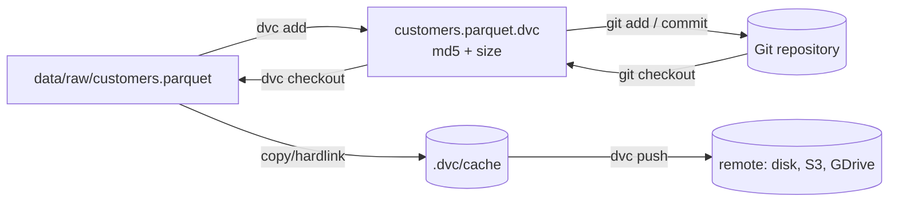
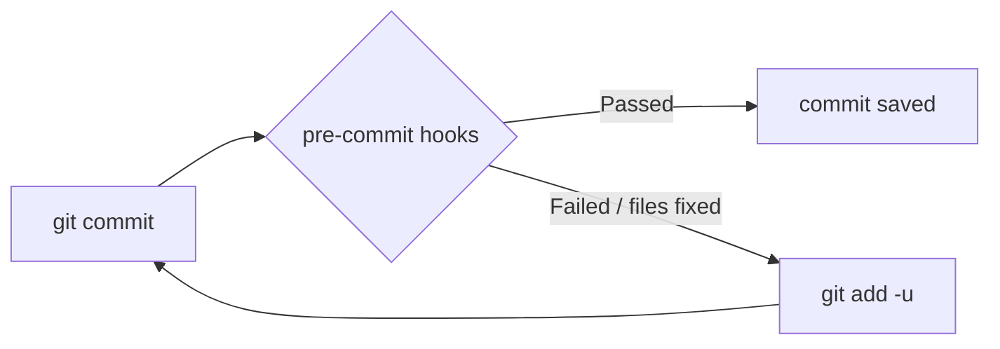

# Lab 1: MLOps Environment and Code Versioning

> ℹ️ **Before you start:** prepare the Ubuntu 24.04 virtual machine according to the guide [00_virtual_machine_setup.md](00_virtual_machine_setup.md). All commands in this lab assume Ubuntu 24.04, Python 3.12 and the `bash` shell.

## General information
- **Duration:** 2 hours
- **Level:** Basic
- **Prerequisites:** Python basics, familiarity with the terminal

## Lab objectives
After this lab the student will:
- set up a local MLOps environment (Python, Git, DVC),
- organize an ML project according to best practices,
- master the basics of code and data versioning,
- configure pre-commit hooks.

## Git, DVC and `params.yaml` — what they are and when to use them

### Git
- **What it is:** a version control system for code and text files.
- **Why:** it lets you track the history of changes, work as a team and safely go back to earlier versions.
- **How and when to use it:** use it daily while working on code (`git add`, `git commit`, `git push`), after each logical chunk of changes.

### DVC
- **What it is:** a tool for versioning data and ML artifacts that works together with Git.
- **Why:** large data/model files do not go directly into Git, but are still versioned and reproducible.
- **How and when to use it:** use it when data, the model or the pipeline change (`dvc add`, `dvc repro`, `dvc push`), especially when experiments need to be repeatable.

### `params.yaml`
- **What it is:** a central configuration file for pipeline and model parameters (e.g. `n_estimators`, `test_size`, list of features).
- **Why:** it separates configuration from code, makes comparing experiments easier and ensures reproducibility.
- **How and when to use it:** edit it before running training/the pipeline (`dvc repro`) whenever you want to change hyperparameters, the data split or the feature set — without modifying the source code.

### How Git and DVC work together

Git stores a **small pointer file** (`*.dvc`, `dvc.lock`) containing the MD5 hash of the data. The data itself goes to the local DVC cache (`.dvc/cache`) and optionally to remote storage (`dvc push`). Thanks to this, a Git commit unambiguously identifies which version of the data and the model corresponds to it.



**Common pitfalls:**
- `.gitignore` must not ignore the entire directory in which the `*.dvc` file lives (e.g. `data/raw/`) — otherwise `dvc add` fails with the error `bad DVC file name ... is git-ignored`. DVC itself adds the correct entries to `data/raw/.gitignore`.
- Metrics with `cache: false` (e.g. `reports/metrics/*.json`) **must** be in Git — otherwise `dvc metrics diff` has nothing to compare against.
- After `git checkout` always run `dvc checkout` — Git changes only the pointer, not the data.

---

## Part 1: Environment setup (30 min)

### Step 1.1: Installing tools

```bash
# Ubuntu 24.04: system packages (without python3-venv the `python3 -m venv` command will not work)
sudo apt update
sudo apt install -y python3-venv python3-pip git curl

# Check the Python version (>= 3.10 required; Ubuntu 24.04 ships 3.12)
python3 --version  # Linux/Mac
# python --version  # Windows

# Create a virtual environment
python3 -m venv mlops-env  # Linux/Mac
# python -m venv mlops-env  # Windows
source mlops-env/bin/activate  # Linux/Mac
# mlops-env\Scripts\activate   # Windows

# Install the basic tools
pip install --upgrade pip

# Option A (recommended): dependencies from the course repository
# pip install -r /path/to/materials-about-MLOps/requirements.txt

# Option B: minimal set for Labs 1–2 (ranges consistent with the course requirements.txt)
pip install \
    "scikit-learn>=1.5,<2.0" \
    "pandas>=2.2,<3.0" \
    "numpy>=1.26,<3.0" \
    "matplotlib>=3.9,<4.0" \
    "pyarrow>=17.0,<19.0" \
    "pyyaml>=6.0,<7.0" \
    "joblib>=1.4,<2.0" \
    "mlflow>=2.15,<3.0" \
    "sqlalchemy<2.1" \
    "dvc>=3.55,<4.0" \
    "pytest>=8.3,<9.0" \
    "ruff>=0.6,<1.0" \
    "pre-commit>=3.8,<4.0"

# Verify the installation
dvc --version && mlflow --version && python -c "import sklearn, pandas, pyarrow; print('OK')"

# Save the project dependencies (exact versions = reproducibility)
pip freeze > requirements.txt
```

> ⚠️ Do not pin old versions such as `numpy==1.26.0` or `scikit-learn==1.4.0` — they have no prebuilt wheels for Python 3.12 or conflict with newer MLflow, so `pip` tries to compile them and fails. Ranges `>=x,<y` are safer. `pyarrow` is needed for `to_parquet()`, and `sqlalchemy<2.1` — because MLflow 2.x does not work with SQLAlchemy 2.1 (error `cannot import name 'FallbackAsyncAdaptedQueuePool'` when running `mlflow server`).

**Why a virtual environment?** Each project has its own library versions; a venv isolates them from the system Python (on Ubuntu 24.04 `pip install` outside a venv is blocked by PEP 668 — error `externally-managed-environment`).

### Step 1.2: ML project structure

Create a directory structure following Cookiecutter Data Science:

```bash
mkdir -p mlops-project/{data/{raw,processed,features},\
models,\
notebooks,\
src/{data,features,models,serving},\
tests/{unit,data,model},\
scripts,\
reports/{figures,metrics},\
configs}

cd mlops-project

# Create the init files
touch src/__init__.py
touch src/data/__init__.py
touch src/features/__init__.py
touch src/models/__init__.py
touch src/serving/__init__.py
touch tests/__init__.py
```

The structure should look like this:

```
mlops-project/
├── data/
│   ├── raw/          # raw data (tracked by DVC)
│   ├── processed/    # processed data
│   └── features/     # ML features
├── models/           # trained models
├── notebooks/        # exploration (Jupyter)
├── src/
│   ├── data/         # data processing scripts
│   ├── features/     # feature engineering
│   ├── models/       # training and evaluation
│   └── serving/      # model serving
├── tests/            # tests
├── scripts/          # helper scripts
├── reports/          # reports and plots
├── configs/          # configurations
├── params.yaml       # model parameters
├── dvc.yaml          # DVC pipeline
├── requirements.txt
└── README.md
```

### Step 1.3: Initializing Git and DVC

```bash
# Initialize Git
git init
git config user.name "Your Name"
git config user.email "your@email.com"

# Create .gitignore
cat > .gitignore << 'EOF'
# Python
__pycache__/
*.py[cod]
*.egg-info/
.venv/
mlops-env/
*.pyc

# Data and models: we do NOT ignore the data/ or models/ directories here —
# DVC itself will add specific files to data/raw/.gitignore, models/.gitignore etc.
# (ignoring the whole data/raw/ blocks committing the customers.parquet.dvc file)

# MLflow
mlruns/
mlartifacts/
mlflow.db

# Jupyter
.ipynb_checkpoints/
*.ipynb

# IDE
.idea/
.vscode/
*.swp

# Reports (we commit the JSON metrics in reports/metrics/ — needed for dvc metrics diff)
reports/figures/

# Environment
.env
*.env
EOF

# Initialize DVC
dvc init

# First commit
git add .
git commit -m "feat: initial project structure"
```

---

## Part 2: Data versioning with DVC (30 min)

### Step 2.1: Generating data and tracking it with DVC

Create the file `scripts/generate_data.py`:

```python
# scripts/generate_data.py
"""Generates sample data for the churn prediction project."""

import pandas as pd
import numpy as np
from pathlib import Path
import argparse

def generate_churn_dataset(
    n_samples: int = 10_000,
    seed: int = 42,
    output_path: str = "data/raw/customers.parquet"
) -> pd.DataFrame:
    """
    Generates a synthetic customer churn dataset.
    
    Args:
        n_samples: number of samples
        seed: random seed
        output_path: output path
    
    Returns:
        DataFrame with customer data
    """
    np.random.seed(seed)
    
    # Demographic features
    age = np.random.normal(40, 12, n_samples).clip(18, 90)
    income = np.random.lognormal(10.8, 0.5, n_samples).clip(15000, 500000)
    
    # Product features
    tenure_months = np.random.exponential(24, n_samples).clip(1, 240).astype(int)
    num_products = np.random.choice([1, 2, 3, 4], n_samples, p=[0.4, 0.35, 0.15, 0.1])
    has_credit_card = np.random.binomial(1, 0.7, n_samples)
    is_active = np.random.binomial(1, 0.8, n_samples)
    
    # Transaction features
    balance = np.random.lognormal(9, 1.5, n_samples) * is_active
    num_transactions_30d = np.random.poisson(15, n_samples) * is_active
    
    # Label (churn) - dependent on the features
    churn_prob = (
        0.05
        + 0.15 * (age > 60)
        + 0.20 * (tenure_months < 6)
        + 0.10 * (num_products == 1)
        - 0.10 * (is_active)
        - 0.05 * (has_credit_card)
        + 0.15 * (balance < 1000)
    ).clip(0.02, 0.95)
    
    churn = np.random.binomial(1, churn_prob, n_samples)
    
    df = pd.DataFrame({
        'customer_id': range(1, n_samples + 1),
        'age': age.round(1),
        'income': income.round(2),
        'tenure_months': tenure_months,
        'num_products': num_products,
        'has_credit_card': has_credit_card,
        'is_active': is_active,
        'balance': balance.round(2),
        'num_transactions_30d': num_transactions_30d,
        'churn': churn
    })
    
    # Save the data
    Path(output_path).parent.mkdir(parents=True, exist_ok=True)
    df.to_parquet(output_path, index=False)
    
    print(f"✅ Generated {n_samples:,} records")
    print(f"   Churn rate: {churn.mean():.2%}")
    print(f"   Saved to: {output_path}")
    
    return df

if __name__ == "__main__":
    parser = argparse.ArgumentParser()
    parser.add_argument("--n-samples", type=int, default=10_000)
    parser.add_argument("--seed", type=int, default=42)
    parser.add_argument("--output", default="data/raw/customers.parquet")
    args = parser.parse_args()
    
    generate_churn_dataset(args.n_samples, args.seed, args.output)
```

```bash
# Generate the data
python scripts/generate_data.py --n-samples 10000

# Add the data to DVC tracking
dvc add data/raw/customers.parquet

# Check what DVC created
cat data/raw/customers.parquet.dvc

# Commit the .dvc file (not the data itself!) and the .gitignore created by DVC
git add data/raw/customers.parquet.dvc data/raw/.gitignore
git commit -m "data: add raw customer dataset v1 (10k samples)"
```

### Step 2.2: Updating and versioning data

```bash
# Generate a new version of the data (more samples)
python scripts/generate_data.py --n-samples 50000 --output data/raw/customers.parquet

# Update DVC tracking
dvc add data/raw/customers.parquet

# Commit the new version
git add data/raw/customers.parquet.dvc
git commit -m "data: update customer dataset to 50k samples"

# Check the history
git log --oneline

# Go back to the previous version of the data
git checkout HEAD~1 -- data/raw/customers.parquet.dvc
dvc checkout data/raw/customers.parquet.dvc
python -c "import pandas as pd; df = pd.read_parquet('data/raw/customers.parquet'); print(f'Rows: {len(df):,}')"
# Expected: Rows: 10,000

# Go back to the latest version
git checkout HEAD -- data/raw/customers.parquet.dvc
dvc checkout data/raw/customers.parquet.dvc
# Expected: Rows: 50,000
```

> 💡 We specify the target explicitly (`dvc checkout <file>.dvc`). A bare `dvc checkout` tries to restore **all** outputs, including those from `dvc.yaml` — when the pipeline has not been run yet, it reports the error `Checkout failed ... Is your cache up to date?`.

---

## Part 3: DVC pipeline (30 min)

### Step 3.1: Data processing script

Create `src/data/preprocess.py`:

```python
# src/data/preprocess.py
"""Processing of raw data."""

import pandas as pd
from pathlib import Path
import argparse
import json
import yaml

def preprocess_data(
    input_path: str,
    output_train: str,
    output_test: str,
    test_size: float = 0.2,
    seed: int = 42
) -> dict:
    """Processes raw data and splits it into train/test."""
    from sklearn.model_selection import train_test_split
    
    print(f"Loading data from {input_path}...")
    df = pd.read_parquet(input_path)
    print(f"  Loaded {len(df):,} rows")
    
    # Cleaning
    initial_size = len(df)
    df = df.drop_duplicates(subset=['customer_id'])
    df = df[df['age'].between(18, 90)]
    df = df[df['income'] > 0]
    removed = initial_size - len(df)
    print(f"  Removed {removed} invalid rows")
    
    # Feature engineering
    df['income_per_age'] = df['income'] / df['age']
    df['balance_per_product'] = df['balance'] / df['num_products']
    df['is_long_tenure'] = (df['tenure_months'] > 24).astype(int)
    
    # Train/test split
    train_df, test_df = train_test_split(
        df, test_size=test_size, random_state=seed, stratify=df['churn']
    )
    
    # Save
    Path(output_train).parent.mkdir(parents=True, exist_ok=True)
    train_df.to_parquet(output_train, index=False)
    test_df.to_parquet(output_test, index=False)
    
    stats = {
        "total_rows": len(df),
        "train_rows": len(train_df),
        "test_rows": len(test_df),
        "churn_rate_train": float(train_df['churn'].mean()),
        "churn_rate_test": float(test_df['churn'].mean()),
        "n_features": df.shape[1] - 2  # without customer_id and churn
    }
    
    print(f"  Train: {stats['train_rows']:,}, Test: {stats['test_rows']:,}")
    print(f"  Churn rate: {stats['churn_rate_train']:.2%}")
    
    return stats

if __name__ == "__main__":
    parser = argparse.ArgumentParser()
    parser.add_argument("--input", default="data/raw/customers.parquet")
    parser.add_argument("--output-train", default="data/processed/train.parquet")
    parser.add_argument("--output-test", default="data/processed/test.parquet")
    parser.add_argument("--params", default="params.yaml")
    args = parser.parse_args()
    
    # We read the parameters from params.yaml — DVC tracks data.test_size and data.seed,
    # so changing them must actually affect the stage's output
    with open(args.params) as f:
        data_params = yaml.safe_load(f).get("data", {})
    
    stats = preprocess_data(
        args.input, args.output_train, args.output_test,
        test_size=data_params.get("test_size", 0.2),
        seed=data_params.get("seed", 42),
    )
    
    # Save the statistics
    Path("reports/metrics").mkdir(parents=True, exist_ok=True)
    with open("reports/metrics/data_stats.json", "w") as f:
        json.dump(stats, f, indent=2)
    print("Statistics saved to reports/metrics/data_stats.json")
```

### Step 3.2: Training script

Create `src/models/train.py`:

```python
# src/models/train.py
"""Training of the churn prediction model."""

import pandas as pd
import joblib
import json
import yaml
import argparse
from pathlib import Path
from sklearn.ensemble import RandomForestClassifier
from sklearn.preprocessing import StandardScaler
from sklearn.pipeline import Pipeline
from sklearn.metrics import roc_auc_score, f1_score, accuracy_score

def train_model(
    train_path: str,
    model_path: str,
    params_path: str = "params.yaml"
) -> dict:
    """Trains the model and saves the artifacts."""
    
    # Load parameters
    with open(params_path) as f:
        params = yaml.safe_load(f)
    
    model_params = params.get('model', {})
    feature_cols = params.get('features', [
        'age', 'income', 'tenure_months', 'num_products',
        'has_credit_card', 'is_active', 'balance',
        'num_transactions_30d', 'income_per_age',
        'balance_per_product', 'is_long_tenure'
    ])
    
    # Load data
    train_df = pd.read_parquet(train_path)
    X_train = train_df[feature_cols]
    y_train = train_df['churn']
    
    print(f"Training on {len(X_train):,} samples, {len(feature_cols)} features")
    
    # Build the pipeline
    pipeline = Pipeline([
        ('scaler', StandardScaler()),
        ('model', RandomForestClassifier(
            n_estimators=model_params.get('n_estimators', 100),
            max_depth=model_params.get('max_depth', 8),
            min_samples_split=model_params.get('min_samples_split', 10),
            random_state=model_params.get('random_state', 42),
            n_jobs=-1
        ))
    ])
    
    pipeline.fit(X_train, y_train)
    
    # Evaluation on the training set
    y_pred = pipeline.predict(X_train)
    y_prob = pipeline.predict_proba(X_train)[:, 1]
    
    metrics = {
        "train_auc": float(roc_auc_score(y_train, y_prob)),
        "train_f1": float(f1_score(y_train, y_pred)),
        "train_accuracy": float(accuracy_score(y_train, y_pred)),
        "n_estimators": model_params.get('n_estimators', 100),
        "max_depth": model_params.get('max_depth', 8)
    }
    
    print(f"  Train AUC: {metrics['train_auc']:.4f}")
    
    # Save the model
    Path(model_path).parent.mkdir(parents=True, exist_ok=True)
    joblib.dump(pipeline, model_path)
    print(f"  Model saved: {model_path}")
    
    return metrics

if __name__ == "__main__":
    parser = argparse.ArgumentParser()
    parser.add_argument("--train-data", default="data/processed/train.parquet")
    parser.add_argument("--model-output", default="models/churn_model.pkl")
    args = parser.parse_args()
    
    metrics = train_model(args.train_data, args.model_output)
    
    Path("reports/metrics").mkdir(parents=True, exist_ok=True)
    with open("reports/metrics/train_metrics.json", "w") as f:
        json.dump(metrics, f, indent=2)
```

### Step 3.3: Parameters file and DVC pipeline

```yaml
# params.yaml
model:
  n_estimators: 100
  max_depth: 8
  min_samples_split: 10
  random_state: 42

data:
  test_size: 0.2
  seed: 42

features:
  - age
  - income
  - tenure_months
  - num_products
  - has_credit_card
  - is_active
  - balance
  - num_transactions_30d
  - income_per_age
  - balance_per_product
  - is_long_tenure
```

```yaml
# dvc.yaml
stages:
  preprocess:
    cmd: python src/data/preprocess.py
    deps:
      - src/data/preprocess.py
      - data/raw/customers.parquet
    params:
      - params.yaml:
          - data.test_size
          - data.seed
    outs:
      - data/processed/train.parquet
      - data/processed/test.parquet
    metrics:
      - reports/metrics/data_stats.json:
          cache: false

  train:
    cmd: python src/models/train.py
    deps:
      - src/models/train.py
      - data/processed/train.parquet
    params:
      - params.yaml:
          - model
          - features
    outs:
      - models/churn_model.pkl
    metrics:
      - reports/metrics/train_metrics.json:
          cache: false
```

```bash
# Run the whole pipeline
dvc repro

# View the dependency graph
dvc dag

# Commit the pipeline state (dvc.lock = a "receipt" with hashes of inputs/outputs)
git add dvc.yaml dvc.lock params.yaml data/processed/.gitignore models/.gitignore \
        reports/metrics/ src/ scripts/
git commit -m "feat: add DVC pipeline"

# Check the pipeline status (should be: Data and pipelines are up to date.)
dvc status

# Change a parameter and compare metrics with the previous commit
sed -i 's/n_estimators: 100/n_estimators: 200/' params.yaml
dvc repro
dvc params diff
dvc metrics show
dvc metrics diff HEAD
```

Pipeline graph (`dvc dag`):

```
+-------------------------------+
| data/raw/customers.parquet.dvc|
+-------------------------------+
                *
         +------------+
         | preprocess |   <- params: data.test_size, data.seed
         +------------+
                *
           +-------+
           | train |      <- params: model, features
           +-------+
```

> 💡 DVC runs a stage only when the hash of one of its `deps` has changed, a tracked parameter has changed, or `outs` are missing. That is why every parameter used in the script should be declared in `params:` — otherwise a change in `params.yaml` will not trigger recomputation.

---

## Part 4: Pre-commit hooks (30 min)

### Step 4.1: Configuring pre-commit

```yaml
# .pre-commit-config.yaml
repos:
  - repo: https://github.com/pre-commit/pre-commit-hooks
    rev: v5.0.0
    hooks:
      - id: trailing-whitespace
      - id: end-of-file-fixer
      - id: check-yaml
      - id: check-json
      - id: check-merge-conflict
      - id: check-added-large-files
        args: ['--maxkb=5000']

  - repo: https://github.com/astral-sh/ruff-pre-commit
    rev: v0.6.9
    hooks:
      - id: ruff
        args: [--fix, --exit-non-zero-on-fix]
      - id: ruff-format
```

```bash
# Install the hooks
pre-commit install

# Test on all files (the first run downloads hooks from GitHub — requires internet)
pre-commit run --all-files

# Auto-fixing hooks (ruff --fix, ruff-format, end-of-file-fixer) modify files
# and report "Failed" — this is normal. Add the fixed files and run again:
git add -u
pre-commit run --all-files   # now everything should be "Passed"

# Commit the configuration
git add .pre-commit-config.yaml
git commit -m "chore: add pre-commit hooks"
```

> 💡 If `end-of-file-fixer` fixes files in `reports/metrics/`, DVC will consider the metrics changed. In that case run `dvc repro` / `dvc commit` or add `exclude: ^reports/metrics/` to that hook. You update the `rev` versions with the `pre-commit autoupdate` command.

**How pre-commit works:** on `git commit`, Git calls the `.git/hooks/pre-commit` script, which runs the defined tools only on the staged files. If any of them returns an error, the commit is aborted — formatting errors do not get into the repository.



### Step 4.2: Unit tests

Create `tests/unit/test_preprocess.py`:

```python
# tests/unit/test_preprocess.py
import pytest
import pandas as pd
import numpy as np
import sys
from pathlib import Path

sys.path.insert(0, str(Path(__file__).parent.parent.parent))

class TestPreprocessing:
    
    @pytest.fixture
    def raw_data(self, tmp_path):
        """Creates sample raw data."""
        df = pd.DataFrame({
            'customer_id': range(1, 101),
            'age': np.random.uniform(18, 80, 100),
            'income': np.random.uniform(20000, 100000, 100),
            'tenure_months': np.random.randint(1, 120, 100),
            'num_products': np.random.randint(1, 5, 100),
            'has_credit_card': np.random.randint(0, 2, 100),
            'is_active': np.random.randint(0, 2, 100),
            'balance': np.random.uniform(0, 50000, 100),
            'num_transactions_30d': np.random.randint(0, 50, 100),
            'churn': np.random.randint(0, 2, 100)
        })
        path = tmp_path / "raw.parquet"
        df.to_parquet(path)
        return str(path)
    
    def test_preprocess_creates_output_files(self, raw_data, tmp_path):
        """Test: preprocess creates the train and test files."""
        from src.data.preprocess import preprocess_data
        
        train_path = str(tmp_path / "train.parquet")
        test_path = str(tmp_path / "test.parquet")
        
        preprocess_data(raw_data, train_path, test_path)
        
        assert Path(train_path).exists()
        assert Path(test_path).exists()
    
    def test_preprocess_correct_split_ratio(self, raw_data, tmp_path):
        """Test: the train/test split is correct."""
        from src.data.preprocess import preprocess_data
        
        train_path = str(tmp_path / "train.parquet")
        test_path = str(tmp_path / "test.parquet")
        
        preprocess_data(raw_data, train_path, test_path, test_size=0.2)
        
        train_df = pd.read_parquet(train_path)
        test_df = pd.read_parquet(test_path)
        
        total = len(train_df) + len(test_df)
        test_ratio = len(test_df) / total
        
        assert abs(test_ratio - 0.2) < 0.05  # 5% tolerance
    
    def test_preprocess_adds_engineered_features(self, raw_data, tmp_path):
        """Test: preprocess adds new features."""
        from src.data.preprocess import preprocess_data
        
        train_path = str(tmp_path / "train.parquet")
        test_path = str(tmp_path / "test.parquet")
        
        preprocess_data(raw_data, train_path, test_path)
        
        train_df = pd.read_parquet(train_path)
        
        assert 'income_per_age' in train_df.columns
        assert 'balance_per_product' in train_df.columns
        assert 'is_long_tenure' in train_df.columns

# Running the tests
# pytest tests/unit/test_preprocess.py -v
```

```bash
# Run the tests
pytest tests/ -v

# Commit the tests
git add tests/
git commit -m "test: add unit tests for preprocessing"
```

## Cheat sheet: basic Git commands

| Command | What it does |
|---------|---------|
| `git init` | Initializes a new Git repository in the current directory. |
| `git status` | Shows the repository state and the list of modified files. |
| `git add <file>` | Adds a file to the staging area before a commit. |
| `git add .` | Adds all current changes to staging. |
| `git commit -m "..."` | Records the staged changes in the repository history. |
| `git log --oneline` | Shows a condensed commit history. |
| `git diff` | Shows differences in files not yet staged for commit. |
| `git diff --staged` | Shows differences for changes added to staging. |
| `git branch` | Lists branches. |
| `git checkout <branch>` | Switches to the specified branch. |
| `git pull` | Fetches and merges changes from the remote repository. |
| `git push` | Sends local commits to the remote repository. |

## Cheat sheet: basic DVC commands

| Command | What it does |
|---------|---------|
| `dvc init` | Initializes DVC in a Git repository. |
| `dvc add <file_or_directory>` | Starts tracking data outside Git and creates a `.dvc` file. |
| `dvc status` | Shows which data or pipeline stages are out of date. |
| `dvc repro` | Runs the stages from `dvc.yaml` that need to be recomputed. |
| `dvc dag` | Displays the DVC pipeline dependency graph. |
| `dvc metrics show` | Shows the current metrics saved by the pipeline. |
| `dvc metrics diff` | Compares metrics between Git revisions. |
| `dvc remote add -d <name> <url>` | Adds and sets the default remote data storage. |
| `dvc push` | Uploads versioned data to remote storage. |
| `dvc pull` | Downloads versioned data from remote storage. |
| `dvc checkout` | Restores the data version matching the current Git commit. |
| `dvc gc` | Removes unused data from the local DVC cache. |

---

## Common problems and solutions

| Problem | Cause | Solution |
|---------|-----------|-------------|
| `dvc add` reports an error | DVC is not initialized | Run `dvc init` in the directory containing the Git repository |
| `bad DVC file name '...dvc' is git-ignored` | `.gitignore` ignores the entire directory (e.g. `data/raw/`) | Remove that entry — DVC itself will add the data file to `data/raw/.gitignore` |
| `The virtual environment was not created successfully because ensurepip is not available` | The `python3-venv` package is missing on Ubuntu | `sudo apt install -y python3-venv` |
| `error: externally-managed-environment` | `pip install` outside a venv (PEP 668, Ubuntu 24.04) | Activate the venv: `source mlops-env/bin/activate` |
| `ImportError: Unable to find a usable engine ... pyarrow` | Missing Parquet library | `pip install "pyarrow>=17,<19"` |
| `pip` compiles numpy/scikit-learn and fails | Pinned old versions without wheels for Python 3.12 | Use the ranges from the course `requirements.txt` |
| `dvc checkout` → `Checkout failed ... Is your cache up to date?` | The stages from `dvc.yaml` have not been run yet | `dvc checkout <file>.dvc` or run `dvc repro` first |
| `dvc metrics diff` shows nothing | Metrics ignored by Git or not committed | Remove `reports/metrics/` from `.gitignore`, commit the JSON files and `dvc.lock` |
| `pre-commit run` hangs / connection error | No internet in the VM (NAT/proxy) | Check `ping github.com`; set the VirtualBox network adapter to NAT |
| Training is very slow / the VM freezes | Too little RAM/CPU assigned to the VM | Assign ≥ 4 GB RAM and ≥ 2 vCPU; alternatively generate less data (`--n-samples 10000`) |
| Files in a VirtualBox shared folder: `git`/`dvc` errors (symlinks, permissions) | The `vboxsf` file system | Keep the project in the VM home directory (`~/mlops-project`), not in `/media/sf_*` |
| `dvc repro` skips all steps | None of the dependencies changed | Change a parameter in `params.yaml` or the input data |
| `pre-commit` does not work | Hooks are not installed | Run `pre-commit install` |
| `ModuleNotFoundError` in tests | The module path is not in PYTHONPATH | Add `sys.path.insert(0, ...)` or install the package in editable mode (`pip install -e .`) |
| `pip install` takes a very long time | No pip cache | Use `pip install --cache-dir .pip-cache` |
| Git commits data files | The file is not tracked by DVC (no entry in `data/raw/.gitignore`) | Use `dvc add <file>` (or declare it in `outs` in `dvc.yaml`) — DVC will add the entry to `.gitignore`; if the file is already in Git: `git rm --cached <file>` |

> 💡 **Tip:** If `dvc repro` does not detect changes in the data, check whether the `.dvc` file is up to date (`dvc status`). DVC tracks changes based on the MD5 hash of the files.

> 💡 **Tip:** Use `dvc dag` to visualize the pipeline dependency graph — it helps you understand which steps will be run.

---

## Exercises

1. **Extend the DVC pipeline** with a model evaluation step on the test set. Add a new `evaluate` stage in `dvc.yaml`.
2. **Add the parameter** `min_samples_leaf` to `params.yaml` and use it in training. Run `dvc repro` and check whether the metrics changed.
3. **Write a test** verifying that `income_per_age` is computed correctly (value = income / age).
4. **Compare metrics** between two model versions (change `n_estimators` and run `dvc repro`, then `dvc metrics diff`).
5. **Add DVC remote storage** (e.g. local: `dvc remote add -d myremote /tmp/dvc-storage`) and test `dvc push` / `dvc pull`.

## Review questions

1. What is the difference between `git add` and `dvc add`?
2. What does a `.dvc` file store and why is it important?
3. Why don't we commit data files directly to Git?
4. What does `dvc repro` do and when does it skip steps?
5. Why is it worth using the Cookiecutter Data Science directory structure?

## Summary

In this lab:
- ✅ You set up an MLOps environment with Git and DVC
- ✅ You organized the project according to best practices (Cookiecutter Data Science)
- ✅ You version data with DVC (adding, updating, switching versions)
- ✅ You defined a reproducible DVC pipeline with parameters and metrics
- ✅ You configured pre-commit hooks and unit tests
