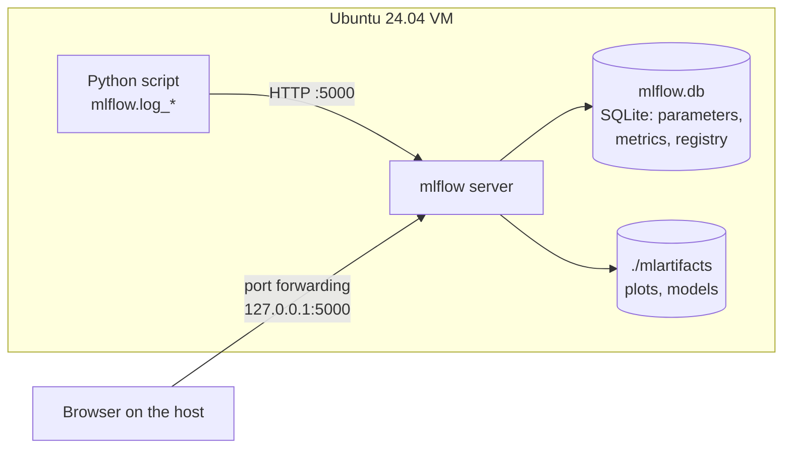
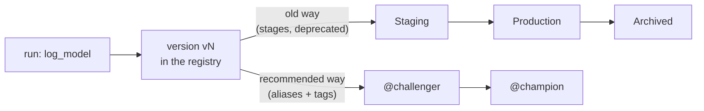

# Lab 2: Experiment Tracking with MLflow

> ℹ️ **Before you start:** prepare an Ubuntu 24.04 virtual machine following [00_virtual_machine_setup.md](00_virtual_machine_setup.md) and complete [Lab 1](lab_01_environment_and_git.md) (you need the `data/processed/train.parquet` and `test.parquet` files created by `dvc repro`). The examples were tested with MLflow 2.x (`mlflow>=2.15,<3.0` from `requirements.txt`).

## General information
- **Duration:** 2 hours
- **Level:** Basic–Intermediate
- **Prerequisites:** Lab 1 completed, scikit-learn basics

## Lab objectives
After this lab the student will:
- start a local MLflow server and configure tracking,
- log parameters, metrics and artifacts to MLflow,
- compare experiments in the MLflow UI,
- register a model in the MLflow Model Registry.

## Theory: why track experiments?

Without a tracking tool, experiment results end up in notes, file names (`model_final_v2_NEW.pkl`) and the author's memory. MLflow Tracking records for every run **what** was trained, **with which parameters**, **on which data** and **with what result** — so the experiment can be compared and reproduced.

| Concept | Meaning | Example |
|--------|-----------|----------|
| **Experiment** | A group of related runs (one business problem) | `churn-prediction` |
| **Run** | A single execution of training code | `RF-deep` |
| **Parameter** | An input value, logged once (string) | `max_depth=10` |
| **Metric** | A numeric value, may have a history (`step`) | `auc_roc=0.79` |
| **Tag** | Any label used for filtering | `model_type=tree` |
| **Artifact** | An output file: plot, JSON, model | `plots/roc_curve.png` |
| **Registered Model** | A named model in the registry with numbered versions | `churn-randomforestclassifier` v3 |
| **Alias** | A movable label pointing to a model version | `@champion` → v3 |

Architecture used in the lab:



- **Backend store** (SQLite/PostgreSQL) stores metadata. The Model Registry requires a database backend — hence `sqlite:///mlflow.db` rather than a file directory.
- **Artifact store** stores files. With the `--artifacts-destination` option the client uploads artifacts **through the server** (HTTP proxy), so it does not need access to the server's disk.

**Pitfalls:**
- A parameter cannot be overwritten with a different value in the same run (`MlflowException: Changing param values is not allowed`).
- A test-set metric stops being objective after many "peeks" — use CV on the training set for model selection.
- With imbalanced classes (here ~10% churn) high `accuracy` means nothing, and `F1`/`recall` at a 0.5 threshold are often close to 0 — look at `auc_roc` and `precision`/`recall`.

---

## Part 1: Starting MLflow (20 min)

### Step 1.1: Starting the MLflow server

```bash
# Activate the environment
source mlops-env/bin/activate  # Linux/Mac
# mlops-env\Scripts\activate   # Windows
cd mlops-project

# Start the MLflow UI in a SEPARATE terminal (keep it open; Ctrl+C stops the server)
mlflow server \
    --backend-store-uri sqlite:///mlflow.db \
    --artifacts-destination ./mlartifacts \
    --host 0.0.0.0 \
    --port 5000

# In a second terminal: check that it works (expected response: OK)
curl http://localhost:5000/health
# Open in the browser: http://localhost:5000
```

> 💡 `--host 0.0.0.0` means listening on all network interfaces of the VM — it is needed so that the UI is reachable from a browser on the host computer. With the default `127.0.0.1` the server is visible only inside the VM. Do not expose the server like this on a public network — MLflow has no authentication by default.

**Access from the host (VirtualBox, NAT network adapter):** *VM Settings → Network → Adapter 1 (NAT) → Advanced → Port Forwarding* and add a rule: protocol TCP, host port `5000`, guest port `5000` (IP can be left empty). Or from the host terminal (VM powered off):

```bash
VBoxManage modifyvm "VM-name" --natpf1 "mlflow,tcp,,5000,,5000"
```

Then open `http://localhost:5000` on the host. If port 5000 is busy (e.g. on macOS by AirPlay Receiver), use `--port 5001` and the same forwarding. If the `ufw` firewall is active in the VM: `sudo ufw allow 5000/tcp`.

### Step 1.2: Configuring the MLflow client

The server address can be given in code (`mlflow.set_tracking_uri`) or via an environment variable — the latter lets you run the same code locally and in CI without changes:

```bash
export MLFLOW_TRACKING_URI=http://localhost:5000
```

Helper function (optional — the scripts below set the URI themselves):

```python
# configs/mlflow_config.py
import mlflow

def setup_mlflow(
    tracking_uri: str = "http://localhost:5000",
    experiment_name: str = "churn-prediction"
) -> str:
    """Configures MLflow and returns the experiment ID."""
    mlflow.set_tracking_uri(tracking_uri)
    
    # Create or get the experiment
    experiment = mlflow.get_experiment_by_name(experiment_name)
    if experiment is None:
        experiment_id = mlflow.create_experiment(
            experiment_name,
            tags={
                "project": "churn-prediction",
                "team": "mlops-lab",
                "version": "1.0"
            }
        )
        print(f"Created experiment: {experiment_name} (ID: {experiment_id})")
    else:
        experiment_id = experiment.experiment_id
        print(f"Using experiment: {experiment_name} (ID: {experiment_id})")
    
    mlflow.set_experiment(experiment_name)
    return experiment_id
```

---

## Part 2: Logging experiments (40 min)

### Step 2.1: Basic experiment

Create `src/models/experiment.py`:

```python
# src/models/experiment.py
"""ML experiments with full logging to MLflow."""

import os
import mlflow
import mlflow.sklearn
import pandas as pd
import numpy as np
import json
import time
import tempfile
import matplotlib
matplotlib.use("Agg")  # save plots to files without a window (also works over SSH)
import matplotlib.pyplot as plt
from pathlib import Path
from sklearn.preprocessing import StandardScaler
from sklearn.pipeline import Pipeline
from sklearn.model_selection import cross_val_score
from sklearn.metrics import (
    roc_auc_score, f1_score, accuracy_score,
    precision_score, recall_score,
    RocCurveDisplay, ConfusionMatrixDisplay
)

# MLflow configuration (the MLFLOW_TRACKING_URI variable takes precedence)
mlflow.set_tracking_uri(os.getenv("MLFLOW_TRACKING_URI", "http://localhost:5000"))
mlflow.set_experiment("churn-prediction")

FEATURE_COLS = [
    'age', 'income', 'tenure_months', 'num_products',
    'has_credit_card', 'is_active', 'balance',
    'num_transactions_30d', 'income_per_age',
    'balance_per_product', 'is_long_tenure'
]

def load_data(train_path: str, test_path: str):
    """Loads training and test data."""
    train_df = pd.read_parquet(train_path)
    test_df = pd.read_parquet(test_path)
    
    X_train = train_df[FEATURE_COLS]
    y_train = train_df['churn']
    X_test = test_df[FEATURE_COLS]
    y_test = test_df['churn']
    
    return X_train, X_test, y_train, y_test

def compute_metrics(model, X_test, y_test) -> dict:
    """Computes a complete set of metrics."""
    y_pred = model.predict(X_test)
    y_prob = model.predict_proba(X_test)[:, 1]
    
    return {
        "auc_roc": float(roc_auc_score(y_test, y_prob)),
        # zero_division=0: no warning when the model predicts no churn at all
        "f1_score": float(f1_score(y_test, y_pred, zero_division=0)),
        "accuracy": float(accuracy_score(y_test, y_pred)),
        "precision": float(precision_score(y_test, y_pred, zero_division=0)),
        "recall": float(recall_score(y_test, y_pred, zero_division=0)),
    }

def plot_roc_curve(model, X_test, y_test, save_path: str):
    """Draws and saves the ROC curve."""
    fig, ax = plt.subplots(figsize=(8, 6))
    RocCurveDisplay.from_estimator(model, X_test, y_test, ax=ax)
    ax.set_title("ROC Curve – Churn Prediction")
    plt.tight_layout()
    plt.savefig(save_path, dpi=100, bbox_inches='tight')
    plt.close()

def plot_confusion_matrix(model, X_test, y_test, save_path: str):
    """Draws and saves the confusion matrix."""
    fig, ax = plt.subplots(figsize=(6, 5))
    ConfusionMatrixDisplay.from_estimator(
        model, X_test, y_test,
        display_labels=['No churn', 'Churn'],
        ax=ax
    )
    ax.set_title("Confusion matrix")
    plt.tight_layout()
    plt.savefig(save_path, dpi=100, bbox_inches='tight')
    plt.close()


def run_experiment(
    model_class,
    model_params: dict,
    run_name: str,
    X_train, X_test, y_train, y_test,
    tags: dict = None
) -> tuple[str, dict]:
    """
    Runs a single experiment and logs everything to MLflow.
    
    Returns:
        (run_id, metrics)
    """
    with mlflow.start_run(run_name=run_name, tags=tags or {}) as run:
        run_id = run.info.run_id
        
        # --- Logging parameters ---
        mlflow.log_params(model_params)
        mlflow.log_param("model_class", model_class.__name__)
        mlflow.log_param("n_train_samples", len(X_train))
        mlflow.log_param("n_test_samples", len(X_test))
        mlflow.log_param("n_features", X_train.shape[1])
        mlflow.log_param("churn_rate_train", float(y_train.mean()))
        
        # --- Training ---
        t0 = time.time()
        pipeline = Pipeline([
            ('scaler', StandardScaler()),
            ('model', model_class(**model_params, random_state=42))
        ])
        pipeline.fit(X_train, y_train)
        train_time = time.time() - t0
        
        mlflow.log_metric("training_time_seconds", train_time)
        
        # --- Evaluation ---
        metrics = compute_metrics(pipeline, X_test, y_test)
        mlflow.log_metrics(metrics)
        
        # --- Cross-validation ---
        cv_scores = cross_val_score(
            pipeline, X_train, y_train, cv=5, scoring='roc_auc', n_jobs=-1
        )
        mlflow.log_metric("cv_auc_mean", float(cv_scores.mean()))
        mlflow.log_metric("cv_auc_std", float(cv_scores.std()))
        
        # --- Plots as artifacts (a separate temporary directory for each run) ---
        art_dir = Path(tempfile.mkdtemp(prefix="mlflow_artifacts_"))
        
        plot_roc_curve(pipeline, X_test, y_test, str(art_dir / "roc_curve.png"))
        plot_confusion_matrix(pipeline, X_test, y_test, str(art_dir / "confusion_matrix.png"))
        
        mlflow.log_artifact(str(art_dir / "roc_curve.png"), "plots")
        mlflow.log_artifact(str(art_dir / "confusion_matrix.png"), "plots")
        
        # --- Feature importance (for tree-based models) ---
        model = pipeline.named_steps['model']
        if hasattr(model, 'feature_importances_'):
            importances = model.feature_importances_
            fi_dict = dict(zip(FEATURE_COLS, importances.tolist()))
            
            # Save as JSON (file-less alternative: mlflow.log_dict(fi_dict, "feature_importance.json"))
            with open(art_dir / "feature_importance.json", "w") as f:
                json.dump(fi_dict, f, indent=2)
            mlflow.log_artifact(str(art_dir / "feature_importance.json"))
            
            # Plot
            fig, ax = plt.subplots(figsize=(10, 6))
            sorted_idx = np.argsort(importances)[::-1]
            ax.bar(range(len(FEATURE_COLS)), importances[sorted_idx])
            ax.set_xticks(range(len(FEATURE_COLS)))
            ax.set_xticklabels([FEATURE_COLS[i] for i in sorted_idx], rotation=45, ha='right')
            ax.set_title(f"Feature Importance – {model_class.__name__}")
            plt.tight_layout()
            plt.savefig(art_dir / "feature_importance.png", dpi=100)
            plt.close()
            mlflow.log_artifact(str(art_dir / "feature_importance.png"), "plots")
        
        # --- Logging the model ---
        # input_example lets MLflow infer the signature (input/output schema)
        mlflow.sklearn.log_model(
            pipeline,
            artifact_path="model",
            input_example=X_train.head(5),
            registered_model_name=f"churn-{model_class.__name__.lower()}"
        )
        
        print(f"✅ {run_name}: AUC={metrics['auc_roc']:.4f}, F1={metrics['f1_score']:.4f}")
        print(f"   Run ID: {run_id}")
        
        return run_id, metrics
```

### Step 2.2: Running multiple experiments

```python
# scripts/run_experiments.py
"""Runs a series of experiments and compares the results."""

import sys
sys.path.insert(0, '.')

import pandas as pd
from sklearn.ensemble import RandomForestClassifier, GradientBoostingClassifier
from sklearn.linear_model import LogisticRegression

from src.models.experiment import load_data, run_experiment

# Load the data
X_train, X_test, y_train, y_test = load_data(
    "data/processed/train.parquet",
    "data/processed/test.parquet"
)

# Experiment definitions
experiments = [
    # Baseline: logistic regression
    (LogisticRegression, {"C": 1.0, "max_iter": 1000}, "LR-baseline",
     {"model_type": "linear", "purpose": "baseline"}),
    
    # Random Forest – different depths
    (RandomForestClassifier, {"n_estimators": 100, "max_depth": 5}, "RF-shallow",
     {"model_type": "tree", "purpose": "experiment"}),
    
    (RandomForestClassifier, {"n_estimators": 100, "max_depth": 10}, "RF-medium",
     {"model_type": "tree", "purpose": "experiment"}),
    
    (RandomForestClassifier, {"n_estimators": 200, "max_depth": 15}, "RF-deep",
     {"model_type": "tree", "purpose": "experiment"}),
    
    # Gradient Boosting
    (GradientBoostingClassifier, {"n_estimators": 100, "learning_rate": 0.1, "max_depth": 4},
     "GBM-default", {"model_type": "boosting", "purpose": "experiment"}),
    
    (GradientBoostingClassifier, {"n_estimators": 200, "learning_rate": 0.05, "max_depth": 5},
     "GBM-tuned", {"model_type": "boosting", "purpose": "experiment"}),
]

# Run the experiments
results = []
for model_class, params, name, tags in experiments:
    run_id, metrics = run_experiment(
        model_class, params, name,
        X_train, X_test, y_train, y_test,
        tags=tags
    )
    results.append({"name": name, "run_id": run_id, **metrics})

# Summary
results_df = pd.DataFrame(results).sort_values("auc_roc", ascending=False)
print("\n=== Experiment ranking ===")
print(results_df[["name", "auc_roc", "f1_score", "precision", "recall"]].to_string(index=False))
print(f"\nBest model: {results_df.iloc[0]['name']} (AUC={results_df.iloc[0]['auc_roc']:.4f})")
```

```bash
# Run the experiments (from the mlops-project directory; the MLflow server must be running)
python scripts/run_experiments.py

# Open the MLflow UI and compare the results
# http://localhost:5000
```

> ⏱️ On a VM with 2 vCPUs and 50k rows the whole thing (6 models × training + 5-fold CV) takes a few minutes; `GBM-tuned` takes the longest. To speed it up, generate a smaller dataset in Lab 1 or reduce `cv=5` to `cv=3`.

> ℹ️ Results for the synthetic data from Lab 1: AUC approx. 0.74 (LR) and approx. 0.79–0.80 (RF/GBM). `F1` and `recall` are very low (sometimes 0.0), because with ~10% churn the models rarely exceed the 0.5 threshold — a good starting point for a discussion about the decision threshold and `class_weight="balanced"`.

---

## Part 3: MLflow Model Registry (30 min)

### Step 3.1: Registering and managing models

Every call to `log_model(..., registered_model_name=...)` creates a new **version** of the model in the registry (v1, v2, ...). The version lifecycle can be described in two ways:



> ⚠️ **Stages are deprecated** since MLflow 2.9: `transition_model_version_stage` and `get_latest_versions` work in MLflow 2.x, but emit a `FutureWarning` and will be removed in a future version. The script below shows the classic Staging → Production flow (common in existing projects), and Step 3.2 shows the recommended variant with aliases.

```python
# scripts/manage_registry.py
"""Managing models in the MLflow Model Registry."""

import mlflow
from mlflow.tracking import MlflowClient

mlflow.set_tracking_uri("http://localhost:5000")
client = MlflowClient()

MODEL_NAME = "churn-randomforestclassifier"

def list_registered_models():
    """Displays all registered models and their versions."""
    print("\n=== Registered models ===")
    for rm in client.search_registered_models():
        print(f"\nModel: {rm.name}")
        for mv in client.search_model_versions(f"name='{rm.name}'"):
            print(f"  v{mv.version} | stage={mv.current_stage} | run={mv.run_id[:8]}...")

def promote_best_model(model_name: str, min_auc: float = 0.80):
    """Promotes the best model to Staging."""
    
    # Find all versions of the model
    versions = client.search_model_versions(f"name='{model_name}'")
    
    best_version = None
    best_auc = 0
    
    for mv in versions:
        run = client.get_run(mv.run_id)
        auc = run.data.metrics.get("auc_roc", 0)
        
        if auc > best_auc and auc >= min_auc:
            best_auc = auc
            best_version = mv.version
    
    if best_version is None:
        print(f"❌ No model with AUC >= {min_auc}")
        return None
    
    # Move to Staging
    client.transition_model_version_stage(
        name=model_name,
        version=best_version,
        stage="Staging",
        archive_existing_versions=False
    )
    
    # Add a description
    client.update_model_version(
        name=model_name,
        version=best_version,
        description=f"Best model. AUC={best_auc:.4f}. Promoted automatically."
    )
    
    print(f"✅ Model v{best_version} promoted to Staging (AUC={best_auc:.4f})")
    return best_version

def promote_to_production(model_name: str, version: str):
    """Promotes a model from Staging to Production."""
    
    # Archive the previous production model
    prod_versions = client.get_latest_versions(model_name, stages=["Production"])
    for pv in prod_versions:
        client.transition_model_version_stage(
            name=model_name,
            version=pv.version,
            stage="Archived"
        )
        print(f"📦 Archived v{pv.version}")
    
    # Promote the new model
    client.transition_model_version_stage(
        name=model_name,
        version=version,
        stage="Production"
    )
    print(f"🚀 Model v{version} deployed to Production!")

def load_production_model(model_name: str):
    """Loads the current production model."""
    model_uri = f"models:/{model_name}/Production"
    model = mlflow.sklearn.load_model(model_uri)
    print(f"✅ Loaded production model: {model_uri}")
    return model

# Execution
list_registered_models()

staging_version = promote_best_model(MODEL_NAME, min_auc=0.75)

if staging_version:
    # Simulating tests before deployment
    print("\nRunning integration tests...")
    # ... tests ...
    print("✅ Tests passed successfully")
    
    promote_to_production(MODEL_NAME, staging_version)
    
    # Load the production model
    prod_model = load_production_model(MODEL_NAME)
    print(f"Model loaded: {type(prod_model)}")
```

```bash
python scripts/manage_registry.py
```

### Step 3.2: Recommended variant — aliases and tags

An alias is a named, movable label (e.g. `champion`) pointing to a specific version. The serving code always loads `models:/<name>@champion`, and "deploying" a new version means moving the alias — with no code changes.

```python
# scripts/registry_aliases.py
"""Managing model versions with aliases (MLflow >= 2.9)."""

import mlflow
from mlflow import MlflowClient

mlflow.set_tracking_uri("http://localhost:5000")
client = MlflowClient()

MODEL_NAME = "churn-randomforestclassifier"

# Choose the version with the highest AUC
versions = client.search_model_versions(f"name='{MODEL_NAME}'")
best = max(versions, key=lambda mv: client.get_run(mv.run_id).data.metrics.get("auc_roc", 0))

# Tag the version and set the "champion" alias (the alias's previous target is replaced)
client.set_model_version_tag(MODEL_NAME, best.version, "validation_status", "approved")
client.set_registered_model_alias(MODEL_NAME, "champion", best.version)

mv = client.get_model_version_by_alias(MODEL_NAME, "champion")
print(f"@champion -> v{mv.version}, tags: {mv.tags}")

# Loading the model by alias — without knowing the version number or path
model = mlflow.sklearn.load_model(f"models:/{MODEL_NAME}@champion")
print(f"Loaded: {type(model).__name__}")
```

```bash
python scripts/registry_aliases.py
```

---

## Part 4: Comparing experiments (30 min)

### Step 4.1: Programmatic comparison via the API

```python
# scripts/compare_experiments.py
"""Compares experiments and generates a report."""

import mlflow
import pandas as pd
import matplotlib
matplotlib.use('Agg')  # must be called BEFORE importing pyplot
import matplotlib.pyplot as plt
from pathlib import Path

mlflow.set_tracking_uri("http://localhost:5000")
client = mlflow.tracking.MlflowClient()

def get_experiment_results(experiment_name: str) -> pd.DataFrame:
    """Fetches the results of all runs in the experiment."""
    experiment = client.get_experiment_by_name(experiment_name)
    if not experiment:
        raise ValueError(f"Experiment '{experiment_name}' does not exist")
    
    runs = client.search_runs(
        experiment_ids=[experiment.experiment_id],
        order_by=["metrics.auc_roc DESC"]
    )
    
    rows = []
    for run in runs:
        rows.append({
            "run_name": run.data.tags.get("mlflow.runName", "N/A"),
            "model_class": run.data.params.get("model_class", "N/A"),
            "auc_roc": run.data.metrics.get("auc_roc", 0),
            "f1_score": run.data.metrics.get("f1_score", 0),
            "precision": run.data.metrics.get("precision", 0),
            "recall": run.data.metrics.get("recall", 0),
            "cv_auc_mean": run.data.metrics.get("cv_auc_mean", 0),
            "cv_auc_std": run.data.metrics.get("cv_auc_std", 0),
            "training_time": run.data.metrics.get("training_time_seconds", 0),
            "run_id": run.info.run_id,
            "status": run.info.status
        })
    
    return pd.DataFrame(rows)

# Fetch the results
df = get_experiment_results("churn-prediction")

print("=== Experiment results ===")
print(df[["run_name", "auc_roc", "f1_score", "cv_auc_mean", "training_time"]].to_string(index=False))

# Comparison plot
fig, axes = plt.subplots(1, 3, figsize=(15, 5))

# AUC-ROC
axes[0].barh(df['run_name'], df['auc_roc'], color='steelblue')
axes[0].set_xlabel('AUC-ROC')
axes[0].set_title('AUC-ROC per model')
axes[0].axvline(x=0.80, color='red', linestyle='--', label='Threshold 0.80')
axes[0].legend()

# F1 Score
axes[1].barh(df['run_name'], df['f1_score'], color='green')
axes[1].set_xlabel('F1 Score')
axes[1].set_title('F1 Score per model')

# Training time
axes[2].barh(df['run_name'], df['training_time'], color='orange')
axes[2].set_xlabel('Training time (s)')
axes[2].set_title('Training time per model')

plt.tight_layout()
Path("reports/figures").mkdir(parents=True, exist_ok=True)
plt.savefig("reports/figures/experiment_comparison.png", dpi=100, bbox_inches='tight')
print("\nPlot saved: reports/figures/experiment_comparison.png")

# Best model
best = df.iloc[0]
print(f"\n🏆 Best model: {best['run_name']}")
print(f"   AUC-ROC: {best['auc_roc']:.4f}")
print(f"   F1:      {best['f1_score']:.4f}")
print(f"   CV AUC:  {best['cv_auc_mean']:.4f} ± {best['cv_auc_std']:.4f}")
```

```bash
python scripts/compare_experiments.py
```

---

## Common problems and solutions

| Problem | Cause | Solution |
|---------|-----------|-------------|
| `ConnectionRefusedError` when logging | The MLflow server is not running | Start `mlflow server` in a separate terminal |
| `ImportError: cannot import name 'FallbackAsyncAdaptedQueuePool' from 'sqlalchemy.pool'` | MLflow 2.x with SQLAlchemy 2.1 | `pip install "sqlalchemy<2.1"` |
| The UI works in the VM but not on the host | The server listens on `127.0.0.1` or port forwarding is missing | Start with `--host 0.0.0.0`; add a NAT port forwarding rule 5000→5000 in VirtualBox; check `sudo ufw status` |
| `[ERROR] Connection in use: ('0.0.0.0', 5000)` | Port busy (e.g. an old server in the background) | `ss -ltnp \| grep 5000`, end the process (`kill <PID>`) or use `--port 5001` |
| `FutureWarning: ... transition_model_version_stage is deprecated` | Stages are deprecated since MLflow 2.9 | The warning can be ignored; ultimately use aliases (Step 3.2) |
| `UserWarning: Hint: Inferred schema contains integer column(s)` on `log_model` | Signature inferred from an `input_example` with `int` columns | Informational only; in production cast features to `float` if they may have missing values |
| `UndefinedMetricWarning` / `F1 = 0.0` | The model does not predict class 1 at the 0.5 threshold (imbalanced data) | `zero_division=0`, `class_weight="balanced"` or a different threshold |
| `ModuleNotFoundError: No module named 'src'` | Script run from outside the `mlops-project` directory | Run from the project root directory: `python scripts/run_experiments.py` |
| `FileNotFoundError: data/processed/train.parquet` | The Lab 1 pipeline has not been run | `dvc repro` (or `dvc pull`) |
| No plot window / `TclError: no display` error | No graphical environment (SSH) | `matplotlib.use("Agg")` before importing `pyplot` — plots are saved to files |
| Experiments do not appear in the UI | Wrong `tracking_uri` | Check `mlflow.get_tracking_uri()` — it should point to the server |
| `MlflowException: RESOURCE_ALREADY_EXISTS` | An experiment with this name already exists | Use `mlflow.set_experiment()` instead of `create_experiment()` |
| Model Registry does not work | The backend store is a file (not a database) | Use `--backend-store-uri sqlite:///mlflow.db` when starting the server |
| Artifacts are not visible in the UI / `PermissionError` on `log_artifact` | The client writes artifacts directly to disk (`--default-artifact-root` with a local path) instead of through the server | Start the server with `--artifacts-destination ./mlartifacts` (artifact proxy) |

> 💡 **Tip:** To compare experiments in the MLflow UI, select several runs with the checkbox and click "Compare". You will see comparison charts of metrics and parameters.

> 💡 **Tip:** Use `mlflow.autolog()` for quick logging — it automatically logs parameters, metrics and the model for scikit-learn, PyTorch, TensorFlow and other frameworks.

---

## Exercises for independent work

1. **Add a new experiment** with XGBoost (`pip install xgboost`) and compare it with Random Forest.
2. **Log an additional metric** – AUC-PR (Precision-Recall AUC) for imbalanced classes.
3. **Add a tag** `data_version` to every run and filter by it in the UI.
4. **Write a script** that automatically promotes a model to Production if its AUC is better than that of the current production model.
5. **Use `mlflow.autolog()`** — run an experiment with automatic logging and compare what was logged vs. manual logging.

## Review questions

1. What is the difference between `mlflow.log_param` and `mlflow.log_metric`?
2. What is the MLflow Model Registry and what states can a model have? How do stages differ from aliases?
3. Why do we log CV AUC instead of only the AUC on the test set?
4. How do you load a model from the MLflow Registry without knowing the file path?
5. What does `mlflow.autolog()` do and when is it worth using?

## Summary

In this lab you:
- ✅ Started a local MLflow server with an SQLite database
- ✅ Logged parameters, metrics, plots and models
- ✅ Compared 6 different models in the MLflow UI
- ✅ Registered a model in the Model Registry and managed its lifecycle (Staging → Production and `@champion` aliases)
