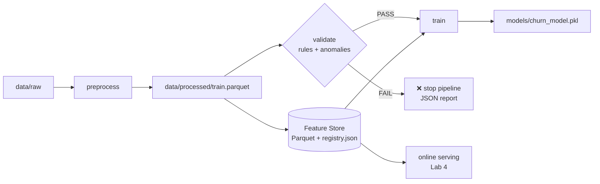

# Lab 3: Data Validation and Feature Store

> ℹ️ **Environment:** this lab assumes an Ubuntu 24.04 virtual machine (VirtualBox) with Python 3.12 and an active `venv` environment with the dependencies from `requirements.txt` (including `pandas`, `pyarrow`, `scipy`, `pytest`, `great-expectations` 1.x). If you don't have it yet, start with [Virtual Machine Setup](00_virtual_machine_setup.md). Run all commands from the **project root directory** from Lab 1 (where `src/`, `data/` and `dvc.yaml` are located).

## General information
- **Duration:** 2 hours
- **Level:** Intermediate
- **Prerequisites:** Labs 1 and 2 completed

## Lab objectives
After this lab, the student will:
- write data quality tests using pytest and custom rules,
- build a simple Feature Store based on Parquet files,
- detect anomalies in input data,
- integrate data validation with a DVC pipeline.

---

## Theoretical introduction

### Why data validation?

In classic software, bugs live mainly in the code. In ML systems, the source of failures is just as often the **data**: a changed schema in the source system, a new unit (PLN → thousands of PLN), missing values after an ETL failure, duplicates. The model will not raise an exception — it will simply start returning worse predictions (*silent failure*). The **"garbage in, garbage out"** principle makes data validation the first quality gate in the pipeline.

### Validation levels

| Level | What we check | Example in this lab |
|--------|---------------|---------------------|
| **Schema** | Presence of columns, data types | `required_columns` |
| **Completeness and uniqueness** | Missing values (`null`), duplicate keys | `no_missing_values`, `no_duplicate_customers` |
| **Ranges / domain** | Allowed values for a single column | `age_range`, `churn_binary` |
| **Dataset statistics** | Distribution, mean, class ratio | `churn_rate_reasonable`, `min_sample_size` |
| **Anomalies / drift** | Single records or entire batches deviating from reference data | `StatisticalAnomalyDetector` (Part 2), Lab 5 |

An **error (`error`)** stops the pipeline (the data is unfit for use), a **warning (`warning`)** is reported but allows continuing — it is a trade-off between safety and the number of false alarms.

### Where validation fits in the pipeline



### Feature Store in a nutshell

A Feature Store is a central repository of **defined, versioned features** used both by training (*offline store* — large, historical tables) and by serving (*online store* — fast lookup by entity key). Thanks to this, the same feature definition (e.g. `income_per_age`) is used in both places, which eliminates **training-serving skew**. In production, tools such as Feast, Tecton, Hopsworks are used; in this lab we build a minimal equivalent on Parquet files to understand the ideas: registry, feature groups, entity key, versions.

### Common pitfalls
- **Thresholds "pulled out of thin air"** — ranges should come from domain knowledge or reference data statistics, not be chosen so that the test "passes".
- **Validating only training data** — the same rules should be applied to incoming data in production.
- **Computing reference statistics on test data** (information leakage) — the detector's `fit()` is done exclusively on the training set.
- **Statistical methods do not replace domain rules** — IQR/Z-score may fail to detect a business-impossible value (e.g. negative income) if it lies close to the center of the distribution (see the note in Part 2).

---

## Part 1: Data quality tests (40 min)

### Step 1.1: Data validation framework

Create `src/data/validation.py`:

```python
# src/data/validation.py
"""Data validation framework for the churn prediction project."""

import pandas as pd
import numpy as np
from dataclasses import dataclass, field
from typing import Callable, Any
from datetime import datetime


@dataclass
class ValidationRule:
    """A single validation rule."""
    name: str
    description: str
    check_fn: Callable[[pd.DataFrame], bool]
    severity: str = "error"   # error | warning
    column: str = None        # None = rule for the whole DataFrame


@dataclass
class ValidationResult:
    """Result of validating a single rule."""
    rule_name: str
    passed: bool
    severity: str
    message: str = ""
    affected_rows: int = 0


@dataclass
class ValidationReport:
    """Full validation report."""
    timestamp: str = field(default_factory=lambda: datetime.now().isoformat())
    results: list[ValidationResult] = field(default_factory=list)

    @property
    def passed(self) -> bool:
        return all(r.passed for r in self.results if r.severity == "error")

    @property
    def errors(self) -> list[ValidationResult]:
        return [r for r in self.results if not r.passed and r.severity == "error"]

    @property
    def warnings(self) -> list[ValidationResult]:
        return [r for r in self.results if not r.passed and r.severity == "warning"]

    def summary(self) -> str:
        total = len(self.results)
        passed = sum(1 for r in self.results if r.passed)
        lines = [
            f"=== Validation Report [{self.timestamp}] ===",
            f"Result: {'✅ PASS' if self.passed else '❌ FAIL'}",
            f"Rules: {passed}/{total} passed",
        ]
        if self.errors:
            lines.append("\nCritical errors:")
            for e in self.errors:
                lines.append(f"  ❌ {e.rule_name}: {e.message}")
        if self.warnings:
            lines.append("\nWarnings:")
            for w in self.warnings:
                lines.append(f"  ⚠️  {w.rule_name}: {w.message}")
        return "\n".join(lines)


class DataValidator:
    """Data validator with a set of rules."""

    def __init__(self):
        self.rules: list[ValidationRule] = []

    def add_rule(self, rule: ValidationRule) -> "DataValidator":
        self.rules.append(rule)
        return self  # enables chaining

    def validate(self, df: pd.DataFrame) -> ValidationReport:
        """Runs all rules and returns a report."""
        report = ValidationReport()

        for rule in self.rules:
            try:
                passed = rule.check_fn(df)
                result = ValidationResult(
                    rule_name=rule.name,
                    passed=passed,
                    severity=rule.severity,
                    message="" if passed else rule.description,
                )
            except Exception as e:
                result = ValidationResult(
                    rule_name=rule.name,
                    passed=False,
                    severity=rule.severity,
                    message=f"Rule execution error: {e}",
                )
            report.results.append(result)

        return report


def build_churn_validator() -> DataValidator:
    """Builds a validator for churn prediction data."""
    validator = DataValidator()

    # --- Schema rules ---
    required_columns = [
        'customer_id', 'age', 'income', 'tenure_months',
        'num_products', 'has_credit_card', 'is_active',
        'balance', 'num_transactions_30d', 'churn'
    ]

    validator.add_rule(ValidationRule(
        name="required_columns",
        description=f"Missing columns: {required_columns}",
        check_fn=lambda df: all(c in df.columns for c in required_columns),
        severity="error"
    ))

    validator.add_rule(ValidationRule(
        name="no_missing_values",
        description="Data contains null values",
        check_fn=lambda df: df.isnull().sum().sum() == 0,
        severity="error"
    ))

    validator.add_rule(ValidationRule(
        name="no_duplicate_customers",
        description="Duplicated customer_id",
        check_fn=lambda df: not df['customer_id'].duplicated().any()
            if 'customer_id' in df.columns else True,
        severity="error"
    ))

    # --- Range rules ---
    validator.add_rule(ValidationRule(
        name="age_range",
        description="Age outside range [18, 100]",
        check_fn=lambda df: df['age'].between(18, 100).all()
            if 'age' in df.columns else True,
        severity="error"
    ))

    validator.add_rule(ValidationRule(
        name="income_positive",
        description="Negative income",
        check_fn=lambda df: (df['income'] >= 0).all()
            if 'income' in df.columns else True,
        severity="error"
    ))

    validator.add_rule(ValidationRule(
        name="churn_binary",
        description="Churn label is not binary (0/1)",
        check_fn=lambda df: set(df['churn'].unique()).issubset({0, 1})
            if 'churn' in df.columns else True,
        severity="error"
    ))

    validator.add_rule(ValidationRule(
        name="num_products_range",
        description="Number of products outside range [1, 10]",
        check_fn=lambda df: df['num_products'].between(1, 10).all()
            if 'num_products' in df.columns else True,
        severity="warning"
    ))

    # --- Statistical rules ---
    validator.add_rule(ValidationRule(
        name="churn_rate_reasonable",
        description="Churn rate outside range [1%, 60%]",
        check_fn=lambda df: 0.01 <= df['churn'].mean() <= 0.60
            if 'churn' in df.columns else True,
        severity="warning"
    ))

    validator.add_rule(ValidationRule(
        name="min_sample_size",
        description="Too few samples (< 100)",
        check_fn=lambda df: len(df) >= 100,
        severity="error"
    ))

    validator.add_rule(ValidationRule(
        name="balance_non_negative",
        description="Negative account balance",
        check_fn=lambda df: (df['balance'] >= 0).all()
            if 'balance' in df.columns else True,
        severity="warning"
    ))

    return validator
```

### Step 1.2: Validation tests

Create `tests/data/test_validation.py`:

```python
# tests/data/test_validation.py
"""Data validation tests."""

import pytest
import pandas as pd
import numpy as np
import sys
from pathlib import Path

sys.path.insert(0, str(Path(__file__).parent.parent.parent))

from src.data.validation import build_churn_validator, DataValidator, ValidationRule


@pytest.fixture
def valid_df():
    """A valid DataFrame satisfying all rules."""
    np.random.seed(42)
    n = 500
    return pd.DataFrame({
        'customer_id': range(1, n + 1),
        'age': np.random.uniform(18, 80, n),
        'income': np.random.uniform(20000, 100000, n),
        'tenure_months': np.random.randint(1, 120, n),
        'num_products': np.random.randint(1, 5, n),
        'has_credit_card': np.random.randint(0, 2, n),
        'is_active': np.random.randint(0, 2, n),
        'balance': np.random.uniform(0, 50000, n),
        'num_transactions_30d': np.random.randint(0, 50, n),
        'churn': np.random.binomial(1, 0.2, n)
    })


class TestDataValidator:

    def test_valid_data_passes_all_rules(self, valid_df):
        """Test: valid data passes all rules."""
        validator = build_churn_validator()
        report = validator.validate(valid_df)
        assert report.passed, f"Errors: {[e.rule_name for e in report.errors]}"

    def test_missing_column_fails(self, valid_df):
        """Test: a missing column causes an error."""
        df_missing = valid_df.drop(columns=['age'])
        validator = build_churn_validator()
        report = validator.validate(df_missing)
        assert not report.passed
        assert any(r.rule_name == "required_columns" for r in report.errors)

    def test_null_values_fail(self, valid_df):
        """Test: null values cause an error."""
        df_with_nulls = valid_df.copy()
        df_with_nulls.loc[0, 'age'] = None
        validator = build_churn_validator()
        report = validator.validate(df_with_nulls)
        assert not report.passed

    def test_invalid_age_fails(self, valid_df):
        """Test: age out of range causes an error."""
        df_bad_age = valid_df.copy()
        df_bad_age.loc[0, 'age'] = -5
        validator = build_churn_validator()
        report = validator.validate(df_bad_age)
        assert not report.passed
        assert any(r.rule_name == "age_range" for r in report.errors)

    def test_non_binary_churn_fails(self, valid_df):
        """Test: a non-binary label causes an error."""
        df_bad_churn = valid_df.copy()
        df_bad_churn.loc[0, 'churn'] = 2
        validator = build_churn_validator()
        report = validator.validate(df_bad_churn)
        assert not report.passed

    def test_duplicate_customers_fail(self, valid_df):
        """Test: duplicated customer_id values cause an error."""
        df_dupes = pd.concat([valid_df, valid_df.head(5)], ignore_index=True)
        validator = build_churn_validator()
        report = validator.validate(df_dupes)
        assert not report.passed

    def test_report_summary_format(self, valid_df):
        """Test: the report has the correct format."""
        validator = build_churn_validator()
        report = validator.validate(valid_df)
        summary = report.summary()
        assert "Validation Report" in summary
        assert "PASS" in summary or "FAIL" in summary

    def test_custom_rule_chaining(self):
        """Test: adding rules via chaining."""
        validator = (DataValidator()
            .add_rule(ValidationRule(
                name="min_rows",
                description="Too few rows",
                check_fn=lambda df: len(df) >= 10
            ))
            .add_rule(ValidationRule(
                name="has_id",
                description="Missing id column",
                check_fn=lambda df: 'id' in df.columns
            )))

        df = pd.DataFrame({'id': range(20), 'value': range(20)})
        report = validator.validate(df)
        assert report.passed
```

> 💡 The `data/processed/train.parquet` data is produced in Lab 1 (`dvc repro` or `python src/data/preprocess.py`). If the file is missing, first reproduce the pipeline from Lab 1.

```bash
# Run the validation tests
pytest tests/data/test_validation.py -v

# Run validation on the data
python -c "
import pandas as pd
import sys
sys.path.insert(0, '.')
from src.data.validation import build_churn_validator

df = pd.read_parquet('data/processed/train.parquet')
validator = build_churn_validator()
report = validator.validate(df)
print(report.summary())
"
```

---

## Part 2: Anomaly detection (30 min)

### Step 2.1: Statistical anomaly detector

Create `src/data/anomaly_detection.py`:

```python
# src/data/anomaly_detection.py
"""Anomaly detection in input data."""

import pandas as pd
import numpy as np
from dataclasses import dataclass
from scipy import stats


@dataclass
class AnomalyReport:
    """Anomaly report for a single feature."""
    feature: str
    n_anomalies: int
    anomaly_pct: float
    method: str
    threshold: float
    anomaly_indices: list[int]

    def __str__(self):
        return (f"{self.feature}: {self.n_anomalies} anomalies "
                f"({self.anomaly_pct:.1%}) using method {self.method}")


class StatisticalAnomalyDetector:
    """Detects anomalies using statistical methods."""

    def __init__(self, z_score_threshold: float = 3.5, iqr_multiplier: float = 3.0):
        self.z_threshold = z_score_threshold
        self.iqr_multiplier = iqr_multiplier
        self._reference_stats: dict = {}

    def fit(self, df: pd.DataFrame, numeric_cols: list[str]):
        """Learns reference statistics from training data."""
        for col in numeric_cols:
            if col in df.columns:
                values = df[col].dropna()
                Q1 = values.quantile(0.25)
                Q3 = values.quantile(0.75)
                IQR = Q3 - Q1
                self._reference_stats[col] = {
                    'mean': float(values.mean()),
                    'std': float(values.std()),
                    'median': float(values.median()),
                    'Q1': float(Q1),
                    'Q3': float(Q3),
                    'IQR': float(IQR),
                    'lower_iqr': float(Q1 - self.iqr_multiplier * IQR),
                    'upper_iqr': float(Q3 + self.iqr_multiplier * IQR),
                }
        return self

    def detect(self, df: pd.DataFrame) -> list[AnomalyReport]:
        """Detects anomalies in new data."""
        reports = []

        for col, stats_ref in self._reference_stats.items():
            if col not in df.columns:
                continue

            values = df[col].dropna()

            # IQR method
            iqr_mask = ~values.between(stats_ref['lower_iqr'], stats_ref['upper_iqr'])
            n_iqr = iqr_mask.sum()

            if n_iqr > 0:
                reports.append(AnomalyReport(
                    feature=col,
                    n_anomalies=int(n_iqr),
                    anomaly_pct=float(n_iqr / len(values)),
                    method="IQR",
                    threshold=self.iqr_multiplier,
                    anomaly_indices=values[iqr_mask].index.tolist()
                ))

            # Z-score method (based on reference statistics)
            z_scores = np.abs((values - stats_ref['mean']) / max(stats_ref['std'], 1e-6))
            z_mask = z_scores > self.z_threshold
            n_z = z_mask.sum()

            if n_z > 0:
                reports.append(AnomalyReport(
                    feature=col,
                    n_anomalies=int(n_z),
                    anomaly_pct=float(n_z / len(values)),
                    method="Z-score",
                    threshold=self.z_threshold,
                    anomaly_indices=values[z_mask].index.tolist()
                ))

        return reports

    def get_clean_data(self, df: pd.DataFrame) -> pd.DataFrame:
        """Returns data without anomalies (IQR method)."""
        mask = pd.Series(True, index=df.index)

        for col, stats_ref in self._reference_stats.items():
            if col in df.columns:
                col_mask = df[col].between(stats_ref['lower_iqr'], stats_ref['upper_iqr'])
                mask = mask & col_mask

        removed = (~mask).sum()
        print(f"Removed {removed} rows with anomalies ({removed/len(df):.1%})")
        return df[mask].copy()


# Usage example
if __name__ == "__main__":
    import sys
    sys.path.insert(0, '.')

    # Load training data
    train_df = pd.read_parquet("data/processed/train.parquet")

    numeric_cols = ['age', 'income', 'balance', 'num_transactions_30d']

    # Fit the detector on training data
    detector = StatisticalAnomalyDetector(z_score_threshold=3.5, iqr_multiplier=3.0)
    detector.fit(train_df, numeric_cols)

    # Simulate production data with anomalies
    import numpy as np
    np.random.seed(42)
    prod_df = train_df.sample(1000).copy()
    # Inject artificial anomalies
    prod_df.loc[prod_df.index[:10], 'age'] = 999
    prod_df.loc[prod_df.index[10:20], 'income'] = -1000

    # Detect anomalies
    reports = detector.detect(prod_df)

    print("=== Anomaly Report ===")
    for report in reports:
        print(f"  {report}")

    # Clean the data
    clean_df = detector.get_clean_data(prod_df)
    print(f"\nData after cleaning: {len(clean_df)} rows (was {len(prod_df)})")
```

```bash
python src/data/anomaly_detection.py
```

> ⚠️ **Important observation:** the artificial anomalies `age = 999` will be detected by both methods, but `income = -1000` most likely **will not** — with a right-skewed income distribution, the lower IQR bound (`Q1 − 3·IQR`) is negative, and the value −1000 lies less than 3.5 standard deviations from the mean. Most of the reported `income` and `balance` anomalies are naturally high values from the "tail" of the distribution. Conclusion: statistical detection **complements**, rather than replaces, the domain rules from Part 1 (`income_positive` will catch this case immediately). Check it: run `build_churn_validator().validate(prod_df)`.

### Theory: Z-score vs IQR

| Method | Formula | Advantages | Disadvantages |
|--------|------|--------|------|
| **Z-score** | `abs(x − μ) / σ > k` (usually k = 3) | Simple, fast | Assumes a roughly normal distribution; μ and σ are themselves sensitive to outliers |
| **IQR** | `x < Q1 − k·IQR` or `x > Q3 + k·IQR` (k = 1.5 or 3) | Robust (based on quantiles), works for skewed distributions | With strong skewness, flags many "genuine" large values |

For strongly skewed distributions (incomes, balances), it is often better to apply methods to `log1p(x)` or to use multivariate detectors (e.g. `IsolationForest` from scikit-learn).

---

## Part 3: A simple Feature Store (30 min)

### Step 3.1: Feature Store implementation

Create `src/features/feature_store.py`:

```python
# src/features/feature_store.py
"""A simple Feature Store based on Parquet files."""

import pandas as pd
import numpy as np
import json
from pathlib import Path
from datetime import datetime
from dataclasses import dataclass, asdict


@dataclass
class FeatureDefinition:
    """Feature definition in the Feature Store."""
    name: str
    dtype: str
    description: str
    source_column: str
    transformation: str = "identity"  # identity | log | normalize | bin
    version: str = "1.0"


class SimpleFeatureStore:
    """
    A simple Feature Store based on Parquet files.
    
    Directory structure:
        feature_store/
            registry.json          # feature registry
            features/
                user_stats/
                    v1/data.parquet
                    v2/data.parquet
    """

    def __init__(self, store_path: str = "feature_store"):
        self.store_path = Path(store_path)
        self.store_path.mkdir(parents=True, exist_ok=True)
        (self.store_path / "features").mkdir(exist_ok=True)
        self._registry_path = self.store_path / "registry.json"
        self._registry = self._load_registry()

    def _load_registry(self) -> dict:
        if self._registry_path.exists():
            with open(self._registry_path) as f:
                return json.load(f)
        return {"feature_groups": {}}

    def _save_registry(self):
        with open(self._registry_path, "w") as f:
            json.dump(self._registry, f, indent=2)

    def register_feature_group(
        self,
        group_name: str,
        features: list[FeatureDefinition],
        entity_key: str = "customer_id"
    ):
        """Registers a feature group."""
        self._registry["feature_groups"][group_name] = {
            "entity_key": entity_key,
            "features": [asdict(f) for f in features],
            "created_at": datetime.now().isoformat(),
            "versions": []
        }
        self._save_registry()
        print(f"✅ Registered feature group: {group_name} ({len(features)} features)")

    def write_features(
        self,
        group_name: str,
        df: pd.DataFrame,
        version: str = None
    ) -> str:
        """Writes features to the Feature Store."""
        if group_name not in self._registry["feature_groups"]:
            raise ValueError(f"Unknown feature group: {group_name}")

        if version is None:
            version = datetime.now().strftime("v%Y%m%d_%H%M%S")

        # Save the data
        group_path = self.store_path / "features" / group_name / version
        group_path.mkdir(parents=True, exist_ok=True)
        data_path = group_path / "data.parquet"
        df.to_parquet(data_path, index=False)

        # Update the registry
        self._registry["feature_groups"][group_name]["versions"].append({
            "version": version,
            "path": str(data_path),
            "n_rows": len(df),
            "created_at": datetime.now().isoformat()
        })
        self._save_registry()

        print(f"✅ Saved {len(df):,} rows to {group_name}/{version}")
        return version

    def read_features(
        self,
        group_name: str,
        entity_ids: list,
        feature_names: list[str] = None,
        version: str = "latest"
    ) -> pd.DataFrame:
        """Retrieves features for the given entities."""
        if group_name not in self._registry["feature_groups"]:
            raise ValueError(f"Unknown feature group: {group_name}")

        group_info = self._registry["feature_groups"][group_name]
        versions = group_info["versions"]

        if not versions:
            raise ValueError(f"No data for group: {group_name}")

        # Select the version
        if version == "latest":
            data_path = versions[-1]["path"]
        else:
            matching = [v for v in versions if v["version"] == version]
            if not matching:
                raise ValueError(f"Version {version} does not exist")
            data_path = matching[0]["path"]

        # Load the data
        df = pd.read_parquet(data_path)
        entity_key = group_info["entity_key"]

        # Filter by entities
        df = df[df[entity_key].isin(entity_ids)]

        # Select columns
        if feature_names:
            cols = [entity_key] + feature_names
            df = df[[c for c in cols if c in df.columns]]

        return df

    def list_feature_groups(self):
        """Displays all feature groups."""
        print("\n=== Feature Store Registry ===")
        for name, info in self._registry["feature_groups"].items():
            n_versions = len(info["versions"])
            n_features = len(info["features"])
            print(f"\n📦 {name}")
            print(f"   Features: {n_features}, Versions: {n_versions}")
            print(f"   Entity key: {info['entity_key']}")
            if info["versions"]:
                latest = info["versions"][-1]
                print(f"   Latest version: {latest['version']} ({latest['n_rows']:,} rows)")


# Feature Store creation script
if __name__ == "__main__":
    import sys
    sys.path.insert(0, '.')

    # Load the data
    df = pd.read_parquet("data/processed/train.parquet")

    # Initialize the Feature Store
    fs = SimpleFeatureStore("feature_store")

    # Define the features
    user_features = [
        FeatureDefinition("age", "float", "Customer age", "age"),
        FeatureDefinition("income", "float", "Monthly income", "income"),
        FeatureDefinition("tenure_months", "int", "Customer tenure", "tenure_months"),
        FeatureDefinition("num_products", "int", "Number of products", "num_products"),
        FeatureDefinition("income_per_age", "float", "Income per year of age", "income_per_age"),
    ]

    behavioral_features = [
        FeatureDefinition("balance", "float", "Account balance", "balance"),
        FeatureDefinition("num_transactions_30d", "int", "Transactions 30d", "num_transactions_30d"),
        FeatureDefinition("is_active", "int", "Is active", "is_active"),
    ]

    # Register the feature groups
    fs.register_feature_group("user_demographics", user_features)
    fs.register_feature_group("user_behavior", behavioral_features)

    # Write the features
    demo_cols = ['customer_id', 'age', 'income', 'tenure_months', 'num_products', 'income_per_age']
    behav_cols = ['customer_id', 'balance', 'num_transactions_30d', 'is_active']

    fs.write_features("user_demographics", df[demo_cols])
    fs.write_features("user_behavior", df[behav_cols])

    # Display the registry
    fs.list_feature_groups()

    # Retrieve features for specific customers
    sample_ids = df['customer_id'].head(5).tolist()
    features = fs.read_features(
        "user_demographics",
        entity_ids=sample_ids,
        feature_names=['age', 'income', 'income_per_age']
    )
    print(f"\nRetrieved features for {len(sample_ids)} customers:")
    print(features)
```

```bash
python src/features/feature_store.py

# Inspect the registry and the directory structure
cat feature_store/registry.json | head -30
find feature_store -name "*.parquet"
```

> 💡 Each run of the script creates a **new version** (`vYYYYMMDD_HHMMSS`), but `register_feature_group()` overwrites the registry entry and "loses" the list of previous versions (the Parquet files stay on disk). This is a good starting point for exercise 4. Add the `feature_store/` directory to `.gitignore` (or version it with DVC) — do not commit Parquet files to Git.

---

## Part 4: Integration with the DVC pipeline (20 min)

### Step 4.1: Validation script in the pipeline

Create `scripts/validate_data.py`:

```python
# scripts/validate_data.py
"""Data validation script – used in the DVC pipeline."""

import sys
import json
import argparse
from pathlib import Path
import pandas as pd

sys.path.insert(0, '.')
from src.data.validation import build_churn_validator

def main():
    parser = argparse.ArgumentParser()
    parser.add_argument("--input", required=True, help="Path to the data")
    parser.add_argument("--output-report", default="reports/metrics/validation_report.json")
    parser.add_argument("--fail-on-warning", action="store_true")
    args = parser.parse_args()

    print(f"Validating data: {args.input}")
    df = pd.read_parquet(args.input)
    print(f"Loaded {len(df):,} rows")

    validator = build_churn_validator()
    report = validator.validate(df)

    print(report.summary())

    # Save the report
    Path(args.output_report).parent.mkdir(parents=True, exist_ok=True)
    report_dict = {
        "timestamp": report.timestamp,
        "passed": report.passed,
        "n_rules": len(report.results),
        "n_passed": sum(1 for r in report.results if r.passed),
        "errors": [{"rule": e.rule_name, "message": e.message} for e in report.errors],
        "warnings": [{"rule": w.rule_name, "message": w.message} for w in report.warnings],
    }
    with open(args.output_report, "w") as f:
        json.dump(report_dict, f, indent=2)

    # Exit with an error if validation did not pass
    if not report.passed:
        print("\n❌ Validation FAILED – stopping the pipeline")
        sys.exit(1)

    if args.fail_on_warning and report.warnings:
        print("\n⚠️  Warnings detected – stopping the pipeline (--fail-on-warning)")
        sys.exit(1)

    print("\n✅ Validation PASSED")

if __name__ == "__main__":
    main()
```

Add the validation step to `dvc.yaml` (indented at the level of the other stages in the `stages:` section):

```yaml
# Add to dvc.yaml after the preprocess stage:
  validate:
    cmd: python scripts/validate_data.py --input data/processed/train.parquet
    deps:
      - scripts/validate_data.py
      - src/data/validation.py
      - data/processed/train.parquet
    metrics:
      - reports/metrics/validation_report.json:
          cache: false
```

> 💡 DVC determines the order of stages based on dependencies. For `train` to actually wait for a successful validation, add `reports/metrics/validation_report.json` to the `deps` of the `train` stage. If `validate_data.py` exits with code `1`, `dvc repro` will stop the pipeline.

```bash
# Run the pipeline with validation
dvc repro

# Preview the dependency graph
dvc dag

# Check the validation report
cat reports/metrics/validation_report.json

# Run the tests
pytest tests/data/ -v --tb=short
```

### Step 4.2 (optional): The same rules in Great Expectations 1.x

The custom framework from Part 1 illustrates the working principle well. In practice, ready-made libraries are often used — the most popular is **Great Expectations (GX)**, which is already in `requirements.txt` (`great-expectations>=1.0`).

> ⚠️ GX 1.x has a **completely different API** than the 0.x versions. Many tutorials on the internet use constructs that have since been removed, e.g. `ge.from_pandas(df)`, `df.expect_column_values_to_be_between(...)`, `context.sources.pandas_default.read_dataframe(...)` or `great_expectations init`. The example below uses the 1.x API (Data Source → Data Asset → Batch Definition → Expectation Suite → Validation Definition).

Create `scripts/validate_gx.py`:

```python
# scripts/validate_gx.py
"""Data validation with Great Expectations 1.x."""

import sys
import pandas as pd
import great_expectations as gx

df = pd.read_parquet("data/processed/train.parquet")

# Ephemeral context – writes nothing to disk (sufficient for the lab)
context = gx.get_context(mode="ephemeral")

data_source = context.data_sources.add_pandas("churn_source")
data_asset = data_source.add_dataframe_asset(name="train")
batch_definition = data_asset.add_batch_definition_whole_dataframe("train_batch")

suite = context.suites.add(gx.ExpectationSuite(name="churn_suite"))
suite.add_expectation(gx.expectations.ExpectColumnValuesToNotBeNull(column="customer_id"))
suite.add_expectation(gx.expectations.ExpectColumnValuesToBeUnique(column="customer_id"))
suite.add_expectation(gx.expectations.ExpectColumnValuesToBeBetween(column="age", min_value=18, max_value=100))
suite.add_expectation(gx.expectations.ExpectColumnValuesToBeBetween(column="income", min_value=0))
suite.add_expectation(gx.expectations.ExpectColumnValuesToBeInSet(column="churn", value_set=[0, 1]))
suite.add_expectation(gx.expectations.ExpectColumnMeanToBeBetween(column="churn", min_value=0.01, max_value=0.60))

validation_definition = context.validation_definitions.add(
    gx.ValidationDefinition(name="churn_validation", data=batch_definition, suite=suite)
)

result = validation_definition.run(batch_parameters={"dataframe": df})

for r in result.results:
    status = "✅" if r.success else "❌"
    print(f"{status} {r.expectation_config.type} {r.expectation_config.kwargs.get('column', '')}")

print(f"\nResult: {'PASS' if result.success else 'FAIL'}")
sys.exit(0 if result.success else 1)
```

```bash
# GX_ANALYTICS_ENABLED=false disables sending anonymous telemetry
GX_ANALYTICS_ENABLED=false python scripts/validate_gx.py
```

Compare the result with `scripts/validate_data.py`. Consider: what do we gain from the library (ready-made expectations, "Data Docs" HTML reports, integrations with Airflow/Spark/SQL), and what do we lose (complexity, large dependencies, frequent API changes)?

---

## Common problems and solutions

| Problem | Cause | Solution |
|---------|-----------|-------------|
| Validation lets bad data through | Rules too lenient (e.g. age 0-200) | Tighten the ranges based on the training data |
| Too many false positives in anomalies | Z-score threshold too low (e.g. 2.0) | Increase the threshold to 3.0-4.0 or use IQR with a multiplier of 3.0 |
| Feature Store returns stale features | No update after data changes | Add a timestamp to features and check freshness |
| `dvc repro` does not run validation | Missing dependency in `dvc.yaml` | Make sure `validate` depends on `data/processed/train.parquet` |
| `ModuleNotFoundError: No module named 'src'` | Script/pytest run from outside the project root directory | Run commands from the root directory (where `src/` is) |
| `FileNotFoundError: data/processed/train.parquet` | The Lab 1 pipeline was not reproduced | `dvc repro` (or `dvc pull` if the data is in remote storage) |
| `ImportError: Unable to find a usable engine ... pyarrow` | `pyarrow` missing in the active environment | Activate the correct `venv` (`source .venv/bin/activate`) and `pip install -r requirements.txt` |
| `pip install` ends with `externally-managed-environment` | Installing into the system Python of Ubuntu 24.04 (PEP 668) | Always install packages in an active `venv`, do not use `sudo pip` |
| `AttributeError: module 'great_expectations' has no attribute 'from_pandas'` | Tutorial code for GX 0.x | Use the 1.x API from Step 4.2 |
| An anomaly (e.g. negative income) is not detected by IQR/Z-score | The value lies within the statistical bounds | Add a domain rule to `DataValidator` (e.g. `income_positive`) |
| Out of disk space on the VM when working with data | Small virtual disk (DVC cache + `feature_store/`) | `df -h`, remove old versions in `feature_store/`, `dvc gc -w`; optionally enlarge the VM disk |

> 💡 **Tip:** Start with simple validation rules (schema, ranges, null) and gradually add more advanced ones (statistical distributions, correlations between features). Overly complicated validation at the start slows down development.

> 💡 **Tip:** Save reference data statistics (mean, std, percentiles) as a model artifact — they will be needed for drift monitoring in production.

---

## Exercises for independent work

1. **Add a validation rule** checking that `balance` is correlated with `is_active` (inactive customers should have balance = 0).
2. **Extend the Feature Store** with a `get_training_dataset()` method that joins features from multiple groups.
3. **Write a test** for `StatisticalAnomalyDetector` checking that it detects outliers.
4. **Add versioning** to the Feature Store – save two versions of features and retrieve the older one.
5. **Implement schema validation** — check whether new data has the same columns and types as the training data.

## Review questions

1. What is the difference between an error (`error`) and a warning (`warning`) in validation?
2. Why does a Feature Store solve the "training-serving skew" problem?
3. When should you use the IQR method, and when Z-score, for anomaly detection?
4. How do you integrate data validation with a CI/CD pipeline?
5. Why is it worth saving reference data statistics as a model artifact?

## Summary

In this lab:
- ✅ You built a data validation framework with rules and reports
- ✅ You wrote unit tests for the validator
- ✅ You implemented a statistical anomaly detector (Z-score, IQR)
- ✅ You built a simple Feature Store with versioning
- ✅ You integrated validation with the DVC pipeline
