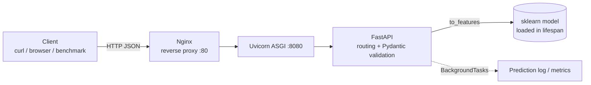

# Lab 4: REST API and ML Model Serving

> ℹ️ **Environment:** this lab assumes an Ubuntu 24.04 virtual machine (VirtualBox) with Python 3.12, an active `venv` environment with the dependencies from `requirements.txt`, and Docker Engine from the official apt repository. If you don't have it yet, start with [Virtual machine setup](00_virtual_machine_setup.md).

## General information
- **Duration:** 2 hours
- **Level:** Intermediate
- **Prerequisites:** Labs 1–3 completed, basics of HTTP/REST

## Lab objectives
After this lab, the student will:
- build a REST API for an ML model using FastAPI,
- containerize the service in Docker,
- test the API (unit tests + integration tests),
- measure the service performance (latency, throughput).

---

## Theoretical introduction

### Why put the model "behind an API"?

A trained `churn_model.pkl` file brings no value by itself — it has to be **made available** to other systems (a mobile app, CRM, a batch pipeline). The most common serving patterns:

| Pattern | Description | When |
|---------|-------------|------|
| **Online (REST/gRPC)** | Request → immediate response (ms) | Real-time decisions (e.g. a retention offer at login) |
| **Batch** | Predictions for many records at once, e.g. once a day | Reports, marketing campaigns |
| **Streaming** | Predictions for events from a queue (Kafka) | Fraud detection, IoT |
| **Embedded** | Model inside an application/device | No network, low latency |

In this lab we build the **online** variant (the `/predict` endpoint) and **mini-batch** (`/predict/batch`).

### Service architecture



Key concepts:
- **ASGI / Uvicorn** — the application server running the asynchronous FastAPI application. `--workers N` starts N independent processes (each with its **own copy** of the model and in-memory state!).
- **Pydantic v2** — declarative input data validation. An invalid request ends with code **422** before it reaches the model. In Pydantic v2 validators are defined with `@field_validator` (the old `@validator` from v1 is deprecated).
- **Lifespan** — an `asynccontextmanager` function passed to `FastAPI(lifespan=...)`; code before `yield` runs once at startup (model loading), code after `yield` — at shutdown. It replaces the deprecated `@app.on_event("startup")`.
- **Health check** — a lightweight endpoint (`/health`) used by Docker, Kubernetes and load balancers to check whether an instance can accept traffic.
- **Training-serving skew** — a different feature transformation in training and in serving. That is why `to_features()` must compute features **exactly the same way** as `preprocess.py` from Lab 1 (the same column order!).

### Common pitfalls
- Loading the model **on every request** (instead of once in `lifespan`) — latency grows by orders of magnitude.
- Heavy CPU computations in `async def` block the event loop; for large models consider plain `def` (FastAPI will run them in a thread pool) or separate workers.
- In-process memory state (counters, logs) **is not shared** between workers or replicas — in production Prometheus is used for metrics (Lab 5).
- Running `uvicorn` with the default `--host 127.0.0.1` in a VM/container — the service is then invisible from the outside.

---

## Part 1: Building a REST API with FastAPI (50 min)

### Step 1.1: Installing dependencies

All required packages (`fastapi`, `uvicorn`, `pydantic` v2, `httpx`, `pytest-asyncio`, `scikit-learn`, `joblib`) are already in the repository's `requirements.txt`. Make sure your `venv` is active:

```bash
source .venv/bin/activate          # path consistent with the VM setup guide
pip install -r requirements.txt
python -c "import fastapi, pydantic; print(fastapi.__version__, pydantic.__version__)"
# expected: fastapi >= 0.115, pydantic 2.x
```

> ⚠️ Do not install older versions "hard-pinned" (e.g. `fastapi==0.110.0`) — they will be incompatible with the versions from `requirements.txt` and with the code below.

### Step 1.2: Prediction service

Create `src/serving/api.py`:

```python
# src/serving/api.py
"""REST API for the churn prediction model."""

from fastapi import FastAPI, HTTPException, BackgroundTasks
from fastapi.middleware.cors import CORSMiddleware
from pydantic import BaseModel, Field, field_validator
from contextlib import asynccontextmanager
import joblib
import numpy as np
import os
import time
import logging
from pathlib import Path
from datetime import datetime

logging.basicConfig(level=logging.INFO, format="%(asctime)s %(levelname)s %(message)s")
logger = logging.getLogger(__name__)

# ── Pydantic models ──────────────���───────────────────────────────────────────

class PredictionRequest(BaseModel):
    customer_id: int = Field(..., gt=0, description="Customer ID")
    age: float = Field(..., ge=18, le=100, description="Age")
    income: float = Field(..., ge=0, description="Monthly income")
    tenure_months: int = Field(..., ge=0, le=600, description="Tenure in months")
    num_products: int = Field(..., ge=1, le=10, description="Number of products")
    has_credit_card: int = Field(..., ge=0, le=1, description="Has a credit card")
    is_active: int = Field(..., ge=0, le=1, description="Is active")
    balance: float = Field(..., ge=0, description="Account balance")
    num_transactions_30d: int = Field(..., ge=0, description="Transactions in 30 days")

    @field_validator('income')
    @classmethod
    def income_reasonable(cls, v: float) -> float:
        if v > 10_000_000:
            raise ValueError("Income too high")
        return round(v, 2)

    def to_features(self) -> np.ndarray:
        """Converts the request into a feature vector."""
        income_per_age = self.income / max(self.age, 1)
        balance_per_product = self.balance / max(self.num_products, 1)
        is_long_tenure = int(self.tenure_months > 24)
        return np.array([[
            self.age, self.income, self.tenure_months, self.num_products,
            self.has_credit_card, self.is_active, self.balance,
            self.num_transactions_30d, income_per_age,
            balance_per_product, is_long_tenure
        ]])


class PredictionResponse(BaseModel):
    customer_id: int
    churn_probability: float = Field(..., ge=0, le=1)
    churn_prediction: bool
    risk_level: str
    model_version: str
    prediction_time_ms: float
    timestamp: str


class BatchPredictionRequest(BaseModel):
    requests: list[PredictionRequest]

    @field_validator('requests')
    @classmethod
    def max_batch_size(cls, v: list[PredictionRequest]) -> list[PredictionRequest]:
        if len(v) > 500:
            raise ValueError("Maximum 500 records per batch")
        return v


class HealthResponse(BaseModel):
    status: str
    model_loaded: bool
    model_version: str
    uptime_seconds: float
    total_predictions: int


# ── Application state ────────────────────────────────────────────────────────

class AppState:
    model = None
    model_version = "unknown"
    start_time = time.time()
    total_predictions = 0
    prediction_log: list = []


state = AppState()


# ── Lifecycle ────────────────────────────────────────────────────────────────

@asynccontextmanager
async def lifespan(app: FastAPI):
    """Loads the model at application startup."""
    logger.info("Starting ML service...")
    # The path can be overridden with an environment variable (useful in Docker)
    model_path = Path(os.getenv("MODEL_PATH", "models/churn_model.pkl"))

    if model_path.exists():
        state.model = joblib.load(model_path)
        state.model_version = "v1.0.0"
        logger.info(f"Model loaded: {state.model_version}")
    else:
        # Demo mode – train a simple model
        logger.warning("No model file – using demo model")
        from sklearn.ensemble import RandomForestClassifier
        from sklearn.datasets import make_classification
        X, y = make_classification(n_samples=2000, n_features=11, random_state=42)
        state.model = RandomForestClassifier(n_estimators=50, random_state=42).fit(X, y)
        state.model_version = "demo-v1.0"

    yield

    logger.info("Shutting down ML service...")


# ── Application ──────────────────────────────────────────────────────────────

app = FastAPI(
    title="Churn Prediction API",
    description="REST API for customer churn prediction",
    version="1.0.0",
    lifespan=lifespan
)

app.add_middleware(
    CORSMiddleware,
    allow_origins=["*"],
    allow_methods=["GET", "POST"],
    allow_headers=["*"],
)


# ── Helpers ──────────────────────────────────────────────────────────────────

def classify_risk(probability: float) -> str:
    if probability >= 0.7:
        return "high"
    elif probability >= 0.3:
        return "medium"
    return "low"


def log_prediction_async(customer_id: int, probability: float, latency_ms: float):
    """Logs a prediction (called in the background)."""
    entry = {
        "customer_id": customer_id,
        "probability": probability,
        "latency_ms": latency_ms,
        "timestamp": datetime.now().isoformat()
    }
    state.prediction_log.append(entry)
    # Keep only the last 1000 entries
    if len(state.prediction_log) > 1000:
        state.prediction_log.pop(0)


# ── Endpoints ────────────────────────────────────────────────────────────────

@app.get("/health", response_model=HealthResponse, tags=["Monitoring"])
async def health_check():
    """Checks the service state."""
    return HealthResponse(
        status="healthy" if state.model is not None else "degraded",
        model_loaded=state.model is not None,
        model_version=state.model_version,
        uptime_seconds=round(time.time() - state.start_time, 1),
        total_predictions=state.total_predictions
    )


@app.get("/metrics", tags=["Monitoring"])
async def get_metrics():
    """Returns service metrics (last 1000 predictions)."""
    if not state.prediction_log:
        return {"total_predictions": state.total_predictions, "message": "No data"}

    latencies = [e["latency_ms"] for e in state.prediction_log]
    probs = [e["probability"] for e in state.prediction_log]

    return {
        "total_predictions": state.total_predictions,
        "recent_predictions": len(state.prediction_log),
        "latency_ms": {
            "p50": float(np.percentile(latencies, 50)),
            "p95": float(np.percentile(latencies, 95)),
            "p99": float(np.percentile(latencies, 99)),
            "mean": float(np.mean(latencies))
        },
        "churn_probability": {
            "mean": float(np.mean(probs)),
            "high_risk_pct": float(np.mean([p >= 0.7 for p in probs]))
        }
    }


@app.post("/predict", response_model=PredictionResponse, tags=["Prediction"])
async def predict(request: PredictionRequest, background_tasks: BackgroundTasks):
    """Churn prediction for a single customer."""
    if state.model is None:
        raise HTTPException(status_code=503, detail="Model is not loaded")

    t0 = time.time()

    try:
        features = request.to_features()
        probability = float(state.model.predict_proba(features)[0][1])
    except Exception as e:
        logger.error(f"Prediction error: {e}")
        raise HTTPException(status_code=500, detail=f"Prediction error: {str(e)}")

    latency_ms = (time.time() - t0) * 1000
    state.total_predictions += 1

    background_tasks.add_task(
        log_prediction_async, request.customer_id, probability, latency_ms
    )

    return PredictionResponse(
        customer_id=request.customer_id,
        churn_probability=round(probability, 4),
        churn_prediction=probability >= 0.5,
        risk_level=classify_risk(probability),
        model_version=state.model_version,
        prediction_time_ms=round(latency_ms, 2),
        timestamp=datetime.now().isoformat()
    )


@app.post("/predict/batch", response_model=list[PredictionResponse], tags=["Prediction"])
async def predict_batch(batch: BatchPredictionRequest):
    """Churn prediction for many customers at once."""
    if state.model is None:
        raise HTTPException(status_code=503, detail="Model is not loaded")

    t0 = time.time()

    features = np.vstack([r.to_features() for r in batch.requests])
    probabilities = state.model.predict_proba(features)[:, 1]

    total_time_ms = (time.time() - t0) * 1000
    per_request_ms = total_time_ms / len(batch.requests)
    state.total_predictions += len(batch.requests)

    return [
        PredictionResponse(
            customer_id=req.customer_id,
            churn_probability=round(float(prob), 4),
            churn_prediction=float(prob) >= 0.5,
            risk_level=classify_risk(float(prob)),
            model_version=state.model_version,
            prediction_time_ms=round(per_request_ms, 2),
            timestamp=datetime.now().isoformat()
        )
        for req, prob in zip(batch.requests, probabilities)
    ]
```

### Step 1.3: Running the service

> 💡 Without the `models/churn_model.pkl` file (from Lab 1, `dvc repro`) the service will start in **demo mode** with a model trained on synthetic data — in the logs you will see `No model file – using demo model`. This is enough to complete the whole lab.

```bash
# Start the service (from the project root directory!)
# --host 0.0.0.0 is required for the API to be visible from outside the VM (from the host)
uvicorn src.serving.api:app --host 0.0.0.0 --port 8080 --reload

# In a separate terminal – test the API
# Health check
curl http://localhost:8080/health | python3 -m json.tool

# Prediction
curl -X POST http://localhost:8080/predict \
  -H "Content-Type: application/json" \
  -d '{
    "customer_id": 1001,
    "age": 35,
    "income": 55000,
    "tenure_months": 24,
    "num_products": 2,
    "has_credit_card": 1,
    "is_active": 1,
    "balance": 15000,
    "num_transactions_30d": 12
  }' | python3 -m json.tool

# Batch prediction
curl -X POST http://localhost:8080/predict/batch \
  -H "Content-Type: application/json" \
  -d '{
    "requests": [
      {"customer_id": 1, "age": 25, "income": 30000, "tenure_months": 6,
       "num_products": 1, "has_credit_card": 0, "is_active": 1, "balance": 500, "num_transactions_30d": 3},
      {"customer_id": 2, "age": 55, "income": 80000, "tenure_months": 60,
       "num_products": 3, "has_credit_card": 1, "is_active": 1, "balance": 25000, "num_transactions_30d": 20}
    ]
  }' | python3 -m json.tool

# Open the Swagger documentation
# http://localhost:8080/docs

# Check validation – invalid age → 422 with an error description
curl -s -X POST http://localhost:8080/predict \
  -H "Content-Type: application/json" \
  -d '{"customer_id": 1, "age": -5, "income": 1, "tenure_months": 1, "num_products": 1,
       "has_credit_card": 0, "is_active": 1, "balance": 0, "num_transactions_30d": 0}' \
  | python3 -m json.tool
```

#### Accessing the API from the host computer (VirtualBox)

The default VirtualBox network adapter (NAT) does not let the host connect to the VM. You have two options:

1. **Port forwarding (NAT):** *VM Settings → Network → Adapter 1 → Advanced → Port Forwarding* and add a rule: protocol TCP, host port `8080`, guest port `8080` (for Nginx from Part 3 add a second rule: host port e.g. `8081` → guest port `80`). Then open `http://localhost:8080/docs` on the host.
2. **"Host-only" adapter:** add a second network adapter, check the address in the VM with `ip -4 addr` (e.g. `192.168.56.101`) and open `http://192.168.56.101:8080/docs`.

In both cases uvicorn must listen on `0.0.0.0`, not on `127.0.0.1`. If the `ufw` firewall is enabled in the VM, allow the port: `sudo ufw allow 8080/tcp`.

---

## Part 2: API tests (30 min)

### Step 2.1: Unit and integration tests

Create `tests/model/test_api.py`:

```python
# tests/model/test_api.py
"""Tests of the ML service REST API."""

import pytest
from fastapi.testclient import TestClient
import sys
from pathlib import Path

sys.path.insert(0, str(Path(__file__).parent.parent.parent))

from src.serving.api import app

# ── Fixtures ─────────────────────────────────────────────────────────────────

@pytest.fixture(scope="module")
def client():
    """TestClient used as a context manager runs `lifespan`,
    i.e. loads the model. Without `with` the model would NOT be loaded (503)."""
    with TestClient(app) as c:
        yield c

@pytest.fixture
def valid_request():
    return {
        "customer_id": 1001,
        "age": 35.0,
        "income": 55000.0,
        "tenure_months": 24,
        "num_products": 2,
        "has_credit_card": 1,
        "is_active": 1,
        "balance": 15000.0,
        "num_transactions_30d": 12
    }

@pytest.fixture
def high_risk_request():
    """Customer with a high churn risk."""
    return {
        "customer_id": 9999,
        "age": 65.0,
        "income": 20000.0,
        "tenure_months": 2,
        "num_products": 1,
        "has_credit_card": 0,
        "is_active": 0,
        "balance": 100.0,
        "num_transactions_30d": 0
    }

# ── Health check tests ────────────────────────────────────────────────────────

class TestHealthCheck:

    def test_health_returns_200(self, client):
        response = client.get("/health")
        assert response.status_code == 200

    def test_health_response_schema(self, client):
        response = client.get("/health")
        data = response.json()
        assert "status" in data
        assert "model_loaded" in data
        assert "model_version" in data
        assert "uptime_seconds" in data
        assert "total_predictions" in data

    def test_health_model_loaded(self, client):
        response = client.get("/health")
        data = response.json()
        assert data["model_loaded"] is True

# ── Prediction tests ──────────────────────────────────────────────────────────

class TestPrediction:

    def test_predict_returns_200(self, client, valid_request):
        response = client.post("/predict", json=valid_request)
        assert response.status_code == 200

    def test_predict_response_schema(self, client, valid_request):
        response = client.post("/predict", json=valid_request)
        data = response.json()
        assert "customer_id" in data
        assert "churn_probability" in data
        assert "churn_prediction" in data
        assert "risk_level" in data
        assert "model_version" in data
        assert "prediction_time_ms" in data

    def test_predict_probability_in_range(self, client, valid_request):
        response = client.post("/predict", json=valid_request)
        data = response.json()
        assert 0.0 <= data["churn_probability"] <= 1.0

    def test_predict_customer_id_preserved(self, client, valid_request):
        response = client.post("/predict", json=valid_request)
        data = response.json()
        assert data["customer_id"] == valid_request["customer_id"]

    def test_predict_risk_level_valid(self, client, valid_request):
        response = client.post("/predict", json=valid_request)
        data = response.json()
        assert data["risk_level"] in ["low", "medium", "high"]

    def test_predict_churn_consistent_with_probability(self, client, valid_request):
        response = client.post("/predict", json=valid_request)
        data = response.json()
        expected_prediction = data["churn_probability"] >= 0.5
        assert data["churn_prediction"] == expected_prediction

    def test_predict_invalid_age_returns_422(self, client, valid_request):
        invalid = {**valid_request, "age": -5}
        response = client.post("/predict", json=invalid)
        assert response.status_code == 422

    def test_predict_invalid_income_returns_422(self, client, valid_request):
        invalid = {**valid_request, "income": -1000}
        response = client.post("/predict", json=invalid)
        assert response.status_code == 422

    def test_predict_missing_field_returns_422(self, client, valid_request):
        incomplete = {k: v for k, v in valid_request.items() if k != "age"}
        response = client.post("/predict", json=incomplete)
        assert response.status_code == 422

    def test_predict_latency_reasonable(self, client, valid_request):
        response = client.post("/predict", json=valid_request)
        data = response.json()
        assert data["prediction_time_ms"] < 1000  # < 1 second

# ── Batch prediction tests ────────────────────────────────────────────────────

class TestBatchPrediction:

    def test_batch_predict_returns_correct_count(self, client, valid_request, high_risk_request):
        batch = {"requests": [valid_request, high_risk_request]}
        response = client.post("/predict/batch", json=batch)
        assert response.status_code == 200
        data = response.json()
        assert len(data) == 2

    def test_batch_predict_all_probabilities_valid(self, client, valid_request):
        batch = {"requests": [valid_request] * 10}
        response = client.post("/predict/batch", json=batch)
        data = response.json()
        for item in data:
            assert 0.0 <= item["churn_probability"] <= 1.0

    def test_batch_too_large_returns_422(self, client, valid_request):
        batch = {"requests": [valid_request] * 501}
        response = client.post("/predict/batch", json=batch)
        assert response.status_code == 422

# ── Metrics tests ─────────────────────────────────────────────────────────────

class TestMetrics:

    def test_metrics_endpoint_exists(self, client):
        response = client.get("/metrics")
        assert response.status_code == 200

    def test_metrics_after_predictions(self, client, valid_request):
        # Make a few predictions
        for _ in range(5):
            client.post("/predict", json=valid_request)

        response = client.get("/metrics")
        data = response.json()
        assert "total_predictions" in data
        assert data["total_predictions"] >= 5
```

```bash
# Run the API tests
pytest tests/model/test_api.py -v

# Run with code coverage
pytest tests/model/test_api.py -v --cov=src/serving --cov-report=term-missing
```

---

## Part 3: Containerization with Docker (30 min)

### Theory: image, container, layers

- An **image** is an immutable template (file system + metadata), a **container** is a running instance of an image.
- Each `RUN`/`COPY` instruction creates a **layer**. Docker caches layers — that is why we first copy the dependency file and install packages, and only then the code (a code change does not force reinstalling packages).
- A container should run as a **non-root user** and contain only what is needed for serving (no MLflow, DVC, Jupyter…) — hence a separate, slimmed-down dependency file.

```
 Host (Windows/macOS)      Ubuntu 24.04 VM                 churn-api container
+------------------+     +-----------------------+     +--------------------------+
| browser          | NAT | curl localhost:8080   | -p  | uvicorn 0.0.0.0:8080     |
| localhost:8080 --+---->| port 8080 ------------+---->| /app/models  (ro, -v)    |
+------------------+ fwd | ./models -------------+---->| user: mluser (uid 1000)  |
                         +-----------------------+     +--------------------------+
```

> ⚠️ **Docker in the Ubuntu VM:** if `docker ps` returns `permission denied while trying to connect to the Docker daemon socket`, add the user to the `docker` group and log in again (or run `newgrp docker`):
> ```bash
> sudo usermod -aG docker $USER
> newgrp docker
> docker run --rm hello-world
> ```
> Alternatively, prefix commands with `sudo`. Remember that membership in the `docker` group grants privileges equivalent to root.

### Step 3.1: Dockerfile

Create a slimmed-down service dependency file `requirements-api.txt` (version ranges consistent with the main `requirements.txt`):

```text
# requirements-api.txt – only what is needed for serving
fastapi>=0.115,<1.0
uvicorn>=0.30,<1.0
pydantic>=2.8,<3.0
scikit-learn>=1.5,<2.0
numpy>=1.26,<3.0
joblib>=1.4,<2.0
```

> ⚠️ The `scikit-learn` version in the image should be **the same** as the one you trained the model with (`pip show scikit-learn`). A pickle from a different version may generate `InconsistentVersionWarning` or fail to load — if necessary, pin the exact version (`scikit-learn==X.Y.Z`).

Also create `.dockerignore` so that the virtual environment and data are not sent to the Docker daemon:

```text
# .dockerignore
.venv/
.git/
.dvc/cache/
data/
mlruns/
__pycache__/
*.pyc
```

```dockerfile
# Dockerfile
FROM python:3.12-slim

LABEL maintainer="mlops-lab"
LABEL description="Churn Prediction API"

WORKDIR /app

# Install system dependencies
RUN apt-get update && apt-get install -y --no-install-recommends \
    curl \
    && rm -rf /var/lib/apt/lists/*

# Install Python dependencies (separate layer – cache on code changes)
COPY requirements-api.txt .
RUN pip install --no-cache-dir -r requirements-api.txt

# Copy the code (the models/ directory must exist – it can be empty)
COPY src/ ./src/
COPY models/ ./models/

# Non-root user
RUN useradd -m -u 1000 mluser && chown -R mluser:mluser /app
USER mluser

EXPOSE 8080

HEALTHCHECK --interval=30s --timeout=10s --start-period=15s --retries=3 \
    CMD curl -f http://localhost:8080/health || exit 1

CMD ["uvicorn", "src.serving.api:app", \
     "--host", "0.0.0.0", \
     "--port", "8080", \
     "--workers", "2", \
     "--log-level", "info"]
```

> 💡 With `--workers 2` each process has its own counters — `/metrics` and `total_predictions` in `/health` will show values only from the process that handled the given request. This is an intentional illustration of the in-memory state problem (solution: Prometheus in Lab 5).

```bash
# Make sure the models/ directory exists (otherwise COPY models/ will fail)
mkdir -p models

# Build the image
docker build -t churn-api:latest .

# Run the container
docker run -d \
  --name churn-api \
  -p 8080:8080 \
  -v $(pwd)/models:/app/models:ro \
  churn-api:latest

# Check the logs (Ctrl+C ends the preview, the container keeps running)
docker logs -f churn-api

# Test (after ~15 s the status in `docker ps` will change to "healthy")
curl http://localhost:8080/health
docker ps --filter name=churn-api

# Stop the container
docker stop churn-api && docker rm churn-api
```

### Step 3.2: Docker Compose with monitoring

```yaml
# docker-compose.yml
# (the `version:` key is deprecated in Docker Compose v2 and has been omitted)

services:
  ml-api:
    build: .
    ports:
      - "8080:8080"
    volumes:
      - ./models:/app/models:ro
    environment:
      - LOG_LEVEL=INFO
    healthcheck:
      test: ["CMD", "curl", "-f", "http://localhost:8080/health"]
      interval: 30s
      timeout: 10s
      retries: 3
    restart: unless-stopped

  # Nginx as a reverse proxy
  nginx:
    image: nginx:alpine
    ports:
      - "80:80"
    volumes:
      - ./nginx.conf:/etc/nginx/conf.d/default.conf:ro
    depends_on:
      ml-api:
        condition: service_healthy
```

```nginx
# nginx.conf
upstream ml_api {
    server ml-api:8080;
}

server {
    listen 80;

    location /api/ {
        proxy_pass http://ml_api/;
        proxy_set_header Host $host;
        proxy_set_header X-Real-IP $remote_addr;
        proxy_read_timeout 30s;
    }

    location /health {
        proxy_pass http://ml_api/health;
    }
}
```

```bash
# Docker Compose v2 is the `docker compose` plugin (with a space) – the docker-compose-plugin package
# from the Docker repository. The old `docker-compose` command (with a hyphen) is not installed.
docker compose up -d --build

# Check the status (ml-api should be "healthy")
docker compose ps

# Test through Nginx (the /api/ prefix is stripped by proxy_pass)
curl http://localhost/health
curl -X POST http://localhost/api/predict -H "Content-Type: application/json" \
  -d '{"customer_id": 1, "age": 40, "income": 50000, "tenure_months": 12, "num_products": 2,
       "has_credit_card": 1, "is_active": 1, "balance": 1000, "num_transactions_30d": 5}'

# Stop and remove the containers
docker compose down
```

---

## Part 4: Performance measurement (10 min)

### Step 4.1: Simple benchmark

```python
# scripts/benchmark_api.py
"""API performance benchmark."""

import httpx
import time
import statistics
import asyncio

BASE_URL = "http://localhost:8080"

SAMPLE_REQUEST = {
    "customer_id": 1001,
    "age": 35.0,
    "income": 55000.0,
    "tenure_months": 24,
    "num_products": 2,
    "has_credit_card": 1,
    "is_active": 1,
    "balance": 15000.0,
    "num_transactions_30d": 12
}

async def benchmark_single_predictions(n_requests: int = 100):
    """Measures the latency of single predictions."""
    latencies = []

    async with httpx.AsyncClient(base_url=BASE_URL) as client:
        for i in range(n_requests):
            request = {**SAMPLE_REQUEST, "customer_id": i + 1}
            t0 = time.perf_counter()
            response = await client.post("/predict", json=request)
            latency_ms = (time.perf_counter() - t0) * 1000
            assert response.status_code == 200
            latencies.append(latency_ms)

    print(f"\n=== Benchmark: {n_requests} single predictions ===")
    print(f"  p50:  {statistics.median(latencies):.2f} ms")
    print(f"  p95:  {sorted(latencies)[int(0.95 * len(latencies))]:.2f} ms")
    print(f"  p99:  {sorted(latencies)[int(0.99 * len(latencies))]:.2f} ms")
    print(f"  mean: {statistics.mean(latencies):.2f} ms")
    print(f"  min:  {min(latencies):.2f} ms")
    print(f"  max:  {max(latencies):.2f} ms")

async def benchmark_batch_predictions(batch_sizes: list[int] = [1, 10, 50, 100]):
    """Measures batch prediction throughput."""
    print("\n=== Benchmark: Batch predictions ===")
    print(f"{'Batch size':>12} | {'Time (ms)':>10} | {'ms/record':>10} | {'Records/s':>12}")
    print("-" * 55)

    async with httpx.AsyncClient(base_url=BASE_URL, timeout=30.0) as client:
        for batch_size in batch_sizes:
            requests = [
                {**SAMPLE_REQUEST, "customer_id": i + 1}
                for i in range(batch_size)
            ]
            batch = {"requests": requests}

            t0 = time.perf_counter()
            response = await client.post("/predict/batch", json=batch)
            elapsed_ms = (time.perf_counter() - t0) * 1000

            assert response.status_code == 200
            ms_per_record = elapsed_ms / batch_size
            records_per_sec = 1000 / ms_per_record

            print(f"{batch_size:>12} | {elapsed_ms:>10.1f} | {ms_per_record:>10.2f} | {records_per_sec:>12.0f}")

async def main():
    # Check whether the service is running
    async with httpx.AsyncClient(base_url=BASE_URL) as client:
        response = await client.get("/health")
        if response.status_code != 200:
            print("❌ Service is not running!")
            return
        print(f"✅ Service is running: {response.json()['model_version']}")

    await benchmark_single_predictions(n_requests=100)
    await benchmark_batch_predictions(batch_sizes=[1, 10, 50, 100, 200])

if __name__ == "__main__":
    asyncio.run(main())
```

```bash
# Run the benchmark (the service must be running)
python scripts/benchmark_api.py
```

---

## Common problems and solutions

| Problem | Cause | Solution |
|---------|-------|----------|
| `422 Unprocessable Entity` | Data does not match the Pydantic schema | Check the field types and ranges in the JSON request |
| `503 Service Unavailable` | Model is not loaded | Check the model path and the application startup logs |
| Docker build takes a long time | No layer cache, large build context | Copy `requirements-api.txt` before the source code; add `.dockerignore` (excluding `.venv/`, `data/`) |
| High latency in Docker | Too few uvicorn workers | Increase `--workers` (roughly the number of CPU cores assigned to the VM) |
| Tests return `503` / `model_loaded is False` | `TestClient(app)` used without `with` – `lifespan` did not run | Use the fixture `with TestClient(app) as c: yield c` (as in Step 2.1) |
| `ModuleNotFoundError: No module named 'src'` | `uvicorn`/`pytest` run from outside the project root directory | Run from the repository root directory |
| `PydanticDeprecatedSince20: @validator` | Pydantic v1-style code | Use `@field_validator` + `@classmethod` |
| `UserWarning: X does not have valid feature names` | Lab 1 model trained on a `DataFrame`, while the API passes an `ndarray` | The warning is harmless; you can pass a `pd.DataFrame` with column names |
| `PytestDeprecationWarning: asyncio_default_fixture_loop_scope is unset` | Newer `pytest-asyncio` | Harmless; you can add to `pytest.ini`: `asyncio_default_fixture_loop_scope = function` |
| `Connection refused` in the benchmark | The service is not running | Start `uvicorn` in a separate terminal before the benchmark |
| `[Errno 98] Address already in use` | Port 8080 is taken (e.g. the `churn-api` container or an old uvicorn is running) | `docker ps` / `docker stop churn-api` or `sudo ss -ltnp \| grep 8080` and kill the process |
| `permission denied ... /var/run/docker.sock` | The VM user is not in the `docker` group | `sudo usermod -aG docker $USER`, then log out or `newgrp docker` (or use `sudo docker ...`) |
| API works in the VM but not from the host | No VirtualBox port forwarding or uvicorn on `127.0.0.1` | Add a NAT rule 8080→8080 (see Step 1.3), run with `--host 0.0.0.0` |
| `docker-compose: command not found` | Compose v2 is a plugin | Use `docker compose` (with a space); if missing: `sudo apt install docker-compose-plugin` |
| `COPY models/ ./models/` – `not found` | No `models/` directory | `mkdir -p models` or train the model (`dvc repro` from Lab 1) |
| Nginx: `bind: address already in use` on port 80 | Port 80 in the VM is taken (e.g. apache2) | Change the mapping to `"8081:80"` in `docker-compose.yml` |

> 💡 **Tip:** Use `uvicorn main:app --reload` during development — the server restarts automatically after code changes. In production **never** use `--reload`.

> 💡 **Tip:** Add the `/docs` endpoint (generated automatically by FastAPI) to the API documentation — clients can test the endpoints directly in the browser.

---

## Exercises for independent work

1. **Add an endpoint** `GET /predict/history/{customer_id}` returning the prediction history for a customer.
2. **Add API Key authentication** – requests without the `X-API-Key` header should return 401.
3. **Write a test** checking that a batch prediction is faster than N single predictions.
4. **Add middleware** logging every request (method, path, status, time).
5. **Add API versioning** — create `/v1/predict` and `/v2/predict` routers with different response schemas.

## Review questions

1. Why do we use `BackgroundTasks` for logging predictions?
2. What is the difference between `TestClient` and a real HTTP client?
3. When is it worth using a batch API instead of single requests?
4. What does `HEALTHCHECK` do in a Dockerfile and why is it important?
5. Why don't we use the `--reload` flag in uvicorn in production?

## Summary

In this lab:
- ✅ You built a REST API with FastAPI with Pydantic validation
- ✅ You wrote unit and integration tests for the API
- ✅ You containerized the service in Docker with a health check
- ✅ You measured the API performance (p50/p95/p99 latency, throughput)
