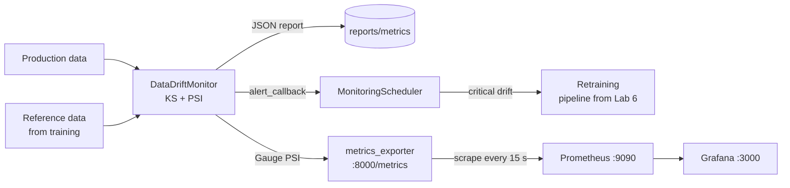

# Lab 5: Model Monitoring and Drift Detection

## General information
- **Duration:** 2 hours
- **Level:** Intermediate–Advanced
- **Prerequisites:** Labs 1–4 completed

> 🖥️ **Environment:** this lab is prepared for an Ubuntu 24.04 virtual machine (Python 3.12, Docker Engine with the `docker compose` plugin) — setup instructions: [00_virtual_machine_setup.md](00_virtual_machine_setup.md). Run commands from the project root directory in an active `venv` with the dependencies from the repository's `requirements.txt`.

## Lab objectives
After this lab the student will:
- implement data drift monitoring (KS test, PSI),
- build a monitoring dashboard with Prometheus and Grafana,
- configure alerts when drift is detected,
- simulate data drift and verify that the system works.

---

## Part 0: Theory in a nutshell (10 min)

An ML model "breaks" without any code change — the world the data comes from changes. We distinguish:

| Type | What changes | How to detect | Labels needed? |
|--------|----------------|------------|---------------------|
| **Data drift** (covariate shift) | feature distribution `P(X)` | statistical tests on features (KS, PSI, chi²) | no |
| **Prediction drift** | prediction distribution `P(ŷ)` | PSI/KS on model outputs | no |
| **Concept drift** | relationship `P(y \| X)` | drop in metrics (AUC, F1) on new labels | yes |

**The Kolmogorov–Smirnov (KS) test** compares the empirical distribution functions of two samples; the statistic is `D = max|F_ref(x) − F_cur(x)|`. With large samples even small, business-irrelevant differences yield very small p-values — that is why we combine it with an "effect size" measure.

**PSI (Population Stability Index)** splits the feature range into bins (here: quantiles of the reference data) and sums:

```
PSI = Σ_i (cur_i − ref_i) · ln(cur_i / ref_i)
```

where `ref_i`, `cur_i` are the shares of observations in bin `i`. Typical interpretation: `< 0.1` – stable, `0.1–0.2` – moderate change, `> 0.2` – significant drift.

The architecture you will build in this lab:



---

## Part 1: Implementing the drift monitor (50 min)

### Step 1.1: Data drift monitor

Create `src/monitoring/drift_monitor.py`:

```python
# src/monitoring/drift_monitor.py
"""Data drift monitor for an ML model."""

import pandas as pd
import numpy as np
from scipy import stats
from dataclasses import dataclass, field
from datetime import datetime
from typing import Callable, Optional
import json
import logging

logger = logging.getLogger(__name__)


@dataclass
class FeatureDriftResult:
    feature: str
    ks_statistic: float
    ks_pvalue: float
    psi_value: float
    drift_detected: bool
    severity: str   # none | low | medium | high | critical

    def to_dict(self) -> dict:
        return {
            "feature": self.feature,
            "ks_statistic": round(self.ks_statistic, 4),
            "ks_pvalue": round(self.ks_pvalue, 4),
            "psi_value": round(self.psi_value, 4),
            "drift_detected": self.drift_detected,
            "severity": self.severity
        }


@dataclass
class DriftReport:
    timestamp: str = field(default_factory=lambda: datetime.now().isoformat())
    feature_results: list[FeatureDriftResult] = field(default_factory=list)
    overall_drift: bool = False
    drifted_features: list[str] = field(default_factory=list)
    n_reference_samples: int = 0
    n_current_samples: int = 0

    def to_dict(self) -> dict:
        return {
            "timestamp": self.timestamp,
            "overall_drift": self.overall_drift,
            "drifted_features": self.drifted_features,
            "n_reference_samples": self.n_reference_samples,
            "n_current_samples": self.n_current_samples,
            "features": [r.to_dict() for r in self.feature_results]
        }

    def summary(self) -> str:
        status = "🔴 DRIFT" if self.overall_drift else "🟢 OK"
        lines = [
            f"=== Drift Report [{self.timestamp}] ===",
            f"Status: {status}",
            f"Samples: ref={self.n_reference_samples}, current={self.n_current_samples}",
        ]
        for r in self.feature_results:
            icon = {"none": "✅", "low": "🟡", "medium": "🟠",
                    "high": "🔴", "critical": "💀"}.get(r.severity, "❓")
            lines.append(
                f"  {icon} {r.feature}: PSI={r.psi_value:.3f}, "
                f"KS p={r.ks_pvalue:.4f}, severity={r.severity}"
            )
        return "\n".join(lines)


def calculate_psi(reference: np.ndarray, current: np.ndarray, n_bins: int = 10) -> float:
    """Computes the Population Stability Index."""
    bins = np.percentile(reference, np.linspace(0, 100, n_bins + 1))
    # For discrete features (e.g. Poisson) quantiles repeat – remove duplicates
    bins = np.unique(bins)
    bins[0] = -np.inf
    bins[-1] = np.inf

    ref_counts, _ = np.histogram(reference, bins=bins)
    cur_counts, _ = np.histogram(current, bins=bins)

    ref_pct = np.where(ref_counts == 0, 1e-4, ref_counts / len(reference))
    cur_pct = np.where(cur_counts == 0, 1e-4, cur_counts / len(current))

    return float(np.sum((cur_pct - ref_pct) * np.log(cur_pct / ref_pct)))


def classify_severity(psi: float, ks_pvalue: float) -> tuple[bool, str]:
    """Classifies drift severity."""
    if psi > 0.5 or ks_pvalue < 0.001:
        return True, "critical"
    elif psi > 0.2 or ks_pvalue < 0.01:
        return True, "high"
    elif psi > 0.1 or ks_pvalue < 0.05:
        return True, "medium"
    elif psi > 0.05:
        return False, "low"
    return False, "none"


class DataDriftMonitor:
    """Data drift monitor."""

    def __init__(
        self,
        reference_df: pd.DataFrame,
        feature_columns: list[str],
        alert_callback: Optional[Callable] = None,
        ks_threshold: float = 0.05
    ):
        self.reference_df = reference_df
        self.feature_columns = [c for c in feature_columns if c in reference_df.columns]
        self.alert_callback = alert_callback
        self.ks_threshold = ks_threshold
        self._history: list[DriftReport] = []

    def check_drift(self, current_df: pd.DataFrame) -> DriftReport:
        """Checks drift for all features."""
        report = DriftReport(
            n_reference_samples=len(self.reference_df),
            n_current_samples=len(current_df)
        )

        for feature in self.feature_columns:
            if feature not in current_df.columns:
                continue

            ref_vals = self.reference_df[feature].dropna().values
            cur_vals = current_df[feature].dropna().values

            if len(cur_vals) < 30:
                logger.warning(f"Too few samples for {feature}: {len(cur_vals)}")
                continue

            ks_stat, ks_pvalue = stats.ks_2samp(ref_vals, cur_vals)
            psi = calculate_psi(ref_vals, cur_vals)
            drift_detected, severity = classify_severity(psi, ks_pvalue)

            result = FeatureDriftResult(
                feature=feature,
                ks_statistic=float(ks_stat),
                ks_pvalue=float(ks_pvalue),
                psi_value=psi,
                drift_detected=drift_detected,
                severity=severity
            )
            report.feature_results.append(result)

            if drift_detected:
                report.drifted_features.append(feature)

        report.overall_drift = len(report.drifted_features) > 0
        self._history.append(report)

        if report.overall_drift and self.alert_callback:
            self.alert_callback(report)

        return report

    def get_drift_trend(self) -> pd.DataFrame:
        """Returns the drift history as a DataFrame."""
        rows = []
        for rep in self._history:
            for feat in rep.feature_results:
                rows.append({
                    "timestamp": rep.timestamp,
                    "feature": feat.feature,
                    "psi": feat.psi_value,
                    "ks_pvalue": feat.ks_pvalue,
                    "severity": feat.severity,
                    "drift": feat.drift_detected
                })
        return pd.DataFrame(rows) if rows else pd.DataFrame()

    def save_report(self, report: DriftReport, path: str):
        """Saves the report to a JSON file."""
        with open(path, "w") as f:
            json.dump(report.to_dict(), f, indent=2)
        logger.info(f"Report saved: {path}")
```

### Step 1.2: Drift simulation and tests

Create `scripts/simulate_drift.py`:

```python
# scripts/simulate_drift.py
"""Simulates data drift and tests the monitor."""

import sys
sys.path.insert(0, '.')

import pandas as pd
import numpy as np
import matplotlib
matplotlib.use('Agg')
import matplotlib.pyplot as plt
from pathlib import Path

from src.monitoring.drift_monitor import DataDriftMonitor

np.random.seed(42)

# ── Reference data (from training) ───────────────────────────────────────────
n_ref = 5000
reference_df = pd.DataFrame({
    'age':                np.random.normal(40, 10, n_ref).clip(18, 90),
    'income':             np.random.normal(50000, 15000, n_ref).clip(0),
    'tenure_months':      np.random.exponential(24, n_ref).clip(1, 240),
    'balance':            np.random.lognormal(9, 1, n_ref),
    'num_transactions_30d': np.random.poisson(15, n_ref),
})

feature_cols = list(reference_df.columns)

# ── Drift scenarios ──────────────────────────────────────────────────────────

def generate_no_drift(n=500) -> pd.DataFrame:
    """Data without drift – same distribution as the reference."""
    return pd.DataFrame({
        'age':                np.random.normal(40, 10, n).clip(18, 90),
        'income':             np.random.normal(50000, 15000, n).clip(0),
        'tenure_months':      np.random.exponential(24, n).clip(1, 240),
        'balance':            np.random.lognormal(9, 1, n),
        'num_transactions_30d': np.random.poisson(15, n),
    })

def generate_mild_drift(n=500) -> pd.DataFrame:
    """Mild drift – small shift of the mean."""
    return pd.DataFrame({
        'age':                np.random.normal(43, 11, n).clip(18, 90),
        'income':             np.random.normal(52000, 15000, n).clip(0),
        'tenure_months':      np.random.exponential(22, n).clip(1, 240),
        'balance':            np.random.lognormal(9, 1, n),
        'num_transactions_30d': np.random.poisson(14, n),
    })

def generate_severe_drift(n=500) -> pd.DataFrame:
    """Severe drift – significant distribution changes."""
    return pd.DataFrame({
        'age':                np.random.normal(55, 15, n).clip(18, 90),  # older customers
        'income':             np.random.normal(35000, 20000, n).clip(0), # lower income
        'tenure_months':      np.random.exponential(8, n).clip(1, 240),  # shorter tenure
        'balance':            np.random.lognormal(7, 1.5, n),            # lower balances
        'num_transactions_30d': np.random.poisson(5, n),                 # fewer transactions
    })

# ── Running the monitoring ───────────────────────────────────────────────────

def alert_handler(report):
    print(f"\n🚨 ALERT: Drift detected in features: {report.drifted_features}")

monitor = DataDriftMonitor(
    reference_df=reference_df,
    feature_columns=feature_cols,
    alert_callback=alert_handler
)

print("=" * 60)
print("SCENARIO 1: No drift")
print("=" * 60)
report1 = monitor.check_drift(generate_no_drift())
print(report1.summary())

print("\n" + "=" * 60)
print("SCENARIO 2: Mild drift")
print("=" * 60)
report2 = monitor.check_drift(generate_mild_drift())
print(report2.summary())

print("\n" + "=" * 60)
print("SCENARIO 3: Severe drift")
print("=" * 60)
report3 = monitor.check_drift(generate_severe_drift())
print(report3.summary())

# ── Visualization ────────────────────────────────────────────────────────────

Path("reports/figures").mkdir(parents=True, exist_ok=True)

fig, axes = plt.subplots(2, 3, figsize=(15, 8))
axes = axes.flatten()

for i, feature in enumerate(feature_cols):
    ax = axes[i]
    ref_vals = reference_df[feature].values
    severe_vals = generate_severe_drift()[feature].values

    ax.hist(ref_vals, bins=30, alpha=0.6, label='Reference', color='blue', density=True)
    ax.hist(severe_vals, bins=30, alpha=0.6, label='Production (drift)', color='red', density=True)
    ax.set_title(f'{feature}')
    ax.legend(fontsize=8)
    ax.set_xlabel('Value')
    ax.set_ylabel('Density')

plt.suptitle('Distribution comparison: Reference vs Production (severe drift)', fontsize=12)
plt.tight_layout()
plt.savefig("reports/figures/drift_comparison.png", dpi=100, bbox_inches='tight')
print("\n📊 Plot saved: reports/figures/drift_comparison.png")

# ── Drift trend ──────────────────────────────────────────────────────────────

trend_df = monitor.get_drift_trend()
if not trend_df.empty:
    print(f"\nDrift history ({len(trend_df)} entries):")
    print(trend_df.groupby(['feature', 'severity']).size().unstack(fill_value=0))
```

```bash
python scripts/simulate_drift.py
```

### Step 1.3: Drift monitor tests

Create `tests/model/test_drift_monitor.py`:

```python
# tests/model/test_drift_monitor.py
import pytest
import pandas as pd
import numpy as np
import sys
from pathlib import Path

sys.path.insert(0, str(Path(__file__).parent.parent.parent))

from src.monitoring.drift_monitor import (
    DataDriftMonitor, calculate_psi, classify_severity
)

@pytest.fixture
def reference_df():
    np.random.seed(42)
    n = 2000
    return pd.DataFrame({
        'age': np.random.normal(40, 10, n),
        'income': np.random.normal(50000, 15000, n),
        'balance': np.random.lognormal(9, 1, n),
    })

class TestCalculatePSI:

    def test_psi_same_distribution_near_zero(self):
        np.random.seed(42)
        ref = np.random.normal(0, 1, 5000)
        cur = np.random.normal(0, 1, 1000)
        psi = calculate_psi(ref, cur)
        assert psi < 0.1, f"PSI for the same distribution should be < 0.1, got {psi}"

    def test_psi_different_distribution_high(self):
        np.random.seed(42)
        ref = np.random.normal(0, 1, 5000)
        cur = np.random.normal(5, 1, 1000)  # very different distribution
        psi = calculate_psi(ref, cur)
        assert psi > 0.2, f"PSI for different distributions should be > 0.2, got {psi}"

    def test_psi_non_negative(self):
        np.random.seed(42)
        ref = np.random.normal(0, 1, 1000)
        cur = np.random.normal(1, 1, 500)
        psi = calculate_psi(ref, cur)
        assert psi >= 0

class TestClassifySeverity:

    def test_no_drift_when_psi_low_pvalue_high(self):
        drift, severity = classify_severity(psi=0.02, ks_pvalue=0.5)
        assert not drift
        assert severity == "none"

    def test_high_severity_when_psi_very_high(self):
        drift, severity = classify_severity(psi=0.6, ks_pvalue=0.001)
        assert drift
        assert severity == "critical"

    def test_medium_severity(self):
        drift, severity = classify_severity(psi=0.15, ks_pvalue=0.03)
        assert drift
        assert severity == "medium"

class TestDataDriftMonitor:

    def test_no_drift_detected_same_distribution(self, reference_df):
        np.random.seed(99)
        current_df = pd.DataFrame({
            'age': np.random.normal(40, 10, 500),
            'income': np.random.normal(50000, 15000, 500),
            'balance': np.random.lognormal(9, 1, 500),
        })
        monitor = DataDriftMonitor(reference_df, list(reference_df.columns))
        report = monitor.check_drift(current_df)
        assert not report.overall_drift

    def test_drift_detected_different_distribution(self, reference_df):
        np.random.seed(99)
        current_df = pd.DataFrame({
            'age': np.random.normal(65, 5, 500),      # very different
            'income': np.random.normal(20000, 5000, 500),
            'balance': np.random.lognormal(6, 0.5, 500),
        })
        monitor = DataDriftMonitor(reference_df, list(reference_df.columns))
        report = monitor.check_drift(current_df)
        assert report.overall_drift
        assert len(report.drifted_features) > 0

    def test_alert_callback_called_on_drift(self, reference_df):
        alerts = []
        def callback(report):
            alerts.append(report)

        np.random.seed(99)
        current_df = pd.DataFrame({
            'age': np.random.normal(70, 5, 500),
            'income': np.random.normal(15000, 3000, 500),
            'balance': np.random.lognormal(5, 0.5, 500),
        })
        monitor = DataDriftMonitor(
            reference_df, list(reference_df.columns), alert_callback=callback
        )
        monitor.check_drift(current_df)
        assert len(alerts) > 0

    def test_report_contains_all_features(self, reference_df):
        current_df = reference_df.sample(500)
        monitor = DataDriftMonitor(reference_df, list(reference_df.columns))
        report = monitor.check_drift(current_df)
        reported_features = {r.feature for r in report.feature_results}
        assert reported_features == set(reference_df.columns)

    def test_drift_history_accumulates(self, reference_df):
        monitor = DataDriftMonitor(reference_df, list(reference_df.columns))
        for _ in range(3):
            monitor.check_drift(reference_df.sample(200))
        trend = monitor.get_drift_trend()
        assert len(trend) > 0
```

```bash
pytest tests/model/test_drift_monitor.py -v
```

---

## Part 2: Prometheus metrics for ML monitoring (30 min)

### Step 2.1: Metrics exporter

Create `src/monitoring/metrics_exporter.py`:

```python
# src/monitoring/metrics_exporter.py
"""ML metrics exporter for Prometheus."""

from prometheus_client import (
    Counter, Histogram, Gauge,
    start_http_server, CollectorRegistry, REGISTRY
)
import time
import numpy as np
import threading

# ── Metric definitions ───────────────────────────────────────────────────────

PREDICTIONS_TOTAL = Counter(
    'ml_predictions_total',
    'Total number of predictions',
    ['model_version', 'risk_level']
)

PREDICTION_LATENCY = Histogram(
    'ml_prediction_latency_seconds',
    'Prediction time',
    ['model_version'],
    buckets=[0.001, 0.005, 0.01, 0.025, 0.05, 0.1, 0.25, 0.5, 1.0]
)

CHURN_PROBABILITY_AVG = Gauge(
    'ml_churn_probability_avg',
    'Average churn probability (last 1000)'
)

DATA_DRIFT_PSI = Gauge(
    'ml_data_drift_psi',
    'PSI for a feature',
    ['feature_name']
)

DATA_DRIFT_DETECTED = Gauge(
    'ml_data_drift_detected',
    'Whether drift was detected (1=yes, 0=no)',
    ['feature_name']
)

MODEL_AUC = Gauge(
    'ml_model_auc_roc',
    'Model AUC-ROC',
    ['model_version']
)

ERRORS_TOTAL = Counter(
    'ml_prediction_errors_total',
    'Number of prediction errors',
    ['error_type']
)


class MLMetricsCollector:
    """Collects and exports ML metrics."""

    def __init__(self, model_version: str = "v1.0"):
        self.model_version = model_version
        self._recent_probs: list[float] = []
        self._lock = threading.Lock()

    def record_prediction(
        self,
        probability: float,
        latency_seconds: float,
        risk_level: str
    ):
        """Records a prediction."""
        PREDICTIONS_TOTAL.labels(
            model_version=self.model_version,
            risk_level=risk_level
        ).inc()

        PREDICTION_LATENCY.labels(
            model_version=self.model_version
        ).observe(latency_seconds)

        with self._lock:
            self._recent_probs.append(probability)
            if len(self._recent_probs) > 1000:
                self._recent_probs.pop(0)
            CHURN_PROBABILITY_AVG.set(np.mean(self._recent_probs))

    def record_error(self, error_type: str):
        """Records a prediction error."""
        ERRORS_TOTAL.labels(error_type=error_type).inc()

    def update_drift_metrics(self, drift_report):
        """Updates drift metrics."""
        for feat_result in drift_report.feature_results:
            DATA_DRIFT_PSI.labels(
                feature_name=feat_result.feature
            ).set(feat_result.psi_value)

            DATA_DRIFT_DETECTED.labels(
                feature_name=feat_result.feature
            ).set(1 if feat_result.drift_detected else 0)

    def update_model_auc(self, auc: float):
        """Updates the model AUC metric."""
        MODEL_AUC.labels(model_version=self.model_version).set(auc)


# ── Demo ─────────────────────────────────────────────────────────────────────

if __name__ == "__main__":
    import random

    collector = MLMetricsCollector(model_version="v1.0")

    # Start the metrics server
    start_http_server(8000)
    print("Metrics available at http://localhost:8000/metrics")
    print("Simulating predictions... (Ctrl+C to stop)")

    collector.update_model_auc(0.87)

    while True:
        # Simulate a prediction
        prob = random.betavariate(2, 5)  # mostly low probabilities
        latency = random.expovariate(50)  # ~20ms on average
        risk = "high" if prob > 0.7 else "medium" if prob > 0.3 else "low"

        collector.record_prediction(prob, latency, risk)

        # Every ~100 predictions – simulate a drift check
        if random.random() < 0.01:
            print(f"Prediction: prob={prob:.3f}, latency={latency*1000:.1f}ms, risk={risk}")

        time.sleep(0.05)  # 20 predictions/s
```

### Step 2.2: Prometheus and Grafana configuration

```yaml
# monitoring/prometheus.yml
global:
  scrape_interval: 15s

scrape_configs:
  - job_name: 'ml-service'
    static_configs:
      - targets: ['host.docker.internal:8000']
    metrics_path: '/metrics'
```

> ℹ️ On Linux (Ubuntu in the VM) the name `host.docker.internal` **does not exist by default** — that is why in `docker-compose` we map it to the host gateway (`extra_hosts: host-gateway`). Without it Prometheus will not reach the exporter running outside the container.

```yaml
# monitoring/docker-compose-monitoring.yml
# (the `version:` key is obsolete in Docker Compose v2 – we omit it)

services:
  prometheus:
    image: prom/prometheus:v2.53.0
    ports:
      - "9090:9090"
    extra_hosts:
      - "host.docker.internal:host-gateway"
    volumes:
      - ./prometheus.yml:/etc/prometheus/prometheus.yml:ro
    command:
      - '--config.file=/etc/prometheus/prometheus.yml'
      - '--storage.tsdb.retention.time=7d'

  grafana:
    image: grafana/grafana:10.3.0
    ports:
      - "3000:3000"
    environment:
      - GF_SECURITY_ADMIN_PASSWORD=mlops123
      - GF_USERS_ALLOW_SIGN_UP=false
    volumes:
      - grafana-data:/var/lib/grafana
    depends_on:
      - prometheus

volumes:
  grafana-data:
```

```bash
# Start the monitoring stack (from the project root directory)
docker compose -f monitoring/docker-compose-monitoring.yml up -d
docker compose -f monitoring/docker-compose-monitoring.yml ps

# Start the metrics exporter (in a separate terminal, from the project root directory)
python src/monitoring/metrics_exporter.py

# Check the metrics
curl -s http://localhost:8000/metrics | grep ^ml_

# Does Prometheus see the target? (expected "health":"up")
curl -s http://localhost:9090/api/v1/targets | grep -o '"health":"[a-z]*"'

# Open Grafana: http://localhost:3000 (admin/mlops123)
# Open Prometheus: http://localhost:9090
```

In Grafana add a data source: *Connections → Data sources → Prometheus*, URL `http://prometheus:9090` (the service name from compose, not `localhost`). Example PromQL queries for panels:

```promql
# PSI per feature
ml_data_drift_psi
# Predictions per second (by risk level)
sum by (risk_level) (rate(ml_predictions_total[1m]))
# p95 latency
histogram_quantile(0.95, sum by (le) (rate(ml_prediction_latency_seconds_bucket[5m])))
```

> 🖥️ **VM without GUI / access from the host computer:** if the browser runs on your computer rather than in the VM, forward ports in VirtualBox (*Settings → Network → NAT → Port Forwarding*: 3000→3000, 9090→9090) or use an SSH tunnel: `ssh -L 3000:localhost:3000 -L 9090:localhost:9090 user@<vm-ip>`.

After class stop the stack and the exporter (`Ctrl+C`):

```bash
docker compose -f monitoring/docker-compose-monitoring.yml down      # -v also removes Grafana data
```

### Step 2.3 (optional): Drift report with Evidently

[Evidently](https://github.com/evidentlyai/evidently) generates ready-made HTML reports with drift tests (it picks the test according to the data type and size). Note: since version **0.7** the API has changed — the `evidently.report` / `evidently.metric_preset` imports from older tutorials do not work. The code below targets `evidently>=0.7` (the version from `requirements.txt`):

```python
# scripts/evidently_report.py
"""Data drift report with Evidently (API >= 0.7)."""

from pathlib import Path

import numpy as np
import pandas as pd
from evidently import DataDefinition, Dataset, Report
from evidently.presets import DataDriftPreset

rng = np.random.default_rng(42)
reference = pd.DataFrame({
    "age": rng.normal(40, 10, 2000),
    "income": rng.normal(50000, 15000, 2000),
})
current = pd.DataFrame({
    "age": rng.normal(48, 12, 500),          # drift
    "income": rng.normal(50000, 15000, 500), # unchanged
})

definition = DataDefinition(numerical_columns=["age", "income"])
report = Report([DataDriftPreset()])
snapshot = report.run(
    reference_data=Dataset.from_pandas(reference, data_definition=definition),
    current_data=Dataset.from_pandas(current, data_definition=definition),
)

Path("reports").mkdir(exist_ok=True)
snapshot.save_html("reports/evidently_drift.html")

for metric in snapshot.dict()["metrics"]:
    print(metric["metric_name"], "->", metric["value"])
```

```bash
python scripts/evidently_report.py
# Open in a browser: reports/evidently_drift.html
```

Evidently picks the test itself: for small samples (≤ 1000 rows) it uses KS (value = p-value, drift when < 0.05), for larger ones — the normalized Wasserstein distance (drift when > 0.1). The method is visible in the metric name, e.g. `ValueDrift(column=age,method=Wasserstein distance (normed),threshold=0.1)`. Compare the result with your own `DataDriftMonitor` on the same data.

---

## Part 3: Automatic retraining (30 min)

### Step 3.1: Monitoring scheduler

Create `scripts/monitoring_scheduler.py`:

```python
# scripts/monitoring_scheduler.py
"""Monitoring scheduler with automatic retraining."""

import sys
sys.path.insert(0, '.')

import pandas as pd
import numpy as np
import time
import logging
from datetime import datetime
from pathlib import Path

from src.monitoring.drift_monitor import DataDriftMonitor

logging.basicConfig(
    level=logging.INFO,
    format="%(asctime)s %(levelname)s %(message)s"
)
logger = logging.getLogger(__name__)


class MonitoringScheduler:
    """ML model monitoring scheduler."""

    def __init__(
        self,
        reference_df: pd.DataFrame,
        feature_columns: list[str],
        check_interval_seconds: int = 60,
        drift_threshold_psi: float = 0.2
    ):
        self.monitor = DataDriftMonitor(
            reference_df=reference_df,
            feature_columns=feature_columns,
            alert_callback=self._on_drift_detected
        )
        self.check_interval = check_interval_seconds
        self.drift_threshold = drift_threshold_psi
        self._retraining_triggered = False
        self._check_count = 0

    def _on_drift_detected(self, report):
        """Callback invoked when drift is detected."""
        logger.warning(f"🚨 DRIFT DETECTED: {report.drifted_features}")

        # Check severity
        critical_features = [
            r.feature for r in report.feature_results
            if r.severity in ("high", "critical")
        ]

        if critical_features and not self._retraining_triggered:
            logger.warning(f"Critical drift in: {critical_features}")
            self._trigger_retraining(report)

    def _trigger_retraining(self, report):
        """Triggers model retraining."""
        logger.info("🔄 Triggering retraining...")
        self._retraining_triggered = True

        # In production: run the ML pipeline
        # subprocess.run(["python", "src/models/train.py"])
        # or: kfp_client.create_run(pipeline_func=training_pipeline)

        logger.info("✅ Retraining triggered (simulation)")

        # Save the report
        Path("reports/metrics").mkdir(parents=True, exist_ok=True)
        self.monitor.save_report(
            report,
            f"reports/metrics/drift_report_{datetime.now().strftime('%Y%m%d_%H%M%S')}.json"
        )

    def run_once(self, current_df: pd.DataFrame):
        """Performs a single drift check."""
        self._check_count += 1
        logger.info(f"Check #{self._check_count} ({len(current_df)} samples)")

        report = self.monitor.check_drift(current_df)

        if not report.overall_drift:
            logger.info("✅ No drift")
        
        return report

    def simulate_monitoring(self, n_checks: int = 5):
        """Simulates monitoring over N checks."""
        logger.info(f"Starting monitoring simulation ({n_checks} checks)")

        for i in range(n_checks):
            # Simulate gradual drift
            drift_factor = i / n_checks

            current_df = pd.DataFrame({
                'age': np.random.normal(40 + drift_factor * 20, 10, 300),
                'income': np.random.normal(50000 - drift_factor * 20000, 15000, 300),
                'tenure_months': np.random.exponential(24 - drift_factor * 15, 300).clip(1),
                'balance': np.random.lognormal(9 - drift_factor * 2, 1, 300),
                'num_transactions_30d': np.random.poisson(max(1, 15 - drift_factor * 12), 300),
            })

            report = self.run_once(current_df)
            logger.info(f"  Drift: {report.overall_drift}, features: {report.drifted_features}")

            if i < n_checks - 1:
                time.sleep(1)  # short pause between checks

        # Summary
        trend = self.monitor.get_drift_trend()
        if not trend.empty:
            logger.info("\n=== Drift trend ===")
            summary = trend.groupby('feature')['psi'].agg(['mean', 'max'])
            logger.info(f"\n{summary}")


# Run
if __name__ == "__main__":
    np.random.seed(42)

    # Reference data
    reference = pd.DataFrame({
        'age': np.random.normal(40, 10, 5000).clip(18, 90),
        'income': np.random.normal(50000, 15000, 5000).clip(0),
        'tenure_months': np.random.exponential(24, 5000).clip(1, 240),
        'balance': np.random.lognormal(9, 1, 5000),
        'num_transactions_30d': np.random.poisson(15, 5000),
    })

    scheduler = MonitoringScheduler(
        reference_df=reference,
        feature_columns=list(reference.columns),
        check_interval_seconds=60
    )

    scheduler.simulate_monitoring(n_checks=6)
```

```bash
python scripts/monitoring_scheduler.py
```

---

## Common problems and solutions

| Problem | Cause | Solution |
|---------|-----------|-------------|
| PSI always = 0 | Reference and current data are identical | Make sure you use different datasets (training vs production) |
| KS test detects drift on insignificant differences | With large samples the test is very sensitive (p-value → 0) | Increase the p-value threshold or use PSI as the main metric |
| Prometheus does not collect metrics | Wrong port or `/metrics` path | Check `scrape_configs` in `prometheus.yml` and whether the metrics server is running |
| Grafana does not see Prometheus | Wrong data source URL | Use `http://prometheus:9090` (container name in docker-compose) |
| False drift alarms | Seasonality or normal variability | Extend the alert time window (e.g. `for: 1h` instead of `for: 5m`) |
| Target `ml-service` in Prometheus is `DOWN` (`no such host`) | No `host.docker.internal` on Linux | Add `extra_hosts: ["host.docker.internal:host-gateway"]` to the `prometheus` service; make sure the exporter is running |
| Target `DOWN` (`connection refused`) despite `extra_hosts` | The `ufw` firewall blocks traffic from the Docker network to the host | `sudo ufw allow from 172.16.0.0/12 to any port 8000` or temporarily `sudo ufw disable` in the VM |
| `docker-compose: command not found` | Ubuntu 24.04 + Docker Engine ships Compose v2 as a plugin | Use `docker compose` (with a space) |
| `permission denied ... docker.sock` | The user is not in the `docker` group | `sudo usermod -aG docker $USER`, log out and log back in |
| `OSError: [Errno 98] Address already in use` for the exporter | Port 8000 is taken (e.g. the API from Lab 4 or a previous exporter) | Stop the old process (`ss -ltnp \| grep 8000`) or change the port in `start_http_server` and in `prometheus.yml` |
| Grafana/Prometheus unreachable from the host computer | Ports are open only inside the VM | NAT port forwarding in VirtualBox or `ssh -L 3000:localhost:3000 ...` |
| `ImportError: cannot import name 'Report' from 'evidently.report'` | Tutorial code for Evidently < 0.7 | Use `from evidently import Report` and `from evidently.presets import DataDriftPreset` (Step 2.3) |
| `ModuleNotFoundError: No module named 'src'` | Script run from a different directory | Run from the project root directory: `python scripts/simulate_drift.py` |

> 💡 **Tip:** Test the monitoring system on synthetic data with controlled drift — this lets you verify that alerts fire correctly before deploying to production.

> 💡 **Tip:** Store the reference data (training distributions) as a model artifact in MLflow — this way every model version has its own reference data for comparison.

---

## Tasks for independent work

1. **Add prediction monitoring** – track the distribution of model predictions (not only input features).
2. **Implement a Chi-square test** for categorical variables (e.g. `num_products`).
3. **Create a Grafana dashboard** with panels: PSI per feature, p95 latency, error rate.
4. **Write a test** checking that `MonitoringScheduler` triggers retraining on severe drift.
5. **Add concept drift detection** — compare model metrics (AUC) on data from the last week vs the training data.

## Review questions

1. What is the difference between data drift and concept drift?
2. When is PSI > 0.2 a serious problem, and when can it be ignored?
3. Why do we monitor the prediction distribution even when we have no labels?
4. How can false alarms be avoided in a monitoring system?
5. Why is it worth storing reference data as a model artifact?

## Summary

In this lab you:
- ✅ Implemented a drift monitor with the KS test and PSI
- ✅ Simulated various data drift scenarios (sudden, gradual, seasonal)
- ✅ Configured metrics export to Prometheus
- ✅ Launched Grafana to visualize ML metrics
- ✅ Built a monitoring scheduler with automatic retraining
