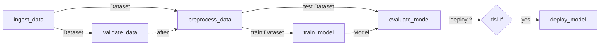

# Lab 6: Building an ML Pipeline with Kubeflow Pipelines

## General information
- **Duration:** 2 hours
- **Level:** Advanced
- **Prerequisites:** Labs 1–5 completed, Docker basics

> 🖥️ **Environment:** this lab is prepared for an Ubuntu 24.04 virtual machine (Python 3.12, Docker Engine) — setup instructions: [00_virtual_machine_setup.md](00_virtual_machine_setup.md). Run the commands in an active `venv` with the dependencies from the repository's `requirements.txt`.

## Lab objectives
After this lab the student will:
- build a complete ML Pipeline using KFP SDK v2,
- define pipeline components as Python functions,
- compile the pipeline to YAML and run it locally,
- implement conditional model deployment.

---

## Part 0: Theory in a nutshell (10 min)

**Kubeflow Pipelines (KFP)** is an ML workflow orchestrator running on Kubernetes. A pipeline is a directed acyclic graph (DAG) of **components** — each component is a Python function run in a **separate container** (`base_image` + `packages_to_install`). Components communicate via:

- **parameters** (`str`, `int`, `float`, `bool`, `dict`, `list`) — small values passed directly,
- **artifacts** (`Input[Dataset]`, `Output[Model]`, `Output[Metrics]` …) — files stored in object storage (MinIO/S3/GCS), for which the component receives a path `.path`.

Python code is **compiled to YAML** (IR – *Intermediate Representation*), which can be versioned and run on any KFP installation.



Three ways to run the pipeline in this lab (from the lightest):

| Mode | Requirements | When to use |
|------|--------------|-------------|
| YAML compilation only | `pip install kfp` | Always — verifies the definition is correct |
| `kfp.local` (`SubprocessRunner` / `DockerRunner`) | Python / Docker | Quick tests without Kubernetes, little RAM |
| KFP standalone on **kind** | Docker, ~6 GB free RAM, 4 vCPU | Full UI, run history, artifacts |

---

## Part 1: Installing and configuring KFP (20 min)

### Step 1.1: Installing the KFP SDK

The KFP SDK is already in the repository's `requirements.txt` (`kfp>=2.9,<3.0`). The local runner (`kfp.local`) is part of the SDK — **do not install** a separate `kfp-local` package (it does not exist).

```bash
pip install -r requirements.txt   # or: pip install "kfp>=2.9,<3.0"

# Verify the installation
python -c "import kfp; print(f'KFP version: {kfp.__version__}')"
python -c "from kfp import local; print('kfp.local OK')"
```

### Step 1.1a (optional): kind cluster + KFP standalone in the virtual machine

Needed only if you want to see the pipeline in the UI. Requires ~6 GB of free RAM in the VM — with 8 GB, close other programs (a browser with many tabs, IDE). If resources are lacking, stick with compilation + `kfp.local`.

```bash
# Install kind and kubectl (Linux x86_64)
curl -Lo ./kind https://kind.sigs.k8s.io/dl/v0.24.0/kind-linux-amd64
chmod +x ./kind && sudo mv ./kind /usr/local/bin/kind
curl -LO "https://dl.k8s.io/release/$(curl -Ls https://dl.k8s.io/release/stable.txt)/bin/linux/amd64/kubectl"
chmod +x kubectl && sudo mv kubectl /usr/local/bin/

# Single-node cluster
kind create cluster --name kfp

# KFP standalone (backend version compatible with SDK 2.x)
export PIPELINE_VERSION=2.3.0
kubectl apply -k "github.com/kubeflow/pipelines/manifests/kustomize/cluster-scoped-resources?ref=$PIPELINE_VERSION"
kubectl wait --for condition=established --timeout=60s crd/applications.app.k8s.io
kubectl apply -k "github.com/kubeflow/pipelines/manifests/kustomize/env/platform-agnostic?ref=$PIPELINE_VERSION"

# The first run pulls images – it may take 10–20 min
kubectl get pods -n kubeflow -w

# UI (leave it in a separate terminal), then http://localhost:8080
kubectl port-forward -n kubeflow svc/ml-pipeline-ui 8080:80
```

After class, free the resources: `kind delete cluster --name kfp`.

### Step 1.2: Pipeline project structure

```
mlops-project/
├── pipeline/
│   ├── components/
│   │   ├── __init__.py
│   │   ├── ingest.py        # data ingestion component
│   │   ├── validate.py      # validation component
│   │   ├── preprocess.py    # preprocessing component
│   │   ├── train.py         # training component
│   │   ├── evaluate.py      # evaluation component
│   │   └── deploy.py        # deployment component
│   ├── churn_pipeline.py    # pipeline definition
│   ├── run_pipeline.py      # local run (kfp.local)
│   └── submit_pipeline.py   # submission to a KFP cluster (optional)
```

> ℹ️ Always run the files from the project root directory (`mlops-project/`), e.g. `python pipeline/churn_pipeline.py` — the scripts add `.` to `sys.path` so that the `pipeline.components...` import works.

```bash
mkdir -p pipeline/components
touch pipeline/__init__.py pipeline/components/__init__.py
```

---

## Part 2: Pipeline components (60 min)

### Step 2.1: Data ingestion component

Create `pipeline/components/ingest.py`:

```python
# pipeline/components/ingest.py
"""KFP component: data ingestion and generation."""

from kfp import dsl
from kfp.dsl import Dataset, Output


@dsl.component(
    base_image="python:3.12-slim",
    packages_to_install=["pandas==2.2.3", "numpy==1.26.4", "pyarrow==17.0.0"]
)
def ingest_data(
    n_samples: int,
    seed: int,
    output_dataset: Output[Dataset]
):
    """
    Generates synthetic customer data and saves it to an artifact.
    
    In production: it would fetch data from BigQuery/Cloud Storage.
    """
    import pandas as pd
    import numpy as np
    from pathlib import Path

    np.random.seed(seed)
    n = n_samples

    age = np.random.normal(40, 12, n).clip(18, 90)
    income = np.random.lognormal(10.8, 0.5, n).clip(15000, 500000)
    tenure_months = np.random.exponential(24, n).clip(1, 240).astype(int)
    num_products = np.random.choice([1, 2, 3, 4], n, p=[0.4, 0.35, 0.15, 0.1])
    has_credit_card = np.random.binomial(1, 0.7, n)
    is_active = np.random.binomial(1, 0.8, n)
    balance = np.random.lognormal(9, 1.5, n) * is_active
    num_transactions_30d = np.random.poisson(15, n) * is_active

    churn_prob = (
        0.05
        + 0.15 * (age > 60)
        + 0.20 * (tenure_months < 6)
        + 0.10 * (num_products == 1)
        - 0.10 * is_active
        - 0.05 * has_credit_card
        + 0.15 * (balance < 1000)
    ).clip(0.02, 0.95)

    churn = np.random.binomial(1, churn_prob, n)

    df = pd.DataFrame({
        'customer_id': range(1, n + 1),
        'age': age.round(1),
        'income': income.round(2),
        'tenure_months': tenure_months,
        'num_products': num_products,
        'has_credit_card': has_credit_card,
        'is_active': is_active,
        'balance': balance.round(2),
        'num_transactions_30d': num_transactions_30d,
        'churn': churn
    })

    # Save to the KFP artifact
    Path(output_dataset.path).parent.mkdir(parents=True, exist_ok=True)
    df.to_parquet(output_dataset.path, index=False)

    print(f"✅ Generated {n:,} records")
    print(f"   Churn rate: {churn.mean():.2%}")
    print(f"   Saved to: {output_dataset.path}")
```

### Step 2.2: Data validation component

Create `pipeline/components/validate.py`:

```python
# pipeline/components/validate.py
"""KFP component: data validation."""

from kfp import dsl
from kfp.dsl import Dataset, Input, Metrics, Output


@dsl.component(
    base_image="python:3.12-slim",
    packages_to_install=["pandas==2.2.3", "pyarrow==17.0.0"]
)
def validate_data(
    input_dataset: Input[Dataset],
    validation_metrics: Output[Metrics],
    min_rows: int = 1000,
    max_churn_rate: float = 0.60,
    min_churn_rate: float = 0.01
) -> bool:
    """Validates input data and returns True if the data is correct."""
    import pandas as pd

    df = pd.read_parquet(input_dataset.path)

    errors = []
    warnings = []

    # Critical checks
    required_cols = [
        'customer_id', 'age', 'income', 'tenure_months',
        'num_products', 'has_credit_card', 'is_aactive',
        'balance', 'num_transactions_30d', 'churn'
    ]
    missing = set(required_cols) - set(df.columns)
    if missing:
        errors.append(f"Missing columns: {missing}")

    if len(df) < min_rows:
        errors.append(f"Too few rows: {len(df)} < {min_rows}")

    if df.isnull().sum().sum() > 0:
        errors.append(f"Null values: {df.isnull().sum().sum()}")

    if 'age' in df.columns and not df['age'].between(18, 100).all():
        errors.append("Age out of range [18, 100]")

    if 'churn' in df.columns:
        churn_rate = df['churn'].mean()
        if not (min_churn_rate <= churn_rate <= max_churn_rate):
            warnings.append(f"Churn rate {churn_rate:.2%} outside the expected range")

    # Logging metrics to KFP
    validation_metrics.log_metric("n_rows", len(df))
    validation_metrics.log_metric("n_columns", df.shape[1])
    validation_metrics.log_metric("n_errors", len(errors))
    validation_metrics.log_metric("n_warnings", len(warnings))
    if 'churn' in df.columns:
        validation_metrics.log_metric("churn_rate", float(df['churn'].mean()))

    if errors:
        print(f"❌ Validation FAILED: {errors}")
        return False

    if warnings:
        print(f"⚠️  Warnings: {warnings}")

    print(f"✅ Validation OK: {len(df):,} rows, {df.shape[1]} columns")
    return True
```

### Step 2.3: Preprocessing component

Create `pipeline/components/preprocess.py`:

```python
# pipeline/components/preprocess.py
"""KFP component: data preprocessing."""

from kfp import dsl
from kfp.dsl import Dataset, Input, Output, Metrics


@dsl.component(
    base_image="python:3.12-slim",
    packages_to_install=[
        "pandas==2.2.3", "scikit-learn==1.5.2",
        "numpy==1.26.4", "pyarrow==17.0.0"
    ]
)
def preprocess_data(
    input_dataset: Input[Dataset],
    train_dataset: Output[Dataset],
    test_dataset: Output[Dataset],
    preprocessing_metrics: Output[Metrics],
    test_size: float = 0.2,
    seed: int = 42
):
    """Processes the data and splits it into train/test."""
    import pandas as pd
    import numpy as np
    from sklearn.model_selection import train_test_split
    from pathlib import Path

    df = pd.read_parquet(input_dataset.path)
    initial_size = len(df)

    # Cleaning
    df = df.drop_duplicates(subset=['customer_id'])
    df = df[df['age'].between(18, 90)]
    df = df[df['income'] > 0]
    removed = initial_size - len(df)

    # Feature engineering
    df['income_per_age'] = df['income'] / df['age']
    df['balance_per_product'] = df['balance'] / df['num_products']
    df['is_long_tenure'] = (df['tenure_months'] > 24).astype(int)
    df['log_income'] = np.log1p(df['income'])
    df['log_balance'] = np.log1p(df['balance'])

    # Split
    train_df, test_df = train_test_split(
        df, test_size=test_size, random_state=seed, stratify=df['churn']
    )

    # Save
    Path(train_dataset.path).parent.mkdir(parents=True, exist_ok=True)
    Path(test_dataset.path).parent.mkdir(parents=True, exist_ok=True)
    train_df.to_parquet(train_dataset.path, index=False)
    test_df.to_parquet(test_dataset.path, index=False)

    # Metrics
    preprocessing_metrics.log_metric("initial_rows", initial_size)
    preprocessing_metrics.log_metric("removed_rows", removed)
    preprocessing_metrics.log_metric("train_rows", len(train_df))
    preprocessing_metrics.log_metric("test_rows", len(test_df))
    preprocessing_metrics.log_metric("n_features", df.shape[1] - 2)
    preprocessing_metrics.log_metric("churn_rate_train", float(train_df['churn'].mean()))

    print(f"✅ Preprocessing finished")
    print(f"   Removed: {removed} rows")
    print(f"   Train: {len(train_df):,}, Test: {len(test_df):,}")
```

### Step 2.4: Training component

Create `pipeline/components/train.py`:

```python
# pipeline/components/train.py
"""KFP component: model training."""

from kfp import dsl
from kfp.dsl import Dataset, Input, Model, Output, Metrics


@dsl.component(
    base_image="python:3.12-slim",
    packages_to_install=[
        "pandas==2.2.3", "scikit-learn==1.5.2",
        "numpy==1.26.4", "pyarrow==17.0.0", "joblib==1.4.2"
    ]
)
def train_model(
    train_dataset: Input[Dataset],
    output_model: Output[Model],
    training_metrics: Output[Metrics],
    n_estimators: int = 100,
    max_depth: int = 8,
    min_samples_split: int = 10,
    seed: int = 42
):
    """Trains a Random Forest model and saves the artifacts."""
    import pandas as pd
    import numpy as np
    import joblib
    from sklearn.ensemble import RandomForestClassifier
    from sklearn.preprocessing import StandardScaler
    from sklearn.pipeline import Pipeline
    from sklearn.model_selection import cross_val_score
    from sklearn.metrics import roc_auc_score, f1_score, accuracy_score
    from pathlib import Path

    FEATURE_COLS = [
        'age', 'income', 'tenure_months', 'num_products',
        'has_credit_card', 'is_active', 'balance',
        'num_transactions_30d', 'income_per_age',
        'balance_per_product', 'is_long_tenure',
        'log_income', 'log_balance'
    ]

    train_df = pd.read_parquet(train_dataset.path)
    available_features = [c for c in FEATURE_COLS if c in train_df.columns]

    X_train = train_df[available_features]
    y_train = train_df['churn']

    print(f"Training: {len(X_train):,} samples, {len(available_features)} features")

    # Pipeline
    pipeline = Pipeline([
        ('scaler', StandardScaler()),
        ('model', RandomForestClassifier(
            n_estimators=n_estimators,
            max_depth=max_depth,
            min_samples_split=min_samples_split,
            random_state=seed,
            n_jobs=-1,
            class_weight='balanced'
        ))
    ])

    # Cross-validation
    cv_scores = cross_val_score(pipeline, X_train, y_train, cv=5, scoring='roc_auc', n_jobs=-1)
    print(f"CV AUC: {cv_scores.mean():.4f} ± {cv_scores.std():.4f}")

    # Training on the full set
    pipeline.fit(X_train, y_train)

    # Training metrics
    y_pred = pipeline.predict(X_train)
    y_prob = pipeline.predict_proba(X_train)[:, 1]

    training_metrics.log_metric("cv_auc_mean", float(cv_scores.mean()))
    training_metrics.log_metric("cv_auc_std", float(cv_scores.std()))
    training_metrics.log_metric("train_auc", float(roc_auc_score(y_train, y_prob)))
    training_metrics.log_metric("train_f1", float(f1_score(y_train, y_pred)))
    training_metrics.log_metric("n_estimators", n_estimators)
    training_metrics.log_metric("max_depth", max_depth)
    training_metrics.log_metric("n_features", len(available_features))

    # Save the model
    Path(output_model.path).parent.mkdir(parents=True, exist_ok=True)
    model_data = {
        'pipeline': pipeline,
        'feature_cols': available_features,
        'params': {
            'n_estimators': n_estimators,
            'max_depth': max_depth,
            'seed': seed
        }
    }
    joblib.dump(model_data, output_model.path)
    print(f"✅ Model saved: {output_model.path}")
```

### Step 2.5: Evaluation component

Create `pipeline/components/evaluate.py`:

```python
# pipeline/components/evaluate.py
"""KFP component: model evaluation."""

from kfp import dsl
from kfp.dsl import Dataset, Input, Model, Metrics, Output


@dsl.component(
    base_image="python:3.12-slim",
    packages_to_install=[
        "pandas==2.2.3", "scikit-learn==1.5.2",
        "numpy==1.26.4", "pyarrow==17.0.0", "joblib==1.4.2"
    ]
)
def evaluate_model(
    test_dataset: Input[Dataset],
    input_model: Input[Model],
    evaluation_metrics: Output[Metrics],
    min_auc_threshold: float = 0.75
) -> str:
    """
    Evaluates the model on the test set.
    
    Returns:
        'deploy' if the model meets the requirements, 'reject' otherwise
    """
    import pandas as pd
    import numpy as np
    import joblib
    from sklearn.metrics import (
        roc_auc_score, f1_score, accuracy_score,
        precision_score, recall_score, average_precision_score
    )

    # Load the model and data
    model_data = joblib.load(input_model.path)
    pipeline = model_data['pipeline']
    feature_cols = model_data['feature_cols']

    test_df = pd.read_parquet(test_dataset.path)
    available_features = [c for c in feature_cols if c in test_df.columns]

    X_test = test_df[available_features]
    y_test = test_df['churn']

    # Predictions
    y_pred = pipeline.predict(X_test)
    y_prob = pipeline.predict_proba(X_test)[:, 1]

    # Metrics
    auc = float(roc_auc_score(y_test, y_prob))
    f1 = float(f1_score(y_test, y_pred))
    acc = float(accuracy_score(y_test, y_pred))
    precision = float(precision_score(y_test, y_pred))
    recall = float(recall_score(y_test, y_pred))
    avg_precision = float(average_precision_score(y_test, y_prob))

    # Logging metrics
    evaluation_metrics.log_metric("test_auc_roc", auc)
    evaluation_metrics.log_metric("test_f1", f1)
    evaluation_metrics.log_metric("test_accuracy", acc)
    evaluation_metrics.log_metric("test_precision", precision)
    evaluation_metrics.log_metric("test_recall", recall)
    evaluation_metrics.log_metric("test_avg_precision", avg_precision)
    evaluation_metrics.log_metric("n_test_samples", len(y_test))
    evaluation_metrics.log_metric("churn_rate_test", float(y_test.mean()))

    print(f"=== Evaluation results ===")
    print(f"  AUC-ROC:   {auc:.4f}")
    print(f"  F1-Score:  {f1:.4f}")
    print(f"  Accuracy:  {acc:.4f}")
    print(f"  Precision: {precision:.4f}")
    print(f"  Recall:    {recall:.4f}")
    print(f"  Avg Prec:  {avg_precision:.4f}")

    # Deployment decision
    if auc >= min_auc_threshold:
        decision = "deploy"
        print(f"\n✅ Model ACCEPTED (AUC={auc:.4f} >= {min_auc_threshold})")
    else:
        decision = "reject"
        print(f"\n❌ Model REJECTED (AUC={auc:.4f} < {min_auc_threshold})")

    evaluation_metrics.log_metric("deployment_decision", 1 if decision == "deploy" else 0)
    return decision
```

### Step 2.6: Deployment component

Create `pipeline/components/deploy.py`:

```python
# pipeline/components/deploy.py
"""KFP component: (simulated) model deployment."""

from kfp import dsl
from kfp.dsl import Input, Model


@dsl.component(
    base_image="python:3.12-slim",
    # scikit-learn is needed because joblib reconstructs the sklearn.Pipeline object
    packages_to_install=["scikit-learn==1.5.2", "joblib==1.4.2"]
)
def deploy_model(input_model: Input[Model]) -> str:
    """Loads the model and simulates deployment."""
    import joblib

    model_data = joblib.load(input_model.path)
    print("🚀 Deploying the model...")
    print(f"   Features: {model_data['feature_cols']}")
    print(f"   Parameters: {model_data['params']}")
    # In production: deployment e.g. to KServe / Vertex AI Endpoint
    return "deployed"
```

> ⚠️ A component that has both an output artifact (`Output[Metrics]`) **and** a return value (`-> str`) has several outputs. The return value is available as `task.outputs["Output"]` — `task.output` works only for components with a single output.

---

## Part 3: Defining and running the pipeline (40 min)

### Step 3.1: Main pipeline

Create `pipeline/churn_pipeline.py`:

```python
# pipeline/churn_pipeline.py
"""Definition of the complete ML pipeline for churn prediction."""

from kfp import dsl, compiler

# Import components
import sys
sys.path.insert(0, '.')

from pipeline.components.ingest import ingest_data
from pipeline.components.validate import validate_data
from pipeline.components.preprocess import preprocess_data
from pipeline.components.train import train_model
from pipeline.components.evaluate import evaluate_model
from pipeline.components.deploy import deploy_model


@dsl.pipeline(
    name="churn-prediction-pipeline",
    description="Complete ML pipeline for customer churn prediction"
)
def churn_pipeline(
    # Data parameters
    n_samples: int = 10000,
    seed: int = 42,
    test_size: float = 0.2,
    # Model parameters
    n_estimators: int = 100,
    max_depth: int = 8,
    min_samples_split: int = 10,
    # Quality gate
    min_auc_threshold: float = 0.75
):
    """
    ML pipeline: ingest → validate → preprocess → train → evaluate → [deploy]
    """

    # ── Step 1: Ingest data ─────────────────────────────────────────────────
    ingest_task = ingest_data(
        n_samples=n_samples,
        seed=seed
    )
    ingest_task.set_display_name("1. Ingest data")

    # ── Step 2: Validate data ────────────────────────────────────────────────
    validate_task = validate_data(
        input_dataset=ingest_task.outputs["output_dataset"],
        min_rows=1000
    )
    validate_task.set_display_name("2. Validate data")
    validate_task.after(ingest_task)

    # ── Step 3: Preprocessing ────────────────────────────────────────────────
    preprocess_task = preprocess_data(
        input_dataset=ingest_task.outputs["output_dataset"],
        test_size=test_size,
        seed=seed
    )
    preprocess_task.set_display_name("3. Preprocessing")
    preprocess_task.after(validate_task)

    # ── Step 4: Training ─────────────────────────────────────────────────────
    train_task = train_model(
        train_dataset=preprocess_task.outputs["train_dataset"],
        n_estimators=n_estimators,
        max_depth=max_depth,
        min_samples_split=min_samples_split,
        seed=seed
    )
    train_task.set_display_name("4. Train model")
    # Resource configuration
    train_task.set_cpu_request("1")
    train_task.set_memory_request("2Gi")

    # ── Step 5: Evaluation ───────────────────────────────────────────────────
    evaluate_task = evaluate_model(
        test_dataset=preprocess_task.outputs["test_dataset"],
        input_model=train_task.outputs["output_model"],
        min_auc_threshold=min_auc_threshold
    )
    evaluate_task.set_display_name("5. Evaluate model")

    # ── Step 6: Conditional deployment ──────────────────────────────────────
    # evaluate_model has two outputs (Metrics + return) → the return value is "Output"
    with dsl.If(evaluate_task.outputs["Output"] == "deploy", name="Deploy?"):
        deploy_task = deploy_model(
            input_model=train_task.outputs["output_model"]
        )
        deploy_task.set_display_name("6. Deploy model")


# ── Compilation ───────────────────────────────────────────────────────────────

if __name__ == "__main__":
    output_path = "pipeline/churn_pipeline.yaml"
    compiler.Compiler().compile(
        pipeline_func=churn_pipeline,
        package_path=output_path
    )
    print(f"✅ Pipeline compiled to: {output_path}")
```

### Step 3.2: Running the pipeline locally

```python
# pipeline/run_pipeline.py
"""Runs the pipeline locally (without a Kubernetes cluster)."""

import sys
sys.path.insert(0, '.')

from kfp import local
from pipeline.churn_pipeline import churn_pipeline

# Local runner initialization:
# - SubprocessRunner(use_venv=True) – each component in a separate venv
#   (packages from packages_to_install will NOT overwrite your environment),
# - local.DockerRunner() – each component in a base_image container
#   (the most faithful reproduction of the cluster, requires Docker).
local.init(
    runner=local.SubprocessRunner(use_venv=True),
    pipeline_root="./local_outputs",   # artifacts go here
)

# Running the pipeline
print("Running the pipeline locally...")
print("=" * 60)

pipeline_run = churn_pipeline(
    n_samples=5000,
    seed=42,
    test_size=0.2,
    n_estimators=50,    # fewer trees for a faster test
    max_depth=6,
    min_samples_split=10,
    min_auc_threshold=0.70
)

print("\n" + "=" * 60)
print("Pipeline finished!")
print(f"Status: {pipeline_run.state}")
```

Optionally – submitting the compiled pipeline to a KFP cluster (requires Step 1.1a and a running `port-forward`):

```python
# pipeline/submit_pipeline.py
"""Submits the pipeline to a KFP cluster (e.g. kind + port-forward)."""

import kfp

# With `kubectl port-forward -n kubeflow svc/ml-pipeline-ui 8080:80`
client = kfp.Client(host="http://localhost:8080")

run = client.create_run_from_pipeline_package(
    "pipeline/churn_pipeline.yaml",
    arguments={"n_samples": 5000, "n_estimators": 50, "min_auc_threshold": 0.70},
    experiment_name="churn-lab06",
    enable_caching=True,
)
print(f"Run ID: {run.run_id} – check in the UI: http://localhost:8080")
```

```bash
# Compile the pipeline
python pipeline/churn_pipeline.py

# Inspect the generated YAML
head -50 pipeline/churn_pipeline.yaml

# Run the pipeline locally (the first run installs packages
# in the components' venvs – a few minutes; internet access required)
python pipeline/run_pipeline.py

# You will find the artifacts (parquet, model, metrics) in:
ls -R local_outputs | head -30
```

> ℹ️ `kfp.local` supports running whole pipelines (including `dsl.If`) since KFP SDK 2.8+. Not all cluster features are available locally — e.g. `set_cpu_request()` / `set_memory_request()` are ignored, and `dsl.ParallelFor` and `dsl.ExitHandler` may not be supported. In case of a `NotImplementedError`, limit yourself to YAML compilation or use the kind cluster.

### Step 3.3: Component tests

Create `tests/unit/test_pipeline_components.py`:

```python
# tests/unit/test_pipeline_components.py
"""Unit tests for pipeline components."""

import pytest
import pandas as pd
import numpy as np
import joblib
from pathlib import Path
import sys

sys.path.insert(0, str(Path(__file__).parent.parent.parent))


class TestIngestComponent:
    """Tests for the ingest_data component."""

    def test_generates_correct_number_of_rows(self, tmp_path):
        """Test: generates the correct number of rows."""
        from pipeline.components.ingest import ingest_data

        output_path = tmp_path / "data.parquet"

        # Call the function directly (without the KFP decorator)
        import numpy as np
        import pandas as pd

        np.random.seed(42)
        n = 500
        df = pd.DataFrame({
            'customer_id': range(1, n + 1),
            'age': np.random.normal(40, 12, n).clip(18, 90),
            'income': np.random.lognormal(10.8, 0.5, n),
            'churn': np.random.binomial(1, 0.2, n)
        })
        df.to_parquet(output_path)

        loaded = pd.read_parquet(output_path)
        assert len(loaded) == n

    def test_churn_column_is_binary(self, tmp_path):
        """Test: the churn column is binary."""
        import numpy as np
        import pandas as pd

        np.random.seed(42)
        n = 200
        df = pd.DataFrame({
            'customer_id': range(1, n + 1),
            'churn': np.random.binomial(1, 0.2, n)
        })
        output_path = tmp_path / "data.parquet"
        df.to_parquet(output_path)

        loaded = pd.read_parquet(output_path)
        assert set(loaded['churn'].unique()).issubset({0, 1})


class TestPreprocessComponent:
    """Tests for the preprocess_data component."""

    @pytest.fixture
    def sample_parquet(self, tmp_path):
        """Creates a sample Parquet file."""
        np.random.seed(42)
        n = 500
        df = pd.DataFrame({
            'customer_id': range(1, n + 1),
            'age': np.random.uniform(18, 80, n),
            'income': np.random.uniform(20000, 100000, n),
            'tenure_months': np.random.randint(1, 120, n),
            'num_products': np.random.randint(1, 5, n),
            'has_credit_card': np.random.randint(0, 2, n),
            'is_active': np.random.randint(0, 2, n),
            'balance': np.random.uniform(0, 50000, n),
            'num_transactions_30d': np.random.randint(0, 50, n),
            'churn': np.random.binomial(1, 0.2, n)
        })
        path = tmp_path / "raw.parquet"
        df.to_parquet(path)
        return path

    def test_creates_engineered_features(self, sample_parquet, tmp_path):
        """Test: creates derived features."""
        df = pd.read_parquet(sample_parquet)

        # Simulate preprocessing
        df['income_per_age'] = df['income'] / df['age']
        df['balance_per_product'] = df['balance'] / df['num_products']
        df['is_long_tenure'] = (df['tenure_months'] > 24).astype(int)

        assert 'income_per_age' in df.columns
        assert 'balance_per_product' in df.columns
        assert 'is_long_tenure' in df.columns

    def test_train_test_split_ratio(self, sample_parquet, tmp_path):
        """Test: the train/test split is correct."""
        from sklearn.model_selection import train_test_split

        df = pd.read_parquet(sample_parquet)
        train_df, test_df = train_test_split(df, test_size=0.2, random_state=42)

        total = len(train_df) + len(test_df)
        test_ratio = len(test_df) / total
        assert abs(test_ratio - 0.2) < 0.05


class TestEvaluateComponent:
    """Tests for the evaluate_model component."""

    def test_deploy_decision_for_good_model(self):
        """Test: a good model gets the 'deploy' decision."""
        from sklearn.datasets import make_classification
        from sklearn.ensemble import RandomForestClassifier
        from sklearn.metrics import roc_auc_score

        X, y = make_classification(n_samples=1000, random_state=42)
        model = RandomForestClassifier(n_estimators=50, random_state=42)
        model.fit(X[:800], y[:800])

        auc = roc_auc_score(y[800:], model.predict_proba(X[800:])[:, 1])
        decision = "deploy" if auc >= 0.70 else "reject"

        assert decision == "deploy", f"Expected 'deploy', AUC={auc:.4f}"

    def test_reject_decision_for_bad_model(self):
        """Test: a bad model gets the 'reject' decision."""
        # Model with random predictions
        np.random.seed(42)
        y_true = np.random.binomial(1, 0.3, 200)
        y_prob = np.random.uniform(0, 1, 200)

        from sklearn.metrics import roc_auc_score
        auc = roc_auc_score(y_true, y_prob)
        decision = "deploy" if auc >= 0.80 else "reject"

        assert decision == "reject", f"Expected 'reject', AUC={auc:.4f}"
```

```bash
# Run the component tests
pytest tests/unit/test_pipeline_components.py -v

# Run all tests
pytest tests/ -v --tb=short
```

---

## Common problems and solutions

| Problem | Cause | Solution |
|---------|-------|----------|
| `ImportError` in a KFP component | The library is not in `packages_to_install` | Add the missing library to the `@dsl.component` decorator |
| Pipeline compilation fails | Type error in the component signature | KFP v2 requires types: `str`, `int`, `float`, `bool`, `Input[Dataset]`, `Output[Model]` |
| Component does not see the input file | Wrong artifact path | Use `input_artifact.path` instead of hardcoded paths |
| Pipeline works locally but not on K8s | Docker image missing from the registry | Build and push the base image to a Container Registry |
| Caching does not work | Changed input data or parameters | Check that `enable_caching=True` is set and that the inputs have not changed |
| `AttributeError: The task has multiple outputs` | Using `task.output` with a component that has `Output[Metrics]` and `return` | Use `task.outputs["Output"]` |
| `ERROR: No matching distribution found for kfp-local` | The package does not exist | `kfp.local` is part of `kfp>=2.5`; install only `kfp` |
| A local run changed pandas/numpy versions in the venv | `SubprocessRunner()` without `use_venv=True` installs `packages_to_install` into the current environment | Use `SubprocessRunner(use_venv=True)` or `DockerRunner()` |
| `ModuleNotFoundError: sklearn` in the deploy step | `joblib.load` reconstructs the `sklearn.Pipeline` object | Add `scikit-learn` to `packages_to_install` of the component that loads the model |
| KFP pods in kind stuck in `Pending`/`CrashLoopBackOff` | Too little RAM/CPU in the VM | Give the VM ≥ 8 GB RAM and 4 vCPU, close other applications; check `kubectl describe pod -n kubeflow <pod>`; as a last resort stay with `kfp.local` |
| `kind create cluster` → Docker permission error | The user is not in the `docker` group | `sudo usermod -aG docker $USER`, then log out and log back in |
| KFP UI unavailable at `localhost:8080` | Missing or interrupted `port-forward` | Run `kubectl port-forward -n kubeflow svc/ml-pipeline-ui 8080:80` again (leave the terminal open) |
| `kfp.Client` → `Connection refused` | As above, or wrong `host` | Use `kfp.Client(host="http://localhost:8080")` with a running port-forward |

> 💡 **Tip:** Separate business logic from KFP code — write Python functions that can be tested independently, and let KFP components be just a "wrapper" calling those functions.

> 💡 **Tip:** Use `compiler.Compiler().compile()` to generate YAML and review it — it helps you understand how KFP translates Python into a Kubernetes workflow.

---

## Exercises for independent work

1. **Add a component** `feature_selection` between preprocessing and training that removes low-importance features.
2. **Add a parameter** `model_type` to the pipeline allowing a choice between RF and GBM.
3. **Implement caching** – add `enable_caching=True` and check which steps are skipped on a re-run.
4. **Write a test** checking that the pipeline compiles without errors.
5. **Add a notification component** — send a summary of the pipeline results (metrics, deployment decision) to the console or to a file.

## Review questions

1. Why is each KFP component run in a separate container?
2. What is a KFP artifact and how does it differ from a regular parameter?
3. How does `dsl.If` work and when do we use it?
4. Why do we test components as plain Python functions rather than through KFP?
5. What are the advantages of compiling a pipeline to YAML?

## Summary

In this lab:
- ✅ You defined 5 KFP components as Python functions
- ✅ You built a complete pipeline with conditional deployment
- ✅ You compiled the pipeline to YAML and ran it locally
- ✅ You wrote unit tests for the components (separated from KFP)
