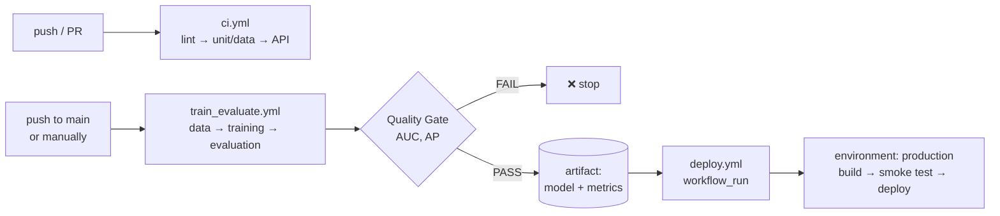
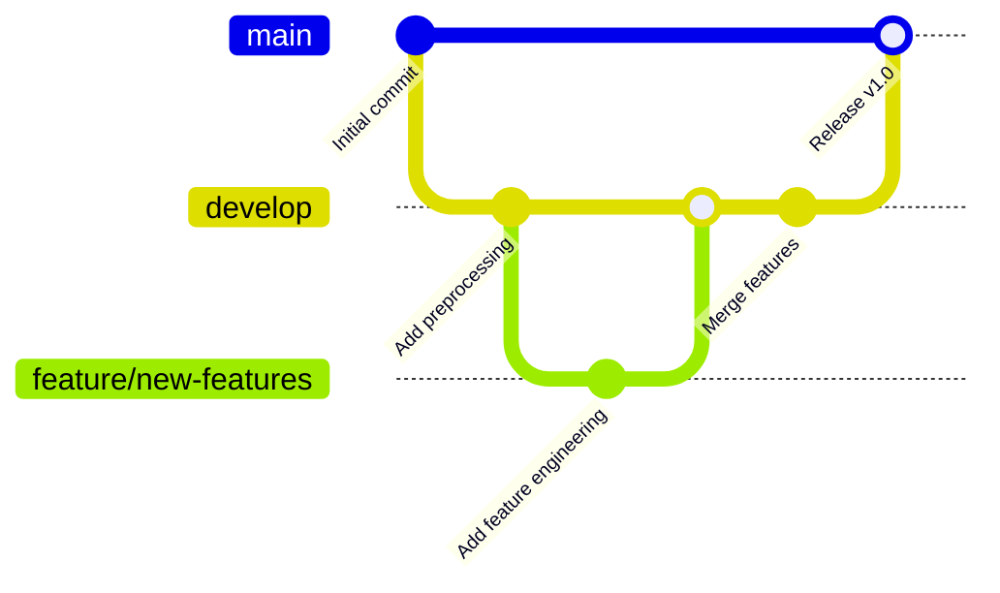

# Lab 7: CI/CD for ML with GitHub Actions

## General information
- **Duration:** 2 hours
- **Level:** Advanced
- **Prerequisites:** Labs 1–6 completed, GitHub account

> 🖥️ **Environment:** the lab is prepared for an Ubuntu 24.04 virtual machine (Python 3.12, Docker Engine, Git) — setup instructions: [00_virtual_machine_setup.md](00_virtual_machine_setup.md). The workflows use the same Python version (3.12) and the same dependencies (`requirements.txt`) as the VM — thanks to that, "works on my machine" means "works in CI".

## Lab objectives
After this lab the student will:
- configure a GitHub repository with a branching strategy,
- build a CI/CD workflow for an ML project,
- implement quality gates blocking the deployment of weak models,
- configure automatic test execution on every push.

---

## Part 0: Theory in a nutshell (10 min)

In classic software, CI/CD tests **code**. In ML the deployment artifact depends on three things: **code, data and model** — that is why a CI/CD pipeline for ML contains additional stages: data tests, training, evaluation and a **quality gate** (an automatic quality barrier that stops the deployment of a weak model).

Basic GitHub Actions concepts:

| Concept | Meaning |
|---------|-----------|
| **workflow** | a YAML file in `.github/workflows/`, triggered by an event (`on:`) |
| **job** | a set of steps on a single runner (VM); jobs run in parallel unless `needs:` is used |
| **step** | a single command (`run:`) or a ready-made action (`uses:`) |
| **artifact** | a file passed between jobs/workflows (`upload-artifact` / `download-artifact`) |
| **environment** | e.g. `production` — may require manual approval and have its own secrets |

The flow you will build:



---

## Part 1: GitHub repository configuration (20 min)

### Step 1.1: Repository initialization

```bash
cd mlops-project

# Make sure you have an initialized Git repository
git status

# Create a repository on GitHub (via GitHub CLI or manually)
# gh repo create mlops-churn-prediction --public --source=. --push

# Or manually:
git remote add origin https://github.com/YOUR_LOGIN/mlops-churn-prediction.git
git branch -M main
git push -u origin main
```

### Step 1.2: Branching strategy



Branch strategy:
- `main` – production code, only via PR
- `develop` – integration of changes
- `feature/*` – new features
- `hotfix/*` – urgent fixes

```bash
# Create the develop branch
git checkout -b develop
git push -u origin develop

# Configure protection of the main branch (via GitHub UI):
# Settings → Branches → Add rule → main
# ✅ Require pull request reviews
# ✅ Require status checks to pass
# ✅ Require branches to be up to date
```

---

## Part 2: CI workflow – Tests and Validation (40 min)

### Step 2.1: Basic CI workflow

Create `.github/workflows/ci.yml`:


```yaml
# .github/workflows/ci.yml
name: CI – Tests and Validation

on:
  push:
    branches: [main, develop]
  pull_request:
    branches: [main, develop]

env:
  PYTHON_VERSION: '3.12'

jobs:
  # ── Job 1: Linting and formatting ────────────────────────────────────────
  lint:
    name: Linting
    runs-on: ubuntu-latest

    steps:
      - uses: actions/checkout@v4

      - name: Setup Python
        uses: actions/setup-python@v5
        with:
          python-version: ${{ env.PYTHON_VERSION }}
          cache: 'pip'

      - name: Install linting tools
        run: pip install "ruff>=0.6,<1.0"   # consistent with requirements.txt

      - name: Run ruff (linting)
        run: ruff check src/ tests/ pipeline/ --output-format=github

      - name: Run ruff (formatting check)
        run: ruff format --check src/ tests/ pipeline/

  # ── Job 2: Unit tests ──────────────────────────────────────────────
  unit-tests:
    name: Unit Tests
    runs-on: ubuntu-latest
    needs: lint

    steps:
      - uses: actions/checkout@v4

      - name: Setup Python
        uses: actions/setup-python@v5
        with:
          python-version: ${{ env.PYTHON_VERSION }}
          cache: 'pip'

      - name: Install dependencies
        run: |
          pip install -r requirements.txt

      - name: Run unit tests
        run: |
          pytest tests/unit/ -v \
            --cov=src \
            --cov-report=xml \
            --cov-report=term-missing \
            --junitxml=reports/junit-unit.xml

      - name: Upload coverage report
        uses: codecov/codecov-action@v5
        with:
          files: coverage.xml
          token: ${{ secrets.CODECOV_TOKEN }}
          flags: unit-tests
        continue-on-error: true

      - name: Upload test results
        uses: actions/upload-artifact@v4
        if: always()
        with:
          name: unit-test-results
          path: reports/junit-unit.xml

  # ── Job 3: Data tests ───────────────────────────────────────────────────
  data-tests:
    name: Data Tests
    runs-on: ubuntu-latest
    needs: lint

    steps:
      - uses: actions/checkout@v4

      - name: Setup Python
        uses: actions/setup-python@v5
        with:
          python-version: ${{ env.PYTHON_VERSION }}
          cache: 'pip'

      - name: Install dependencies
        run: pip install -r requirements.txt

      - name: Generate test data
        run: python scripts/generate_data.py --n-samples 2000 --output data/raw/customers.parquet

      - name: Run preprocessing
        run: python src/data/preprocess.py

      - name: Run data tests
        run: pytest tests/data/ -v --junitxml=reports/junit-data.xml

      - name: Upload test results
        uses: actions/upload-artifact@v4
        if: always()
        with:
          name: data-test-results
          path: reports/junit-data.xml

  # ── Job 4: API tests ──────────────────────────────────────────────────────
  api-tests:
    name: API Tests
    runs-on: ubuntu-latest
    needs: unit-tests

    steps:
      - uses: actions/checkout@v4

      - name: Setup Python
        uses: actions/setup-python@v5
        with:
          python-version: ${{ env.PYTHON_VERSION }}
          cache: 'pip'

      - name: Install dependencies
        run: pip install -r requirements.txt   # includes pytest, pytest-cov, httpx

      - name: Run API tests
        run: pytest tests/model/test_api.py -v --junitxml=reports/junit-api.xml

      - name: Upload test results
        uses: actions/upload-artifact@v4
        if: always()
        with:
          name: api-test-results
          path: reports/junit-api.xml
```

### Step 2.2: Model training and evaluation workflow

Create `.github/workflows/train_evaluate.yml`:

```yaml
# .github/workflows/train_evaluate.yml
name: Train & Evaluate Model

on:
  push:
    branches: [main]
    paths:
      - 'src/**'
      - 'params.yaml'
      - 'data/**/*.dvc'
  pull_request:
    branches: [main]
  workflow_dispatch:
    inputs:
      n_samples:
        description: 'Number of training samples'
        required: false
        default: '10000'
      min_auc:
        description: 'Minimum AUC-ROC'
        required: false
        default: '0.75'

env:
  PYTHON_VERSION: '3.12'

# GITHUB_TOKEN permissions – needed to comment on PRs
permissions:
  contents: read
  pull-requests: write

jobs:
  train-and-evaluate:
    name: Train & Evaluate
    runs-on: ubuntu-latest

    steps:
      - uses: actions/checkout@v4

      - name: Setup Python
        uses: actions/setup-python@v5
        with:
          python-version: ${{ env.PYTHON_VERSION }}
          cache: 'pip'

      - name: Install dependencies
        run: pip install -r requirements.txt

      - name: Generate training data
        run: |
          python scripts/generate_data.py \
            --n-samples ${{ github.event.inputs.n_samples || '10000' }} \
            --output data/raw/customers.parquet

      - name: Preprocess data
        run: python src/data/preprocess.py

      - name: Validate data
        run: |
          python scripts/validate_data.py \
            --input data/processed/train.parquet \
            --output-report reports/metrics/validation_report.json

      - name: Train model
        run: python src/models/train.py

      - name: Evaluate model
        id: evaluate
        run: |
          python scripts/evaluate_model.py \
            --model models/churn_model.pkl \
            --test-data data/processed/test.parquet \
            --output reports/metrics/eval_metrics.json

          # Read AUC and set it as an output
          AUC=$(python -c "
          import json
          with open('reports/metrics/eval_metrics.json') as f:
              m = json.load(f)
          print(m.get('test_auc_roc', 0))
          ")
          echo "auc_roc=$AUC" >> $GITHUB_OUTPUT
          echo "Model AUC-ROC: $AUC"

      - name: Quality Gate
        run: |
          python -c "
          import json, sys
          with open('reports/metrics/eval_metrics.json') as f:
              metrics = json.load(f)
          
          min_auc = float('${{ github.event.inputs.min_auc || 0.75 }}')
          auc = metrics.get('test_auc_roc', 0)
          ap = metrics.get('test_avg_precision', 0)
          base = metrics.get('churn_rate_test', 0)
          f1 = metrics.get('test_f1', 0)
          
          print(f'AUC-ROC: {auc:.4f} (min: {min_auc})')
          print(f'Avg Precision: {ap:.4f} (baseline = churn rate {base:.4f})')
          print(f'F1-Score: {f1:.4f} (informational)')
          
          failures = []
          if auc < min_auc:
              failures.append(f'AUC {auc:.4f} < {min_auc}')
          if ap < 1.5 * base:
              failures.append(f'AP {ap:.4f} < 1.5 x churn rate')
          
          if failures:
              print(f'❌ Quality Gate FAILED: {failures}')
              sys.exit(1)
          print('✅ Quality Gate PASSED')
          "

      - name: Upload model artifacts
        uses: actions/upload-artifact@v4
        with:
          name: trained-model-${{ github.sha }}
          path: |
            models/churn_model.pkl
            reports/metrics/eval_metrics.json
          retention-days: 30

      - name: Comment PR with metrics
        if: github.event_name == 'pull_request'
        uses: actions/github-script@v7
        with:
          script: |
            const fs = require('fs');
            const metrics = JSON.parse(fs.readFileSync('reports/metrics/eval_metrics.json'));
            const body = `## 📊 Model evaluation results
            
            | Metric | Value |
            |---------|---------|
            | AUC-ROC | ${metrics.test_auc_roc?.toFixed(4) || 'N/A'} |
            | F1-Score | ${metrics.test_f1?.toFixed(4) || 'N/A'} |
            | Accuracy | ${metrics.test_accuracy?.toFixed(4) || 'N/A'} |
            | Precision | ${metrics.test_precision?.toFixed(4) || 'N/A'} |
            | Recall | ${metrics.test_recall?.toFixed(4) || 'N/A'} |
            
            **Commit:** \`${{ github.sha }}\`
            `;
            
            github.rest.issues.createComment({
              issue_number: context.issue.number,
              owner: context.repo.owner,
              repo: context.repo.repo,
              body: body
            });
```

> ℹ️ **Why not F1 ≥ 0.60?** The churn dataset is imbalanced (~12% of customers leave), and the model from Lab 1 uses the default threshold of 0.5 — F1 is then usually < 0.2 despite AUC ≈ 0.78. A gate at F1 = 0.60 would block every model. Threshold-independent metrics are better: AUC-ROC and **Average Precision** compared with the baseline level (a random model has AP ≈ the share of the positive class). If you want an F1 gate, first tune the decision threshold (task 6).

---

## Part 3: Model evaluation script (20 min)

### Step 3.1: The evaluate_model.py script

Create `scripts/evaluate_model.py`:


```python
# scripts/evaluate_model.py
"""Model evaluation on the test set."""

import sys
import json
import argparse
import time
from pathlib import Path

import pandas as pd
import joblib
from sklearn.metrics import (
    roc_auc_score, f1_score, accuracy_score,
    precision_score, recall_score, average_precision_score
)

sys.path.insert(0, '.')

FEATURE_COLS = [
    'age', 'income', 'tenure_months', 'num_products',
    'has_credit_card', 'is_active', 'balance',
    'num_transactions_30d', 'income_per_age',
    'balance_per_product', 'is_long_tenure'
]


def evaluate_model(model_path: str, test_data_path: str) -> dict:
    """Evaluates the model and returns metrics."""
    print(f"Loading model: {model_path}")
    model = joblib.load(model_path)

    print(f"Loading test data: {test_data_path}")
    test_df = pd.read_parquet(test_data_path)

    available_features = [c for c in FEATURE_COLS if c in test_df.columns]
    X_test = test_df[available_features]
    y_test = test_df['churn']

    print(f"Evaluating on {len(X_test):,} samples, {len(available_features)} features")

    # Latency measurement
    t0 = time.time()
    y_pred = model.predict(X_test)
    y_prob = model.predict_proba(X_test)[:, 1]
    latency_ms = (time.time() - t0) * 1000 / len(X_test)

    metrics = {
        "test_auc_roc": float(roc_auc_score(y_test, y_prob)),
        "test_f1": float(f1_score(y_test, y_pred)),
        "test_accuracy": float(accuracy_score(y_test, y_pred)),
        "test_precision": float(precision_score(y_test, y_pred)),
        "test_recall": float(recall_score(y_test, y_pred)),
        "test_avg_precision": float(average_precision_score(y_test, y_prob)),
        "avg_latency_ms": round(latency_ms, 3),
        "n_test_samples": len(y_test),
        "churn_rate_test": float(y_test.mean()),
        "n_features": len(available_features)
    }

    print("\n=== Evaluation results ===")
    for k, v in metrics.items():
        if isinstance(v, float):
            print(f"  {k}: {v:.4f}")
        else:
            print(f"  {k}: {v}")

    return metrics


def main():
    parser = argparse.ArgumentParser()
    parser.add_argument("--model", required=True, help="Path to the model")
    parser.add_argument("--test-data", required=True, help="Path to the test data")
    parser.add_argument("--output", default="reports/metrics/eval_metrics.json")
    args = parser.parse_args()

    metrics = evaluate_model(args.model, args.test_data)

    Path(args.output).parent.mkdir(parents=True, exist_ok=True)
    with open(args.output, "w") as f:
        json.dump(metrics, f, indent=2)

    print(f"\n✅ Metrics saved: {args.output}")


if __name__ == "__main__":
    main()
```

### Step 3.2: Testing the evaluation script

A quality gate is only as good as the script that computes the metrics — test it. Create `tests/unit/test_evaluate_model.py`:

```python
# tests/unit/test_evaluate_model.py
"""Tests of the scripts/evaluate_model.py script."""

import json
import subprocess
import sys
from pathlib import Path

import joblib
import numpy as np
import pandas as pd
import pytest
from sklearn.ensemble import RandomForestClassifier

ROOT = Path(__file__).parent.parent.parent
sys.path.insert(0, str(ROOT))

from scripts.evaluate_model import FEATURE_COLS, evaluate_model


@pytest.fixture
def model_and_data(tmp_path):
    rng = np.random.default_rng(42)
    n = 400
    df = pd.DataFrame({c: rng.normal(size=n) for c in FEATURE_COLS})
    df["churn"] = (df["age"] + rng.normal(scale=0.5, size=n) > 0).astype(int)

    model = RandomForestClassifier(n_estimators=20, random_state=42)
    model.fit(df[FEATURE_COLS], df["churn"])

    model_path = tmp_path / "model.pkl"
    data_path = tmp_path / "test.parquet"
    joblib.dump(model, model_path)
    df.to_parquet(data_path, index=False)
    return model_path, data_path


def test_returns_all_metrics(model_and_data):
    metrics = evaluate_model(*map(str, model_and_data))
    for key in ["test_auc_roc", "test_f1", "test_avg_precision", "churn_rate_test"]:
        assert key in metrics
    assert 0.0 <= metrics["test_auc_roc"] <= 1.0
    assert metrics["n_test_samples"] == 400


def test_cli_writes_json(model_and_data, tmp_path):
    model_path, data_path = model_and_data
    out = tmp_path / "metrics" / "eval.json"
    subprocess.run(
        [sys.executable, "scripts/evaluate_model.py",
         "--model", str(model_path), "--test-data", str(data_path),
         "--output", str(out)],
        check=True, cwd=ROOT,
    )
    saved = json.loads(out.read_text())
    assert saved["test_auc_roc"] > 0.8  # the data is easily separable
```

```bash
touch scripts/__init__.py    # so that the `scripts.evaluate_model` import works
pytest tests/unit/test_evaluate_model.py -v
```

---

## Part 4: Deployment workflow (20 min)

### Step 4.1: CD workflow

Create `.github/workflows/deploy.yml`:

```yaml
# .github/workflows/deploy.yml
name: Deploy Model

on:
  workflow_run:
    workflows: ["Train & Evaluate Model"]
    types: [completed]
    branches: [main]

permissions:
  contents: read
  actions: read      # required to download an artifact from another workflow (run-id)

jobs:
  deploy:
    name: Deploy to Production
    runs-on: ubuntu-latest
    if: ${{ github.event.workflow_run.conclusion == 'success' }}
    environment: production

    steps:
      - uses: actions/checkout@v4
        with:
          # we deploy exactly the commit that was trained
          ref: ${{ github.event.workflow_run.head_sha }}

      - name: Download model artifacts
        uses: actions/download-artifact@v4
        with:
          name: trained-model-${{ github.event.workflow_run.head_sha }}
          run-id: ${{ github.event.workflow_run.id }}
          github-token: ${{ secrets.GITHUB_TOKEN }}

      - name: Setup Python
        uses: actions/setup-python@v5
        with:
          python-version: '3.12'
          cache: 'pip'

      - name: Install dependencies
        run: pip install -r requirements.txt

      - name: Final quality check before deploy
        run: |
          python -c "
          import json, sys
          with open('reports/metrics/eval_metrics.json') as f:
              m = json.load(f)
          auc = m.get('test_auc_roc', 0)
          print(f'Final AUC check: {auc:.4f}')
          if auc < 0.75:
              print('❌ AUC too low – halting deployment')
              sys.exit(1)
          print('✅ Model approved for deployment')
          "

      - name: Build Docker image
        run: |
          docker build -t churn-api:${{ github.sha }} .
          docker tag churn-api:${{ github.sha }} churn-api:latest
          echo "✅ Docker image built"

      - name: Smoke test Docker image
        run: |
          docker run -d --name test-api -p 8080:8080 churn-api:latest
          sleep 10
          curl -f http://localhost:8080/health || (docker logs test-api && exit 1)
          docker stop test-api && docker rm test-api
          echo "✅ Smoke test passed"

      - name: Deploy (simulation)
        run: |
          echo "🚀 Deploying the model to the endpoint..."
          echo "   Commit: ${{ github.sha }}"
          echo "   Model: churn-api:${{ github.sha }}"
          # In production:
          # gcloud ai endpoints deploy-model ENDPOINT_ID \
          #   --model=MODEL_ID \
          #   --display-name="churn-v${{ github.sha }}"
          echo "✅ Deployment completed (simulation)"

      - name: Create deployment summary
        run: |
          cat >> $GITHUB_STEP_SUMMARY << 'EOF'
          ## 🚀 Deployment completed
          
          - **Commit:** `${{ github.sha }}`
          - **Environment:** Production
          - **Status:** ✅ Success
          EOF

      - name: Notify team
        if: always()
        run: |
          STATUS="${{ job.status }}"
          if [ "$STATUS" = "success" ]; then
            echo "✅ Deployment completed successfully"
          else
            echo "❌ Deployment failed"
          fi
          # In production: send a Slack/email notification
```

---

## Part 5: Testing workflows locally (20 min)

### Step 5.1: Local CI script

Create `scripts/run_ci_locally.sh`:


```bash
#!/bin/bash
# scripts/run_ci_locally.sh
# Simulates the CI workflow locally

set -e  # stop on error

echo "=================================================="
echo "  Local CI – MLOps Churn Prediction"
echo "=================================================="

# Colors
GREEN='\033[0;32m'
RED='\033[0;31m'
YELLOW='\033[1;33m'
NC='\033[0m'

step() { echo -e "\n${YELLOW}▶ $1${NC}"; }
ok()   { echo -e "${GREEN}✅ $1${NC}"; }
fail() { echo -e "${RED}❌ $1${NC}"; exit 1; }

# ── Step 1: Linting ──────────────────────────────────────────────────────────
step "Linting (ruff)"
ruff check src/ tests/ --quiet && ok "Linting OK" || fail "Linting FAILED"

# ── Step 2: Unit tests ─────────────────────────────────────────────────
step "Unit tests"
pytest tests/unit/ -q --tb=short && ok "Unit tests OK" || fail "Unit tests FAILED"

# ── Step 3: Data generation ────────────────────────────────────────────────
step "Generating test data"
python scripts/generate_data.py --n-samples 2000 --output data/raw/customers.parquet
ok "Data generated"

# ── Step 4: Preprocessing ────────────────────────────────────────────────────
step "Data preprocessing"
python src/data/preprocess.py && ok "Preprocessing OK" || fail "Preprocessing FAILED"

# ── Step 5: Data validation ──────────────────────────────────────────────────
step "Data validation"
python scripts/validate_data.py --input data/processed/train.parquet && ok "Validation OK" || fail "Validation FAILED"

# ── Step 6: Data tests ──────────────────────────────────────────────────────
step "Data tests"
pytest tests/data/ -q --tb=short && ok "Data tests OK" || fail "Data tests FAILED"

# ── Step 7: Model training ────────────────────────────────────────────────────
step "Model training"
python src/models/train.py && ok "Training OK" || fail "Training FAILED"

# ── Step 8: Model evaluation ──────────────────────────────────────────────────
step "Model evaluation"
python scripts/evaluate_model.py \
    --model models/churn_model.pkl \
    --test-data data/processed/test.parquet \
    --output reports/metrics/eval_metrics.json && ok "Evaluation OK" || fail "Evaluation FAILED"

# ── Step 9: Quality Gate ──────────────────────────────────────────────────────
step "Quality Gate"
python -c "
import json, sys
with open('reports/metrics/eval_metrics.json') as f:
    m = json.load(f)
auc = m.get('test_auc_roc', 0)
ap = m.get('test_avg_precision', 0)
base = m.get('churn_rate_test', 0)
print(f'AUC-ROC: {auc:.4f}')
print(f'Avg Precision: {ap:.4f} (baseline {base:.4f})')
if auc < 0.70 or ap < 1.5 * base:
    print('❌ Quality Gate FAILED')
    sys.exit(1)
print('✅ Quality Gate PASSED')
" && ok "Quality Gate OK" || fail "Quality Gate FAILED"

# ── Step 10: API tests ────────────────────────────────────────────────────────
step "API tests"
pytest tests/model/test_api.py -q --tb=short && ok "API tests OK" || fail "API tests FAILED"

echo ""
echo "=================================================="
echo -e "${GREEN}  ✅ All CI steps completed successfully!${NC}"
echo "=================================================="
```

```bash
# Set permissions and run (from the project root directory, in an active venv)
chmod +x scripts/run_ci_locally.sh
./scripts/run_ci_locally.sh
```

### Step 5.1a: Running workflows locally with `act`

[`act`](https://github.com/nektos/act) runs GitHub Actions jobs in Docker containers on your VM — without pushing and without using GitHub minutes.

```bash
# Installation (to ~/.local/bin or /usr/local/bin)
curl -s https://raw.githubusercontent.com/nektos/act/master/install.sh | sudo bash -s -- -b /usr/local/bin
act --version

# List of jobs and events detected in .github/workflows/
act -l

# Run a single job from ci.yml for the push event
# ("medium" image ~1 GB – sufficient for setup-python; the first start pulls the image)
act push -W .github/workflows/ci.yml -j lint \
    -P ubuntu-latest=catthehacker/ubuntu:act-latest

act push -W .github/workflows/ci.yml -j unit-tests \
    -P ubuntu-latest=catthehacker/ubuntu:act-latest \
    --artifact-server-path /tmp/act-artifacts

# workflow_dispatch with parameters
act workflow_dispatch -W .github/workflows/train_evaluate.yml \
    --input n_samples=2000 --input min_auc=0.70 \
    -P ubuntu-latest=catthehacker/ubuntu:act-latest \
    --artifact-server-path /tmp/act-artifacts
```

Limitations of `act`: it does not fully support `workflow_run`, `environment` with approval, or secrets from GitHub (provide them via `--secret NAME=value` or a `.secrets` file). The `codecov` step may fail — it has `continue-on-error: true`.

### Step 5.2: Committing and testing the workflows

```bash
# Create a feature branch
git checkout -b feature/add-ci-workflow

# Before pushing: fix the style so that the `lint` job does not block the rest of CI
# (code from earlier labs may have e.g. unsorted imports – I001)
ruff check --fix src/ tests/ scripts/ pipeline/
ruff format src/ tests/ scripts/ pipeline/

# Add the workflow files
git add .github/ scripts/evaluate_model.py scripts/run_ci_locally.sh
git commit -m "feat: add CI/CD workflows and evaluation script"

# Push and create a PR
git push -u origin feature/add-ci-workflow

# On GitHub: create a Pull Request to develop
# Watch the CI workflows start
```

---

## Common problems and solutions

| Problem | Cause | Solution |
|---------|-----------|-------------|
| Workflow does not start | Wrong trigger or YAML file path | The file must be in `.github/workflows/` and have a correct `on:` trigger |
| `pip install` takes 5+ minutes | No pip cache | Add `actions/setup-python` with `cache: 'pip'` |
| Secrets are not available in PRs from a fork | GitHub does not expose secrets to forks | Use `pull_request_target` instead of `pull_request` (carefully!) |
| Quality Gate passes despite bad metrics | The script does not return `sys.exit(1)` | Make sure the script ends with a non-zero code on failure |
| `act` does not work locally | No Docker or wrong image | Install Docker and use `act -P ubuntu-latest=catthehacker/ubuntu:act-latest` |
| `act`: `permission denied ... docker.sock` | The VM user is not in the `docker` group | `sudo usermod -aG docker $USER`, log out and log in again |
| `act`: no disk space / very slow start | Runner images take 1–20 GB | Use the `act-latest` (medium) image, not `full-latest`; `docker system prune` after class; give the VM ≥ 40 GB of disk |
| `act`: `Unable to get ACTIONS_RUNTIME_TOKEN` on `upload-artifact` | No local artifact server | Add `--artifact-server-path /tmp/act-artifacts` |
| `actions/upload-artifact@v3` → workflow fails | Artifact actions v1–v3 have been disabled by GitHub | Use `upload-artifact@v4` / `download-artifact@v4` (as in this lab) |
| Quality Gate always FAILED on F1 | Imbalanced classes + 0.5 threshold | Gate on AUC/Average Precision or tune the decision threshold |
| `deploy.yml` cannot download the artifact (`Not Found`) | Missing `actions: read` permission or wrong artifact name | Add `permissions: actions: read`; the name must use `workflow_run.head_sha` |
| PR comment is not created (`Resource not accessible by integration`) | `GITHUB_TOKEN` without write access to PRs | `permissions: pull-requests: write` in the workflow (or in repo settings: *Actions → Workflow permissions*) |
| `ruff` in CI reports different errors than locally | Different ruff versions | Install the same version as in `requirements.txt`/pre-commit; locally `ruff check --fix` and `ruff format` |

> 💡 **Tip:** Use `act` (https://github.com/nektos/act) to test GitHub Actions workflows locally — it saves time and GitHub minute limits.

> 💡 **Tip:** Add `concurrency` to the workflow to cancel previous runs on a new push — it prevents wasting resources on outdated commits.

```yaml
# Add at the beginning of the workflow:
concurrency:
  group: ${{ github.workflow }}-${{ github.ref }}
  cancel-in-progress: true
```

---

## Tasks for independent work

1. **Add a job** `security-scan` using `bandit` to scan Python code for vulnerabilities.
2. **Configure a cache** for pip in the workflow – measure how much it shortens execution time.
3. **Add a CI status badge** to README.md (`[]`).
4. **Implement** a `scheduled_retraining.yml` workflow that runs training every week.
5. **Add `concurrency`** to the workflow to cancel previous runs on a new push.
6. **Tune the decision threshold** — in `evaluate_model.py` determine the threshold maximizing F1 (`sklearn.metrics.precision_recall_curve`), save it in the metrics and add a condition on F1 at that threshold to the Quality Gate.

## Review questions

1. Why should the Quality Gate be a separate step and not part of training?
2. What is `environment: production` in GitHub Actions and how does it protect deployment?
3. How does `workflow_run` differ from `on: push` as a trigger?
4. Why is it worth running CI locally before pushing?
5. What does `concurrency` do in a workflow and why is it useful?

## Summary

In this lab:
- ✅ You configured a branching strategy for an ML project (main/develop/feature)
- ✅ You built a CI workflow with linting, tests and data validation
- ✅ You implemented a Quality Gate blocking weak models
- ✅ You built a CD workflow with smoke tests and notifications
- ✅ You ran full CI locally with `act`
