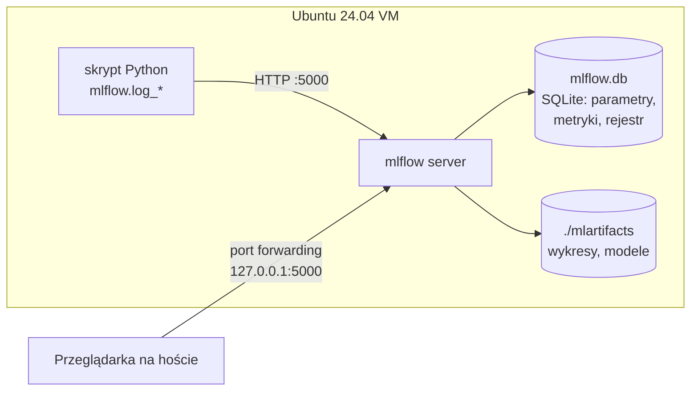
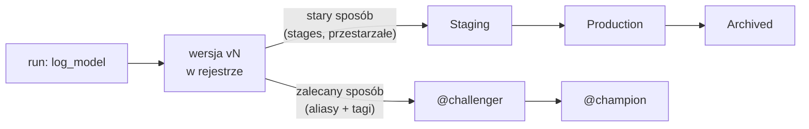

# Laboratorium 2: Śledzenie Eksperymentów z MLflow

> ℹ️ **Zanim zaczniesz:** przygotuj maszynę wirtualną Ubuntu 24.04 zgodnie z instrukcją [00_przygotowanie_maszyny_wirtualnej.md](00_przygotowanie_maszyny_wirtualnej.md) i ukończ [Laboratorium 1](lab_01_srodowisko_i_git.md) (potrzebne są pliki `data/processed/train.parquet` i `test.parquet` utworzone przez `dvc repro`). Przykłady sprawdzono z MLflow 2.x (`mlflow>=2.15,<3.0` z `requirements.txt`).

## Informacje ogólne
- **Czas:** 2 godziny
- **Poziom:** Podstawowy–Średni
- **Wymagania wstępne:** Lab 1 ukończony, podstawy scikit-learn

## Cele laboratorium
Po tym laboratorium student:
- uruchomi lokalny serwer MLflow i skonfiguruje tracking,
- zaloguje parametry, metryki i artefakty do MLflow,
- porówna eksperymenty w UI MLflow,
- zarejestruje model w MLflow Model Registry.

## Teoria: po co śledzić eksperymenty?

Bez narzędzia do śledzenia wyniki eksperymentów kończą w notatkach, nazwach plików (`model_final_v2_NEW.pkl`) i pamięci autora. MLflow Tracking zapisuje dla każdego uruchomienia **co** zostało wytrenowane, **z jakimi parametrami**, **na jakich danych** i **z jakim wynikiem** — dzięki temu eksperyment da się porównać i odtworzyć.

| Pojęcie | Znaczenie | Przykład |
|--------|-----------|----------|
| **Experiment** | Grupa powiązanych runów (jeden problem biznesowy) | `churn-prediction` |
| **Run** | Pojedyncze uruchomienie kodu treningowego | `RF-deep` |
| **Parameter** | Wartość wejściowa, zapisywana raz (string) | `max_depth=10` |
| **Metric** | Wartość liczbowa, może mieć historię (`step`) | `auc_roc=0.79` |
| **Tag** | Dowolna etykieta do filtrowania | `model_type=tree` |
| **Artifact** | Plik wynikowy: wykres, JSON, model | `plots/roc_curve.png` |
| **Registered Model** | Nazwany model w rejestrze z numerowanymi wersjami | `churn-randomforestclassifier` v3 |
| **Alias** | Ruchoma etykieta wskazująca wersję modelu | `@champion` → v3 |

Architektura używana w laboratorium:



- **Backend store** (SQLite/PostgreSQL) przechowuje metadane. Model Registry wymaga backendu bazodanowego — dlatego `sqlite:///mlflow.db`, a nie katalog plików.
- **Artifact store** przechowuje pliki. Z opcją `--artifacts-destination` klient wysyła artefakty **przez serwer** (proxy HTTP), więc nie musi mieć dostępu do dysku serwera.

**Pułapki:**
- Parametru nie można nadpisać inną wartością w tym samym runie (`MlflowException: Changing param values is not allowed`).
- Metryka na zbiorze testowym przy wielu próbach "podglądania" przestaje być obiektywna — do wyboru modelu używaj CV na zbiorze treningowym.
- Przy niezbalansowanych klasach (tu ~10% churnu) wysokie `accuracy` nic nie znaczy, a `F1`/`recall` przy progu 0.5 bywają bliskie 0 — patrz `auc_roc` i `precision`/`recall`.

---

## Część 1: Uruchomienie MLflow (20 min)

### Krok 1.1: Start serwera MLflow

```bash
# Aktywuj środowisko
source mlops-env/bin/activate  # Linux/Mac
# mlops-env\Scripts\activate   # Windows
cd mlops-project

# Uruchom MLflow UI w OSOBNYM terminalu (zostaw go otwartego; Ctrl+C zatrzymuje serwer)
mlflow server \
    --backend-store-uri sqlite:///mlflow.db \
    --artifacts-destination ./mlartifacts \
    --host 0.0.0.0 \
    --port 5000

# W drugim terminalu: sprawdź czy działa (oczekiwana odpowiedź: OK)
curl http://localhost:5000/health
# Otwórz w przeglądarce: http://localhost:5000
```

> 💡 `--host 0.0.0.0` oznacza nasłuchiwanie na wszystkich interfejsach sieciowych VM — jest potrzebne, aby UI było dostępne z przeglądarki na komputerze-hoście. Przy domyślnym `127.0.0.1` serwer jest widoczny tylko wewnątrz VM. Nie wystawiaj tak serwera w sieci publicznej — MLflow domyślnie nie ma uwierzytelniania.

**Dostęp z hosta (VirtualBox, karta sieciowa NAT):** *Ustawienia VM → Sieć → Karta 1 (NAT) → Zaawansowane → Przekierowanie portów* i dodaj regułę: protokół TCP, port hosta `5000`, port gościa `5000` (IP można zostawić puste). Albo z terminala hosta (VM wyłączona):

```bash
VBoxManage modifyvm "nazwa-VM" --natpf1 "mlflow,tcp,,5000,,5000"
```

Następnie na hoście otwórz `http://localhost:5000`. Jeśli port 5000 jest zajęty (np. na macOS przez AirPlay Receiver), użyj `--port 5001` i takiego samego przekierowania. Jeśli w VM działa zapora `ufw`: `sudo ufw allow 5000/tcp`.

### Krok 1.2: Konfiguracja klienta MLflow

Adres serwera można podać w kodzie (`mlflow.set_tracking_uri`) albo zmienną środowiskową — ta druga opcja pozwala uruchamiać ten sam kod lokalnie i w CI bez zmian:

```bash
export MLFLOW_TRACKING_URI=http://localhost:5000
```

Pomocnicza funkcja (opcjonalna — skrypty poniżej ustawiają URI samodzielnie):

```python
# configs/mlflow_config.py
import mlflow

def setup_mlflow(
    tracking_uri: str = "http://localhost:5000",
    experiment_name: str = "churn-prediction"
) -> str:
    """Konfiguruje MLflow i zwraca ID eksperymentu."""
    mlflow.set_tracking_uri(tracking_uri)
    
    # Utwórz lub pobierz eksperyment
    experiment = mlflow.get_experiment_by_name(experiment_name)
    if experiment is None:
        experiment_id = mlflow.create_experiment(
            experiment_name,
            tags={
                "project": "churn-prediction",
                "team": "mlops-lab",
                "version": "1.0"
            }
        )
        print(f"Utworzono eksperyment: {experiment_name} (ID: {experiment_id})")
    else:
        experiment_id = experiment.experiment_id
        print(f"Używam eksperymentu: {experiment_name} (ID: {experiment_id})")
    
    mlflow.set_experiment(experiment_name)
    return experiment_id
```

---

## Część 2: Logowanie eksperymentów (40 min)

### Krok 2.1: Podstawowy eksperyment

Utwórz `src/models/experiment.py`:

```python
# src/models/experiment.py
"""Eksperymenty ML z pełnym logowaniem do MLflow."""

import os
import mlflow
import mlflow.sklearn
import pandas as pd
import numpy as np
import json
import time
import tempfile
import matplotlib
matplotlib.use("Agg")  # zapis wykresów do plików bez okna (działa też przez SSH)
import matplotlib.pyplot as plt
from pathlib import Path
from sklearn.preprocessing import StandardScaler
from sklearn.pipeline import Pipeline
from sklearn.model_selection import cross_val_score
from sklearn.metrics import (
    roc_auc_score, f1_score, accuracy_score,
    precision_score, recall_score,
    RocCurveDisplay, ConfusionMatrixDisplay
)

# Konfiguracja MLflow (zmienna MLFLOW_TRACKING_URI ma pierwszeństwo)
mlflow.set_tracking_uri(os.getenv("MLFLOW_TRACKING_URI", "http://localhost:5000"))
mlflow.set_experiment("churn-prediction")

FEATURE_COLS = [
    'age', 'income', 'tenure_months', 'num_products',
    'has_credit_card', 'is_active', 'balance',
    'num_transactions_30d', 'income_per_age',
    'balance_per_product', 'is_long_tenure'
]

def load_data(train_path: str, test_path: str):
    """Wczytuje dane treningowe i testowe."""
    train_df = pd.read_parquet(train_path)
    test_df = pd.read_parquet(test_path)
    
    X_train = train_df[FEATURE_COLS]
    y_train = train_df['churn']
    X_test = test_df[FEATURE_COLS]
    y_test = test_df['churn']
    
    return X_train, X_test, y_train, y_test

def compute_metrics(model, X_test, y_test) -> dict:
    """Oblicza kompletny zestaw metryk."""
    y_pred = model.predict(X_test)
    y_prob = model.predict_proba(X_test)[:, 1]
    
    return {
        "auc_roc": float(roc_auc_score(y_test, y_prob)),
        # zero_division=0: brak ostrzeżenia, gdy model nie przewidzi żadnego churnu
        "f1_score": float(f1_score(y_test, y_pred, zero_division=0)),
        "accuracy": float(accuracy_score(y_test, y_pred)),
        "precision": float(precision_score(y_test, y_pred, zero_division=0)),
        "recall": float(recall_score(y_test, y_pred, zero_division=0)),
    }

def plot_roc_curve(model, X_test, y_test, save_path: str):
    """Rysuje i zapisuje krzywą ROC."""
    fig, ax = plt.subplots(figsize=(8, 6))
    RocCurveDisplay.from_estimator(model, X_test, y_test, ax=ax)
    ax.set_title("ROC Curve – Churn Prediction")
    plt.tight_layout()
    plt.savefig(save_path, dpi=100, bbox_inches='tight')
    plt.close()

def plot_confusion_matrix(model, X_test, y_test, save_path: str):
    """Rysuje i zapisuje macierz pomyłek."""
    fig, ax = plt.subplots(figsize=(6, 5))
    ConfusionMatrixDisplay.from_estimator(
        model, X_test, y_test,
        display_labels=['Brak churnu', 'Churn'],
        ax=ax
    )
    ax.set_title("Macierz pomyłek")
    plt.tight_layout()
    plt.savefig(save_path, dpi=100, bbox_inches='tight')
    plt.close()

def run_experiment(
    model_class,
    model_params: dict,
    run_name: str,
    X_train, X_test, y_train, y_test,
    tags: dict = None
) -> tuple[str, dict]:
    """
    Uruchamia jeden eksperyment i loguje wszystko do MLflow.
    
    Returns:
        (run_id, metrics)
    """
    with mlflow.start_run(run_name=run_name, tags=tags or {}) as run:
        run_id = run.info.run_id
        
        # --- Logowanie parametrów ---
        mlflow.log_params(model_params)
        mlflow.log_param("model_class", model_class.__name__)
        mlflow.log_param("n_train_samples", len(X_train))
        mlflow.log_param("n_test_samples", len(X_test))
        mlflow.log_param("n_features", X_train.shape[1])
        mlflow.log_param("churn_rate_train", float(y_train.mean()))
        
        # --- Trening ---
        t0 = time.time()
        pipeline = Pipeline([
            ('scaler', StandardScaler()),
            ('model', model_class(**model_params, random_state=42))
        ])
        pipeline.fit(X_train, y_train)
        train_time = time.time() - t0
        
        mlflow.log_metric("training_time_seconds", train_time)
        
        # --- Ewaluacja ---
        metrics = compute_metrics(pipeline, X_test, y_test)
        mlflow.log_metrics(metrics)
        
        # --- Cross-validation ---
        cv_scores = cross_val_score(
            pipeline, X_train, y_train, cv=5, scoring='roc_auc', n_jobs=-1
        )
        mlflow.log_metric("cv_auc_mean", float(cv_scores.mean()))
        mlflow.log_metric("cv_auc_std", float(cv_scores.std()))
        
        # --- Wykresy jako artefakty (osobny katalog tymczasowy dla każdego runu) ---
        art_dir = Path(tempfile.mkdtemp(prefix="mlflow_artifacts_"))
        
        plot_roc_curve(pipeline, X_test, y_test, str(art_dir / "roc_curve.png"))
        plot_confusion_matrix(pipeline, X_test, y_test, str(art_dir / "confusion_matrix.png"))
        
        mlflow.log_artifact(str(art_dir / "roc_curve.png"), "plots")
        mlflow.log_artifact(str(art_dir / "confusion_matrix.png"), "plots")
        
        # --- Feature importance (dla modeli drzewiastych) ---
        model = pipeline.named_steps['model']
        if hasattr(model, 'feature_importances_'):
            importances = model.feature_importances_
            fi_dict = dict(zip(FEATURE_COLS, importances.tolist()))
            
            # Zapisz jako JSON (alternatywa bez pliku: mlflow.log_dict(fi_dict, "feature_importance.json"))
            with open(art_dir / "feature_importance.json", "w") as f:
                json.dump(fi_dict, f, indent=2)
            mlflow.log_artifact(str(art_dir / "feature_importance.json"))
            
            # Wykres
            fig, ax = plt.subplots(figsize=(10, 6))
            sorted_idx = np.argsort(importances)[::-1]
            ax.bar(range(len(FEATURE_COLS)), importances[sorted_idx])
            ax.set_xticks(range(len(FEATURE_COLS)))
            ax.set_xticklabels([FEATURE_COLS[i] for i in sorted_idx], rotation=45, ha='right')
            ax.set_title(f"Feature Importance – {model_class.__name__}")
            plt.tight_layout()
            plt.savefig(art_dir / "feature_importance.png", dpi=100)
            plt.close()
            mlflow.log_artifact(str(art_dir / "feature_importance.png"), "plots")
        
        # --- Logowanie modelu ---
        # input_example pozwala MLflow wyznaczyć sygnaturę (schemat wejścia/wyjścia)
        mlflow.sklearn.log_model(
            pipeline,
            artifact_path="model",
            input_example=X_train.head(5),
            registered_model_name=f"churn-{model_class.__name__.lower()}"
        )
        
        print(f"✅ {run_name}: AUC={metrics['auc_roc']:.4f}, F1={metrics['f1_score']:.4f}")
        print(f"   Run ID: {run_id}")
        
        return run_id, metrics
```

### Krok 2.2: Uruchomienie wielu eksperymentów

```python
# scripts/run_experiments.py
"""Uruchamia serię eksperymentów i porównuje wyniki."""

import sys
sys.path.insert(0, '.')

import pandas as pd
from sklearn.ensemble import RandomForestClassifier, GradientBoostingClassifier
from sklearn.linear_model import LogisticRegression

from src.models.experiment import load_data, run_experiment

# Wczytaj dane
X_train, X_test, y_train, y_test = load_data(
    "data/processed/train.parquet",
    "data/processed/test.parquet"
)

# Definicja eksperymentów
experiments = [
    # Baseline: Regresja logistyczna
    (LogisticRegression, {"C": 1.0, "max_iter": 1000}, "LR-baseline",
     {"model_type": "linear", "purpose": "baseline"}),
    
    # Random Forest – różne głębokości
    (RandomForestClassifier, {"n_estimators": 100, "max_depth": 5}, "RF-shallow",
     {"model_type": "tree", "purpose": "experiment"}),
    
    (RandomForestClassifier, {"n_estimators": 100, "max_depth": 10}, "RF-medium",
     {"model_type": "tree", "purpose": "experiment"}),
    
    (RandomForestClassifier, {"n_estimators": 200, "max_depth": 15}, "RF-deep",
     {"model_type": "tree", "purpose": "experiment"}),
    
    # Gradient Boosting
    (GradientBoostingClassifier, {"n_estimators": 100, "learning_rate": 0.1, "max_depth": 4},
     "GBM-default", {"model_type": "boosting", "purpose": "experiment"}),
    
    (GradientBoostingClassifier, {"n_estimators": 200, "learning_rate": 0.05, "max_depth": 5},
     "GBM-tuned", {"model_type": "boosting", "purpose": "experiment"}),
]

# Uruchom eksperymenty
results = []
for model_class, params, name, tags in experiments:
    run_id, metrics = run_experiment(
        model_class, params, name,
        X_train, X_test, y_train, y_test,
        tags=tags
    )
    results.append({"name": name, "run_id": run_id, **metrics})

# Podsumowanie
results_df = pd.DataFrame(results).sort_values("auc_roc", ascending=False)
print("\n=== Ranking eksperymentów ===")
print(results_df[["name", "auc_roc", "f1_score", "precision", "recall"]].to_string(index=False))
print(f"\nNajlepszy model: {results_df.iloc[0]['name']} (AUC={results_df.iloc[0]['auc_roc']:.4f})")
```

```bash
# Uruchom eksperymenty (z katalogu mlops-project; serwer MLflow musi działać)
python scripts/run_experiments.py

# Otwórz MLflow UI i porównaj wyniki
# http://localhost:5000
```

> ⏱️ Na VM z 2 vCPU i 50 tys. wierszy całość (6 modeli × trening + 5-krotna CV) trwa kilka minut; najdłużej `GBM-tuned`. Aby przyspieszyć, wygeneruj mniejszy zbiór w Lab 1 albo zmniejsz `cv=5` do `cv=3`.

> ℹ️ Wyniki dla danych syntetycznych z Lab 1: AUC ok. 0.74 (LR) i ok. 0.79–0.80 (RF/GBM). `F1` i `recall` są bardzo niskie (czasem 0.0), bo przy ~10% churnu modele rzadko przekraczają próg 0.5 — to dobry punkt wyjścia do dyskusji o progu decyzyjnym i `class_weight="balanced"`.

---

## Część 3: MLflow Model Registry (30 min)

### Krok 3.1: Rejestracja i zarządzanie modelami

Każde wywołanie `log_model(..., registered_model_name=...)` tworzy nową **wersję** modelu w rejestrze (v1, v2, ...). Cykl życia wersji można opisać na dwa sposoby:



> ⚠️ **Stages są przestarzałe** od MLflow 2.9: `transition_model_version_stage` i `get_latest_versions` działają w MLflow 2.x, ale wypisują `FutureWarning` i zostaną usunięte w przyszłej wersji. Poniższy skrypt pokazuje klasyczny przepływ Staging → Production (często spotykany w istniejących projektach), a Krok 3.2 — zalecany wariant z aliasami.

```python
# scripts/manage_registry.py
"""Zarządzanie modelami w MLflow Model Registry."""

import mlflow
from mlflow.tracking import MlflowClient

mlflow.set_tracking_uri("http://localhost:5000")
client = MlflowClient()

MODEL_NAME = "churn-randomforestclassifier"

def list_registered_models():
    """Wyświetla wszystkie zarejestrowane modele i ich wersje."""
    print("\n=== Zarejestrowane modele ===")
    for rm in client.search_registered_models():
        print(f"\nModel: {rm.name}")
        for mv in client.search_model_versions(f"name='{rm.name}'"):
            print(f"  v{mv.version} | stage={mv.current_stage} | run={mv.run_id[:8]}...")

def promote_best_model(model_name: str, min_auc: float = 0.80):
    """Promuje najlepszy model do Staging."""
    
    # Znajdź wszystkie wersje modelu
    versions = client.search_model_versions(f"name='{model_name}'")
    
    best_version = None
    best_auc = 0
    
    for mv in versions:
        run = client.get_run(mv.run_id)
        auc = run.data.metrics.get("auc_roc", 0)
        
        if auc > best_auc and auc >= min_auc:
            best_auc = auc
            best_version = mv.version
    
    if best_version is None:
        print(f"❌ Brak modelu z AUC >= {min_auc}")
        return None
    
    # Przenieś do Staging
    client.transition_model_version_stage(
        name=model_name,
        version=best_version,
        stage="Staging",
        archive_existing_versions=False
    )
    
    # Dodaj opis
    client.update_model_version(
        name=model_name,
        version=best_version,
        description=f"Najlepszy model. AUC={best_auc:.4f}. Promowany automatycznie."
    )
    
    print(f"✅ Model v{best_version} promowany do Staging (AUC={best_auc:.4f})")
    return best_version

def promote_to_production(model_name: str, version: str):
    """Promuje model ze Staging do Production."""
    
    # Archiwizuj poprzedni model produkcyjny
    prod_versions = client.get_latest_versions(model_name, stages=["Production"])
    for pv in prod_versions:
        client.transition_model_version_stage(
            name=model_name,
            version=pv.version,
            stage="Archived"
        )
        print(f"📦 Zarchiwizowano v{pv.version}")
    
    # Promuj nowy model
    client.transition_model_version_stage(
        name=model_name,
        version=version,
        stage="Production"
    )
    print(f"🚀 Model v{version} wdrożony do Production!")

def load_production_model(model_name: str):
    """Ładuje aktualny model produkcyjny."""
    model_uri = f"models:/{model_name}/Production"
    model = mlflow.sklearn.load_model(model_uri)
    print(f"✅ Załadowano model produkcyjny: {model_uri}")
    return model

# Uruchomienie
list_registered_models()

staging_version = promote_best_model(MODEL_NAME, min_auc=0.75)

if staging_version:
    # Symulacja testów przed wdrożeniem
    print("\nUruchamianie testów integracyjnych...")
    # ... testy ...
    print("✅ Testy przeszły pomyślnie")
    
    promote_to_production(MODEL_NAME, staging_version)
    
    # Załaduj model produkcyjny
    prod_model = load_production_model(MODEL_NAME)
    print(f"Model załadowany: {type(prod_model)}")
```

```bash
python scripts/manage_registry.py
```

### Krok 3.2: Zalecany wariant — aliasy i tagi

Alias to nazwana, przesuwalna etykieta (np. `champion`) wskazująca konkretną wersję. Kod serwujący ładuje zawsze `models:/<nazwa>@champion`, a "wdrożenie" nowej wersji to przestawienie aliasu — bez zmian w kodzie.

```python
# scripts/registry_aliases.py
"""Zarządzanie wersjami modelu przez aliasy (MLflow >= 2.9)."""

import mlflow
from mlflow import MlflowClient

mlflow.set_tracking_uri("http://localhost:5000")
client = MlflowClient()

MODEL_NAME = "churn-randomforestclassifier"

# Wybierz wersję z najwyższym AUC
versions = client.search_model_versions(f"name='{MODEL_NAME}'")
best = max(versions, key=lambda mv: client.get_run(mv.run_id).data.metrics.get("auc_roc", 0))

# Oznacz wersję tagiem i ustaw alias "champion" (poprzednie wskazanie aliasu jest zastępowane)
client.set_model_version_tag(MODEL_NAME, best.version, "validation_status", "approved")
client.set_registered_model_alias(MODEL_NAME, "champion", best.version)

mv = client.get_model_version_by_alias(MODEL_NAME, "champion")
print(f"@champion -> v{mv.version}, tagi: {mv.tags}")

# Ładowanie modelu po aliasie — bez znajomości numeru wersji i ścieżki
model = mlflow.sklearn.load_model(f"models:/{MODEL_NAME}@champion")
print(f"Załadowano: {type(model).__name__}")
```

```bash
python scripts/registry_aliases.py
```

---

## Część 4: Porównanie eksperymentów (30 min)

### Krok 4.1: Programowe porównanie przez API

```python
# scripts/compare_experiments.py
"""Porównuje eksperymenty i generuje raport."""

import mlflow
import pandas as pd
import matplotlib
matplotlib.use('Agg')  # musi być wywołane PRZED importem pyplot
import matplotlib.pyplot as plt
from pathlib import Path

mlflow.set_tracking_uri("http://localhost:5000")
client = mlflow.tracking.MlflowClient()

def get_experiment_results(experiment_name: str) -> pd.DataFrame:
    """Pobiera wyniki wszystkich runów z eksperymentu."""
    experiment = client.get_experiment_by_name(experiment_name)
    if not experiment:
        raise ValueError(f"Eksperyment '{experiment_name}' nie istnieje")
    
    runs = client.search_runs(
        experiment_ids=[experiment.experiment_id],
        order_by=["metrics.auc_roc DESC"]
    )
    
    rows = []
    for run in runs:
        rows.append({
            "run_name": run.data.tags.get("mlflow.runName", "N/A"),
            "model_class": run.data.params.get("model_class", "N/A"),
            "auc_roc": run.data.metrics.get("auc_roc", 0),
            "f1_score": run.data.metrics.get("f1_score", 0),
            "precision": run.data.metrics.get("precision", 0),
            "recall": run.data.metrics.get("recall", 0),
            "cv_auc_mean": run.data.metrics.get("cv_auc_mean", 0),
            "cv_auc_std": run.data.metrics.get("cv_auc_std", 0),
            "training_time": run.data.metrics.get("training_time_seconds", 0),
            "run_id": run.info.run_id,
            "status": run.info.status
        })
    
    return pd.DataFrame(rows)

# Pobierz wyniki
df = get_experiment_results("churn-prediction")

print("=== Wyniki eksperymentów ===")
print(df[["run_name", "auc_roc", "f1_score", "cv_auc_mean", "training_time"]].to_string(index=False))

# Wykres porównawczy
fig, axes = plt.subplots(1, 3, figsize=(15, 5))

# AUC-ROC
axes[0].barh(df['run_name'], df['auc_roc'], color='steelblue')
axes[0].set_xlabel('AUC-ROC')
axes[0].set_title('AUC-ROC per model')
axes[0].axvline(x=0.80, color='red', linestyle='--', label='Próg 0.80')
axes[0].legend()

# F1 Score
axes[1].barh(df['run_name'], df['f1_score'], color='green')
axes[1].set_xlabel('F1 Score')
axes[1].set_title('F1 Score per model')

# Czas treningu
axes[2].barh(df['run_name'], df['training_time'], color='orange')
axes[2].set_xlabel('Czas treningu (s)')
axes[2].set_title('Czas treningu per model')

plt.tight_layout()
Path("reports/figures").mkdir(parents=True, exist_ok=True)
plt.savefig("reports/figures/experiment_comparison.png", dpi=100, bbox_inches='tight')
print("\nWykres zapisany: reports/figures/experiment_comparison.png")

# Najlepszy model
best = df.iloc[0]
print(f"\n🏆 Najlepszy model: {best['run_name']}")
print(f"   AUC-ROC: {best['auc_roc']:.4f}")
print(f"   F1:      {best['f1_score']:.4f}")
print(f"   CV AUC:  {best['cv_auc_mean']:.4f} ± {best['cv_auc_std']:.4f}")
```

```bash
python scripts/compare_experiments.py
```

---

## Typowe problemy i rozwiązania

| Problem | Przyczyna | Rozwiązanie |
|---------|-----------|-------------|
| `ConnectionRefusedError` przy logowaniu | Serwer MLflow nie jest uruchomiony | Uruchom `mlflow server` w osobnym terminalu |
| `ImportError: cannot import name 'FallbackAsyncAdaptedQueuePool' from 'sqlalchemy.pool'` | MLflow 2.x z SQLAlchemy 2.1 | `pip install "sqlalchemy<2.1"` |
| UI działa w VM, ale nie na hoście | Serwer słucha na `127.0.0.1` lub brak przekierowania portu | Startuj z `--host 0.0.0.0`; dodaj regułę NAT port forwarding 5000→5000 w VirtualBox; sprawdź `sudo ufw status` |
| `[ERROR] Connection in use: ('0.0.0.0', 5000)` | Port zajęty (np. stary serwer w tle) | `ss -ltnp \| grep 5000`, zakończ proces (`kill <PID>`) lub użyj `--port 5001` |
| `FutureWarning: ... transition_model_version_stage is deprecated` | Stages są przestarzałe od MLflow 2.9 | Ostrzeżenie można zignorować; docelowo użyj aliasów (Krok 3.2) |
| `UserWarning: Hint: Inferred schema contains integer column(s)` przy `log_model` | Sygnatura wyznaczona z `input_example` z kolumnami `int` | Tylko informacja; w produkcji rzutuj cechy na `float`, jeśli mogą mieć braki |
| `UndefinedMetricWarning` / `F1 = 0.0` | Model nie przewiduje klasy 1 przy progu 0.5 (niezbalansowane dane) | `zero_division=0`, `class_weight="balanced"` lub zmiana progu |
| `ModuleNotFoundError: No module named 'src'` | Skrypt uruchomiony spoza katalogu `mlops-project` | Uruchamiaj z katalogu głównego projektu: `python scripts/run_experiments.py` |
| `FileNotFoundError: data/processed/train.parquet` | Nie uruchomiono pipeline'u z Lab 1 | `dvc repro` (lub `dvc pull`) |
| Brak okna z wykresem / błąd `TclError: no display` | Brak środowiska graficznego (SSH) | `matplotlib.use("Agg")` przed importem `pyplot` — wykresy zapisywane są do plików |
| Eksperymenty nie pojawiają się w UI | Zły `tracking_uri` | Sprawdź `mlflow.get_tracking_uri()` — powinien wskazywać na serwer |
| `MlflowException: RESOURCE_ALREADY_EXISTS` | Eksperyment o tej nazwie już istnieje | Użyj `mlflow.set_experiment()` zamiast `create_experiment()` |
| Model Registry nie działa | Backend store to plik (nie baza danych) | Użyj `--backend-store-uri sqlite:///mlflow.db` przy starcie serwera |
| Artefakty nie są widoczne w UI / `PermissionError` przy `log_artifact` | Klient zapisuje artefakty bezpośrednio na dysk (`--default-artifact-root` z lokalną ścieżką), a nie przez serwer | Startuj serwer z `--artifacts-destination ./mlartifacts` (proxy artefaktów) |

> 💡 **Wskazówka:** Aby porównać eksperymenty w UI MLflow, zaznacz kilka runów checkboxem i kliknij „Compare". Zobaczysz wykresy porównawcze metryk i parametrów.

> 💡 **Wskazówka:** Używaj `mlflow.autolog()` dla szybkiego logowania — automatycznie loguje parametry, metryki i model dla scikit-learn, PyTorch, TensorFlow i innych frameworków.

---

## Zadania do samodzielnego wykonania

1. **Dodaj nowy eksperyment** z XGBoost (`pip install xgboost`) i porównaj z Random Forest.
2. **Zaloguj dodatkową metrykę** – AUC-PR (Precision-Recall AUC) dla niezbalansowanych klas.
3. **Dodaj tag** `data_version` do każdego runu i filtruj po nim w UI.
4. **Napisz skrypt** który automatycznie promuje model do Production jeśli jego AUC jest lepsze od aktualnego modelu produkcyjnego.
5. **Użyj `mlflow.autolog()`** — uruchom eksperyment z automatycznym logowaniem i porównaj, co zostało zalogowane vs ręczne logowanie.

## Pytania kontrolne

1. Jaka jest różnica między `mlflow.log_param` a `mlflow.log_metric`?
2. Co to jest MLflow Model Registry i jakie stany może mieć model? Czym różnią się stages od aliasów?
3. Dlaczego logujemy CV AUC zamiast tylko AUC na zbiorze testowym?
4. Jak załadować model z MLflow Registry bez znajomości ścieżki do pliku?
5. Co robi `mlflow.autolog()` i kiedy warto go używać?

## Podsumowanie

W tym laboratorium:
- ✅ Uruchomiłeś lokalny serwer MLflow z bazą SQLite
- ✅ Zalogowałeś parametry, metryki, wykresy i modele
- ✅ Porównałeś 6 różnych modeli w UI MLflow
- ✅ Zarejestrowałeś model w Model Registry i zarządzałeś jego cyklem życia (Staging → Production oraz aliasy `@champion`)
