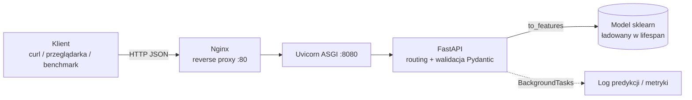

# Laboratorium 4: REST API i Serwowanie Modelu ML

> ℹ️ **Środowisko:** laboratorium zakłada maszynę wirtualną Ubuntu 24.04 (VirtualBox) z Pythonem 3.12, aktywnym środowiskiem `venv` z zależnościami z `requirements.txt` oraz Docker Engine z oficjalnego repozytorium apt. Jeśli jeszcze go nie masz, zacznij od [Przygotowania maszyny wirtualnej](00_przygotowanie_maszyny_wirtualnej.md).

## Informacje ogólne
- **Czas:** 2 godziny
- **Poziom:** Średni
- **Wymagania wstępne:** Lab 1–3 ukończone, podstawy HTTP/REST

## Cele laboratorium
Po tym laboratorium student:
- zbuduje REST API dla modelu ML z użyciem FastAPI,
- skonteneryzuje serwis w Dockerze,
- przetestuje API (unit testy + testy integracyjne),
- zmierzy wydajność serwisu (latencja, throughput).

---

## Wprowadzenie teoretyczne

### Dlaczego model „za API”?

Wytrenowany plik `churn_model.pkl` sam w sobie nie przynosi wartości — trzeba go **udostępnić** innym systemom (aplikacji mobilnej, CRM, pipeline'owi batch). Najczęstsze wzorce serwowania:

| Wzorzec | Opis | Kiedy |
|---------|------|-------|
| **Online (REST/gRPC)** | Żądanie → natychmiastowa odpowiedź (ms) | Decyzje w czasie rzeczywistym (np. oferta retencyjna przy logowaniu) |
| **Batch** | Predykcje dla wielu rekordów naraz, np. raz na dobę | Raporty, kampanie marketingowe |
| **Streaming** | Predykcje dla zdarzeń z kolejki (Kafka) | Wykrywanie fraudów, IoT |
| **Embedded** | Model w aplikacji/urządzeniu | Brak sieci, niskie opóźnienia |

W tym laboratorium budujemy wariant **online** (endpoint `/predict`) oraz **mini-batch** (`/predict/batch`).

### Architektura serwisu



Kluczowe pojęcia:
- **ASGI / Uvicorn** — serwer aplikacji uruchamiający asynchroniczną aplikację FastAPI. `--workers N` uruchamia N niezależnych procesów (każdy ma **własną kopię** modelu i stanu w pamięci!).
- **Pydantic v2** — deklaratywna walidacja danych wejściowych. Błędne żądanie kończy się kodem **422** zanim dotrze do modelu. W Pydantic v2 walidatory definiujemy przez `@field_validator` (stary `@validator` z v1 jest przestarzały).
- **Lifespan** — funkcja `asynccontextmanager` przekazana do `FastAPI(lifespan=...)`; kod przed `yield` wykonuje się raz przy starcie (ładowanie modelu), po `yield` — przy zamykaniu. Zastępuje przestarzałe `@app.on_event("startup")`.
- **Health check** — lekki endpoint (`/health`) używany przez Dockera, Kubernetes i load balancery do sprawdzania, czy instancja może przyjmować ruch.
- **Training-serving skew** — inna transformacja cech w treningu i w serwowaniu. Dlatego `to_features()` musi liczyć cechy **dokładnie tak samo** jak `preprocess.py` z Lab 1 (ta sama kolejność kolumn!).

### Typowe pułapki
- Ładowanie modelu **przy każdym żądaniu** (zamiast raz w `lifespan`) — latencja rośnie o rzędy wielkości.
- Ciężkie obliczenia CPU w `async def` blokują pętlę zdarzeń; dla dużych modeli rozważ zwykłe `def` (FastAPI uruchomi je w puli wątków) lub osobne workery.
- Stan w pamięci procesu (liczniki, logi) **nie jest współdzielony** między workerami ani replikami — do metryk w produkcji używa się Prometheusa (Lab 5).
- Uruchomienie `uvicorn` z domyślnym `--host 127.0.0.1` w VM/kontenerze — serwis jest wtedy niewidoczny z zewnątrz.

---

## Część 1: Budowa REST API z FastAPI (50 min)

### Krok 1.1: Instalacja zależności

Wszystkie potrzebne pakiety (`fastapi`, `uvicorn`, `pydantic` v2, `httpx`, `pytest-asyncio`, `scikit-learn`, `joblib`) są już w `requirements.txt` repozytorium. Upewnij się, że masz aktywne `venv`:

```bash
source .venv/bin/activate          # ścieżka zgodna z instrukcją przygotowania VM
pip install -r requirements.txt
python -c "import fastapi, pydantic; print(fastapi.__version__, pydantic.__version__)"
# oczekiwane: fastapi >= 0.115, pydantic 2.x
```

> ⚠️ Nie instaluj starszych wersji „na sztywno” (np. `fastapi==0.110.0`) — będą niezgodne z wersjami z `requirements.txt` i z kodem poniżej.

### Krok 1.2: Serwis predykcji

Utwórz `src/serving/api.py`:

```python
# src/serving/api.py
"""REST API dla modelu predykcji churnu."""

from fastapi import FastAPI, HTTPException, BackgroundTasks
from fastapi.middleware.cors import CORSMiddleware
from pydantic import BaseModel, Field, field_validator
from contextlib import asynccontextmanager
import joblib
import numpy as np
import os
import time
import logging
from pathlib import Path
from datetime import datetime

logging.basicConfig(level=logging.INFO, format="%(asctime)s %(levelname)s %(message)s")
logger = logging.getLogger(__name__)

# ── Modele Pydantic ──────────────────────────────────────────────────────────

class PredictionRequest(BaseModel):
    customer_id: int = Field(..., gt=0, description="ID klienta")
    age: float = Field(..., ge=18, le=100, description="Wiek")
    income: float = Field(..., ge=0, description="Dochód miesięczny")
    tenure_months: int = Field(..., ge=0, le=600, description="Staż w miesiącach")
    num_products: int = Field(..., ge=1, le=10, description="Liczba produktów")
    has_credit_card: int = Field(..., ge=0, le=1, description="Czy ma kartę kredytową")
    is_active: int = Field(..., ge=0, le=1, description="Czy aktywny")
    balance: float = Field(..., ge=0, description="Saldo konta")
    num_transactions_30d: int = Field(..., ge=0, description="Transakcje w 30 dniach")

    @field_validator('income')
    @classmethod
    def income_reasonable(cls, v: float) -> float:
        if v > 10_000_000:
            raise ValueError("Dochód zbyt wysoki")
        return round(v, 2)

    def to_features(self) -> np.ndarray:
        """Konwertuje żądanie na wektor cech."""
        income_per_age = self.income / max(self.age, 1)
        balance_per_product = self.balance / max(self.num_products, 1)
        is_long_tenure = int(self.tenure_months > 24)
        return np.array([[
            self.age, self.income, self.tenure_months, self.num_products,
            self.has_credit_card, self.is_active, self.balance,
            self.num_transactions_30d, income_per_age,
            balance_per_product, is_long_tenure
        ]])


class PredictionResponse(BaseModel):
    customer_id: int
    churn_probability: float = Field(..., ge=0, le=1)
    churn_prediction: bool
    risk_level: str
    model_version: str
    prediction_time_ms: float
    timestamp: str


class BatchPredictionRequest(BaseModel):
    requests: list[PredictionRequest]

    @field_validator('requests')
    @classmethod
    def max_batch_size(cls, v: list[PredictionRequest]) -> list[PredictionRequest]:
        if len(v) > 500:
            raise ValueError("Maksymalnie 500 rekordów w batchu")
        return v


class HealthResponse(BaseModel):
    status: str
    model_loaded: bool
    model_version: str
    uptime_seconds: float
    total_predictions: int


# ── Stan aplikacji ───────────────────────────────────────────────────────────

class AppState:
    model = None
    model_version = "unknown"
    start_time = time.time()
    total_predictions = 0
    prediction_log: list = []


state = AppState()


# ── Lifecycle ────────────────────────────────────────────────────────────────

@asynccontextmanager
async def lifespan(app: FastAPI):
    """Ładuje model przy starcie aplikacji."""
    logger.info("Uruchamianie serwisu ML...")
    # Ścieżkę można nadpisać zmienną środowiskową (przydatne w Dockerze)
    model_path = Path(os.getenv("MODEL_PATH", "models/churn_model.pkl"))

    if model_path.exists():
        state.model = joblib.load(model_path)
        state.model_version = "v1.0.0"
        logger.info(f"Model załadowany: {state.model_version}")
    else:
        # Tryb demo – trenuj prosty model
        logger.warning("Brak pliku modelu – używam modelu demo")
        from sklearn.ensemble import RandomForestClassifier
        from sklearn.datasets import make_classification
        X, y = make_classification(n_samples=2000, n_features=11, random_state=42)
        state.model = RandomForestClassifier(n_estimators=50, random_state=42).fit(X, y)
        state.model_version = "demo-v1.0"

    yield

    logger.info("Zamykanie serwisu ML...")


# ── Aplikacja ────────────────────────────────────────────────────────────────

app = FastAPI(
    title="Churn Prediction API",
    description="REST API do predykcji churnu klientów",
    version="1.0.0",
    lifespan=lifespan
)

app.add_middleware(
    CORSMiddleware,
    allow_origins=["*"],
    allow_methods=["GET", "POST"],
    allow_headers=["*"],
)


# ── Helpers ──────────────────────────────────────────────────────────────────

def classify_risk(probability: float) -> str:
    if probability >= 0.7:
        return "high"
    elif probability >= 0.3:
        return "medium"
    return "low"


def log_prediction_async(customer_id: int, probability: float, latency_ms: float):
    """Loguje predykcję (wywoływana w tle)."""
    entry = {
        "customer_id": customer_id,
        "probability": probability,
        "latency_ms": latency_ms,
        "timestamp": datetime.now().isoformat()
    }
    state.prediction_log.append(entry)
    # Zachowaj tylko ostatnie 1000 wpisów
    if len(state.prediction_log) > 1000:
        state.prediction_log.pop(0)


# ── Endpointy ────────────────────────────────────────────────────────────────

@app.get("/health", response_model=HealthResponse, tags=["Monitoring"])
async def health_check():
    """Sprawdza stan serwisu."""
    return HealthResponse(
        status="healthy" if state.model is not None else "degraded",
        model_loaded=state.model is not None,
        model_version=state.model_version,
        uptime_seconds=round(time.time() - state.start_time, 1),
        total_predictions=state.total_predictions
    )


@app.get("/metrics", tags=["Monitoring"])
async def get_metrics():
    """Zwraca metryki serwisu (ostatnie 1000 predykcji)."""
    if not state.prediction_log:
        return {"total_predictions": state.total_predictions, "message": "Brak danych"}

    latencies = [e["latency_ms"] for e in state.prediction_log]
    probs = [e["probability"] for e in state.prediction_log]

    return {
        "total_predictions": state.total_predictions,
        "recent_predictions": len(state.prediction_log),
        "latency_ms": {
            "p50": float(np.percentile(latencies, 50)),
            "p95": float(np.percentile(latencies, 95)),
            "p99": float(np.percentile(latencies, 99)),
            "mean": float(np.mean(latencies))
        },
        "churn_probability": {
            "mean": float(np.mean(probs)),
            "high_risk_pct": float(np.mean([p >= 0.7 for p in probs]))
        }
    }


@app.post("/predict", response_model=PredictionResponse, tags=["Prediction"])
async def predict(request: PredictionRequest, background_tasks: BackgroundTasks):
    """Predykcja churnu dla jednego klienta."""
    if state.model is None:
        raise HTTPException(status_code=503, detail="Model nie jest załadowany")

    t0 = time.time()

    try:
        features = request.to_features()
        probability = float(state.model.predict_proba(features)[0][1])
    except Exception as e:
        logger.error(f"Błąd predykcji: {e}")
        raise HTTPException(status_code=500, detail=f"Błąd predykcji: {str(e)}")

    latency_ms = (time.time() - t0) * 1000
    state.total_predictions += 1

    background_tasks.add_task(
        log_prediction_async, request.customer_id, probability, latency_ms
    )

    return PredictionResponse(
        customer_id=request.customer_id,
        churn_probability=round(probability, 4),
        churn_prediction=probability >= 0.5,
        risk_level=classify_risk(probability),
        model_version=state.model_version,
        prediction_time_ms=round(latency_ms, 2),
        timestamp=datetime.now().isoformat()
    )


@app.post("/predict/batch", response_model=list[PredictionResponse], tags=["Prediction"])
async def predict_batch(batch: BatchPredictionRequest):
    """Predykcja churnu dla wielu klientów naraz."""
    if state.model is None:
        raise HTTPException(status_code=503, detail="Model nie jest załadowany")

    t0 = time.time()

    features = np.vstack([r.to_features() for r in batch.requests])
    probabilities = state.model.predict_proba(features)[:, 1]

    total_time_ms = (time.time() - t0) * 1000
    per_request_ms = total_time_ms / len(batch.requests)
    state.total_predictions += len(batch.requests)

    return [
        PredictionResponse(
            customer_id=req.customer_id,
            churn_probability=round(float(prob), 4),
            churn_prediction=float(prob) >= 0.5,
            risk_level=classify_risk(float(prob)),
            model_version=state.model_version,
            prediction_time_ms=round(per_request_ms, 2),
            timestamp=datetime.now().isoformat()
        )
        for req, prob in zip(batch.requests, probabilities)
    ]
```

### Krok 1.3: Uruchomienie serwisu

> 💡 Bez pliku `models/churn_model.pkl` (z Lab 1, `dvc repro`) serwis wystartuje w **trybie demo** z modelem wytrenowanym na danych syntetycznych — w logach zobaczysz `Brak pliku modelu – używam modelu demo`. To wystarcza do przejścia całego laboratorium.

```bash
# Uruchom serwis (z katalogu głównego projektu!)
# --host 0.0.0.0 jest konieczne, aby API było widoczne spoza VM (z hosta)
uvicorn src.serving.api:app --host 0.0.0.0 --port 8080 --reload

# W osobnym terminalu – testuj API
# Health check
curl http://localhost:8080/health | python3 -m json.tool

# Predykcja
curl -X POST http://localhost:8080/predict \
  -H "Content-Type: application/json" \
  -d '{
    "customer_id": 1001,
    "age": 35,
    "income": 55000,
    "tenure_months": 24,
    "num_products": 2,
    "has_credit_card": 1,
    "is_active": 1,
    "balance": 15000,
    "num_transactions_30d": 12
  }' | python3 -m json.tool

# Batch predykcja
curl -X POST http://localhost:8080/predict/batch \
  -H "Content-Type: application/json" \
  -d '{
    "requests": [
      {"customer_id": 1, "age": 25, "income": 30000, "tenure_months": 6,
       "num_products": 1, "has_credit_card": 0, "is_active": 1, "balance": 500, "num_transactions_30d": 3},
      {"customer_id": 2, "age": 55, "income": 80000, "tenure_months": 60,
       "num_products": 3, "has_credit_card": 1, "is_active": 1, "balance": 25000, "num_transactions_30d": 20}
    ]
  }' | python3 -m json.tool

# Otwórz dokumentację Swagger
# http://localhost:8080/docs

# Sprawdź walidację – błędny wiek → 422 z opisem błędu
curl -s -X POST http://localhost:8080/predict \
  -H "Content-Type: application/json" \
  -d '{"customer_id": 1, "age": -5, "income": 1, "tenure_months": 1, "num_products": 1,
       "has_credit_card": 0, "is_active": 1, "balance": 0, "num_transactions_30d": 0}' \
  | python3 -m json.tool
```

#### Dostęp do API z komputera-hosta (VirtualBox)

Domyślna karta sieciowa VirtualBox (NAT) nie pozwala hostowi połączyć się z VM. Masz dwie opcje:

1. **Przekierowanie portów (NAT):** *Ustawienia VM → Sieć → Karta 1 → Zaawansowane → Przekierowanie portów* i dodaj regułę: protokół TCP, port hosta `8080`, port gościa `8080` (dla Nginx z Części 3 dodaj drugą regułę: port hosta np. `8081` → port gościa `80`). Następnie na hoście otwórz `http://localhost:8080/docs`.
2. **Karta „Tylko host” (Host-only):** dodaj drugą kartę sieciową, w VM sprawdź adres poleceniem `ip -4 addr` (np. `192.168.56.101`) i otwórz `http://192.168.56.101:8080/docs`.

W obu przypadkach uvicorn musi nasłuchiwać na `0.0.0.0`, a nie na `127.0.0.1`. Jeżeli w VM włączony jest firewall `ufw`, zezwól na port: `sudo ufw allow 8080/tcp`.

---

## Część 2: Testy API (30 min)

### Krok 2.1: Testy jednostkowe i integracyjne

Utwórz `tests/model/test_api.py`:

```python
# tests/model/test_api.py
"""Testy REST API serwisu ML."""

import pytest
from fastapi.testclient import TestClient
import sys
from pathlib import Path

sys.path.insert(0, str(Path(__file__).parent.parent.parent))

from src.serving.api import app

# ── Fixtures ─────────────────────────────────────────────────────────────────

@pytest.fixture(scope="module")
def client():
    """TestClient użyty jako context manager uruchamia `lifespan`,
    czyli ładuje model. Bez `with` model NIE zostałby załadowany (503)."""
    with TestClient(app) as c:
        yield c

@pytest.fixture
def valid_request():
    return {
        "customer_id": 1001,
        "age": 35.0,
        "income": 55000.0,
        "tenure_months": 24,
        "num_products": 2,
        "has_credit_card": 1,
        "is_active": 1,
        "balance": 15000.0,
        "num_transactions_30d": 12
    }

@pytest.fixture
def high_risk_request():
    """Klient z wysokim ryzykiem churnu."""
    return {
        "customer_id": 9999,
        "age": 65.0,
        "income": 20000.0,
        "tenure_months": 2,
        "num_products": 1,
        "has_credit_card": 0,
        "is_active": 0,
        "balance": 100.0,
        "num_transactions_30d": 0
    }

# ── Testy health check ────────────────────────────────────────────────────────

class TestHealthCheck:

    def test_health_returns_200(self, client):
        response = client.get("/health")
        assert response.status_code == 200

    def test_health_response_schema(self, client):
        response = client.get("/health")
        data = response.json()
        assert "status" in data
        assert "model_loaded" in data
        assert "model_version" in data
        assert "uptime_seconds" in data
        assert "total_predictions" in data

    def test_health_model_loaded(self, client):
        response = client.get("/health")
        data = response.json()
        assert data["model_loaded"] is True

# ── Testy predykcji ───────────────────────────────────────────────────────────

class TestPrediction:

    def test_predict_returns_200(self, client, valid_request):
        response = client.post("/predict", json=valid_request)
        assert response.status_code == 200

    def test_predict_response_schema(self, client, valid_request):
        response = client.post("/predict", json=valid_request)
        data = response.json()
        assert "customer_id" in data
        assert "churn_probability" in data
        assert "churn_prediction" in data
        assert "risk_level" in data
        assert "model_version" in data
        assert "prediction_time_ms" in data

    def test_predict_probability_in_range(self, client, valid_request):
        response = client.post("/predict", json=valid_request)
        data = response.json()
        assert 0.0 <= data["churn_probability"] <= 1.0

    def test_predict_customer_id_preserved(self, client, valid_request):
        response = client.post("/predict", json=valid_request)
        data = response.json()
        assert data["customer_id"] == valid_request["customer_id"]

    def test_predict_risk_level_valid(self, client, valid_request):
        response = client.post("/predict", json=valid_request)
        data = response.json()
        assert data["risk_level"] in ["low", "medium", "high"]

    def test_predict_churn_consistent_with_probability(self, client, valid_request):
        response = client.post("/predict", json=valid_request)
        data = response.json()
        expected_prediction = data["churn_probability"] >= 0.5
        assert data["churn_prediction"] == expected_prediction

    def test_predict_invalid_age_returns_422(self, client, valid_request):
        invalid = {**valid_request, "age": -5}
        response = client.post("/predict", json=invalid)
        assert response.status_code == 422

    def test_predict_invalid_income_returns_422(self, client, valid_request):
        invalid = {**valid_request, "income": -1000}
        response = client.post("/predict", json=invalid)
        assert response.status_code == 422

    def test_predict_missing_field_returns_422(self, client, valid_request):
        incomplete = {k: v for k, v in valid_request.items() if k != "age"}
        response = client.post("/predict", json=incomplete)
        assert response.status_code == 422

    def test_predict_latency_reasonable(self, client, valid_request):
        response = client.post("/predict", json=valid_request)
        data = response.json()
        assert data["prediction_time_ms"] < 1000  # < 1 sekunda

# ── Testy batch predykcji ─────────────────────────────────────────────────────

class TestBatchPrediction:

    def test_batch_predict_returns_correct_count(self, client, valid_request, high_risk_request):
        batch = {"requests": [valid_request, high_risk_request]}
        response = client.post("/predict/batch", json=batch)
        assert response.status_code == 200
        data = response.json()
        assert len(data) == 2

    def test_batch_predict_all_probabilities_valid(self, client, valid_request):
        batch = {"requests": [valid_request] * 10}
        response = client.post("/predict/batch", json=batch)
        data = response.json()
        for item in data:
            assert 0.0 <= item["churn_probability"] <= 1.0

    def test_batch_too_large_returns_422(self, client, valid_request):
        batch = {"requests": [valid_request] * 501}
        response = client.post("/predict/batch", json=batch)
        assert response.status_code == 422

# ── Testy metryk ──────────────────────────────────────────────────────────────

class TestMetrics:

    def test_metrics_endpoint_exists(self, client):
        response = client.get("/metrics")
        assert response.status_code == 200

    def test_metrics_after_predictions(self, client, valid_request):
        # Wykonaj kilka predykcji
        for _ in range(5):
            client.post("/predict", json=valid_request)

        response = client.get("/metrics")
        data = response.json()
        assert "total_predictions" in data
        assert data["total_predictions"] >= 5
```

```bash
# Uruchom testy API
pytest tests/model/test_api.py -v

# Uruchom z pokryciem kodu
pytest tests/model/test_api.py -v --cov=src/serving --cov-report=term-missing
```

---

## Część 3: Konteneryzacja z Docker (30 min)

### Teoria: obraz, kontener, warstwy

- **Obraz** to niezmienny szablon (system plików + metadane), **kontener** to uruchomiona instancja obrazu.
- Każda instrukcja `RUN`/`COPY` tworzy **warstwę**. Docker cache'uje warstwy — dlatego najpierw kopiujemy plik z zależnościami i instalujemy pakiety, a dopiero potem kod (zmiana kodu nie wymusza ponownej instalacji pakietów).
- Kontener powinien działać jako **użytkownik bez uprawnień root** i zawierać tylko to, co potrzebne do serwowania (bez MLflow, DVC, Jupytera…) — stąd osobny, odchudzony plik zależności.

```
 Host (Windows/macOS)      VM Ubuntu 24.04                 Kontener churn-api
+------------------+     +-----------------------+     +--------------------------+
| przeglądarka     | NAT | curl localhost:8080   | -p  | uvicorn 0.0.0.0:8080     |
| localhost:8080 --+---->| port 8080 ------------+---->| /app/models  (ro, -v)    |
+------------------+ fwd | ./models -------------+---->| user: mluser (uid 1000)  |
                         +-----------------------+     +--------------------------+
```

> ⚠️ **Docker w VM Ubuntu:** jeżeli `docker ps` zwraca `permission denied while trying to connect to the Docker daemon socket`, dodaj użytkownika do grupy `docker` i zaloguj się ponownie (lub wykonaj `newgrp docker`):
> ```bash
> sudo usermod -aG docker $USER
> newgrp docker
> docker run --rm hello-world
> ```
> Alternatywnie poprzedzaj polecenia `sudo`. Pamiętaj, że członkostwo w grupie `docker` daje uprawnienia równoważne root.

### Krok 3.1: Dockerfile

Utwórz odchudzony plik zależności serwisu `requirements-api.txt` (zakresy wersji zgodne z głównym `requirements.txt`):

```text
# requirements-api.txt – tylko to, co potrzebne do serwowania
fastapi>=0.115,<1.0
uvicorn>=0.30,<1.0
pydantic>=2.8,<3.0
scikit-learn>=1.5,<2.0
numpy>=1.26,<3.0
joblib>=1.4,<2.0
```

> ⚠️ Wersja `scikit-learn` w obrazie powinna być **taka sama** jak ta, którą wytrenowałeś model (`pip show scikit-learn`). Pickle z innej wersji może wygenerować `InconsistentVersionWarning` lub się nie wczytać — w razie potrzeby przypnij dokładną wersję (`scikit-learn==X.Y.Z`).

Utwórz też `.dockerignore`, aby nie wysyłać do demona Dockera środowiska wirtualnego i danych:

```text
# .dockerignore
.venv/
.git/
.dvc/cache/
data/
mlruns/
__pycache__/
*.pyc
```

```dockerfile
# Dockerfile
FROM python:3.12-slim

LABEL maintainer="mlops-lab"
LABEL description="Churn Prediction API"

WORKDIR /app

# Instalacja zależności systemowych
RUN apt-get update && apt-get install -y --no-install-recommends \
    curl \
    && rm -rf /var/lib/apt/lists/*

# Instalacja zależności Python (osobna warstwa – cache przy zmianach kodu)
COPY requirements-api.txt .
RUN pip install --no-cache-dir -r requirements-api.txt

# Kopiowanie kodu (katalog models/ musi istnieć – może być pusty)
COPY src/ ./src/
COPY models/ ./models/

# Użytkownik bez uprawnień root
RUN useradd -m -u 1000 mluser && chown -R mluser:mluser /app
USER mluser

EXPOSE 8080

HEALTHCHECK --interval=30s --timeout=10s --start-period=15s --retries=3 \
    CMD curl -f http://localhost:8080/health || exit 1

CMD ["uvicorn", "src.serving.api:app", \
     "--host", "0.0.0.0", \
     "--port", "8080", \
     "--workers", "2", \
     "--log-level", "info"]
```

> 💡 Przy `--workers 2` każdy proces ma własne liczniki — `/metrics` i `total_predictions` w `/health` pokażą wartości tylko z procesu, który obsłużył dane żądanie. To zamierzona ilustracja problemu stanu w pamięci (rozwiązanie: Prometheus w Lab 5).

```bash
# Upewnij się, że katalog models/ istnieje (inaczej COPY models/ zakończy się błędem)
mkdir -p models

# Zbuduj obraz
docker build -t churn-api:latest .

# Uruchom kontener
docker run -d \
  --name churn-api \
  -p 8080:8080 \
  -v $(pwd)/models:/app/models:ro \
  churn-api:latest

# Sprawdź logi (Ctrl+C kończy podgląd, kontener działa dalej)
docker logs -f churn-api

# Przetestuj (po ~15 s status w `docker ps` zmieni się na "healthy")
curl http://localhost:8080/health
docker ps --filter name=churn-api

# Zatrzymaj kontener
docker stop churn-api && docker rm churn-api
```

### Krok 3.2: Docker Compose z monitoringiem

```yaml
# docker-compose.yml
# (klucz `version:` jest przestarzały w Docker Compose v2 i został pominięty)

services:
  ml-api:
    build: .
    ports:
      - "8080:8080"
    volumes:
      - ./models:/app/models:ro
    environment:
      - LOG_LEVEL=INFO
    healthcheck:
      test: ["CMD", "curl", "-f", "http://localhost:8080/health"]
      interval: 30s
      timeout: 10s
      retries: 3
    restart: unless-stopped

  # Nginx jako reverse proxy
  nginx:
    image: nginx:alpine
    ports:
      - "80:80"
    volumes:
      - ./nginx.conf:/etc/nginx/conf.d/default.conf:ro
    depends_on:
      ml-api:
        condition: service_healthy
```

```nginx
# nginx.conf
upstream ml_api {
    server ml-api:8080;
}

server {
    listen 80;

    location /api/ {
        proxy_pass http://ml_api/;
        proxy_set_header Host $host;
        proxy_set_header X-Real-IP $remote_addr;
        proxy_read_timeout 30s;
    }

    location /health {
        proxy_pass http://ml_api/health;
    }
}
```

```bash
# Docker Compose v2 to wtyczka `docker compose` (ze spacją) – pakiet docker-compose-plugin
# z repozytorium Dockera. Stare polecenie `docker-compose` (z myślnikiem) nie jest instalowane.
docker compose up -d --build

# Sprawdź status (ml-api powinno być "healthy")
docker compose ps

# Przetestuj przez Nginx (prefiks /api/ jest obcinany przez proxy_pass)
curl http://localhost/health
curl -X POST http://localhost/api/predict -H "Content-Type: application/json" \
  -d '{"customer_id": 1, "age": 40, "income": 50000, "tenure_months": 12, "num_products": 2,
       "has_credit_card": 1, "is_active": 1, "balance": 1000, "num_transactions_30d": 5}'

# Zatrzymaj i usuń kontenery
docker compose down
```

---

## Część 4: Pomiar wydajności (10 min)

### Krok 4.1: Prosty benchmark

```python
# scripts/benchmark_api.py
"""Benchmark wydajności API."""

import httpx
import time
import statistics
import asyncio

BASE_URL = "http://localhost:8080"

SAMPLE_REQUEST = {
    "customer_id": 1001,
    "age": 35.0,
    "income": 55000.0,
    "tenure_months": 24,
    "num_products": 2,
    "has_credit_card": 1,
    "is_active": 1,
    "balance": 15000.0,
    "num_transactions_30d": 12
}

async def benchmark_single_predictions(n_requests: int = 100):
    """Mierzy latencję pojedynczych predykcji."""
    latencies = []

    async with httpx.AsyncClient(base_url=BASE_URL) as client:
        for i in range(n_requests):
            request = {**SAMPLE_REQUEST, "customer_id": i + 1}
            t0 = time.perf_counter()
            response = await client.post("/predict", json=request)
            latency_ms = (time.perf_counter() - t0) * 1000
            assert response.status_code == 200
            latencies.append(latency_ms)

    print(f"\n=== Benchmark: {n_requests} pojedynczych predykcji ===")
    print(f"  p50:  {statistics.median(latencies):.2f} ms")
    print(f"  p95:  {sorted(latencies)[int(0.95 * len(latencies))]:.2f} ms")
    print(f"  p99:  {sorted(latencies)[int(0.99 * len(latencies))]:.2f} ms")
    print(f"  mean: {statistics.mean(latencies):.2f} ms")
    print(f"  min:  {min(latencies):.2f} ms")
    print(f"  max:  {max(latencies):.2f} ms")

async def benchmark_batch_predictions(batch_sizes: list[int] = [1, 10, 50, 100]):
    """Mierzy throughput batch predykcji."""
    print("\n=== Benchmark: Batch predykcje ===")
    print(f"{'Batch size':>12} | {'Czas (ms)':>10} | {'ms/rekord':>10} | {'Rekordów/s':>12}")
    print("-" * 55)

    async with httpx.AsyncClient(base_url=BASE_URL, timeout=30.0) as client:
        for batch_size in batch_sizes:
            requests = [
                {**SAMPLE_REQUEST, "customer_id": i + 1}
                for i in range(batch_size)
            ]
            batch = {"requests": requests}

            t0 = time.perf_counter()
            response = await client.post("/predict/batch", json=batch)
            elapsed_ms = (time.perf_counter() - t0) * 1000

            assert response.status_code == 200
            ms_per_record = elapsed_ms / batch_size
            records_per_sec = 1000 / ms_per_record

            print(f"{batch_size:>12} | {elapsed_ms:>10.1f} | {ms_per_record:>10.2f} | {records_per_sec:>12.0f}")

async def main():
    # Sprawdź czy serwis działa
    async with httpx.AsyncClient(base_url=BASE_URL) as client:
        response = await client.get("/health")
        if response.status_code != 200:
            print("❌ Serwis nie działa!")
            return
        print(f"✅ Serwis działa: {response.json()['model_version']}")

    await benchmark_single_predictions(n_requests=100)
    await benchmark_batch_predictions(batch_sizes=[1, 10, 50, 100, 200])

if __name__ == "__main__":
    asyncio.run(main())
```

```bash
# Uruchom benchmark (serwis musi być uruchomiony)
python scripts/benchmark_api.py
```

---

## Typowe problemy i rozwiązania

| Problem | Przyczyna | Rozwiązanie |
|---------|-----------|-------------|
| `422 Unprocessable Entity` | Dane nie pasują do schematu Pydantic | Sprawdź typy i zakresy pól w żądaniu JSON |
| `503 Service Unavailable` | Model nie jest załadowany | Sprawdź ścieżkę do modelu i logi startu aplikacji |
| Docker build trwa długo | Brak cache warstw, duży kontekst budowania | Kopiuj `requirements-api.txt` przed kodem źródłowym; dodaj `.dockerignore` (bez `.venv/`, `data/`) |
| Wysoka latencja w Dockerze | Za mało workerów uvicorn | Zwiększ `--workers` (orientacyjnie liczba rdzeni CPU przydzielonych VM) |
| Testy zwracają `503` / `model_loaded is False` | `TestClient(app)` użyty bez `with` – `lifespan` się nie wykonał | Użyj fixture `with TestClient(app) as c: yield c` (jak w Kroku 2.1) |
| `ModuleNotFoundError: No module named 'src'` | `uvicorn`/`pytest` uruchomione spoza katalogu głównego projektu | Uruchamiaj z katalogu głównego repozytorium |
| `PydanticDeprecatedSince20: @validator` | Kod w stylu Pydantic v1 | Użyj `@field_validator` + `@classmethod` |
| `UserWarning: X does not have valid feature names` | Model z Lab 1 trenowany na `DataFrame`, a API przekazuje `ndarray` | Ostrzeżenie niegroźne; można przekazywać `pd.DataFrame` z nazwami kolumn |
| `PytestDeprecationWarning: asyncio_default_fixture_loop_scope is unset` | Nowsze `pytest-asyncio` | Niegroźne; można dodać do `pytest.ini`: `asyncio_default_fixture_loop_scope = function` |
| `Connection refused` w benchmarku | Serwis nie jest uruchomiony | Uruchom `uvicorn` w osobnym terminalu przed benchmarkiem |
| `[Errno 98] Address already in use` | Port 8080 zajęty (np. działa kontener `churn-api` lub stary uvicorn) | `docker ps` / `docker stop churn-api` lub `sudo ss -ltnp \| grep 8080` i zakończ proces |
| `permission denied ... /var/run/docker.sock` | Użytkownik VM nie jest w grupie `docker` | `sudo usermod -aG docker $USER`, potem wyloguj się lub `newgrp docker` (albo użyj `sudo docker ...`) |
| API działa w VM, ale nie z hosta | Brak przekierowania portów VirtualBox lub uvicorn na `127.0.0.1` | Dodaj regułę NAT 8080→8080 (patrz Krok 1.3), uruchamiaj z `--host 0.0.0.0` |
| `docker-compose: command not found` | Compose v2 to wtyczka | Użyj `docker compose` (ze spacją); w razie braku: `sudo apt install docker-compose-plugin` |
| `COPY models/ ./models/` – `not found` | Brak katalogu `models/` | `mkdir -p models` lub wytrenuj model (`dvc repro` z Lab 1) |
| Nginx: `bind: address already in use` na porcie 80 | Port 80 w VM zajęty (np. apache2) | Zmień mapowanie na `"8081:80"` w `docker-compose.yml` |

> 💡 **Wskazówka:** Używaj `uvicorn main:app --reload` podczas developmentu — serwer automatycznie restartuje się po zmianach w kodzie. Na produkcji **nigdy** nie używaj `--reload`.

> 💡 **Wskazówka:** Dodaj endpoint `/docs` (automatycznie generowany przez FastAPI) do dokumentacji API — klienci mogą testować endpointy bezpośrednio w przeglądarce.

---

## Zadania do samodzielnego wykonania

1. **Dodaj endpoint** `GET /predict/history/{customer_id}` zwracający historię predykcji dla klienta.
2. **Dodaj autentykację** API Key – żądania bez nagłówka `X-API-Key` powinny zwracać 401.
3. **Napisz test** sprawdzający, że batch predykcja jest szybsza niż N pojedynczych predykcji.
4. **Dodaj middleware** logujący każde żądanie (metoda, ścieżka, status, czas).
5. **Dodaj wersjonowanie API** — utwórz router `/v1/predict` i `/v2/predict` z różnymi schematami odpowiedzi.

## Pytania kontrolne

1. Dlaczego używamy `BackgroundTasks` do logowania predykcji?
2. Jaka jest różnica między `TestClient` a prawdziwym klientem HTTP?
3. Kiedy warto używać batch API zamiast pojedynczych żądań?
4. Co robi `HEALTHCHECK` w Dockerfile i dlaczego jest ważny?
5. Dlaczego na produkcji nie używamy flagi `--reload` w uvicorn?

## Podsumowanie

W tym laboratorium:
- ✅ Zbudowałeś REST API z FastAPI z walidacją Pydantic
- ✅ Napisałeś testy jednostkowe i integracyjne dla API
- ✅ Skonteneryzowałeś serwis w Dockerze z health checkiem
- ✅ Zmierzyłeś wydajność API (latencja p50/p95/p99, throughput)
