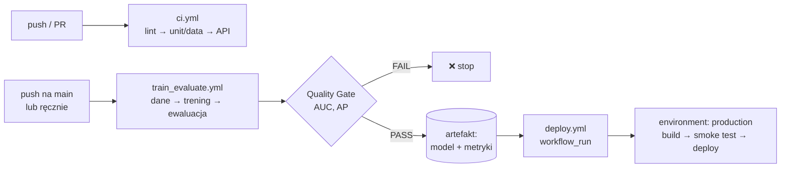
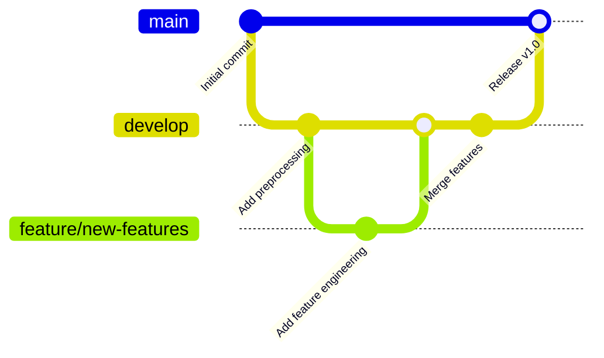

# Laboratorium 7: CI/CD dla ML z GitHub Actions

## Informacje ogólne
- **Czas:** 2 godziny
- **Poziom:** Zaawansowany
- **Wymagania wstępne:** Lab 1–6 ukończone, konto GitHub

> 🖥️ **Środowisko:** laboratorium jest przygotowane pod maszynę wirtualną Ubuntu 24.04 (Python 3.12, Docker Engine, Git) — instrukcja jej przygotowania: [00_przygotowanie_maszyny_wirtualnej.md](00_przygotowanie_maszyny_wirtualnej.md). Workflow używają tej samej wersji Pythona (3.12) i tych samych zależności (`requirements.txt`) co VM — dzięki temu „u mnie działa” znaczy „działa w CI”.

## Cele laboratorium
Po tym laboratorium student:
- skonfiguruje repozytorium GitHub z branching strategy,
- zbuduje workflow CI/CD dla projektu ML,
- zaimplementuje quality gates blokujące wdrożenie słabych modeli,
- skonfiguruje automatyczne uruchamianie testów przy każdym push.

---

## Część 0: Teoria w pigułce (10 min)

W klasycznym oprogramowaniu CI/CD testuje **kod**. W ML artefakt wdrożeniowy zależy od trzech rzeczy: **kodu, danych i modelu** — dlatego pipeline CI/CD dla ML zawiera dodatkowe etapy: testy danych, trening, ewaluację i **quality gate** (automatyczną bramkę jakości, która zatrzymuje wdrożenie słabego modelu).

Podstawowe pojęcia GitHub Actions:

| Pojęcie | Znaczenie |
|---------|-----------|
| **workflow** | plik YAML w `.github/workflows/`, uruchamiany przez zdarzenie (`on:`) |
| **job** | zestaw kroków na jednym runnerze (VM); joby działają równolegle, chyba że użyto `needs:` |
| **step** | pojedyncza komenda (`run:`) lub gotowa akcja (`uses:`) |
| **artifact** | plik przekazywany między jobami/workflow (`upload-artifact` / `download-artifact`) |
| **environment** | np. `production` — może wymagać ręcznej akceptacji i mieć własne sekrety |

Przepływ, który zbudujesz:



---

## Część 1: Konfiguracja repozytorium GitHub (20 min)

### Krok 1.1: Inicjalizacja repozytorium

```bash
cd mlops-project

# Upewnij się, że masz zainicjowane repozytorium Git
git status

# Utwórz repozytorium na GitHub (przez GitHub CLI lub ręcznie)
# gh repo create mlops-churn-prediction --public --source=. --push

# Lub ręcznie:
git remote add origin https://github.com/TWOJ_LOGIN/mlops-churn-prediction.git
git branch -M main
git push -u origin main
```

### Krok 1.2: Branching strategy



Strategia gałęzi:
- `main` – kod produkcyjny, tylko przez PR
- `develop` – integracja zmian
- `feature/*` – nowe funkcjonalności
- `hotfix/*` – pilne poprawki

```bash
# Utwórz gałąź develop
git checkout -b develop
git push -u origin develop

# Skonfiguruj ochronę gałęzi main (przez GitHub UI):
# Settings → Branches → Add rule → main
# ✅ Require pull request reviews
# ✅ Require status checks to pass
# ✅ Require branches to be up to date
```

---

## Część 2: Workflow CI – Testy i Walidacja (40 min)

### Krok 2.1: Podstawowy workflow CI

Utwórz `.github/workflows/ci.yml`:

```yaml
# .github/workflows/ci.yml
name: CI – Testy i Walidacja

on:
  push:
    branches: [main, develop]
  pull_request:
    branches: [main, develop]

env:
  PYTHON_VERSION: '3.12'

jobs:
  # ── Job 1: Linting i formatowanie ────────────────────────────────────────
  lint:
    name: Linting
    runs-on: ubuntu-latest

    steps:
      - uses: actions/checkout@v4

      - name: Setup Python
        uses: actions/setup-python@v5
        with:
          python-version: ${{ env.PYTHON_VERSION }}
          cache: 'pip'

      - name: Install linting tools
        run: pip install "ruff>=0.6,<1.0"   # zgodnie z requirements.txt

      - name: Run ruff (linting)
        run: ruff check src/ tests/ pipeline/ --output-format=github

      - name: Run ruff (formatting check)
        run: ruff format --check src/ tests/ pipeline/

  # ── Job 2: Testy jednostkowe ──────────────────────────────────────────────
  unit-tests:
    name: Unit Tests
    runs-on: ubuntu-latest
    needs: lint

    steps:
      - uses: actions/checkout@v4

      - name: Setup Python
        uses: actions/setup-python@v5
        with:
          python-version: ${{ env.PYTHON_VERSION }}
          cache: 'pip'

      - name: Install dependencies
        run: |
          pip install -r requirements.txt

      - name: Run unit tests
        run: |
          pytest tests/unit/ -v \
            --cov=src \
            --cov-report=xml \
            --cov-report=term-missing \
            --junitxml=reports/junit-unit.xml

      - name: Upload coverage report
        uses: codecov/codecov-action@v5
        with:
          files: coverage.xml
          token: ${{ secrets.CODECOV_TOKEN }}
          flags: unit-tests
        continue-on-error: true

      - name: Upload test results
        uses: actions/upload-artifact@v4
        if: always()
        with:
          name: unit-test-results
          path: reports/junit-unit.xml

  # ── Job 3: Testy danych ───────────────────────────────────────────────────
  data-tests:
    name: Data Tests
    runs-on: ubuntu-latest
    needs: lint

    steps:
      - uses: actions/checkout@v4

      - name: Setup Python
        uses: actions/setup-python@v5
        with:
          python-version: ${{ env.PYTHON_VERSION }}
          cache: 'pip'

      - name: Install dependencies
        run: pip install -r requirements.txt

      - name: Generate test data
        run: python scripts/generate_data.py --n-samples 2000 --output data/raw/customers.parquet

      - name: Run preprocessing
        run: python src/data/preprocess.py

      - name: Run data tests
        run: pytest tests/data/ -v --junitxml=reports/junit-data.xml

      - name: Upload test results
        uses: actions/upload-artifact@v4
        if: always()
        with:
          name: data-test-results
          path: reports/junit-data.xml

  # ── Job 4: Testy API ──────────────────────────────────────────────────────
  api-tests:
    name: API Tests
    runs-on: ubuntu-latest
    needs: unit-tests

    steps:
      - uses: actions/checkout@v4

      - name: Setup Python
        uses: actions/setup-python@v5
        with:
          python-version: ${{ env.PYTHON_VERSION }}
          cache: 'pip'

      - name: Install dependencies
        run: pip install -r requirements.txt   # zawiera pytest, pytest-cov, httpx

      - name: Run API tests
        run: pytest tests/model/test_api.py -v --junitxml=reports/junit-api.xml

      - name: Upload test results
        uses: actions/upload-artifact@v4
        if: always()
        with:
          name: api-test-results
          path: reports/junit-api.xml
```

### Krok 2.2: Workflow treningu i ewaluacji modelu

Utwórz `.github/workflows/train_evaluate.yml`:

```yaml
# .github/workflows/train_evaluate.yml
name: Train & Evaluate Model

on:
  push:
    branches: [main]
    paths:
      - 'src/**'
      - 'params.yaml'
      - 'data/**/*.dvc'
  pull_request:
    branches: [main]
  workflow_dispatch:
    inputs:
      n_samples:
        description: 'Liczba próbek treningowych'
        required: false
        default: '10000'
      min_auc:
        description: 'Minimalny AUC-ROC'
        required: false
        default: '0.75'

env:
  PYTHON_VERSION: '3.12'

# Uprawnienia GITHUB_TOKEN – potrzebne do komentowania PR
permissions:
  contents: read
  pull-requests: write

jobs:
  train-and-evaluate:
    name: Train & Evaluate
    runs-on: ubuntu-latest

    steps:
      - uses: actions/checkout@v4

      - name: Setup Python
        uses: actions/setup-python@v5
        with:
          python-version: ${{ env.PYTHON_VERSION }}
          cache: 'pip'

      - name: Install dependencies
        run: pip install -r requirements.txt

      - name: Generate training data
        run: |
          python scripts/generate_data.py \
            --n-samples ${{ github.event.inputs.n_samples || '10000' }} \
            --output data/raw/customers.parquet

      - name: Preprocess data
        run: python src/data/preprocess.py

      - name: Validate data
        run: |
          python scripts/validate_data.py \
            --input data/processed/train.parquet \
            --output-report reports/metrics/validation_report.json

      - name: Train model
        run: python src/models/train.py

      - name: Evaluate model
        id: evaluate
        run: |
          python scripts/evaluate_model.py \
            --model models/churn_model.pkl \
            --test-data data/processed/test.parquet \
            --output reports/metrics/eval_metrics.json

          # Odczytaj AUC i ustaw jako output
          AUC=$(python -c "
          import json
          with open('reports/metrics/eval_metrics.json') as f:
              m = json.load(f)
          print(m.get('test_auc_roc', 0))
          ")
          echo "auc_roc=$AUC" >> $GITHUB_OUTPUT
          echo "Model AUC-ROC: $AUC"

      - name: Quality Gate
        run: |
          python -c "
          import json, sys
          with open('reports/metrics/eval_metrics.json') as f:
              metrics = json.load(f)
          
          min_auc = float('${{ github.event.inputs.min_auc || 0.75 }}')
          auc = metrics.get('test_auc_roc', 0)
          ap = metrics.get('test_avg_precision', 0)
          base = metrics.get('churn_rate_test', 0)
          f1 = metrics.get('test_f1', 0)
          
          print(f'AUC-ROC: {auc:.4f} (min: {min_auc})')
          print(f'Avg Precision: {ap:.4f} (baseline = churn rate {base:.4f})')
          print(f'F1-Score: {f1:.4f} (informacyjnie)')
          
          failures = []
          if auc < min_auc:
              failures.append(f'AUC {auc:.4f} < {min_auc}')
          if ap < 1.5 * base:
              failures.append(f'AP {ap:.4f} < 1.5 x churn rate')
          
          if failures:
              print(f'❌ Quality Gate FAILED: {failures}')
              sys.exit(1)
          print('✅ Quality Gate PASSED')
          "

      - name: Upload model artifacts
        uses: actions/upload-artifact@v4
        with:
          name: trained-model-${{ github.sha }}
          path: |
            models/churn_model.pkl
            reports/metrics/eval_metrics.json
          retention-days: 30

      - name: Comment PR with metrics
        if: github.event_name == 'pull_request'
        uses: actions/github-script@v7
        with:
          script: |
            const fs = require('fs');
            const metrics = JSON.parse(fs.readFileSync('reports/metrics/eval_metrics.json'));
            const body = `## 📊 Wyniki ewaluacji modelu
            
            | Metryka | Wartość |
            |---------|---------|
            | AUC-ROC | ${metrics.test_auc_roc?.toFixed(4) || 'N/A'} |
            | F1-Score | ${metrics.test_f1?.toFixed(4) || 'N/A'} |
            | Accuracy | ${metrics.test_accuracy?.toFixed(4) || 'N/A'} |
            | Precision | ${metrics.test_precision?.toFixed(4) || 'N/A'} |
            | Recall | ${metrics.test_recall?.toFixed(4) || 'N/A'} |
            
            **Commit:** \`${{ github.sha }}\`
            `;
            
            github.rest.issues.createComment({
              issue_number: context.issue.number,
              owner: context.repo.owner,
              repo: context.repo.repo,
              body: body
            });
```

> ℹ️ **Dlaczego nie F1 ≥ 0.60?** Zbiór churn jest niezbalansowany (~12% klientów odchodzi), a model z Lab 1 używa domyślnego progu 0.5 — F1 wynosi wtedy zwykle < 0.2 mimo AUC ≈ 0.78. Bramka na F1 = 0.60 blokowałaby każdy model. Lepsze są metryki niezależne od progu: AUC-ROC i **Average Precision** porównane z poziomem bazowym (losowy model ma AP ≈ odsetek klasy pozytywnej). Jeśli chcesz bramkę na F1, najpierw dobierz próg decyzyjny (zadanie 6).

---

## Część 3: Skrypt ewaluacji modelu (20 min)

### Krok 3.1: Skrypt evaluate_model.py

Utwórz `scripts/evaluate_model.py`:

```python
# scripts/evaluate_model.py
"""Ewaluacja modelu na zbiorze testowym."""

import sys
import json
import argparse
import time
from pathlib import Path

import pandas as pd
import joblib
from sklearn.metrics import (
    roc_auc_score, f1_score, accuracy_score,
    precision_score, recall_score, average_precision_score
)

sys.path.insert(0, '.')

FEATURE_COLS = [
    'age', 'income', 'tenure_months', 'num_products',
    'has_credit_card', 'is_active', 'balance',
    'num_transactions_30d', 'income_per_age',
    'balance_per_product', 'is_long_tenure'
]


def evaluate_model(model_path: str, test_data_path: str) -> dict:
    """Ewaluuje model i zwraca metryki."""
    print(f"Ładowanie modelu: {model_path}")
    model = joblib.load(model_path)

    print(f"Wczytywanie danych testowych: {test_data_path}")
    test_df = pd.read_parquet(test_data_path)

    available_features = [c for c in FEATURE_COLS if c in test_df.columns]
    X_test = test_df[available_features]
    y_test = test_df['churn']

    print(f"Ewaluacja na {len(X_test):,} próbkach, {len(available_features)} cechach")

    # Pomiar latencji
    t0 = time.time()
    y_pred = model.predict(X_test)
    y_prob = model.predict_proba(X_test)[:, 1]
    latency_ms = (time.time() - t0) * 1000 / len(X_test)

    metrics = {
        "test_auc_roc": float(roc_auc_score(y_test, y_prob)),
        "test_f1": float(f1_score(y_test, y_pred)),
        "test_accuracy": float(accuracy_score(y_test, y_pred)),
        "test_precision": float(precision_score(y_test, y_pred)),
        "test_recall": float(recall_score(y_test, y_pred)),
        "test_avg_precision": float(average_precision_score(y_test, y_prob)),
        "avg_latency_ms": round(latency_ms, 3),
        "n_test_samples": len(y_test),
        "churn_rate_test": float(y_test.mean()),
        "n_features": len(available_features)
    }

    print("\n=== Wyniki ewaluacji ===")
    for k, v in metrics.items():
        if isinstance(v, float):
            print(f"  {k}: {v:.4f}")
        else:
            print(f"  {k}: {v}")

    return metrics


def main():
    parser = argparse.ArgumentParser()
    parser.add_argument("--model", required=True, help="Ścieżka do modelu")
    parser.add_argument("--test-data", required=True, help="Ścieżka do danych testowych")
    parser.add_argument("--output", default="reports/metrics/eval_metrics.json")
    args = parser.parse_args()

    metrics = evaluate_model(args.model, args.test_data)

    Path(args.output).parent.mkdir(parents=True, exist_ok=True)
    with open(args.output, "w") as f:
        json.dump(metrics, f, indent=2)

    print(f"\n✅ Metryki zapisane: {args.output}")


if __name__ == "__main__":
    main()
```

### Krok 3.2: Test skryptu ewaluacji

Quality gate jest tak dobry, jak skrypt, który liczy metryki — przetestuj go. Utwórz `tests/unit/test_evaluate_model.py`:

```python
# tests/unit/test_evaluate_model.py
"""Testy skryptu scripts/evaluate_model.py."""

import json
import subprocess
import sys
from pathlib import Path

import joblib
import numpy as np
import pandas as pd
import pytest
from sklearn.ensemble import RandomForestClassifier

ROOT = Path(__file__).parent.parent.parent
sys.path.insert(0, str(ROOT))

from scripts.evaluate_model import FEATURE_COLS, evaluate_model


@pytest.fixture
def model_and_data(tmp_path):
    rng = np.random.default_rng(42)
    n = 400
    df = pd.DataFrame({c: rng.normal(size=n) for c in FEATURE_COLS})
    df["churn"] = (df["age"] + rng.normal(scale=0.5, size=n) > 0).astype(int)

    model = RandomForestClassifier(n_estimators=20, random_state=42)
    model.fit(df[FEATURE_COLS], df["churn"])

    model_path = tmp_path / "model.pkl"
    data_path = tmp_path / "test.parquet"
    joblib.dump(model, model_path)
    df.to_parquet(data_path, index=False)
    return model_path, data_path


def test_returns_all_metrics(model_and_data):
    metrics = evaluate_model(*map(str, model_and_data))
    for key in ["test_auc_roc", "test_f1", "test_avg_precision", "churn_rate_test"]:
        assert key in metrics
    assert 0.0 <= metrics["test_auc_roc"] <= 1.0
    assert metrics["n_test_samples"] == 400


def test_cli_writes_json(model_and_data, tmp_path):
    model_path, data_path = model_and_data
    out = tmp_path / "metrics" / "eval.json"
    subprocess.run(
        [sys.executable, "scripts/evaluate_model.py",
         "--model", str(model_path), "--test-data", str(data_path),
         "--output", str(out)],
        check=True, cwd=ROOT,
    )
    saved = json.loads(out.read_text())
    assert saved["test_auc_roc"] > 0.8  # dane są łatwo separowalne
```

```bash
touch scripts/__init__.py    # aby działał import `scripts.evaluate_model`
pytest tests/unit/test_evaluate_model.py -v
```

---

## Część 4: Workflow wdrożenia (20 min)

### Krok 4.1: Workflow CD

Utwórz `.github/workflows/deploy.yml`:

```yaml
# .github/workflows/deploy.yml
name: Deploy Model

on:
  workflow_run:
    workflows: ["Train & Evaluate Model"]
    types: [completed]
    branches: [main]

permissions:
  contents: read
  actions: read      # wymagane do pobrania artefaktu z innego workflow (run-id)

jobs:
  deploy:
    name: Deploy to Production
    runs-on: ubuntu-latest
    if: ${{ github.event.workflow_run.conclusion == 'success' }}
    environment: production

    steps:
      - uses: actions/checkout@v4
        with:
          # wdrażamy dokładnie ten commit, który został wytrenowany
          ref: ${{ github.event.workflow_run.head_sha }}

      - name: Download model artifacts
        uses: actions/download-artifact@v4
        with:
          name: trained-model-${{ github.event.workflow_run.head_sha }}
          run-id: ${{ github.event.workflow_run.id }}
          github-token: ${{ secrets.GITHUB_TOKEN }}

      - name: Setup Python
        uses: actions/setup-python@v5
        with:
          python-version: '3.12'
          cache: 'pip'

      - name: Install dependencies
        run: pip install -r requirements.txt

      - name: Final quality check before deploy
        run: |
          python -c "
          import json, sys
          with open('reports/metrics/eval_metrics.json') as f:
              m = json.load(f)
          auc = m.get('test_auc_roc', 0)
          print(f'Final AUC check: {auc:.4f}')
          if auc < 0.75:
              print('❌ AUC zbyt niskie – wstrzymuję wdrożenie')
              sys.exit(1)
          print('✅ Model zatwierdzony do wdrożenia')
          "

      - name: Build Docker image
        run: |
          docker build -t churn-api:${{ github.sha }} .
          docker tag churn-api:${{ github.sha }} churn-api:latest
          echo "✅ Obraz Docker zbudowany"

      - name: Smoke test Docker image
        run: |
          docker run -d --name test-api -p 8080:8080 churn-api:latest
          sleep 10
          curl -f http://localhost:8080/health || (docker logs test-api && exit 1)
          docker stop test-api && docker rm test-api
          echo "✅ Smoke test przeszedł"

      - name: Deploy (symulacja)
        run: |
          echo "🚀 Wdrażanie modelu na endpoint..."
          echo "   Commit: ${{ github.sha }}"
          echo "   Model: churn-api:${{ github.sha }}"
          # W produkcji:
          # gcloud ai endpoints deploy-model ENDPOINT_ID \
          #   --model=MODEL_ID \
          #   --display-name="churn-v${{ github.sha }}"
          echo "✅ Wdrożenie zakończone (symulacja)"

      - name: Create deployment summary
        run: |
          cat >> $GITHUB_STEP_SUMMARY << 'EOF'
          ## 🚀 Wdrożenie zakończone
          
          - **Commit:** `${{ github.sha }}`
          - **Środowisko:** Production
          - **Status:** ✅ Sukces
          EOF

      - name: Notify team
        if: always()
        run: |
          STATUS="${{ job.status }}"
          if [ "$STATUS" = "success" ]; then
            echo "✅ Wdrożenie zakończone sukcesem"
          else
            echo "❌ Wdrożenie nieudane"
          fi
          # W produkcji: wyślij powiadomienie Slack/email
```

---

## Część 5: Lokalne testowanie workflow (20 min)

### Krok 5.1: Skrypt lokalnego CI

Utwórz `scripts/run_ci_locally.sh`:

```bash
#!/bin/bash
# scripts/run_ci_locally.sh
# Symuluje workflow CI lokalnie

set -e  # zatrzymaj przy błędzie

echo "=================================================="
echo "  Lokalne CI – MLOps Churn Prediction"
echo "=================================================="

# Kolory
GREEN='\033[0;32m'
RED='\033[0;31m'
YELLOW='\033[1;33m'
NC='\033[0m'

step() { echo -e "\n${YELLOW}▶ $1${NC}"; }
ok()   { echo -e "${GREEN}✅ $1${NC}"; }
fail() { echo -e "${RED}❌ $1${NC}"; exit 1; }

# ── Krok 1: Linting ──────────────────────────────────────────────────────────
step "Linting (ruff)"
ruff check src/ tests/ --quiet && ok "Linting OK" || fail "Linting FAILED"

# ── Krok 2: Testy jednostkowe ─────────────────────────────────────────────────
step "Testy jednostkowe"
pytest tests/unit/ -q --tb=short && ok "Unit tests OK" || fail "Unit tests FAILED"

# ── Krok 3: Generowanie danych ────────────────────────────────────────────────
step "Generowanie danych testowych"
python scripts/generate_data.py --n-samples 2000 --output data/raw/customers.parquet
ok "Dane wygenerowane"

# ── Krok 4: Preprocessing ────────────────────────────────────────────────────
step "Preprocessing danych"
python src/data/preprocess.py && ok "Preprocessing OK" || fail "Preprocessing FAILED"

# ── Krok 5: Walidacja danych ──────────────────────────────────────────────────
step "Walidacja danych"
python scripts/validate_data.py --input data/processed/train.parquet && ok "Walidacja OK" || fail "Walidacja FAILED"

# ── Krok 6: Testy danych ──────────────────────────────────────────────────────
step "Testy danych"
pytest tests/data/ -q --tb=short && ok "Data tests OK" || fail "Data tests FAILED"

# ── Krok 7: Trening modelu ────────────────────────────────────────────────────
step "Trening modelu"
python src/models/train.py && ok "Trening OK" || fail "Trening FAILED"

# ── Krok 8: Ewaluacja modelu ──────────────────────────────────────────────────
step "Ewaluacja modelu"
python scripts/evaluate_model.py \
    --model models/churn_model.pkl \
    --test-data data/processed/test.parquet \
    --output reports/metrics/eval_metrics.json && ok "Ewaluacja OK" || fail "Ewaluacja FAILED"

# ── Krok 9: Quality Gate ──────────────────────────────────────────────────────
step "Quality Gate"
python -c "
import json, sys
with open('reports/metrics/eval_metrics.json') as f:
    m = json.load(f)
auc = m.get('test_auc_roc', 0)
ap = m.get('test_avg_precision', 0)
base = m.get('churn_rate_test', 0)
print(f'AUC-ROC: {auc:.4f}')
print(f'Avg Precision: {ap:.4f} (baseline {base:.4f})')
if auc < 0.70 or ap < 1.5 * base:
    print('❌ Quality Gate FAILED')
    sys.exit(1)
print('✅ Quality Gate PASSED')
" && ok "Quality Gate OK" || fail "Quality Gate FAILED"

# ── Krok 10: Testy API ────────────────────────────────────────────────────────
step "Testy API"
pytest tests/model/test_api.py -q --tb=short && ok "API tests OK" || fail "API tests FAILED"

echo ""
echo "=================================================="
echo -e "${GREEN}  ✅ Wszystkie kroki CI zakończone sukcesem!${NC}"
echo "=================================================="
```

```bash
# Nadaj uprawnienia i uruchom (z katalogu głównego projektu, w aktywnym venv)
chmod +x scripts/run_ci_locally.sh
./scripts/run_ci_locally.sh
```

### Krok 5.1a: Uruchamianie workflow lokalnie z `act`

[`act`](https://github.com/nektos/act) uruchamia joby GitHub Actions w kontenerach Dockera na Twojej VM — bez pushowania i bez zużywania minut GitHub.

```bash
# Instalacja (do ~/.local/bin lub /usr/local/bin)
curl -s https://raw.githubusercontent.com/nektos/act/master/install.sh | sudo bash -s -- -b /usr/local/bin
act --version

# Lista jobów i zdarzeń wykrytych w .github/workflows/
act -l

# Uruchom pojedynczy job z ci.yml dla zdarzenia push
# (obraz "medium" ~1 GB – wystarczający dla setup-python; pierwszy start pobiera obraz)
act push -W .github/workflows/ci.yml -j lint \
    -P ubuntu-latest=catthehacker/ubuntu:act-latest

act push -W .github/workflows/ci.yml -j unit-tests \
    -P ubuntu-latest=catthehacker/ubuntu:act-latest \
    --artifact-server-path /tmp/act-artifacts

# workflow_dispatch z parametrami
act workflow_dispatch -W .github/workflows/train_evaluate.yml \
    --input n_samples=2000 --input min_auc=0.70 \
    -P ubuntu-latest=catthehacker/ubuntu:act-latest \
    --artifact-server-path /tmp/act-artifacts
```

Ograniczenia `act`: nie obsługuje w pełni `workflow_run`, `environment` z akceptacją ani sekretów z GitHub (podaj je przez `--secret NAZWA=wartość` lub plik `.secrets`). Krok `codecov` może się nie udać — ma `continue-on-error: true`.

### Krok 5.2: Commitowanie i testowanie workflow

```bash
# Utwórz gałąź feature
git checkout -b feature/add-ci-workflow

# Zanim wypchniesz: popraw styl, aby job `lint` nie zablokował reszty CI
# (kod z wcześniejszych labów może mieć np. nieposortowane importy – I001)
ruff check --fix src/ tests/ scripts/ pipeline/
ruff format src/ tests/ scripts/ pipeline/

# Dodaj pliki workflow
git add .github/ scripts/evaluate_model.py scripts/run_ci_locally.sh
git commit -m "feat: add CI/CD workflows and evaluation script"

# Push i utwórz PR
git push -u origin feature/add-ci-workflow

# Na GitHub: utwórz Pull Request do develop
# Obserwuj jak uruchamiają się workflow CI
```

---

## Typowe problemy i rozwiązania

| Problem | Przyczyna | Rozwiązanie |
|---------|-----------|-------------|
| Workflow nie uruchamia się | Zły trigger lub ścieżka pliku YAML | Plik musi być w `.github/workflows/` i mieć poprawny trigger `on:` |
| `pip install` trwa 5+ minut | Brak cache pip | Dodaj `actions/setup-python` z `cache: 'pip'` |
| Sekrety nie są dostępne w PR z forka | GitHub nie udostępnia sekretów forkom | Użyj `pull_request_target` zamiast `pull_request` (ostrożnie!) |
| Quality Gate przechodzi mimo złych metryk | Skrypt nie zwraca `sys.exit(1)` | Upewnij się, że skrypt kończy się niezerowym kodem przy niepowodzeniu |
| `act` nie działa lokalnie | Brak Docker lub zły obraz | Zainstaluj Docker i użyj `act -P ubuntu-latest=catthehacker/ubuntu:act-latest` |
| `act`: `permission denied ... docker.sock` | Użytkownik VM nie jest w grupie `docker` | `sudo usermod -aG docker $USER`, wyloguj się i zaloguj ponownie |
| `act`: brak miejsca na dysku / bardzo wolny start | Obrazy runnerów zajmują 1–20 GB | Użyj obrazu `act-latest` (medium), nie `full-latest`; `docker system prune` po zajęciach; daj VM ≥ 40 GB dysku |
| `act`: `Unable to get ACTIONS_RUNTIME_TOKEN` przy `upload-artifact` | Brak lokalnego serwera artefaktów | Dodaj `--artifact-server-path /tmp/act-artifacts` |
| `actions/upload-artifact@v3` → workflow kończy się błędem | Akcje artefaktów v1–v3 zostały wyłączone przez GitHub | Używaj `upload-artifact@v4` / `download-artifact@v4` (jak w tym labie) |
| Quality Gate zawsze FAILED na F1 | Niezbalansowane klasy + próg 0.5 | Bramkuj na AUC/Average Precision albo dobierz próg decyzyjny |
| `deploy.yml` nie może pobrać artefaktu (`Not Found`) | Brak uprawnienia `actions: read` lub zła nazwa artefaktu | Dodaj `permissions: actions: read`; nazwa musi używać `workflow_run.head_sha` |
| Komentarz do PR nie powstaje (`Resource not accessible by integration`) | `GITHUB_TOKEN` bez prawa zapisu do PR | `permissions: pull-requests: write` w workflow (lub w ustawieniach repo: *Actions → Workflow permissions*) |
| `ruff` w CI zgłasza inne błędy niż lokalnie | Różne wersje ruff | Instaluj tę samą wersję co w `requirements.txt`/pre-commit; lokalnie `ruff check --fix` i `ruff format` |

> 💡 **Wskazówka:** Używaj `act` (https://github.com/nektos/act) do lokalnego testowania workflow GitHub Actions — oszczędza czas i limity minut GitHub.

> 💡 **Wskazówka:** Dodaj `concurrency` do workflow, aby anulować poprzednie uruchomienia przy nowym pushu — zapobiega marnowaniu zasobów na nieaktualne commity.

```yaml
# Dodaj na początku workflow:
concurrency:
  group: ${{ github.workflow }}-${{ github.ref }}
  cancel-in-progress: true
```

---

## Zadania do samodzielnego wykonania

1. **Dodaj job** `security-scan` używający `bandit` do skanowania kodu Python pod kątem podatności.
2. **Skonfiguruj cache** dla pip w workflow – zmierz jak skraca czas wykonania.
3. **Dodaj badge** statusu CI do README.md (`[]`).
4. **Zaimplementuj** workflow `scheduled_retraining.yml` uruchamiający trening co tydzień.
5. **Dodaj `concurrency`** do workflow, aby anulować poprzednie uruchomienia przy nowym pushu.
6. **Dobierz próg decyzyjny** — w `evaluate_model.py` wyznacz próg maksymalizujący F1 (`sklearn.metrics.precision_recall_curve`), zapisz go w metrykach i dodaj do Quality Gate warunek na F1 przy tym progu.

## Pytania kontrolne

1. Dlaczego Quality Gate powinien być osobnym krokiem, a nie częścią treningu?
2. Co to jest `environment: production` w GitHub Actions i jak chroni wdrożenie?
3. Jak `workflow_run` różni się od `on: push` jako trigger?
4. Dlaczego warto uruchamiać CI lokalnie przed push?
5. Co robi `concurrency` w workflow i dlaczego jest przydatne?

## Podsumowanie

W tym laboratorium:
- ✅ Skonfigurowałeś branching strategy dla projektu ML (main/develop/feature)
- ✅ Zbudowałeś workflow CI z lintingiem, testami i walidacją danych
- ✅ Zaimplementowałeś Quality Gate blokujący słabe modele
- ✅ Zbudowałeś workflow CD z smoke testami i powiadomieniami
- ✅ Uruchomiłeś pełne CI lokalnie z `act`
