# Lecture 1: Introduction to MLOps and ML Systems Engineering

## Lecture goals
After this lecture, the student:
- understands what MLOps is and why it is needed,
- knows the life cycle of an ML model in production,
- can describe the differences between traditional DevOps and MLOps,
- knows the main challenges of deploying ML models.

## Lecture scripts

The demo scripts are located in ``. Full instructions can be found in [``](scripts/README.md).

| When (section) | Script | Demo goal |
|---|---|---|
| 4.1 Reproducibility | `01_reproducibility.py` | no seed gives different results, with a seed the results are identical |
| 4.2–4.3 Data/Concept drift | `02_data_drift.py --plot` | the KS test detects data drift, but concept drift is only detected by metric monitoring |
| 8. Simple MLOps system | `03_simple_mlops_system.py` | model registry with automatic promotion of the better model |

**How:** from the repository root, after `pip install -r requirements.txt`, run `python lectures/scripts/lecture_01/<script>`. Results are saved in ``.

---

## 1. What is MLOps?

**MLOps** (Machine Learning Operations) is a set of practices, tools and organizational culture aimed at standardizing and streamlining the life cycle of machine learning models — from experiment to production and back.

> "MLOps is DevOps applied to machine learning."

MLOps combines three worlds:

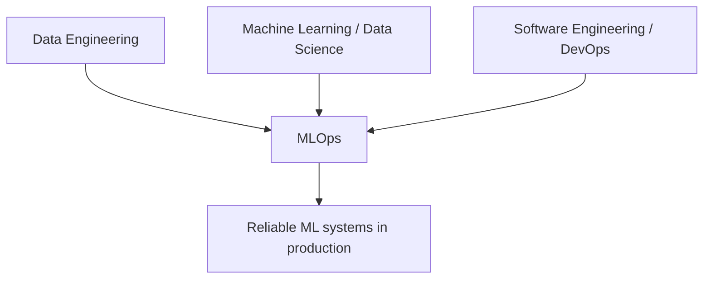

### Why is MLOps hard?

Unlike classic software, ML systems have an additional dimension of complexity:

| Aspect | Classic software | ML system |
|--------|--------------------------|-----------|
| Code | Deterministic | Probabilistic |
| Testing | Unit/integration tests | Data + model tests |
| Versioning | Code (git) | Code + data + model + pipeline |
| Degradation | Bugs in code | Data drift, concept drift |
| Reproducibility | Easy | Hard (randomness, data, environment) |
| Dependencies | Libraries | Libraries + data + hardware (GPU) |
| Debugging | Stack trace | Analysis of distributions, metrics, features |

### Technical debt in ML systems

Google's paper "Hidden Technical Debt in Machine Learning Systems" (NIPS 2015) shows that **the model code itself is only ~5% of the entire ML system**. The rest is infrastructure:

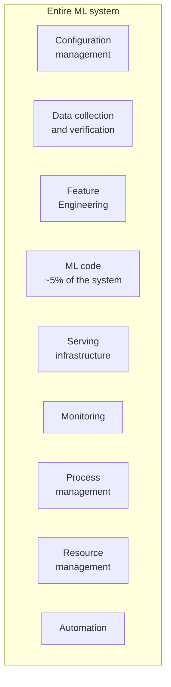

> 💡 **Pitfall:** Many teams focus solely on training the model (Jupyter Notebook), ignoring 95% of the work needed to deploy and maintain the model in production. This is the main reason why, according to Gartner research, **85% of ML projects never reach production**.

### Case Study: Uber Michelangelo

**Uber** built an internal MLOps platform called **Michelangelo**, which supports thousands of ML models in production (ETA, dynamic pricing, fraud detection). Key takeaways:
- Before Michelangelo, every team built its own solutions — the lack of standardization led to duplicated work and inconsistencies.
- The platform standardized the whole cycle: from data management, through training, to serving and monitoring.
- Introducing a central **Feature Store** eliminated the problem of different teams computing the same features in different ways.

### Case Study: Spotify — music recommendations

**Spotify** uses MLOps to run a recommendation system for over 500 million users:
- Models are retrained daily on new listening data.
- They use **Kubeflow Pipelines** to orchestrate ML pipelines.
- Data drift monitoring is crucial — music preferences change seasonally (e.g. Christmas carols in December).


### Software 1.0 vs Software 2.0

In classic software (*Software 1.0*) a programmer writes **rules** in code. In ML (*Software 2.0*, A. Karpathy) the rules are **learned from data**. Code is only one of three inputs of the system:

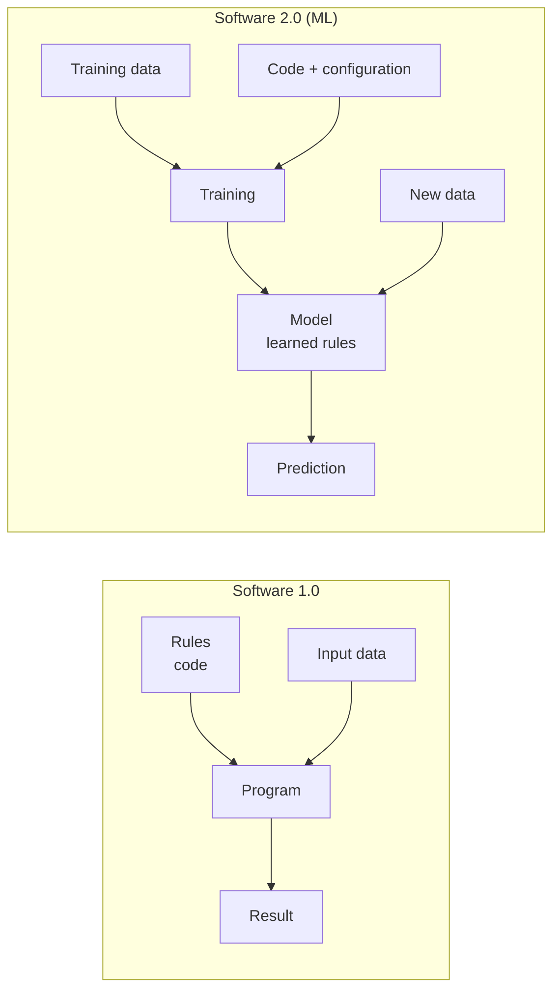

Takeaway for MLOps: **you need to version three things – code, data and model** (plus the environment). Changing any of them changes the system's behavior, even if the code remained identical.

| Dimension | Software 1.0 | ML system |
|---|---|---|
| Source of logic | programmer | data + algorithm |
| Error | exception, wrong deterministic result | "silent" quality degradation |
| Testing | unit/integration tests | + data tests, model tests, metric monitoring |
| Aging | when requirements change | also when the **world** changes (drift) |

#### The CACE principle

*Changing Anything Changes Everything* (Sculley et al., 2015): in a model, features are entangled – changing the scaling of one feature, adding a new column or changing a hyperparameter can change the weights of all other features. That is why in ML there are no "small, isolated changes" – every change requires re-evaluation.

#### Catalog of typical sources of technical debt in ML

Sculley et al. describe several recurring anti-patterns. It is worth knowing them by name, because they appear in almost every project:

| Anti-pattern | What it is | Symptom in practice | Countermeasure |
|---|---|---|---|
| **Glue code** | lots of code "gluing" data to the ML library | 90% of the repository is format conversions | shared interfaces, ready-made pipeline components |
| **Pipeline jungles** | accumulated, undocumented processing scripts | nobody knows in which order to run them | explicit DAG (Airflow, KFP, DVC) |
| **Dead experimental codepaths** | flags and branches left over from old experiments | `if USE_FEATURE_V2_OLD:` in production code | regular cleanup, experiments outside production code |
| **Undeclared consumers** | other systems silently read the model's predictions | changing the model breaks an unrelated system | access control, API contracts |
| **Unstable data dependencies** | a feature comes from a table that someone else changes | sudden quality drop without code changes | data versioning, schema validation |
| **Underutilized data dependencies** | almost useless features that are still maintained | cost and risk without gain | feature ablation (*leave-one-feature-out*) |
| **Configuration debt** | hundreds of parameters scattered across files | the configuration cannot be reproduced | a single, versioned configuration (YAML + git) |

```
  Jupyter Notebook (day 1)              System after a year without MLOps
  ┌──────────────────────┐              ┌──────────────────────────────────┐
  │ load → clean → fit   │   ───────▶   │ cron → script_a.py → tmp.csv     │
  │ → evaluate           │              │ script_b_fix.py → model_new.pkl  │
  └──────────────────────┘              │ "do not touch!" → service.py     │
                                        │ manual copying to the server     │
                                        └──────────────────────────────────┘
```

> ⚠️ **Note:** technical debt in ML grows "silently" – the system still returns predictions, throws no exceptions, it just gives worse and worse results. That is why in ML monitoring is part of the definition of a "working system", not an add-on.

---

## 2. ML model life cycle

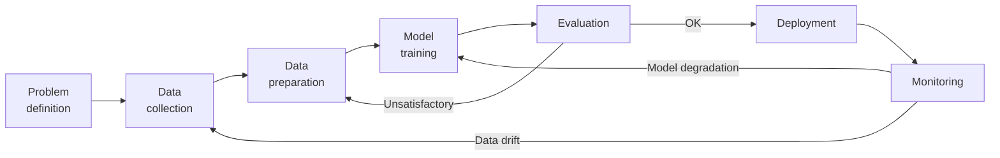

> **Model decay** – a gradual decline in the quality of a model's predictions in production, even though the model itself (code and weights) has not changed. The cause is that **the world changes while the model stays "frozen"** in the state from the moment of training.
>
> - **Causes:** data drift (the input distribution changes, $P(X)$), concept drift (the relationship between features and the label changes, $P(y \mid X)$), changes in data sources (schema/upstream drift) and feedback loops.
> - **Example:** a clothing recommendation model trained in summer has an increasingly lower CTR in February, because the season, trends and product range have changed. The accuracy of a fraud detection model drops from 0.92 to 0.75 within half a year, because fraudsters change their techniques.
> - **How to detect:** monitoring quality metrics (when labels are available), and without labels indirectly via feature drift and prediction distribution drift (sections 4.2–4.4).
> - **How to react:** retraining on fresh data on a schedule or after exceeding a threshold (the "Model degradation" → "Model training" arrow in the diagram), if needed going back to data collection or changing features.
>
> A chart of accuracy dropping over time under gradual drift is in section 4.4.

### Life cycle phases

1. **Problem definition** – what do we want to predict? What is the success metric?
2. **Data collection** – where does the data come from? How often is it updated?
3. **Data preparation** – cleaning, feature engineering, splitting into sets.
4. **Model training** – choice of algorithm, hyperparameters, experiments.
5. **Evaluation** – ML metrics (AUC, RMSE, F1) and business metrics.
6. **Deployment** – serving predictions (online/batch).
7. **Monitoring** – is the model still working correctly?

### Artifacts and checkpoint questions for each phase

Each phase should end with an **artifact** that can be versioned and reviewed. It is the artifacts that connect the phases into a repeatable process:

| Phase | Output artifact | Question to ask | Typical pitfall |
|---|---|---|---|
| Problem definition | document with success metric and baseline | is ML needed at all? | no simple baseline (rule, mean) |
| Data collection | data snapshot + version (e.g. DVC hash) | will the training data be available in production? | using features unavailable at prediction time |
| Data preparation | transformation code + validation report | does the train/test split respect time? | *data leakage* (e.g. scaling before splitting) |
| Training | model + parameters + metrics (MLflow) | can the result be reproduced? | no seed, configuration not saved |
| Evaluation | metrics report, per-segment error analysis | is the model better than the production one? | a single global metric hides weak segments |
| Deployment | Docker image / endpoint / registry entry | is preprocessing identical to training? | train/serve skew |
| Monitoring | dashboards, alerts, prediction logs | what will we do when an alert fires? | alerts without an owner and a procedure |

### ML metric vs business metric

The model optimizes a loss function, and the company – a business outcome. These two things are related, but **they are not the same**:

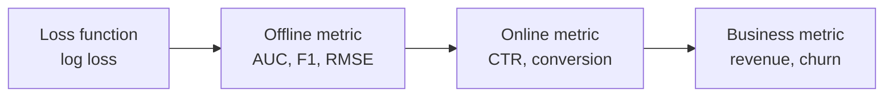

**Example:** a churn model has an AUC of 0.89, but the retention campaign achieves nothing, because the model is best at pointing out customers who will leave *anyway* (e.g. they are moving abroad). A better metric would be *uplift* – how much churn decreases after contact.

> 💡 **Good practice:** before you start training a model, write down (1) the offline metric, (2) the business metric, (3) a baseline without ML and (4) the threshold below which the model will not be deployed. This later becomes the quality gate in the pipeline.

### Two loops: experimental and production

```
   EXPERIMENTAL LOOP (Data Scientist)             PRODUCTION LOOP (system)
   ┌───────────────────────────────┐              ┌────────────────────────────┐
   │ hypothesis → features → train │   chosen     │ new data → pipeline        │
   │    ▲                  │       │   model +    │ → validation → training    │
   │    └──── analysis ◀───┘       │ ───────────▶ │ → quality gate → deploy    │
   │  (hours, manual, notebook)    │   pipeline   │ → monitoring ──┐           │
   └───────────────────────────────┘              │      ▲         │ (automatic)│
                                                  │      └─retrain─┘           │
                                                  └────────────────────────────┘
```

The goal of MLOps is that **the result of experimental work is a pipeline, not a single model file**. Then the production loop can reproduce the model on new data by itself.

---

## 3. MLOps maturity levels

Google defines three MLOps maturity levels:

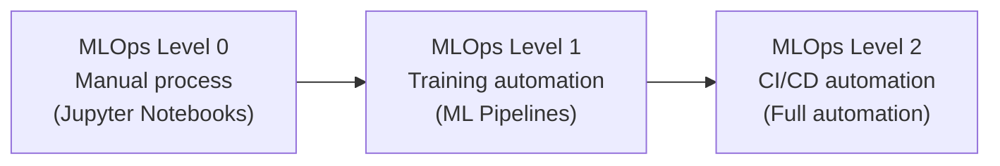

### Level 0 – Manual process
- A Data Scientist trains the model locally in a notebook.
- The model is exported and deployed manually (e.g. via email or a USB stick).
- No versioning of data and models.
- No monitoring — nobody knows whether the model still works correctly.
- No automated tests — "it works on my laptop".

**Problem:** "Works on my machine" – the model works for the Data Scientist, but not in production.

> 💡 **Typical Level 0 pitfall:** A Data Scientist sends the file `model_final_v3_FINAL.pkl` on Slack. Nobody knows what data and parameters were used. After 3 months the model stops working, and reproducing it is impossible.

**Real-life example:** A fintech startup trains a scoring model in a Jupyter Notebook. The model works great on test data (AUC=0.92). After deployment to production it turns out that the data preprocessing differs from the one in the notebook — AUC drops to 0.65.

### Level 1 – Training automation
- Defined ML Pipelines (automatic training from data to model).
- Versioning of data, code and models (DVC, MLflow).
- Automatic retraining triggers (e.g. after drift detection or on a schedule).
- Model monitoring in production (ML metrics + operational metrics).
- A Feature Store ensures feature consistency between training and production.

**Example:** A bank automatically retrains its scoring model every week on new transaction data. The pipeline validates the data, trains the model, compares the metrics with the previous version and registers the model in the Model Registry.

### Level 2 – CI/CD for ML
- Full automation: from commit to deployment (GitHub Actions, Cloud Build).
- Unit tests for pipeline components.
- Automatic A/B tests of new models in production.
- Canary deployments (gradual rollout), rollback in case of problems.
- Quality Gates — automatic quality gates blocking the deployment of weak models.

**Example:** Google Ads uses Level 2 MLOps — every change in the model code automatically triggers a CI/CD pipeline that trains the model, tests it, deploys a canary to 5% of traffic and monitors business metrics.

### How to assess your maturity level?

| Question | Level 0 | Level 1 | Level 2 |
|---------|---------|---------|---------|
| How often do you retrain the model? | Manually, ad hoc | Automatically, regularly | Automatically, on trigger |
| Can you reproduce the model from 3 months ago? | No | Yes (DVC/MLflow) | Yes + full audit trail |
| How long does it take to deploy a new model? | Days–weeks | Hours | Minutes |
| Who monitors the model in production? | Nobody | ML team | Automated system |
| What is the deployment artifact? | a `.pkl` file | training pipeline | pipeline + CI/CD code + tests |
| What does rollback look like? | "let's look for the old file" | manual version change in the registry | automatic, after exceeding a threshold |

### How to move from Level 0 to Level 1 – the minimal path

You do not need to build a platform right away. A reasonable order of steps (each delivers value on its own):

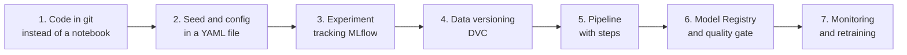

> ⚠️ **Pitfall:** deploying Kubernetes and Kubeflow in a team that does not yet have its code in a repository or recorded experiments. Tools from a higher level will not fix gaps at a lower level.


### Feedback loops

A production model **influences the data** it will be trained on in the future. Example: a recommendation system mostly shows popular products → users mostly click on them → the next model learns that only they matter.

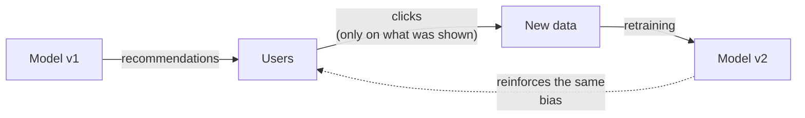

Mitigations: exploration (e.g. part of the traffic with random recommendations), logging the probability of showing an item (*propensity*) and weight correction, control groups without the model.

---


## 4. Main MLOps challenges

### 4.1 Reproducibility

```python
# Bad approach - no control over randomness
import numpy as np
from sklearn.ensemble import RandomForestClassifier

model = RandomForestClassifier()
model.fit(X_train, y_train)

# Good approach - full reproducibility
import numpy as np
from sklearn.ensemble import RandomForestClassifier

SEED = 42
np.random.seed(SEED)

model = RandomForestClassifier(
    n_estimators=100,
    random_state=SEED,
    n_jobs=-1
)
model.fit(X_train, y_train)

# Save the experiment parameters
experiment_config = {
    "seed": SEED,
    "model": "RandomForestClassifier",
    "n_estimators": 100,
    "data_version": "v2024-01-15",
    "train_size": len(X_train)
}
```


#### Sources of non-determinism

The seed is only one element. Full reproducibility requires control over all of the following sources:

| Source | Example | How to control |
|---|---|---|
| Algorithm randomness | weight initialization, bootstrap in RF | `random_state`, `np.random.default_rng(seed)`, `torch.manual_seed` |
| Data split | `train_test_split` without a seed | fixed seed or saving the split indices |
| Data | table overwritten with new records | snapshot + hash (DVC), `data_version` |
| Code | uncommitted changes | saving the `git commit hash` in the experiment metadata |
| Environment | a different scikit-learn version | `requirements.txt` with pinned versions, Docker |
| Hardware | GPU operations (cuDNN), multithreading | deterministic flags, accepting a small tolerance |
| Data order | `SELECT` without `ORDER BY` | explicit sorting |

An example of saving the experiment "fingerprint" – the data, code and environment versions:

```python
import hashlib
import json
import platform
import subprocess

import sklearn

def file_hash(path: str) -> str:
    h = hashlib.sha256()
    with open(path, "rb") as f:
        for chunk in iter(lambda: f.read(8192), b""):
            h.update(chunk)
    return h.hexdigest()[:12]

def git_commit() -> str:
    try:
        return subprocess.check_output(["git", "rev-parse", "--short", "HEAD"], text=True).strip()
    except Exception:
        return "unknown"

fingerprint = {
    "data_hash": file_hash("data/train.csv"),
    "git_commit": git_commit(),
    "python": platform.python_version(),
    "sklearn": sklearn.__version__,
    "seed": 42,
}
print(json.dumps(fingerprint, indent=2))
```

> 💡 **Rule:** if the experiment metadata cannot answer the question "what data, what code, what parameters, what environment?", the experiment is not reproducible – even if the seed was set.

> **▶️ Live demo:** `python lectures/scripts/lecture_01/01_reproducibility.py`  
> **When:** at the end of section 4.1, before moving on to drift.  
> **What to show:** three different accuracies without a seed, three identical ones with `seed=42`, and the saved `experiment_config.json` file.

### 4.2 Data Drift

**Data drift** – the distribution of input data changes over time.

#### Example: credit scoring in a bank

A bank trains a scoring model on applications from 2022–2023. Most applicants at that time are people aged 35–55, with a median income of about PLN 6,000, applying at a branch. In 2024 the bank launches applications through a mobile app and a social media campaign. The distribution of input features changes:

| Feature | Training data (2022–2023) | Production data (2024) | Change |
|---|---|---|---|
| Age (mean) | 44 years | 29 years | younger customers |
| Income (median) | PLN 6,000 | PLN 4,200 | lower incomes |
| Job tenure (mean) | 11 years | 3 years | shorter history |
| `mobile` channel | 10% | 70% | new dominant channel |

The rule "repays the loan if…", i.e. $P(y \mid X)$, may not have changed. What changed is $P(X)$: the model now mostly sees cases that were rare in training. It has little data there, so its predictions are less certain and worse calibrated. What matters is that **data drift can be detected immediately, without labels**: it is enough to compare feature distributions, whereas information on whether the customer repaid the loan would take months to arrive.

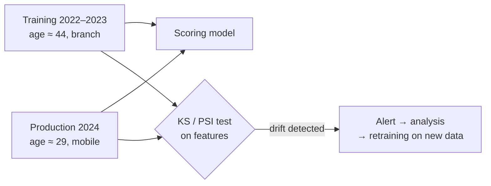

Other typical examples of data drift:
- **E-commerce:** on Black Friday the average basket value and the share of new customers increase.
- **IoT sensors:** after replacing a sensor with a new model, temperature readings are shifted by +2°C.
- **Image recognition:** photos from a new smartphone model have different brightness and resolution.

The code below reproduces the bank example for the "age" feature:

```python
import numpy as np
from scipy import stats

rng = np.random.default_rng(42)
age_train = rng.normal(44, 9, 5000).clip(18, 80)  # applications 2022–2023
age_prod = rng.normal(29, 6, 1000).clip(18, 80)   # applications 2024 (mobile)

stat, p = stats.ks_2samp(age_train, age_prod)
print(f"KS = {stat:.3f}, p-value = {p:.2e}")      # KS ≈ 0.8, p ≈ 0 → drift
print(f"Share of customers < 30 years: training {np.mean(age_train < 30):.0%}, "
      f"production {np.mean(age_prod < 30):.0%}")
```

The function below is a general detector that can be applied to any numerical feature:

```python
import numpy as np
from scipy import stats

def detect_data_drift(reference_data: np.ndarray, 
                       current_data: np.ndarray,
                       threshold: float = 0.05) -> dict:
    """
    Detects data drift using the Kolmogorov-Smirnov test.
    
    Args:
        reference_data: reference data (from training)
        current_data: current production data
        threshold: p-value threshold for rejecting H0
    
    Returns:
        dict with the test results
    """
    statistic, p_value = stats.ks_2samp(reference_data, current_data)
    
    return {
        "statistic": statistic,
        "p_value": p_value,
        "drift_detected": p_value < threshold,
        "severity": "high" if p_value < 0.01 else "medium" if p_value < threshold else "none"
    }

# Usage example
reference = np.random.normal(0, 1, 1000)   # training data
current = np.random.normal(0.5, 1.2, 500)  # production data (with drift)

result = detect_data_drift(reference, current)
print(f"Drift detected: {result['drift_detected']}")
print(f"P-value: {result['p_value']:.4f}")
print(f"Severity: {result['severity']}")
```


### 4.3 Concept Drift

**Concept drift** – the relationship between the features and the label changes over time.

Example: a model predicting apartment prices stops working after a financial crisis.

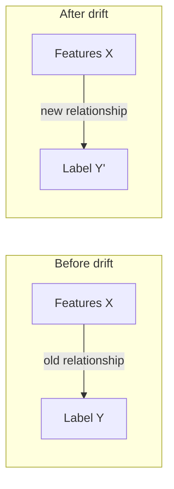

#### Why is concept drift harder to detect?

With concept drift the feature distribution $P(X)$ can remain **identical** – a KS test on the features will show nothing. Only the answer that the "world" assigns to the same features changes. It can only be detected by comparing predictions with the true labels, and these often arrive with a delay (*label delay*):

| Domain | Label delay | Consequence |
|---|---|---|
| Recommendations (click) | seconds–minutes | fast reaction possible |
| Card fraud (chargeback) | weeks | you have to rely on proxies (prediction distribution, rules) |
| Credit scoring (default) | months–years | mostly indirect monitoring, periodic backtests |

A minimal example – the same $X$, a shifted decision threshold:

```python
import numpy as np
from sklearn.linear_model import LogisticRegression

rng = np.random.default_rng(42)
X = rng.normal(0, 1, (2000, 1))
y_old = (X[:, 0] > 0).astype(int)      # old rule
y_new = (X[:, 0] > 1).astype(int)      # new rule (e.g. stricter criteria)

model = LogisticRegression().fit(X, y_old)
print("accuracy before:", (model.predict(X) == y_old).mean())   # ≈ 1.0
print("accuracy after: ", (model.predict(X) == y_new).mean())   # ≈ 0.66
# The distribution of X has not changed, so a KS test on the features will not detect the problem.
```


> **▶️ Live demo:** `python lectures/scripts/lecture_01/02_data_drift.py --plot`  
> **When:** after discussing sections 4.2 and 4.3.  
> **What to show:** a small drift (0.1) is not statistically significant, while a large one is. In the concept drift part the KS test detects nothing, even though accuracy drops from ~1.0 to ~0.5. The histogram plot is saved to `outputs/data_drift.png`. Exercise: change the distribution parameters and ask the students from what shift the test starts detecting drift.


### 4.4 Drift taxonomy

From the point of view of the joint distribution $P(X, y) = P(y \mid X)\,P(X)$ we distinguish:

| Type | What changes | Example | How to detect |
|---|---|---|---|
| **Covariate shift** (data drift) | $P(X)$ | a new age group of customers | statistical tests on features (KS, PSI, χ²) – without labels |
| **Prior / label shift** | $P(y)$ | fraud rate rises from 1% to 5% | prediction distribution, later the label distribution |
| **Concept drift** | $P(y \mid X)$ | a pandemic changes shopping behavior | only quality metrics – requires labels |
| **Schema / upstream drift** | data format | a column in zloty → in grosze | schema and range validation |

Drift can be **sudden** (a regulation change), **gradual** (inflation), **recurring** (seasonality) or **transient** (a one-off incident):

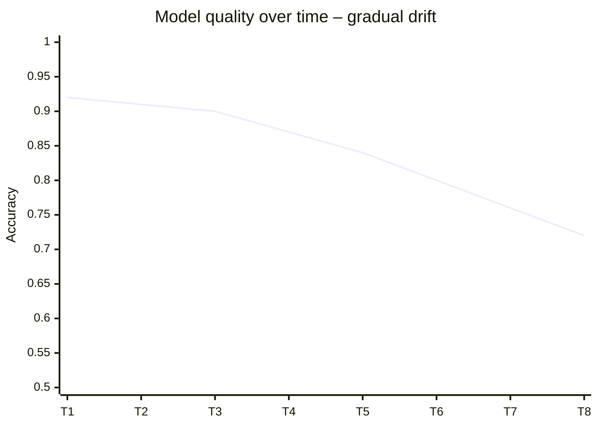

#### Population Stability Index (PSI)

Besides the KS test, PSI is popular in industry (e.g. banking) – it works on intervals (bins) and is easy to interpret:

$$PSI = \sum_{i=1}^{k} (p_i^{cur} - p_i^{ref}) \cdot \ln\frac{p_i^{cur}}{p_i^{ref}}$$

```python
import numpy as np

def psi(reference: np.ndarray, current: np.ndarray, bins: int = 10) -> float:
    edges = np.quantile(reference, np.linspace(0, 1, bins + 1))
    edges[0], edges[-1] = -np.inf, np.inf
    ref = np.histogram(reference, edges)[0] / len(reference)
    cur = np.histogram(current, edges)[0] / len(current)
    ref, cur = np.clip(ref, 1e-6, None), np.clip(cur, 1e-6, None)
    return float(np.sum((cur - ref) * np.log(cur / ref)))

rng = np.random.default_rng(0)
ref = rng.normal(0, 1, 10_000)
print(f"no drift:     {psi(ref, rng.normal(0, 1, 5000)):.3f}")
print(f"large drift:  {psi(ref, rng.normal(0.5, 1.2, 5000)):.3f}")
```

Rule of thumb: **PSI < 0.1** – no significant change, **0.1–0.25** – moderate (watch), **> 0.25** – significant change (consider retraining).

> **Note:** with very large samples, statistical tests (KS) detect even business-irrelevant differences (p-value → 0). That is why in practice the p-value is combined with an effect size measure (KS statistic, PSI, Wasserstein distance).

#### Comparison of drift detection methods

| Method | Feature type | Requires labels? | Advantages | Disadvantages |
|---|---|---|---|---|
| KS test | numerical | no | simple, non-parametric | oversensitive for large n |
| χ² test | categorical | no | standard for categories | problems with rare categories |
| PSI | numerical and categorical | no | interpretable thresholds | depends on the choice of bins |
| Wasserstein distance | numerical | no | measures "how much" shift, in feature units | no natural threshold |
| Prediction distribution | model output | no | one signal instead of hundreds of features | does not indicate the cause |
| Quality metrics (AUC, F1) | – | yes | measures what really matters | label delay |

> ⚠️ **Multiple testing trap:** with 200 features and a threshold of p < 0.05, on average ~10 features will "show drift" by chance. Apply a correction (e.g. Bonferroni), monitor the most important features, or alert only on drift in several consecutive windows.

### 4.5 Train/serve skew and data leakage

Two mistakes that cause a model that is **great offline to turn out weak online** – even though there is no drift at all:

| | Train/serve skew | Data leakage |
|---|---|---|
| Essence | features computed differently in training and in production | in training the model sees information unavailable at prediction time |
| Example | `income` in training in zloty, in the API in grosze | the `number_of_reminders` feature only appears *after* a payment delay |
| Symptom | quality drop from the first day of deployment | suspiciously high offline metrics (AUC 0.99) |
| Prevention | a single feature implementation (Feature Store, shared `Pipeline`) | time-based split, analysis of "when the feature is known" |

Classic leakage in preprocessing and its fix:

```python
from sklearn.datasets import make_classification
from sklearn.linear_model import LogisticRegression
from sklearn.model_selection import train_test_split
from sklearn.pipeline import make_pipeline
from sklearn.preprocessing import StandardScaler

X, y = make_classification(n_samples=1000, random_state=42)

# WRONG: the scaler sees the test data (mean and std from the whole dataset)
X_scaled = StandardScaler().fit_transform(X)
X_tr, X_te, y_tr, y_te = train_test_split(X_scaled, y, random_state=42)

# RIGHT: preprocessing is part of the model - the same object goes to production
X_tr, X_te, y_tr, y_te = train_test_split(X, y, random_state=42)
model = make_pipeline(StandardScaler(), LogisticRegression())
model.fit(X_tr, y_tr)
print(f"accuracy: {model.score(X_te, y_te):.3f}")
```

> 💡 Saving the whole `Pipeline` (preprocessing + model) as a single artifact is the simplest way to avoid train/serve skew in small projects.

---

## 5. MLOps system architecture

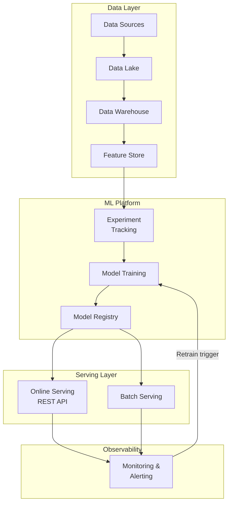

### Description of the architecture components

#### Data Layer
- **Data Sources** – sources of input data (transactional systems, application logs, APIs, IoT) that feed the ML system.
- **Data Lake** – the raw data layer (often in file format), storing the full data history for analysis and retraining.
- **Data Warehouse** – a structured analytical layer after cleaning and transformations, used for reporting and feature preparation.
- **Feature Store** – a central feature repository with a single computation definition for training and inference, which limits train/serve skew.
  - **Training** – the stage in which the model learns from historical data. Features are computed in batch for many records at once, e.g. "number of customer transactions in the last 30 days" computed for the whole dataset from the previous year.
  - **Inference** (serving, prediction) – using the trained model in production to make predictions for new data, often in real time. The same features have to be computed for a single request, e.g. for a customer who is placing an order right now.
  - **Train/serve skew** (training-serving skew) – a discrepancy between the features seen by the model in training and the features given to it in production. It usually results from two different implementations of the same feature (e.g. pandas in training, SQL or Java in the service) or from different data sources. Examples include different rounding, time zones, different handling of missing values or a different time window. The model performs well offline but worse in production, even though the model itself has not changed. The Feature Store counteracts this: a feature is defined once and the same definition is used by training (offline store) and inference (online store). More on this in lecture 2.

#### ML Platform
- **Experiment Tracking** – a registry of experiments (parameters, metrics, artifacts, data and code versions) that ensures comparability and reproducibility.
- **Model Training** – the process of training and validating models in pipelines, with data quality and metric checks.
- **Model Registry** – a catalog of model versions with their status (staging/production/archived), metadata and promotion history.

#### Serving Layer
- **Online Serving (REST API)** – serving predictions in real time for applications that require low latency.
- **Batch Serving** – batch predictions run periodically (e.g. nightly scoring) when an online response is not required.

#### Observability
- **Monitoring & Alerting** – observability of the system and the model: operational metrics (latency, errors), prediction quality metrics, data/concept drift and alerts.
- **Retrain trigger** – a mechanism that automatically starts retraining when quality or drift thresholds are exceeded, or according to a schedule.

> 💡 **In practice:** it is worth defining an owner, SLA/SLO and a minimal set of metrics for each component. This way the MLOps architecture is not only technically complete but also operationally maintainable.

### Online vs batch serving – comparison

| Criterion | Online (REST/gRPC) | Batch |
|---|---|---|
| Latency | milliseconds | minutes–hours |
| Example | fraud detection at payment time | nightly churn scoring for the whole customer base |
| Features | from the online store, computed on the fly | from the data warehouse |
| Scaling | replica autoscaling | resources for the duration of the job |
| Typical risk | latency, availability, skew | stale predictions |
| Monitoring | p95/p99 latency, HTTP errors | job duration, number of records |

The flow of a single online prediction request:

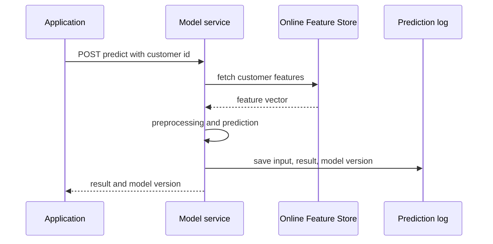

> ⚠️ **Often overlooked:** logging inputs, predictions and the **model version** for every request. Without these logs it is impossible to later compute metrics once labels arrive, detect drift or investigate an incident.

---

## 6. Key tools of the MLOps ecosystem

| Category | Open Source tools | Cloud tools |
|-----------|----------------------|-----------------|
| Experiment Tracking | MLflow, Weights & Biases | Vertex AI Experiments |
| Pipeline Orchestration | Kubeflow, Apache Airflow | Vertex AI Pipelines |
| Model Registry | MLflow Registry | Vertex AI Model Registry |
| Feature Store | Feast | Vertex AI Feature Store |
| Model Serving | BentoML, Seldon | Vertex AI Endpoints |
| Monitoring | Evidently AI, Prometheus | Vertex AI Model Monitoring |
| CI/CD | GitHub Actions, Jenkins | Cloud Build |


### How to choose tools? Build vs Buy

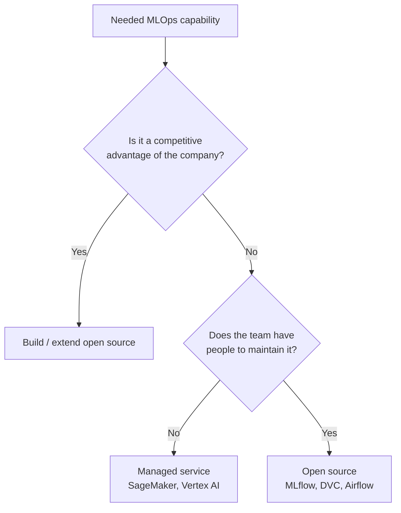

Selection criteria: maintenance cost, integration with the existing stack (cloud, CI/CD), vendor lock-in, security requirements (data cannot leave the company), community maturity. Good practice: **start with the simplest solution** (e.g. MLflow + DVC + GitHub Actions) and add tools only when a concrete problem appears.

---

## 7. MLOps vs DevOps – key differences

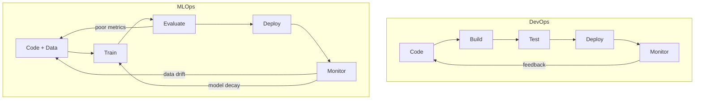

**Additional elements in MLOps:**
- Versioning of **data** (not only code)
- Versioning of **models** (binary artifacts)
- **ML metrics** as a deployment condition
- **Automatic retraining** after drift is detected
- **Explainability** – explaining predictions

### CI, CD and CT

In MLOps a third element joins the classic CI/CD pair – **CT (Continuous Training)**:

| Practice | DevOps | MLOps |
|---|---|---|
| **CI** – Continuous Integration | code tests, build | + data tests, schema validation, pipeline component tests |
| **CD** – Continuous Delivery | application deployment | deployment of the **training pipeline** and the prediction service |
| **CT** – Continuous Training | – | automatic retraining on new data with a quality gate |

| Aspect | DevOps | MLOps |
|---|---|---|
| Change trigger | code commit | commit **or** new data **or** drift alert |
| Artifact | binary, Docker image | image + model + data metadata |
| "Ready to deploy" criterion | tests pass | tests + metrics ≥ threshold + comparison with the production model |
| Deployment strategy | blue-green, canary | + shadow deployment, A/B tests |
| Rollback | previous code version | previous model version from the registry |

> 💡 **Shadow deployment:** the new model receives a copy of production traffic and computes predictions, but does not return them to users. It allows comparing models on real data without risk.

---


## 8. Example: A simple MLOps system from scratch

```python
from dataclasses import dataclass, field
from datetime import datetime
from typing import Optional
import json
import hashlib

@dataclass
class ModelVersion:
    """Represents a model version in the registry."""
    name: str
    version: str
    metrics: dict
    data_version: str
    created_at: str = field(default_factory=lambda: datetime.now().isoformat())
    status: str = "staging"  # staging | production | archived
    
    def to_dict(self) -> dict:
        return {
            "name": self.name,
            "version": self.version,
            "metrics": self.metrics,
            "data_version": self.data_version,
            "created_at": self.created_at,
            "status": self.status
        }

class SimpleModelRegistry:
    """A simple model registry (concept demonstration)."""
    
    def __init__(self):
        self.models: dict[str, list[ModelVersion]] = {}
    
    def register(self, model: ModelVersion) -> str:
        """Registers a new model version."""
        if model.name not in self.models:
            self.models[model.name] = []
        self.models[model.name].append(model)
        print(f"✅ Registered: {model.name} v{model.version}")
        return model.version
    
    def promote_to_production(self, name: str, version: str):
        """Promotes a model version to production."""
        for mv in self.models.get(name, []):
            if mv.status == "production":
                mv.status = "archived"
            if mv.version == version:
                mv.status = "production"
                print(f"🚀 Deployed: {name} v{version} → production")
    
    def get_production_model(self, name: str) -> Optional[ModelVersion]:
        """Returns the current production model."""
        for mv in self.models.get(name, []):
            if mv.status == "production":
                return mv
        return None

# Usage
registry = SimpleModelRegistry()

# Registering model v1
v1 = ModelVersion(
    name="churn_predictor",
    version="1.0.0",
    metrics={"auc": 0.82, "f1": 0.75},
    data_version="data-2024-01"
)
registry.register(v1)
registry.promote_to_production("churn_predictor", "1.0.0")

# Registering a better model v2
v2 = ModelVersion(
    name="churn_predictor",
    version="2.0.0",
    metrics={"auc": 0.89, "f1": 0.83},
    data_version="data-2024-06"
)
registry.register(v2)
registry.promote_to_production("churn_predictor", "2.0.0")

# Checking the current production model
prod = registry.get_production_model("churn_predictor")
print(f"\nCurrent production model: {prod.name} v{prod.version}")
print(f"Metrics: {prod.metrics}")
```


> **▶️ Live demo:** `python lectures/scripts/lecture_01/03_simple_mlops_system.py`  
> **When:** after the example in section 8, as its extended, working version.  
> **What to show:** models v1 and v2 go to production, while the weaker v3 stays in `staging` (quality gate). Then show the `outputs/model_registry/registry.json` file and announce that in lecture 3 the same role is played by the MLflow Model Registry.

### Quality gate

In the example above `promote_to_production` promotes the model unconditionally. In a real system promotion should be a rule-based decision. The lifecycle of a model version:

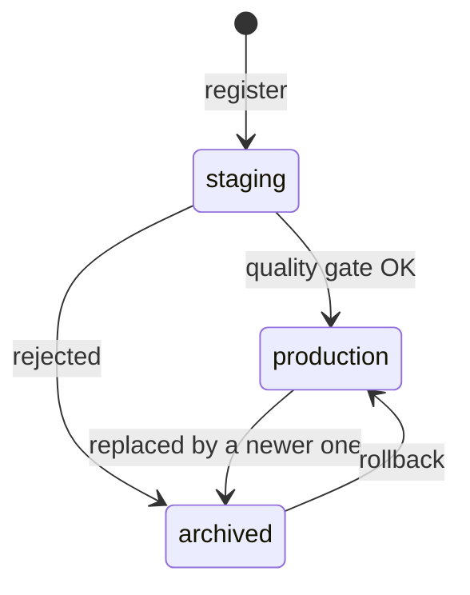

An example gate that can be added to `SimpleModelRegistry`:

```python
def passes_quality_gate(candidate: ModelVersion,
                        current: Optional[ModelVersion],
                        min_auc: float = 0.80,
                        min_improvement: float = 0.01) -> bool:
    """The model goes to production only if it meets the threshold and is better than the current one."""
    if candidate.metrics.get("auc", 0.0) < min_auc:
        return False
    if current is None:
        return True
    return candidate.metrics["auc"] >= current.metrics["auc"] + min_improvement

candidate = ModelVersion("churn_predictor", "3.0.0", {"auc": 0.87, "f1": 0.80}, "data-2024-09")
registry.register(candidate)
if passes_quality_gate(candidate, registry.get_production_model("churn_predictor")):
    registry.promote_to_production("churn_predictor", "3.0.0")
else:
    print("⛔ v3.0.0 stays in staging – it did not pass the quality gate")
```

> ⚠️ **Trap:** comparing models on **different** test sets. The AUC of a new model on September data and of the old one on January data are not comparable – both models must be evaluated on the same, current dataset.


### Testing ML systems – the test pyramid

An ML system requires tests at several levels (cf. *ML Test Score*, Breck et al., Google 2017):

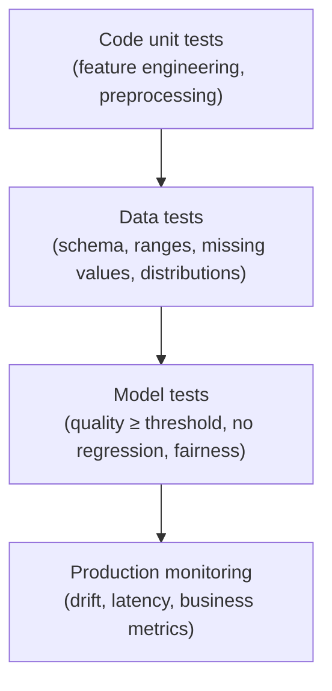

An example of tests (pytest) for the system from section 8:

```python
import numpy as np
import pytest
from sklearn.datasets import make_classification
from sklearn.linear_model import LogisticRegression
from sklearn.metrics import f1_score

@pytest.fixture(scope="module")
def data():
    return make_classification(n_samples=1000, random_state=42)

def test_feature_shape(data):                      # data test
    X, y = data
    assert X.shape[1] == 20 and not np.isnan(X).any()

def test_model_quality_threshold(data):            # quality test
    X, y = data
    model = LogisticRegression(max_iter=500).fit(X[:800], y[:800])
    assert f1_score(y[800:], model.predict(X[800:])) >= 0.8

def test_invariance_to_row_order(data):            # behavioral test
    X, y = data
    model = LogisticRegression(max_iter=500).fit(X, y)
    idx = np.random.default_rng(0).permutation(len(X))
    assert (model.predict(X)[idx] == model.predict(X[idx])).all()
```

Types of behavioral tests (*CheckList*, Ribeiro et al. 2020): **invariance** (changing an irrelevant feature does not change the prediction), **directional expectation** (an increase in income should not increase credit risk), **minimum functionality** (simple cases must work).

---

## 9. Roles in an MLOps team

Implementing MLOps requires cooperation between many specialists:

| Role | Responsibility | Typical tools |
|------|------------------|------------------|
| **Data Scientist** | Experimentation, model training | Jupyter, scikit-learn, PyTorch |
| **ML Engineer** | Model productization, pipelines | KFP, Airflow, Docker |
| **Data Engineer** | Data pipelines, Feature Store | Spark, Kafka, dbt |
| **DevOps/Platform Engineer** | Infrastructure, CI/CD, monitoring | Kubernetes, Terraform, Prometheus |
| **Product Manager** | Defining business metrics | A/B testing, dashboards |

> 💡 **Tip:** In small teams one person often plays several roles. The key is that **each of these responsibilities is covered**, even if by the same person.

### Who is responsible for what? (RACI matrix)

R – responsible (does the work), A – accountable for the result, C – consulted, I – informed.

| Task | Data Scientist | ML Engineer | Data Engineer | Platform Engineer | Product Manager |
|---|---|---|---|---|---|
| Defining the success metric | C | I | I | I | **A/R** |
| Data pipeline and data quality | C | C | **A/R** | I | I |
| Experiments and model selection | **A/R** | C | I | I | C |
| Training pipeline and serving | C | **A/R** | C | C | I |
| Infrastructure and CI/CD | I | C | I | **A/R** | I |
| Responding to a drift alert | R | **A** | R | C | I |

### Case study: Zillow Offers – the cost of lacking control over a model

In 2021 Zillow shut down its home-buying business (*Zillow Offers*), reporting losses of several hundred million dollars and a reduction of about 25% of its staff. The property valuation model was used to automatically make purchase offers during a period of rapid market changes. Lessons for MLOps (simplified):
- a model that worked well on historical data could not keep up with the rapid market change (**concept drift**),
- the model's decisions directly influenced the market and future data (**feedback loop**),
- there were not enough risk-limiting mechanisms (limits, human oversight, fast reaction to monitoring signals).

---

## Review and discussion questions

1. Explain why deploying an ML model to production is harder than deploying a classic web application.
2. At which MLOps maturity level (0, 1, 2) is your organization or project? Justify your answer.
3. Give three examples of situations in which an ML model can degrade in production.
4. How does data drift differ from concept drift? Give an example of each.
5. Why does the model code itself make up only ~5% of the whole ML system? What makes up the remaining 95%?
6. What benefits does a Feature Store provide compared to a situation where each Data Scientist computes features on their own?
7. **Discussion:** Does every ML project need full MLOps (Level 2)? When is Level 0 sufficient?
8. List at least four sources of non-determinism in model training other than a missing seed.
9. How does train/serve skew differ from data leakage? How does each of them show up in the metrics?
10. Why will concept drift not be detected by a KS test on the input features?
11. What is Continuous Training and how does it differ from Continuous Delivery?
12. Why should a quality gate compare the candidate with the production model on the same test set?


### Suggested answers

1. Deploying an ML model is harder because, besides code, there are data, the model, the pipeline, drift monitoring and reproducibility. A web application is usually deterministic, while an ML system is probabilistic and degrades as the data changes.
2. In most university projects and small teams it is usually Level 0 or the beginning of Level 1: there are experiments and manual deployments, but full monitoring and automated CI/CD are missing. The justification is the lack of full data/model versioning and automated quality gates.
3. (a) A change in user behavior (e.g. seasonality), (b) a change in the source/schema of the input data, (c) a change in the business process or market, which makes the feature→label relationship outdated.
4. Data drift is a change in the distribution of input features (e.g. customer age shifts towards younger groups). Concept drift is a change in the relationship between the features and the label (e.g. the same credit features no longer predict default as well after a crisis).
5. Because a production ML system requires infrastructure: data collection and validation, feature engineering, training, a model registry, serving, monitoring, alerting, CI/CD and resource management. The model code is just one element of this chain.
6. A Feature Store provides a single, consistent feature definition for training and inference, so it reduces training-serving skew. In addition, it limits duplicated work, improves reusability and simplifies governance and auditing.
7. Not every project needs Level 2 right away. Level 0 can be sufficient for a PoC, a prototype or a small, low-risk project with a short horizon. As scale, frequency of changes and the cost of errors grow, it is worth moving at least to Level 1, and eventually to Level 2.
8. Random data split, changes in the source data (no snapshot), uncommitted code, different library versions, non-deterministic GPU operations and multithreading, the order of rows returned by an SQL query.
9. Train/serve skew is a different implementation of features in training and in production – offline metrics are good, while online they are worse from the first day. Data leakage is using information in training that is unavailable at prediction time – offline metrics are unnaturally high and drop in production.
10. Because with concept drift $P(y \mid X)$ changes, while the distribution $P(X)$ may remain the same. The KS test only compares feature distributions, so it does not see the change in the relationship with the label – that requires labels and quality metrics.
11. CT is the automatic retraining of a model on new data (triggered by a schedule, new data or an alert). CD concerns software deployment – in MLOps the training pipeline and the service are deployed, and CT runs that pipeline.
12. Because metrics computed on different data reflect differences in the data, not in the models. A fair comparison requires a common, current evaluation dataset.


---

## Summary

- **MLOps** is a set of practices combining ML, software engineering and IT operations.
- Main challenges: reproducibility, data drift, concept drift, scalability.
- A model that is great offline but weak online is most often a case of train/serve skew or data leakage – not drift.
- Besides CI/CD, MLOps has **CT** – continuous retraining with a quality gate.
- Three maturity levels: manual → training automation → full CI/CD.
- Key components: Feature Store, Experiment Tracking, Model Registry, Monitoring.
- The model code itself is ~5% of the system — the rest is infrastructure, data and processes.
- MLOps is not a one-off project but a **continuous process** requiring cooperation between many roles.

## Literature and resources

- [Google MLOps: Continuous delivery and automation pipelines in machine learning](https://cloud.google.com/architecture/mlops-continuous-delivery-and-automation-pipelines-in-machine-learning)
- [Sculley et al. "Hidden Technical Debt in Machine Learning Systems" (NIPS 2015)](https://papers.nips.cc/paper/2015/hash/86df7dcfd896fcaf2674f757a2463eba-Abstract.html)
- [Chip Huyen "Designing Machine Learning Systems" (O'Reilly, 2022)](https://www.oreilly.com/library/view/designing-machine-learning/9781098107956/)
- [ml-ops.org](https://ml-ops.org/)
- [Uber Michelangelo – ML Platform](https://www.uber.com/blog/michelangelo-machine-learning-platform/)
- [Made With ML – MLOps Course](https://madewithml.com/)
- [Awesome MLOps – a list of tools and resources](https://github.com/visenger/awesome-mlops)
