# Lecture 2: Data Engineering for ML

## Lecture goal
After this lecture, the student:
- understands the role of data engineering in ML systems,
- knows the Data Lake and Data Warehouse architectural patterns,
- can design a data processing pipeline,
- understands the concept of a Feature Store and its importance.

## Lecture scripts

The demo scripts are located in ``. Full instructions can be found in [``](scripts/README.md).

| When (section) | Script | Demo goal |
|---|---|---|
| 3. Data formats | `01_csv_vs_parquet.py` | size, speed, column pruning and data types |
| 5. Processing pipeline | `02_data_pipeline.py` | complete pandas + sklearn pipeline saved as a single artifact |
| 6. Data validation | `03_data_validation.py [--corrupt]` | validation as a quality gate (exit code 1 on errors) |
| 8. DVC | `05_dvc_demo.sh` | data versioning and reverting to a previous version |
| 10. Pitfalls | `04_data_leakage.py` | data leakage gives deceptively high scores |

**How:** from the repository root, run `python lectures/scripts/lecture_02/<script>`. The DVC script is run via `bash` and requires `git` and `dvc`. It works in a temporary directory, so it does not modify the repository.

---

## 1. Data as the foundation of ML

> "Garbage in, garbage out" – model quality is limited by data quality.

In production systems, data is the most important asset. Data Engineering deals with:
- **collecting** data from various sources,
- **storing** it in appropriate formats and structures,
- **processing** it (cleaning, transformation, aggregation),
- **serving** it to ML models.

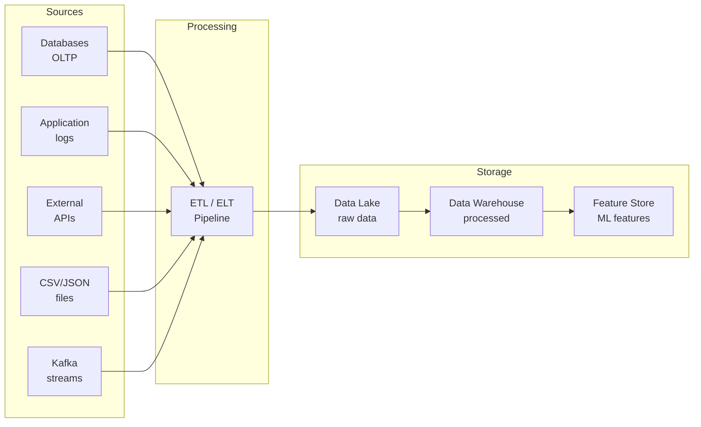

### 1.1. How much of ML work is data work?

Research and industry surveys repeatedly observe that data preparation takes most of the time in an ML project, while the model code itself is a small fragment of the whole system (cf. Sculley et al., *Hidden Technical Debt in Machine Learning Systems*, NeurIPS 2015).

```
┌──────────────────────────────────────────────────────────────────┐
│                    ML system in production                       │
│  ┌────────────┐ ┌─────────────┐ ┌───────────┐ ┌───────────────┐  │
│  │ Data       │ │ Data        │ │ Feature   │ │ Resource      │  │
│  │ collection │ │ verification│ │ extraction│ │ management    │  │
│  └────────────┘ └─────────────┘ └───────────┘ └───────────────┘  │
│  ┌────────────┐      ┌──────┐      ┌───────────┐ ┌───────────┐   │
│  │ Config.    │      │  ML  │      │ Serving   │ │ Monitoring│   │
│  │            │      │ CODE │      │           │ │           │   │
│  └────────────┘      └──────┘      └───────────┘ └───────────┘   │
└──────────────────────────────────────────────────────────────────┘
        a small "ML CODE" box surrounded by data infrastructure
```

### 1.2. Data lifecycle in an ML system

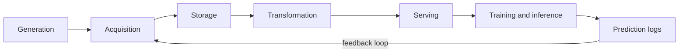

The feedback loop is crucial: model predictions and user reactions become new training data. This is the source of both continuous learning and risk (e.g. a *feedback loop* – a recommender system learns from data it shaped itself).

### 1.3. Roles in a data team

| Role | Main responsibility | Typical tools |
|---|---|---|
| Data Engineer | pipelines, data stores, quality and availability | Spark, Airflow, dbt, Kafka |
| Analytics Engineer | data models in the warehouse, business metrics | dbt, SQL, Looker |
| Data Scientist | exploration, features, models | pandas, sklearn, notebooks |
| ML Engineer | production ML pipelines, serving | MLflow, Feast, Docker, K8s |
| Data Steward / Owner | definitions, ownership, regulatory compliance | data catalogs, DataHub |

> 💡 **Data-centric AI** (A. Ng): instead of endlessly tuning the model architecture, we often gain more by systematically improving the data – labels, coverage of edge cases, consistency of definitions.

---

## 2. Data architecture: Data Lake vs Data Warehouse

### Data Lake
- Stores **raw data** in its original format (files, JSON, Parquet, Avro).
- Schema defined on read (*schema-on-read*).
- Cheap storage of large volumes.
- Examples: AWS S3, Google Cloud Storage, Azure Data Lake.

### Data Warehouse
- Stores **processed, structured data**.
- Schema defined on write (*schema-on-write*).
- Optimized for analytical queries (OLAP).
- Examples: BigQuery, Snowflake, Redshift.

### Data Lakehouse
A modern approach combining the advantages of both:

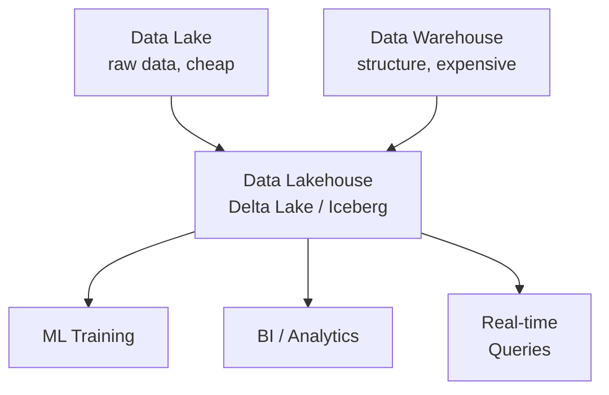

### Medallion architecture (Bronze / Silver / Gold)

A popular pattern for organizing data in a Lakehouse – data passes through successive quality layers:

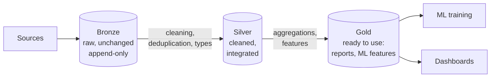

| Layer | Contents | Who uses it | Rule |
|---|---|---|---|
| Bronze | copy of source data | data engineers | never overwrite – full replay possible |
| Silver | cleaned data, unified types | analysts, DS | a single "version of truth" per entity |
| Gold | aggregates and business features | ML models, BI | optimized for a specific use |

Advantage for ML: when we change the feature engineering logic, we can **rebuild** the Silver/Gold layers from Bronze and train the model on historical data with the new features.

### OLTP vs OLAP

| | OLTP (e.g. PostgreSQL) | OLAP (e.g. BigQuery) |
|---|---|---|
| Operations | many small writes/reads | large scans and aggregations |
| Data layout | row-based | columnar |
| Role in ML | data source, online serving | training, analytics, feature engineering |

### Summary comparison: Lake vs Warehouse vs Lakehouse

| Criterion | Data Lake | Data Warehouse | Data Lakehouse |
|---|---|---|---|
| Data types | any: tables, text, images, audio | structured | any + tables with ACID |
| Schema | schema-on-read | schema-on-write | schema-on-write with evolution |
| ACID transactions | none | yes | yes (metadata layer) |
| Storage cost | low (object storage) | higher | low |
| SQL performance | poor without add-ons | very good | good |
| Time travel | none | depends on the product | yes (snapshot versions) |
| Typical use in ML | unstructured data for DL | tabular features, analytics | single source for BI and ML |

### How does a Lakehouse work? Open table formats

In practice, a Lakehouse is Parquet files in object storage **plus a transaction log** (metadata) that says which files make up a given version of a table. The most popular implementations: **Delta Lake**, **Apache Iceberg**, **Apache Hudi**.

```
s3://lake/silver/orders/
├── _delta_log/
│   ├── 00000000000000000000.json   ← version 0: added part-0001, part-0002
│   ├── 00000000000000000001.json   ← version 1: removed part-0002, added part-0003
│   └── 00000000000000000002.json   ← version 2: MERGE (upsert)
├── part-0001.snappy.parquet
├── part-0002.snappy.parquet        ← logically removed, physically until VACUUM
└── part-0003.snappy.parquet
```

This enables: atomic writes, `MERGE`/`UPDATE`/`DELETE` (important e.g. for GDPR – the right to erasure), **time travel** (reading the table in the version the model was trained on) and schema evolution.

```python
# Delta Lake + PySpark: read the table as of the training date
df_train = (spark.read.format("delta")
            .option("timestampAsOf", "2024-01-15")
            .load("s3://lake/gold/churn_features"))
```

> 💡 Time travel in a Lakehouse and DVC (section 8) solve the same problem – **reproducibility of training data** – at different scales: DVC for files in the project repository, table formats for large shared tables.

> ⚠️ **Pitfall: Data Swamp.** A Data Lake without a catalog, owners, schema descriptions and retention policies quickly turns into a pile of files that nobody understands and nobody dares to delete. Minimum: a data catalog (e.g. Glue Catalog, DataHub, Unity Catalog), a path naming convention, an owner for every dataset.

### Data modeling in the warehouse: star schema

Warehouses are often organized into a **fact table** (events, numbers) and **dimension tables** (entity descriptions). ML features are derived from this layout.

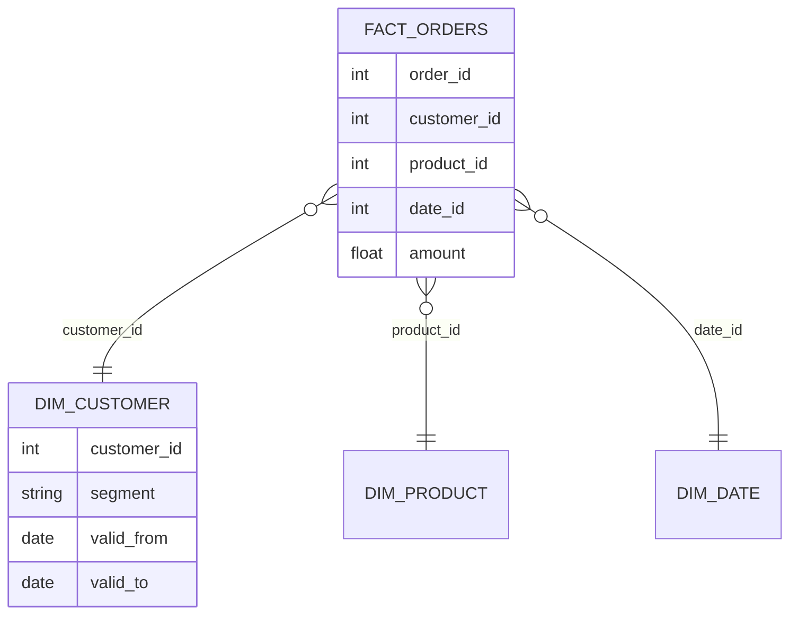

The `valid_from`/`valid_to` columns are **SCD type 2** (*Slowly Changing Dimension*): instead of overwriting e.g. a customer's segment, we add a new row with a validity range. For ML this is extremely valuable – it lets us reconstruct which segment the customer had at the time of the event (point-in-time correctness, section 7).

| SCD type | Behavior on change | History | Usefulness for ML |
|---|---|---|---|
| Type 0 | value never changes | — | constant attributes only |
| Type 1 | overwrite | none | risk of leakage from the future |
| Type 2 | new row + date range | full | recommended |
| Type 3 | additional "previous value" column | one step | limited |

---

## 3. Data formats for ML

### Format comparison

| Format | Type | Compression | Schema | Use |
|--------|-----|-----------|---------|--------|
| CSV | Row-based | None | None | Small datasets, prototypes |
| JSON | Row-based | Optional | None | APIs, logs |
| Parquet | Columnar | Snappy/ZSTD | Yes | Analytics, ML |
| Avro | Row-based | Deflate | Yes | Kafka, streaming |
| TFRecord | Binary | Optional | Yes | TensorFlow |
| HDF5 | Hierarchical | Yes | Yes | Large matrices, DL |

### Why Parquet for ML?

```python
import pandas as pd
import pyarrow as pa
import pyarrow.parquet as pq
import time
import os

# Generate sample data
df = pd.DataFrame({
    'user_id': range(1_000_000),
    'age': pd.Series(range(1_000_000)) % 80 + 18,
    'income': pd.Series(range(1_000_000)) * 0.05 + 20000,
    'churn': pd.Series(range(1_000_000)) % 2
})

# Write CSV
t0 = time.time()
df.to_csv('/tmp/data.csv', index=False)
csv_time = time.time() - t0
csv_size = os.path.getsize('/tmp/data.csv') / 1024 / 1024

# Write Parquet
t0 = time.time()
df.to_parquet('/tmp/data.parquet', compression='snappy', index=False)
parquet_time = time.time() - t0
parquet_size = os.path.getsize('/tmp/data.parquet') / 1024 / 1024

print(f"CSV:     {csv_size:.1f} MB, write: {csv_time:.2f}s")
print(f"Parquet: {parquet_size:.1f} MB, write: {parquet_time:.2f}s")
print(f"Space saved: {(1 - parquet_size/csv_size)*100:.0f}%")

# Read only selected columns (column pruning)
t0 = time.time()
df_partial = pd.read_parquet('/tmp/data.parquet', columns=['user_id', 'churn'])
print(f"\nReading 2 columns from Parquet: {time.time()-t0:.3f}s")
```

> **▶️ Live demo:** `python lectures/scripts/lecture_02/01_csv_vs_parquet.py --rows 1000000`  
> **When:** after discussing the format comparison table.  
> **What to show:** Parquet is several times smaller, reading two columns is many times faster, and CSV loses the `datetime` and `category` types.

### Row-based vs columnar layout

```
Table:    id | age | income | churn
          1  | 25  | 5000   | 0
          2  | 41  | 7200   | 1
          3  | 33  | 6100   | 0

Row-based (CSV, Avro, OLTP):
[1,25,5000,0][2,41,7200,1][3,33,6100,0]
  → fast append/read of a whole record

Columnar (Parquet, ORC, OLAP):
[1,2,3][25,41,33][5000,7200,6100][0,1,0]
  → we read only the needed columns,
  → similar values next to each other = better compression
```

### Structure of a Parquet file

```
file.parquet
├── Row group 1  (e.g. ~128 MB of rows)
│   ├── Column chunk: age     → pages + min/max statistics, null_count
│   ├── Column chunk: income
│   └── Column chunk: churn
├── Row group 2
│   └── ...
└── Footer: schema, offsets, statistics of every column in every group
```

Benefits resulting from this structure:
- **Column pruning (projection pushdown)** – we read only selected columns.
- **Predicate pushdown** – min/max statistics in the footer allow skipping entire row groups (e.g. `age > 60` when `max(age)=55`).
- **Dictionary and RLE encoding** – columns with few unique values (e.g. `country`) take a fraction of the space.
- **Logical types** – dates, decimals, lists, structs preserved without text parsing.

### Data partitioning

```python
import pandas as pd

df = pd.DataFrame({
    "event_date": pd.to_datetime(["2024-01-14", "2024-01-14", "2024-01-15"]),
    "country": ["PL", "DE", "PL"],
    "amount": [10.0, 25.5, 7.2],
})
df["date"] = df["event_date"].dt.strftime("%Y-%m-%d")

# Hive-style layout: data/events/date=2024-01-14/country=PL/part-0.parquet
df.to_parquet("data/events", partition_cols=["date", "country"], index=False)

# Read with a filter – pyarrow reads only matching directories (partition pruning)
pl_15 = pd.read_parquet("data/events", filters=[("date", "=", "2024-01-15"),
                                                ("country", "=", "PL")])
```

| Good practice | Why |
|---|---|
| Partition by a column used in filters (usually date) | partition pruning, easy backfill of a single partition |
| Avoid high-cardinality columns (`user_id`) | millions of small files = the *small files* problem |
| Aim for files of 100 MB – 1 GB | balance between parallelism and metadata overhead |
| Write the schema explicitly (`pyarrow.schema`) | no surprises like `int` → `float` on NaN |

### Schema evolution

A data schema changes over time: columns are added, types change. Formats with a schema (Parquet, Avro) let us manage this deliberately.

| Change | Backward compatibility | Comment |
|---|---|---|
| Adding an optional (nullable) column | ✅ | old readers ignore it |
| Removing a column | ⚠️ | breaks consumers that use it |
| Renaming a column | ❌ | for the reader it is a removal + addition |
| Widening a type `int32` → `int64` | ✅ usually | depends on the format and engine |
| Narrowing a type `float` → `int` | ❌ | loss of information |

> ⚠️ **CSV pitfall:** `pd.read_csv` guesses types. A postal code `01-234` may be OK, but `00123` will turn into the number `123`, identifiers with leading zeros will lose them, and an `int` column with a single missing value will become `float64`. Always pass `dtype=` or switch to Parquet.

### Unstructured data

For images, audio and text in deep learning, different approaches are used: millions of small files in object storage are slow to read, so they are combined into **shards** (TFRecord, WebDataset `.tar`, Lance/Mosaic MDS formats), while metadata (labels, paths, splits) is kept in Parquet.

---

## 4. ETL vs ELT

### ETL (Extract → Transform → Load)
The traditional approach: transformation before loading into the store.

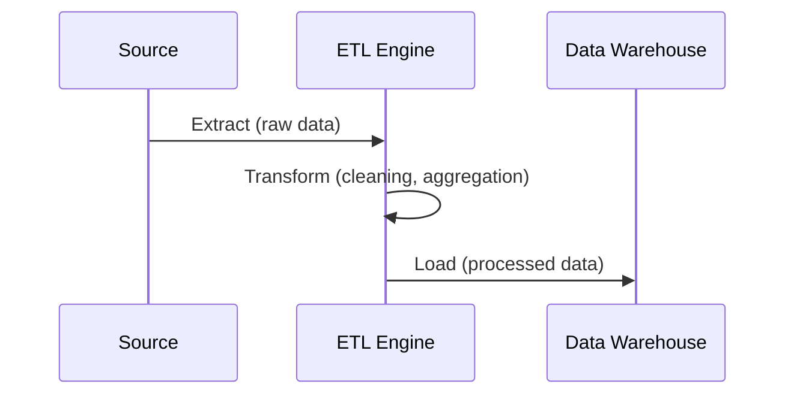

### ELT (Extract → Load → Transform)
The modern approach: load raw data, transform in place.

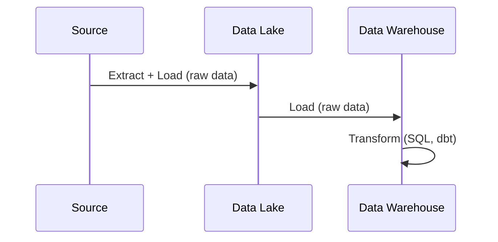

**Advantages of ELT:**
- Raw data is preserved (possibility of reprocessing).
- Uses the compute power of the data store.
- Easier debugging.

### Pipeline orchestration: DAG, idempotency, backfill

A data pipeline is a **directed acyclic graph (DAG)** of tasks. The orchestrator (Airflow, Prefect, Dagster) takes care of ordering, retries and scheduling.

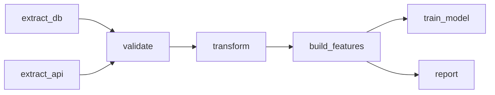

Key properties of a good pipeline task:
- **Idempotency** – running it multiple times for the same period gives the same result (e.g. `INSERT OVERWRITE partition=2024-01-15` instead of `INSERT`).
- **Determinism** – the result depends only on the input and parameters (e.g. the logical date), not on "now".
- **Atomicity** – write to a temporary location, then swap (rename); no "half-written" data.
- **Backfill** – the ability to recompute history for new logic.

Example of a DAG skeleton in Airflow (TaskFlow API):

```python
from datetime import datetime
from airflow.decorators import dag, task

@dag(schedule="@daily", start_date=datetime(2024, 1, 1), catchup=True)
def churn_features():
    @task
    def extract(ds=None) -> str:            # ds = logical date, e.g. "2024-01-15"
        path = f"s3://lake/bronze/events/date={ds}/"
        # ... copy data for ONE day -> idempotent
        return path

    @task
    def validate(path: str) -> str:
        # ... run expectations; an exception stops the pipeline
        return path

    @task
    def build_features(path: str, ds=None) -> None:
        # ... overwrite partition gold/features/date={ds}
        ...

    build_features(validate(extract()))

churn_features()
```

### ETL vs ELT – comparison

| Criterion | ETL | ELT |
|---|---|---|
| Where transformation happens | separate engine (Spark, Python, ETL tools) | in the warehouse / lakehouse (SQL) |
| Raw data | often lost | preserved |
| Flexibility | logic change = re-extraction | logic change = re-running SQL |
| Privacy | easier to mask before loading | raw data in the store must be protected |
| Typical tools | Spark, Informatica, NiFi | Fivetran/Airbyte + dbt + Snowflake/BigQuery |
| When | sensitive data, heavy non-SQL transformations | modern cloud stack |

### Full vs incremental load vs CDC

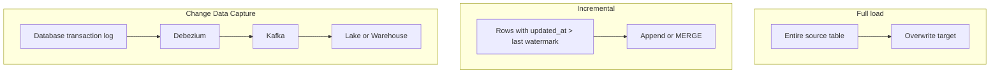

| Strategy | Advantages | Disadvantages |
|---|---|---|
| Full load | simple, always consistent | expensive for large tables |
| Incremental (column watermark) | cheap | does not see deletions; requires a reliable `updated_at` |
| CDC (database log) | sees INSERT/UPDATE/DELETE, low latency | complex infrastructure |

### Example of an ELT transformation in dbt

```sql
-- models/gold/customer_features.sql
{{ config(materialized='incremental', unique_key=['customer_id', 'feature_date']) }}

SELECT
    customer_id,
    DATE '{{ var("ds") }}'                         AS feature_date,
    COUNT(*)                                       AS orders_30d,
    AVG(amount)                                    AS avg_order_30d,
    DATE_DIFF(DATE '{{ var("ds") }}', MAX(order_date), DAY) AS days_since_last_order
FROM {{ ref('silver_orders') }}
WHERE order_date <  DATE '{{ var("ds") }}'                 -- past only!
  AND order_date >= DATE_SUB(DATE '{{ var("ds") }}', INTERVAL 30 DAY)
GROUP BY customer_id
```

```yaml
# models/gold/schema.yml – dbt tests as a quality gate
models:
  - name: customer_features
    columns:
      - name: customer_id
        tests: [not_null]
      - name: orders_30d
        tests:
          - dbt_utils.accepted_range: {min_value: 0}
```

### Idempotent partition write in Python

```python
import os
import shutil
import tempfile
import pandas as pd

def write_partition_atomically(df: pd.DataFrame, root: str, ds: str) -> None:
    """Overwrites partition date=ds in an idempotent and atomic way."""
    target = os.path.join(root, f"date={ds}")
    tmp = tempfile.mkdtemp(dir=root, prefix=".tmp_")
    df.to_parquet(os.path.join(tmp, "part-0.parquet"), index=False)
    if os.path.exists(target):
        shutil.rmtree(target)        # re-running = the same result
    os.rename(tmp, target)           # rename within a FS is atomic
```

> ⚠️ **Pitfall: `datetime.now()` in a task.** A task computing "the last 30 days relative to now" will give a different result during a backfill and on a rerun. Always parameterize the task with the **logical date** (`ds`) passed by the orchestrator.

### Orchestrator comparison

| | Airflow | Prefect | Dagster |
|---|---|---|---|
| Model | tasks in a DAG | Python flows | data assets |
| Strengths | maturity, huge number of integrations | simplicity, dynamic flows | data lineage, typing, testability |
| Weaknesses | heavier infrastructure | smaller ecosystem | concept learning curve |

---

## 5. Data processing pipeline in Python

### Example: Pipeline using pandas and scikit-learn

```python
import pandas as pd
import numpy as np
from sklearn.pipeline import Pipeline
from sklearn.preprocessing import StandardScaler, OneHotEncoder
from sklearn.impute import SimpleImputer
from sklearn.compose import ColumnTransformer
from sklearn.model_selection import train_test_split

# --- Step 1: Load data ---
def load_data(path: str) -> pd.DataFrame:
    """Loads data and performs basic validation."""
    df = pd.read_parquet(path)
    
    required_cols = ['age', 'income', 'category', 'churn']
    missing = set(required_cols) - set(df.columns)
    if missing:
        raise ValueError(f"Missing columns: {missing}")
    
    print(f"Loaded {len(df):,} rows, {df.shape[1]} columns")
    return df

# --- Step 2: Data cleaning ---
def clean_data(df: pd.DataFrame) -> pd.DataFrame:
    """Removes duplicates and obvious errors."""
    initial_size = len(df)
    
    # Remove duplicates
    df = df.drop_duplicates()
    
    # Remove rows with negative age
    df = df[df['age'] > 0]
    
    # Remove outliers (IQR method)
    Q1 = df['income'].quantile(0.25)
    Q3 = df['income'].quantile(0.75)
    IQR = Q3 - Q1
    df = df[df['income'].between(Q1 - 3*IQR, Q3 + 3*IQR)]
    
    removed = initial_size - len(df)
    print(f"Removed {removed:,} rows ({removed/initial_size*100:.1f}%)")
    return df

# --- Step 3: Feature Engineering ---
def engineer_features(df: pd.DataFrame) -> pd.DataFrame:
    """Creates new features."""
    df = df.copy()
    
    # Derived features
    df['income_per_age'] = df['income'] / df['age']
    df['age_group'] = pd.cut(df['age'], 
                              bins=[0, 25, 35, 50, 65, 100],
                              labels=['<25', '25-35', '35-50', '50-65', '65+'])
    
    return df

# --- Step 4: Preprocessing Pipeline ---
def build_preprocessing_pipeline(
    numeric_features: list[str],
    categorical_features: list[str]
) -> ColumnTransformer:
    """Builds the preprocessing pipeline."""
    
    numeric_transformer = Pipeline(steps=[
        ('imputer', SimpleImputer(strategy='median')),
        ('scaler', StandardScaler())
    ])
    
    categorical_transformer = Pipeline(steps=[
        ('imputer', SimpleImputer(strategy='most_frequent')),
        ('encoder', OneHotEncoder(handle_unknown='ignore', sparse_output=False))
    ])
    
    preprocessor = ColumnTransformer(transformers=[
        ('num', numeric_transformer, numeric_features),
        ('cat', categorical_transformer, categorical_features)
    ])
    
    return preprocessor

# --- Main pipeline ---
def run_data_pipeline(input_path: str) -> tuple:
    """Runs the full data processing pipeline."""
    
    # Load and clean
    df = load_data(input_path)
    df = clean_data(df)
    df = engineer_features(df)
    
    # Split into features and label
    X = df.drop('churn', axis=1)
    y = df['churn']
    
    # Split into sets
    X_train, X_test, y_train, y_test = train_test_split(
        X, y, test_size=0.2, random_state=42, stratify=y
    )
    
    # Preprocessing
    numeric_features = ['age', 'income', 'income_per_age']
    categorical_features = ['category', 'age_group']
    
    preprocessor = build_preprocessing_pipeline(numeric_features, categorical_features)
    
    X_train_processed = preprocessor.fit_transform(X_train)
    X_test_processed = preprocessor.transform(X_test)
    
    print(f"\nShapes after preprocessing:")
    print(f"  Train: {X_train_processed.shape}")
    print(f"  Test:  {X_test_processed.shape}")
    
    return X_train_processed, X_test_processed, y_train, y_test, preprocessor
```

> **▶️ Live demo:** `python lectures/scripts/lecture_02/02_data_pipeline.py`  
> **When:** after discussing the code from section 5.  
> **What to show:** the cleaning log (duplicates, invalid incomes), the classification report and a prediction from the saved pipeline. Emphasize that imputation and scaling are fitted only on the training set.

### Data flow through the pipeline – what is "fitted" and what is not?

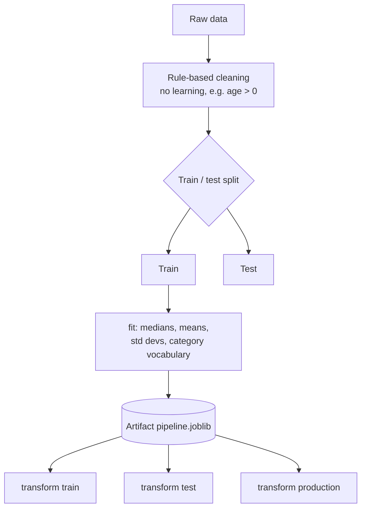

> 💡 Rule of thumb: **stateless** operations (filter `age > 0`, computing `income / age`) can be done before the split. Operations that **learn statistics from data** (median imputation, scaling, category encoding, IQR thresholds, feature selection) must be part of a pipeline fitted only on the training set. Note that removing outliers with the IQR method in `clean_data` above computes quantiles on the whole dataset – strictly speaking, this is also a minor leak.

### Types of missing data

| Mechanism | Meaning | Example | Consequence |
|---|---|---|---|
| MCAR (Missing Completely At Random) | missingness independent of anything | random sensor failure | simple imputation is OK |
| MAR (Missing At Random) | missingness depends on other observed features | older people less often provide an e-mail | conditional imputation (KNN, iterative) |
| MNAR (Missing Not At Random) | missingness depends on the missing value itself | high-income people do not report income | the fact of missingness itself carries information |

```python
from sklearn.impute import SimpleImputer

# add_indicator=True adds a binary "was missing" column – useful for MNAR
imputer = SimpleImputer(strategy="median", add_indicator=True)
```

### Encoding categorical variables

| Method | When | Risk |
|---|---|---|
| One-Hot | low cardinality (< ~50) | dimension explosion |
| Ordinal | natural order (S < M < L) | artificial order if there is none |
| Target encoding | high cardinality | **label leakage** – requires CV/out-of-fold |
| Hashing | very high cardinality, streaming | collisions, no interpretability |
| Embeddings | DL, categories like `product_id` | needs a lot of data |

> 📘 **CV (Cross-Validation)** – a model evaluation technique in which the training set is split into *k* parts (*folds*, e.g. k=5). The model is trained *k* times, each time on *k−1* folds, and evaluated on the remaining one; the result is the average over *k* runs. **Out-of-fold (OOF)** means that the value for a given row (e.g. target encoding) is computed only from folds that the row does *not belong to* – so the row's label does not "leak" into its own feature. In sklearn: `KFold`, `cross_val_score`, `TimeSeriesSplit` (for time series data). All preprocessing and feature selection steps must be performed **inside** each fold (e.g. via `Pipeline`), otherwise CV gives inflated results (section 10).

### Custom sklearn-compatible transformer

Derived features should also be wrapped in the pipeline so that production computes them identically:

```python
import numpy as np
import pandas as pd
from sklearn.base import BaseEstimator, TransformerMixin

class RatioFeatures(BaseEstimator, TransformerMixin):
    """Adds income_per_age; stateless, so fit learns nothing."""

    def fit(self, X: pd.DataFrame, y=None):
        return self

    def transform(self, X: pd.DataFrame) -> pd.DataFrame:
        X = X.copy()
        X["income_per_age"] = X["income"] / X["age"].replace(0, np.nan)
        return X
```

```python
import joblib
from sklearn.pipeline import Pipeline
from sklearn.linear_model import LogisticRegression

full_pipeline = Pipeline([
    ("ratios", RatioFeatures()),
    ("prep", build_preprocessing_pipeline(
        ["age", "income", "income_per_age"], ["category"])),
    ("model", LogisticRegression(max_iter=1000)),
])
full_pipeline.fit(X_train, y_train)
joblib.dump(full_pipeline, "models/churn_pipeline.joblib")   # a single artifact
```

> ⚠️ **Pitfall:** saving only the model (`model.pkl`) without the preprocessor. The production service then has to reproduce the scaling manually – a straight road to training-serving skew.

### Typical cleaning operations – cheat sheet

| Problem | Detection | Typical response |
|---|---|---|
| Duplicates | `df.duplicated(subset=key)` | deduplicate by key and the latest timestamp |
| Inconsistent categories (`"PL"`, `"pl"`, `"Polska"`) | `value_counts()` | normalization, mapping dictionary |
| Sentinel values (`-1`, `999`, `"N/A"`) | distribution, domain knowledge | replace with `NaN` |
| Time zones | mixed offsets | convert to UTC |
| Outliers | IQR, z-score, domain knowledge | removal, *clipping*, separate flag |

---

## 6. Data validation – Great Expectations

Data validation is a key element of MLOps. The **Great Expectations** library lets you define and verify expectations about data.

```python
import great_expectations as gx
import pandas as pd

# Sample data
df = pd.DataFrame({
    'age': [25, 30, -5, 200, 45],       # -5 and 200 are errors
    'income': [50000, 60000, None, 80000, 55000],
    'churn': [0, 1, 0, 1, 2]            # 2 is an error (should be 0 or 1)
})

# Create the GE context
context = gx.get_context()

# Define expectations
validator = context.sources.pandas_default.read_dataframe(df)

# Expectations for the 'age' column
validator.expect_column_values_to_be_between('age', min_value=0, max_value=120)
validator.expect_column_values_to_not_be_null('age')

# Expectations for the 'income' column
validator.expect_column_values_to_not_be_null('income')
validator.expect_column_values_to_be_between('income', min_value=0)

# Expectations for the 'churn' column
validator.expect_column_values_to_be_in_set('churn', value_set=[0, 1])

# Run validation
results = validator.validate()
print(f"Validation: {'✅ OK' if results.success else '❌ FAILED'}")
for result in results.results:
    status = "✅" if result.success else "❌"
    print(f"  {status} {result.expectation_config.expectation_type}: "
          f"{result.expectation_config.kwargs}")
```

### Data validation scheme in the pipeline

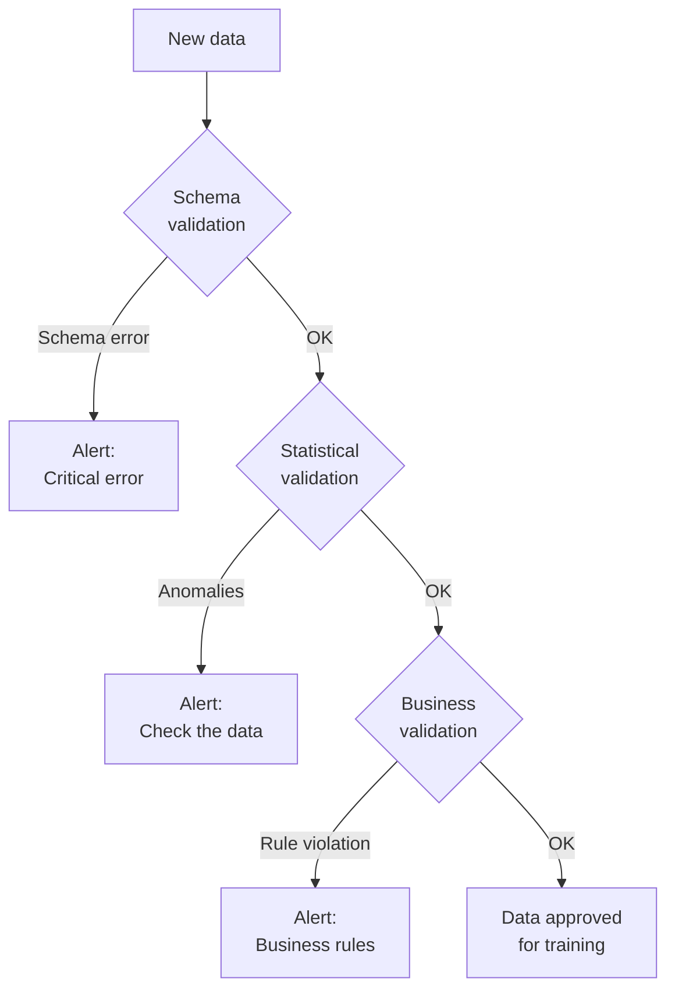

> **▶️ Live demo:** `python lectures/scripts/lecture_02/03_data_validation.py && python lectures/scripts/lecture_02/03_data_validation.py --corrupt; echo $?`  
> **When:** after the Great Expectations example.  
> **What to show:** the same expectations (including the `mostly` parameter) implemented in plain pandas. On corrupted data validation fails and the script returns exit code 1, which stops the pipeline in CI/CD.

### Data quality dimensions

| Dimension | Question | Example rule |
|---|---|---|
| Completeness | Are values/rows missing? | `age` non-null in ≥ 99% |
| Validity | Are values within the allowed range? | `0 ≤ age ≤ 120` |
| Consistency | Is data consistent across systems? | sum of orders = sum in accounting |
| Uniqueness | Are there no duplicates? | `customer_id` unique |
| Timeliness | Is the data fresh? | last record < 24 h |
| Distribution stability | Has the distribution not changed? | PSI(`income`) < 0.2 |

### Training-serving skew

The most common source of "the model worked offline but not in production": **features computed differently during training and serving**.

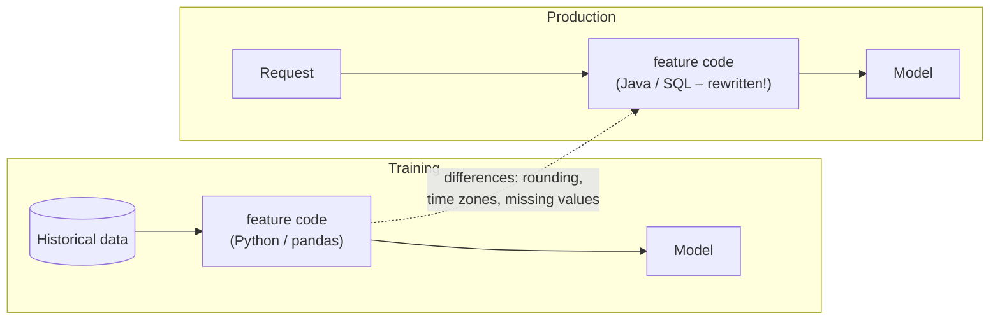

Solutions: a single feature implementation (Feature Store, shared library), logging the features used at prediction time (*log & wait*) and comparing them with the training features.

### Schema validation in code: Pandera

A lighter alternative to Great Expectations is **Pandera** – data schemas written as Python code, convenient in unit tests.

```python
import pandas as pd
import pandera as pa
from pandera import Column, Check

schema = pa.DataFrameSchema({
    "age":    Column(int,   Check.in_range(0, 120)),
    "income": Column(float, Check.ge(0), nullable=True),
    "churn":  Column(int,   Check.isin([0, 1])),
}, strict=True)               # extra, unknown columns = error

df = pd.DataFrame({"age": [25, 130], "income": [5000.0, None], "churn": [0, 1]})
try:
    schema.validate(df, lazy=True)        # lazy: collect all errors at once
except pa.errors.SchemaErrors as err:
    print(err.failure_cases[["column", "check", "failure_case"]])
```

| Tool | Style | Strengths |
|---|---|---|
| Great Expectations | declarative "expectations", HTML reports | data documentation, many ready-made rules |
| Pandera | schema as code | integration with tests and typing |
| dbt tests | SQL in the warehouse | validation where the data lives |
| TFDV / Evidently | statistics and drift | comparing train vs production distributions |

### Statistical validation: distribution drift and PSI

The **Population Stability Index** compares the distribution of a feature in reference data (e.g. training) and current data:

PSI = Σ (pᵢ − qᵢ) · ln(pᵢ / qᵢ), where pᵢ, qᵢ are the shares of observations in bin *i*.

```python
import numpy as np

def psi(reference: np.ndarray, current: np.ndarray, bins: int = 10) -> float:
    edges = np.quantile(reference, np.linspace(0, 1, bins + 1))
    edges[0], edges[-1] = -np.inf, np.inf
    p = np.histogram(reference, edges)[0] / len(reference)
    q = np.histogram(current, edges)[0] / len(current)
    p, q = np.clip(p, 1e-6, None), np.clip(q, 1e-6, None)
    return float(np.sum((p - q) * np.log(p / q)))

rng = np.random.default_rng(42)
train_income = rng.normal(5000, 1000, 10_000)
print(psi(train_income, rng.normal(5000, 1000, 10_000)))   # ~0.00 – stable
print(psi(train_income, rng.normal(5600, 1200, 10_000)))   # clearly > 0.1 – drift
```

| PSI | Interpretation (industry convention) |
|---|---|
| < 0.1 | no significant change |
| 0.1 – 0.2 | moderate change – monitor |
| > 0.2 | significant change – investigate, consider retraining |

### Data contracts

Many ML pipeline failures happen because a product team changed a source (column name, unit, meaning of a status) without knowing that someone uses it. A **data contract** is an explicit, versioned agreement between producer and consumer:

```yaml
# contracts/orders.yaml
dataset: orders
owner: team-checkout
version: 2.1.0
freshness: { max_delay: 2h }
schema:
  - { name: order_id,  type: string,  required: true, unique: true }
  - { name: amount,    type: decimal, unit: PLN, min: 0 }
  - { name: status,    type: string,  enum: [NEW, PAID, CANCELLED, REFUNDED] }
breaking_change_policy: "new major version + 30-day transition period"
```

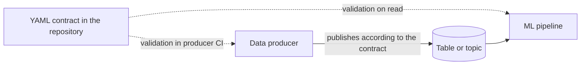

> 💡 **Where to validate?** Cheapest as close to the source as possible (*shift left*): an error caught in the producer's CI costs minutes; the same error detected after model metrics drop costs weeks.

> ⚠️ **Pitfall: rules that are too rigid.** The rule "0 missing values in `income`" will block the pipeline at the first single null. Use tolerance thresholds (`mostly=0.99` in GE, demo `03_data_validation.py`) and distinguish levels: *critical error* (stop) vs *warning* (alert, the pipeline continues).

---

## 7. Feature Store – a central feature repository

A **Feature Store** is a system for storing, managing and serving ML features.

### The problem without a Feature Store

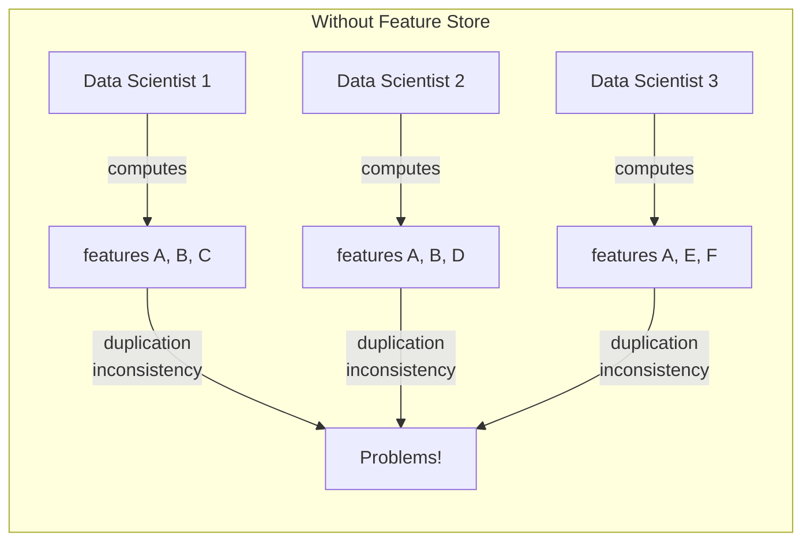

### The solution with a Feature Store

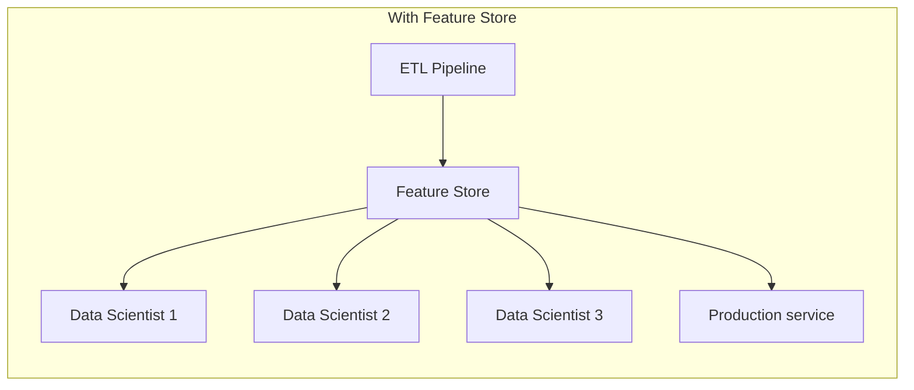

### Implementing a simple Feature Store with Feast

```python
from feast import Entity, Feature, FeatureView, FileSource, ValueType
from feast.types import Float32, Int64
from datetime import timedelta

# Entity definition
user = Entity(
    name="user_id",
    value_type=ValueType.INT64,
    description="User identifier"
)

# Data source
user_stats_source = FileSource(
    path="data/user_stats.parquet",
    timestamp_field="event_timestamp"
)

# Feature View definition
user_stats_fv = FeatureView(
    name="user_statistics",
    entities=["user_id"],
    ttl=timedelta(days=7),  # feature time-to-live
    features=[
        Feature(name="age", dtype=Float32),
        Feature(name="income", dtype=Float32),
        Feature(name="days_since_last_purchase", dtype=Int64),
        Feature(name="total_purchases_30d", dtype=Int64),
        Feature(name="avg_order_value", dtype=Float32),
    ],
    source=user_stats_source,
)

# Retrieving features for training (historical features)
from feast import FeatureStore
import pandas as pd

store = FeatureStore(repo_path="feature_repo/")

# Get historical features for the training set
entity_df = pd.DataFrame({
    "user_id": [1001, 1002, 1003],
    "event_timestamp": pd.to_datetime(["2024-01-15", "2024-01-15", "2024-01-15"])
})

training_df = store.get_historical_features(
    entity_df=entity_df,
    features=[
        "user_statistics:age",
        "user_statistics:income",
        "user_statistics:total_purchases_30d",
    ]
).to_df()

print(training_df)

# Retrieving online features (for real-time prediction)
online_features = store.get_online_features(
    features=["user_statistics:age", "user_statistics:income"],
    entity_rows=[{"user_id": 1001}]
).to_dict()

print(online_features)
```

### Point-in-time correctness

When building a training set, for each event you may use **only the features known at the moment of that event**. A plain `JOIN` on `user_id` would take the latest feature value – i.e. information from the future (data leakage).

#### Why does it matter?

A model in production always receives features "as of now", i.e. from the past relative to the moment it predicts for. The training set must reproduce exactly this situation. If in training we join a feature computed on January 21 to an event from January 15, the model learns from information that nobody had yet at decision time. Consequences:

- **inflated offline metrics** – validation looks great because the model "knows the future";
- **quality drop after deployment** – this information is not available in production, so the model performs worse than the tests promised;
- **hard diagnosis** – the code is correct, the data too; the error lies only in how the join is done in time.

This is a special case of data leakage (section 10) and one of the causes of training-serving skew (section 6).

#### Key concepts

| Concept | Meaning | Example |
|---|---|---|
| **Entity** | the object the features describe; the join key | `user_id = 1001` |
| **Event timestamp** | the moment we predict for and that the label refers to | application submitted on 15.01 |
| **Feature timestamp** | the moment from which a given feature value is valid | `avg_order = 80` from 11.01 |
| **Availability time** (created / ingestion timestamp) | the moment the value actually arrived in the system | computed by a nightly job on 12.01 at 02:00 |
| **TTL** (time-to-live) | how long a feature value is considered current | feature older than 30 days = missing (`NaN`) |

Point-in-time join rule: for each label row `(entity, t)` choose **the latest feature value with `feature_time ≤ t`** (and in the cautious version `availability_time ≤ t`), as long as it is not older than the TTL. This is the so-called *as-of* join ("as of a given date").

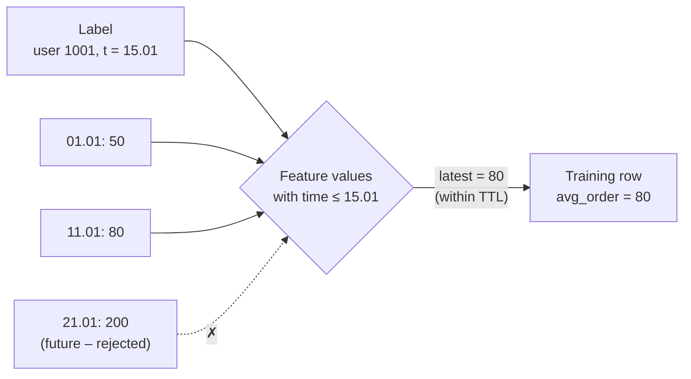

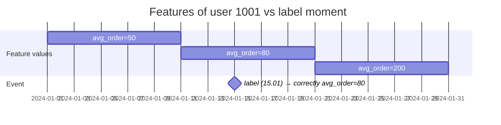

A Feature Store implements this via a *point-in-time join*. In pandas, `merge_asof` gives the same effect:

```python
import pandas as pd

features = pd.DataFrame({
    "user_id": [1001, 1001, 1001],
    "ts": pd.to_datetime(["2024-01-01", "2024-01-11", "2024-01-21"]),
    "avg_order": [50, 80, 200],
})
labels = pd.DataFrame({"user_id": [1001], "ts": pd.to_datetime(["2024-01-15"]), "churn": [1]})

wrong = labels.merge(features.sort_values("ts").groupby("user_id").tail(1), on="user_id")
right = pd.merge_asof(labels.sort_values("ts"), features.sort_values("ts"),
                      on="ts", by="user_id", direction="backward")
print(wrong[["avg_order"]].iloc[0].item(), "← leak from the future")   # 200
print(right[["avg_order"]].iloc[0].item(), "← correct")              # 80
```

What this code does:
- `wrong` – takes the **last** known feature row for the user (21.01, value 200) and attaches it to the label from 15.01. This is how a naive `JOIN` with a table of "current" features works.
- `right` – for each label, `merge_asof` searches by `user_id` (`by=`) for the feature row with the largest `ts` that is **≤** the label time (`direction="backward"`). Both tables must be sorted by the time column.

#### Pitfall: availability delay and stale features

A feature with timestamp 11.01 may have been computed only on the next day (e.g. a daily batch job). If the event happened on 11.01 at 10:00, this value would not yet exist in production. That is why the join is done on **availability time**, not on feature time. The second problem is very old values – the `tolerance` parameter corresponds to the TTL:

```python
import pandas as pd

features = pd.DataFrame({
    "user_id": [1001, 1001],
    "feature_ts": pd.to_datetime(["2024-01-01", "2024-01-11"]),
    "avg_order": [50, 80],
})
# features computed by a nightly job – available a day later at 02:00
features["available_ts"] = features["feature_ts"] + pd.Timedelta(days=1, hours=2)

labels = pd.DataFrame({
    "user_id": [1001, 1001, 1001],
    "ts": pd.to_datetime(["2024-01-11 10:00", "2024-01-15 00:00", "2024-03-01 00:00"]),
})

result = pd.merge_asof(
    labels.sort_values("ts"),
    features.sort_values("available_ts"),
    left_on="ts", right_on="available_ts", by="user_id",
    direction="backward",
    tolerance=pd.Timedelta(days=30),   # TTL: older values → NaN
)
print(result[["ts", "avg_order"]])
# 2024-01-11 10:00 → 50   (value 80 not yet available)
# 2024-01-15       → 80
# 2024-03-01       → NaN  (last value older than 30 days)
```

The SQL equivalent (e.g. BigQuery, Snowflake) when there is no `ASOF JOIN`:

```sql
SELECT l.user_id, l.ts, f.avg_order
FROM labels l
LEFT JOIN features f
  ON f.user_id = l.user_id
 AND f.available_ts <= l.ts
 AND f.available_ts >  l.ts - INTERVAL 30 DAY
QUALIFY ROW_NUMBER() OVER (PARTITION BY l.user_id, l.ts ORDER BY f.available_ts DESC) = 1;
```

#### Common mistakes and good practices

- **A feature table without history** (only the "current state", overwritten every night) – a correct training set cannot be built from it. Store features as history (append-only, Bronze/Silver layer) with a time column.
- **Aggregates computed over the whole dataset**, e.g. "the customer's average order value" computed over all years – it contains the future. The aggregation window must end before the event time (`rolling` with `closed="left"`).
- **Time zones** – compare timestamps in a single zone (preferably UTC), otherwise a shift of a few hours causes leakage or missing features.
- **Random train/test split** with time data – even with a correct join, the test set "mixes" with training. Split by time (training: past, test: future).
- **Control test** – in the pipeline, assert that for every row `feature_ts ≤ event_ts`.

A Feature Store (e.g. Feast `get_historical_features`) performs the point-in-time join automatically based on the source's `timestamp_field` and the feature view's `ttl`, so the same feature definition gives consistent data for training (offline) and serving (online).

### Online vs offline store

| | Offline store | Online store |
|---|---|---|
| Purpose | training sets, batch scoring | real-time prediction |
| Technology | Parquet, BigQuery | Redis, DynamoDB |
| Latency | minutes | milliseconds |
| Data | full history | only the latest feature value |

### Feature Store architecture

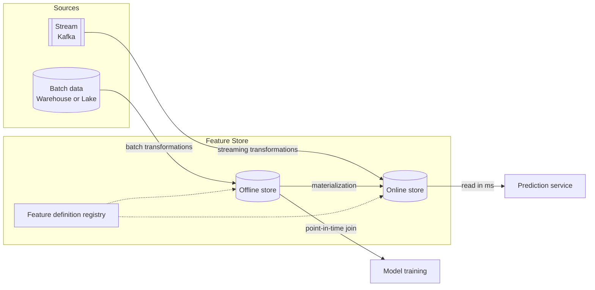

The most important components:
- **Registry** – feature definitions, owners, descriptions, versions (discoverability and reuse).
- **Offline store** – full history for building training sets.
- **Online store** – latest values for low-latency serving.
- **Materialization** – periodic copying of the latest values offline → online (in Feast: `feast materialize-incremental <date>`).

### Modern Feast API

> ⚠️ The example at the beginning of the section uses the older API (`Feature`, `ValueType`), which in newer Feast versions has been replaced by `Field` and `schema`. Below is the equivalent in the current style – check the library version in `requirements.txt`.

```python
from datetime import timedelta
from feast import Entity, FeatureView, Field, FileSource
from feast.types import Float32, Int64

user = Entity(name="user", join_keys=["user_id"])

user_stats_source = FileSource(
    path="data/user_stats.parquet",
    timestamp_field="event_timestamp",
    created_timestamp_column="created",   # value availability time
)

user_stats_fv = FeatureView(
    name="user_statistics",
    entities=[user],
    ttl=timedelta(days=7),
    schema=[
        Field(name="age", dtype=Float32),
        Field(name="income", dtype=Float32),
        Field(name="total_purchases_30d", dtype=Int64),
    ],
    source=user_stats_source,
)
```

```bash
feast apply                                  # register definitions
feast materialize-incremental 2024-01-15T00:00:00   # offline → online
```

### When does a Feature Store pay off?

| Situation | Feature Store? |
|---|---|
| One batch model, small team | probably not – a Gold table + shared code is enough |
| Many models sharing features | yes – reuse and consistent definitions |
| Online predictions with historical features (e.g. fraud) | definitely yes |
| Strong audit requirements (finance) | yes – lineage and feature versioning |

| Solution | Type | Notes |
|---|---|---|
| Feast | open source | lightweight, "bring your own" storage |
| Hopsworks | open source / commercial | full platform with an online store |
| Tecton | commercial | strong streaming support |
| Databricks / Vertex AI / SageMaker Feature Store | managed in the cloud | integration with the vendor's ecosystem |

---

## 8. Data versioning with DVC

**DVC** (Data Version Control) is a tool for versioning data and models that works together with Git.

```bash
# Initialize DVC in the project
git init
dvc init

# Add remote storage (e.g. Google Cloud Storage)
dvc remote add -d myremote gs://my-bucket/dvc-storage

# Track a data file
dvc add data/train.parquet
git add data/train.parquet.dvc .gitignore
git commit -m "Add training data v1"

# Push data to remote storage
dvc push

# Switch to another data version
git checkout v1.0
dvc checkout
```

### Structure of a .dvc file

```yaml
# data/train.parquet.dvc
outs:
- md5: a1b2c3d4e5f6...
  size: 52428800
  path: train.parquet
```

### DVC pipeline

```yaml
# dvc.yaml
stages:
  prepare:
    cmd: python src/prepare.py
    deps:
      - src/prepare.py
      - data/raw/
    outs:
      - data/prepared/

  train:
    cmd: python src/train.py
    deps:
      - src/train.py
      - data/prepared/
    params:
      - params.yaml:
          - train.n_estimators
          - train.max_depth
    outs:
      - models/model.pkl
    metrics:
      - metrics/scores.json:
          cache: false
```

```python
# params.yaml
train:
  n_estimators: 100
  max_depth: 5
  random_state: 42
test_size: 0.2
```

> **▶️ Live demo:** `bash lectures/scripts/lecture_02/05_dvc_demo.sh`  
> **When:** after discussing the DVC commands and the `.dvc` file.  
> **What to show:** the contents of the `train.csv.dvc` file (md5 hash), the change in the number of rows from 5000 to 1000 after `git checkout data-v1 && dvc checkout`, and the commit history.

### How does DVC work under the hood?

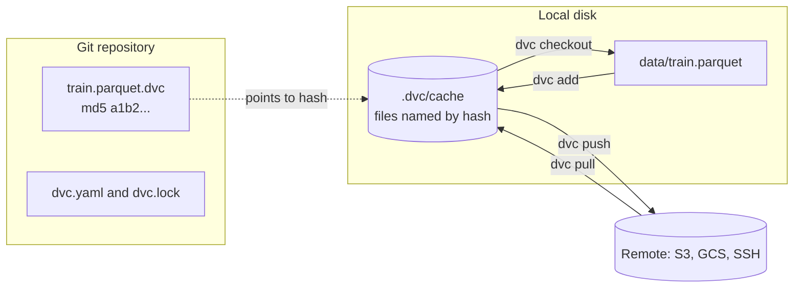

- Git stores only a **small pointer file** with the hash; large files go to the cache and the remote (*content-addressable storage*).
- The same file in many project versions takes up space only once.
- `dvc.lock` records the hashes of inputs and outputs of each stage – `dvc repro` runs **only the stages whose dependencies have changed**.

### Typical workflow with a DVC pipeline

```bash
dvc dag                     # visualize stage dependencies
dvc repro                   # run only changed stages
dvc params diff             # what changed in params.yaml
dvc metrics diff main       # compare metrics with the main branch
dvc exp run -S train.max_depth=8   # experiment with a different parameter
git add dvc.lock params.yaml && git commit -m "max_depth=8"
dvc push
```

Example output of `dvc dag`:

```
+---------+
| prepare |
+---------+
     *
     *
+-------+
| train |
+-------+
```

### Comparison of data versioning tools

| Tool | Model | Scale | When |
|---|---|---|---|
| DVC | files + Git | files/directories up to hundreds of GB | ML projects, experiments |
| Git LFS | files in Git | small/medium files | binaries, no pipelines |
| lakeFS | "Git for object storage" (branches, commits) | entire data lakes | isolating changes in the lake |
| Delta / Iceberg time travel | table versions | very large tables | analytical tables in a lakehouse |

> ⚠️ **Pitfall:** committing a `.dvc` file without `dvc push`. Colleagues will get a pointer to data that is not in the remote. A good practice is a pre-push hook or a CI step checking `dvc status -c`.

> 💡 For full model reproducibility you need to know three things: the **code version** (Git commit), the **data version** (DVC hash / table snapshot) and the **parameters/environment** (`params.yaml`, Docker image). Record all three for every training run (e.g. as tags in MLflow).

---

## 9. Streaming vs Batch Processing

### Batch Processing
- Processing large datasets at regular intervals.
- Tools: Apache Spark, dbt, pandas.
- Use: model training, daily reports.

### Stream Processing
- Processing data in real time.
- Tools: Apache Kafka, Apache Flink, Spark Streaming.
- Use: fraud detection, real-time recommendations.

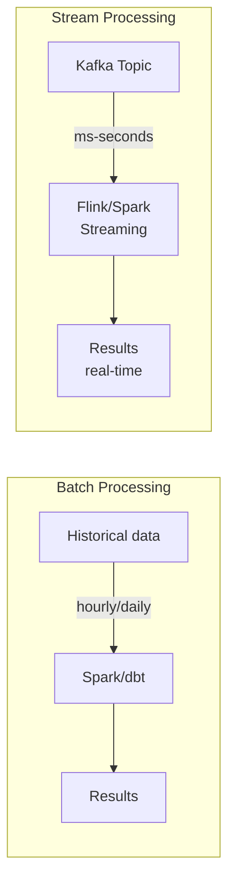

### Example: Kafka Producer/Consumer for ML

```python
from kafka import KafkaProducer, KafkaConsumer
import json
import numpy as np

# Producer – sending events to Kafka
producer = KafkaProducer(
    bootstrap_servers=['localhost:9092'],
    value_serializer=lambda v: json.dumps(v).encode('utf-8')
)

def send_prediction_request(user_id: int, features: dict):
    """Sends a prediction request to Kafka."""
    message = {
        "user_id": user_id,
        "features": features,
        "timestamp": "2024-01-15T10:30:00Z"
    }
    producer.send('ml-predictions', value=message)
    producer.flush()

# Consumer – receiving and processing events
consumer = KafkaConsumer(
    'ml-predictions',
    bootstrap_servers=['localhost:9092'],
    value_deserializer=lambda m: json.loads(m.decode('utf-8')),
    group_id='ml-service-group',
    auto_offset_reset='earliest'
)

def process_predictions(model):
    """Processes prediction requests from the stream."""
    for message in consumer:
        data = message.value
        features = np.array(list(data['features'].values())).reshape(1, -1)
        prediction = model.predict(features)[0]
        probability = model.predict_proba(features)[0][1]
        
        print(f"User {data['user_id']}: "
              f"churn={'YES' if prediction else 'NO'} "
              f"(p={probability:.2%})")
```

### Lambda and Kappa architectures

```mermaid
flowchart LR
    subgraph Lambda
        S1[Stream] --> B1[Batch layer\nSpark, daily]
        S1 --> SP1[Speed layer\nFlink, continuous]
        B1 --> SV1[Serving: merging results]
        SP1 --> SV1
    end
    subgraph Kappa
        S2[Event log\nKafka] --> SP2[Single streaming\nengine]
        SP2 --> SV2[Serving]
        S2 -. history replay .-> SP2
    end
```

- **Lambda** – two paths (accurate batch + fast streaming); drawback: two implementations of the same logic.
- **Kappa** – streaming only; history is recomputed by replaying the event log.

### Time windows in stream processing

Streaming features (e.g. "number of transactions in the last 10 min") are computed in windows:
- **tumbling** – disjoint windows of fixed length (00:00–00:10, 00:10–00:20),
- **sliding/hopping** – overlapping windows (10 min every 1 min),
- **session** – a window closed after a period of user inactivity.

An important distinction: **event time** (when the event happened) vs **processing time** (when it was processed). Late events are handled with *watermarks*.

```python
import pandas as pd

tx = pd.DataFrame({
    "ts": pd.to_datetime(["10:00", "10:03", "10:07", "10:12", "10:14"], format="%H:%M"),
    "amount": [20, 35, 500, 15, 40],
}).set_index("ts")

print(tx["amount"].resample("10min").sum())          # tumbling windows
print(tx["amount"].rolling("10min").count())         # sliding window: number of tx in the last 10 min
```

### Batch vs streaming – comparison

| Criterion | Batch | Streaming |
|---|---|---|
| Latency | minutes – hours | milliseconds – seconds |
| Complexity | lower | higher (state, late events, ordering) |
| Cost | usually lower | constant 24/7 infrastructure |
| Fixing errors | rerun the batch | replay from the log, harder |
| Typical features | 30/90-day aggregates | counters from the last minutes |

> 💡 In practice most systems combine both approaches: "slowly changing" features (e.g. the average order value over 90 days) are computed in batch, and "fast changing" ones (number of transactions in the last 5 min) in streaming – both land in the same online store.

### Message delivery semantics

| Guarantee | Meaning | Consequence for ML features |
|---|---|---|
| at-most-once | a message may be lost | undercounted counters |
| at-least-once | a message may be repeated | overcounted counters – deduplication by `event_id` needed |
| exactly-once | effect as if processed once | requires transactions (Kafka transactions, Flink checkpoints) |

In the consumer example above, offsets are committed automatically – if a failure occurs during processing, messages may be lost or reprocessed. In production, manual `commit()` after successful processing and idempotent consumers are used.

### Event time, watermark and late events

```
event time:       10:00  10:02  10:04       10:01 (late!)
processing time:  10:00  10:02  10:04  ...  10:07
                   │      │      │            │
window [10:00,10:05) ●────●──────●            ●  ← accepted if the watermark
                                                  (e.g. max_event_time − 5 min)
                                                  has not yet closed the window
```

A **watermark** is a declaration "I no longer expect events older than T". Too small – we lose late events; too large – window results are published with more delay and we keep more state.

### Case study: real-time fraud detection

```mermaid
sequenceDiagram
    participant K as Customer
    participant API as Payment API
    participant FS as Online Feature Store
    participant M as Fraud model
    participant Q as Kafka
    participant F as Flink

    K->>API: transaction
    API->>FS: get card features
    FS-->>API: tx_count_10m, avg_amount_90d
    API->>M: prediction
    M-->>API: p_fraud = 0.93
    API-->>K: rejection or 3-D Secure
    API->>Q: transaction event
    Q->>F: stream
    F->>FS: update tx_count_10m
```

The latency budget of the whole path is usually tens to hundreds of ms, so features must be **precomputed** and sit in the online store; computing 90-day aggregates at request time is infeasible.

---

## 10. Common pitfalls in data engineering for ML

> ⚠️ **Pitfall 1: Data Leakage**
> The most common and most dangerous error — information from the future "leaks" into the training data. Example: normalizing features on the whole dataset before the train/test split makes test set statistics influence training.

```python
# ❌ WRONG: normalization before the split (data leakage!)
from sklearn.preprocessing import StandardScaler
scaler = StandardScaler()
X_scaled = scaler.fit_transform(X)  # fit on the WHOLE dataset
X_train, X_test = train_test_split(X_scaled, ...)

# ✅ RIGHT: normalization after the split
X_train, X_test = train_test_split(X, ...)
scaler = StandardScaler()
X_train_scaled = scaler.fit_transform(X_train)  # fit on train only
X_test_scaled = scaler.transform(X_test)         # transform on test
```

> ⚠️ **Pitfall 2: Training-Serving Skew**
> Data preprocessing in training differs from preprocessing in production. Solution: use the same code (e.g. sklearn Pipeline) in both environments.

> ⚠️ **Pitfall 3: Ignoring missing values**
> A model trained on data without missing values may behave unpredictably when null values appear in production. Always test the model with missing data.

> **▶️ Live demo:** `python lectures/scripts/lecture_02/04_data_leakage.py`  
> **When:** while discussing the "normalization before the split" pitfall.  
> **What to show:** on pure noise, feature selection before CV gives accuracy ~0.85, while a correct `Pipeline` gives ~0.5. A feature "from the future" raises the score from ~0.65 to ~0.95.

### Case Study: Zillow — a data disaster

**Zillow** (a real estate portal) lost **304 million dollars** in 2021 due to errors in its property valuation model. Main causes:
- The model was trained on historical data that did not account for sudden market changes (the COVID-19 pandemic).
- Lack of proper data drift monitoring — the model kept predicting despite a fundamental change in the price distribution.
- Insufficient input data validation — the model accepted unrealistic feature values.

> 💡 Some analysts also emphasize business effects (aggressive purchase targets, *adverse selection* – sellers were more willing to accept inflated offers). The lesson for MLOps: the model is part of a larger decision system, and data quality and monitoring must account for the feedback loop between predictions and data.

### More pitfalls

> ⚠️ **Pitfall 4: Random split of time data**
> With time-indexed data, `train_test_split(shuffle=True)` mixes the future with the past. Use a time-based split or `TimeSeriesSplit`.

```python
from sklearn.model_selection import TimeSeriesSplit

df = df.sort_values("event_ts")
for fold, (tr_idx, te_idx) in enumerate(TimeSeriesSplit(n_splits=4).split(df)):
    print(fold, df.iloc[tr_idx]["event_ts"].max(), "<", df.iloc[te_idx]["event_ts"].min())
```

> ⚠️ **Pitfall 5: Leakage through groups (the same customer in train and test)**
> If one patient/customer has many rows, the model may "memorize" the person. Use `GroupKFold` / `GroupShuffleSplit` with `groups=customer_id`.

> ⚠️ **Pitfall 6: Label proxy features**
> The `cancellation_reason` column for a churn model is filled only for customers who have already left. Check every feature with the question: *"would I know this value at prediction time?"*.

> ⚠️ **Pitfall 7: Silent source change**
> A change of unit (grosze → złoty), encoding (`M/F` → `1/2`) or the meaning of a status will not raise an error; it will silently degrade the model. Data contracts and distribution validation help (section 6).

> ⚠️ **Pitfall 8: Imbalanced or biased samples**
> Historical data reflects past decisions (e.g. loans granted only to some customers – *selection bias*). The model knows nothing about the population that was never served.

### Data leakage taxonomy

| Leakage type | Mechanism | Example | Protection |
|---|---|---|---|
| Preprocessing | statistics computed on the whole dataset | `StandardScaler` before the split | `Pipeline` + CV |
| Feature selection | choosing features using test labels | `SelectKBest` before CV (demo `04_data_leakage.py`) | selection inside the pipeline |
| Temporal | information from the future | aggregate over the customer's entire history | point-in-time join, time-based split |
| Target leakage | the feature is a consequence of the label | `cancellation_reason` | feature review with a domain expert |
| Group | the same entity in train and test | images of the same patient | `GroupKFold` |
| Duplicates | identical rows in both sets | duplicated records from ETL | deduplication before the split |

```mermaid
flowchart TD
    A["Suspiciously high offline score?"] --> B{"Does one feature\ndominate importance?"}
    B -->|yes| C["Check whether it is known\nat prediction time"]
    B -->|no| D{"Does the data have\na time axis or groups?"}
    D -->|yes| E["Use a time-based split\nor GroupKFold"]
    D -->|no| F{"Is preprocessing\nin a Pipeline?"}
    F -->|no| G["Move fit into the Pipeline"]
    F -->|yes| H["Check for duplicates\nbetween train and test"]
```

### Data engineering checklist for an ML project

- [ ] Raw data is stored unchanged (Bronze) and the rest can be rebuilt from it.
- [ ] Every dataset has an owner, a schema description and a retention policy.
- [ ] Data is stored in a format with a schema (Parquet), partitioned by date.
- [ ] Pipeline tasks are idempotent and parameterized by the logical date.
- [ ] Validation (schema, ranges, freshness, distributions) works as a gate in the pipeline and CI.
- [ ] Features are built with point-in-time correctness.
- [ ] Preprocessing is saved together with the model as a single artifact.
- [ ] The data version (DVC/snapshot) is recorded for every training run.
- [ ] Features served in production are logged and compared with the training ones.

---

## Review and discussion questions

1. Explain the difference between a Data Lake and a Data Warehouse. When would you use each of them?
2. Why is Parquet a better format than CSV for large ML datasets?
3. How does ETL differ from ELT? What are the advantages of the ELT approach?
4. What is data leakage and how can it be avoided?
5. What benefits does a Feature Store offer compared to computing features manually?
6. Why is data versioning (DVC) important in ML projects?
7. **Discussion:** When is it worth using stream processing instead of batch processing in the context of ML?
8. What is point-in-time correctness and why can a plain `JOIN` on the entity key lead to leakage?
9. What does idempotency of a task in a data pipeline mean? Give an example of a non-idempotent task and how to fix it.
10. Explain the difference between the Lambda and Kappa architectures.
11. What is PSI used for and how should its values be interpreted?
12. Why is SCD type 2 better for ML than SCD type 1?
13. **Discussion:** Your churn model has AUC = 0.99 on validation. What diagnostic steps will you take before deploying it?

### Suggested answers

1. A Data Lake stores raw, diverse data "as-is", while a Data Warehouse stores data already cleaned and structured for analytics. I choose a Lake for exploration and long-term storage, a Warehouse for reporting and stable business queries.
2. Parquet is columnar, compresses data and allows reading only the needed columns, so I/O is faster and cheaper for large datasets. CSV is text-based, heavier and less efficient for ML analytics.
3. ETL: you transform before loading into the store; ELT: you load first, then transform in the target engine. ELT scales better in the cloud, gives more flexibility and makes it easier to reproduce transformations.
4. Data leakage is a situation where the model "sees" information unavailable at prediction time (e.g. test statistics during training). We avoid it with a correct time/train-test split, a preprocessing pipeline fitted only on train and rigorous feature validation.
5. A Feature Store ensures online/offline feature consistency, versioning, reusability and central management of feature definitions. Computing features manually increases the risk of inconsistency and duplication.
6. DVC gives experiment reproducibility: we know which data version a given model was trained on. It makes auditing, comparisons and rollback after quality degradation easier.
7. Stream processing is worth choosing when decisions must be made close to real time (e.g. fraud, live recommendations). Batch is enough when a delay is acceptable and simplicity/cost matter more.
8. It is the rule that an event from time *t* is joined only with feature values available at time *t*. A plain `JOIN` takes the current (latest) feature value, often computed after the event, so the model learns from information from the future. Solution: an as-of join (`merge_asof`, `get_historical_features`).
9. An idempotent task run multiple times with the same parameters gives the same result. Non-idempotent: an `INSERT` appending a day's data – a retry after a failure creates duplicates. Fix: overwrite the partition (`INSERT OVERWRITE`, `MERGE` by key) and parameterize with the logical date instead of `now()`.
10. Lambda maintains two paths – an accurate batch one and a fast streaming one – merged in the serving layer (cost: two implementations of the logic). Kappa has a single streaming path and recomputes history by replaying the event log.
11. PSI measures the change in a feature's distribution between reference and current data. Conventionally: < 0.1 no change, 0.1–0.2 moderate change, > 0.2 significant drift requiring analysis or retraining.
12. SCD1 overwrites the attribute, so we lose history and join the current state to old events (leakage). SCD2 stores versions with a validity range, which allows reconstructing the entity's state at the time of the event.
13. Check feature importance (whether one dominates and whether it is known at prediction time), the split method (time, groups), whether preprocessing and feature selection are inside the pipeline, duplicates between sets and point-in-time correctness of joins. Then verify the model on a "future" (out-of-time) set or in shadow mode.

---

## Summary

- Data is the foundation of ML systems – its quality determines the quality of the model.
- A **Data Lake** stores raw data, a **Data Warehouse** processed data, a **Data Lakehouse** combines the advantages of both.
- **Parquet** is the preferred format for ML (columnar, compressed, with a schema).
- **Data validation** (Great Expectations) should be an integral part of the pipeline — not an optional add-on.
- A **Feature Store** eliminates duplication and ensures feature consistency between training and production.
- **DVC** enables versioning data together with code.
- Avoid common pitfalls: data leakage, training-serving skew, ignoring missing values.
- **Point-in-time correctness**, **idempotent pipelines** and **data contracts** are the foundations of reproducible and reliable training data.
- Batch and streaming complement each other – the choice depends on the required decision latency and cost.

## Literature and resources

- [Fundamentals of Data Engineering (O'Reilly)](https://www.oreilly.com/library/view/fundamentals-of-data/9781098108298/)
- [Great Expectations Documentation](https://docs.greatexpectations.io/)
- [DVC Documentation](https://dvc.org/doc)
- [Feast Feature Store](https://feast.dev/)
- [Apache Parquet Format](https://parquet.apache.org/)
- [Zillow's iBuying Debacle – What Went Wrong](https://insidebigdata.com/2021/12/13/the-500-million-lesson-from-zillow/)
- [Data Leakage in Machine Learning (Kaggle)](https://www.kaggle.com/code/alexisbcook/data-leakage)
- [Hidden Technical Debt in Machine Learning Systems (NeurIPS 2015)](https://papers.nips.cc/paper/2015/hash/86df7dcfd896fcaf2674f757a2463eba-Abstract.html)
- [Pandera Documentation](https://pandera.readthedocs.io/)
- [Delta Lake Documentation](https://docs.delta.io/)
- [dbt Documentation](https://docs.getdbt.com/)
