# Lecture 3: Experimentation and Experiment Tracking

## Lecture goal
After this lecture, the student:
- understands the need for systematic tracking of ML experiments,
- can use MLflow to log parameters, metrics and artifacts,
- knows patterns for organizing experiments,
- can compare experiments and select the best model.

## Lecture scripts

The demo scripts are located in ``. You can find the full instructions in [``](scripts/README.md).

| When (section) | Script | Demo goal |
|---|---|---|
| 3. MLflow Tracking basics | `01_mlflow_experiments.py` | logging parameters, metrics, artifacts and models |
| 4. Comparing experiments | `02_compare_runs.py` (after `01`) | `search_runs`, loading a model, Model Registry + alias |
| 6. Optuna | `03_hyperparameter_tuning.py --trials 15` | HPO with nested runs |
| 8 and 10. Reproducibility, pitfalls | `04_reproducibility.py` | seed, git commit, data hash, FAILED run |

**How:** before the lecture, run `rm -rf mlruns` to start with empty tracking. Then run the scripts from the repository root (`python lectures/scripts/lecture_03/<script>`). In a second terminal, run `mlflow ui --port 5000` and after each script show the results in the browser (http://localhost:5000). By default, the scripts save runs in `./mlruns`. To use a server, set `MLFLOW_TRACKING_URI`.

---

## 1. The problem of uncontrolled experiments

A typical scenario without experiment tracking:

```
model_final.pkl
model_final_v2.pkl
model_final_v2_REALLY_FINAL.pkl
model_best_20240115.pkl
model_TO_USE.pkl   ← which one is it?!
```

**Problems:**
- You don't know which hyperparameters gave the best result.
- You don't know what data the model was trained on.
- The experiment cannot be reproduced.
- It's hard to compare different approaches.


### What exactly should be logged?

An experiment is reproducible only if we record **all** of its inputs and outputs:

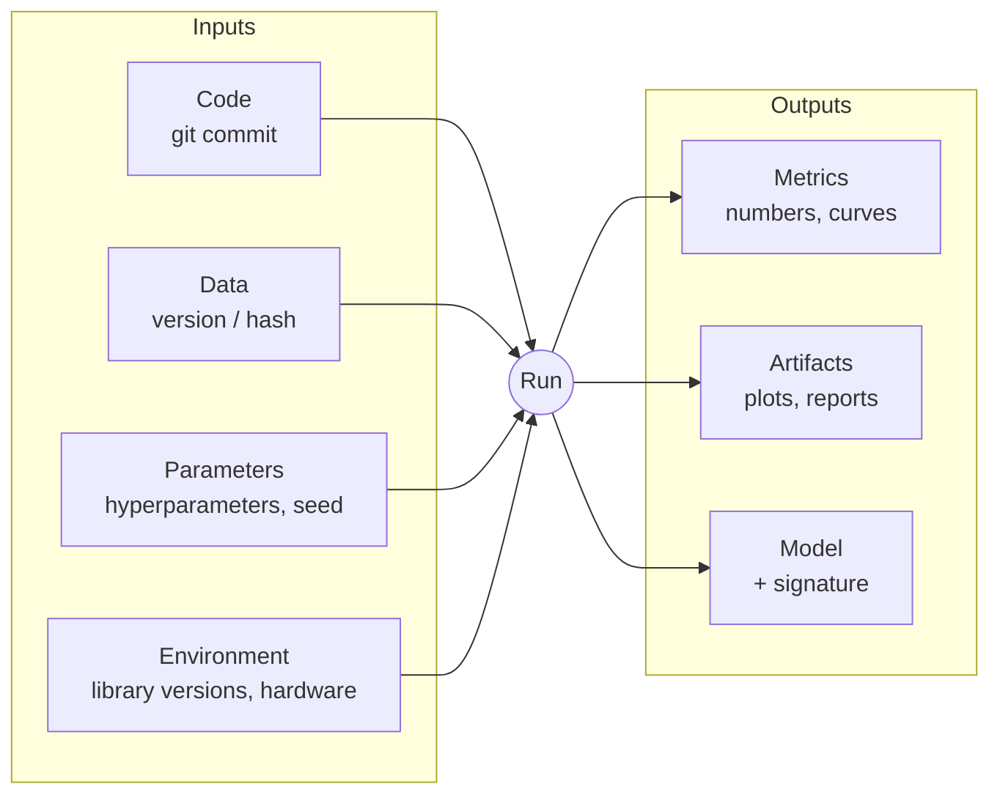

| Category | Examples | MLflow API |
|---|---|---|
| Parameters | `learning_rate`, `max_depth`, `seed` | `log_param(s)` |
| Metrics | `roc_auc`, `loss` per epoch | `log_metric(s)` (with `step`) |
| Tags | `git_commit`, `data_hash`, `author` | `set_tag(s)` |
| Artifacts | confusion matrix, feature importance | `log_artifact`, `log_figure` |
| Data | name, source, dataset digest | `log_input` |
| Model | trained model, signature | `mlflow.<flavor>.log_model` |

### The experimentation cycle

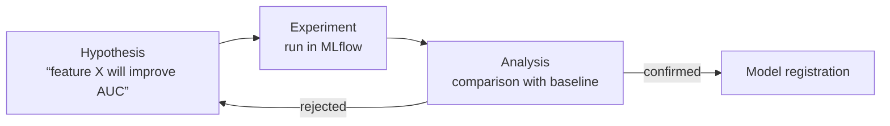

Good practice: **always start with a baseline** (e.g., a majority-class model, logistic regression) – without a reference point you can't tell whether a complex model adds value.

### Why does ML need more than Git?

In classic software, a program's result depends (almost) exclusively on the code. In ML, the result is a function of **code, data, configuration and randomness**:

```
              ┌───────────── Software 1.0 ─────────────┐
  code ─────► │  program  │ ─────► behavior            │   Git is enough
              └────────────────────────────────────────┘

              ┌───────────── Software 2.0 (ML) ────────┐
  code ─────► │                                        │
  data ─────► │  training │ ─────► model ─► behavior   │   Git + DVC + tracking
  params ───► │                                        │
  seed ─────► │                                        │
              └────────────────────────────────────────┘
```

| Tool | What it versions | What it does **not** solve |
|---|---|---|
| Git | code, YAML configs | large data, results, metrics |
| DVC / LakeFS | data and large files | comparing run results |
| MLflow / W&B | parameters, metrics, artifacts, models | versioning the source data itself |
| Docker / `requirements.txt` | environment | experiment logic |

> 💡 Experiment tracking is the data scientist's "lab notebook". Git tells you **how** the code looked, and tracking tells you **what** was achieved with that code and on what data.

### Case study: "the model we can't reproduce"

A credit scoring team deployed a model with AUC 0.81. Six months later, the regulator asked for an explanation of the decisions, and the team wanted to retrain the model. It turned out that:

1. The notebook the model came from had been edited many times after training.
2. The training data came from an SQL query on a table that had since been overwritten.
3. Nobody remembered whether `class_weight="balanced"` had been used.

Retraining gave AUC 0.77–0.79 and nobody could explain the difference. Cost: several weeks of "archaeology". With tracking, it would have been enough to open the run and read the commit, data hash and parameters.

### Tracking maturity levels

| Level | Description | Typical symptom |
|---|---|---|
| 0 | no tracking, results in someone's head / Excel | "which `.pkl` file is the current one?" |
| 1 | manual logging of metrics in a spreadsheet | typos, no artifacts |
| 2 | local MLflow (`./mlruns`) | everyone has their own runs, no sharing |
| 3 | shared tracking server + registry | comparisons within the team, model aliases |
| 4 | tracking integrated with CI/CD pipelines | every production training is logged automatically |

---

## 2. MLflow – a platform for experiment tracking

**MLflow** is an open-source platform for managing the ML lifecycle, consisting of four components:

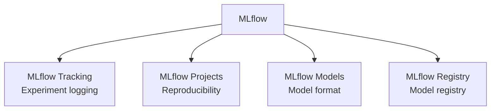

### Installation and startup

```bash
pip install mlflow scikit-learn pandas

# Start the UI (by default http://localhost:5000)
mlflow ui
```

### MLflow Tracking architecture

MLflow separates two kinds of stores:

- **Backend store** – metadata: experiments, runs, parameters, metrics, tags (files in `./mlruns` or an SQL database: SQLite, PostgreSQL, MySQL).
- **Artifact store** – large files: models, plots, reports (local disk, S3, GCS, Azure Blob, MinIO).

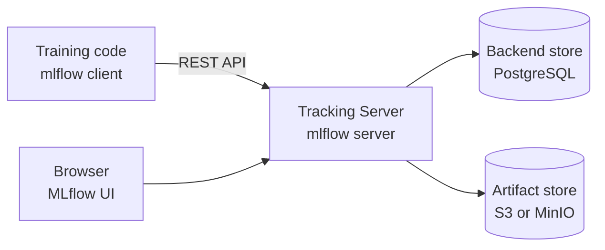

| Scenario | Backend store | Artifact store | When |
|---|---|---|---|
| Local | `./mlruns` (files) | `./mlruns` | learning, prototypes, this lecture |
| Local with a database | `sqlite:///mlflow.db` | `./mlartifacts` | Model Registry needed locally |
| Team | PostgreSQL | S3 / MinIO | several people, shared comparisons |
| Managed | Databricks, SageMaker, Azure ML | cloud | organizations without their own infrastructure |

```bash
# Team server (example)
mlflow server \
  --backend-store-uri postgresql://mlflow:password@db:5432/mlflow \
  --artifacts-destination s3://ml-artifacts \
  --host 0.0.0.0 --port 5000

# The client points to the server via an environment variable
export MLFLOW_TRACKING_URI=http://mlflow.company.local:5000
```

> ⚠️ The default `mlflow server` has no authentication. Do not expose it publicly without a reverse proxy with login (or the built-in `--app-name basic-auth`).

> 💡 The scripts in `` write to `./mlruns` by default, and after setting `MLFLOW_TRACKING_URI` – to the server. The training code doesn't change, only the configuration does.

---

## 3. MLflow Tracking basics

### Key concepts

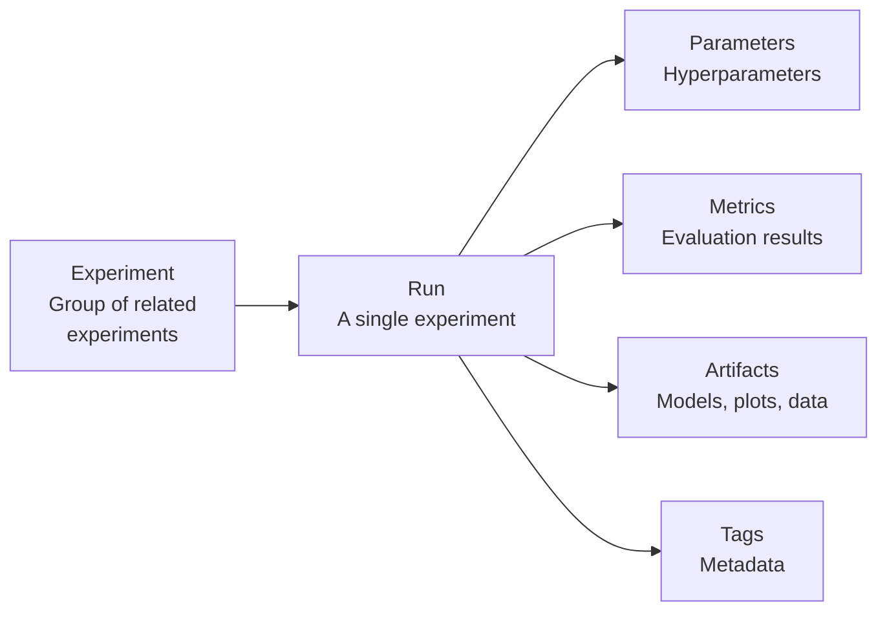

### Parameter, metric or tag?

| Feature | Parameter | Metric | Tag |
|---|---|---|---|
| Value type | text (stored as a string) | number (float) | text |
| Mutability | **immutable** once saved | can have many values (`step`, `timestamp`) | can be overwritten |
| Role | experiment input | experiment result | context, filtering |
| Example | `max_depth=8` | `val_loss` at epoch 12 | `git_commit`, `owner` |

> ⚠️ Calling `log_param` again with a **different** value for the same key in the same run results in an error. This is intentional – parameters describe the configuration, which shouldn't change during a run.

### Run lifecycle

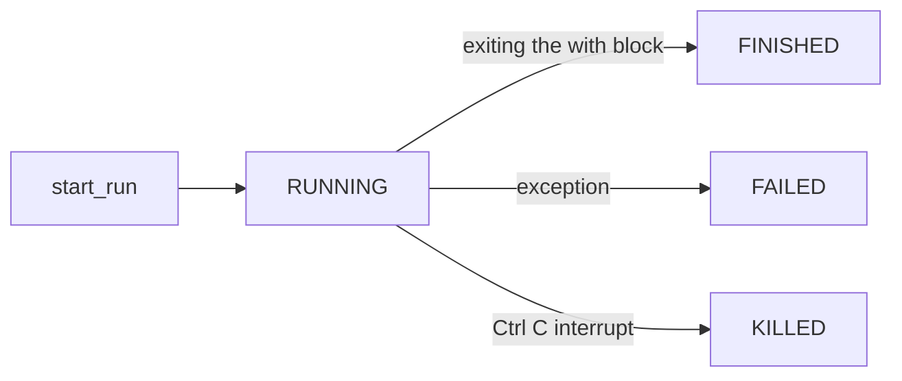

Using `with mlflow.start_run():` guarantees that the run is closed with the correct status even in case of an exception – this is used by the `04_reproducibility.py` script (the `failing-run` run).

### Autologging – minimum effort

Most popular libraries have an `autolog` integration that automatically logs the estimator's parameters, training metrics and the model:

```python
import mlflow
from sklearn.datasets import make_classification
from sklearn.ensemble import RandomForestClassifier
from sklearn.model_selection import train_test_split

mlflow.set_experiment("autolog-demo")
mlflow.sklearn.autolog(log_input_examples=True)

X, y = make_classification(n_samples=2000, random_state=42)
X_tr, X_te, y_tr, y_te = train_test_split(X, y, random_state=42)

with mlflow.start_run(run_name="rf-autolog"):
    model = RandomForestClassifier(n_estimators=150, random_state=42).fit(X_tr, y_tr)
    # test metrics are still worth logging explicitly
    mlflow.log_metric("test_accuracy", model.score(X_te, y_te))
```

| Approach | Pros | Cons |
|---|---|---|
| `autolog()` | fast, we won't forget any model parameters | logs a lot of noise, doesn't know business metrics or data versions |
| Manual logging | full control, consistent metric names | more code, easy to miss something |
| Hybrid (recommended) | autolog + manually: data, commit, test metrics | – |

### Model signature and input data

The signature describes the model's input and output schema. Thanks to it, the prediction server can reject a request with wrong columns or types:

```python
import mlflow
from mlflow.models import infer_signature

signature = infer_signature(X_tr, model.predict_proba(X_tr)[:, 1])
with mlflow.start_run():
    dataset = mlflow.data.from_numpy(X_tr, targets=y_tr, name="churn-train")
    mlflow.log_input(dataset, context="training")   # data digest in the UI
    mlflow.sklearn.log_model(model, "model", signature=signature,
                             input_example=X_tr[:5])
```

### Example: A complete experiment with MLflow

```python
import mlflow
import mlflow.sklearn
import pandas as pd
import numpy as np
from sklearn.datasets import make_classification
from sklearn.ensemble import RandomForestClassifier, GradientBoostingClassifier
from sklearn.linear_model import LogisticRegression
from sklearn.model_selection import train_test_split, cross_val_score
from sklearn.metrics import (accuracy_score, roc_auc_score, 
                              f1_score, classification_report)
import matplotlib.pyplot as plt
import json

# Data generation
X, y = make_classification(
    n_samples=10_000,
    n_features=20,
    n_informative=10,
    n_redundant=5,
    random_state=42
)
X_train, X_test, y_train, y_test = train_test_split(
    X, y, test_size=0.2, random_state=42, stratify=y
)

# MLflow configuration
mlflow.set_tracking_uri("http://localhost:5000")
mlflow.set_experiment("churn-prediction-v1")

def evaluate_model(model, X_test, y_test) -> dict:
    """Computes model evaluation metrics."""
    y_pred = model.predict(X_test)
    y_prob = model.predict_proba(X_test)[:, 1]
    
    return {
        "accuracy": accuracy_score(y_test, y_pred),
        "auc_roc": roc_auc_score(y_test, y_prob),
        "f1_score": f1_score(y_test, y_pred),
    }

def run_experiment(model_class, params: dict, run_name: str):
    """Runs a single experiment and logs the results to MLflow."""
    
    with mlflow.start_run(run_name=run_name) as run:
        # Logging parameters
        mlflow.log_params(params)
        mlflow.log_param("model_class", model_class.__name__)
        mlflow.log_param("train_size", len(X_train))
        mlflow.log_param("test_size", len(X_test))
        
        # Model training
        model = model_class(**params, random_state=42)
        model.fit(X_train, y_train)
        
        # Evaluation
        metrics = evaluate_model(model, X_test, y_test)
        
        # Cross-validation
        cv_scores = cross_val_score(model, X_train, y_train, cv=5, scoring='roc_auc')
        metrics["cv_auc_mean"] = cv_scores.mean()
        metrics["cv_auc_std"] = cv_scores.std()
        
        # Logging metrics
        mlflow.log_metrics(metrics)
        
        # Logging the model
        mlflow.sklearn.log_model(
            model, 
            "model",
            registered_model_name=f"churn-{model_class.__name__.lower()}"
        )
        
        # Logging the feature importance plot (for RF)
        if hasattr(model, 'feature_importances_'):
            fig, ax = plt.subplots(figsize=(10, 6))
            importances = model.feature_importances_
            indices = np.argsort(importances)[::-1][:10]
            ax.bar(range(10), importances[indices])
            ax.set_title('Top 10 Feature Importances')
            ax.set_xlabel('Feature Index')
            plt.tight_layout()
            mlflow.log_figure(fig, "feature_importance.png")
            plt.close()
        
        # Logging the classification report as an artifact
        report = classification_report(y_test, model.predict(X_test))
        with open("/tmp/classification_report.txt", "w") as f:
            f.write(report)
        mlflow.log_artifact("/tmp/classification_report.txt")
        
        print(f"Run: {run_name}")
        print(f"  AUC-ROC: {metrics['auc_roc']:.4f}")
        print(f"  F1:      {metrics['f1_score']:.4f}")
        print(f"  Run ID:  {run.info.run_id}")
        
        return run.info.run_id, metrics

# Experiments with different models and hyperparameters
experiments = [
    (RandomForestClassifier, {"n_estimators": 100, "max_depth": 5}, "RF-shallow"),
    (RandomForestClassifier, {"n_estimators": 200, "max_depth": 10}, "RF-deep"),
    (GradientBoostingClassifier, {"n_estimators": 100, "learning_rate": 0.1}, "GBM-default"),
    (GradientBoostingClassifier, {"n_estimators": 200, "learning_rate": 0.05}, "GBM-slow"),
    (LogisticRegression, {"C": 1.0, "max_iter": 1000}, "LR-default"),
]

results = []
for model_class, params, name in experiments:
    run_id, metrics = run_experiment(model_class, params, name)
    results.append({"name": name, "run_id": run_id, **metrics})

# Results summary
results_df = pd.DataFrame(results).sort_values("auc_roc", ascending=False)
print("\n=== Experiment ranking ===")
print(results_df[["name", "auc_roc", "f1_score", "cv_auc_mean"]].to_string(index=False))
```


> **▶️ Live demo:** `python lectures/scripts/lecture_03/01_mlflow_experiments.py`  
> **When:** after discussing the code from section 3. It takes about 40 s, so you can discuss the key concepts in the meantime.  
> **What to show:** in the MLflow UI, select 5 runs and click **Compare** (parallel coordinates plot). Open the GBM run and show the step metric `staged_roc_auc`, the artifacts `evaluation/confusion_matrix.png` and the model with its signature and `input_example`.

### Common mistakes in logging code

| Mistake | Effect | Fix |
|---|---|---|
| `mlflow.set_experiment` omitted | runs land in the `Default` experiment | always set the experiment at the beginning of the script |
| `start_run()` without `with` and without `end_run()` | subsequent runs get nested or the status stays `RUNNING` | use the context manager |
| Saving artifacts to a fixed path `/tmp/x.txt` | collisions with parallel runs | `tempfile.TemporaryDirectory()` or `mlflow.log_text` |
| Logging a metric in a loop without `step` | unreadable curve plot | `log_metric(name, value, step=epoch)` |
| Different names for the same metric (`auc`, `roc_auc`, `AUC`) | runs can't be compared | agree on a naming dictionary within the team |

```python
# Instead of a temporary file – directly from memory
mlflow.log_text(report, "evaluation/classification_report.txt")
mlflow.log_dict({"threshold": 0.42, "features": 20}, "config/eval.json")
```

---


## 4. Comparing experiments

### Programmatic comparison via the MLflow API

```python
import mlflow
from mlflow.tracking import MlflowClient

client = MlflowClient()

# Fetch all runs from the experiment
experiment = client.get_experiment_by_name("churn-prediction-v1")
runs = client.search_runs(
    experiment_ids=[experiment.experiment_id],
    order_by=["metrics.auc_roc DESC"],
    max_results=10
)

print("Top 5 experiments by AUC-ROC:")
for i, run in enumerate(runs[:5], 1):
    print(f"{i}. {run.data.tags.get('mlflow.runName', 'N/A')}")
    print(f"   AUC-ROC: {run.data.metrics.get('auc_roc', 0):.4f}")
    print(f"   F1:      {run.data.metrics.get('f1_score', 0):.4f}")
    print(f"   Params:  {run.data.params}")
    print()

# Fetch the best model
best_run = runs[0]
best_run_id = best_run.info.run_id
print(f"Best model: {best_run_id}")

# Load the best model
best_model = mlflow.sklearn.load_model(f"runs:/{best_run_id}/model")
```


> **▶️ Live demo:** `python lectures/scripts/lecture_03/02_compare_runs.py`  
> **When:** right after the code from section 4.  
> **What to show:** the run ranking in the terminal, the filter `tags.model_type = ... and metrics.roc_auc > 0.9` (the same syntax works in the UI search field) and the **Models** tab in the UI with the `churn-classifier` model and the `champion` alias.


### Is the difference between runs significant?

An AUC difference of 0.871 vs 0.874 may result solely from the randomness of the data split. Before you announce a "better model":
1. Run each configuration with **several seeds** or in **k-fold CV** and compare the mean ± standard deviation.
2. Use a paired test (the same folds) or **bootstrap** on the test set.

```python
import numpy as np
from sklearn.datasets import make_classification
from sklearn.ensemble import GradientBoostingClassifier, RandomForestClassifier
from sklearn.model_selection import cross_val_score, StratifiedKFold
from scipy import stats

X, y = make_classification(n_samples=2000, n_features=20, random_state=0)
cv = StratifiedKFold(n_splits=10, shuffle=True, random_state=0)   # the same folds!
a = cross_val_score(RandomForestClassifier(random_state=0), X, y, cv=cv, scoring="roc_auc")
b = cross_val_score(GradientBoostingClassifier(random_state=0), X, y, cv=cv, scoring="roc_auc")

print(f"RF : {a.mean():.4f} ± {a.std():.4f}")
print(f"GBM: {b.mean():.4f} ± {b.std():.4f}")
t, p = stats.ttest_rel(a, b)
print(f"paired t-test: p = {p:.3f} → {'significant difference' if p < 0.05 else 'no evidence of a difference'}")
```

> It is worth logging CV results in MLflow as `roc_auc_mean` and `roc_auc_std` – then the comparison in the UI accounts for uncertainty.

### Bootstrap confidence interval on the test set

When we have a single test set, we can estimate the metric's uncertainty by sampling with replacement:

```python
import numpy as np
from sklearn.metrics import roc_auc_score

def bootstrap_auc(y_true, y_score, n_boot=1000, seed=42):
    rng = np.random.default_rng(seed)
    n = len(y_true)
    scores = []
    for _ in range(n_boot):
        idx = rng.integers(0, n, n)
        if len(np.unique(y_true[idx])) < 2:   # AUC requires both classes
            continue
        scores.append(roc_auc_score(y_true[idx], y_score[idx]))
    return np.percentile(scores, [2.5, 97.5])

low, high = bootstrap_auc(np.asarray(y_test), y_prob)
mlflow.log_metrics({"roc_auc_ci_low": low, "roc_auc_ci_high": high})
```

If the confidence intervals of two models overlap heavily, the difference is probably random (for a rigorous test use a **paired** bootstrap – the same indices for both models).

### `search_runs` filter syntax

| Goal | Filter |
|---|---|
| metric above a threshold | `metrics.roc_auc > 0.9` |
| specific parameter | `params.max_depth = '8'` (parameters are strings!) |
| tag | `tags.model_type = 'gbm'` |
| finished only | `attributes.status = 'FINISHED'` |
| run name | `attributes.run_name LIKE 'GBM%'` |
| combining conditions | `metrics.roc_auc > 0.9 and tags.feature_set = 'v2'` |


```python
import mlflow

# Result as a pandas.DataFrame – convenient for analyses and plots
df = mlflow.search_runs(
    experiment_names=["churn-prediction-v1"],
    filter_string="attributes.status = 'FINISHED'",
    order_by=["metrics.roc_auc DESC"],
)
print(df[["tags.mlflow.runName", "metrics.roc_auc", "params.max_depth"]].head())
```

### How to choose the "best" model?

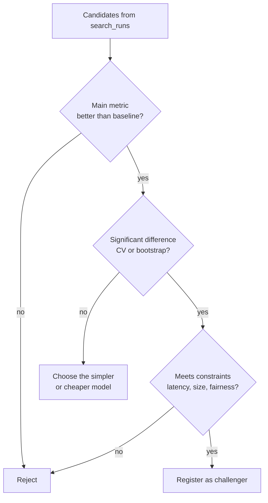

> 💡 In a statistical tie, choose the **simpler** model (Occam's razor): faster at inference, easier to explain and maintain.

---

## 5. Organizing experiments – good practices

### Experiment hierarchy

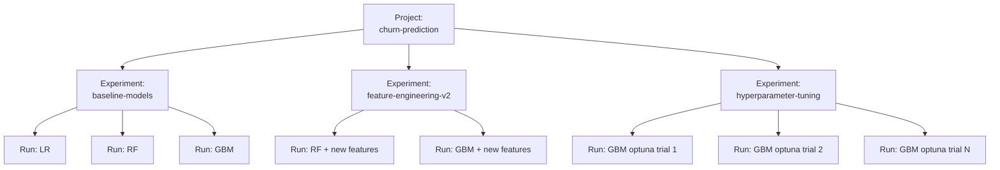

**Diagram explanation** – three levels of work organization:

- **Project** (`churn-prediction`) – the business problem we are solving, here predicting customer attrition (*churn*). MLflow has no separate "project" object, so it is usually a common prefix of experiment names (e.g. `churn-prediction/baseline-models`) or a separate server or workspace for the team.
- **Experiment** (MLflow *Experiment*) – a group of runs that answer **one research question**. Runs in one experiment should be meaningfully comparable: the same metric, the same data split.
  - **`baseline-models`** – the reference point. Simple models with default parameters on the basic feature set. Question: what result can be achieved with the "simplest" approach?
  - **`feature-engineering-v2`** – we test a new feature set (version 2, e.g. 30-day aggregates, customer tenure). Question: do the new features improve the result relative to the baseline with the same models?
  - **`hyperparameter-tuning`** – tuning the hyperparameters of the best model. Question: how much do we gain from parameter selection?
- **Run** – a single training execution with specific parameters, data and code. It records parameters, metrics, artifacts and tags.
  - **LR** (*Logistic Regression*) – logistic regression: a linear, fast and interpretable model, the classic baseline.
  - **RF** (*Random Forest*) – random forest: an ensemble of decision trees trained on random subsets of data and features. The result is a vote of the trees.
  - **GBM** (*Gradient Boosting Machine*) – gradient boosting: trees built sequentially, each correcting the errors of the previous ones. Often the best on tabular data.
  - **`+ new features`** – the same model as in the baseline, but with v2 features. Comparing e.g. `RF` with `RF + new features` shows the impact of the features alone.
  - **`optuna trial 1…N`** – successive tuning attempts (*trials*) in Optuna (section 6). Each trial is a run with a different set of hyperparameters. In practice these are **nested runs** (`nested=True`) under a single parent run for the whole study, so the UI is not cluttered with hundreds of entries.

Why such a split? Each experiment changes **one factor**: first the model, then the features, then the hyperparameters. This way it is clear where the improvement comes from. The best run from each stage is the starting point for the next, and we always compare its result with the baseline.

### Naming conventions

```python
# A good run naming convention
run_name = f"{model_type}-{feature_set}-{date}-{author}"
# Example: "GBM-v2features-20240115-jkowalski"

# Tags for easy filtering
tags = {
    "author": "jan.kowalski",
    "feature_set": "v2",
    "data_version": "2024-01-15",
    "purpose": "hyperparameter_search",
    "environment": "development"
}

with mlflow.start_run(run_name=run_name, tags=tags):
    pass  # ... training
```

### System tags vs custom tags

MLflow itself sets tags with the `mlflow.` prefix, including `mlflow.runName`, `mlflow.user`, `mlflow.source.name` (script) and `mlflow.source.git.commit` (when the script was run in a Git repository). Custom tags should not use this prefix.

### Organization anti-patterns

> ⚠️ **One experiment for everything** – thousands of runs in `Default`, different datasets and metrics. Comparison loses its meaning.

> ⚠️ **An experiment per run** – no way to compare in a single view. Experiment = research question, not a single attempt.

> ⚠️ **Information only in the run name** – `GBM_lr01_v2_final` is unreadable for filters. Keep key information in parameters and tags; the name is only a label for humans.

### Checklist before running an experiment

- [ ] The correct experiment is set (`set_experiment`).
- [ ] The hypothesis is recorded (e.g. a `hypothesis` tag or the run description `mlflow.note.content`).
- [ ] Logged: commit, data version / hash, seed.
- [ ] The same main metric and the same data split as the baseline.
- [ ] Code committed in Git (no uncommitted changes – `git_dirty` tag).

---


## 6. Optuna – automatic hyperparameter tuning

**Optuna** is a framework for automatic hyperparameter optimization (AutoML).

```python
import optuna
import mlflow
from sklearn.ensemble import GradientBoostingClassifier
from sklearn.model_selection import cross_val_score

# Integrating Optuna with MLflow
mlflow.set_experiment("hyperparameter-tuning-gbm")

def objective(trial: optuna.Trial) -> float:
    """Objective function for Optuna."""
    
    # Hyperparameter space
    params = {
        "n_estimators": trial.suggest_int("n_estimators", 50, 500),
        "max_depth": trial.suggest_int("max_depth", 2, 10),
        "learning_rate": trial.suggest_float("learning_rate", 0.01, 0.3, log=True),
        "subsample": trial.suggest_float("subsample", 0.6, 1.0),
        "min_samples_split": trial.suggest_int("min_samples_split", 2, 20),
        "random_state": 42
    }
    
    with mlflow.start_run(run_name=f"trial-{trial.number}", nested=True):
        mlflow.log_params(params)
        
        model = GradientBoostingClassifier(**params)
        scores = cross_val_score(model, X_train, y_train, cv=5, scoring='roc_auc')
        
        mean_auc = scores.mean()
        mlflow.log_metric("cv_auc_mean", mean_auc)
        mlflow.log_metric("cv_auc_std", scores.std())
    
    return mean_auc

# Running the optimization
with mlflow.start_run(run_name="optuna-study"):
    study = optuna.create_study(
        direction="maximize",
        sampler=optuna.samplers.TPESampler(seed=42),
        pruner=optuna.pruners.MedianPruner()
    )
    study.optimize(objective, n_trials=50, timeout=300)
    
    # Logging the best results
    mlflow.log_params(study.best_params)
    mlflow.log_metric("best_auc", study.best_value)
    
    print(f"Best hyperparameters: {study.best_params}")
    print(f"Best AUC: {study.best_value:.4f}")
```

### Pruning – early stopping of weak trials

A pruner (e.g. `MedianPruner`) works only when a trial **reports intermediate results**. In the example above with `cross_val_score` there are no intermediate metrics, so the pruner does nothing. The correct version reports the result after each fold:

```python
import numpy as np
import optuna
from sklearn.model_selection import StratifiedKFold
from sklearn.metrics import roc_auc_score

def objective(trial: optuna.Trial) -> float:
    params = {
        "n_estimators": trial.suggest_int("n_estimators", 50, 300),
        "learning_rate": trial.suggest_float("learning_rate", 0.01, 0.3, log=True),
        "max_depth": trial.suggest_int("max_depth", 2, 6),
    }
    cv = StratifiedKFold(n_splits=5, shuffle=True, random_state=42)
    scores = []
    for fold, (tr, va) in enumerate(cv.split(X_train, y_train)):
        model = GradientBoostingClassifier(**params, random_state=42)
        model.fit(X_train[tr], y_train[tr])
        scores.append(roc_auc_score(y_train[va], model.predict_proba(X_train[va])[:, 1]))
        trial.report(np.mean(scores), step=fold)      # intermediate result
        if trial.should_prune():                       # worse than the median?
            raise optuna.TrialPruned()
    return float(np.mean(scores))
```

### Grid vs random search – intuition

```
   Grid search 3×3                    Random search (9 trials)
   important parameter →              important parameter →
   ┌───────────────┐                  ┌───────────────┐
   │ ●     ●     ● │                  │   ●       ●   │
   │               │                  │ ●     ●       │
   │ ●     ●     ● │                  │         ●   ● │
   │               │                  │  ●   ●        │
   │ ●     ●     ● │                  │            ●  │
   └───────────────┘                  └───────────────┘
   3 different values of the          9 different values of the
   important parameter                important parameter
```

### Designing the search space

| Hyperparameter | Distribution | Why |
|---|---|---|
| `learning_rate` | log-uniform (`log=True`) | the difference 0.001 → 0.01 is as important as 0.01 → 0.1 |
| `C`, `alpha` (regularization) | log-uniform | order-of-magnitude changes |
| `max_depth`, `num_layers` | int, uniform | small discrete range |
| `subsample`, `dropout` | float, uniform | bounded interval [0, 1] |
| `optimizer`, `kernel` | categorical | no ordering |

> 💡 Start with a wide space and a small number of trials, look at `plot_param_importances`, and then narrow the ranges of the most important parameters.


> ⚠️ If the best value lies **on the edge** of the interval (e.g. `learning_rate=0.3` with an upper bound of 0.3), the space is probably too narrow.

### Visualizing the hyperparameter space

```python
import optuna.visualization as vis

# Hyperparameter importance plot
fig = vis.plot_param_importances(study)
fig.write_html("/tmp/param_importances.html")
mlflow.log_artifact("/tmp/param_importances.html")

# Optimization history
fig = vis.plot_optimization_history(study)
fig.write_html("/tmp/optimization_history.html")
mlflow.log_artifact("/tmp/optimization_history.html")
```


> **▶️ Live demo:** `python lectures/scripts/lecture_03/03_hyperparameter_tuning.py --trials 15`  
> **When:** after discussing the Optuna + MLflow integration.  
> **What to show:** in the `churn-hpo` experiment expand the parent run with trials as nested runs, then use **Compare → Parallel Coordinates**. Without Optuna installed the script will use random search. It is worth contrasting both approaches.


### Hyperparameter search strategies – theory

| Method | Idea | Advantages | Disadvantages |
|---|---|---|---|
| Grid search | all grid combinations | simple, exhaustive | cost grows exponentially with the number of parameters |
| Random search | random points | covers important dimensions better (Bergstra & Bengio, 2012) | does not learn from previous trials |
| Bayesian (TPE, GP) | a surrogate model predicts where to search | fewer trials to a good result | sequential, harder to parallelize |
| Hyperband / ASHA | early stopping of weak trials (pruning) | huge time savings | requires an intermediate metric (e.g. per epoch) |

Why does random search beat grid search? When only one of two parameters matters, a 3×3 grid tests only **3** different values of the important parameter, while 9 random trials test **9** different values.

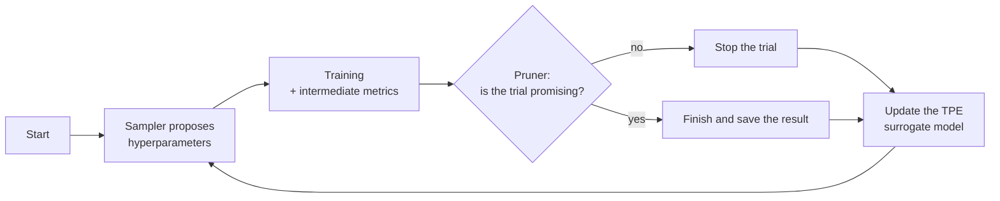

**TPE (Tree-structured Parzen Estimator)** – Optuna's default sampler – splits the trials so far into "good" (the top γ%, e.g. 25%) and "bad", models the densities $l(x)$ and $g(x)$ of the hyperparameters in both groups and proposes points maximizing $l(x)/g(x)$.

> **Pitfall:** tuning on the test set. We choose hyperparameters on validation (or CV) and use the test set **once**, at the end – otherwise the test result is optimistically biased.

---


## 7. Tracking deep learning experiments

### Integration with PyTorch

```python
import mlflow
import torch
import torch.nn as nn
from torch.utils.data import DataLoader, TensorDataset

class SimpleNN(nn.Module):
    def __init__(self, input_dim: int, hidden_dim: int, dropout: float):
        super().__init__()
        self.network = nn.Sequential(
            nn.Linear(input_dim, hidden_dim),
            nn.ReLU(),
            nn.Dropout(dropout),
            nn.Linear(hidden_dim, hidden_dim // 2),
            nn.ReLU(),
            nn.Dropout(dropout),
            nn.Linear(hidden_dim // 2, 1),
            nn.Sigmoid()
        )
    
    def forward(self, x):
        return self.network(x).squeeze()

def train_neural_network(
    hidden_dim: int = 128,
    dropout: float = 0.3,
    lr: float = 0.001,
    epochs: int = 50,
    batch_size: int = 256
):
    """Trains a neural network with logging to MLflow."""
    
    with mlflow.start_run():
        # Logging hyperparameters
        params = {
            "hidden_dim": hidden_dim,
            "dropout": dropout,
            "learning_rate": lr,
            "epochs": epochs,
            "batch_size": batch_size,
            "optimizer": "Adam"
        }
        mlflow.log_params(params)
        
        # Data preparation
        X_t = torch.FloatTensor(X_train)
        y_t = torch.FloatTensor(y_train.values)
        dataset = TensorDataset(X_t, y_t)
        loader = DataLoader(dataset, batch_size=batch_size, shuffle=True)
        
        # Model and optimizer
        model = SimpleNN(X_train.shape[1], hidden_dim, dropout)
        optimizer = torch.optim.Adam(model.parameters(), lr=lr)
        criterion = nn.BCELoss()
        
        # Training with per-epoch metric logging
        for epoch in range(epochs):
            model.train()
            total_loss = 0
            
            for X_batch, y_batch in loader:
                optimizer.zero_grad()
                y_pred = model(X_batch)
                loss = criterion(y_pred, y_batch)
                loss.backward()
                optimizer.step()
                total_loss += loss.item()
            
            avg_loss = total_loss / len(loader)
            
            # Logging the metric per step (epoch)
            mlflow.log_metric("train_loss", avg_loss, step=epoch)
            
            if (epoch + 1) % 10 == 0:
                print(f"Epoch {epoch+1}/{epochs}, Loss: {avg_loss:.4f}")
        
        # Logging the PyTorch model
        mlflow.pytorch.log_model(model, "neural_network")
        
        return model
```

### What to log when training neural networks

| Category | Examples | Frequency |
|---|---|---|
| Learning curves | `train_loss`, `val_loss`, `val_auc` | every epoch (or every N steps) |
| Optimization | `learning_rate` (with a scheduler), gradient norm | every step / epoch |
| Resources | GPU usage, epoch time | every epoch |
| Checkpoints | best model by `val_loss` | on improvement |
| Prediction examples | misclassified images, text samples | rarely (artifacts are large) |

### Reading learning curves

```
 loss                                    loss
  │╲                                      │╲
  │ ╲__  val                              │ ╲   val      ___----
  │    ╲____________                      │  ╲_____----
  │ ╲__                                   │ ╲__
  │    ╲____________ train                │    ╲________________ train
  └──────────────────► epoch              └──────────────────► epoch
   good fit                                overfitting: val rises,
                                           train keeps falling → early stopping
```

### Validation, early stopping and checkpoint

```python
best_val, patience, bad_epochs = float("inf"), 5, 0
for epoch in range(epochs):
    train_loss = train_one_epoch(model, train_loader)      # helper functions
    val_loss = evaluate(model, val_loader)
    mlflow.log_metrics({"train_loss": train_loss, "val_loss": val_loss}, step=epoch)

    if val_loss < best_val:
        best_val, bad_epochs = val_loss, 0
        torch.save(model.state_dict(), "best.pt")
        mlflow.log_artifact("best.pt", artifact_path="checkpoints")
    else:
        bad_epochs += 1
        if bad_epochs >= patience:
            mlflow.set_tag("early_stopped_epoch", epoch)
            break
mlflow.log_metric("best_val_loss", best_val)
```

> ⚠️ Logging a metric **after every batch** with millions of steps can slow training down and clog the backend store. Log every N steps or use `mlflow.log_metrics` in batches.

> 💡 For PyTorch Lightning, Keras and Hugging Face Transformers there is `mlflow.<framework>.autolog()` or a ready-made callback – you don't need to write the logging loop yourself.

---


## 8. Reproducibility – guaranteeing repeatability

```python
import os
import sys
import platform
import subprocess
import mlflow

def log_environment_info():
    """Logs environment information to MLflow."""
    
    env_info = {
        "python_version": sys.version,
        "platform": platform.platform(),
        "cpu_count": os.cpu_count(),
    }
    
    # Library versions
    import sklearn, numpy, pandas
    lib_versions = {
        "sklearn_version": sklearn.__version__,
        "numpy_version": numpy.__version__,
        "pandas_version": pandas.__version__,
    }
    
    # Git commit hash
    try:
        git_hash = subprocess.check_output(
            ["git", "rev-parse", "HEAD"]
        ).decode().strip()
        lib_versions["git_commit"] = git_hash
    except Exception:
        lib_versions["git_commit"] = "unknown"
    
    mlflow.log_params({**env_info, **lib_versions})
    
    # Save requirements.txt as an artifact
    subprocess.run(["pip", "freeze"], 
                   stdout=open("/tmp/requirements_snapshot.txt", "w"))
    mlflow.log_artifact("/tmp/requirements_snapshot.txt")

# Usage in an experiment
with mlflow.start_run():
    log_environment_info()
    # ... rest of the experiment
```

### Setting seeds in one place

```python
import os
import random
import numpy as np

def set_seed(seed: int = 42) -> None:
    """Sets the seeds of all random generators in use."""
    random.seed(seed)
    np.random.seed(seed)
    os.environ["PYTHONHASHSEED"] = str(seed)  # works for subprocesses
    try:
        import torch
        torch.manual_seed(seed)
        torch.cuda.manual_seed_all(seed)
        torch.backends.cudnn.benchmark = False
    except ImportError:
        pass
```

### Data hash as a "fingerprint"

```python
import hashlib
import pandas as pd

def dataframe_hash(df: pd.DataFrame) -> str:
    """Stable hash of the data frame contents (independent of the file)."""
    row_hashes = pd.util.hash_pandas_object(df, index=True).values
    return hashlib.md5(row_hashes.tobytes()).hexdigest()

mlflow.set_tag("data_hash", dataframe_hash(train_df))
```

The same idea (hash, git commit, seed) is implemented by the `04_reproducibility.py` script.

### Levels of reproducibility

| Level | Definition | What is needed |
|---|---|---|
| Bitwise | identical weights and predictions | the same data, code, seed, libraries, hardware, deterministic operations |
| Statistical | metrics within uncertainty bounds | data, code, configuration; seed optional |
| Conceptual | the same conclusion with a different implementation | description of the method and data |

> 💡 In production practice **statistical** reproducibility is usually sufficient, but bitwise reproducibility is useful for debugging and auditing.


> **▶️ Live demo:** `python lectures/scripts/lecture_03/04_reproducibility.py`  
> **When:** after section 8. It also complements section 10 (logging failed experiments).  
> **What to show:** two runs with `seed=42` give identical `roc_auc`. Show in the UI the `git_commit` and `data_hash` tags and library versions, as well as the `failing-run` run with FAILED status.


### Sources of non-determinism

| Source | Example | How to control |
|---|---|---|
| Random generators | weight initialization, data split, bootstrap | `random`, `numpy`, `torch` seed, `random_state` |
| Data | someone overwrote the CSV file | DVC, data hash in the run tag |
| Data order | `SELECT` without `ORDER BY`, multithreaded loading | sorting, `DataLoader` seed |
| Libraries | a different sklearn version changes default parameters | `requirements.txt` with versions, Docker |
| Hardware | non-deterministic cuDNN operations on GPU | `torch.use_deterministic_algorithms(True)` |
| Arithmetic | a different float summation order in parallel computations | accepting a tolerance (e.g. ±1e-6) |


### Lineage – the origin of a model

Full lineage lets you answer an auditor's question: *"On what data and with what code was the model that rejected this loan application created?"*

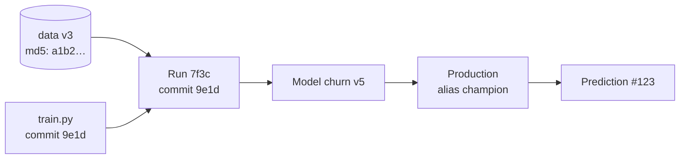

---

## 9. Weights & Biases (W&B) – an alternative to MLflow

**W&B** is a cloud platform for experiment tracking, popular in research environments.

```python
import wandb
from sklearn.ensemble import RandomForestClassifier
from sklearn.metrics import roc_auc_score

# Initialize the W&B project
wandb.init(
    project="churn-prediction",
    name="RF-experiment-01",
    config={
        "n_estimators": 200,
        "max_depth": 8,
        "random_state": 42
    }
)

config = wandb.config

# Training
model = RandomForestClassifier(
    n_estimators=config.n_estimators,
    max_depth=config.max_depth,
    random_state=config.random_state
)
model.fit(X_train, y_train)

# Logging metrics
auc = roc_auc_score(y_test, model.predict_proba(X_test)[:, 1])
wandb.log({"auc_roc": auc, "n_features": X_train.shape[1]})

# Logging the model
wandb.save("model.pkl")

wandb.finish()
```

### MLflow vs W&B comparison

| Feature | MLflow | Weights & Biases |
|-------|--------|-----------------|
| Hosting | Self-hosted / Managed | Cloud (SaaS) |
| Cost | Open Source (free) | Freemium |
| UI | Basic | Advanced |
| Integrations | Broad | Very broad |
| Collaboration | Limited | Built-in |
| Model Registry | Yes | Yes |

### The broader tool landscape

| Tool | Model | Strengths | Notes |
|---|---|---|---|
| MLflow | open source, self-hosted or managed | de facto standard, registry, many model flavors | UI simpler than competitors' |
| Weights & Biases | SaaS (on-prem option) | visualizations, reports, sweeps | data goes to the vendor's cloud |
| Neptune.ai | SaaS | scalable metadata, comparisons | paid at larger scale |
| Comet ML | SaaS / on-prem | panels, code comparison | similar to W&B |
| ClearML | open source | tracking + orchestration + task queues | more elaborate installation |
| DVC (`dvc exp`) | open source, Git-based | experiments as commits, data versioning | no full UI server (Studio separately) |
| TensorBoard | open source | DL learning curves | no registry or run management |

> 💡 Selection criteria: where data may be stored (regulations, GDPR), cost at team scale, integration with the existing cloud and the need for a Model Registry.


### Model Registry – the lifecycle of a model version

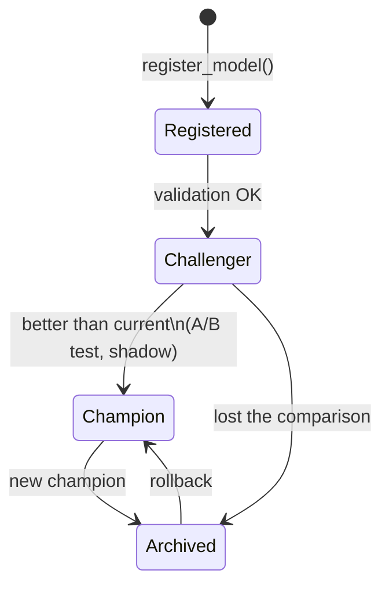

In MLflow ≥ 2.9, instead of stages (`Staging`/`Production`, now deprecated) you use **aliases** (`champion`, `challenger`) and tags. Serving code loads the model by alias, so deployment and rollback are just a matter of moving the alias:

```python
from mlflow import MlflowClient
import mlflow

client = MlflowClient()
client.set_registered_model_alias("churn-classifier", "champion", version=5)
model = mlflow.pyfunc.load_model("models:/churn-classifier@champion")
# rollback:
client.set_registered_model_alias("churn-classifier", "champion", version=4)
```

---


## 10. Common pitfalls in experiment tracking

> ⚠️ **Pitfall 1: Comparing apples to oranges**
> Comparing models trained on different data versions or with different preprocessing. Always log `data_version` and `preprocessing_version` as parameters.

> ⚠️ **Pitfall 2: Overfitting to the test set**
> Repeatedly tuning hyperparameters on the same test set leads to overfitting. Solution: use three sets (train/validation/test) or cross-validation, and treat the test set as the "final exam".

> ⚠️ **Pitfall 3: Not logging negative results**
> Teams often log only successful experiments. Negative results are just as valuable — they show what is not worth trying. Log **every** experiment, even a failed one.

```python
# ✅ Good practice: also log failed experiments with an appropriate tag
with mlflow.start_run(run_name="failed-experiment", tags={"status": "failed"}):
    mlflow.log_param("reason", "OOM - model too large for available memory")
    mlflow.log_param("model_class", "TransformerXL")
    mlflow.log_param("memory_required_gb", 32)
    mlflow.log_param("memory_available_gb", 16)
```

> ⚠️ **Pitfall 4: ML metrics vs business metrics**
> A high AUC-ROC does not always mean business value. A model with AUC=0.85 may generate more profit than a model with AUC=0.92 if it better identifies high-value customers. Always log business metrics alongside ML metrics.

> ⚠️ **Pitfall 5: Data leakage in preprocessing**
> Scaling or feature selection fitted on the whole dataset before splitting into folds inflates CV metrics. Put preprocessing in a `sklearn.pipeline.Pipeline` so that it is fitted only on the training part of each fold.

```python
from sklearn.pipeline import make_pipeline
from sklearn.preprocessing import StandardScaler
from sklearn.feature_selection import SelectKBest
from sklearn.linear_model import LogisticRegression

# ✅ scaler and feature selection fitted inside each fold
pipe = make_pipeline(StandardScaler(), SelectKBest(k=10), LogisticRegression(max_iter=1000))
scores = cross_val_score(pipe, X_train, y_train, cv=5, scoring="roc_auc")
```

> ⚠️ **Pitfall 6: Picking the best of hundreds of runs (multiple comparisons)**
> The more trials, the greater the chance that the best result is a lucky fluke. Always confirm the best HPO configuration on an independent test set or by repeating with other seeds.

> ⚠️ **Pitfall 7: Uncommitted code**
> The `git_commit` tag is worthless if the run was produced from locally modified code. Also log a `git_dirty` flag (output of `git status --porcelain`) or block "official" training runs on a dirty repository.

> ⚠️ **Pitfall 8: A metric computed differently across runs**
> e.g. F1 at threshold 0.5 in one run and at the optimal threshold in another. A shared `evaluate_model` function in the repository (as in the lecture scripts) eliminates this problem.

### Pitfalls summary

| Pitfall | Symptom | Safeguard |
|---|---|---|
| Different data | inconsistent comparisons | `data_version`, `log_input` |
| Overfitting to the test | quality drop in production | train / val / test, test used once |
| No negative results | repeating failed ideas | log every run, including FAILED |
| ML-only metrics | "better" model, but lower profit | business metrics in the run |
| Data leakage | suspiciously high results | `Pipeline`, split before preprocessing |
| Multiple comparisons | result does not replicate | confirmation on holdout / other seeds |
| Dirty repository | code cannot be reproduced | `git_dirty` tag, CI |

### Case Study: Netflix — experiments at scale

**Netflix** runs thousands of ML experiments simultaneously (recommendations, thumbnails, UI personalization):
- Every experiment is tracked with full context: data, parameters, ML metrics and business metrics (watch time, retention).
- They use an internal platform for A/B testing models on live traffic.
- Key lesson: **an offline metric (AUC) does not always correlate with an online metric (watch time)**. That is why every model goes through A/B tests before full deployment.

---

## Review and discussion questions

1. Why is systematic experiment tracking more important than the choice of algorithm itself?
2. What information should every logged experiment in MLflow contain?
3. How does `mlflow.log_param` differ from `mlflow.log_metric`? When will you use each?
4. Explain how Optuna chooses the next hyperparameters to test (TPE sampler).
5. Compare MLflow and Weights & Biases — when would you choose one and when the other?
6. What is overfitting to the test set and how do you avoid it?
7. **Discussion:** Is it worth logging experiments that failed? Justify.
8. How does the backend store differ from the artifact store in MLflow? What does each store?
9. Why will `MedianPruner` not stop any trial if the objective function does not call `trial.report`?
10. You have two models: AUC 0.874 ± 0.012 and 0.871 ± 0.010 (10-fold CV). Which one will you deploy and why?
11. Why do we sample `learning_rate` on a logarithmic scale?
12. What are the pros and cons of `mlflow.autolog()` compared to manual logging?


### Suggested answers

1. Without tracking you cannot reliably compare results or reproduce the best model, so even a "better algorithm" gives little. The greatest value comes from controlling the training process, not from a single model choice.
2. Minimum: parameters, metrics, model artifacts, data version, code version (commit), environment (libraries), run time and contextual tags. This ensures full reproducibility and auditability.
3. `mlflow.log_param` records configuration (e.g. `max_depth=8`), while `mlflow.log_metric` records numerical results (e.g. `auc=0.89`), usually also per epoch/step. Parameters describe the experiment's input, metrics its quality.
4. TPE builds a probabilistic model of the hyperparameter space and chooses next configurations with the highest expected improvement over results so far. This way it searches smarter than brute force.
5. I'll choose MLflow when I need open source and self-hosting; W&B when the priority is team collaboration and a rich SaaS UI. Both tools support tracking but differ in working style and cost.
6. Overfitting to the test means tuning decisions to a single test set, so the test result stops being objective. We prevent it with a separate validation set/CV and using the test only at the end.
7. Yes, it is worth logging failed experiments too, because it saves time and prevents repeating the same mistakes. It also builds the team's knowledge about the limitations of data and models.
8. The backend store keeps metadata (experiments, runs, parameters, metrics, tags) in files or an SQL database. The artifact store keeps large files (models, plots, reports) on disk or in object storage (S3, MinIO).
9. The pruner compares a trial's intermediate results with other trials at the same step. Without `trial.report` there is nothing to compare, so `should_prune()` always returns `False`.
10. The difference (0.003) is much smaller than the standard deviation, so it is most likely insignificant (worth confirming with a paired test). We choose the simpler, cheaper or faster model, or decide based on a business metric and deployment constraints.
11. The effect of the learning rate depends on its order of magnitude, not its absolute value. Linear sampling on [0.0001, 0.3] would almost never test values below 0.01.
12. Autolog is fast and doesn't miss any model parameters, but it logs a lot of noise and doesn't know the context (data version, business metrics, test metrics). It is best to combine both approaches.


---

## Summary

- Systematic experiment tracking is key to reproducibility and model comparison.
- **MLflow** offers a complete solution: tracking, registry, serving.
- Log **everything**: parameters, metrics, artifacts, environment, code version — including failed experiments.
- **Optuna** automates the search for optimal hyperparameters (TPE, pruning).
- Good experiment organization (naming, tags, hierarchy) saves time in the future.
- Remember the difference between ML metrics and business metrics.
- Verify differences between runs statistically (CV with many folds, bootstrap) – in a tie, choose the simpler model.
- The MLflow architecture separates metadata (backend store) from artifacts (artifact store), which allows tracking to scale from a laptop to a team.


## Literature and resources

- [MLflow Documentation](https://mlflow.org/docs/latest/index.html)
- [Optuna Documentation](https://optuna.readthedocs.io/)
- [Weights & Biases Documentation](https://docs.wandb.ai/)
- [Hyperparameter Optimization: A Spectral Approach](https://arxiv.org/abs/1706.00764)
- [Netflix Technology Blog – ML Experimentation](https://netflixtechblog.com/)
- [How to Track ML Experiments (Neptune.ai Blog)](https://neptune.ai/blog/ml-experiment-tracking)
