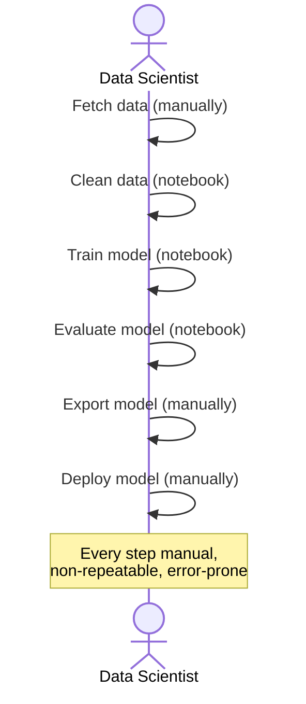
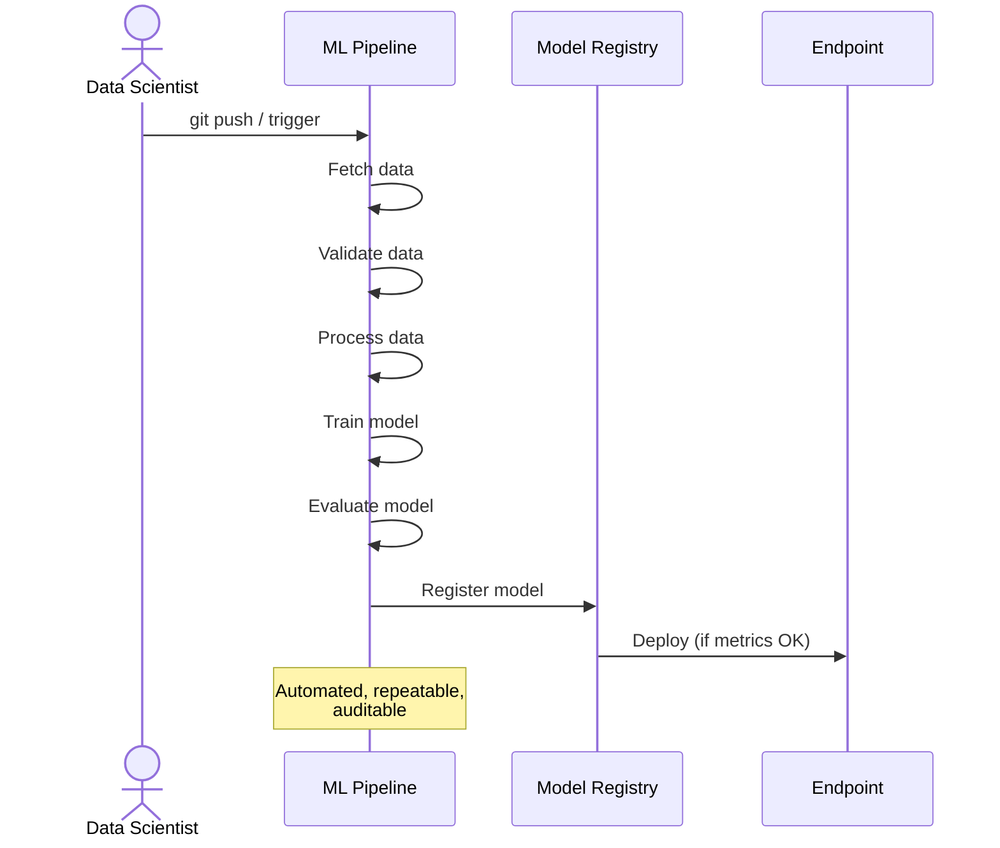
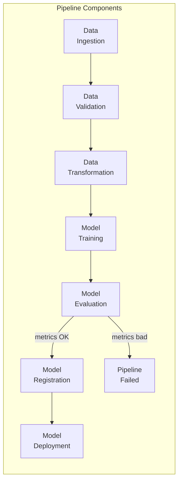
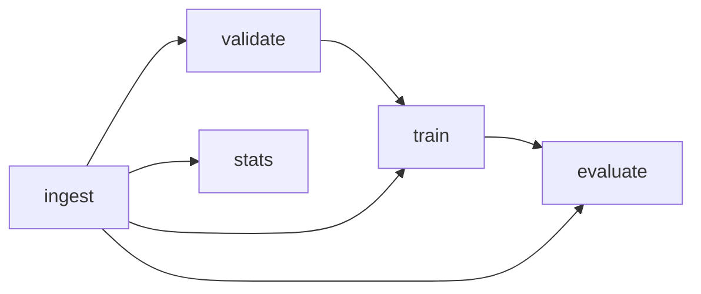
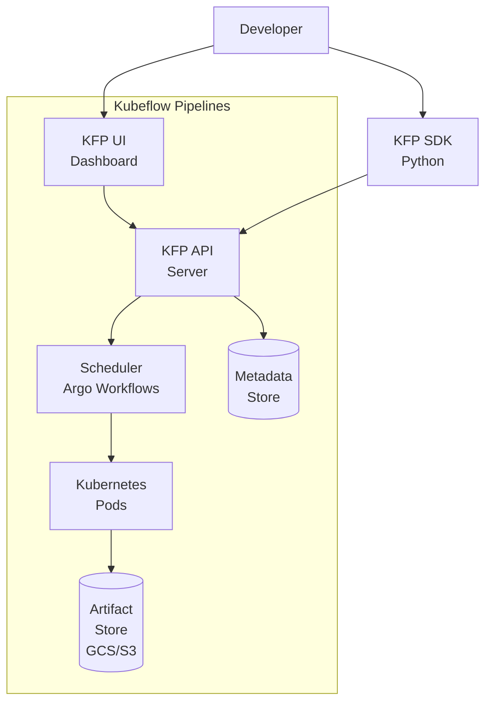
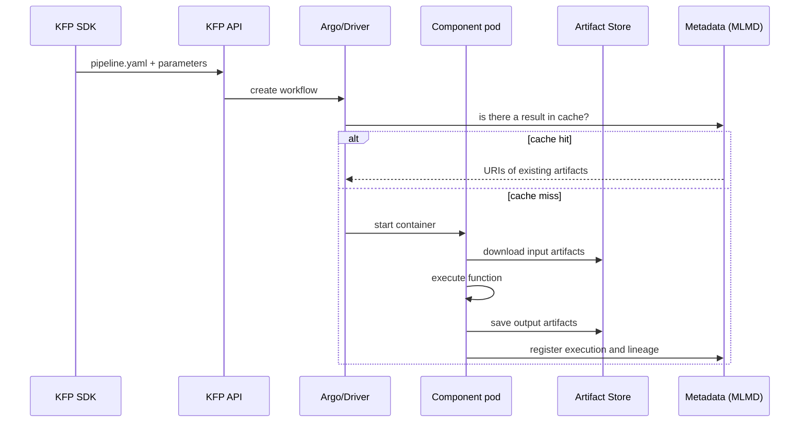
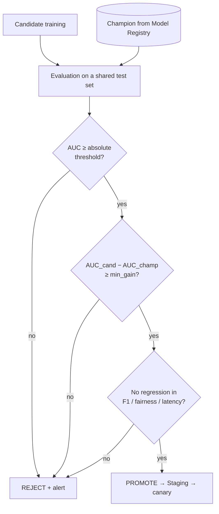
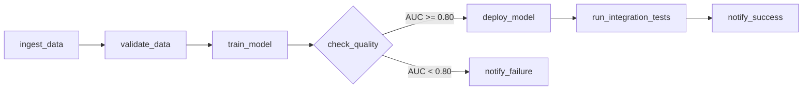
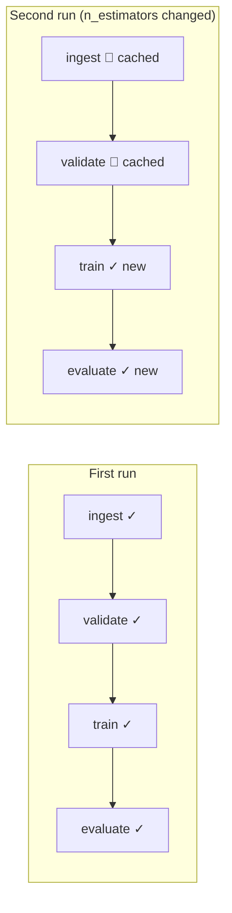
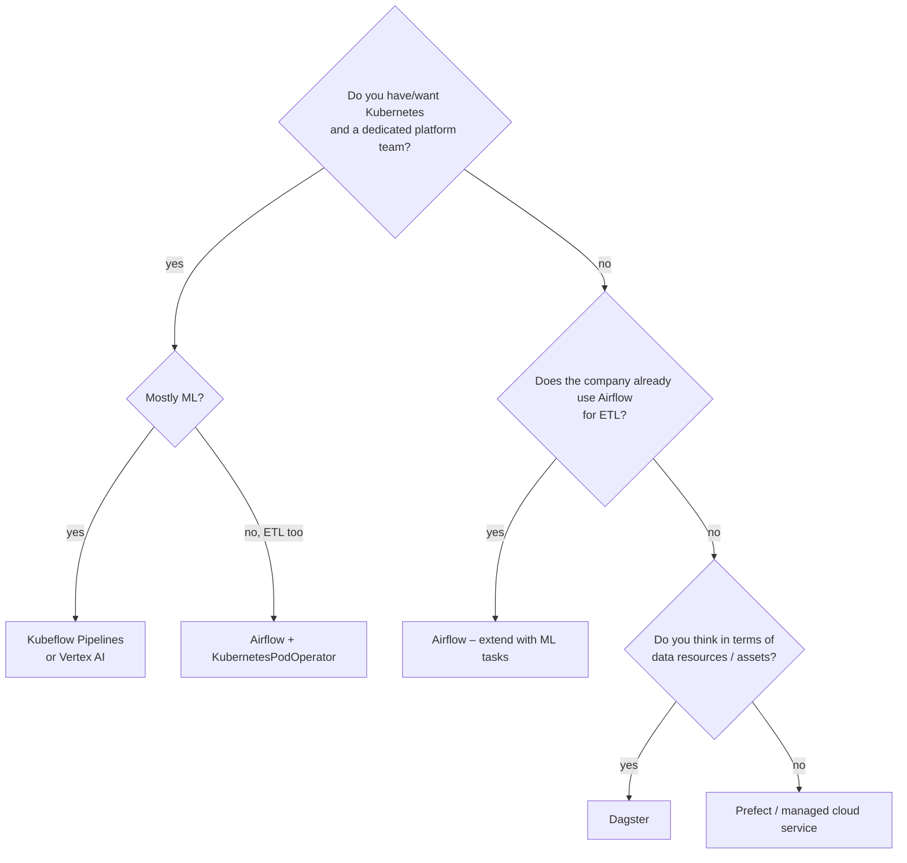

# Lecture 4: ML Pipelines – Workflow Automation

## Lecture goals
After this lecture, the student:
- understands what ML Pipelines are and why they are crucial in MLOps,
- knows the difference between a data pipeline and an ML pipeline,
- can build a pipeline using Kubeflow Pipelines (KFP),
- understands the concept of a DAG and task orchestration,
- knows the concepts: artifact, lineage, metadata store, caching, quality gate, backfill,
- can consciously choose an orchestrator and avoid typical pitfalls.

> 💻 **Demo scripts** for this lecture are located in ``:
>
> | Script | Section | What it shows |
> |--------|--------|-------------|
> | `01_mini_orchestrator.py` | 2a | A custom mini-orchestrator: DAG, topological sorting, retry, caching |
> | `02_quality_gate_pipeline.py` | 6a | A local pipeline with artifacts, lineage (`metadata.jsonl`) and a champion/challenger gate |
> | `03_kfp_compile.py` | 4–6 | Compiling a KFP v2 pipeline to YAML without a cluster and analyzing the generated DAG |
>
> Results are saved in ``.

---

## 1. What is an ML Pipeline?

An **ML Pipeline** is an automated, repeatable workflow that connects all stages of an ML model's lifecycle — from data to deployment.

### Without a pipeline (manual process)



### With an ML Pipeline



### Three kinds of pipelines in an ML system

In practice, an "ML pipeline" is not a single flow, but at least three interconnected ones:

```
┌──────────────────┐ features   ┌────────────────────┐   model    ┌────────────────────┐
│  DATA / FEATURE  │──────────▶│ TRAINING PIPELINE  │──────────▶│ INFERENCE PIPELINE │
│    PIPELINE      │ (Feature  │ (validation, train-│ (Model     │ (batch scoring or  │
│ ETL, aggregation,│  Store)   │  ing, evaluation,  │  Registry) │  online serving)   │
│ data validation  │           │  registry, gate)   │            │                    │
└──────────────────┘           └────────────────────┘            └─────────┬──────────┘
         ▲                                                                  │ prediction logs,
         └──────────────────── monitoring / retraining trigger ◀────────────┘ drift
```

| Aspect | Data pipeline | Training pipeline | Inference pipeline |
|--------|-----------------|---------------------|---------------------|
| Input | Raw data (DB, logs, API) | Features + labels | Features of new observations |
| Output | Feature tables, datasets | Model + metrics + model card | Predictions |
| Frequency | Hourly / daily / streaming | Daily / weekly / on trigger | Continuous or batch |
| Main risk | Bad/incomplete data | Quality regression, leakage | Training–serving skew, latency |
| Typical tools | Airflow, dbt, Spark | KFP, Vertex AI, SageMaker, MLflow | FastAPI, KServe, Spark batch |

> 💡 **Training–serving skew** – if preprocessing is implemented twice (in the training pipeline in pandas and in the service in Java), sooner or later the two will diverge. Good practice: a single transformation code (e.g., an `sklearn.Pipeline` saved together with the model, a Feature Store) used in both places.

### Automation maturity levels (according to Google MLOps)

| Level | Description | What is automated |
|--------|------|-------------------------|
| **0 – manual process** | Notebooks, manual handover of the model to IT | Nothing |
| **1 – ML pipeline automation** | Training pipeline triggered automatically (schedule/trigger), continuous training | Training, validation, registration |
| **2 – CI/CD of pipelines** | Pipeline code is tested, built and deployed via CI/CD | Also building and deploying the pipeline itself |

The key mental shift when moving from level 0 to 1: **we deploy the pipeline, not the model**. The model is an artifact that the pipeline produces regularly.

---

## 2. Anatomy of an ML Pipeline



### Properties of a good pipeline

| Property | Description |
|-----------|------|
| **Idempotency** | Running it multiple times produces the same result |
| **Modularity** | Each step is an independent component |
| **Auditability** | Full history of runs and artifacts |
| **Scalability** | Ability to execute steps in parallel |
| **Fault tolerance** | Retry, checkpointing, rollback |
| **Reproducibility** | Versioned code, data, images and parameters make it possible to recreate any run |
| **Observability** | Logs, step time/cost metrics, alerts |

### Key concepts

| Concept | Definition | Example |
|---------|-----------|----------|
| **Component (step, task)** | A self-contained unit of work with explicitly defined inputs and outputs | `train_model(dataset) -> model, metrics` |
| **Artifact** | A file/object produced by a step, stored in an Artifact Store | `dataset.parquet`, `model.joblib` |
| **Parameter** | A small value (number, string) passed to a step | `n_estimators=200` |
| **Run** | A single execution of a pipeline with specific parameters | `run_id=a80e822b` |
| **Lineage** | Provenance graph: which data and code a given model was produced from | model v7 ← dataset hash `4710b7` ← code `git:3fa2c1` |
| **Metadata Store** | A database with information about runs, artifacts and their relationships | ML Metadata (MLMD) in KFP/TFX |
| **Quality gate** | A condition the model must satisfy to move on | AUC ≥ 0.85 and better than the champion |
| **Backfill** | Running the pipeline for historical time intervals | recomputing features for the last 90 days |

### Parameters vs artifacts – a common mistake

Orchestrators distinguish small **parameters** (stored in the metadata database, e.g., JSON) from large **artifacts** (files in S3/GCS). Passing a DataFrame through a parameter (e.g., XCom in Airflow) is an anti-pattern – the metadata database is not a data store. Pass the **path/URI** to the artifact, not the object itself.

```
Step A ──(parameter: "s3://bucket/run-42/dataset.parquet")──▶ Step B   ✅
Step A ──(XCom: 2 GB DataFrame serialized to JSON)─────────▶ Step B   ❌
```

---

## 2a. DAG and orchestration – how it works under the hood

A **DAG (Directed Acyclic Graph)** is a directed graph without cycles: vertices are steps, edges are dependencies ("B needs the result of A"). The absence of cycles guarantees that there exists an execution order in which each step starts only after its dependencies – the so-called **topological order**.



The orchestrator executes in a loop:
1. Determines the steps whose dependencies have all completed (in-degree = 0) → a **wave** of steps that can be run in parallel (`validate` and `stats` above).
2. For each step, computes a **cache key** = hash(code/image + parameters + inputs). If the result exists – skips execution.
3. Runs the step (process, container, K8s pod); on a transient error performs a **retry with exponential backoff**.
4. Saves artifacts and metadata, updates state, moves on to the next wave.

All of this is implemented in ~100 lines by the script `01_mini_orchestrator.py`:

```bash
python lectures/scripts/lecture_04/01_mini_orchestrator.py
```

```text
▶ Run 1 (n_estimators=50)
  wave 0: ['ingest']
    ⟳  ingest    error: data warehouse timeout – retry in 0.1s
    ⟳  ingest    error: data warehouse timeout – retry in 0.2s
    ✓  ingest    executed in 0.03s (attempt 3)
  wave 1: ['validate', 'stats']
  ...
▶ Run 2 (n_estimators=150) – ingest/validate/stats from cache
    💾 ingest    cache hit (7f0ddaefe6059093)
    💾 validate  cache hit (196ceaa092a8ef4b)
    ✓  train     executed in 0.35s (attempt 1)
▶ Attempt with a cycle (train → ingest)
  ❌ The graph contains a cycle – this is not a DAG!
```

### Retry – when it helps and when it hurts

| Error type | Example | Retry? |
|-----------|----------|--------|
| Transient | network timeout, temporary GPU unavailability, spot VM preemption | ✅ yes, with backoff |
| Deterministic | bug in code, wrong column, validation assert | ❌ no – retry only wastes resources |
| With a side effect | sending an e-mail, writing to a database without an idempotency key | ⚠️ only if the operation is idempotent |

### Idempotency in practice

```python
# ❌ Non-idempotent: every run appends data (duplicates after retry)
df.to_sql("features", engine, if_exists="append")

# ✅ Idempotent: the partition for the logical date is overwritten
out = f"s3://features/date={run_date}/part.parquet"
df.to_parquet(out)  # re-running for run_date yields the same state

# ❌ Dependency on "now" – the result depends on the moment of execution
start = datetime.now() - timedelta(days=30)

# ✅ Dependency on the run's logical date (pipeline parameter / {{ ds }} in Airflow)
start = run_date - timedelta(days=30)
```

---

## 3. Kubeflow Pipelines (KFP)

**Kubeflow Pipelines** is a platform for building and running ML Pipelines on Kubernetes.

### KFP architecture



### How KFP executes a component

Each component is a separate **container** run as a Kubernetes pod. The code of a Python function decorated with `@dsl.component` is serialized into a YAML specification and, when the pod starts, injected into the `base_image` image (that is why **imports must be inside the function**!). Artifacts are passed through the Artifact Store (S3/GCS/MinIO), not through memory.



### KFP v2 component types

| Type | Definition | When to use |
|-----|-----------|--------------|
| **Lightweight Python** | `@dsl.component(base_image=..., packages_to_install=[...])` | Prototypes, simple steps; packages installed at every start (slower) |
| **Containerized Python** | `@dsl.component(target_image=...)` + `kfp component build` | Production: dependencies baked into the image, fast start, repeatability |
| **Container component** | `@dsl.container_component` returning `dsl.ContainerSpec` | Any language/tool (e.g., Spark, a C++ binary) |
| **Importer** | `dsl.importer(artifact_uri=...)` | Bringing an existing artifact (e.g., a base model) into lineage |

> ⚠️ `packages_to_install` without pinned versions (`"pandas"`) breaks reproducibility – in half a year a different version will be installed. In production, pin versions or build your own image.

### Installing the KFP SDK

```bash
pip install "kfp>=2.9,<3.0"   # according to the course requirements.txt
```

> 📝 Compiling a pipeline to YAML **does not require a cluster** – the SDK is enough. This makes it possible to test the pipeline definition in CI (see `03_kfp_compile.py`).

---

## 4. Building KFP components

### A component as a Python function

```python
from kfp import dsl
from kfp.dsl import Dataset, Model, Metrics, Input, Output
import pandas as pd
import numpy as np

# --- Component 1: Data ingestion ---
@dsl.component(
    base_image="python:3.11-slim",
    packages_to_install=["pandas", "scikit-learn"]
)
def ingest_data(
    n_samples: int,
    output_dataset: Output[Dataset]
):
    """Fetches and saves training data."""
    from sklearn.datasets import make_classification
    import pandas as pd
    
    X, y = make_classification(
        n_samples=n_samples,
        n_features=20,
        n_informative=10,
        random_state=42
    )
    
    df = pd.DataFrame(X, columns=[f"feature_{i}" for i in range(20)])
    df['target'] = y
    
    df.to_parquet(output_dataset.path, index=False)
    print(f"Saved {len(df)} rows to {output_dataset.path}")


# --- Component 2: Data validation ---
@dsl.component(
    base_image="python:3.11-slim",
    packages_to_install=["pandas", "pyarrow"]
)
def validate_data(
    input_dataset: Input[Dataset],
    min_rows: int = 1000
) -> bool:
    """Validates input data."""
    import pandas as pd
    
    df = pd.read_parquet(input_dataset.path)
    
    # Checks
    assert len(df) >= min_rows, f"Too few rows: {len(df)} < {min_rows}"
    assert df.isnull().sum().sum() == 0, "Data contains null values"
    assert 'target' in df.columns, "Missing 'target' column"
    
    print(f"✅ Validation OK: {len(df)} rows, {df.shape[1]} columns")
    return True


# --- Component 3: Model training ---
@dsl.component(
    base_image="python:3.11-slim",
    packages_to_install=["pandas", "scikit-learn", "pyarrow", "joblib"]
)
def train_model(
    input_dataset: Input[Dataset],
    n_estimators: int,
    max_depth: int,
    output_model: Output[Model],
    output_metrics: Output[Metrics]
):
    """Trains the model and saves artifacts."""
    import pandas as pd
    import joblib
    from sklearn.ensemble import RandomForestClassifier
    from sklearn.model_selection import train_test_split
    from sklearn.metrics import roc_auc_score, f1_score, accuracy_score
    
    # Load data
    df = pd.read_parquet(input_dataset.path)
    X = df.drop('target', axis=1)
    y = df['target']
    
    X_train, X_test, y_train, y_test = train_test_split(
        X, y, test_size=0.2, random_state=42, stratify=y
    )
    
    # Training
    model = RandomForestClassifier(
        n_estimators=n_estimators,
        max_depth=max_depth,
        random_state=42,
        n_jobs=-1
    )
    model.fit(X_train, y_train)
    
    # Evaluation
    y_pred = model.predict(X_test)
    y_prob = model.predict_proba(X_test)[:, 1]
    
    auc = roc_auc_score(y_test, y_prob)
    f1 = f1_score(y_test, y_pred)
    acc = accuracy_score(y_test, y_pred)
    
    # Logging metrics to KFP
    output_metrics.log_metric("auc_roc", auc)
    output_metrics.log_metric("f1_score", f1)
    output_metrics.log_metric("accuracy", acc)
    output_metrics.log_metric("n_estimators", n_estimators)
    output_metrics.log_metric("max_depth", max_depth)
    
    # Saving the model
    joblib.dump(model, output_model.path)
    print(f"Model saved. AUC-ROC: {auc:.4f}")


# --- Component 4: Evaluation and deployment decision ---
@dsl.component(
    base_image="python:3.11-slim",
    packages_to_install=["pandas", "scikit-learn", "pyarrow", "joblib"]
)
def evaluate_and_decide(
    input_model: Input[Model],
    input_dataset: Input[Dataset],
    auc_threshold: float = 0.80
) -> str:
    """Evaluates the model and decides on deployment."""
    import pandas as pd
    import joblib
    from sklearn.metrics import roc_auc_score
    from sklearn.model_selection import train_test_split
    
    df = pd.read_parquet(input_dataset.path)
    X = df.drop('target', axis=1)
    y = df['target']
    # The same split as in train_model (including stratify!) – otherwise
    # the test set would differ from the training split and could
    # contain samples seen during training (data leakage).
    _, X_test, _, y_test = train_test_split(
        X, y, test_size=0.2, random_state=42, stratify=y
    )
    
    model = joblib.load(input_model.path)
    auc = roc_auc_score(y_test, model.predict_proba(X_test)[:, 1])
    
    decision = "deploy" if auc >= auc_threshold else "reject"
    print(f"AUC: {auc:.4f}, threshold: {auc_threshold}, decision: {decision}")
    return decision
```

> 💡 **A better pattern:** instead of repeating `train_test_split` in several components, extract a separate `split_data` component that produces two artifacts (`train_dataset`, `test_dataset`). Then the split is performed once, is visible in lineage, and there is no risk of the logic diverging.

### Good practices for designing components

- **Single responsibility** – a component does one thing (easier to cache and test).
- **Logic outside the decorator** – keep the actual code in a regular Python module (`src/train.py`), and treat the KFP component as a thin wrapper. Then unit tests do not require KFP (see section 9).
- **Explicit input/output types** – `Input[Dataset]`, `Output[Model]`, parameter types; the compiler detects mismatches before execution.
- **Determinism** – `random_state`, pinned library versions, no `datetime.now()` in the logic.
- **Granularity** – steps that are too fine-grained = pod start-up overhead (often 10–60 s per step); too coarse = no caching and difficult debugging.

---

## 5. Defining a Pipeline

```python
from kfp import dsl, compiler

@dsl.pipeline(
    name="churn-prediction-pipeline",
    description="Full ML pipeline for churn prediction"
)
def churn_pipeline(
    n_samples: int = 10000,
    n_estimators: int = 100,
    max_depth: int = 5,
    auc_threshold: float = 0.80
):
    """Defines the full ML pipeline."""
    
    # Step 1: Fetch data
    ingest_task = ingest_data(n_samples=n_samples)
    
    # Step 2: Validate data
    validate_task = validate_data(
        input_dataset=ingest_task.outputs["output_dataset"]
    )
    
    # Step 3: Train model (after validation)
    train_task = train_model(
        input_dataset=ingest_task.outputs["output_dataset"],
        n_estimators=n_estimators,
        max_depth=max_depth
    )
    train_task.after(validate_task)  # dependency
    
    # Step 4: Evaluate and decide
    evaluate_task = evaluate_and_decide(
        input_model=train_task.outputs["output_model"],
        input_dataset=ingest_task.outputs["output_dataset"],
        auc_threshold=auc_threshold
    )
    
    # Resource configuration
    train_task.set_cpu_request("2")
    train_task.set_memory_request("4Gi")
    train_task.set_cpu_limit("4")
    train_task.set_memory_limit("8Gi")

# Compiling the pipeline to YAML
compiler.Compiler().compile(
    pipeline_func=churn_pipeline,
    package_path="churn_pipeline.yaml"
)
print("Pipeline compiled to churn_pipeline.yaml")
```

### Running the pipeline

```python
import kfp

# Connecting to KFP (Vertex AI Pipelines or local KFP)
client = kfp.Client(host="https://your-kfp-endpoint")

# Running the pipeline
run = client.create_run_from_pipeline_func(
    churn_pipeline,
    arguments={
        "n_samples": 50000,
        "n_estimators": 200,
        "max_depth": 8,
        "auc_threshold": 0.82
    },
    run_name="churn-pipeline-run-20240115",
    experiment_name="churn-experiments"
)

print(f"Pipeline started: {run.run_id}")
# Note: get_run returns a run object – the status is the .state field (KFP v2)
print(f"Status: {client.get_run(run.run_id).state}")

# Optionally: wait for completion (e.g., in CI)
result = client.wait_for_run_completion(run.run_id, timeout=3600)
print(f"Final state: {result.state}")
```

### Schedule (recurring run)

```python
client.create_recurring_run(
    experiment_id=client.get_experiment(experiment_name="churn-experiments").experiment_id,
    job_name="churn-nightly",
    cron_expression="0 0 2 * * *",   # KFP uses a 6-field cron (with seconds)
    pipeline_package_path="churn_pipeline.yaml",
    params={"n_samples": 50000},
    max_concurrency=1,               # do not start a new one while the previous is running
)
```

### Local compilation and YAML inspection

The script `03_kfp_compile.py` compiles a pipeline with a `dsl.If/dsl.Else` condition, retry and resource limits, and then reads the generated IR YAML:

```bash
python lectures/scripts/lecture_04/03_kfp_compile.py
```

```text
Pipeline parameters:
  auc_threshold  NUMBER_DOUBLE default=0.8
  n_estimators   NUMBER_INTEGER default=100.0
  n_samples      NUMBER_INTEGER default=10000.0

Tasks in the DAG (with nested conditional groups):
  - condition-branches-1  deps=['train-model']
    - condition-2  deps=[]  if: inputs.parameter_values['pipelinechannel--train-model-Output'] >= ...
      - deploy-model  deps=[]
    - condition-3  deps=[]  if: !(inputs.parameter_values['pipelinechannel--train-model-Output'] >= ...)
      - send-notification  deps=[]
  - ingest-data  deps=[]
  - train-model  deps=['ingest-data']
```

You can see that `dsl.If/Else` compiles to conditional groups with a CEL expression, and dependencies (`dependentTasks`) follow **automatically** from the data flow – `.after()` is needed only for dependencies without passing an artifact (like `validate_task` → `train_task` in the example above).

---

## 6. Conditional execution of steps

```python
from kfp import dsl

@dsl.pipeline(name="conditional-pipeline")
def pipeline_with_conditions(auc_threshold: float = 0.80):
    
    # ... previous steps ...
    evaluate_task = evaluate_and_decide(...)
    
    # Conditional deployment
    with dsl.If(evaluate_task.output == "deploy", name="deploy-condition"):
        deploy_task = deploy_model(
            input_model=train_task.outputs["output_model"]
        )
        notify_task = send_notification(
            message="Model deployed successfully!"
        )
        notify_task.after(deploy_task)
    
    with dsl.Else(name="reject-condition"):
        alert_task = send_notification(
            message=f"Model rejected - AUC below threshold {auc_threshold}"
        )
```

> ⚠️ Beware of an f-string with a pipeline parameter: `auc_threshold` inside a `@dsl.pipeline` function is a **placeholder** (`PipelineParameterChannel`), not a number – the f-string will contain its textual representation, not the value. It is better to pass the threshold value as a separate component parameter and format the message inside the component.

### Other KFP v2 control constructs

| Construct | Use case |
|-------------|--------------|
| `dsl.If / dsl.Elif / dsl.Else` | Branching based on a step output or parameter |
| `dsl.ParallelFor(items, parallelism=4)` | Fan-out: e.g., training one model per region or a hyperparameter grid |
| `dsl.Collected(...)` | Fan-in: collecting results from `ParallelFor` (e.g., choosing the best model) |
| `dsl.ExitHandler(exit_task)` | A cleanup/notification step that always runs, also after a failure |
| `task.set_retry(num_retries, backoff_duration)` | Retry for steps prone to transient errors |
| `task.set_caching_options(False)` | Disabling cache for steps with side effects |

```python
@dsl.pipeline(name="per-region-training")
def per_region(regions: list = ["PL", "DE", "CZ"]):
    notify = send_notification(message="Pipeline finished")
    with dsl.ExitHandler(notify):
        with dsl.ParallelFor(regions, parallelism=2) as region:
            data = ingest_region(region=region)
            train_model(input_dataset=data.outputs["output_dataset"],
                        n_estimators=100, max_depth=5)
```

---

## 6a. Quality gate and champion/challenger

An absolute threshold alone (`AUC ≥ 0.80`) is not enough: a new model may pass the threshold and still be **worse than the current production model**. Mature pipelines compare the candidate (*challenger*) with the production model (*champion*) on **the same** test set.



Typical gate criteria:

| Criterion | Example | Why |
|-----------|----------|-------|
| Absolute threshold | AUC ≥ 0.85 | Minimum acceptable business quality |
| Relative improvement | ΔAUC ≥ +0.005 vs champion | Avoiding "model churn" without real gain |
| No regression in segments | F1 in every region ≥ champion F1 − 0.02 | A model better on average but worse for a customer group |
| Non-functional requirements | p95 latency < 50 ms, size < 500 MB | The model must be servable |
| Behavioral tests | invariance to a name change, price monotonicity | Sensibility of predictions |

The script `02_quality_gate_pipeline.py` implements the entire flow locally, recording lineage:

```bash
python lectures/scripts/lecture_04/02_quality_gate_pipeline.py
python lectures/scripts/lecture_04/02_quality_gate_pipeline.py --min-gain 0.02   # → REJECT
```

```text
  champion  (LogReg): {'auc': 0.9688, 'f1': 0.8621}
  candidate (GBM)   : {'auc': 0.9766, 'f1': 0.8935}
  🚦 decision: PROMOTE

Lineage (.../outputs/quality_gate/metadata.jsonl):
  ingest               {'output': 'dataset.parquet', 'output_hash': '4710b76cff', 'rows': 6000}
  validate             {'input_hash': '4710b76cff', 'checks': {...}}
  train_candidate      {'input_hash': '4710b76cff', 'output_hash': 'c4f7bc2dde'}
  evaluate_candidate   {'model_hash': 'c4f7bc2dde', 'metrics': {'auc': 0.9766, 'f1': 0.8935}}
  quality_gate         {'decision': 'promote', 'reasons': []}
```

Thanks to the hashes, we can answer an auditor's question: *"on exactly what data was the model that made this credit decision trained?"* – this is precisely **lineage**.

---

## 7. Apache Airflow for ML

**Apache Airflow** is an alternative orchestrator, popular in data engineering environments.

```python
from airflow import DAG
from airflow.operators.python import PythonOperator, BranchPythonOperator
from datetime import datetime, timedelta

# DAG definition
default_args = {
    'owner': 'mlops-team',
    'depends_on_past': False,
    'email_on_failure': True,
    'email': ['mlops@company.com'],
    'retries': 2,
    'retry_delay': timedelta(minutes=5),
}

with DAG(
    dag_id='ml_training_pipeline',
    default_args=default_args,
    description='ML model training pipeline',
    schedule='0 2 * * *',  # daily at 2:00 (in Airflow < 2.4: schedule_interval)
    start_date=datetime(2024, 1, 1),  # fixed date; days_ago() is deprecated
    catchup=False,
    tags=['ml', 'training', 'churn'],
) as dag:
    
    def ingest_data_fn(**context):
        """Fetches data from the Data Warehouse."""
        import pandas as pd
        # ... data fetching logic
        print(f"Fetched data for: {context['ds']}")
        return "data/train_2024-01-15.parquet"
    
    def validate_data_fn(**context):
        """Validates data."""
        ti = context['task_instance']
        data_path = ti.xcom_pull(task_ids='ingest_data')
        # ... validation logic
        print(f"Validating data: {data_path}")
    
    def train_model_fn(**context):
        """Trains the model."""
        # ... training logic
        auc = 0.87  # training result
        context['task_instance'].xcom_push(key='auc', value=auc)
        return auc
    
    def check_model_quality(**context):
        """Checks model quality and decides on deployment."""
        ti = context['task_instance']
        auc = ti.xcom_pull(task_ids='train_model', key='auc')
        
        if auc >= 0.80:
            return 'deploy_model'
        else:
            return 'notify_failure'
    
    # Task definitions
    ingest = PythonOperator(
        task_id='ingest_data',
        python_callable=ingest_data_fn,
    )
    
    validate = PythonOperator(
        task_id='validate_data',
        python_callable=validate_data_fn,
    )
    
    train = PythonOperator(
        task_id='train_model',
        python_callable=train_model_fn,
    )
    
    check_quality = BranchPythonOperator(
        task_id='check_model_quality',
        python_callable=check_model_quality,
    )
    
    deploy = PythonOperator(
        task_id='deploy_model',
        python_callable=lambda: print("Deploying model..."),
    )
    
    notify_failure = PythonOperator(
        task_id='notify_failure',
        python_callable=lambda: print("Model rejected!"),
    )
    
    # Dependencies between tasks
    ingest >> validate >> train >> check_quality >> [deploy, notify_failure]
```

> 📝 `BranchPythonOperator` returns the `task_id` of the branch to execute – both target tasks must exist in the DAG, and the skipped branch gets the `skipped` status.

### Logical date, catchup and backfill

In Airflow, each run has a **logical date** (`{{ ds }}`, `logical_date`) – the data interval it processes, not the moment it is started. A run for `2024-01-15` usually starts after that day has ended.

```
timeline:   |--- 01-13 ---|--- 01-14 ---|--- 01-15 ---|  now
runs:            run(ds=01-13)  run(ds=01-14)  run(ds=01-15)
catchup=True  → after enabling the DAG, Airflow will start all missed runs since start_date
catchup=False → only the most recent one
backfill      → airflow dags backfill -s 2023-10-01 -e 2023-12-31 ml_training_pipeline
```

Backfill works correctly **only for idempotent tasks** parameterized by the logical date (section 2a).

### Modern style: TaskFlow API

```python
from airflow.decorators import dag, task
from datetime import datetime

@dag(schedule="0 2 * * *", start_date=datetime(2024, 1, 1), catchup=False, tags=["ml"])
def ml_training_taskflow():

    @task(retries=3)
    def ingest(ds=None) -> str:
        return f"s3://ml-data/train/date={ds}/data.parquet"   # we return a URI, not the data!

    @task
    def train(path: str) -> float:
        print(f"Training on {path}")
        return 0.87

    @task.branch
    def gate(auc: float) -> str:
        return "deploy" if auc >= 0.80 else "notify_failure"

    @task
    def deploy(): print("deploy")

    @task
    def notify_failure(): print("alert")

    gate(train(ingest())) >> [deploy(), notify_failure()]

ml_training_taskflow()
```

TaskFlow automatically creates dependencies from the flow of values and passes them via XCom – hence the rule: only small values (URIs, metrics) go through XCom.

### Airflow DAG visualization



---

## 8. Vertex AI Pipelines

**Vertex AI Pipelines** is a managed Google Cloud service for running KFP pipelines.

```python
from google.cloud import aiplatform
from kfp import compiler

# Initializing Vertex AI
aiplatform.init(
    project="my-gcp-project",
    location="us-central1",
    staging_bucket="gs://my-bucket/staging"
)

# Compiling the pipeline
compiler.Compiler().compile(
    pipeline_func=churn_pipeline,
    package_path="churn_pipeline.yaml"
)

# Running on Vertex AI
job = aiplatform.PipelineJob(
    display_name="churn-pipeline-20240115",
    template_path="churn_pipeline.yaml",
    pipeline_root="gs://my-bucket/pipeline-runs",
    parameter_values={
        "n_samples": 100000,
        "n_estimators": 300,
        "max_depth": 10,
        "auc_threshold": 0.85
    },
    enable_caching=True  # caching of component results
)

job.submit()
print(f"Pipeline started: {job.resource_name}")
```

### Caching in pipelines



**Caching** saves time and costs — if a component's inputs have not changed, the result is fetched from the cache.

### Caching pitfalls

The cache key in KFP covers the component specification (code, image) and the input values – **but not the contents of external sources**. An `ingest_data(table="sales")` component reading from BigQuery will be cached even though the table got new rows!

| Situation | Problem | Solution |
|----------|---------|-------------|
| Reading from an external database/API | Stale data from cache | Pass a date/snapshot as a parameter or disable cache for the step |
| Step with a side effect (deploy, e-mail) | Step "skipped", the effect did not happen | `task.set_caching_options(False)` |
| Non-deterministic training | Cache hides the variance of results | Fix seeds; consciously disable cache in experiments |
| `packages_to_install` without versions | Same key, different libraries | Pin versions or use your own image |

### Comparison of managed cloud pipeline services

| Feature | Vertex AI Pipelines | SageMaker Pipelines | Azure ML Pipelines |
|-------|---------------------|---------------------|--------------------|
| Definition format | KFP v2 / TFX | SageMaker Python SDK | Azure ML SDK v2 / YAML |
| Serverless | Yes (you pay for steps) | Yes | Partially (compute clusters) |
| Cache | Yes | Yes (`CacheConfig`) | Yes (reuse) |
| Model Registry | Vertex Model Registry | SageMaker Model Registry | Azure ML Registry |
| Portability | High (KFP also runs on-prem) | Low (vendor lock-in) | Medium |

---

## 9. Testing pipelines

```python
import pytest
from unittest.mock import patch, MagicMock
import pandas as pd
import numpy as np

class TestPipelineComponents:
    """Unit tests of pipeline components."""
    
    def test_ingest_data_creates_correct_shape(self, tmp_path):
        """Test: the ingest_data component creates data of the correct shape."""
        output_path = tmp_path / "dataset.parquet"
        
        # Simulating Output[Dataset]
        mock_output = MagicMock()
        mock_output.path = str(output_path)
        
        # Calling the component function (without the KFP decorator)
        from lecture_04_components import ingest_data_fn
        ingest_data_fn(n_samples=1000, output_path=str(output_path))
        
        df = pd.read_parquet(output_path)
        assert len(df) == 1000
        assert 'target' in df.columns
        assert df.shape[1] == 21  # 20 features + target
    
    def test_validate_data_rejects_empty_dataset(self, tmp_path):
        """Test: validation rejects an empty dataset."""
        empty_df = pd.DataFrame()
        empty_path = tmp_path / "empty.parquet"
        empty_df.to_parquet(empty_path)
        
        with pytest.raises(AssertionError, match="Too few rows"):
            from lecture_04_components import validate_data_fn
            validate_data_fn(input_path=str(empty_path), min_rows=1000)
    
    def test_train_model_produces_valid_metrics(self, tmp_path):
        """Test: model training produces metrics in the expected range."""
        # Prepare test data
        from sklearn.datasets import make_classification
        X, y = make_classification(n_samples=500, random_state=42)
        df = pd.DataFrame(X, columns=[f"f{i}" for i in range(20)])
        df['target'] = y
        
        data_path = tmp_path / "data.parquet"
        model_path = tmp_path / "model.pkl"
        df.to_parquet(data_path)
        
        from lecture_04_components import train_model_fn
        metrics = train_model_fn(
            input_path=str(data_path),
            output_path=str(model_path),
            n_estimators=10,
            max_depth=3
        )
        
        assert 0.5 <= metrics['auc_roc'] <= 1.0
        assert 0.0 <= metrics['f1_score'] <= 1.0

# Running the tests
# pytest test_pipeline_components.py -v
```

> 📝 The tests above assume the "logic outside the decorator" pattern: the `lecture_04_components` module contains regular functions (`ingest_data_fn`, `validate_data_fn`, `train_model_fn`), and the KFP components merely call them.

### ML pipeline test pyramid

```
                 ▲  few, slow, expensive
                ╱ ╲      E2E: full run on staging (Vertex/KFP), small dataset
               ╱───╲
              ╱     ╲    Integration: pipeline compilation, local run
             ╱       ╲   (e.g., kfp.local / DockerRunner), artifact contracts
            ╱─────────╲
           ╱           ╲ Unit: transformation, validation, metric functions;
          ╱             ╲ data tests (schema, ranges) and model tests (quality threshold)
         ▔▔▔▔▔▔▔▔▔▔▔▔▔▔▔▔▔ many, fast, cheap
```

### Pipeline compilation test in CI

```python
# tests/test_pipeline_compiles.py
import yaml
from kfp import compiler
from pipelines.churn import churn_pipeline

def test_pipeline_compiles(tmp_path):
    path = tmp_path / "p.yaml"
    compiler.Compiler().compile(churn_pipeline, str(path))
    spec = yaml.safe_load(path.read_text())
    tasks = spec["root"]["dag"]["tasks"]
    assert "train-model" in tasks
    assert "ingest-data" in tasks["train-model"]["dependentTasks"]
```

Such a test catches input/output type errors and typos in artifact names in a second – instead of after 20 minutes on the cluster.

---

## 10. Typical pitfalls in building ML pipelines

> ⚠️ **Pitfall 1: Monolithic pipeline**
> One big script that does everything — from fetching data to deployment. Such a pipeline is hard to debug, test and modify. Solution: split the pipeline into small, independent components.

> ⚠️ **Pitfall 2: Lack of idempotency**
> A pipeline that produces different results on every run (e.g., due to the lack of a fixed seed or fetching data from an API without a cache). Each component should produce the same result for the same inputs.

> ⚠️ **Pitfall 3: Hardcoded paths and parameters**
> Data paths, hyperparameters and configurations written directly in the code. Use configuration files (params.yaml) and pipeline parameters.

> ⚠️ **Pitfall 4: No error handling**
> A pipeline without retries, timeouts and alerts. In production, data may be unavailable, an API may not respond, and training may hang. Always add error handling and notifications.

> ⚠️ **Pitfall 5: Passing large data through metadata**
> A DataFrame in XCom/a parameter clogs the orchestrator's database and slows down the UI. Pass artifact URIs.

> ⚠️ **Pitfall 6: Different preprocessing in training and serving**
> Training–serving skew – the model works great in evaluation and poorly in production. Save preprocessing together with the model (`sklearn.Pipeline`) or use a Feature Store.

> ⚠️ **Pitfall 7: Evaluation on a different split than assumed**
> Each component splits the data itself (`train_test_split`) with different arguments – the test set stops being disjoint from the training set. Split the data once, in a separate step.

> ⚠️ **Pitfall 8: No gate against the champion**
> Automatic retraining with only an absolute threshold may deploy a model worse than the current one. Compare with the production model (section 6a).

### Pipeline production-readiness checklist

- [ ] Each step has explicit inputs/outputs and is idempotent
- [ ] Library versions pinned / custom Docker image
- [ ] Parameters in configuration, not in code
- [ ] Data validation before training (schema, ranges, counts)
- [ ] Quality gate: absolute threshold + comparison with the champion
- [ ] Retry only for transient errors, timeouts for every step
- [ ] Alerts on failure (`ExitHandler`, `on_failure_callback`)
- [ ] Lineage: model → data → code commit
- [ ] Pipeline compilation test in CI

### Case Study: Uber — Michelangelo

**Uber** built the **Michelangelo** platform, which standardizes the entire cycle: feature management (Palette Feature Store), training, evaluation, deployment and prediction monitoring. Key lessons:
- The same feature code used offline (training, Spark) and online (serving) – eliminating training–serving skew.
- Pipelines are templates – the product team configures rather than programs the infrastructure.
- Every model in production has its provenance recorded (data, configuration, metrics), which enables comparisons and rollback.

### Case Study: Spotify — moving to Kubeflow

**Spotify** described its migration from its own scattered scripts to a platform based on **Kubeflow Pipelines** (internally "ML Home" / "Paved Road"). The result was a unified way of training and deploying models across many teams and a significant reduction of the time from experiment to production – thanks to ready-made, shared components instead of writing infrastructure from scratch each time.

### Case Study: Airbnb — Zipline ML Pipeline

**Airbnb** built the internal **Zipline** platform for managing ML pipelines:
- It supports over 100 ML models in production (dynamic pricing, fraud detection, search result ranking).
- Key innovation: **automatic backfilling** — when you add a new feature, Zipline automatically computes it for historical data.
- Pipelines are defined declaratively (YAML), which facilitates auditing and reproducibility.
- It guarantees offline/online feature consistency and **point-in-time correctness** – a feature for a training example is computed solely from data available at the moment of the event, which prevents leakage of data from the future.

> 📝 Zipline is in essence a **feature pipeline** framework (part of Airbnb's *Bighead* ML platform), not a general orchestrator – it illustrates well that the data/feature pipeline is just as important as the training pipeline.

### Comparison of ML orchestrators

| Feature | Kubeflow Pipelines | Apache Airflow | Prefect | Dagster |
|-------|-------------------|----------------|---------|---------|
| Specialization | ML-first | General ETL | General | Data-first |
| Infrastructure | Kubernetes | Any | Any | Any |
| UI | Good (ML-focused) | Good | Very good | Very good |
| Learning curve | Steep | Medium | Gentle | Gentle |
| Caching | Built-in | None | Built-in | Built-in |
| Best for | Large ML teams, K8s | Existing DE teams | Small/medium teams | Data-centric projects |

> 📝 Note on the "Caching" row: Airflow does not have task result caching like KFP – "skipping" tasks is achieved manually (sensors, checking partition existence, `ShortCircuitOperator`).

### How to choose? Decision tree



### The same step in different orchestrators

```python
# Prefect
from prefect import flow, task

@task(retries=3, cache_key_fn=lambda ctx, p: str(p))
def train(n_estimators: int) -> float: ...

@flow
def ml_flow(): train(100)

# Dagster – thinking in terms of "assets" (tables/models), not tasks
from dagster import asset

@asset
def training_data(): ...

@asset
def churn_model(training_data): ...   # the dependency follows from the argument name
```

---

## Review and discussion questions

1. How does an ML Pipeline differ from a regular Python script that performs the same steps?
2. Explain the concept of a DAG (Directed Acyclic Graph) in the context of pipelines.
3. Why is idempotency an important property of pipeline components?
4. How does caching work in KFP and when is it worth disabling?
5. Compare Kubeflow Pipelines and Apache Airflow — when would you use each of them?
6. How do you test pipeline components? Give an example of a unit test.
7. **Discussion:** Is it worth building your own pipeline from scratch, or is it better to use a ready-made orchestrator? What are the trade-offs?
8. Why should large data not be passed through XCom/parameters? What should be passed instead?
9. What is a champion/challenger gate and why is an absolute threshold alone not enough?
10. When is retry harmful? Give an example.


### Suggested answers

1. An ML Pipeline is declarative, split into components, versionable and orchestrated (with retry, cache, scheduling), whereas a script is usually a sequence of steps without strong execution management. A pipeline scales better and is easier to maintain.
2. A DAG is a graph of dependencies between tasks without cycles, which determines the order in which components are run. Thanks to it, the orchestrator knows what can be run in parallel and what the data dependencies are.
3. Idempotency guarantees that the same input yields the same result when re-run. This is crucial for reliability, debugging, retry and auditing.
4. KFP caches a component's result for the same code and parameters, so a re-run can skip the step and save time/cost. We disable the cache e.g. in integration tests, for steps with side effects, or when we deliberately want to force a fresh recomputation.
5. I choose KFP for Kubernetes environments and ML-first pipelines; Airflow for mature data engineering teams and general ETL workflows. KFP has stronger native support for ML artifacts, Airflow has a huge ecosystem of operators.
6. We test components like regular functions: input/output, error validation, metric ranges. Example: a test checks that training saves the model and returns AUC/F1 within valid ranges.
7. It is usually better to start with a ready-made orchestrator, because it shortens time and reduces operational risk. A custom solution gives full control, but increases maintenance costs, the risk of bugs and technical debt.
8. The orchestrator's metadata database is not a data store – large objects slow down the system, have size limits and are not versioned like artifacts. We pass the artifact URI in the Artifact Store (S3/GCS).
9. The candidate is compared with the production model on the same test set; we promote it only if there is a real improvement and no regression. A threshold alone may deploy a model that meets it but is worse than the current one.
10. For deterministic errors (a bug, failed validation), retry only wastes resources and delays the alert; for non-idempotent side effects (e.g., `append` to a database), retry creates duplicates.


---

## Summary

- An **ML Pipeline** automates and standardizes the entire ML workflow.
- **KFP** (Kubeflow Pipelines) is the standard for ML pipelines on Kubernetes.
- Each pipeline component should be **independent, testable and idempotent**.
- **Caching** of components saves time and costs on re-runs.
- **Conditional execution** enables automatic deployment decisions.
- Test pipeline components like regular Python code.
- The choice of orchestrator depends on context: KFP for Kubernetes, Airflow for existing DE teams, Prefect/Dagster for smaller teams.
- An orchestrator is in essence: DAG + topological sorting + cache + retry + metadata (`01_mini_orchestrator.py`).
- A mature pipeline ends with a **champion/challenger quality gate** and records **lineage** (`02_quality_gate_pipeline.py`).
- A KFP pipeline definition can be compiled and tested locally in CI (`03_kfp_compile.py`).

## Literature and resources

- [Kubeflow Pipelines Documentation](https://www.kubeflow.org/docs/components/pipelines/)
- [Vertex AI Pipelines](https://cloud.google.com/vertex-ai/docs/pipelines/introduction)
- [Apache Airflow Documentation](https://airflow.apache.org/docs/)
- [KFP SDK v2 Migration Guide](https://www.kubeflow.org/docs/components/pipelines/v2/migration/)
- [Prefect Documentation](https://docs.prefect.io/)
- [Dagster Documentation](https://docs.dagster.io/)
- [Airbnb Zipline – ML Feature Pipeline](https://medium.com/airbnb-engineering)
- [Google Cloud – MLOps: Continuous delivery and automation pipelines in ML](https://cloud.google.com/architecture/mlops-continuous-delivery-and-automation-pipelines-in-machine-learning)
- [Uber Engineering – Meet Michelangelo](https://www.uber.com/blog/michelangelo-machine-learning-platform/)
- [Airflow – TaskFlow API](https://airflow.apache.org/docs/apache-airflow/stable/tutorial/taskflow.html)
