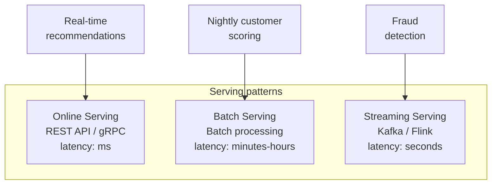
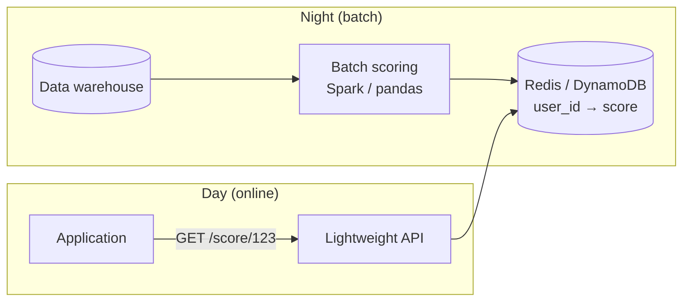
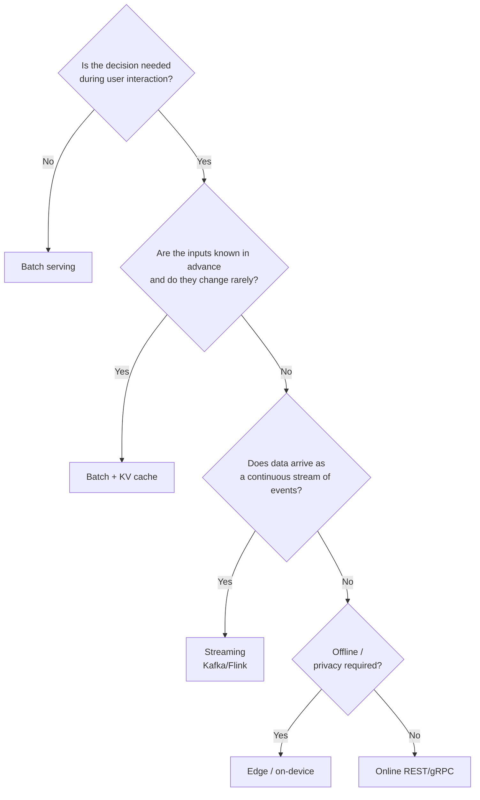
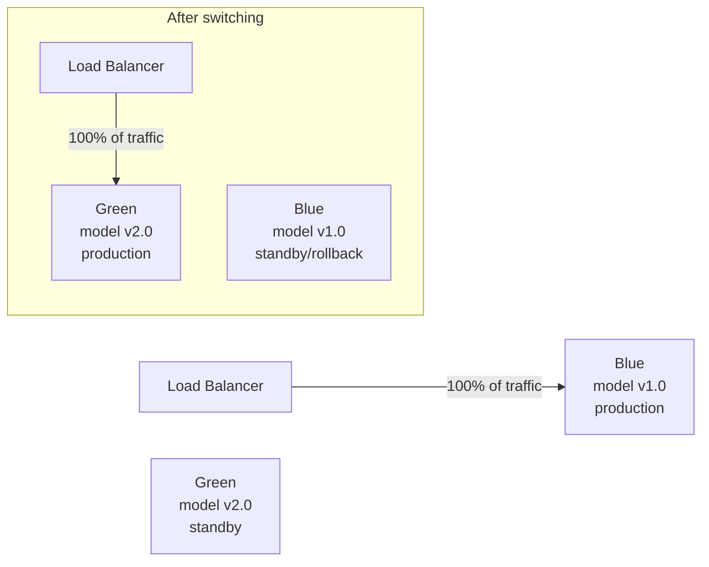
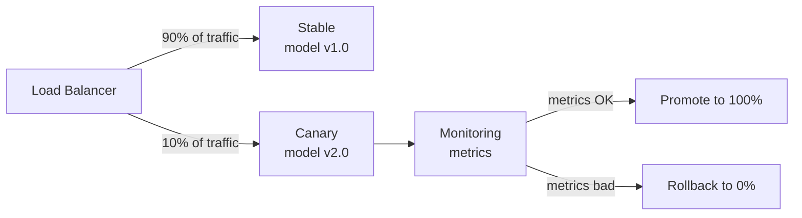
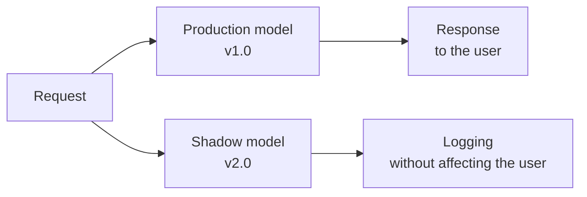
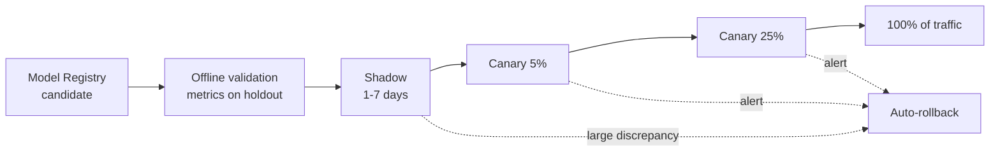
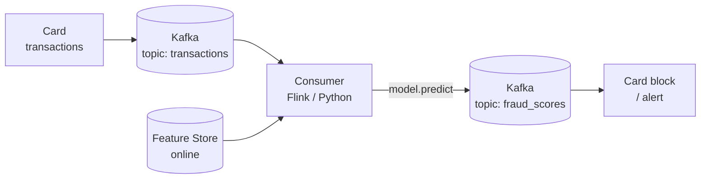
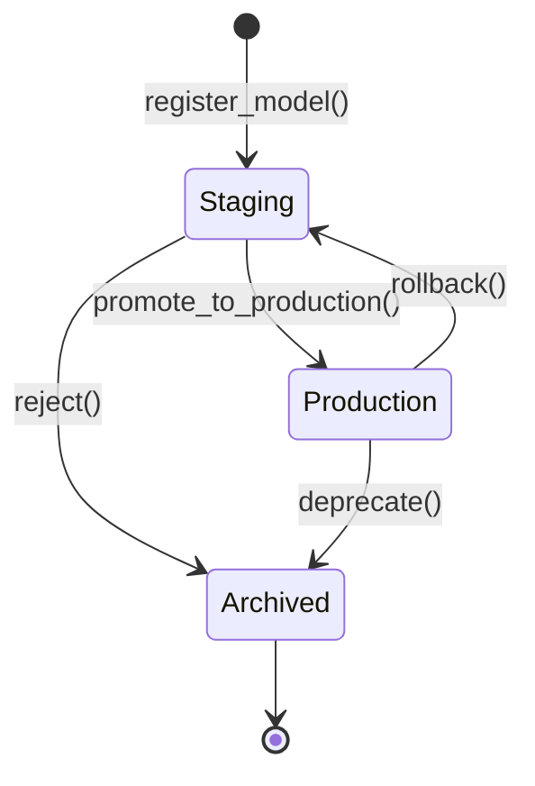
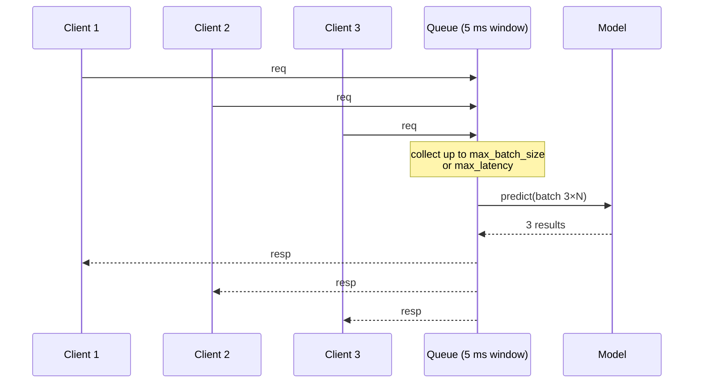

# Lecture 5: Deploying and Serving ML Models

## Lecture objectives
After this lecture, the student:
- knows ML model deployment patterns (online, batch, streaming),
- can build a REST API for an ML model using FastAPI,
- understands deployment strategies (canary, blue-green, shadow),
- knows model serving tools (BentoML, Seldon, Triton),
- understands the latency vs throughput trade-off, p95/p99 percentiles and micro-batching,
- can design idempotent batch scoring and a safe rollout with automatic rollback.

> 💻 **Lecture scripts** (directory ``, run from the repo root directory):
>
> | Script | Section | What it shows |
> |--------|--------|-------------|
> | `01_fastapi_service.py` | 2 | FastAPI service (Pydantic v2, lifespan, `/health` vs `/ready`, `/v1/...`) tested via `TestClient` – without starting a server |
> | `02_latency_batching.py` | 9 | Measuring p50/p95/p99 and throughput for different batch sizes + plot |
> | `03_deployment_strategies.py` | 4 | Shadow and canary simulation (sticky routing, auto-rollback on a feature bug) |
> | `04_batch_scoring.py` | 6 | Batch scoring in chunks into Parquet partitions, idempotency, metadata |

---

## 0. From notebook to production – what does "deploying a model" actually mean?

A trained model is only an **artifact** (a `.pkl` file, `.onnx`, a SavedModel directory). "Deployment" means wrapping it in a **system** that:

1. accepts input data in an agreed **contract** (schema, types, units),
2. performs **exactly the same** preprocessing as during training,
3. returns the prediction within the required **SLA** (latency, availability),
4. is **observable** (logs, metrics, traces), **versioned** and **reversible** (rollback).

```
  ┌──────────┐   ┌──────────────┐   ┌───────────────┐   ┌──────────┐   ┌──────────────┐
  │ Client   │──▶│ Validation   │──▶│ Feature       │──▶│ Model    │──▶│ Post-        │──▶ response
  │ (HTTP)   │   │ (Pydantic)   │   │ pipeline      │   │ .predict │   │ processing   │
  └──────────┘   └──────────────┘   │ (same as in   │   └──────────┘   │ (threshold,  │
                                    │  training!)   │        │         │  rank)       │
                                    └───────────────┘        ▼         └──────────────┘
                                                   prediction logs ──▶ monitoring (lecture 6)
```

> 💡 It is estimated that in a typical ML system the model code itself is only a small fraction of the whole (Sculley et al., *Hidden Technical Debt in ML Systems*, 2015) – the rest is the "surrounding infrastructure" that this lecture is about.

### Key concepts

| Concept | Meaning |
|---------|-----------|
| **Latency** | Time from sending a request to receiving the response; we measure percentiles (p50, p95, p99) |
| **Throughput** | Number of predictions per second (RPS/QPS) |
| **SLA / SLO** | Service level agreement / objective, e.g. "p99 < 100 ms, 99.9% availability" |
| **Cold start** | The first requests after startup are slow (model loading, JIT, empty cache) |
| **Training-serving skew** | Difference between data processing in training and in serving |
| **Rollout / rollback** | Introducing a new version / quickly reverting to the previous one |

---

## 1. Model serving patterns



### Pattern comparison

| Pattern | Latency | Throughput | Cost | Example |
|---------|----------|------------|-------|---------|
| Online (REST) | < 100ms | Medium | High | Recommendations, chatbot |
| Batch | Minutes–hours | Very high | Low | Customer scoring |
| Streaming | Seconds | High | Medium | Fraud detection |

### A fourth pattern: on-device prediction (edge / embedded)

A model can also run **inside the client application** (phone, browser, microcontroller) – e.g. TensorFlow Lite, ONNX Runtime Mobile, Core ML. Advantages: zero network latency, privacy, offline operation. Disadvantages: limited compute and memory (quantization, pruning), difficult model updates (requires an app release), no central prediction logging.

### Online vs. precomputed (batch → cache)

A common compromise: predictions are computed **in batch** and stored in a fast key-value store (Redis, DynamoDB), and the API only **reads** them.



| Criterion | Online inference | Precomputed (batch + cache) |
|-----------|------------------|-----------------------------|
| Feature freshness | Current (seconds) | Stale (up to 24 h) |
| Read latency | Depends on the model (ms–s) | ~1 ms (lookup) |
| New users | Handled | No result (cold start → fallback) |
| Cost | Permanent 24/7 infrastructure | Short job + cheap KV store |
| Complexity | Higher (SLA, autoscaling) | Lower |

### Decision tree for choosing a pattern



> 🏦 **Real-world example:** a bank computes customers' *credit scoring* at night (batch), but *fraud detection* during a card transaction must run in < 100 ms (online/streaming) – all patterns often coexist within the same organization.

---

## 2. REST API with FastAPI

**FastAPI** is a modern Python framework for building APIs, ideal for serving ML models.

### Basic prediction service

```python
from fastapi import FastAPI, HTTPException, BackgroundTasks
from pydantic import BaseModel, Field, field_validator
from typing import Optional
import joblib
import numpy as np
import time
import logging
from contextlib import asynccontextmanager

# Logging configuration
logging.basicConfig(level=logging.INFO)
logger = logging.getLogger(__name__)

# --- Data models (Pydantic) ---
class PredictionRequest(BaseModel):
    """Prediction request schema."""
    user_id: int = Field(..., description="User ID", gt=0)
    age: float = Field(..., description="User age", ge=0, le=120)
    income: float = Field(..., description="Monthly income", ge=0)
    tenure_months: int = Field(..., description="Customer tenure in months", ge=0)
    num_products: int = Field(..., description="Number of products", ge=1, le=10)
    
    @field_validator('income')  # Pydantic v2 (in v1: @validator)
    @classmethod
    def income_must_be_reasonable(cls, v):
        if v > 1_000_000:
            raise ValueError("Income seems too high")
        return v

class PredictionResponse(BaseModel):
    """Prediction response schema."""
    user_id: int
    churn_probability: float = Field(..., ge=0, le=1)
    churn_prediction: bool
    risk_level: str  # low / medium / high
    model_version: str
    prediction_time_ms: float

class HealthResponse(BaseModel):
    status: str
    model_loaded: bool
    model_version: str
    uptime_seconds: float

# --- Application lifecycle management ---
model = None
model_version = "unknown"
start_time = time.time()

@asynccontextmanager
async def lifespan(app: FastAPI):
    """Loads the model at startup, releases resources at shutdown."""
    global model, model_version
    
    logger.info("Loading model...")
    try:
        model = joblib.load("models/churn_model.pkl")
        model_version = "v2.1.0"
        logger.info(f"Model loaded: {model_version}")
    except FileNotFoundError:
        logger.warning("Model file not found - using demo model")
        from sklearn.ensemble import RandomForestClassifier
        from sklearn.datasets import make_classification
        # n_features=5 – that's how many features we build in /predict (otherwise predict_proba will raise an error!)
        X, y = make_classification(n_samples=1000, n_features=5, random_state=42)
        model = RandomForestClassifier(random_state=42).fit(X, y)
        model_version = "demo-v1.0"
    
    yield  # the application is running
    
    logger.info("Shutting down application...")

# --- FastAPI application ---
app = FastAPI(
    title="Churn Prediction API",
    description="API for customer churn prediction",
    version="1.0.0",
    lifespan=lifespan
)

def get_risk_level(probability: float) -> str:
    """Classifies churn risk."""
    if probability < 0.3:
        return "low"
    elif probability < 0.7:
        return "medium"
    else:
        return "high"

def log_prediction(request: PredictionRequest, response: PredictionResponse):
    """Logs the prediction to the monitoring system."""
    logger.info(
        f"prediction | user_id={request.user_id} | "
        f"prob={response.churn_probability:.4f} | "
        f"risk={response.risk_level} | "
        f"time_ms={response.prediction_time_ms:.2f}"
    )

# --- Endpoints ---
@app.get("/health", response_model=HealthResponse)
async def health_check():
    """Checks the service status."""
    return HealthResponse(
        status="healthy" if model is not None else "degraded",
        model_loaded=model is not None,
        model_version=model_version,
        uptime_seconds=time.time() - start_time
    )

@app.post("/predict", response_model=PredictionResponse)
async def predict(
    request: PredictionRequest,
    background_tasks: BackgroundTasks
):
    """Returns a churn prediction for the user."""
    if model is None:
        raise HTTPException(status_code=503, detail="Model is not loaded")
    
    t0 = time.time()
    
    # Feature preparation
    features = np.array([[
        request.age,
        request.income,
        request.tenure_months,
        request.num_products,
        request.income / max(request.age, 1),  # income_per_age
    ]])
    
    # Prediction
    try:
        probability = float(model.predict_proba(features)[0][1])
        prediction = probability >= 0.5
    except Exception as e:
        logger.error(f"Prediction error: {e}")
        raise HTTPException(status_code=500, detail=f"Prediction error: {str(e)}")
    
    prediction_time = (time.time() - t0) * 1000
    
    response = PredictionResponse(
        user_id=request.user_id,
        churn_probability=probability,
        churn_prediction=prediction,
        risk_level=get_risk_level(probability),
        model_version=model_version,
        prediction_time_ms=prediction_time
    )
    
    # Logging in the background (does not block the response)
    background_tasks.add_task(log_prediction, request, response)
    
    return response

@app.post("/predict/batch", response_model=list[PredictionResponse])
async def predict_batch(requests: list[PredictionRequest]):
    """Prediction for multiple users at once."""
    if model is None:
        raise HTTPException(status_code=503, detail="Model is not loaded")
    if not requests or len(requests) > 1000:
        raise HTTPException(
            status_code=400,
            detail="Maximum 1000 records per request"
        )
    
    features = np.array([[
        r.age, r.income, r.tenure_months,
        r.num_products, r.income / max(r.age, 1)
    ] for r in requests])
    
    t0 = time.time()
    probabilities = model.predict_proba(features)[:, 1]
    prediction_time = (time.time() - t0) * 1000 / len(requests)
    
    return [
        PredictionResponse(
            user_id=req.user_id,
            churn_probability=float(prob),
            churn_prediction=bool(prob >= 0.5),
            risk_level=get_risk_level(float(prob)),
            model_version=model_version,
            prediction_time_ms=prediction_time
        )
        for req, prob in zip(requests, probabilities)
    ]
```

### Running and testing

```bash
# Start the service
uvicorn main:app --host 0.0.0.0 --port 8080 --workers 4

# Health check test
curl http://localhost:8080/health

# Prediction test
curl -X POST http://localhost:8080/predict \
  -H "Content-Type: application/json" \
  -d '{
    "user_id": 1001,
    "age": 35,
    "income": 55000,
    "tenure_months": 24,
    "num_products": 2
  }'

# Interactive documentation (Swagger UI) generated automatically
# http://localhost:8080/docs
```

> 💻 **Demo:** `python lectures/scripts/lecture_05/01_fastapi_service.py` – runs an analogous service *in-process* via `fastapi.testclient.TestClient`, sends valid and invalid requests (HTTP 422 with field descriptions) and an empty batch (HTTP 400). It does not leave a running server behind.

### Testing the API without a server (pytest)

```python
# tests/test_api.py
from fastapi.testclient import TestClient
from src.main import app

def test_predict_ok():
    with TestClient(app) as client:          # `with` runs the lifespan (model loading)
        r = client.post("/predict", json={"user_id": 1, "age": 30, "income": 5000,
                                          "tenure_months": 12, "num_products": 2})
        assert r.status_code == 200
        assert 0 <= r.json()["churn_probability"] <= 1

def test_predict_invalid_age():
    with TestClient(app) as client:
        r = client.post("/predict", json={"user_id": 1, "age": -3, "income": 5000,
                                          "tenure_months": 12, "num_products": 2})
        assert r.status_code == 422             # Pydantic validation
```

### `async def` or `def`? – the concurrency model

This is one of the most common pitfalls in FastAPI. scikit-learn's `model.predict()` is **synchronous and CPU-bound**.

| Endpoint definition | Where it runs | Effect on CPU prediction |
|---------------------|--------------------|--------------------------|
| `async def` + `model.predict()` | In the event loop | **Blocks** all other requests in this worker for the duration of the prediction |
| `def` + `model.predict()` | In the threadpool | Event loop free; GIL limitation, but I/O of other requests continues |
| `async def` + `await run_in_threadpool(...)` | Explicitly in the threadpool | As above, while keeping async for I/O (e.g. Feature Store) |
| Several processes (`--workers N`) | N independent processes | True CPU parallelism, but N copies of the model in RAM |

```python
from starlette.concurrency import run_in_threadpool

@app.post("/v2/predict")
async def predict_v2(req: PredictionRequest):
    features = await feature_store.get(req.user_id)          # I/O – async
    proba = await run_in_threadpool(model.predict_proba, features)  # CPU – outside the event loop
    return {"churn_probability": float(proba[0, 1])}
```

> 💡 **Rule of thumb:** number of workers ≈ number of CPU cores (for CPU-bound models). Each worker loads its own copy of the model – a 2 GB model × 8 workers = 16 GB RAM. For large models it is better to use fewer workers + batching, or a dedicated inference server (Triton).

### Liveness vs. readiness

In Kubernetes (lecture 7) we distinguish two kinds of probes:

| Probe | Question | Reaction on failure | Example endpoint |
|-------|---------|----------------------|--------------------|
| **Liveness** | Is the process alive? | Container restart | `/health` – always 200 if the process responds |
| **Readiness** | Can I accept traffic? | Removal from the load balancer (no restart) | `/ready` – 503 until the model is loaded |
| **Startup** | Has startup finished? | Suspends liveness during a long startup | Useful for models that take minutes to load |

Confusing these probes is a classic mistake: if liveness checks the model and loading takes 90 s, Kubernetes kills the container in a loop (*CrashLoopBackOff*).

### API contract and versioning

```
/v1/predict  ──▶ {"churn_probability": 0.42}                         (old client – keeps working)
/v2/predict  ──▶ {"churn_probability": 0.42, "explanation": {...}}    (new field – new version)
```

- **Backward-compatible changes** (adding an optional field to the response) – allowed within the same version.
- **Breaking changes** (removing a field / changing its type, changing the meaning of the threshold) – new API version.
- **API** version ≠ **model** version: `/v1/predict` can serve model v2.1.0, as long as the contract does not change. Return `model_version` in the response – it makes debugging and A/B analysis easier.

---

## 3. Containerization with Docker

```dockerfile
# Dockerfile
FROM python:3.11-slim

WORKDIR /app

# Install dependencies (cache layer)
COPY requirements.txt .
RUN pip install --no-cache-dir -r requirements.txt

# Copy application code
COPY src/ ./src/
COPY models/ ./models/

# Non-root user (security)
RUN useradd -m -u 1000 mluser
USER mluser

EXPOSE 8080

# Health check
# NOTE: the python:3.11-slim image does NOT include curl – we use Python (or install curl)
HEALTHCHECK --interval=30s --timeout=10s --start-period=5s --retries=3 \
    CMD python -c "import urllib.request; urllib.request.urlopen('http://localhost:8080/health')" || exit 1

CMD ["uvicorn", "src.main:app", "--host", "0.0.0.0", "--port", "8080", "--workers", "2"]
```

```yaml
# docker-compose.yml
version: '3.8'

services:
  ml-api:
    build: .
    ports:
      - "8080:8080"
    environment:
      - MODEL_PATH=/app/models/churn_model.pkl
      - LOG_LEVEL=INFO
    volumes:
      - ./models:/app/models:ro
    deploy:
      resources:
        limits:
          cpus: '2'
          memory: 4G
    restart: unless-stopped
    
  prometheus:
    image: prom/prometheus:latest
    ports:
      - "9090:9090"
    volumes:
      - ./prometheus.yml:/etc/prometheus/prometheus.yml
```

> ℹ️ The `version:` key in `docker-compose.yml` is obsolete and ignored in Compose v2 – it can be omitted.

### Model inside the image or outside it?

| Approach | Description | Advantages | Disadvantages |
|-----------|------|--------|------|
| **Model "baked" into the image** (`COPY models/`) | Image = code + model | Full reproducibility, a single artifact, fast startup | Every new model = new image; large images |
| **Model mounted/downloaded at startup** (S3, MLflow, volume) | Image = code only | Change the model without rebuilding the image; smaller images | Dependency on external storage; slower startup; risk of version mismatch |

### Multi-stage build – a smaller and more secure image

```dockerfile
# --- stage 1: building wheels with compilers ---
FROM python:3.11-slim AS builder
RUN apt-get update && apt-get install -y --no-install-recommends build-essential
COPY requirements.txt .
RUN pip wheel --no-cache-dir --wheel-dir /wheels -r requirements.txt

# --- stage 2: runtime image without compilers ---
FROM python:3.11-slim
WORKDIR /app
COPY --from=builder /wheels /wheels
RUN pip install --no-cache-dir /wheels/* && rm -rf /wheels
COPY src/ ./src/
RUN useradd -m -u 1000 mluser
USER mluser
ENV PYTHONUNBUFFERED=1
CMD ["uvicorn", "src.main:app", "--host", "0.0.0.0", "--port", "8080"]
```

**Good practices for ML images:**
- pin versions (`scikit-learn==1.5.2`) – a model saved with `joblib`/`pickle` may fail to load with a different library version,
- layer order: first `requirements.txt`, then the code (Docker cache),
- `.dockerignore` (without `data/`, `.git/`, `mlruns/`, notebooks),
- do not run as root, do not store secrets in the image (`ENV API_KEY=...` is visible in `docker history`),
- scan the image (`docker scout`, `trivy`) – CUDA images often have hundreds of CVEs.

> ⚠️ **Pickle security:** `joblib.load`/`pickle.load` executes arbitrary code stored in the file. Load models only from a trusted source (your own registry, a verified SHA-256 checksum). Alternatives: ONNX, `skops`, safetensors (for neural networks).

---

## 4. Deployment strategies

### Blue-Green Deployment



**Advantages:** Instant rollback, zero downtime.
**Disadvantages:** Double resources during the switch.

### Canary Deployment



**Advantages:** Gradual deployment, limited risk.
**Disadvantages:** Configuration complexity, longer deployment time.

### Shadow Mode (Shadow Deployment)



**Advantages:** Testing a new model on real traffic without risk.
**Disadvantages:** Double compute costs.

> ⚠️ The call to the shadow model must be **asynchronous** (fire-and-forget, queue) – if the shadow is slow or crashes, it must not affect the latency and availability of the production response. The shadow must also not cause **side effects** (sending an email, charging a card).

### A/B test vs. canary – not the same thing

| | Canary | A/B test | Multi-armed bandit |
|---|--------|----------|--------------------|
| Goal | Technical safety (does v2 break anything?) | Measuring business impact (is v2 better?) | Maximizing reward during the test |
| Traffic split | Increasing 1→5→25→100% | Fixed (e.g. 50/50) for a predetermined time | Dynamic, adaptive |
| Metrics | Errors, latency, prediction distribution | Conversion, revenue, churn – with statistical significance | Reward (CTR, conversion) |
| Duration | Hours–days | Weeks (test power!) | Continuous |

### Strategy comparison

| Strategy | Risk for users | Infrastructure cost | Rollback speed | Validation on live data | When to use |
|-----------|-------------------------|----------------------|--------------------|----------------------------|----------------|
| Recreate (stop → start) | High (downtime) | Low | Slow | Yes | Dev environments, batch jobs |
| Rolling update | Medium | Low | Medium | Yes | Default in K8s, code changes |
| Blue-green | Medium (everyone at once) | 2× during the switch | Instant | Yes | Critical services, easy rollback |
| Canary | Low (small %) | Low–medium | Fast | Yes, gradually | Default choice for new models |
| Shadow | Zero | 2× compute | N/A (no traffic) | Predictions only, no business effect | Major model changes, new architecture |

### Typical model rollout pipeline



**What to watch during canary (guardrail metrics):**
- technical: 5xx error rate, p99 latency, memory usage,
- "ML" metrics: prediction distribution (e.g. mean probability, share of the positive class) – a sudden change often signals a bug in the features,
- business (when labels are available quickly): CTR, conversion.

> 💻 **Demo:** `python lectures/scripts/lecture_05/03_deployment_strategies.py` – simulates shadow and canary 5%→25%→50%→100%. In scenario B the candidate has a "hidden" bug (reversed feature order – a classic training-serving skew): shadow shows a drop in agreement with v1, and canary automatically performs a rollback already at 5% of traffic.

### Canary implementation in Python

```python
import random
from typing import Callable
import logging

logger = logging.getLogger(__name__)

class CanaryRouter:
    """Router implementing the canary deployment strategy."""
    
    def __init__(
        self,
        stable_model,
        canary_model,
        canary_traffic_pct: float = 0.1
    ):
        self.stable_model = stable_model
        self.canary_model = canary_model
        self.canary_traffic_pct = canary_traffic_pct
        self._canary_requests = 0
        self._stable_requests = 0
    
    def predict(self, features):
        """Routes the request to the appropriate model."""
        # Note: random choice per request – the same user may get v1 once and v2 another time.
        # In practice "sticky" routing is better: hash(user_id) % 100 < pct (see script 03).
        use_canary = random.random() < self.canary_traffic_pct
        
        if use_canary:
            self._canary_requests += 1
            result = self.canary_model.predict_proba(features)
            logger.info(f"canary_request | total={self._canary_requests}")
        else:
            self._stable_requests += 1
            result = self.stable_model.predict_proba(features)
        
        return result
    
    def get_traffic_stats(self) -> dict:
        total = self._canary_requests + self._stable_requests
        return {
            "total_requests": total,
            "canary_requests": self._canary_requests,
            "stable_requests": self._stable_requests,
            "actual_canary_pct": self._canary_requests / max(total, 1)
        }
    
    def promote_canary(self):
        """Promotes the canary to the stable role."""
        self.stable_model = self.canary_model
        self.canary_model = None
        self.canary_traffic_pct = 0.0
        logger.info("Canary model promoted to stable!")
    
    def rollback(self):
        """Rolls back the canary deployment."""
        self.canary_traffic_pct = 0.0
        logger.warning("Canary deployment rolled back!")
```

---


## 5. BentoML – a framework for model serving

**BentoML** simplifies packaging and deploying ML models.

```python
import bentoml
import numpy as np
from bentoml.io import NumpyNdarray, JSON
from sklearn.ensemble import RandomForestClassifier

# Saving the model to the BentoML Store
model = RandomForestClassifier(n_estimators=100, random_state=42)
# model.fit(X_train, y_train)  # we assume a trained model

saved_model = bentoml.sklearn.save_model(
    "churn_predictor",
    model,
    signatures={
        "predict": {"batchable": True, "batch_dim": 0},
        "predict_proba": {"batchable": True, "batch_dim": 0}
    },
    metadata={
        "auc_roc": 0.89,
        "training_data": "2024-01-15",
        "author": "mlops-team"
    }
)
print(f"Model saved: {saved_model.tag}")

# BentoML service definition
runner = bentoml.sklearn.get("churn_predictor:latest").to_runner()

svc = bentoml.Service("churn_prediction_service", runners=[runner])

@svc.api(input=JSON(), output=JSON())
async def predict(input_data: dict) -> dict:
    """Prediction endpoint."""
    features = np.array([[
        input_data["age"],
        input_data["income"],
        input_data["tenure_months"],
        input_data["num_products"]
    ]])
    
    probability = await runner.predict_proba.async_run(features)
    churn_prob = float(probability[0][1])
    
    return {
        "user_id": input_data.get("user_id"),
        "churn_probability": churn_prob,
        "churn_prediction": churn_prob >= 0.5,
        "risk_level": "high" if churn_prob > 0.7 else "medium" if churn_prob > 0.3 else "low"
    }
```

```bash
# Running the BentoML service
bentoml serve churn_prediction_service:latest --port 3000

# Building a Bento (deployment package)
bentoml build

# Containerization
bentoml containerize churn_prediction_service:latest
```

> ℹ️ The example above uses the BentoML 1.0/1.1 API (`bentoml.Service` + runners). Since version **1.2**, the class-based style is recommended:

```python
import bentoml
import numpy as np

@bentoml.service(resources={"cpu": "2"}, traffic={"timeout": 10})
class ChurnService:
    def __init__(self):
        self.model = bentoml.sklearn.load_model("churn_predictor:latest")

    @bentoml.api(batchable=True, max_batch_size=64, max_latency_ms=20)  # adaptive batching
    def predict(self, features: np.ndarray) -> np.ndarray:
        return self.model.predict_proba(features)[:, 1]
```

### Comparison of serving tools

| Tool | Type | Strengths | Weaknesses | When to choose |
|-----------|-----|--------------|--------------|--------------|
| **FastAPI (manual)** | Web framework | Full control, simplicity, huge community | Batching, scaling, versioning – all manual | Small/medium models, custom logic |
| **BentoML** | Serving framework | Packaging (Bento), adaptive batching, easy containerization | Its own abstraction to learn | Fast path from model to container |
| **MLflow Models** | Format + `mlflow models serve` | Registry integration, single "pyfunc" format | Limited server performance | Prototypes, teams already on MLflow |
| **NVIDIA Triton** | Inference server | GPU, dynamic batching, many frameworks (ONNX, TensorRT, PyTorch), ensemble | Complex configuration | Deep learning, high RPS, GPU |
| **TorchServe / TF Serving** | Framework-specific server | Mature, optimized for their framework | Tied to a single framework | PyTorch / TensorFlow teams |
| **KServe / Seldon Core** | Kubernetes platform | Canary, scale-to-zero autoscaling, explainers, V2 protocol standard | Requires K8s and a platform team | Many models and teams in an organization |
| **vLLM / TGI** | LLM server | Continuous batching, PagedAttention, token streaming | Language models only | Serving LLMs (lecture 8) |

### Triton configuration – example `config.pbtxt`

```protobuf
name: "churn_onnx"
platform: "onnxruntime_onnx"
max_batch_size: 128
input  [{ name: "float_input", data_type: TYPE_FP32, dims: [4] }]
output [{ name: "probabilities", data_type: TYPE_FP32, dims: [2] }]
dynamic_batching {
  preferred_batch_size: [32, 64]
  max_queue_delay_microseconds: 2000   # wait max 2 ms to assemble a batch
}
instance_group [{ count: 2, kind: KIND_GPU }]
```


### Exporting to ONNX – framework independence

```python
# pip install skl2onnx onnxruntime   (outside the course requirements.txt)
from skl2onnx import to_onnx
import onnxruntime as ort

onx = to_onnx(model, X_train[:1].astype(np.float32))
open("churn.onnx", "wb").write(onx.SerializeToString())

sess = ort.InferenceSession("churn.onnx")
proba = sess.run(None, {sess.get_inputs()[0].name: X_test.astype(np.float32)})[1]
```

ONNX lets you train in scikit-learn/PyTorch and serve in ONNX Runtime (C++, often 2–10× faster, no Python on the server side) – and it eliminates the problem of incompatible `pickle` versions.

---

## 6. Batch Serving

```python
import pandas as pd
import joblib
import numpy as np
from pathlib import Path
from datetime import datetime
import logging

logger = logging.getLogger(__name__)

def run_batch_scoring(
    input_path: str,
    output_path: str,
    model_path: str,
    batch_size: int = 10_000
) -> dict:
    """
    Runs batch scoring for a large dataset.
    
    Args:
        input_path: path to input data (Parquet)
        output_path: path to results (Parquet)
        model_path: path to the model
        batch_size: batch size
    
    Returns:
        Processing statistics
    """
    logger.info(f"Loading model from {model_path}")
    model = joblib.load(model_path)
    
    logger.info(f"Reading data from {input_path}")
    df = pd.read_parquet(input_path)
    
    feature_cols = ['age', 'income', 'tenure_months', 'num_products']
    total_rows = len(df)
    results = []
    
    logger.info(f"Processing {total_rows:,} rows in batches of {batch_size:,}")
    
    for i in range(0, total_rows, batch_size):
        batch = df.iloc[i:i+batch_size]
        X_batch = batch[feature_cols].values
        
        probabilities = model.predict_proba(X_batch)[:, 1]
        
        batch_results = pd.DataFrame({
            'user_id': batch['user_id'].values,
            'churn_probability': probabilities,
            'churn_prediction': probabilities >= 0.5,
            'risk_level': pd.cut(
                probabilities,
                bins=[0, 0.3, 0.7, 1.0],
                labels=['low', 'medium', 'high'],
                include_lowest=True  # without this p == 0.0 → NaN
            ),
            'scored_at': datetime.now().isoformat()
        })
        results.append(batch_results)
        
        processed = min(i + batch_size, total_rows)
        logger.info(f"Processed {processed:,}/{total_rows:,} ({processed/total_rows*100:.1f}%)")
    
    # Saving results
    final_df = pd.concat(results, ignore_index=True)
    final_df.to_parquet(output_path, index=False)
    
    stats = {
        "total_rows": total_rows,
        "high_risk_count": int((final_df['risk_level'] == 'high').sum()),
        "medium_risk_count": int((final_df['risk_level'] == 'medium').sum()),
        "low_risk_count": int((final_df['risk_level'] == 'low').sum()),
        "avg_churn_probability": float(final_df['churn_probability'].mean()),
        "output_path": output_path
    }
    
    logger.info(f"Batch scoring finished: {stats}")
    return stats

# Usage
if __name__ == "__main__":
    stats = run_batch_scoring(
        input_path="data/customers_2024-01-15.parquet",
        output_path="results/churn_scores_2024-01-15.parquet",
        model_path="models/churn_model.pkl",
        batch_size=50_000
    )
    print(f"Results: {stats}")
```


### Batch scoring best practices

```
  input data                scoring job                          results
┌──────────────┐   ┌────────────────────────────┐   ┌─────────────────────────────────┐
│ feature      │──▶│ 1. load model from registry│──▶│ scores/score_date=2026-10-24/   │
│ snapshot for │   │ 2. validate input schema   │   │   part-0000.parquet             │
│ day D (as-of)│   │ 3. scoring in chunks       │   │   part-0001.parquet             │
└──────────────┘   │ 4. write to partition D    │   │   _metadata.json (model version)│
                   │    (overwrite = idempot.)  │   └─────────────────────────────────┘
                   └────────────────────────────┘
```

- **Idempotency:** re-running for the same date must produce the same result and not duplicate rows → write to the `score_date=D` partition with overwrite (or `MERGE`/upsert in the warehouse). This lets the orchestrator (Airflow, lecture 2) safely perform *retries* and *backfills*.
- **Point-in-time correctness:** scoring for day D uses features available *as of day D* – otherwise a historical backfill "peeks into the future".
- **Store the model version and date** with every row/partition – without it you cannot later analyze quality or explain decisions.
- **Scaling:** pandas in chunks is enough for tens of millions of rows; beyond that use Spark (`mapInPandas`/`pandas_udf`), Dask, Ray, or scoring directly in the warehouse (BigQuery ML, Snowflake UDF).
- **Sanity checks on output:** row count = input count, no NaNs, score distribution similar to yesterday's (e.g., alert when the share of "high" changes by > 2×).

> 💻 **Demo:** `python lectures/scripts/lecture_05/04_batch_scoring.py` – generates 200k customers to Parquet, runs chunked scoring twice for the same date and shows that the number of rows in the results table does not double (idempotency). Results go to ``.

### Streaming serving – a sketch



```python
# pip install kafka-python   (optional, outside requirements.txt)
from kafka import KafkaConsumer, KafkaProducer
import json

consumer = KafkaConsumer("transactions", bootstrap_servers="localhost:9092",
                         group_id="fraud-scorer", value_deserializer=json.loads)
producer = KafkaProducer(bootstrap_servers="localhost:9092",
                         value_serializer=lambda v: json.dumps(v).encode())

for msg in consumer:                       # infinite loop – the consumer runs continuously
    tx = msg.value
    score = float(model.predict_proba([[tx["amount"], tx["hour"], tx["merchant_risk"]]])[0, 1])
    producer.send("fraud_scores", {"tx_id": tx["tx_id"], "score": score,
                                   "model_version": "fraud-v3"})
```

Key issues: delivery semantics (*at-least-once* → predictions must be idempotent by `tx_id`), time windows for aggregated features ("number of transactions in the last 10 min"), back-pressure during traffic spikes.

---

## 7. Model Registry and version management




```python
import mlflow
from mlflow.tracking import MlflowClient

client = MlflowClient()

def promote_model_to_production(
    model_name: str,
    version: int,
    min_auc: float = 0.80
) -> bool:
    """
    Promotes the model to production after verifying metrics.
    
    Returns:
        True if the model was deployed, False otherwise
    """
    # Fetch model information
    model_version = client.get_model_version(model_name, str(version))
    run_id = model_version.run_id
    
    # Check metrics
    run = client.get_run(run_id)
    auc = run.data.metrics.get("auc_roc", 0)
    
    if auc < min_auc:
        print(f"❌ Model rejected: AUC {auc:.4f} < threshold {min_auc}")
        client.transition_model_version_stage(
            name=model_name,
            version=str(version),
            stage="Archived"
        )
        return False
    
    # Archive the previous production model
    prod_versions = client.get_latest_versions(model_name, stages=["Production"])
    for pv in prod_versions:
        client.transition_model_version_stage(
            name=model_name,
            version=pv.version,
            stage="Archived"
        )
        print(f"📦 Archived: v{pv.version}")
    
    # Promote the new model
    client.transition_model_version_stage(
        name=model_name,
        version=str(version),
        stage="Production"
    )
    
    # Add a description
    client.update_model_version(
        name=model_name,
        version=str(version),
        description=f"Deployed automatically. AUC: {auc:.4f}"
    )
    
    print(f"✅ Model {model_name} v{version} deployed to production (AUC: {auc:.4f})")
    return True

# Usage
promote_model_to_production("churn_predictor", version=5, min_auc=0.82)
```

> ℹ️ Since MLflow 2.9, **stages** (`Staging`/`Production`) are deprecated in favor of **aliases** and tags. The same flow in the new style:

```python
client.set_registered_model_alias("churn_predictor", "champion", version="5")
client.set_model_version_tag("churn_predictor", "5", "validation_status", "approved")

# The service always loads the "champion" – promotion/rollback = moving the alias, no code change
model = mlflow.pyfunc.load_model("models:/churn_predictor@champion")
```

The **champion / challenger** pattern: `@champion` serves production, `@challenger` is the candidate tested in shadow/canary. Rollback is a single API call – moving the alias to the previous version.

### What should a registry entry contain?

| Element | Why |
|---------|-------|
| Model artifact + **signature** (input/output schema) | Contract validation at serving time |
| `run_id`, Git commit, data hash (DVC) | Full reproducibility (lectures 1–3) |
| Offline metrics (AUC, calibration, per-segment metrics) | Promotion decision |
| Library versions (`requirements.txt`/`conda.yaml`) | Avoiding deserialization errors |
| Input example (`input_example`) | Post-deployment smoke test |
| Owner, description, limitations (*model card*) | Accountability and audit |

---

## 8. Common pitfalls in model serving

> ⚠️ **Pitfall 1: No input validation**
> The model accepts any data without checking range, type or completeness. In production you may get null values, negative ages or unrealistic incomes. Always validate input data (Pydantic).

> ⚠️ **Pitfall 2: Synchronous model loading**
> Loading the model on every request instead of once at service startup. The model should be loaded into memory once (lifespan) and shared between requests.

> ⚠️ **Pitfall 3: No health checks**
> A service without a `/health` endpoint cannot be properly managed by Kubernetes (readiness/liveness probes). Always implement a health check.

> ⚠️ **Pitfall 4: No API versioning**
> Changing the response format without versioning breaks existing clients. Use URL versioning (`/v1/predict`, `/v2/predict`) or headers.

> ⚠️ **Pitfall 5: Training-serving skew**
> Preprocessing implemented twice (e.g., in a pandas notebook and manually in the service) will sooner or later diverge: different column order, different category encoding, different handling of missing values. Solution: serialize the **entire `sklearn.Pipeline`** (preprocessing + model) as a single artifact, or use a Feature Store (lecture 2). Log features from serving and compare their distribution with the training one (lecture 6).

> ⚠️ **Pitfall 6: Blocking the event loop**
> `async def` with a heavy CPU prediction inside stalls the whole worker – p99 jumps sharply under many concurrent requests. Use `def` or `run_in_threadpool` (section 2).

> ⚠️ **Pitfall 7: Library version mismatch**
> A model saved with `joblib` in scikit-learn 1.3 may fail to load (or give different results) in 1.5. Pin versions in the image and record them in the registry.

> ⚠️ **Pitfall 8: No timeouts and fallback**
> When the model/Feature Store does not respond, the client waits forever. Set a timeout and return a **fallback** (e.g., a business rule, a cached prediction, a "baseline" model) instead of a 500 error – degraded quality is usually better than an outage.

### Production readiness checklist

- [ ] Input validation (schema, ranges) and clear 4xx errors
- [ ] Preprocessing in a single artifact with the model
- [ ] `/health` (liveness) and `/ready` (readiness)
- [ ] `model_version` in every response and in the logs
- [ ] Metrics: RPS, errors, p50/p95/p99, prediction distribution (Prometheus – lecture 6)
- [ ] API tests in CI, post-deployment smoke test
- [ ] Timeouts, request size limits, fallback
- [ ] Rollout strategy and a rehearsed rollback
- [ ] Non-root image, no secrets, pinned versions
- [ ] Load test (e.g., `locust`) confirming the SLA

### Case Study: Instagram — serving recommendation models

**Instagram** serves ML models for more than 2 billion users:
- They use **gRPC** instead of REST for internal services (lower latency, less overhead).
- Models are served on **GPUs** using NVIDIA Triton Inference Server.
- They apply **model ensembling** — several models are called in parallel and the results are aggregated.
- Key metric: **p99 latency < 50ms** — every millisecond of delay affects user engagement.

### When to use gRPC instead of REST?

| Aspect | REST (JSON) | gRPC (Protocol Buffers) |
|--------|-------------|------------------------|
| Data format | JSON (text) | Protobuf (binary) |
| Latency | Higher | Lower (~2-5x) |
| Payload size | Larger | Smaller (~3-10x) |
| Streaming | Limited | Native (bidirectional) |
| Debugging | Easy (curl) | Harder |
| Best for | Public APIs, prototypes | Internal services, low latency |


Example gRPC contract definition (`churn.proto`):

```protobuf
syntax = "proto3";

service ChurnPredictor {
  rpc Predict (PredictRequest) returns (PredictResponse);
  rpc PredictStream (stream PredictRequest) returns (stream PredictResponse);
}

message PredictRequest  { int64 user_id = 1; float age = 2; float income = 3;
                          int32 tenure_months = 4; int32 num_products = 5; }
message PredictResponse { int64 user_id = 1; float churn_probability = 2; string model_version = 3; }
```

The `.proto` contract is strongly typed and generates clients in many languages – an additional advantage beyond performance.

### Case Study: Uber Michelangelo

Uber's ML platform (since 2017) supports both **batch** (predictions written to Hive) and **online** (real-time predictions, e.g., estimated delivery time in Uber Eats). Key design decisions:
- a shared **Feature Store** (Palette) for training and serving – eliminating training-serving skew,
- models loaded into serving containers from a central registry, **many models in a single process**,
- built-in comparison of online predictions with later labels (quality monitoring).

### Case Study: Booking.com – "150 successful models"

In the paper *150 Successful Machine Learning Models* (KDD 2019), Booking.com showed that **a ~30% increase in latency lowered conversion by ~0.5%**, and a better offline model metric *did not guarantee* a better business outcome. Conclusions: every model is deployed through an **A/B test**, and serving optimization (cache, precomputation, simpler models) is as important as model quality.

---

## 9. Serving performance: latency, throughput and scaling

### Latency budget

Response time is the sum of many components – the model is often the smallest of them:

```
  p99 = 100 ms (SLO)
  ├── network client ↔ load balancer .....  10 ms
  ├── JSON deserialization + validation ..   3 ms
  ├── fetching features from Feature Store  25 ms   ← often the biggest cost!
  ├── preprocessing ......................   5 ms
  ├── model.predict ......................  15 ms
  ├── logging / serialization ............   2 ms
  └── headroom for queueing / GC .........  40 ms
```

### Why percentiles and not the mean?

If 1% of requests take 50 ms longer (GC, cold cache), the mean barely changes, but p99 triples. When a single page calls 20 services in parallel, the probability that *any* of them hits the 1% "tail" is `1 − 0.99^20 ≈ 18%` – hence in large systems p99 and p99.9 are what matter (*The Tail at Scale*, Dean & Barroso, 2013).

### Batching and dynamic batching

Calling `predict` on 1 row and on 100 rows often takes about the same time (call overhead, vectorization, GPU). **Dynamic batching** collects requests arriving within a short window (e.g., 2–10 ms) and performs a single prediction:



Trade-off: **throughput increases**, but each request may wait up to the window length. The parameters `max_batch_size` and `max_latency_ms` (BentoML) / `max_queue_delay_microseconds` (Triton) are tuned experimentally against the SLO.

> 💻 **Demo:** `python lectures/scripts/lecture_05/02_latency_batching.py` – measures p50/p95/p99 and RandomForest throughput for batches 1…512 and shows how 1% of slow requests changes p99 while the mean stays almost unchanged. Chart: ``. Example result (hardware-dependent): batch=1 → ~90 req/s, batch=512 → ~29,000 req/s.

### Inference acceleration techniques

| Technique | Idea | Typical gain | Cost |
|----------|------|-------------|-------|
| Batching | One call for many requests | 10–100× throughput | Higher latency of a single request |
| Prediction cache | Same inputs → result from Redis | Latency ~1 ms | Stale results, cache invalidation |
| Quantization (FP32 → INT8) | Lower weight precision | 2–4× faster, 4× less RAM | Slight quality drop |
| Distillation | A small "student" model mimics a large one | 5–10× faster | Additional training |
| Compilation (ONNX Runtime, TensorRT) | Computation graph optimization | 2–5× | Additional build step |
| Simpler model | LogReg / smaller GBM instead of an ensemble | Orders of magnitude | Possible metric drop |

### Horizontal scaling

```
                      ┌──────────────┐
 traffic ──▶ LB ─────▶│ pod 1 (model)│
             │        ├──────────────┤        autoscaler (HPA/KEDA):
             ├───────▶│ pod 2 (model)│        CPU > 70% or queue > X
             │        ├──────────────┤        → add pods
             └───────▶│ pod N (model)│
                      └──────────────┘
```

Little's law helps estimate capacity: **number of concurrent requests = RPS × latency**. At 500 RPS and 40 ms latency there are on average 20 requests "in flight" in the system – with 4 workers per pod you need at least 5 pods (plus ~30–50% headroom for traffic spikes and failures). Details of autoscaling in Kubernetes – lecture 7.


### Load test (locust)

```python
# locustfile.py   (pip install locust – optional)
from locust import HttpUser, task, between

class ApiUser(HttpUser):
    wait_time = between(0.01, 0.1)

    @task
    def predict(self):
        self.client.post("/predict", json={"user_id": 1, "age": 35, "income": 5500,
                                           "tenure_months": 24, "num_products": 2})
# locust -f locustfile.py --host http://localhost:8080 --users 200 --spawn-rate 20
```

---

## Review and discussion questions

1. Compare the three model serving patterns (online, batch, streaming). When would you use each?
2. Why is FastAPI a better choice than Flask for serving ML models?
3. Explain the difference between blue-green, canary and shadow deployment. What are the pros and cons of each?
4. How do you ensure zero-downtime deployment of an ML model?
5. Why is containerization (Docker) important for model serving?
6. What is a Model Registry and what states can a model have (staging, production, archived)?
7. **Discussion:** When is it worth using gRPC instead of REST for model serving? What are the trade-offs?
8. How does a liveness probe differ from a readiness probe, and what happens if liveness checks whether the model is loaded?
9. Why is the SLO defined on p99 rather than on mean latency? What is the trade-off with dynamic batching?
10. How do you ensure idempotency of a batch scoring job and why is it important for the orchestrator?
11. What is training-serving skew and how do you prevent it at the serving stage?


### Suggested answers

1. Online gives a prediction immediately (ms), batch computes periodically for large volumes, and streaming processes events continuously with low delay. The choice depends on SLA requirements and the nature of the business process.
2. FastAPI has better support for typing, validation (Pydantic), async and automatic OpenAPI documentation, which speeds up building a safe ML API. Flask is simpler but requires more manual work.
3. Blue-green switches all traffic between two environments (easy rollback, higher cost). Canary releases the model gradually to a small percentage of traffic (lower risk, slower rollout). Shadow duplicates traffic to the new model without affecting the user (great comparison, but no real validation of business decisions in production).
4. You need rolling/blue-green deploys, health checks, API compatibility, model warm-up and traffic control via the load balancer. Additionally, it is worth having a fast rollback and observability of metrics after deployment.
5. Docker provides a reproducible runtime environment and eliminates "works on my machine". It also makes scaling, deployment on K8s and dependency version control easier.
6. A Model Registry is a central catalog of model versions with metadata, metrics and promotion history. Typical states are `staging` (candidate), `production` (active), `archived` (retired).
7. gRPC is worth using for internal communication and low latency/high RPS. REST is often better for public APIs and easier debugging; the trade-off is convenience vs performance.
8. Liveness checks whether the process is alive (failure → restart), readiness – whether traffic can be routed to it (failure → removal from the load balancer). If liveness waits for a slowly loading model, Kubernetes will restart the container in a loop (CrashLoopBackOff) before the model manages to load.
9. The mean hides the "tail" – rare, very slow requests that, with many calls per page, affect a large share of users. Dynamic batching increases throughput and lowers cost, but adds waiting time to assemble a batch (up to `max_latency`).
10. Writing to a date partition with overwrite (or upsert by key), deterministic input (feature snapshot for day D) and recording the model version. This way retries and backfills neither duplicate nor corrupt results.
11. It is a discrepancy in feature processing between training and serving. We prevent it by serializing the whole pipeline (preprocessing + model), using a Feature Store, validating the input schema and monitoring feature/prediction distributions (shadow, canary, lecture 6).


---

## Summary

- Three main serving patterns: **online** (REST/gRPC), **batch**, **streaming**.
- **FastAPI** + **Pydantic** is a solid foundation for ML services (validation, documentation, async).
- Containerization with **Docker** provides portability and reproducibility.
- Deployment strategies: **blue-green** (fast rollback), **canary** (gradual rollout), **shadow** (risk-free testing).
- A **Model Registry** manages the model lifecycle and enables rollback.
- For low latency consider **gRPC** instead of REST and **BentoML/Triton** instead of a hand-written service.
- We measure performance with **percentiles** (p95/p99); **batching** increases throughput at the cost of latency, and the latency budget is often consumed by feature fetching, not the model itself.
- Distinguish **liveness** and **readiness**, return `model_version`, have a **fallback** and a rehearsed **rollback**.
- Batch scoring must be **idempotent** (date partitions) and record the model version.

## Literature and resources

- [FastAPI Documentation](https://fastapi.tiangolo.com/)
- [BentoML Documentation](https://docs.bentoml.com/)
- [MLflow Model Registry](https://mlflow.org/docs/latest/model-registry.html)
- [Seldon Core](https://docs.seldon.io/projects/seldon-core/en/latest/)
- [NVIDIA Triton Inference Server](https://developer.nvidia.com/triton-inference-server)
- [gRPC Documentation](https://grpc.io/docs/)
- [Instagram Engineering – ML at Scale](https://engineering.fb.com/category/ml-applications/)
- [KServe Documentation](https://kserve.github.io/website/)
- [ONNX Runtime](https://onnxruntime.ai/)
- Sculley et al., *Hidden Technical Debt in Machine Learning Systems*, NeurIPS 2015
- Dean, Barroso, *The Tail at Scale*, Communications of the ACM, 2013
- Bernardi et al., *150 Successful Machine Learning Models: 6 Lessons Learned at Booking.com*, KDD 2019
- [Uber – Meet Michelangelo](https://www.uber.com/blog/michelangelo-machine-learning-platform/)
- Chip Huyen, *Designing Machine Learning Systems*, O'Reilly 2022 – ch. 7 (Model Deployment)
