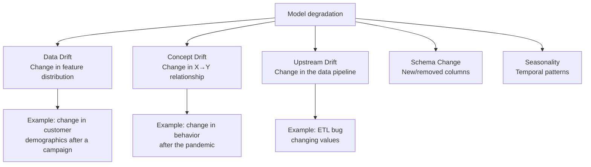
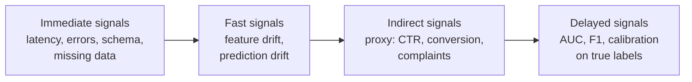
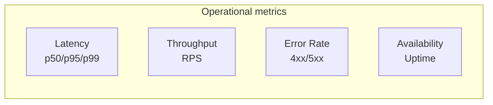
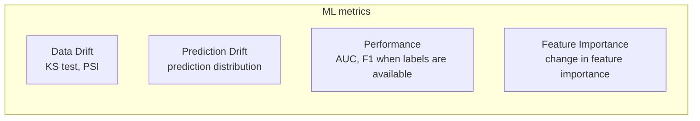
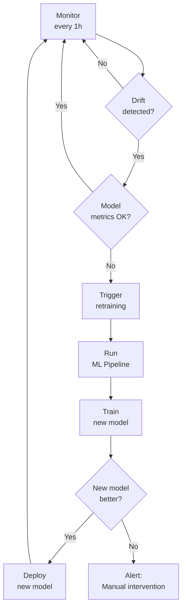
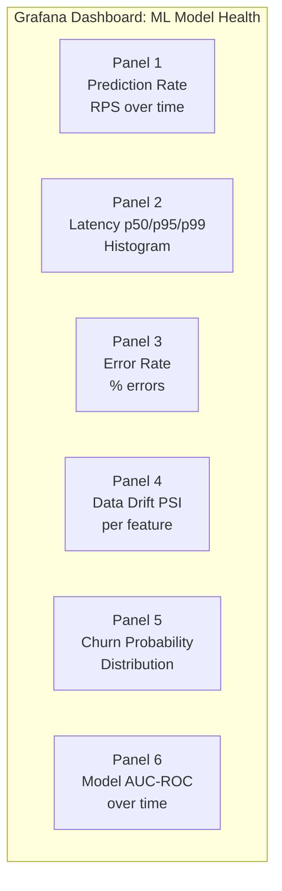

# Lecture 6: Monitoring ML Models in Production

## Lecture objectives
After this lecture the student:
- understands why monitoring is crucial in ML systems,
- knows the types of data drift and the methods for detecting them,
- can build a monitoring system using Evidently AI and Prometheus,
- knows how to configure alerts and automated retraining,
- understands the formal foundations of drift measures (PSI, KS, KL, JS, Wasserstein) and their limitations,
- can design a monitoring strategy under delayed labels.

## Lecture scripts

The demonstration scripts are located in ``. Full instructions can be found in [``](scripts/README.md).

| When (section) | Script | Purpose of the demonstration |
|---|---|---|
| 3. Drift detection | `01_drift_metrics.py` | PSI, KS, KL, JS and Wasserstein for increasing drift + the large-sample trap |
| 1. and 6. Types of drift / retraining | `02_concept_drift_stream.py` | data drift vs concept drift on a 12-week stream, quality gate |
| 5. Prometheus | `03_prometheus_metrics.py [--serve]` | instrumentation, `/metrics` format, quantiles from histogram buckets |

**How:** from the repository root run `python lectures/scripts/lecture_06/<script>`. Script 03 writes its output to ``.

---

## 1. Why do models degrade?

A model trained today may give worse results tomorrow. Causes:



### Types of drift

| Type | Definition | Detection |
|-----|-----------|------------|
| **Data Drift** | P(X) changes | Statistical tests on features |
| **Concept Drift** | P(Y\|X) changes | Monitoring model metrics |
| **Label Drift** | P(Y) changes | Monitoring label distribution |
| **Prediction Drift** | P(Ŷ) changes | Monitoring prediction distribution |

### Formally: the joint distribution and its decompositions

The model learns an approximation of the joint distribution `P(X, Y)`, which can be decomposed in two ways:

```
P(X, Y) = P(Y | X) · P(X)      ← "causal" view (features → label)
P(X, Y) = P(X | Y) · P(Y)      ← "generative" view (label → features)
```

This gives rise to the classic names from the literature (Quiñonero-Candela et al., *Dataset Shift in ML*):

| Name in the literature | What changes | What stays constant | Example |
|---|---|---|---|
| **Covariate shift** (= data drift) | `P(X)` | `P(Y\|X)` | a new marketing channel attracts younger customers |
| **Prior / label shift** | `P(Y)` | `P(X\|Y)` | the fraud rate rises during the holiday season |
| **Concept drift** | `P(Y\|X)` | (any) | after a change in terms of service, the same customers churn more often |
| **Upstream / schema drift** | how features are computed | – | ETL starts returning income in thousands of PLN instead of PLN |

> 💡 Covariate shift **does not always** break the model: if the model approximates `P(Y|X)` well in the new region of feature space too, quality stays good (see demo `02_concept_drift_stream.py`, weeks 5–8: PSI > 0.9, while AUC is unchanged). Concept drift **always** breaks the model, but it is **invisible** to tests on features alone (weeks 9–12: PSI ≈ 0, AUC drops from 0.85 to 0.52).

### Drift dynamics over time

```
sudden                gradual                incremental                 recurring
concept               concept                 concept                     concept
 B ┤      ┌─────       B ┤    ┌┐ ┌┐┌───        B ┤          ╱───          B ┤  ┌──┐    ┌──┐
   │      │              │    ││ │││             │        ╱                 │  │  │    │  │
 A ┤──────┘            A ┤────┘└─┘└┘           A ┤──────╱                 A ┤──┘  └────┘  └──
   └──────────▶ t        └──────────▶ t          └──────────▶ t              └──────────────▶ t
 e.g. COVID-19,         e.g. customers migrating e.g. inflation, aging       e.g. seasonality,
 partner API change     to a new app             of hardware/sensors         weekends, holidays
```

| Type | How to detect | Typical response |
|---|---|---|
| Sudden | threshold alert on a short window (1h–1d) | rollback / fast retraining / fallback rules |
| Gradual | metric trend on a sliding window | scheduled retraining |
| Incremental | comparison with the training reference (not with "yesterday"!) | periodic retraining, online learning |
| Recurring | comparison with the analogous period (a year/week ago) | calendar features, separate models/references |

### The delayed labels problem (label delay)

In most systems the true label arrives with a delay: churn – after 30 days, fraud – after a chargeback (up to 90 days), credit default – after months. That is why monitoring uses a **hierarchy of signals**:



The further to the right, the **more reliable** the signal, but the **later** it arrives. Feature and prediction drift are an "early warning", not proof of degradation. Tools such as NannyML try to estimate quality without labels (the CBPE method – *Confidence-Based Performance Estimation*), assuming good model calibration and no concept drift.

---

## 2. Monitoring metrics

### Operational metrics (infrastructure)



### ML metrics (model quality)



### The ML monitoring pyramid

```
                  ┌─────────────────────┐
                  │  Business KPIs       │  revenue, churn, fraud losses
                ┌─┴─────────────────────┴─┐
                │  Model quality           │  AUC, F1, MAE, calibration (delayed)
              ┌─┴─────────────────────────┴─┐
              │  Predictions                 │  ŷ distribution, class share, confidence
            ┌─┴─────────────────────────────┴─┐
            │  Input data                      │  drift, missing values, ranges, schema
          ┌─┴─────────────────────────────────┴─┐
          │  Infrastructure / service            │  latency, RPS, errors, CPU/GPU, RAM
          └─────────────────────────────────────┘
```

The lower layers are cheap and immediate, the upper ones – costly and delayed, but they are the ones that tell you whether the model **delivers value**.

| Layer | Example metric | Frequency | Prometheus metric type | Who responds |
|---|---|---|---|---|
| Infrastructure | p95 latency, 5xx | seconds | Histogram, Counter | SRE / on-call |
| Data | PSI per feature, % nulls | minutes–hours (batch) | Gauge | Data Engineer |
| Predictions | mean ŷ, % of "high" class | minutes | Counter, Gauge | ML Engineer |
| Quality | AUC, precision@k | days–weeks | Gauge | Data Scientist |
| Business | cost of false alarms | weeks | BI dashboard | Product Owner |

> 💡 **Golden signals** (Google SRE): latency, traffic, errors, saturation. For ML we add a "fifth signal": **prediction quality/distribution**.

---

## 3. Drift detection – statistical methods

### Theory: distance measures between distributions

Let `p` – the reference distribution (training), `q` – the current distribution (production). For binned measures, `p_i`, `q_i` are the fractions of observations in the i-th bin (bins are determined by **reference quantiles**, so `p_i ≈ 1/n_bins`).

| Measure | Formula | Range | Symmetric | Notes |
|---|---|---|---|---|
| **KS** | `D = sup_x \|F_p(x) − F_q(x)\|` | [0, 1] | yes | non-parametric test, gives a p-value; continuous 1D features only |
| **PSI** | `Σ (q_i − p_i) · ln(q_i / p_i)` | [0, ∞) | yes | standard in banking (scoring); = `KL(p‖q) + KL(q‖p)` |
| **KL** | `Σ q_i · ln(q_i / p_i)` | [0, ∞) | no | infinite when `p_i = 0` → requires smoothing (ε) |
| **Jensen–Shannon** | `√(½KL(p‖m) + ½KL(q‖m))`, `m = ½(p+q)` | [0, 1] (log₂) | yes | bounded, stable; default in Evidently for large datasets |
| **Wasserstein (EMD)** | `∫ \|F_p(x) − F_q(x)\| dx` | [0, ∞) in feature units | yes | "cost of moving mass"; normalize by the reference σ |
| **Chi²** | `Σ (O_i − E_i)² / E_i` | [0, ∞) | no | for **categorical** features, gives a p-value |

Where do the PSI thresholds 0.1 / 0.2 come from? It is a rule of thumb from credit risk practice. For a small shift of the mean by `δ` standard deviations in a normal distribution `PSI ≈ δ²`, i.e.:

```
PSI ≈ 0.01  ↔ shift by 0.1σ    (noise)
PSI ≈ 0.10  ↔ shift by ~0.3σ   (worth watching)
PSI ≈ 0.25  ↔ shift by ~0.5σ   (significant change)
```

Demo `01_drift_metrics.py` shows this empirically: a shift of 0.5σ (μ +5) gives PSI ≈ 0.31, and of 0.1σ – PSI ≈ 0.015.

### Statistical test vs effect size measure

```
          KS test p-value                          PSI / JS / Wasserstein
   1.0 ┤●                                    0.1 ┤
       │  ●                                      │●
   0.5 ┤                                         │  ●
       │     ●                                   │     ●──────●───────●
   0.0 ┤        ●──────●───────●             0.0 ┤
       └──────────────────────────▶ n            └──────────────────────────▶ n
         same, insignificant 0.05σ change          same change – value constant
```

- **p-value** answers the question "are the distributions *exactly* the same?" – with high traffic (n = 100,000) the answer is almost always "no" (demo: p = 6e-29 for a 0.05σ change). This is a source of **alert fatigue**.
- **Effect size** (PSI, JS, Wasserstein/σ) answers the question "*how much* do they differ?" – this is what should drive alerts.
- With small samples (n = 200) **all** measures are noisy (PSI ≈ 0.065 without real drift) – set a minimum window size (e.g. ≥ 1,000 observations / ≥ 50 per bin).
- Testing 200 features with `α = 0.05` yields on average **10 false alarms** per check. Apply the Bonferroni correction (`α/k`) or Benjamini–Hochberg, or monitor only the top-k most important features.

| Situation | Recommended method |
|---|---|
| Numerical feature, n < 1,000 | KS (p-value) |
| Numerical feature, n > 1,000 | Wasserstein/σ or JS, possibly PSI |
| Categorical feature | Chi² (small n), JS or PSI on categories (large n) |
| Credit scoring / regulation | PSI (required in reports, e.g. under KNF/EBA supervision) |
| Many features at once | classifier drift (*domain classifier*), PCA + reconstruction error |
| Embeddings (NLP, images) | MMD, cosine distance of mean embeddings, domain classifier |

#### Multivariate drift – domain classifier

1D tests will not detect a change in the **correlation** between features (each feature separately has the same distribution). A simple and effective technique: train a classifier that distinguishes the "reference" (y=0) from "production" (y=1).

```python
import numpy as np
import pandas as pd
from sklearn.ensemble import RandomForestClassifier
from sklearn.model_selection import cross_val_score

def domain_classifier_drift(reference: pd.DataFrame, current: pd.DataFrame) -> float:
    """Returns the AUC of the ref-vs-cur classifier. AUC≈0.5 → no drift, >0.6 → drift."""
    X = pd.concat([reference, current], ignore_index=True)
    y = np.r_[np.zeros(len(reference)), np.ones(len(current))]
    clf = RandomForestClassifier(n_estimators=100, max_depth=5, random_state=42)
    return cross_val_score(clf, X, y, cv=5, scoring="roc_auc").mean()
    # Bonus: clf.feature_importances_ indicates WHICH features drift the most
```

> ▶️ **Live demo:** `python lectures/scripts/lecture_06/01_drift_metrics.py`  
> Show the increasing-drift table, then the "large-sample trap" section – ask the students which metric they would hook an alert to.

### Kolmogorov-Smirnov Test (KS Test)

```python
import numpy as np
import pandas as pd
from scipy import stats
from typing import Optional
import warnings

def ks_drift_test(
    reference: np.ndarray,
    current: np.ndarray,
    feature_name: str,
    threshold: float = 0.05
) -> dict:
    """
    Detects data drift using the KS test.
    
    Null hypothesis H0: both samples come from the same distribution.
    We reject H0 when p-value < threshold → drift detected.
    """
    statistic, p_value = stats.ks_2samp(reference, current)
    drift_detected = p_value < threshold
    
    return {
        "feature": feature_name,
        "test": "KS",
        "statistic": round(statistic, 4),
        "p_value": round(p_value, 4),
        "drift_detected": drift_detected,
        "severity": (
            "critical" if p_value < 0.001 else
            "high" if p_value < 0.01 else
            "medium" if p_value < threshold else
            "none"
        )
    }
```

### Population Stability Index (PSI)

```python
def calculate_psi(
    reference: np.ndarray,
    current: np.ndarray,
    n_bins: int = 10,
    feature_name: str = "feature"
) -> dict:
    """
    Computes PSI (Population Stability Index).
    
    PSI < 0.1:  no significant change
    PSI 0.1-0.2: moderate change (monitor)
    PSI > 0.2:  significant change (retraining required)
    """
    # Creating bins based on the reference data
    bins = np.percentile(reference, np.linspace(0, 100, n_bins + 1))
    bins[0] = -np.inf
    bins[-1] = np.inf
    
    # Computing the proportions in each bin
    ref_counts, _ = np.histogram(reference, bins=bins)
    cur_counts, _ = np.histogram(current, bins=bins)
    
    # Avoid division by zero
    ref_pct = ref_counts / len(reference)
    cur_pct = cur_counts / len(current)
    
    ref_pct = np.where(ref_pct == 0, 0.0001, ref_pct)
    cur_pct = np.where(cur_pct == 0, 0.0001, cur_pct)
    
    # PSI = Σ (cur - ref) * ln(cur/ref)
    psi = np.sum((cur_pct - ref_pct) * np.log(cur_pct / ref_pct))
    
    return {
        "feature": feature_name,
        "test": "PSI",
        "psi_value": round(psi, 4),
        "drift_detected": psi > 0.2,
        "severity": (
            "critical" if psi > 0.5 else
            "high" if psi > 0.2 else
            "medium" if psi > 0.1 else
            "none"
        )
    }

# Usage example
np.random.seed(42)
reference_data = np.random.normal(50, 10, 10000)  # training data
current_data = np.random.normal(55, 12, 2000)      # production data (with drift)

ks_result = ks_drift_test(reference_data, current_data, "age")
psi_result = calculate_psi(reference_data, current_data, feature_name="age")

print(f"KS Test: drift={ks_result['drift_detected']}, severity={ks_result['severity']}")
print(f"PSI:     drift={psi_result['drift_detected']}, PSI={psi_result['psi_value']}")
```

### Comprehensive drift monitor

```python
import pandas as pd
import numpy as np
from dataclasses import dataclass, field
from datetime import datetime
from typing import Callable, Optional

@dataclass
class DriftReport:
    """Drift monitoring report."""
    timestamp: str = field(default_factory=lambda: datetime.now().isoformat())
    feature_results: list = field(default_factory=list)
    overall_drift: bool = False
    critical_features: list = field(default_factory=list)
    
    def summary(self) -> str:
        status = "🔴 DRIFT DETECTED" if self.overall_drift else "🟢 OK"
        lines = [f"=== Drift Report [{self.timestamp}] ===", f"Status: {status}"]
        
        for r in self.feature_results:
            icon = "❌" if r['drift_detected'] else "✅"
            lines.append(
                f"  {icon} {r['feature']}: "
                f"PSI={r.get('psi_value', 'N/A')}, "
                f"severity={r['severity']}"
            )
        
        if self.critical_features:
            lines.append(f"\n⚠️  Critical features: {', '.join(self.critical_features)}")
        
        return "\n".join(lines)

class DataDriftMonitor:
    """Data drift monitor for an ML model."""
    
    def __init__(
        self,
        reference_df: pd.DataFrame,
        feature_columns: list[str],
        alert_callback: Optional[Callable] = None
    ):
        self.reference_df = reference_df
        self.feature_columns = feature_columns
        self.alert_callback = alert_callback
        self._drift_history: list[DriftReport] = []
    
    def check_drift(self, current_df: pd.DataFrame) -> DriftReport:
        """Checks drift for all features."""
        report = DriftReport()
        
        for feature in self.feature_columns:
            if feature not in current_df.columns:
                continue
            
            ref_values = self.reference_df[feature].dropna().values
            cur_values = current_df[feature].dropna().values
            
            # Compute PSI
            psi_result = calculate_psi(ref_values, cur_values, feature_name=feature)
            report.feature_results.append(psi_result)
            
            if psi_result['severity'] in ('high', 'critical'):
                report.critical_features.append(feature)
        
        report.overall_drift = len(report.critical_features) > 0
        self._drift_history.append(report)
        
        # Trigger an alert if drift was detected
        if report.overall_drift and self.alert_callback:
            self.alert_callback(report)
        
        return report
    
    def get_drift_trend(self) -> pd.DataFrame:
        """Returns the drift history as a DataFrame."""
        rows = []
        for rep in self._drift_history:
            for feat_result in rep.feature_results:
                rows.append({
                    "timestamp": rep.timestamp,
                    "feature": feat_result["feature"],
                    "psi": feat_result.get("psi_value", 0),
                    "drift": feat_result["drift_detected"]
                })
        return pd.DataFrame(rows)

# Usage example
def send_alert(report: DriftReport):
    print(f"🚨 ALERT: Drift detected in features: {report.critical_features}")
    # In production: send email, Slack, PagerDuty...

# Reference data (from training)
reference = pd.DataFrame({
    'age': np.random.normal(40, 10, 5000),
    'income': np.random.normal(50000, 15000, 5000),
    'tenure': np.random.exponential(24, 5000)
})

# Production data (with drift)
current = pd.DataFrame({
    'age': np.random.normal(45, 12, 1000),      # drift!
    'income': np.random.normal(50500, 15000, 1000),  # no drift
    'tenure': np.random.exponential(18, 1000)    # drift!
})

monitor = DataDriftMonitor(
    reference_df=reference,
    feature_columns=['age', 'income', 'tenure'],
    alert_callback=send_alert
)

report = monitor.check_drift(current)
print(report.summary())
```

---

## 4. Evidently AI – a library for ML monitoring

**Evidently AI** is an open-source library for monitoring and testing ML models.

> ⚠️ **API versions.** The code below uses the "classic" Evidently API (0.4.x – 0.6.x: `ColumnMapping`, `Report`, `TestSuite`, `metric_preset`). Since version **0.7** the API has been redesigned (`from evidently import Report, Dataset, DataDefinition`, `from evidently.presets import DataDriftPreset`, and Test Suite was replaced by `tests=` conditions in metrics). Pin the version in `requirements.txt` and check the documentation for your version.

**How Evidently chooses the drift test (by default, per column):**

| Column type | n ≤ 1000 | n > 1000 |
|---|---|---|
| numerical (> 5 unique values) | KS (p-value < 0.05) | normalized Wasserstein (> 0.1) |
| categorical / few values | Chi² (or Z-test for binary) | Jensen–Shannon (> 0.1) |

**Dataset drift** is reported when ≥ 50% of columns drift (the `drift_share` parameter). All of this can be overridden, e.g. `DataDriftPreset(stattest="psi", stattest_threshold=0.2)`.

| Tool | Type | Strengths | Weaknesses |
|---|---|---|---|
| **Evidently** | OSS + Cloud | HTML reports, tests in CI, many statistical tests | no native alerting (you need to hook up Prometheus/Grafana) |
| **NannyML** | OSS | quality estimation without labels (CBPE/DLE), multivariate drift | narrower scope (mainly tabular) |
| **WhyLogs / WhyLabs** | OSS + SaaS | lightweight statistical profiles (sketches), scalable to streams | profiles instead of raw data → fewer details |
| **Alibi Detect** | OSS | detectors for images/text (MMD, LSDD), outliers | more "research-oriented", fewer ready-made dashboards |
| **Arize / Fiddler / Datadog ML** | SaaS | ready-made dashboards, explainability, alerting | cost, data leaves the organization |
| **Prometheus + Grafana** | OSS | SRE standard, alerting, scalability | no ready-made drift tests – you compute them yourself |

```python
import pandas as pd
import numpy as np
from evidently import ColumnMapping
from evidently.report import Report
from evidently.metric_preset import (
    DataDriftPreset,
    DataQualityPreset,
    ClassificationPreset
)
from evidently.metrics import (
    DatasetDriftMetric,
    ColumnDriftMetric,
    DatasetMissingValuesMetric
)
from evidently.test_suite import TestSuite
from evidently.test_preset import DataDriftTestPreset, DataQualityTestPreset

# Data preparation
np.random.seed(42)
n_ref = 5000
n_cur = 1000

reference_data = pd.DataFrame({
    'age': np.random.normal(40, 10, n_ref),
    'income': np.random.normal(50000, 15000, n_ref),
    'tenure': np.random.exponential(24, n_ref),
    'num_products': np.random.randint(1, 5, n_ref),
    'target': np.random.binomial(1, 0.2, n_ref),
    'prediction': np.random.uniform(0, 1, n_ref)
})

current_data = pd.DataFrame({
    'age': np.random.normal(45, 12, n_cur),       # drift
    'income': np.random.normal(50000, 15000, n_cur),
    'tenure': np.random.exponential(18, n_cur),    # drift
    'num_products': np.random.randint(1, 5, n_cur),
    'target': np.random.binomial(1, 0.25, n_cur),
    'prediction': np.random.uniform(0.1, 1, n_cur)
})

# Column mapping
column_mapping = ColumnMapping(
    target='target',
    prediction='prediction',
    numerical_features=['age', 'income', 'tenure'],
    categorical_features=['num_products']
)

# --- Data drift report ---
data_drift_report = Report(metrics=[
    DataDriftPreset(),
    DataQualityPreset(),
])

data_drift_report.run(
    reference_data=reference_data,
    current_data=current_data,
    column_mapping=column_mapping
)

# Saving the HTML report
data_drift_report.save_html("reports/data_drift_report.html")
print("Report saved: reports/data_drift_report.html")

# Get the results as a dict
results = data_drift_report.as_dict()
drift_detected = results['metrics'][0]['result']['dataset_drift']
print(f"Dataset drift: {drift_detected}")


# --- Test Suite (pass/fail) ---
tests = TestSuite(tests=[
    DataDriftTestPreset(),
    DataQualityTestPreset(),
])

tests.run(
    reference_data=reference_data,
    current_data=current_data,
    column_mapping=column_mapping
)

tests.save_html("reports/test_suite.html")

# Check the test results
test_results = tests.as_dict()
all_passed = all(t['status'] == 'SUCCESS' for t in test_results['tests'])
print(f"All tests: {'✅ PASS' if all_passed else '❌ FAIL'}")
```

---

## 5. Prometheus + Grafana for ML

### Exporting ML metrics to Prometheus

```python
from prometheus_client import (
    Counter, Histogram, Gauge, Summary,
    start_http_server, CollectorRegistry
)
import time
import numpy as np

# Metric definitions
PREDICTION_COUNTER = Counter(
    'ml_predictions_total',
    'Total number of predictions',
    ['model_version', 'risk_level']
)

PREDICTION_LATENCY = Histogram(
    'ml_prediction_latency_seconds',
    'Prediction time in seconds',
    ['model_version'],
    buckets=[0.001, 0.005, 0.01, 0.025, 0.05, 0.1, 0.25, 0.5, 1.0]
)

CHURN_PROBABILITY_GAUGE = Gauge(
    'ml_churn_probability_avg',
    'Average churn probability (last 1000 predictions)'
)

DATA_DRIFT_GAUGE = Gauge(
    'ml_data_drift_psi',
    'PSI for a feature',
    ['feature_name']
)

MODEL_AUC_GAUGE = Gauge(
    'ml_model_auc_roc',
    'Model AUC-ROC on production data',
    ['model_version']
)

ERROR_COUNTER = Counter(
    'ml_prediction_errors_total',
    'Number of prediction errors',
    ['error_type']
)

class InstrumentedMLService:
    """ML service with Prometheus instrumentation."""
    
    def __init__(self, model, model_version: str):
        self.model = model
        self.model_version = model_version
        self._recent_probs = []
    
    def predict(self, features: np.ndarray, user_id: int) -> dict:
        """Prediction with full instrumentation."""
        start_time = time.time()
        
        try:
            probability = float(self.model.predict_proba(features)[0][1])
            risk_level = (
                "high" if probability > 0.7 else
                "medium" if probability > 0.3 else
                "low"
            )
            
            # Updating metrics
            PREDICTION_COUNTER.labels(
                model_version=self.model_version,
                risk_level=risk_level
            ).inc()
            
            # Updating the probability average
            self._recent_probs.append(probability)
            if len(self._recent_probs) > 1000:
                self._recent_probs.pop(0)
            CHURN_PROBABILITY_GAUGE.set(np.mean(self._recent_probs))
            
            return {
                "user_id": user_id,
                "probability": probability,
                "risk_level": risk_level
            }
        

        except Exception as e:
            ERROR_COUNTER.labels(error_type=type(e).__name__).inc()
            raise
        
        finally:
            # Always measure latency
            latency = time.time() - start_time
            PREDICTION_LATENCY.labels(
                model_version=self.model_version
            ).observe(latency)
    
    def update_drift_metrics(self, psi_scores: dict):
        """Updates the drift metrics."""
        for feature, psi in psi_scores.items():
            DATA_DRIFT_GAUGE.labels(feature_name=feature).set(psi)

# Starting the Prometheus metrics server
start_http_server(8000)
print("Metrics available at http://localhost:8000/metrics")
```

> ⚠️ **Note:** the example above uses the default global registry. In tests and in applications with multiple workers (e.g. `gunicorn`/`uvicorn --workers 4`) use a `CollectorRegistry()` per process or the `multiprocess` mode with `PROMETHEUS_MULTIPROC_DIR` – otherwise each worker reports its own counters, and Prometheus randomly sees one of them.

#### Prometheus metric types – when to use which

| Type | Behavior | Example in ML | Typical query |
|---|---|---|---|
| **Counter** | only increases (resets on restart) | number of predictions, errors | `rate(x_total[5m])` |
| **Gauge** | any value at time t | PSI, AUC, queue size | `x`, `avg_over_time(x[1h])` |
| **Histogram** | counters in `le` buckets + `_sum` + `_count` | latency, score distribution | `histogram_quantile(0.95, sum by (le) (rate(x_bucket[5m])))` |
| **Summary** | quantiles computed on the client side | latency in a single process | `x{quantile="0.95"}` (cannot be aggregated!) |

> 💡 A **prediction histogram** (e.g. buckets 0.1, 0.2, … 1.0 for probability) lets you compute prediction drift directly in PromQL, without a separate batch job.

> ⚠️ **Label cardinality.** Each unique combination of labels is a separate time series. Never use `user_id`, `request_id` or raw feature values as labels – 1 million users = 1 million series and a Prometheus outage. Labels should have a small, finite number of values (`model_version`, `risk_level`, `feature_name`).

```
Metrics flow:

 ┌──────────────┐  scrape /metrics   ┌────────────┐  PromQL  ┌──────────┐
 │ ml-api:8000  │◀──── every 15s ────│ Prometheus │◀─────────│ Grafana  │
 │ (Counter,    │                    │  (TSDB)    │          └──────────┘
 │  Histogram)  │                    │   rules ───┼──▶ Alertmanager ──▶ Slack/PagerDuty
 └──────────────┘                    └─────▲──────┘
 ┌──────────────┐  push (Pushgateway)      │
 │ drift job    │──────────────────────────┘   (batch jobs that are short-lived)
 │ (cron, PSI)  │
 └──────────────┘
```

> ▶️ **Live demo:** `python lectures/scripts/lecture_06/03_prometheus_metrics.py`  
> Show the text exposition format and how p95 is derived from histogram buckets (linear interpolation as in `histogram_quantile`). With `--serve` the metrics are available at `http://localhost:8000/metrics`.

### Prometheus configuration

```yaml
# prometheus.yml
global:
  scrape_interval: 15s
  evaluation_interval: 15s

rule_files:
  - "ml_alerts.yml"

alerting:
  alertmanagers:
    - static_configs:
        - targets: ['alertmanager:9093']

scrape_configs:
  - job_name: 'ml-service'
    static_configs:
      - targets: ['ml-api:8000']
    metrics_path: '/metrics'
```

### Alert rules

```yaml
# ml_alerts.yml
groups:
  - name: ml_alerts
    rules:
      # Alert: high prediction latency
      - alert: HighPredictionLatency
        expr: histogram_quantile(0.95, sum by (le, model_version) (rate(ml_prediction_latency_seconds_bucket[5m]))) > 0.5
        for: 5m
        labels:
          severity: warning
        annotations:
          summary: "High prediction latency (p95 > 500ms)"
          description: "Model {{ $labels.model_version }} has p95 latency of {{ $value }}s"

      # Alert: data drift
      - alert: DataDriftDetected
        expr: ml_data_drift_psi > 0.2
        for: 10m
        labels:
          severity: critical
        annotations:
          summary: "Data drift detected"
          description: "Feature {{ $labels.feature_name }} has PSI={{ $value }}"

      # Alert: high error rate
      - alert: HighErrorRate
        # (error share > 1% of all requests, not 0.01 errors/s)
        expr: |
          sum(rate(ml_prediction_errors_total[5m]))
            / (sum(rate(ml_predictions_total[5m])) + sum(rate(ml_prediction_errors_total[5m])))
            > 0.01
        for: 2m
        labels:
          severity: critical
        annotations:
          summary: "High prediction error rate"

      # Alert: prediction distribution "froze" (e.g. the model returns a constant value)
      - alert: PredictionsStuck
        expr: stddev_over_time(ml_churn_probability_avg[1h]) == 0
        for: 30m
        labels:
          severity: warning
        annotations:
          summary: "Average prediction has not changed for an hour"

      # Alert: no traffic (the service is alive, but nobody calls it – broken upstream?)
      - alert: NoPredictionTraffic
        expr: sum(rate(ml_predictions_total[15m])) == 0
        for: 15m
        labels:
          severity: warning
```

#### Designing alerts – best practices

- **Alert on symptoms, not causes** – "AUC dropped" / "p95 > SLO" instead of "CPU 80%".
- **`for:`** requires the condition to persist – eliminates single spikes.
- **Severity levels:** `warning` → Slack channel (business hours), `critical` → PagerDuty (wakes up on-call). Feature drift is usually `warning`, drift + drop in proxy KPI → `critical`.
- **Every alert has a runbook** (`annotations.runbook_url`) – what to check, how to roll back.
- Measure **alert precision**: if > 50% of alerts require no action, raise the thresholds.

---

## 6. Automated retraining



### Retraining strategies – comparison

| Strategy | Trigger | Pros | Cons | Where to use |
|---|---|---|---|---|
| **Manual** | human decision | full control | slow, does not scale | regulated models (credit, medicine) |
| **Periodic** (cron) | every day/week/month | simple, predictable cost | trains unnecessarily or too rarely | recommendations, demand forecasting |
| **On drift** | PSI/KS > threshold | reacts to data changes | data drift ≠ degradation → unnecessary retrains | rapidly changing data |
| **On quality drop** | AUC/F1 < threshold | trains only when needed | requires labels (delay!) | fraud with fast feedback, ads (CTR) |
| **Online / continuous** | every new batch of data | fastest adaptation | risk of catastrophic forgetting and attacks (data poisoning) | ads, feed ranking |

In practice they are combined: **periodic + emergency on quality drop**, while feature drift serves as a signal for analysis, not an automatic trigger.

#### Quality gate – champion vs challenger

```
  new data ──▶ data validation ──▶ challenger training ──▶ evaluation on holdout (fresh data!)
                     │ fail                                          │
                     ▼                                               ▼
                  ALERT               challenger ≥ champion + δ  AND  metrics ≥ minimum
                                       AND fairness OK  AND  latency OK ?
                                          │ yes                         │ no
                                          ▼                             ▼
                              shadow / canary 5% ──▶ 100%        keep the champion + alert
```

> ⚠️ The holdout for comparison must come from the **most recent period** – comparing on an old test set favors the old champion and hides concept drift.

> ▶️ **Live demo:** `python lectures/scripts/lecture_06/02_concept_drift_stream.py`  
> Weeks 5–8: DATA_DRIFT alarm, but AUC unchanged (retraining unnecessary). Weeks 9–12: feature PSI ≈ 0, while AUC drops to ~0.52 – only quality monitoring will detect this. At the end the quality gate promotes the challenger.

```python
import schedule
import time
import logging
from datetime import datetime

logger = logging.getLogger(__name__)

class AutoRetrainingSystem:
    """Automated model retraining system."""
    
    def __init__(
        self,
        drift_monitor: DataDriftMonitor,
        pipeline_trigger,
        drift_threshold_psi: float = 0.2,
        min_retraining_interval_hours: int = 24
    ):
        self.drift_monitor = drift_monitor
        self.pipeline_trigger = pipeline_trigger
        self.drift_threshold_psi = drift_threshold_psi
        self.min_interval = min_retraining_interval_hours
        self._last_retraining: Optional[datetime] = None
    
    def check_and_retrain(self, current_data: pd.DataFrame):
        """Checks drift and triggers retraining if needed."""
        
        # Check whether the minimum time since the last retraining has passed
        if self._last_retraining:
            # total_seconds(), not .seconds (the latter ignores full days!)
            hours_since = (datetime.now() - self._last_retraining).total_seconds() / 3600
            if hours_since < self.min_interval:
                logger.info(f"Too early for retraining ({hours_since:.1f}h < {self.min_interval}h)")
                return
        
        # Check drift
        report = self.drift_monitor.check_drift(current_data)
        
        if not report.overall_drift:
            logger.info("✅ No drift - retraining is not needed")
            return
        
        logger.warning(f"⚠️ Drift detected in features: {report.critical_features}")
        logger.info("🔄 Triggering automated retraining...")
        
        try:
            # Trigger the ML pipeline
            run_id = self.pipeline_trigger.trigger(
                reason="auto_retraining",
                triggered_by="drift_monitor",
                drift_features=report.critical_features
            )
            
            self._last_retraining = datetime.now()
            logger.info(f"✅ Pipeline started: {run_id}")
            
        except Exception as e:
            logger.error(f"❌ Error triggering retraining: {e}")
            # Send an alert to the team
            raise

# Monitoring schedule
def setup_monitoring_schedule(auto_retrain_system, data_source):
    """Configures the monitoring schedule."""
    
    def monitoring_job():
        logger.info(f"Running monitoring: {datetime.now()}")
        current_data = data_source.get_recent_data(hours=1)
        auto_retrain_system.check_and_retrain(current_data)
    
    # Check every hour
    schedule.every(1).hours.do(monitoring_job)
    
    logger.info("Monitoring scheduled every 1 hour")
    
    while True:
        schedule.run_pending()
        time.sleep(60)
```

---

## 7. Monitoring dashboard – Grafana example



Example PromQL queries for Grafana:

```promql
# Prediction rate (RPS)
rate(ml_predictions_total[5m])

# p95 latency
histogram_quantile(0.95, rate(ml_prediction_latency_seconds_bucket[5m]))

# Error rate
rate(ml_prediction_errors_total[5m]) / rate(ml_predictions_total[5m])

# PSI for the 'age' feature
ml_data_drift_psi{feature_name="age"}

# Risk level distribution
sum by (risk_level) (rate(ml_predictions_total[1h]))

# Share of "high" predictions – comparison with the same window a week ago (seasonality!)
  sum(rate(ml_predictions_total{risk_level="high"}[1h])) / sum(rate(ml_predictions_total[1h]))
- sum(rate(ml_predictions_total{risk_level="high"}[1h] offset 7d)) / sum(rate(ml_predictions_total[1h] offset 7d))

# Comparing latency of two model versions (canary)
histogram_quantile(0.95, sum by (le, model_version) (rate(ml_prediction_latency_seconds_bucket[5m])))
```

**Principles of a good ML dashboard:**
1. At the top, **one status row** (green/yellow/red) per model – an answer to "is everything OK?" in 5 seconds.
2. Each panel shows the **model version** (Grafana annotations at deployment) – does a metric jump coincide with a deployment?
3. ML metrics against a **reference line** from training (e.g. the expected share of the "high" class).
4. Separate dashboards: operational (SRE, 10s refresh) and analytical (DS, days/weeks).

---

## 8. Common pitfalls in ML monitoring

> ⚠️ **Pitfall 1: Monitoring only operational metrics**
> The service responds fast (latency OK, error rate 0%), but the model produces nonsensical predictions. Monitor **ML metrics** (prediction distribution, feature drift) alongside infrastructure metrics.

> ⚠️ **Pitfall 2: Overly sensitive monitoring**
> Alerts on every minor change in data distribution lead to "alert fatigue" — the team ignores alerts. Set reasonable thresholds (e.g. PSI > 0.2 instead of > 0.05) and use time windows (e.g. drift persisting > 1h).

> ⚠️ **Pitfall 3: No reference data**
> Drift cannot be detected without reference data from the training period. Always save training data statistics (distributions, percentiles, correlations) as a model artifact.

> ⚠️ **Pitfall 4: Automated retraining without safeguards**
> Automated retraining on "poisoned" data may deploy a worse model. Always compare the new model with the current production one and require minimum quality thresholds.

> ⚠️ **Pitfall 5: p-value as the only criterion**
> With high traffic, the KS test reports drift for meaningless changes (demo `01_drift_metrics.py`). Use effect size measures (PSI, JS, Wasserstein) and a correction for multiple testing.

> ⚠️ **Pitfall 6: Feedback loop**
> The model affects the data on which it is later evaluated and trained: an anti-fraud system blocks transactions → we never learn their true label; a recommender shows only popular products → only they collect clicks. Solution: a small share of traffic with a random decision (*exploration / holdout group*).

> ⚠️ **Pitfall 7: Training-serving skew instead of drift**
> High PSI from the first day after deployment is usually not drift, but a **difference in feature computation** between training and serving (different time zone, different category encoding, missing normalization). Compare features logged in production with training features for the same entities.

> ⚠️ **Pitfall 8: No logging of inputs and predictions**
> Without logs (features, prediction, model version, timestamp, `request_id`) you cannot compute drift or join labels when they arrive. Log asynchronously (queue/Kafka) and with sampling under very high traffic; remember GDPR (pseudonymization).

### Monitoring deployment checklist

| ✔ | Item |
|---|---|
| ☐ | Reference statistics (quantiles, category distributions) saved as a model artifact (e.g. in MLflow) |
| ☐ | Logging of inputs, predictions, model version and `request_id` |
| ☐ | Operational metrics + SLO (e.g. p95 < 200 ms, availability 99.9%) |
| ☐ | Feature drift (top-k important) and prediction drift computed periodically, min. window size |
| ☐ | Label joining pipeline (join on `request_id`) and quality metrics |
| ☐ | Alerts with `for:`, severity and a runbook |
| ☐ | Retraining policy with a quality gate and rollback capability |

### Case Study: Tesla Autopilot — real-time monitoring

**Tesla** monitors ML models in millions of vehicles simultaneously:
- Each vehicle sends telemetry about situations in which the model was uncertain (low confidence predictions).
- This data is used for **active learning** — the model is retrained on the hardest cases.
- Monitoring detects **edge cases** (e.g. unusual weather conditions, new road signs), which are automatically added to the training set.

### Case Study: Twitter — drift detection in recommendations

**Twitter** (X) monitors timeline recommendation models:
- Seasonal events (e.g. elections, the Super Bowl) cause sharp changes in the data distribution — this **is not drift**, but normal variability.
- Key challenge: distinguishing real drift from seasonality. Solution: comparison with data from the analogous period a year earlier.

### Case Study: COVID-19 — sudden concept drift on a massive scale

In March 2020, many production models stopped working almost overnight:
- **Demand forecasts** in retail (toilet paper, pasta, face masks) – historical seasonal patterns became useless.
- **Anti-fraud systems** in banks – a sudden increase in online purchases by customers who previously paid only in stores generated a mass of false alarms.
- **Credit scoring** – income and payment behavior changed in ways invisible in historical data.

Lessons: (1) companies with prediction and proxy KPI monitoring detected the problem within days, others – after weeks of losses; (2) retraining on 2 weeks of data was too unstable – **business rules were used as a fallback** along with manual corrections; (3) after the pandemic, it had to be decided whether 2020 data should be included in training at all.

### Case Study: Zillow Offers — the cost of unnoticed drift

Zillow used a property valuation model (Zestimate) to **automatically buy homes**. In 2021 the market began to cool, but the model kept predicting price increases (concept drift + feedback loop: the company itself was pushing prices up in some regions). Result: thousands of homes bought above market price, a write-down of **over USD 500 million** and the closure of the division. Conclusion: when a model makes financial decisions automatically, monitoring **prediction error on fresh transactions** and exposure limits are mandatory.

### Case Study: Uber Michelangelo — monitoring at platform scale

Uber's ML platform automatically logs a sample of predictions for every deployed model, later joins them with actual outcomes (e.g. the actual arrival time for the ETA model) and publishes quality metrics on shared dashboards. Teams do not have to build monitoring themselves – this is an example of **monitoring as a platform service**, which is one of the hallmarks of MLOps maturity.

---

## Review and discussion questions

1. Explain the difference between data drift, concept drift, label drift and prediction drift.
2. How does the Kolmogorov-Smirnov (KS) test work and when would you use it to detect drift?
3. What do PSI values < 0.1, 0.1-0.2 and > 0.2 mean?
4. Why is monitoring operational metrics alone (latency, error rate) not enough?
5. How do you configure automated retraining so as not to deploy a worse model?
6. Which metrics would you expose on a Grafana dashboard for an ML service?
7. **Discussion:** How do you distinguish real drift from seasonal data variability?
8. Why does the KS test generate false alarms with very large samples, and what should replace it?
9. How do you monitor a model when labels only arrive after 60 days?
10. How does data drift differ from training-serving skew, and how do you tell them apart?


### Suggested answers

1. Data drift is a change in the distribution of input features, concept drift is a change in the feature→label relationship, label drift is a change in the label distribution, and prediction drift is a change in the distribution of model predictions. Each signals a different type of problem and requires a different response.
2. KS compares two distributions and returns a difference statistic and a `p-value`; a low `p-value` suggests a significant change in distribution. We use it mainly for numerical features, comparing reference and current data.
3. Typically PSI < 0.1 means no significant drift, 0.1–0.2 a moderate signal to watch, and > 0.2 strong drift requiring action. Thresholds must be calibrated to the specific business case.
4. Because the model can run fast and without HTTP errors while giving weak or biased predictions. That is why you also need to monitor ML quality, data distributions and drift.
5. Retraining should have quality gates: data validation, comparison with the baseline model, a minimum metric threshold, regression tests and a canary/shadow stage before full promotion. Without this it is easy to deploy a model worse than the current one.
6. On the dashboard I would put: RPS, p95/p99 latency, error rate, prediction distributions, PSI/KS for key features, quality metrics (AUC/F1 if labels are available) and alert/retraining status. Such a set combines the operational and ML perspectives.
7. You need to compare not only to "yesterday", but also to analogous seasonal periods, use time windows and signal persistence thresholds. Enriching monitoring with business context (campaigns, holidays, events) also helps.
8. The p-value measures whether distributions are identical, not how much they differ – with n on the order of 100,000 even a 0.05σ change gives p ≈ 0. It is better to alert on effect size measures (PSI, JS, Wasserstein/σ) with business thresholds and to apply a correction for multiple testing.
9. Use a hierarchy of signals: feature and prediction drift (immediately), proxy metrics (e.g. customer activity, complaints), label-free quality estimation (CBPE in NannyML), and after 60 days – true metrics on joined labels. Logging `request_id` is important so that labels can be joined.
10. Data drift is a change in the world over time, skew is a difference in feature implementation between training and serving. Skew is visible right after deployment (high PSI from day 0) and is confirmed by comparing features for the same entities computed by both paths.


---

## Summary

- Models degrade due to **data drift**, **concept drift** and changes in the data pipeline.
- Key metrics: **PSI** and **KS test** for feature drift, **AUC/F1** for model quality.
- **Evidently AI** generates readable HTML reports and enables automated tests.
- **Prometheus + Grafana** is the standard for operational and ML monitoring.
- **Automated retraining** closes the MLOps loop — but requires safeguards (quality gates).
- Distinguish real drift from seasonality and normal variability.
- **Covariate shift** does not have to break the model, while **concept drift** is invisible to feature tests – quality monitoring is needed (with labels or proxies).
- For alerts use **effect size measures**, not the p-value alone; watch out for label cardinality in Prometheus.

## Literature and resources

- [Evidently AI Documentation](https://docs.evidentlyai.com/)
- [Prometheus Documentation](https://prometheus.io/docs/)
- [Grafana Documentation](https://grafana.com/docs/)
- [Chip Huyen: ML Systems Design – Chapter on Monitoring](https://huyenchip.com/ml-interviews-book/)
- [Google: Monitoring ML Models in Production](https://cloud.google.com/architecture/mlops-continuous-delivery-and-automation-pipelines-in-machine-learning#monitoring)
- [NannyML – Post-deployment ML Monitoring](https://nannyml.readthedocs.io/)
- [Failing Loudly: An Empirical Study of Methods for Detecting Dataset Shift](https://arxiv.org/abs/1810.11953)
- [Gama et al.: A Survey on Concept Drift Adaptation (ACM Computing Surveys, 2014)](https://dl.acm.org/doi/10.1145/2523813)
- [Quiñonero-Candela et al.: Dataset Shift in Machine Learning (MIT Press, 2009)](https://mitpress.mit.edu/9780262545877/dataset-shift-in-machine-learning/)
- [Google SRE Book – Monitoring Distributed Systems (Golden Signals)](https://sre.google/sre-book/monitoring-distributed-systems/)
- [Prometheus – Histograms and Summaries](https://prometheus.io/docs/practices/histograms/)
