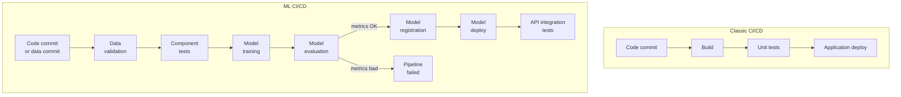
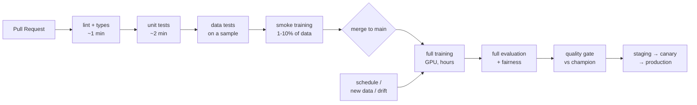
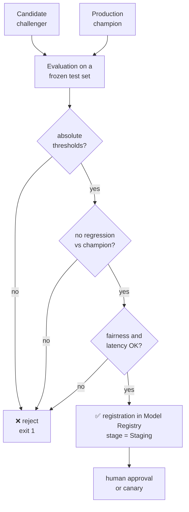
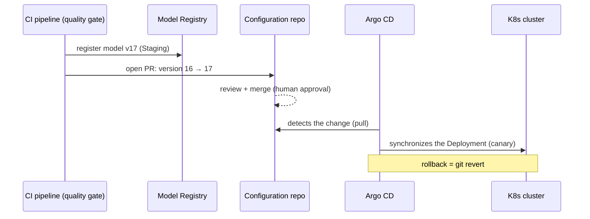

# Lecture 7: CI/CD for Machine Learning

## Lecture objectives
After this lecture, the student:
- understands what CI/CD is in the context of ML and how it differs from classic CI/CD,
- can build a CI/CD pipeline for an ML model with GitHub Actions,
- knows patterns for testing ML code,
- understands the concepts of GitOps and Infrastructure as Code for ML.

## Lecture scripts

The demo scripts are located in ``. Full instructions can be found in [``](scripts/README.md).

| When (section) | Script | Demo purpose |
|---|---|---|
| 2. Testing ML code | `01_ml_unit_tests.py` | unit, contract, behavioral (INV/DIR) and MFT tests in pytest |
| 3. / 6. CI/CD pipeline | `03_ci_pipeline_sim.py [--break-data]` | local simulation of a fail-fast pipeline with smoke training and an artifact manifest |
| 4. Quality Gates | `02_quality_gate.py [--bad]` | champion vs challenger gate (absolute, relative, fairness thresholds; exit code 1) |

**How:** from the repository root, run `python lectures/scripts/lecture_07/<script>`. Artifacts (model, manifest, report) go to ``.

---

## 1. CI/CD in the context of ML

### Classic CI/CD vs ML CI/CD



### Three levels of testing in ML CI/CD

| Level | What we test | Tools |
|--------|-------------|-----------|
| **Code** | Functions, classes, logic | pytest, unittest |
| **Data** | Schema, distributions, quality | Great Expectations, pytest |
| **Model** | Metrics, bias, latency | pytest, locust |

### Why does ML need a "different" CI/CD?

In classic software, the system's behavior is entirely captured in the **code**. In ML, behavior results from three axes of change, each of which can break production independently of the others:

```
          ┌──────────── CODE ────────────┐
          │ preprocessing, architecture, │
          │ hyperparameters, serving     │
          └──────────────┬───────────────┘
                         │
     ┌───── DATA ────────┼──────── MODEL ─────┐
     │ new batches,      │   weights, thresh.,│
     │ schema change,    │   artifact version │
     │ distribution drift│                    │
     └───────────────────┴────────────────────┘
   Any change on any axis = a potential release
```

Practical consequences:
- **Tests are probabilistic.** We don't check `assert f(x) == y`, but rather "AUC ≥ 0.80" or "predictions don't change after changing an irrelevant feature". Thresholds must be chosen with a margin, otherwise the tests will be *flaky*.
- **The artifact is not just a binary.** Release = code + data (hash/DVC version) + model + configuration + environment (Docker image). Missing any element makes it impossible to reproduce the result.
- **Training is expensive.** You can't train the full model on every commit, so the pipeline is split into a fast lane (minutes) and a slow lane (hours, schedule/trigger).
- **CT – Continuous Training appears.** Besides CI (code integration) and CD (delivery), we need automatic retraining triggered by data changes or drift.

### MLOps maturity levels (according to Google)

| Level | Description | CI | CD | CT | Typical symptom |
|---|---|---|---|---|---|
| **0 – manual** | notebook → manual model export | ❌ | ❌ | ❌ | "the model works on my machine", deployments once a quarter |
| **1 – pipeline automation** | training pipeline as code, run automatically | partially | model | ✅ | fast retraining, but manual deployment of pipeline changes |
| **2 – pipeline CI/CD** | the pipeline itself is tested and deployed, not just the model | ✅ | pipeline + model | ✅ | many deployments per day, full auditability |

### Fast and slow lane



| Feature | Fast lane (PR) | Slow lane (main / schedule) |
|---|---|---|
| Goal | feedback for the developer | production candidate |
| Time | < 10–15 min | minutes – hours |
| Data | sample, fixtures, synthetic data | full dataset, versioned (DVC) |
| Hardware | CPU runner | GPU / cluster, self-hosted runner |
| Result | green/red check in the PR | registered model + report |

### Pipeline triggering strategies

| Trigger | Example in GitHub Actions | When to use |
|---|---|---|
| Code change | `on: push`, `on: pull_request` | always – basic CI |
| Data change | `paths: ['data/**.dvc']` | data versioned in the repo (DVC) |
| Schedule | `on: schedule: - cron: '0 3 * * 1'` | data arrives regularly, slow drift |
| External event | `on: repository_dispatch` (webhook from monitoring) | retraining after drift detection |
| Manual | `on: workflow_dispatch` with parameters | experiments, emergency retraining |

---

## 2. Testing ML code

### Unit tests of ML components

```python
# tests/test_preprocessing.py
import pytest
import pandas as pd
import numpy as np
from sklearn.preprocessing import StandardScaler

from src.preprocessing import (
    clean_data,
    engineer_features,
    build_preprocessing_pipeline
)

class TestCleanData:
    """Tests of the data cleaning function."""
    
    @pytest.fixture
    def sample_df(self):
        """Sample test data."""
        return pd.DataFrame({
            'age': [25, 30, -5, 200, 45, 25],  # -5 and 200 are errors, 25 is a duplicate
            'income': [50000, 60000, 70000, 80000, 55000, 50000],
            'churn': [0, 1, 0, 1, 0, 0]
        })
    
    def test_removes_negative_age(self, sample_df):
        """Test: removes rows with negative age."""
        result = clean_data(sample_df)
        assert (result['age'] >= 0).all(), "Negative age found after cleaning"
    
    def test_removes_unrealistic_age(self, sample_df):
        """Test: removes rows with unrealistic age."""
        result = clean_data(sample_df)
        assert (result['age'] <= 120).all(), "Age > 120 found after cleaning"
    
    def test_removes_duplicates(self, sample_df):
        """Test: removes duplicates."""
        result = clean_data(sample_df)
        assert not result.duplicated().any(), "Duplicates found after cleaning"
    
    def test_preserves_valid_rows(self, sample_df):
        """Test: preserves valid rows."""
        result = clean_data(sample_df)
        # Should remain: rows with age=30, 45 (25 is a duplicate)
        assert len(result) >= 2, "Too few rows after cleaning"
    
    def test_returns_dataframe(self, sample_df):
        """Test: returns a DataFrame."""
        result = clean_data(sample_df)
        assert isinstance(result, pd.DataFrame)


class TestFeatureEngineering:
    """Feature engineering tests."""
    
    @pytest.fixture
    def clean_df(self):
        return pd.DataFrame({
            'age': [25, 35, 50],
            'income': [30000, 60000, 90000],
            'churn': [0, 1, 0]
        })
    
    def test_creates_income_per_age(self, clean_df):
        """Test: creates the income_per_age feature."""
        result = engineer_features(clean_df)
        assert 'income_per_age' in result.columns
        assert (result['income_per_age'] == result['income'] / result['age']).all()
    
    def test_creates_age_group(self, clean_df):
        """Test: creates the age_group feature."""
        result = engineer_features(clean_df)
        assert 'age_group' in result.columns
        assert result['age_group'].notna().all()
    
    def test_does_not_modify_original(self, clean_df):
        """Test: does not modify the original DataFrame."""
        original_cols = set(clean_df.columns)
        engineer_features(clean_df)
        assert set(clean_df.columns) == original_cols


class TestModelPerformance:
    """Model quality tests."""
    
    @pytest.fixture(scope="class")
    def trained_model(self):
        """Trains the model once for the whole test class."""
        from sklearn.datasets import make_classification
        from sklearn.ensemble import RandomForestClassifier
        from sklearn.model_selection import train_test_split
        
        X, y = make_classification(n_samples=5000, n_features=20, random_state=42)
        X_train, X_test, y_train, y_test = train_test_split(X, y, random_state=42)
        
        model = RandomForestClassifier(n_estimators=50, random_state=42)
        model.fit(X_train, y_train)
        
        return model, X_test, y_test
    
    def test_auc_above_threshold(self, trained_model):
        """Test: AUC-ROC above the minimum threshold."""
        from sklearn.metrics import roc_auc_score
        model, X_test, y_test = trained_model
        auc = roc_auc_score(y_test, model.predict_proba(X_test)[:, 1])
        assert auc >= 0.75, f"AUC {auc:.4f} below threshold 0.75"
    
    def test_prediction_latency(self, trained_model):
        """Test: prediction latency below 100ms."""
        import time
        model, X_test, _ = trained_model
        
        single_sample = X_test[:1]
        
        start = time.time()
        for _ in range(100):
            model.predict_proba(single_sample)
        avg_latency_ms = (time.time() - start) / 100 * 1000
        
        assert avg_latency_ms < 100, f"Latency {avg_latency_ms:.2f}ms > 100ms"
    
    def test_no_nan_predictions(self, trained_model):
        """Test: no NaN in predictions."""
        model, X_test, _ = trained_model
        predictions = model.predict_proba(X_test)
        assert not np.isnan(predictions).any(), "Predictions contain NaN"
    
    def test_predictions_in_valid_range(self, trained_model):
        """Test: predictions in range [0, 1]."""
        model, X_test, _ = trained_model
        probs = model.predict_proba(X_test)
        assert (probs >= 0).all() and (probs <= 1).all()
    
    def test_no_bias_by_age_group(self, trained_model):
        """Test: no significant bias between age groups."""
        from sklearn.metrics import roc_auc_score
        import pandas as pd
        
        model, X_test, y_test = trained_model
        
        # Simulated age groups
        np.random.seed(42)
        age_groups = np.random.choice(['young', 'middle', 'senior'], len(y_test))
        
        probs = model.predict_proba(X_test)[:, 1]
        
        aucs = {}
        for group in ['young', 'middle', 'senior']:
            mask = age_groups == group
            if mask.sum() > 10:
                aucs[group] = roc_auc_score(y_test[mask], probs[mask])
        
        # The AUC difference between groups should not exceed 0.1
        auc_values = list(aucs.values())
        max_diff = max(auc_values) - min(auc_values)
        assert max_diff < 0.1, f"Bias between groups too large: {aucs}"
```

### The test pyramid in ML

```
                 ▲  slow, expensive, few
                / \
               / E2E\        endpoint smoke test, A/B / shadow tests
              /------\
             / Model  \      metrics vs threshold, fairness, behavioral tests
            /----------\
           / Integration\    end-to-end pipeline on a small sample
          /--------------\
         /  Data (schema)  \  schema, ranges, missing values, distributions
        /------------------\
       /    Unit (code)      \ preprocessing, features, utils, contracts
      /________________________\
                 ▼  fast, cheap, many
```

### Types of model tests – taxonomy

| Test type | Question | Example | When in the pipeline |
|---|---|---|---|
| **Contract** | does the output have the right format? | `predict_proba` returns `(n, 2)`, values in [0, 1] | PR |
| **Determinism** | is training reproducible? | two trainings with the same seed give the same predictions | PR |
| **Overfit on a batch** | can the model learn at all? | the network reaches ~100% accuracy on 32 examples | PR |
| **MFT** (Minimum Functionality) | is the model better than a trivial one? | model AUC > `DummyClassifier` AUC + margin | PR / main |
| **INV** (invariance) | does an irrelevant change leave predictions unchanged? | changing the city / first name doesn't change the score | main |
| **DIR** (directional) | does the change go in the expected direction? | more support tickets → higher churn risk | main |
| **Regression** | do known hard cases still work? | a "golden set" of 200 examples from incidents | main |
| **Performance** | do we fit within the SLA? | p95 latency < 100 ms, model size < 500 MB | main |

> **▶️ Live demo:** `python lectures/scripts/lecture_07/01_ml_unit_tests.py` – 10 pytest tests showing all of the above categories (except performance) on a small churn model.

Example of behavioral tests (script excerpt):

```python
def test_invariance_to_city(model, data):
    """INV: changing an unused feature (city) must not change the prediction."""
    _, test = data
    changed = test.copy()
    changed["city"] = "Gdańsk"
    np.testing.assert_allclose(
        model.predict_proba(test[FEATURES]), model.predict_proba(changed[FEATURES])
    )


def test_directional_support_calls(model, data):
    """DIR: more support tickets => churn probability does not decrease."""
    _, test = data
    more = test.copy()
    more["support_calls"] += 3
    p_base = model.predict_proba(test[FEATURES])[:, 1]
    p_more = model.predict_proba(more[FEATURES])[:, 1]
    assert (p_more >= p_base - 1e-9).mean() > 0.99   # tolerance instead of 100%
```

### Good practices for writing ML tests

- **Set seeds** (`random_state`, `np.random.default_rng(42)`, `torch.manual_seed`) – otherwise tests will randomly turn red.
- **Fixtures with `module`/`session` scope** for expensive objects (trained model, data) – you train once for the whole test file.
- **Tolerances instead of equality**: `np.testing.assert_allclose`, `pytest.approx`, percentage thresholds.
- **Small data in the repo** (`tests/fixtures/*.parquet`, a few hundred rows) – tests must not depend on the production database.
- **Markers** to split fast and slow tests: `@pytest.mark.slow` and in CI `pytest -m "not slow"` in PRs, the full suite on `main`.
- **Test contracts, not implementation** – a test should not break after changing the solver, only after a change in behavior.

```ini
# pytest.ini
[pytest]
markers =
    slow: tests training the model on larger data (run only on main)
    gpu: tests requiring a GPU (self-hosted runner)
addopts = -ra --strict-markers
```

### Data tests

```python
# tests/test_data_quality.py
import pytest
import pandas as pd
import numpy as np

class TestDataQuality:
    """Input data quality tests."""
    
    @pytest.fixture
    def production_data(self):
        """Simulated production data."""
        np.random.seed(42)
        return pd.DataFrame({
            'age': np.random.normal(40, 10, 1000).clip(18, 100),
            'income': np.random.normal(50000, 15000, 1000).clip(0),
            'tenure_months': np.random.exponential(24, 1000),
            'num_products': np.random.randint(1, 5, 1000),
            'churn': np.random.binomial(1, 0.2, 1000)
        })
    
    def test_no_missing_values(self, production_data):
        """Test: no missing values."""
        missing = production_data.isnull().sum()
        assert missing.sum() == 0, f"Missing values: {missing[missing > 0].to_dict()}"
    
    def test_age_in_valid_range(self, production_data):
        """Test: age in range 18-100."""
        assert production_data['age'].between(18, 100).all()
    
    def test_income_non_negative(self, production_data):
        """Test: income non-negative."""
        assert (production_data['income'] >= 0).all()
    
    def test_target_binary(self, production_data):
        """Test: binary label (0 or 1)."""
        assert set(production_data['churn'].unique()).issubset({0, 1})
    
    def test_class_balance(self, production_data):
        """Test: classes are not extremely imbalanced."""
        churn_rate = production_data['churn'].mean()
        assert 0.05 <= churn_rate <= 0.50, \
            f"Imbalanced classes: churn_rate={churn_rate:.2%}"
    
    def test_no_duplicate_users(self, production_data):
        """Test: no duplicate records."""
        if 'user_id' in production_data.columns:
            assert not production_data['user_id'].duplicated().any()
```

---

## 3. GitHub Actions for ML

### Full CI/CD workflow

```yaml
# .github/workflows/ml_cicd.yml
name: ML CI/CD Pipeline

on:
  push:
    branches: [main, develop]
    paths:
      - 'src/**'
      - 'tests/**'
      - 'data/**'
      - 'params.yaml'
  pull_request:
    branches: [main]
  schedule:
    - cron: '0 2 * * 1'  # every Monday at 2:00 (retraining)

env:
  PYTHON_VERSION: '3.11'
  MLFLOW_TRACKING_URI: ${{ secrets.MLFLOW_TRACKING_URI }}

jobs:
  # --- Job 1: Code tests ---
  test-code:
    name: Code Tests
    runs-on: ubuntu-latest
    
    steps:
      - uses: actions/checkout@v4
      
      - name: Setup Python
        uses: actions/setup-python@v5
        with:
          python-version: ${{ env.PYTHON_VERSION }}
          cache: 'pip'
      
      - name: Install dependencies
        run: |
          pip install -r requirements.txt
          pip install -r requirements-dev.txt
      
      - name: Run linting
        run: |
          ruff check src/ tests/
          mypy src/ --ignore-missing-imports
      
      - name: Run unit tests
        run: |
          pytest tests/unit/ -v \
            --cov=src \
            --cov-report=xml \
            --cov-report=term-missing \
            --junitxml=reports/junit.xml
      
      - name: Upload coverage
        uses: codecov/codecov-action@v4
        with:
          file: coverage.xml

  # --- Job 2: Data validation ---
  validate-data:
    name: Data Validation
    runs-on: ubuntu-latest
    needs: test-code
    
    steps:
      - uses: actions/checkout@v4
      
      - name: Setup Python
        uses: actions/setup-python@v5
        with:
          python-version: ${{ env.PYTHON_VERSION }}
          cache: 'pip'
      
      - name: Install dependencies
        run: pip install -r requirements.txt
      
      - name: Pull data with DVC
        env:
          GOOGLE_APPLICATION_CREDENTIALS: ${{ secrets.GCP_SA_KEY }}
        run: |
          dvc pull data/train.parquet.dvc
          dvc pull data/test.parquet.dvc
      
      - name: Validate data quality
        run: |
          python scripts/validate_data.py \
            --input data/train.parquet \
            --expectations expectations/train_expectations.json
      
      - name: Run data tests
        run: pytest tests/data/ -v

  # --- Job 3: Model training and evaluation ---
  train-and-evaluate:
    name: Train & Evaluate Model
    runs-on: ubuntu-latest
    needs: validate-data
    
    steps:
      - uses: actions/checkout@v4
      
      - name: Setup Python
        uses: actions/setup-python@v5
        with:
          python-version: ${{ env.PYTHON_VERSION }}
          cache: 'pip'
      
      - name: Install dependencies
        run: pip install -r requirements.txt
      
      - name: Pull data
        run: dvc pull
      
      - name: Train model
        run: |
          python src/train.py \
            --config params.yaml \
            --output models/
        env:
          MLFLOW_TRACKING_URI: ${{ env.MLFLOW_TRACKING_URI }}
      
      - name: Evaluate model
        id: evaluate
        run: |
          python scripts/evaluate_model.py \
            --model models/model.pkl \
            --test-data data/test.parquet \
            --output reports/metrics.json
          
          # Read metrics and set them as output
          AUC=$(python -c "import json; print(json.load(open('reports/metrics.json'))['auc_roc'])")
          echo "auc_roc=$AUC" >> $GITHUB_OUTPUT
          echo "Model AUC-ROC: $AUC"
      
      - name: Check model quality gate
        run: |
          python scripts/quality_gate.py \
            --metrics reports/metrics.json \
            --min-auc 0.80 \
            --min-f1 0.70
      
      - name: Upload model artifacts
        uses: actions/upload-artifact@v4
        with:
          name: trained-model
          path: |
            models/model.pkl
            reports/metrics.json
          retention-days: 30

  # --- Job 4: Model tests ---
  test-model:
    name: Model Tests
    runs-on: ubuntu-latest
    needs: train-and-evaluate
    
    steps:
      - uses: actions/checkout@v4
      
      - name: Download model artifacts
        uses: actions/download-artifact@v4
        with:
          name: trained-model
      
      - name: Run model tests
        run: |
          pytest tests/model/ -v \
            --model-path models/model.pkl

  # --- Job 5: Build Docker image ---
  build-docker:
    name: Build & Push Docker Image
    runs-on: ubuntu-latest
    needs: test-model
    if: github.ref == 'refs/heads/main'
    
    steps:
      - uses: actions/checkout@v4
      
      - name: Download model artifacts
        uses: actions/download-artifact@v4
        with:
          name: trained-model
      
      - name: Set up Docker Buildx
        uses: docker/setup-buildx-action@v3
      
      - name: Login to Container Registry
        uses: docker/login-action@v3
        with:
          registry: gcr.io
          username: _json_key
          password: ${{ secrets.GCP_SA_KEY }}
      
      - name: Build and push
        uses: docker/build-push-action@v5
        with:
          context: .
          push: true
          tags: |
            gcr.io/${{ secrets.GCP_PROJECT }}/churn-api:latest
            gcr.io/${{ secrets.GCP_PROJECT }}/churn-api:${{ github.sha }}
          cache-from: type=gha
          cache-to: type=gha,mode=max

  # --- Job 6: Deploy ---
  deploy:
    name: Deploy to Production
    runs-on: ubuntu-latest
    needs: build-docker
    environment: production
    
    steps:
      - uses: actions/checkout@v4
      
      - name: Deploy to Vertex AI Endpoint
        run: |
          python scripts/deploy_model.py \
            --model-uri gs://my-bucket/models/${{ github.sha }} \
            --endpoint-name churn-predictor-prod \
            --traffic-split '{"new": 10, "current": 90}'
        env:
          GOOGLE_APPLICATION_CREDENTIALS: ${{ secrets.GCP_SA_KEY }}
      
      - name: Run smoke tests
        run: |
          python scripts/smoke_test.py \
            --endpoint-url ${{ secrets.ENDPOINT_URL }}
      
      - name: Notify on success
        uses: slackapi/slack-github-action@v1
        with:
          payload: |
            {
              "text": "✅ Model deployed successfully!\nCommit: ${{ github.sha }}\nAUC: ${{ needs.train-and-evaluate.outputs.auc_roc }}"
            }
        env:
          SLACK_WEBHOOK_URL: ${{ secrets.SLACK_WEBHOOK }}
```

---

## 4. Quality Gates

```python
# scripts/quality_gate.py
import json
import argparse
import sys
from dataclasses import dataclass
from typing import Optional

@dataclass
class QualityGate:
    """Definition of a quality gate for an ML model."""
    min_auc_roc: float = 0.80
    min_f1_score: float = 0.70
    max_prediction_latency_ms: float = 100.0
    max_bias_difference: float = 0.10
    min_data_coverage: float = 0.95

def check_quality_gate(metrics: dict, gate: QualityGate) -> tuple[bool, list[str]]:
    """
    Checks whether the model meets the quality requirements.
    
    Returns:
        (passed, list_of_failures)
    """
    failures = []
    
    # AUC-ROC check
    auc = metrics.get('auc_roc', 0)
    if auc < gate.min_auc_roc:
        failures.append(
            f"AUC-ROC {auc:.4f} < minimum {gate.min_auc_roc}"
        )
    
    # F1 check
    f1 = metrics.get('f1_score', 0)
    if f1 < gate.min_f1_score:
        failures.append(
            f"F1-Score {f1:.4f} < minimum {gate.min_f1_score}"
        )
    
    # Latency check
    latency = metrics.get('avg_latency_ms', 0)
    if latency > gate.max_prediction_latency_ms:
        failures.append(
            f"Latency {latency:.1f}ms > maximum {gate.max_prediction_latency_ms}ms"
        )
    
    # Bias check
    bias_diff = metrics.get('max_group_auc_difference', 0)
    if bias_diff > gate.max_bias_difference:
        failures.append(
            f"Bias between groups {bias_diff:.4f} > maximum {gate.max_bias_difference}"
        )
    
    passed = len(failures) == 0
    return passed, failures

def main():
    parser = argparse.ArgumentParser()
    parser.add_argument('--metrics', required=True)
    parser.add_argument('--min-auc', type=float, default=0.80)
    parser.add_argument('--min-f1', type=float, default=0.70)
    args = parser.parse_args()
    
    with open(args.metrics) as f:
        metrics = json.load(f)
    
    gate = QualityGate(
        min_auc_roc=args.min_auc,
        min_f1_score=args.min_f1
    )
    
    passed, failures = check_quality_gate(metrics, gate)
    
    if passed:
        print("✅ Quality Gate: PASSED")
        # note: ':.4f' formatting on the string 'N/A' would raise ValueError
        print(f"   AUC-ROC: {metrics.get('auc_roc', float('nan')):.4f}")
        print(f"   F1-Score: {metrics.get('f1_score', float('nan')):.4f}")
        sys.exit(0)
    else:
        print("❌ Quality Gate: FAILED")
        for failure in failures:
            print(f"   - {failure}")
        sys.exit(1)  # A non-zero exit code stops the CI/CD pipeline

if __name__ == "__main__":
    main()
```

### Types of thresholds in a quality gate

An absolute threshold alone ("AUC ≥ 0.80") is not enough: a new model with AUC 0.81 will pass the gate even though the production one has 0.88. That's why mature systems combine several types of thresholds:

| Threshold type | Example | Protects against | Drawback |
|---|---|---|---|
| **Absolute** | AUC ≥ 0.80, p95 < 100 ms | a business-useless model | does not detect regression relative to production |
| **Relative (vs champion)** | candidate AUC ≥ champion AUC − 0.01 | silent regression | requires evaluating both models on the same dataset |
| **Statistical** | the (bootstrap) confidence interval of the AUC difference does not include a drop > 0.01 | noise on a small test set | computationally more expensive |
| **Per-segment / fairness** | AUC difference between groups ≤ 0.10 | discrimination, degradation in a niche | requires group attributes |
| **Operational** | size ≤ 500 MB, RAM ≤ 2 GB | deployment problems | infrastructure-dependent |



> **▶️ Live demo:** `python lectures/scripts/lecture_07/02_quality_gate.py` (the candidate passes) and `python lectures/scripts/lecture_07/02_quality_gate.py --bad` (broken labels – the gate returns code 1 and a list of violations, report in `outputs/quality_gate_report.json`).

**Pitfalls when designing gates:**
- **The test set must be frozen and versioned.** If the champion and challenger are evaluated on different data, the comparison is worthless.
- **Don't tune thresholds to a single result.** A threshold set "right at the edge" of the current model will cause random failures (noise of ±0.005 AUC is normal).
- **Offline metric ≠ business metric.** The offline gate is a necessary condition, not a sufficient one – the final verification comes from a canary/A-B test.
- **Keep thresholds in configuration** (e.g. `configs/quality_gate.yaml`) versioned together with the code, not in arguments scattered across the workflow.

```yaml
# configs/quality_gate.yaml
absolute:
  auc_roc: {min: 0.80}
  f1_score: {min: 0.70}
  p95_latency_ms: {max: 100}
relative_to_champion:
  auc_roc: {max_drop: 0.01}
fairness:
  group_column: region
  max_auc_difference: 0.10
```

### Deployment strategies after passing the gate

| Strategy | How it works | Risk | Cost | Rollback |
|---|---|---|---|---|
| **Recreate / big bang** | old model switched off, new one switched on | high | low | slow (redeploy) |
| **Blue-green** | two environments, traffic switch | medium | 2× resources | instant |
| **Canary** | 1% → 10% → 50% → 100% of traffic with monitoring | low | medium | instant |
| **Shadow** | the new model gets a copy of traffic, responses are ignored | no user impact | 2× inference | not needed |
| **A/B test** | random split of users, statistical KPI test | low | high (time) | instant |

```
Canary – automatic promotion with monitoring

 traffic % 100 ┤                                   ┌──────── production
          50 ┤                     ┌─────────────┘
          10 ┤          ┌──────────┘
           1 ┤ ─────────┘     ▲ at every step: error rate, latency,
           0 ┼──────────────────── prediction distribution vs champion  → time
                 if a metric exceeds the threshold → automatic rollback to 0%
```

---

## 5. Infrastructure as Code for ML

### Terraform for ML infrastructure

```hcl
# infrastructure/main.tf
terraform {
  required_providers {
    google = {
      source  = "hashicorp/google"
      version = "~> 5.0"
    }
  }
  
  backend "gcs" {
    bucket = "my-terraform-state"
    prefix = "mlops/state"
  }
}

provider "google" {
  project = var.project_id
  region  = var.region
}

# Cloud Storage bucket for data and models
resource "google_storage_bucket" "ml_artifacts" {
  name          = "${var.project_id}-ml-artifacts"
  location      = var.region
  force_destroy = false
  
  versioning {
    enabled = true
  }
  
  lifecycle_rule {
    condition {
      age = 90
    }
    action {
      type          = "SetStorageClass"
      storage_class = "NEARLINE"
    }
  }
}

# Vertex AI Endpoint
resource "google_vertex_ai_endpoint" "churn_predictor" {
  name         = "churn-predictor-prod"
  display_name = "Churn Predictor Production"
  location     = var.region
  
  labels = {
    environment = "production"
    team        = "mlops"
    model       = "churn-predictor"
  }
}

# Service Account for the ML pipeline
resource "google_service_account" "ml_pipeline_sa" {
  account_id   = "ml-pipeline-sa"
  display_name = "ML Pipeline Service Account"
}

resource "google_project_iam_member" "ml_pipeline_roles" {
  for_each = toset([
    "roles/aiplatform.user",
    "roles/storage.objectAdmin",
    "roles/bigquery.dataViewer"
  ])
  
  project = var.project_id
  role    = each.value
  member  = "serviceAccount:${google_service_account.ml_pipeline_sa.email}"
}
```

---

## 6. Makefile for an ML project

```makefile
# Makefile
.PHONY: setup test train deploy clean

# Variables
PYTHON := python3
PIP := pip3
MODEL_PATH := models/model.pkl
DATA_PATH := data/

## Environment setup
setup:
	$(PIP) install -r requirements.txt
	$(PIP) install -r requirements-dev.txt
	pre-commit install
	dvc pull

## Tests
test:
	pytest tests/ -v --cov=src --cov-report=term-missing

test-unit:
	pytest tests/unit/ -v

test-data:
	pytest tests/data/ -v

test-model:
	pytest tests/model/ -v --model-path $(MODEL_PATH)

## Code quality
lint:
	ruff check src/ tests/
	mypy src/ --ignore-missing-imports

format:
	ruff format src/ tests/

## Training
train:
	$(PYTHON) src/train.py --config params.yaml

train-local:
	$(PYTHON) src/train.py --config params.yaml --local

## Evaluation
evaluate:
	$(PYTHON) scripts/evaluate_model.py \
		--model $(MODEL_PATH) \
		--test-data data/test.parquet \
		--output reports/metrics.json

quality-gate:
	$(PYTHON) scripts/quality_gate.py \
		--metrics reports/metrics.json \
		--min-auc 0.80

## Deployment
build-docker:
	docker build -t churn-api:latest .

run-local:
	docker-compose up -d

deploy-staging:
	$(PYTHON) scripts/deploy_model.py --env staging

deploy-prod:
	$(PYTHON) scripts/deploy_model.py --env production

## Cleanup
clean:
	find . -type f -name "*.pyc" -delete
	find . -type d -name "__pycache__" -delete
	rm -rf .pytest_cache/ .mypy_cache/ .ruff_cache/
	rm -rf reports/*.json reports/*.html

## End-to-end pipeline
pipeline: setup lint test-unit validate-data train evaluate quality-gate
	@echo "✅ Pipeline completed successfully"
```

---

## 7. Pre-commit hooks for ML

```yaml
# .pre-commit-config.yaml
repos:
  - repo: https://github.com/astral-sh/ruff-pre-commit
    rev: v0.3.0
    hooks:
      - id: ruff
        args: [--fix]
      - id: ruff-format

  - repo: https://github.com/pre-commit/mirrors-mypy
    rev: v1.8.0
    hooks:
      - id: mypy
        additional_dependencies: [types-requests]

  - repo: local
    hooks:
      # Check that we are not committing large data files
      - id: check-large-files
        name: Check for large files
        entry: python scripts/check_large_files.py
        language: python
        pass_filenames: true
        args: [--max-size-mb, "10"]
      
      # Check that notebooks are cleared
      - id: clear-notebook-outputs
        name: Clear Jupyter notebook outputs
        entry: jupyter nbconvert --ClearOutputPreprocessor.enabled=True --inplace
        language: python
        files: \.ipynb$
        additional_dependencies: [jupyter]
      
      # Run unit tests before committing
      - id: run-unit-tests
        name: Run unit tests
        entry: pytest tests/unit/ -x -q
        language: python
        pass_filenames: false
        stages: [pre-commit]   # the name 'commit' is deprecated since pre-commit 3.2
```

---

## 8. Common pitfalls in CI/CD for ML

> ⚠️ **Pitfall 1: Training in CI/CD on full data**
> The CI pipeline takes 4 hours because it trains the model on the full dataset. Solution: in CI use a **data subset** (smoke test), and run full training separately (e.g. a scheduled pipeline).

> ⚠️ **Pitfall 2: No quality gates**
> The model is deployed automatically without checking metrics. A single bad commit can deploy a model with AUC=0.50. Always add quality gates with minimum thresholds.

> ⚠️ **Pitfall 3: Secrets in code**
> API keys, database passwords and tokens written directly in code or configuration files. Use GitHub Secrets, Vault or environment variables.

> ⚠️ **Pitfall 4: No data tests**
> Code tests pass, but the model is trained on corrupted data (e.g. empty columns, changed schema). Always test the data before training.

> ⚠️ **Pitfall 5: Non-deterministic (flaky) model tests**
> The "AUC ≥ 0.85" test passes sometimes and fails other times, because seeds are missing or the test set has 200 examples. The team starts ignoring red builds. Solution: seeds, a larger evaluation set, thresholds with a margin, confidence intervals.

> ⚠️ **Pitfall 6: No link between the artifact and its inputs**
> The registry contains `model_v17.pkl`, but nobody knows which commit and which data it came from. Save a manifest: commit hash, data hash, library versions, metrics (see `03_ci_pipeline_sim.py`).

> ⚠️ **Pitfall 7: Training-serving skew**
> Preprocessing in training (pandas) and in the service (manually rewritten in Java) differ in details. Solution: a single `Pipeline` artifact (preprocessing + model) and an integration test comparing offline and endpoint predictions for the same records.

> ⚠️ **Pitfall 8: Unpinned dependencies**
> `pip install scikit-learn` without a version – after a new library release, a model saved with `joblib` fails to load in production. Pin versions (`requirements.txt` with ranges, a lockfile) and build the Docker image in CI.

### Fail-fast pipeline simulation

Before you write the workflow YAML, it's worth having a local equivalent of the whole pipeline (e.g. `make pipeline` or a script). This lets you debug stages without waiting for a CI runner:

```
[1/6] load-data      ✅   data hash → manifest
[2/6] validate-data  ❌   too many missing values: 20.0% > 1%
                          ↓ fail-fast
Skipped: smoke-train, quality-gate, package-model, smoke-test
```

> **▶️ Live demo:** `python lectures/scripts/lecture_07/03_ci_pipeline_sim.py` (full run + `outputs/model_manifest.json`) and `... --break-data` (the pipeline stops at data validation, subsequent stages are not run).

### Comparison of CI/CD tools for ML

| Tool | Type | Strengths | Weaknesses |
|---|---|---|---|
| **GitHub Actions** | general CI/CD | PR integration, action marketplace, free minutes | 6 h limit per job, GPU only on self-hosted / paid runners |
| **GitLab CI** | general CI/CD | built-in registry, environments, self-hosted | smaller action ecosystem |
| **Jenkins** | general CI/CD | full control, on-premise | maintenance, configuration |
| **CML (Iterative)** | ML add-on for GH/GitLab | reports with metrics/charts as a PR comment, cloud GPU provisioning | dependence on the DVC ecosystem |
| **Argo Workflows / Kubeflow Pipelines** | orchestration on K8s | heavy training, DAG, step caching | Kubernetes complexity |
| **Argo CD / Flux** | GitOps CD | cluster state = repo state, automatic rollback | only part of CD |

### GitOps for models

In GitOps, the repository is the **single source of truth** about what runs in production. Promoting a model is simply a commit (usually via an automatic PR) that changes the model version in the manifest:

```yaml
# deploy/production/model-config.yaml  (configuration repo)
model:
  name: churn-classifier
  version: "17"            # changing this line = deployment
  uri: models:/churn-classifier/17
rollout:
  strategy: canary
  steps: [1, 10, 50, 100]
  max_error_rate: 0.01
```



Advantages: full deployment history in `git log`, review of production changes, rollback via `git revert`, no CI permissions to the cluster (CD *pulls* changes instead of CI *pushing* them).

### Case Study: Lyft — CI/CD for hundreds of ML models

**Lyft** (ride-sharing) manages hundreds of ML models in production:
- Each model has its own CI/CD pipeline with automated code, data and metric tests.
- They use **Flyte** (an open-source orchestrator) instead of Airflow — better support for ML workflows.
- Key practice: **shadow deployment** — the new model runs in parallel with the production one for 24h, comparing predictions without affecting users.
- Automatic rollbacks: if business metrics (waiting time, price) worsen by >2%, the model is automatically withdrawn.

> Note: the numbers in the case studies are illustrative and simplified based on public company presentations/blogs – implementation details change over time.

### Case Study: Uber Michelangelo — from notebook to platform

- Initial problem: every team deployed models in its own way, with no reproducibility and no monitoring.
- Solution: a shared platform in which training, evaluation, the model registry and deployment are **standard pipeline steps** rather than team scripts.
- Lesson for CI/CD: standardizing the steps (the same gates, the same artifact format) makes it possible to scale to thousands of models – the pipeline becomes a platform product.

### Case Study: a "silent regression" incident (typical scenario)

A fintech team changed the way categories were encoded in a PR (`OneHotEncoder` → `OrdinalEncoder`). Unit tests passed, AUC dropped from 0.86 to 0.83 – still above the absolute threshold of 0.80, so the model went to production. After two weeks, the rate of falsely rejected loan applications increased by 15%.

What would have prevented it: (1) a **relative** threshold vs the champion, (2) a metrics report as a PR comment (e.g. CML), (3) a canary with monitoring of the prediction distribution.

### CI/CD checklist for ML

Before deploying a model, make sure that:

- [ ] Code unit tests pass (pytest)
- [ ] Linting and type checking pass (ruff, mypy)
- [ ] Input data is validated (schema, distributions, missing values)
- [ ] The model meets minimum quality thresholds (AUC, F1, latency)
- [ ] The model shows no bias between demographic groups
- [ ] The Docker image builds correctly and passes the health check
- [ ] Smoke tests on the endpoint pass
- [ ] Secrets are not hardcoded in the code
- [ ] Documentation is up to date (README, CHANGELOG)
- [ ] The model is not worse than the current champion (relative threshold)
- [ ] The artifact has a manifest: commit, data hash, library versions, metrics
- [ ] A deployment strategy (canary/shadow) and a rollback procedure are defined

---

## Review and discussion questions

1. How does CI/CD for ML differ from classic CI/CD for a web application?
2. What is a quality gate and why is it crucial in ML pipelines?
3. What three levels of testing should a CI/CD pipeline for ML include?
4. Explain how GitHub Actions can automatically trigger model retraining.
5. Why is Infrastructure as Code (Terraform) important in the context of MLOps?
6. Which pre-commit hooks are particularly useful in ML projects?
7. **Discussion:** Is it worth training the model in the CI pipeline (on every PR), or is it better to do it separately? What are the trade-offs?
8. How does an invariance test (INV) differ from a directional test (DIR)? Give an example for a credit scoring model.
9. Why is an absolute threshold alone not enough in a quality gate?
10. What is GitOps and how is a model rollback performed in it?


### Suggested answers

1. CI/CD for ML covers not only code, but also data, training, model artifacts and quality metrics. In a classic web application, build/test/deploy of the code is usually enough.
2. A quality gate is an automatic barrier (e.g. minimum AUC, latency limit, no data drift) that blocks the promotion of a weak model. It is a key protection against quality regression in production.
3. Three levels: code tests (unit/lint/type), data tests (schema/quality/drift), model and deployment tests (metrics, smoke/performance). Only all of them together give a reliable readiness signal.
4. GitHub Actions can run retraining on a schedule, after a data change, or after a signal from monitoring (dispatch/webhook). The workflow fetches data, trains, evaluates, registers the model and promotes it only after the quality gates are met.
5. Terraform provides repeatability and versioning of infrastructure (environments, endpoints, IAM), so changes are auditable and reproducible. This limits manual configuration errors.
6. Particularly useful: lint/format, type check, unit tests, blocking large data files, clearing notebook outputs and secret scanning. This way problems are detected before the PR/merge.
7. Training on every PR improves fast feedback, but can be expensive and slow; separate trainings (scheduled/event-based) are cheaper and more stable. A practical compromise: do smoke training on a sample in CI, and run full training outside of PRs.
8. INV: changing a feature that should have no effect does not change the prediction (e.g. the customer's first name). DIR: changing a feature shifts the prediction in a known direction (e.g. higher debt → higher risk).
9. Because it doesn't detect regression relative to the production model – the candidate may be above the threshold and yet clearly worse than the champion. A relative threshold is needed (preferably with a statistical assessment of the difference).
10. The production state is described in the repository, and a tool (Argo CD/Flux) synchronizes the cluster with the repo. A deployment is merging a PR that changes the model version; a rollback is `git revert`.


---

## Summary

- ML CI/CD extends classic CI/CD with data validation, training and model evaluation.
- **Quality Gates** automatically block the deployment of models that don't meet the requirements.
- **GitHub Actions** enables full automation from commit to deployment.
- Test ML code like any other code: unit, integration and performance tests.
- **Infrastructure as Code** (Terraform) ensures environment reproducibility.
- Use a checklist before every deployment — automate what you can, but don't skip any step.
- Split the pipeline into a **fast lane** (PR, minutes) and a **slow lane** (full training, schedule/drift).
- Model tests include contracts, determinism, MFT and behavioral **INV/DIR** tests.
- Combine gates: absolute thresholds + **relative vs champion** + fairness; deploy gradually (canary/shadow), ideally in a **GitOps** model.

## Literature and resources

- [GitHub Actions Documentation](https://docs.github.com/en/actions)
- [pytest Documentation](https://docs.pytest.org/)
- [Terraform Documentation](https://developer.hashicorp.com/terraform/docs)
- [pre-commit Documentation](https://pre-commit.com/)
- [Google MLOps: CI/CD for ML](https://cloud.google.com/architecture/mlops-continuous-delivery-and-automation-pipelines-in-machine-learning)
- [Flyte Documentation](https://docs.flyte.org/)
- [Continuous Delivery for Machine Learning (martinfowler.com)](https://martinfowler.com/articles/cd4ml.html)
- [Breck et al., "The ML Test Score: A Rubric for ML Production Readiness" (Google, 2017)](https://research.google/pubs/the-ml-test-score-a-rubric-for-ml-production-readiness-and-technical-debt-reduction/)
- [Ribeiro et al., "Beyond Accuracy: Behavioral Testing of NLP Models with CheckList" (ACL 2020)](https://aclanthology.org/2020.acl-main.442/)
- [CML – Continuous Machine Learning](https://cml.dev/)
- [Argo CD Documentation](https://argo-cd.readthedocs.io/)
