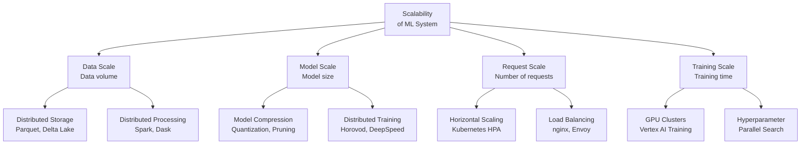
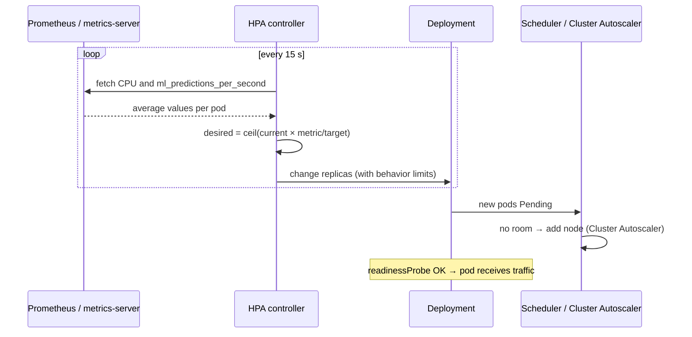
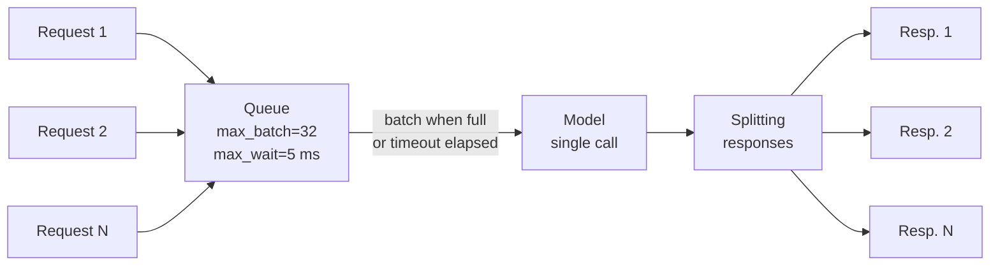
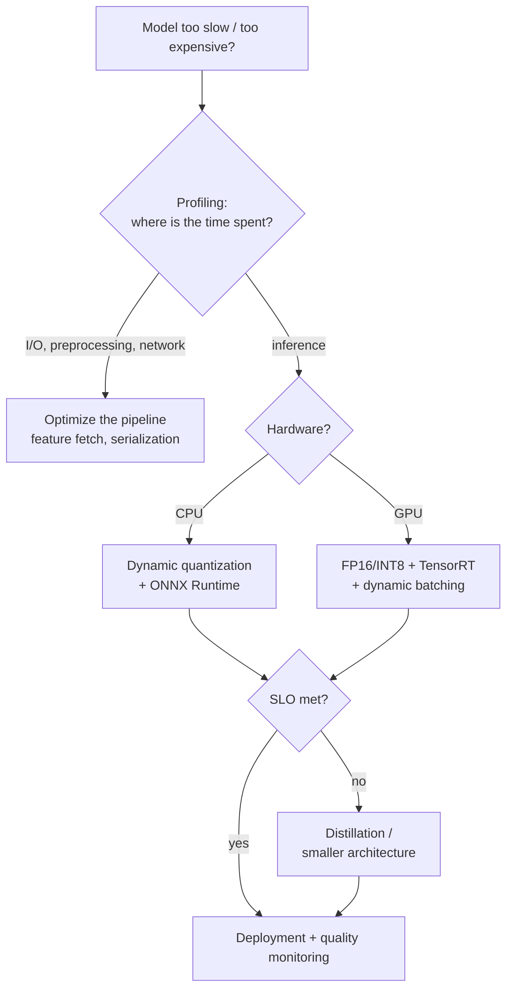
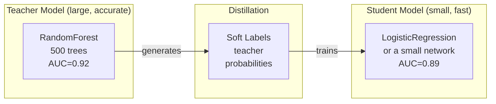
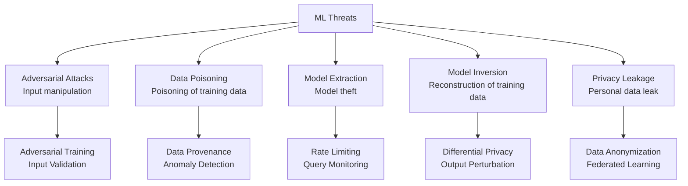
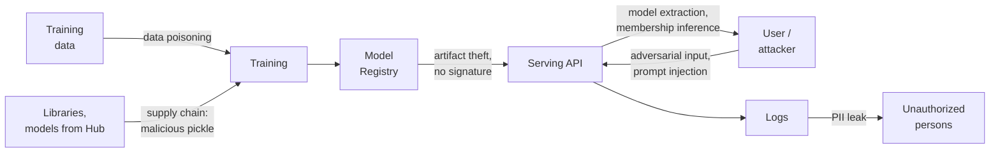
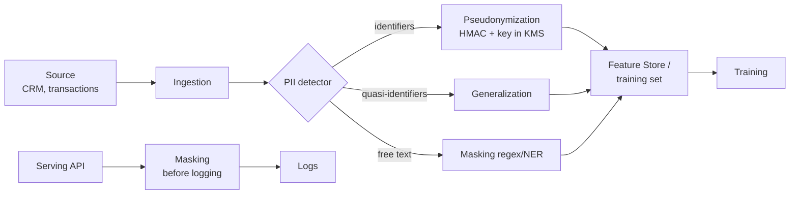
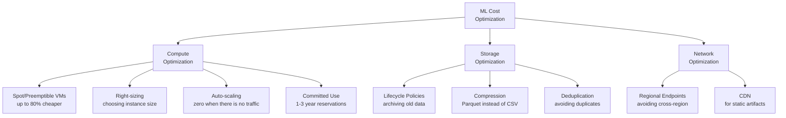
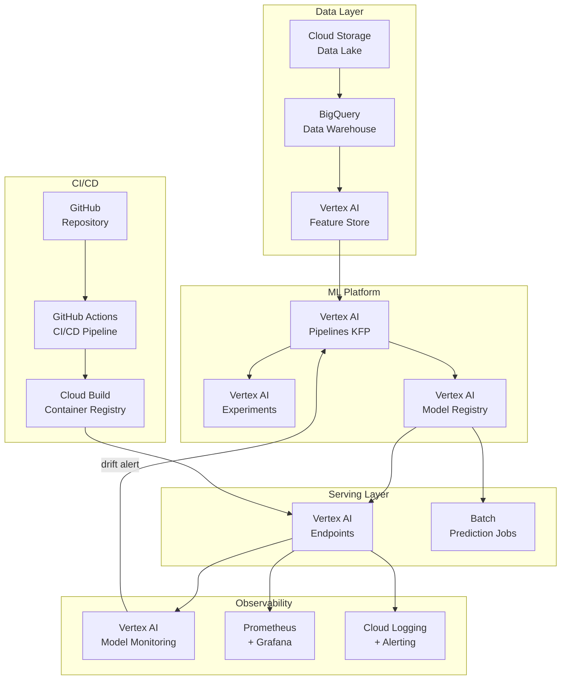

# Lecture 8: Scalability, Security and Cost Optimization in MLOps

## Lecture Goal
After this lecture, the student:
- understands scaling patterns for ML systems,
- knows model optimization techniques (quantization, pruning, distillation),
- can secure an ML system (IAM, encryption, audit),
- knows cost optimization strategies in the cloud.

### Demo Scripts

Demo scripts are located in ``. Run them from the repository root directory (`python lectures/scripts/lecture_08/<script>`). They only require the packages from `requirements.txt` (numpy, scikit-learn, pandas, pydantic).

| Script | Section | What it shows |
|---|---|---|
| `01_batching_latency_throughput.py` | 2.3 | Impact of batch size on latency and throughput, dynamic batching simulation (p50/p95/p99) |
| `02_adversarial_and_validation.py` | 4.2 | FGSM attack on a linear model, pydantic + z-score validation, model extraction |
| `03_pii_masking.py` | 4.5 | PII masking in logs, HMAC pseudonymization, k-anonymity |

---

## 1. Scalability of ML Systems

### Dimensions of Scalability



### Vertical vs Horizontal Scaling

| Feature | Vertical (scale up) | Horizontal (scale out) |
|---|---|---|
| Mechanism | Bigger machine (more CPU/RAM/GPU) | More replicas behind a load balancer |
| Limit | Largest available instance | Practically none (cost, quota limits) |
| Availability | Single point of failure | High – a replica failure does not stop the service |
| Application requirements | None | Statelessness, shared storage/cache |
| Typical use in ML | Training a large model on 1 node, large model in RAM | Online serving, batch scoring, data processing |
| Reaction time | Minutes (restart) | Seconds–minutes (new pods, cold start) |

### Key Concepts and Laws

- **Latency** (response time of a single request, measured with percentiles p50/p95/p99) vs **throughput** (requests/predictions per second). Optimizing one often worsens the other – see batching in section 2.3.
- **Little's Law:** `L = λ · W` – average number of requests in the system = arrival rate × average time spent in the system. At 200 RPS and 50 ms latency there are on average 10 requests "in flight" in the system → we need at least that many parallel serving slots.
- **Amdahl's Law:** if only a fraction `p` of the work can be parallelized, the maximum speedup on `N` workers is `1 / ((1 - p) + p/N)`. With `p = 0.9` even infinitely many GPUs give at most 10×. That is why in distributed training reducing communication (all-reduce) and I/O is crucial.
- **Utilization and queues:** as server utilization approaches 100%, queue waiting time grows nonlinearly (M/M/1 model: `W ~ 1/(1-ρ)`). Hence HPA targets of around 60–70% CPU, not 95%.

```
latency
  ^                                   |
  |                                  /
  |                                 /    ← the "knee" of the curve: above ~70-80%
  |                              _/        utilization the queue explodes
  |                         __--
  |  ______________-----‾‾‾
  +-------------------------------------> utilization (ρ)
  0%            50%           80%  100%
```

---

## 2. Horizontal Scaling of an ML Service

### Kubernetes Horizontal Pod Autoscaler (HPA)

```yaml
# kubernetes/ml-deployment.yaml
apiVersion: apps/v1
kind: Deployment
metadata:
  name: churn-predictor
  labels:
    app: churn-predictor
    version: v2.1.0
spec:
  replicas: 3
  selector:
    matchLabels:
      app: churn-predictor
  template:
    metadata:
      labels:
        app: churn-predictor
      annotations:
        prometheus.io/scrape: "true"
        prometheus.io/port: "8000"
    spec:
      containers:
        - name: churn-api
          image: gcr.io/my-project/churn-api:v2.1.0
          ports:
            - containerPort: 8080
            - containerPort: 8000  # metrics
          resources:
            requests:
              cpu: "500m"
              memory: "512Mi"
            limits:
              cpu: "2000m"
              memory: "2Gi"
          readinessProbe:
            httpGet:
              path: /health
              port: 8080
            initialDelaySeconds: 10
            periodSeconds: 5
          livenessProbe:
            httpGet:
              path: /health
              port: 8080
            initialDelaySeconds: 30
            periodSeconds: 10
          env:
            - name: MODEL_VERSION
              value: "v2.1.0"
            - name: LOG_LEVEL
              value: "INFO"
          volumeMounts:
            - name: model-storage
              mountPath: /app/models
              readOnly: true
      volumes:
        - name: model-storage
          persistentVolumeClaim:
            claimName: model-pvc

---
apiVersion: autoscaling/v2
kind: HorizontalPodAutoscaler
metadata:
  name: churn-predictor-hpa
spec:
  scaleTargetRef:
    apiVersion: apps/v1
    kind: Deployment
    name: churn-predictor
  minReplicas: 2
  maxReplicas: 20
  metrics:
    # Scaling based on CPU
    - type: Resource
      resource:
        name: cpu
        target:
          type: Utilization
          averageUtilization: 70
    # Scaling based on a custom metric (RPS)
    - type: Pods
      pods:
        metric:
          name: ml_predictions_per_second
        target:
          type: AverageValue
          averageValue: "100"
  behavior:
    scaleUp:
      stabilizationWindowSeconds: 60
      policies:
        - type: Pods
          value: 4
          periodSeconds: 60
    scaleDown:
      stabilizationWindowSeconds: 300  # 5 minutes before scaling down
```

> ℹ️ **Note on the manifest:** `prometheus.io/port: "8000"` points to a separate metrics port – a `/metrics` endpoint must actually run in the container (e.g. `prometheus_client.start_http_server(8000)`). The `ml_predictions_per_second` metric of type `Pods` requires an installed **Prometheus Adapter** (or KEDA) that exposes it through the Custom Metrics API – HPA itself does not read Prometheus.

### How HPA Works – the Algorithm

Every ~15 s HPA computes the desired number of replicas:

```
desiredReplicas = ceil( currentReplicas × currentMetricValue / targetMetricValue )
```

Example: 4 replicas, average CPU 105%, target 70% → `ceil(4 × 105/70) = 6`. With multiple metrics HPA picks the **largest** computed value. The `behavior` section limits the rate of change (prevents "flapping").



### Comparison of Autoscaling Mechanisms

| Mechanism | What it scales | Signal | Scale-to-zero | When to use |
|---|---|---|---|---|
| HPA | Number of pods | CPU/RAM, custom metrics | No (min 1) | Steady online traffic |
| VPA | Pod requests/limits | Historical usage | No | Right-sizing, batch jobs |
| KEDA | Number of pods | Queues (Kafka, Pub/Sub), Prometheus, cron | Yes | Event-driven traffic, inference queues |
| Knative / KServe | Number of pods | Request concurrency | Yes | Serverless inference, many rarely used models |
| Cluster Autoscaler | Number of nodes | Pending pods | – | Always together with HPA/KEDA |

### Cold Start of ML Models

Scaling models is slower than scaling regular APIs: pulling the image (often several GB with CUDA), downloading weights (hundreds of MB – tens of GB), loading onto the GPU, warmup (JIT compilation, memory allocation). Typical techniques:

- **small images** (multi-stage build, `python:3.x-slim`, no build tools),
- **weights outside the image** (PVC/GCS + node-level cache) or the opposite – baked into the image for predictability,
- **`startupProbe`** instead of a long `initialDelaySeconds` in `livenessProbe` – we don't kill the pod while the model is loading,
- **capacity headroom** (`minReplicas` > 1, overprovisioning with low-priority pods),
- **predictive scaling** – scaling ahead of a known peak (CronJob / KEDA cron trigger).

```yaml
# container fragment – startupProbe for a slowly loading model
startupProbe:
  httpGet:
    path: /health/ready
    port: 8080
  periodSeconds: 5
  failureThreshold: 60     # up to 5 minutes to load the model
livenessProbe:
  httpGet:
    path: /health/live
    port: 8080
  periodSeconds: 10
```

### Load Testing with Locust

```python
# locustfile.py
from locust import HttpUser, task, between
import json
import random

class MLServiceUser(HttpUser):
    """Simulates a user of the ML service."""
    
    wait_time = between(0.1, 1.0)  # time between requests
    
    def on_start(self):
        """User initialization."""
        # Check health before the tests
        response = self.client.get("/health")
        assert response.status_code == 200
    
    @task(10)  # weight 10 - the most frequent request
    def predict_single(self):
        """Single prediction test."""
        payload = {
            "user_id": random.randint(1, 100000),
            "age": random.uniform(18, 80),
            "income": random.uniform(20000, 150000),
            "tenure_months": random.randint(1, 120),
            "num_products": random.randint(1, 5)
        }
        
        with self.client.post(
            "/predict",
            json=payload,
            catch_response=True
        ) as response:
            if response.status_code == 200:
                data = response.json()
                if not (0 <= data['churn_probability'] <= 1):
                    response.failure("Invalid probability")
                else:
                    response.success()
            else:
                response.failure(f"HTTP {response.status_code}")
    
    @task(2)  # weight 2 - a less frequent request
    def predict_batch(self):
        """Batch prediction test."""
        batch_size = random.randint(10, 100)
        payload = [
            {
                "user_id": i,
                "age": random.uniform(18, 80),
                "income": random.uniform(20000, 150000),
                "tenure_months": random.randint(1, 120),
                "num_products": random.randint(1, 5)
            }
            for i in range(batch_size)
        ]
        
        self.client.post("/predict/batch", json=payload)
    
    @task(1)
    def health_check(self):
        """Health check test."""
        self.client.get("/health")

# Running:
# locust -f locustfile.py --host=http://localhost:8080 --users=100 --spawn-rate=10
```

### Types of Performance Tests

| Test | Traffic profile | Question it answers |
|---|---|---|
| Load test | Expected traffic (e.g. 200 RPS) for 15–30 min | Do we meet the SLO under normal load? |
| Stress test | Increasing traffic until failure | Where is the breaking point and how does the system degrade? |
| Spike test | Sudden 10× jump | Will autoscaling keep up? How long is the cold start? |
| Soak test | Steady traffic for many hours | Memory leaks, growing queues, cache degradation |

**Good practices:** test in an environment close to production (the same CPU/RAM limits), use a realistic distribution of input data (e.g. samples from logs after anonymization), report percentiles, not the mean, and store the results as an artifact in CI to detect performance regressions between model versions.

### 2.3 Batching – Latency vs Throughput

Every model call has a **fixed cost** (framework overhead, serialization, GPU kernel launch) and a **variable cost** (proportional to the number of examples). Grouping requests into a batch spreads the fixed cost across many predictions – on a GPU the difference can be 10–100×.



| Mode | Latency | Throughput | Example tools |
|---|---|---|---|
| No batching | Lowest at low traffic | Low | Simple FastAPI |
| Dynamic (server-side) batching | + `max_wait` | High | Triton Inference Server, TorchServe, BentoML, Ray Serve |
| Continuous batching (LLM) | Low despite varying response lengths | Very high | vLLM, TGI |
| Batch prediction (offline) | Minutes–hours | Maximum | Spark, Vertex AI Batch Prediction |

> **▶️ Live demo:** `python lectures/scripts/lecture_08/01_batching_latency_throughput.py`  
> The script measures RandomForest throughput for batches of 1–512, then simulates a queue at 800 RPS. Without batching a single worker cannot keep up and latency grows to seconds; with `max_batch=8, max_wait=2 ms` p99 drops to ~10 ms, while a longer window (20 ms) raises latency again.

**Trade-off:** we choose `max_wait` so that `max_wait + call_time(max_batch)` fits within the SLO latency budget (e.g. p99 < 100 ms). Batching makes sense mainly for models with a large fixed cost (neural networks, GPU); for very lightweight models (logistic regression) the gain is small.

---


## 3. Model Optimization

### Overview of Model Optimization Techniques

| Technique | Typical size reduction | Speedup | Quality loss | Implementation cost |
|---|---|---|---|---|
| Dynamic quantization (INT8) | ~4× for Linear weights | 1.5–3× on CPU | Usually <1 p.p. | Low (1 line of code) |
| Static quantization / QAT | ~4× | 2–4× | Very small (QAT) | Medium (calibration / retraining) |
| Pruning (unstructured) | 2–10× (after compression) | Small without sparse kernels | Depends on the degree | Medium |
| Pruning (structured – channels/layers) | 1.5–3× | Real | Requires fine-tuning | Medium |
| Knowledge distillation | 2–100× | 2–100× | 1–3 p.p. | High (new training) |
| Export to ONNX Runtime / TensorRT | – | 1.5–5× | None (FP32) / small (FP16) | Low–medium |
| Caching | – | ∞ for hits | Risk of stale results | Low |



### 3.1 Quantization – Reducing Precision

**Theory.** Quantization maps floating-point numbers to integers: `q = round(x / scale) + zero_point`, where `scale = (max - min) / 255` for INT8. We distinguish:
- **dynamic quantization** – weights quantized offline, activations "on the fly" (good for Linear/LSTM on CPU),
- **static (post-training) quantization** – activation ranges calibrated on a data sample,
- **quantization-aware training (QAT)** – simulating quantization during training, the smallest quality loss.

Pitfalls: (1) always compare quality metrics (AUC, accuracy) before and after – not just latency; (2) for very small models (like the one below) the quantization overhead can eat up the gain; (3) not every hardware has fast INT8 instructions.

```python
import torch
import torch.nn as nn
import numpy as np
import time

class SimpleModel(nn.Module):
    def __init__(self, input_dim: int = 20):
        super().__init__()
        self.layers = nn.Sequential(
            nn.Linear(input_dim, 128),
            nn.ReLU(),
            nn.Linear(128, 64),
            nn.ReLU(),
            nn.Linear(64, 1),
            nn.Sigmoid()
        )
    
    def forward(self, x):
        return self.layers(x)

def benchmark_model(model, input_data: torch.Tensor, n_runs: int = 1000) -> dict:
    """Measures model performance."""
    model.eval()
    
    # Warmup
    with torch.no_grad():
        for _ in range(10):
            model(input_data)
    
    # Benchmark
    start = time.time()
    with torch.no_grad():
        for _ in range(n_runs):
            output = model(input_data)
    elapsed = time.time() - start
    
    return {
        "avg_latency_ms": elapsed / n_runs * 1000,
        "throughput_rps": n_runs / elapsed
    }

# Original model (FP32)
model_fp32 = SimpleModel()
input_data = torch.randn(1, 20)

# Dynamic Quantization (INT8)
model_int8 = torch.quantization.quantize_dynamic(
    model_fp32,
    {nn.Linear},
    dtype=torch.qint8
)

# Comparison
fp32_stats = benchmark_model(model_fp32, input_data)
int8_stats = benchmark_model(model_int8, input_data)

# Model sizes
import io
def get_model_size_mb(model) -> float:
    buffer = io.BytesIO()
    torch.save(model.state_dict(), buffer)
    return buffer.tell() / 1024 / 1024

fp32_size = get_model_size_mb(model_fp32)
int8_size = get_model_size_mb(model_int8)

print("=== FP32 vs INT8 comparison ===")
print(f"FP32: {fp32_size:.2f} MB, latency: {fp32_stats['avg_latency_ms']:.3f}ms")
print(f"INT8: {int8_size:.2f} MB, latency: {int8_stats['avg_latency_ms']:.3f}ms")
print(f"Size reduction: {(1 - int8_size/fp32_size)*100:.0f}%")
print(f"Speedup: {fp32_stats['avg_latency_ms']/int8_stats['avg_latency_ms']:.1f}x")
```

### 3.2 Knowledge Distillation

**Theory (Hinton et al., 2015).** The student learns not only from hard labels but from the teacher's **soft probabilities**, which carry information about class similarity ("dark knowledge"). Loss function: `L = α · CE(y, p_student) + (1-α) · T² · KL(softmax(z_t/T) ‖ softmax(z_s/T))`, where `T` – the temperature smoothing the distribution.



```python
import numpy as np
from sklearn.ensemble import RandomForestClassifier
from sklearn.linear_model import LogisticRegression
from sklearn.datasets import make_classification
from sklearn.model_selection import train_test_split
from sklearn.metrics import roc_auc_score
import time

# Data
X, y = make_classification(n_samples=50000, n_features=20, random_state=42)
X_train, X_test, y_train, y_test = train_test_split(X, y, test_size=0.2, random_state=42)

# Teacher: large Random Forest
teacher = RandomForestClassifier(n_estimators=500, max_depth=15, random_state=42, n_jobs=-1)
teacher.fit(X_train, y_train)

# Generating soft labels (temperature T=2 smooths the distribution)
T = 2.0
teacher_probs = teacher.predict_proba(X_train)
soft_labels = teacher_probs[:, 1]  # probability of the positive class

# Student: small logistic regression trained on soft labels
# NOTE: thresholding soft_labels > 0.5 turns them back into hard labels –
# in practice this is "model mimicry", not full distillation. The version on soft
# labels is in the block below (regression on the teacher's logits).
student = LogisticRegression(C=1.0, max_iter=1000, random_state=42)
student.fit(X_train, soft_labels > 0.5)

# Comparison
teacher_auc = roc_auc_score(y_test, teacher.predict_proba(X_test)[:, 1])
student_auc = roc_auc_score(y_test, student.predict_proba(X_test)[:, 1])

# Latency
sample = X_test[:1]
t0 = time.time()
for _ in range(1000): teacher.predict_proba(sample)
teacher_latency = (time.time() - t0) / 1000 * 1000

t0 = time.time()
for _ in range(1000): student.predict_proba(sample)
student_latency = (time.time() - t0) / 1000 * 1000

print("=== Knowledge Distillation ===")
print(f"Teacher: AUC={teacher_auc:.4f}, latency={teacher_latency:.2f}ms")
print(f"Student: AUC={student_auc:.4f}, latency={student_latency:.2f}ms")
print(f"AUC loss: {(teacher_auc - student_auc):.4f}")
print(f"Speedup: {teacher_latency/student_latency:.1f}x")
```

Proper distillation on soft labels – the student (a linear model) regresses the teacher's **logits**, so it also learns the teacher's "confidence":

```python
from sklearn.linear_model import Ridge

eps = 1e-4
p = np.clip(teacher_probs[:, 1], eps, 1 - eps)
teacher_logits = np.log(p / (1 - p)) / T          # logits smoothed by temperature

soft_student = Ridge(alpha=1.0).fit(X_train, teacher_logits)
soft_scores = soft_student.predict(X_test)         # ranking is enough for AUC
print(f"Soft-student AUC: {roc_auc_score(y_test, soft_scores):.4f}")
```

**When distillation pays off:** high traffic (the training cost is amortized over millions of predictions), hard latency constraints (mobile, edge, real-time bidding), access to a large amount of **unlabeled** data (the teacher labels it for free). **Pitfall:** the student inherits the teacher's errors and biases – validate it on data with true labels, also in subgroups (fairness).

### 3.3 Prediction Caching

| Cache level | What it stores | Gain | Risk |
|---|---|---|---|
| Prediction cache (Redis) | Result for an identical input | No model call | Staleness after a model change → the key must contain the model version |
| Feature cache | Online features from the Feature Store | Fewer DB queries | Feature staleness |
| Embedding cache | Vectors for texts/images | Large – the embedding is often the most expensive part | Memory usage |
| Precomputed batch | Predictions computed overnight for all users | Latency = KV read | No reaction to changes during the day |

> ⚠️ The cache key should contain the **model version** (e.g. `pred:v2.1.0:<hash>`), otherwise after deploying a new model we serve old predictions for the duration of the TTL. MD5 is acceptable here (it is not used cryptographically), but for pseudonymizing personal data use HMAC (section 4.5).

```python
import hashlib
import json
import time
from functools import lru_cache
from typing import Optional
import redis

class PredictionCache:
    """Prediction cache with Redis."""
    
    def __init__(
        self,
        redis_client: redis.Redis,
        ttl_seconds: int = 3600,
        cache_threshold: float = 0.05  # cache only when prob < 0.05 or > 0.95
    ):
        self.redis = redis_client
        self.ttl = ttl_seconds
        self.threshold = cache_threshold
        self._hits = 0
        self._misses = 0
    
    def _make_key(self, features: dict) -> str:
        """Creates a cache key from the features."""
        # Round numeric values (avoid float issues)
        rounded = {k: round(v, 2) if isinstance(v, float) else v 
                   for k, v in sorted(features.items())}
        return f"pred:{hashlib.md5(json.dumps(rounded).encode()).hexdigest()}"
    
    def get(self, features: dict) -> Optional[float]:
        """Fetches a prediction from the cache."""
        key = self._make_key(features)
        cached = self.redis.get(key)
        
        if cached is not None:
            self._hits += 1
            return float(cached)
        
        self._misses += 1
        return None
    
    def set(self, features: dict, probability: float):
        """Saves a prediction to the cache (only for confident predictions)."""
        # Cache only when the model is confident (we avoid caching borderline cases)
        if probability < self.threshold or probability > (1 - self.threshold):
            key = self._make_key(features)
            self.redis.setex(key, self.ttl, str(probability))
    
    @property
    def hit_rate(self) -> float:
        total = self._hits + self._misses
        return self._hits / total if total > 0 else 0.0


# Usage in the service
class CachedMLService:
    def __init__(self, model, cache: PredictionCache):
        self.model = model
        self.cache = cache
    
    def predict(self, features: dict) -> dict:
        # Check the cache
        cached_prob = self.cache.get(features)
        
        if cached_prob is not None:
            return {
                "probability": cached_prob,
                "source": "cache",
                "latency_ms": 0.1
            }
        
        # Compute the prediction
        t0 = time.time()
        X = [[features[k] for k in sorted(features.keys())]]
        probability = float(self.model.predict_proba(X)[0][1])
        latency = (time.time() - t0) * 1000
        
        # Save to the cache
        self.cache.set(features, probability)
        
        return {
            "probability": probability,
            "source": "model",
            "latency_ms": latency
        }
```

---

## 4. Security of ML Systems

### 4.1 ML-Specific Threats



### Attack Surface in the ML Lifecycle



| Threat | Stage | Attacker's goal | Example | Main safeguards |
|---|---|---|---|---|
| Evasion (adversarial) | Inference | Bypassing the model | A fraudster changes the amount 10,000 → 9,990 | Adversarial training, business rules, ensemble |
| Data poisoning | Training | Influencing model behavior / backdoor | Fake reviews in retraining data | Data provenance, data validation, manual approval |
| Model extraction | Inference | IP theft | Thousands of queries and training a copy | Rate limiting, returning only labels, watermarking |
| Membership inference | Inference | Was the record in training? | Establishing that a patient took part in a study | Differential privacy, regularization |
| Supply chain | Build | Code execution | `pickle.load` of a malicious model from the internet | `safetensors`/ONNX, scanning, signatures (Sigstore) |
| Prompt injection (LLM) | Inference | Hijacking instructions | "Ignore previous instructions…" | Separation of data and instructions, filters, least privilege for tools |

Useful threat catalogs: **MITRE ATLAS** (attack tactics against ML), **OWASP Machine Learning Security Top 10** and **OWASP Top 10 for LLM Applications**.

### 4.2 Input Validation and Sanitization

**Adversarial attack (FGSM).** For a model with input gradient `∇x L` the attacker creates `x_adv = x + ε · sign(∇x L)`. For a linear model the gradient is simply the weight vector `w`, so it is enough to shift each feature by `ε` "towards" the negative class. Key observation: the perturbation is **small in each feature**, so it passes through simple range validators.

```
  feature 2
    ^         class "fraud"
    |      x •
    |        \  ε·sign(w)
    |---------\----------- decision boundary
    |          • x_adv     class "OK"
    +---------------------> feature 1
```

Input validation is the **first layer** of defense (defense in depth): it rejects wrong types, NaN, out-of-domain values and obvious anomalies, but it will not stop a sophisticated attack. Further layers: business rules, input distribution monitoring (lecture 6), adversarial training, human in the loop for high-risk decisions.

> ℹ️ The code below uses the **pydantic v1** API (`@validator`). In the project (`pydantic>=2.8`) use `@field_validator` with `@classmethod` – an example is in the `02_adversarial_and_validation.py` script. Also note that `Field(ge=18)` already enforces age ≥ 18, so the condition in the validator is redundant (left for illustration).


```python
from pydantic import BaseModel, Field, validator
from typing import Optional
import numpy as np
import logging

logger = logging.getLogger(__name__)

class SecurePredictionRequest(BaseModel):
    """Secure request schema with validation."""
    
    user_id: int = Field(..., gt=0, lt=10_000_000)
    age: float = Field(..., ge=18, le=100)
    income: float = Field(..., ge=0, le=10_000_000)
    tenure_months: int = Field(..., ge=0, le=600)
    num_products: int = Field(..., ge=1, le=20)
    
    @validator('age')
    def age_must_be_adult(cls, v):
        if v < 18:
            raise ValueError("Age must be >= 18")
        return round(v, 1)  # round to 1 decimal place
    
    @validator('income')
    def income_sanity_check(cls, v):
        if v > 5_000_000:
            logger.warning(f"Suspiciously high income: {v}")
        return round(v, 2)

class InputValidator:
    """Input validator for the ML service."""
    
    def __init__(self, reference_stats: dict):
        """
        Args:
            reference_stats: statistics from the training data
                {'age': {'mean': 40, 'std': 10, 'min': 18, 'max': 90}, ...}
        """
        self.stats = reference_stats
        self._anomaly_count = 0
    
    def validate_features(self, features: dict) -> tuple[bool, list[str]]:
        """
        Checks whether the features are within a reasonable range.
        
        Returns:
            (is_valid, list_of_warnings)
        """
        warnings = []
        
        for feature, value in features.items():
            if feature not in self.stats:
                continue
            
            stat = self.stats[feature]
            mean, std = stat['mean'], stat['std']
            
            # Check whether the value is within mean ± 5*std
            z_score = abs(value - mean) / max(std, 1e-6)
            if z_score > 5:
                warnings.append(
                    f"Feature '{feature}' has value {value:.2f} "
                    f"(z-score={z_score:.1f} > 5)"
                )
                self._anomaly_count += 1
        
        is_valid = len(warnings) == 0
        if not is_valid:
            logger.warning(f"Input anomalies: {warnings}")
        
        return is_valid, warnings

# Usage example
reference_stats = {
    'age': {'mean': 40, 'std': 10, 'min': 18, 'max': 90},
    'income': {'mean': 50000, 'std': 15000, 'min': 0, 'max': 500000},
    'tenure_months': {'mean': 24, 'std': 18, 'min': 0, 'max': 240}
}

validator = InputValidator(reference_stats)

# Normal input
normal_features = {'age': 35, 'income': 55000, 'tenure_months': 24}
is_valid, warnings = validator.validate_features(normal_features)
print(f"Normal: valid={is_valid}, warnings={warnings}")

# Suspicious input (potential adversarial attack)
suspicious_features = {'age': 999, 'income': -1, 'tenure_months': 10000}
is_valid, warnings = validator.validate_features(suspicious_features)
print(f"Suspicious: valid={is_valid}, warnings={warnings}")
```

> ⚠️ In the example the variable `validator` shadows the `validator` decorator imported from pydantic – in a real module name it e.g. `input_validator`.

> **▶️ Live demo:** `python lectures/scripts/lecture_08/02_adversarial_and_validation.py`  
> The script shows that a perturbation of ε=1.0 flips 100% of detected frauds, while the z-score validator stops them only at ε=5. Additionally, a copy of the model trained on just 50 API responses agrees with the original in ~98% of cases – an argument for rate limiting and limiting the information in the response.

### 4.3 Rate Limiting and API Protection


```python
from fastapi import FastAPI, Request, HTTPException
from fastapi.middleware.trustedhost import TrustedHostMiddleware
import time
from collections import defaultdict
import asyncio

class RateLimiter:
    """Simple rate limiter based on a sliding window."""
    
    def __init__(self, max_requests: int = 100, window_seconds: int = 60):
        self.max_requests = max_requests
        self.window = window_seconds
        self._requests: dict[str, list[float]] = defaultdict(list)
    
    def is_allowed(self, client_id: str) -> tuple[bool, dict]:
        """Checks whether the client may make a request."""
        now = time.time()
        window_start = now - self.window
        
        # Remove old requests
        self._requests[client_id] = [
            t for t in self._requests[client_id] if t > window_start
        ]
        
        current_count = len(self._requests[client_id])
        
        if current_count >= self.max_requests:
            return False, {
                "error": "Rate limit exceeded",
                "limit": self.max_requests,
                "window_seconds": self.window,
                "retry_after": int(self._requests[client_id][0] + self.window - now)
            }
        
        self._requests[client_id].append(now)
        return True, {
            "remaining": self.max_requests - current_count - 1,
            "reset_at": int(window_start + self.window)
        }

app = FastAPI()
rate_limiter = RateLimiter(max_requests=100, window_seconds=60)

@app.middleware("http")
async def rate_limit_middleware(request: Request, call_next):
    """Rate limiting middleware."""
    # Client identification (IP or API key)
    client_id = request.headers.get("X-API-Key") or request.client.host
    
    allowed, info = rate_limiter.is_allowed(client_id)
    
    if not allowed:
        raise HTTPException(
            status_code=429,
            detail=info,
            headers={"Retry-After": str(info.get("retry_after", 60))}
        )
    
    response = await call_next(request)
    response.headers["X-RateLimit-Remaining"] = str(info.get("remaining", 0))
    return response
```

> ⚠️ **Correction:** in FastAPI/Starlette middleware, `raise HTTPException` is **not** handled by the exception handler (middleware runs outside the router) – it will end with a 500 error. In middleware, return the response directly:
>
> ```python
> from fastapi.responses import JSONResponse
> if not allowed:
>     return JSONResponse(status_code=429, content=info,
>                         headers={"Retry-After": str(info.get("retry_after", 60))})
> ```
>
> Moreover, an in-process memory limiter does not work correctly with multiple replicas (each counts separately) – in production we keep the state in Redis or delegate limiting to an API Gateway (Envoy, Kong, Cloud Armor).

| Algorithm | Principle | Advantages | Disadvantages |
|---|---|---|---|
| Fixed window | Counter per window (e.g. a minute) | Simple, cheap | Double burst at window boundaries |
| Sliding window log | List of timestamps (as above) | Accurate | Memory O(number of requests) |
| Token bucket | Tokens added at a constant rate | Allows controlled bursts | Harder to distribute |
| Leaky bucket | Queue with a constant outflow rate | Smooths traffic | Adds delay |

### 4.4 Differential Privacy


```python
import numpy as np

class DifferentialPrivacyMechanism:
    """
    Implementation of the Laplace mechanism for differential privacy.
    
    Differential Privacy guarantees that the results of queries to the model
    do not reveal information about specific training records.
    """
    
    def __init__(self, epsilon: float = 1.0, sensitivity: float = 1.0):
        """
        Args:
            epsilon: privacy parameter (smaller = more privacy)
            sensitivity: function sensitivity (max change when removing 1 record)
        """
        self.epsilon = epsilon
        self.sensitivity = sensitivity
        self.scale = sensitivity / epsilon
    
    def add_noise(self, value: float) -> float:
        """Adds Laplace noise to a value."""
        noise = np.random.laplace(0, self.scale)
        return value + noise
    
    def privatize_prediction(self, probability: float) -> float:
        """Adds noise to the model prediction."""
        noisy_prob = self.add_noise(probability)
        return float(np.clip(noisy_prob, 0, 1))
    
    def privatize_statistics(self, values: np.ndarray) -> dict:
        """Computes private statistics."""
        return {
            "mean": self.add_noise(float(values.mean())),
            "count": int(self.add_noise(len(values))),
            "std": max(0, self.add_noise(float(values.std())))
        }

# Example
dp = DifferentialPrivacyMechanism(epsilon=0.5)

true_probability = 0.85
private_probability = dp.privatize_prediction(true_probability)
print(f"True probability: {true_probability:.4f}")
print(f"Private probability: {private_probability:.4f}")
print(f"Noise: {abs(true_probability - private_probability):.4f}")
```

**Definition.** A mechanism `M` is `ε`-differentially private if for any two datasets `D`, `D'` differing in one record and every output `S`: `P[M(D) ∈ S] ≤ e^ε · P[M(D') ∈ S]`. The Laplace mechanism achieves this by adding noise `Lap(Δf/ε)`, where `Δf` is the sensitivity of the function.

| ε | Privacy | Utility | Example application |
|---|---|---|---|
| 0.1 | Very strong | Low (large noise) | Statistics on very sensitive medical data |
| 1 | Strong | Medium | Published aggregates, analytics |
| 8–10 | Moderate | High | DP-SGD in network training (e.g. Apple, Google Gboard) |

**Pitfalls:** (1) the privacy budget **adds up** – each subsequent query consumes ε, so it must be accounted for; (2) in the code above `privatize_statistics` spends 3·ε (three queries); (3) `count` has sensitivity 1, but `mean` depends on the data range – sensitivity must be determined after clipping the values. For training models with DP, **DP-SGD** (per-example gradient clipping + noise) is used, e.g. the Opacus (PyTorch) and TensorFlow Privacy libraries.

### 4.5 Protection of Personal Data (PII) in the ML Pipeline

GDPR requires data minimization, purpose limitation and the right to erasure. In ML systems personal data "leaks" in non-obvious places: request/response logs, feature store, training sets in DVC, MLflow artifacts, monitoring dashboards.

| Technique | Reversible? | Preserves joins? | GDPR status | When to use |
|---|---|---|---|---|
| Removing the column | No | No | No personal data | Feature not needed by the model |
| Masking (`<EMAIL>`) | No | No | Text anonymization | Logs, free text |
| Pseudonymization (keyed HMAC) | Only with the key/table | Yes | Still personal data | Table join keys, feature store |
| Tokenization (vault) | Yes (via the vault) | Yes | Personal data | Payments, card numbers |
| Generalization (age → range) | No | Partially | May lead to anonymization (k-anonymity) | Sharing datasets, analytics |
| Differential privacy | No | – | Strong mathematical guarantee | Aggregates, training on sensitive data |



> **▶️ Live demo:** `python lectures/scripts/lecture_08/03_pii_masking.py`  
> The script masks e-mail, phone, PESEL and IBAN in logs, pseudonymizes identifiers with HMAC-SHA256 and shows that generalizing age and postal code raises k-anonymity from k=1 (every record unique) to k≥10. The output goes to ``.

**Pitfalls:** a plain hash (SHA-256 without a key) of an e-mail or PESEL is easy to reverse with a dictionary attack – the PESEL space is ~10¹⁰ values; regexes will not catch everything (names, addresses in text) – for text NER models are used (e.g. Microsoft Presidio); the model itself can "memorize" PII (especially LLMs) – hence DP and deduplication of training data.

### 4.6 IAM, Secrets, Encryption and Audit

- **Least privilege:** separate service accounts for the training pipeline (data read, registry write) and the inference service (model read only). No JSON keys in the repository – Workload Identity / IRSA.
- **Secrets:** Secret Manager / Vault / Kubernetes Secrets (with etcd encryption), key rotation, repo scanning (gitleaks, pre-commit).
- **Encryption:** at rest (CMEK/KMS for buckets with data and models), in transit (TLS, mTLS in a service mesh).
- **Artifact integrity:** sign images and models (Sigstore/cosign), store the model hash in the registry, prefer `safetensors`/ONNX over `pickle`/`joblib` for models from untrusted sources – pickle deserialization can execute arbitrary code.
- **Audit:** every prediction in high-risk systems should have a `request_id`, model version, feature version and timestamp (AI Act requirement for high-risk systems – event logging).

```yaml
# Kubernetes: minimal privileges for the inference container
securityContext:
  runAsNonRoot: true
  runAsUser: 10001
  readOnlyRootFilesystem: true
  allowPrivilegeEscalation: false
  capabilities:
    drop: ["ALL"]
```


---

## 5. Cloud Cost Optimization

### 5.1 Saving Strategies



### Compute Purchasing Models

| Model | Discount vs on-demand | Risk | Fits |
|---|---|---|---|
| On-demand | 0% | None | Experiments, unpredictable traffic |
| Spot / Preemptible | 60–90% | Preemption with ~30 s warning | Training with checkpoints, batch scoring, HPO |
| Committed use / Reserved / Savings Plans | 30–70% | You pay even without usage | Steady serving traffic (baseline) |
| Serverless (Cloud Run, Lambda) | – | Cold start, limits | Rare, irregular traffic, CPU models |

**Mixed pattern:** serving baseline on reserved instances, peaks on on-demand (HPA), training on spot with a checkpoint every N steps. Training on spot **must** be resumable – save the model state, optimizer state and position in the data to GCS/S3.

### Unit Economics – Cost per 1000 Predictions

The most useful FinOps metric for ML is **cost per business unit** (1000 predictions, one customer, one transaction). Example: a node at $0.10/h serves 100 RPS at 50% utilization → `0.10 / (100 × 3600) × 1000 ≈ $0.00028` per 1000 predictions. If traffic drops to 1 RPS, the unit cost grows 100× – that is why scale-to-zero and sharing nodes among many models (multi-model serving) matter so much.

### 5.2 Cost Monitoring

```python
import pandas as pd
from datetime import datetime, timedelta
from dataclasses import dataclass

@dataclass
class MLCostTracker:
    """Tracking the costs of ML operations."""
    
    # GCP prices (USD) - examples
    TRAINING_GPU_HOUR = 2.48      # n1-standard-8 + T4 GPU
    TRAINING_CPU_HOUR = 0.38      # n1-standard-8
    ENDPOINT_HOUR = 0.10          # per node
    STORAGE_GB_MONTH = 0.02       # Cloud Storage Standard
    BIGQUERY_TB_QUERY = 5.00      # BigQuery on-demand
    
    def estimate_training_cost(
        self,
        duration_hours: float,
        use_gpu: bool = True,
        n_nodes: int = 1
    ) -> dict:
        """Estimates the training cost."""
        rate = self.TRAINING_GPU_HOUR if use_gpu else self.TRAINING_CPU_HOUR
        cost = rate * duration_hours * n_nodes
        
        return {
            "duration_hours": duration_hours,
            "n_nodes": n_nodes,
            "use_gpu": use_gpu,
            "cost_usd": round(cost, 2),
            "cost_pln": round(cost * 4.0, 2)  # approximate exchange rate
        }
    
    def estimate_serving_cost(
        self,
        requests_per_day: int,
        avg_latency_ms: float = 50,
        n_replicas: int = 2
    ) -> dict:
        """Estimates the monthly serving cost."""
        # Endpoint cost (per hour)
        endpoint_monthly = self.ENDPOINT_HOUR * 24 * 30 * n_replicas
        
        # Estimated cost per request
        cost_per_request = endpoint_monthly / (requests_per_day * 30)
        
        return {
            "requests_per_day": requests_per_day,
            "n_replicas": n_replicas,
            "monthly_cost_usd": round(endpoint_monthly, 2),
            "cost_per_1k_requests_usd": round(cost_per_request * 1000, 4)
        }
    
    def recommend_optimizations(self, monthly_cost_usd: float) -> list[str]:
        """Recommends cost optimizations."""
        recommendations = []
        
        if monthly_cost_usd > 500:
            recommendations.append(
                "💡 Consider Committed Use Discounts (1-3 years) - savings up to 57%"
            )
        
        recommendations.extend([
            "💡 Use Spot/Preemptible VMs for training - savings up to 80%",
            "💡 Configure auto-scaling with minReplicas=0 for dev/staging environments",
            "💡 Archive data older than 90 days to Coldline Storage",
            "💡 Use Parquet instead of CSV - size reduction of 60-80%",
            "💡 Enable KFP pipeline caching - avoid retraining",
            "💡 Monitor and remove unused Endpoints"
        ])
        
        return recommendations

# Usage example
tracker = MLCostTracker()

# Training cost
training = tracker.estimate_training_cost(
    duration_hours=4,
    use_gpu=True,
    n_nodes=2
)
print(f"Training cost: ${training['cost_usd']} ({training['cost_pln']} PLN)")

# Serving cost
serving = tracker.estimate_serving_cost(
    requests_per_day=100_000,
    n_replicas=3
)
print(f"Monthly serving cost: ${serving['monthly_cost_usd']}")
print(f"Cost per 1000 requests: ${serving['cost_per_1k_requests_usd']}")

# Recommendations
recs = tracker.recommend_optimizations(serving['monthly_cost_usd'])
print("\nOptimization recommendations:")
for rec in recs:
    print(f"  {rec}")
```

---

## 6. Distributed Training

### Horovod – Distributed Training

```python
import horovod.torch as hvd
import torch
import torch.nn as nn
from torch.utils.data import DataLoader, TensorDataset, DistributedSampler

def train_distributed(model, X_train, y_train, epochs=10, lr=0.001):
    """
    Trains the model in distributed mode with Horovod.
    
    Running:
        horovodrun -np 4 python train_distributed.py
    """
    # Horovod initialization
    hvd.init()
    
    # Assigning a GPU to the process
    if torch.cuda.is_available():
        torch.cuda.set_device(hvd.local_rank())
        device = torch.device(f'cuda:{hvd.local_rank()}')
    else:
        device = torch.device('cpu')
    
    model = model.to(device)
    
    # Scaling the learning rate proportionally to the number of workers
    optimizer = torch.optim.Adam(model.parameters(), lr=lr * hvd.size())
    
    # Distributed optimizer
    optimizer = hvd.DistributedOptimizer(
        optimizer,
        named_parameters=model.named_parameters()
    )
    
    # Broadcast parameters from rank 0 to all workers
    hvd.broadcast_parameters(model.state_dict(), root_rank=0)
    hvd.broadcast_optimizer_state(optimizer, root_rank=0)
    
    # Distributed sampler - each worker gets a different part of the data
    dataset = TensorDataset(
        torch.FloatTensor(X_train),
        torch.FloatTensor(y_train)
    )
    sampler = DistributedSampler(
        dataset,
        num_replicas=hvd.size(),
        rank=hvd.rank()
    )
    loader = DataLoader(dataset, batch_size=256, sampler=sampler)
    
    criterion = nn.BCELoss()
    
    for epoch in range(epochs):
        sampler.set_epoch(epoch)
        model.train()
        
        for X_batch, y_batch in loader:
            X_batch, y_batch = X_batch.to(device), y_batch.to(device)
            
            optimizer.zero_grad()
            output = model(X_batch).squeeze()
            loss = criterion(output, y_batch)
            loss.backward()
            optimizer.step()
        
        # Log only from rank 0
        if hvd.rank() == 0:
            print(f"Epoch {epoch+1}/{epochs}, Loss: {loss.item():.4f}")
    
    return model
```


---

## 7. MLOps Reference Architecture



---

## 8. Common Pitfalls in ML Scalability and Security

> ⚠️ **Pitfall 1: Premature optimization**
> The team spends weeks on quantization and distillation of a model that serves 10 requests per minute. Measure first, then optimize. Profiling before optimization!

> ⚠️ **Pitfall 2: No load tests before deployment**
> The model works great on a laptop but falls over at 100 RPS in production. Always run load tests (Locust) before deployment.

> ⚠️ **Pitfall 3: Ignoring GPU costs**
> Leaving GPU instances running overnight/over the weekend. One instance with a T4 GPU costs ~$2.50/h = ~$1800/month. Use auto-scaling with minReplicas=0 for dev environments.

> ⚠️ **Pitfall 4: No protection against adversarial attacks**
> The model is publicly available without rate limiting and input validation. An attacker can extract the model (model extraction) or find weaknesses (adversarial examples).

> ⚠️ **Pitfall 5: Scaling on the wrong metric**
> HPA on CPU for a GPU model – CPU is low, GPU is saturated, the autoscaler does nothing. Scale on the metric that is the bottleneck (GPU utilization, queue length, concurrency, p95 latency).

> ⚠️ **Pitfall 6: PII in logs and artifacts**
> Logging full request payloads "for debugging" – after a year, logs with e-mails and PESEL numbers end up in many systems. Mask before writing and set log retention.

> ⚠️ **Pitfall 7: Loading untrusted pickle**
> `joblib.load("model_from_internet.pkl")` can execute arbitrary code. Load models only from your own registry with hash/signature verification.

> ⚠️ **Pitfall 8: Cache without the model version**
> After deploying a new model, users get the old model's predictions for an hour, because the cache key did not contain the version.

### Case Study: Uber Michelangelo — Scaling an ML Platform

**Uber** serves thousands of models (ETA, pricing, fraud) on a single platform:
- Online models served with millisecond-level latency, with features from an **online feature store** (Cassandra) and precomputed features calculated in Spark/Flink.
- **Multi-model serving** – many models in one container, so as not to pay for thousands of separate deployments.
- Takeaways: most of the latency is feature fetching, not the model itself – optimization starts with the data.

### Case Study: Attacks on ML Systems in Practice

- **Microsoft Tay (2016)** – a chatbot learning online from user utterances was "poisoned" with offensive content within a day (data poisoning through interactions). Lesson: do not learn online from untrusted input without filtering and moderation.
- **Malicious models on public hubs** – security researchers have repeatedly found models in pickle format that execute code on load. Lesson: the `safetensors` format and artifact scanning.
- **Model extraction from public APIs** (Tramèr et al., 2016) – copies of commercial ML-as-a-Service models were reconstructed from a few thousand queries, especially when the API returned full probabilities.

### Case Study: OpenAI — GPT Scalability

**OpenAI** scales GPT models to millions of users:
- They use **model parallelism** — one model is split across many GPUs (tensor parallelism, pipeline parallelism).
- **KV-cache** — a cache for the attention mechanism that drastically reduces the cost of generating subsequent tokens.
- **Quantization** — models are quantized to INT8/INT4 for inference, which reduces memory requirements 2-4x.
- GPT-4 training cost estimated at **$100M+** — cost optimization is critical.

### Case Study: Revolut — ML Security in Fintech

**Revolut** uses ML for fraud detection and must meet rigorous regulatory requirements:
- **Differential privacy** — the model must not reveal information about specific customer transactions.
- **Explainability** — regulations (GDPR, PSD2) require explainability of model decisions. They use SHAP and LIME.
- **Adversarial robustness** — the model must be resistant to circumvention attempts by fraudsters (e.g. small modifications of transaction amounts).
- **Audit trail** — the full history of model decisions is stored for 7 years.

---

## Review and Discussion Questions

1. Explain the difference between horizontal and vertical scaling. When would you use each?
2. How does quantization work and what are the trade-offs (size vs accuracy)?
3. What is knowledge distillation and when is it worth applying?
4. List three security threats specific to ML systems.
5. How does differential privacy work and when is it required?
6. What cost optimization strategies would you apply to an ML service in the cloud?
7. **Discussion:** Should an ML model be treated as a "black box" in the context of regulations (GDPR, AI Act)? What are the implications?
8. What is the latency vs throughput trade-off in dynamic batching? How do you choose `max_wait`?
9. Why is HMAC pseudonymization better than a plain SHA-256 hash, and does pseudonymized data stop being personal data?
10. Which metrics would you choose for autoscaling a model served on a GPU, and why not CPU?


### Suggested Answers

1. Vertical scaling increases the resources of a single machine (more CPU/RAM/GPU), while horizontal scaling adds more replicas/services. Vertical is simpler to start with, horizontal is better for high availability and large traffic.
2. Quantization lowers the precision of weights/activations (e.g. FP32→INT8), shrinking the model and speeding up inference. Trade-off: resource savings at the cost of a possible loss of some accuracy.
3. Knowledge distillation transfers knowledge from a large "teacher" to a smaller "student" that learns from soft predictions. It is worth using when lower latency/cheaper serving is needed while maintaining reasonable quality.
4. Example threats: adversarial examples, model extraction through mass queries, data poisoning. An additional risk is leakage of training data (privacy leakage).
5. Differential privacy adds controlled noise/statistical protection so that a single observation cannot be reconstructed from the model or its outputs. It is required especially with sensitive data and regulatory rigor (e.g. finance, healthcare).
6. Cost strategies: auto-scaling (including minReplicas=0 in dev), right-sizing CPU/GPU, using Spot/Preemptible, batching predictions, caching, environment shutdown schedules and per-model cost monitoring. Additionally, model optimization (quantization/distillation) lowers the inference cost.
7. It is increasingly rare that a model can be treated as a complete "black box", because regulations require explainability, audit and risk management. The greater the impact of a decision on the user, the greater the need for transparency of the process and results.
8. A larger batch increases throughput (the fixed cost is divided across more predictions), but requests wait for the batch to be collected. We choose `max_wait` so that the waiting time plus the call time of a full batch fits within the p99 SLO budget, and we verify it with a load test.
9. Without a key, a hash of an identifier with a small space (PESEL, e-mail) can be reversed with a dictionary attack; HMAC requires a secret key (kept in KMS). Pseudonymized data is still personal data under GDPR, because with the key it can be linked to a person.
10. GPU utilization, inference queue length, request concurrency or p95 latency – these reflect the bottleneck. CPU in a GPU service is often low despite overload, so HPA on CPU will not react.


---

## Summary

- **Scalability** is achieved through Kubernetes HPA, load balancing and distributed training.
- **Model optimization**: quantization (4x smaller model), distillation (faster student), caching (eliminating repeated computations).
- **ML security**: input validation, rate limiting, differential privacy, protection against adversarial attacks.
- **Cost optimization**: Spot VMs (80% cheaper), auto-scaling, lifecycle policies, Parquet instead of CSV.
- The reference architecture combines all MLOps components into a coherent system.
- Regulations (GDPR, AI Act) require explainability, audit trail and privacy protection.
- **Batching** increases throughput at the cost of latency – parameters are chosen for the SLO based on percentiles.
- **Personal data** is protected in layers: minimization, log masking, HMAC pseudonymization, generalization (k-anonymity) and DP.
- **Supply chain security** (signed artifacts, no untrusted pickle) and least privilege are as important as defending against adversarial attacks.

## Literature and Resources

- [Kubernetes HPA Documentation](https://kubernetes.io/docs/tasks/run-application/horizontal-pod-autoscale/)
- [PyTorch Quantization](https://pytorch.org/docs/stable/quantization.html)
- [Horovod Documentation](https://horovod.readthedocs.io/)
- [Differential Privacy – Google's DP Library](https://github.com/google/differential-privacy)
- [Google Cloud Pricing Calculator](https://cloud.google.com/products/calculator)
- [Locust Load Testing](https://locust.io/)
- [EU AI Act – Summary](https://artificialintelligenceact.eu/)
- [SHAP Documentation](https://shap.readthedocs.io/)
- [Adversarial Robustness Toolbox (ART)](https://github.com/Trusted-AI/adversarial-robustness-toolbox)
- [MITRE ATLAS](https://atlas.mitre.org/)
- [OWASP Top 10 for LLM Applications](https://owasp.org/www-project-top-10-for-large-language-model-applications/)
- [KEDA – Kubernetes Event-driven Autoscaling](https://keda.sh/)
- [Microsoft Presidio – PII detection and anonymization](https://microsoft.github.io/presidio/)
- [Opacus – DP-SGD for PyTorch](https://opacus.ai/)
- Hinton, Vinyals, Dean – *Distilling the Knowledge in a Neural Network* (2015)
- Goodfellow, Shlens, Szegedy – *Explaining and Harnessing Adversarial Examples* (2015)
