# Wykład 1: Wprowadzenie do MLOps i Inżynierii Systemów ML

## Cel wykładu
Po tym wykładzie student:
- rozumie, czym jest MLOps i dlaczego jest potrzebny,
- zna cykl życia modelu ML w produkcji,
- potrafi opisać różnice między tradycyjnym DevOps a MLOps,
- zna główne wyzwania wdrażania modeli ML.

## Skrypty do wykładu

Skrypty demonstracyjne znajdują się w `lectures/scripts/lecture_01/`. Pełną instrukcję znajdziesz w [`lectures/scripts/README.md`](scripts/README.md).

| Kiedy (sekcja) | Skrypt | Cel demonstracji |
|---|---|---|
| 4.1 Reprodukowalność | `01_reproducibility.py` | brak seeda daje różne wyniki, a z seedem wyniki są identyczne |
| 4.2–4.3 Data/Concept drift | `02_data_drift.py --plot` | test KS wykrywa data drift, ale concept drift wykryje dopiero monitoring metryk |
| 8. Prosty system MLOps | `03_simple_mlops_system.py` | rejestr modeli z automatyczną promocją lepszego modelu |

**Jak:** z katalogu głównego repozytorium, po `pip install -r requirements.txt`, uruchom `python lectures/scripts/lecture_01/<skrypt>`. Wyniki zapisują się w `lectures/scripts/lecture_01/outputs/`.

---

## 1. Czym jest MLOps?

**MLOps** (Machine Learning Operations) to zbiór praktyk, narzędzi i kultury organizacyjnej, które mają na celu ustandaryzowanie i usprawnienie cyklu życia modeli uczenia maszynowego — od eksperymentu do produkcji i z powrotem.

> „MLOps to DevOps zastosowany do uczenia maszynowego."

MLOps łączy trzy światy:

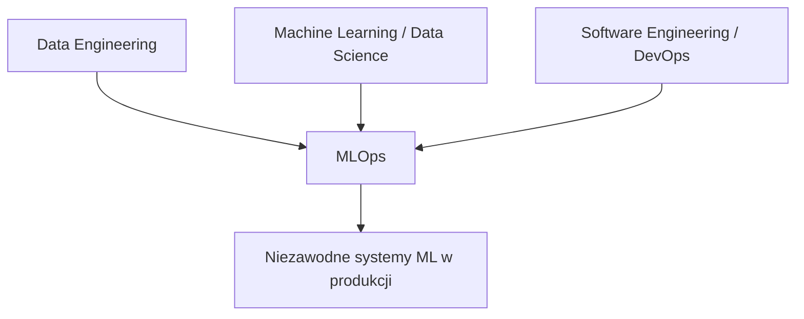

### Dlaczego MLOps jest trudny?

W odróżnieniu od klasycznego oprogramowania, systemy ML mają dodatkowy wymiar złożoności:

| Aspekt | Klasyczne oprogramowanie | System ML |
|--------|--------------------------|-----------|
| Kod | Deterministyczny | Probabilistyczny |
| Testowanie | Unit/integration tests | Testy danych + modelu |
| Wersjonowanie | Kod (git) | Kod + dane + model + pipeline |
| Degradacja | Błędy w kodzie | Data drift, concept drift |
| Reprodukowalność | Łatwa | Trudna (losowość, dane, środowisko) |
| Zależności | Biblioteki | Biblioteki + dane + hardware (GPU) |
| Debugowanie | Stack trace | Analiza rozkładów, metryk, cech |

### Dług techniczny w systemach ML

Artykuł Google „Hidden Technical Debt in Machine Learning Systems" (NIPS 2015) pokazuje, że **sam kod modelu to zaledwie ~5% całego systemu ML**. Reszta to infrastruktura:

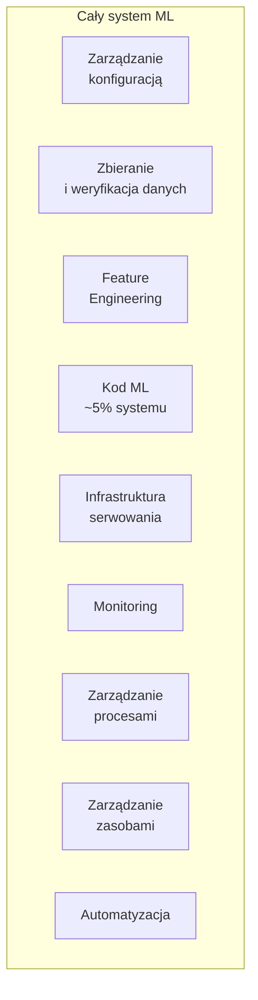

> 💡 **Pułapka:** Wiele zespołów koncentruje się wyłącznie na trenowaniu modelu (Jupyter Notebook), ignorując 95% pracy potrzebnej do wdrożenia i utrzymania modelu w produkcji. To główny powód, dla którego według badań Gartner **85% projektów ML nigdy nie trafia do produkcji**.

### Case Study: Uber Michelangelo

**Uber** zbudował wewnętrzną platformę MLOps o nazwie **Michelangelo**, która obsługuje tysiące modeli ML w produkcji (ETA, dynamiczne ceny, wykrywanie fraudów). Kluczowe wnioski:
- Przed Michelangelo każdy zespół budował własne rozwiązania — brak standaryzacji prowadził do duplikacji pracy i niespójności.
- Platforma ustandaryzowała cały cykl: od zarządzania danymi, przez trening, po serwowanie i monitoring.
- Wprowadzenie centralnego **Feature Store** wyeliminowało problem, w którym różne zespoły obliczały te same cechy na różne sposoby.

### Case Study: Spotify — rekomendacje muzyczne

**Spotify** wykorzystuje MLOps do obsługi systemu rekomendacji dla ponad 500 milionów użytkowników:
- Modele są retrenowane codziennie na nowych danych o odsłuchach.
- Używają **Kubeflow Pipelines** do orkiestracji pipeline'ów ML.
- Monitoring dryfu danych jest kluczowy — preferencje muzyczne zmieniają się sezonowo (np. kolędy w grudniu).


### Software 1.0 vs Software 2.0

W klasycznym oprogramowaniu (*Software 1.0*) programista zapisuje **reguły** w kodzie. W ML (*Software 2.0*, A. Karpathy) reguły są **wyuczane z danych**. Kod jest tylko jednym z trzech wejść systemu:

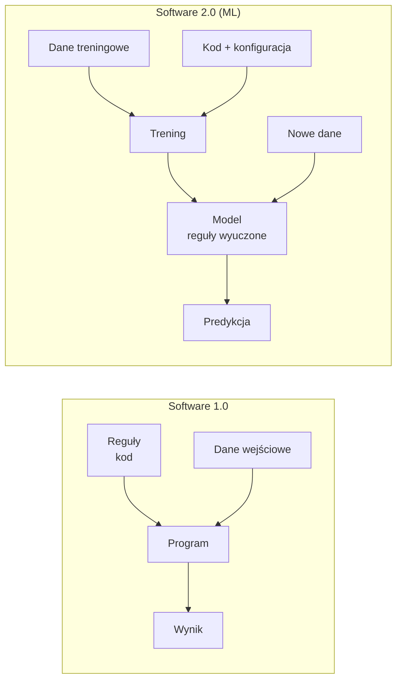

Wniosek dla MLOps: **wersjonować trzeba trzy rzeczy – kod, dane i model** (oraz środowisko). Zmiana każdej z nich zmienia zachowanie systemu, nawet jeśli kod pozostał identyczny.

| Wymiar | Software 1.0 | System ML |
|---|---|---|
| Źródło logiki | programista | dane + algorytm |
| Błąd | wyjątek, zły wynik deterministyczny | „cicha” degradacja jakości |
| Testowanie | testy jednostkowe/integracyjne | + testy danych, testy modelu, monitoring metryk |
| Starzenie się | gdy zmienią się wymagania | również gdy zmieni się **świat** (dryft) |

#### Zasada CACE

*Changing Anything Changes Everything* (Sculley i in., 2015): w modelu cechy są splątane – zmiana skalowania jednej cechy, dodanie nowej kolumny czy zmiana hiperparametru może zmienić wagi wszystkich pozostałych cech. Dlatego w ML nie ma „małych, izolowanych zmian” – każda zmiana wymaga ponownej ewaluacji.

#### Katalog typowych źródeł długu technicznego w ML

Sculley i in. opisują kilka powtarzalnych anty-wzorców. Warto je znać z nazwy, bo pojawiają się w niemal każdym projekcie:

| Anty-wzorzec | Na czym polega | Objaw w praktyce | Przeciwdziałanie |
|---|---|---|---|
| **Glue code** | dużo kodu „sklejającego” dane z biblioteką ML | 90% repozytorium to konwersje formatów | wspólne interfejsy, gotowe komponenty pipeline'u |
| **Pipeline jungles** | narosłe, nieudokumentowane skrypty przetwarzania | nikt nie wie, w jakiej kolejności je uruchamiać | jawny DAG (Airflow, KFP, DVC) |
| **Dead experimental codepaths** | flagi i gałęzie po starych eksperymentach | `if USE_FEATURE_V2_OLD:` w kodzie produkcyjnym | regularne sprzątanie, eksperymenty poza kodem produkcyjnym |
| **Undeclared consumers** | inne systemy po cichu czytają predykcje modelu | zmiana modelu psuje niezwiązany system | kontrola dostępu, kontrakty API |
| **Unstable data dependencies** | cecha pochodzi z tabeli, którą ktoś inny zmienia | nagły spadek jakości bez zmian w kodzie | wersjonowanie danych, walidacja schematu |
| **Underutilized data dependencies** | cechy prawie bezużyteczne, ale utrzymywane | koszt i ryzyko bez zysku | ablacja cech (*leave-one-feature-out*) |
| **Configuration debt** | setki parametrów rozsianych po plikach | nie da się odtworzyć konfiguracji | jedna, wersjonowana konfiguracja (YAML + git) |

```
  Jupyter Notebook (dzień 1)            System po roku bez MLOps
  ┌──────────────────────┐              ┌──────────────────────────────────┐
  │ load → clean → fit   │   ───────▶   │ cron → skrypt_a.py → tmp.csv     │
  │ → evaluate           │              │ skrypt_b_fix.py → model_new.pkl  │
  └──────────────────────┘              │ „nie ruszać!” → serwis.py        │
                                        │ ręczne kopiowanie na serwer      │
                                        └──────────────────────────────────┘
```

> ⚠️ **Uwaga:** dług techniczny w ML rośnie „po cichu” – system nadal zwraca predykcje, nie rzuca wyjątków, tylko daje coraz gorsze wyniki. Dlatego w ML monitoring jest częścią definicji „działającego systemu”, a nie dodatkiem.

---

## 2. Cykl życia modelu ML

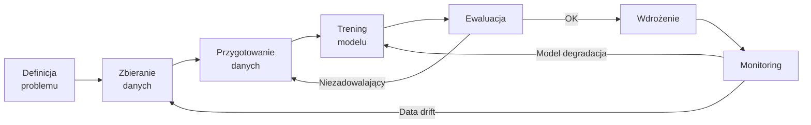

> **Model decay (degradacja modelu)** – stopniowy spadek jakości predykcji modelu w produkcji, mimo że sam model (kod i wagi) się nie zmienił. Przyczyną jest to, że **świat się zmienia, a model pozostaje „zamrożony”** w stanie z chwili treningu.
>
> - **Przyczyny:** data drift (zmienia się rozkład wejść, $P(X)$), concept drift (zmienia się relacja cech z etykietą, $P(y \mid X)$), zmiany w źródłach danych (schema/upstream drift) oraz pętle sprzężenia zwrotnego.
> - **Przykład:** model rekomendacji odzieży wytrenowany latem ma w lutym coraz niższy CTR, bo zmieniły się sezon, trendy i asortyment. Accuracy modelu wykrywania fraudów spada z 0.92 do 0.75 w ciągu pół roku, bo oszuści zmieniają techniki.
> - **Jak wykryć:** monitoring metryk jakości (gdy dostępne są etykiety), a bez etykiet pośrednio przez dryft cech i rozkładu predykcji (sekcje 4.2–4.4).
> - **Jak reagować:** retrening na świeżych danych według harmonogramu lub po przekroczeniu progu (strzałka „Model degradacja” → „Trening modelu” na diagramie), w razie potrzeby powrót do zbierania danych lub zmiana cech.
>
> Wykres spadku accuracy w czasie przy dryfcie stopniowym jest w sekcji 4.4.

### Fazy cyklu życia

1. **Definicja problemu** – co chcemy przewidzieć? Jaka jest metryka sukcesu?
2. **Zbieranie danych** – skąd dane? Jak często są aktualizowane?
3. **Przygotowanie danych** – czyszczenie, feature engineering, podział na zbiory.
4. **Trening modelu** – wybór algorytmu, hiperparametry, eksperymenty.
5. **Ewaluacja** – metryki ML (AUC, RMSE, F1) i metryki biznesowe.
6. **Wdrożenie** – serwowanie predykcji (online/batch).
7. **Monitoring** – czy model nadal działa poprawnie?

### Artefakty i pytania kontrolne każdej fazy

Każda faza powinna kończyć się **artefaktem**, który można wersjonować i przejrzeć. To właśnie artefakty łączą fazy w powtarzalny proces:

| Faza | Artefakt wyjściowy | Pytanie, które trzeba zadać | Typowa pułapka |
|---|---|---|---|
| Definicja problemu | dokument z metryką sukcesu i baseline'em | czy ML jest w ogóle potrzebny? | brak prostego baseline'u (reguła, średnia) |
| Zbieranie danych | snapshot danych + wersja (np. hash DVC) | czy dane z treningu będą dostępne na produkcji? | użycie cech niedostępnych w chwili predykcji |
| Przygotowanie danych | kod transformacji + raport walidacji | czy podział train/test respektuje czas? | *data leakage* (np. skalowanie przed podziałem) |
| Trening | model + parametry + metryki (MLflow) | czy wynik da się odtworzyć? | brak seeda, brak zapisu konfiguracji |
| Ewaluacja | raport metryk, analiza błędów per segment | czy model jest lepszy od produkcyjnego? | jedna metryka globalna ukrywa słabe segmenty |
| Wdrożenie | obraz Docker / endpoint / wpis w rejestrze | czy preprocessing jest identyczny jak w treningu? | train/serve skew |
| Monitoring | dashboardy, alerty, logi predykcji | co zrobimy, gdy alert się zapali? | alerty bez właściciela i procedury |

### Metryka ML a metryka biznesowa

Model optymalizuje funkcję straty, a firma – wynik biznesowy. Te dwie rzeczy są powiązane, ale **nie są tym samym**:

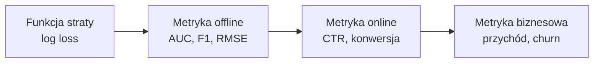

**Przykład:** model churnu ma AUC 0.89, ale kampania retencyjna nic nie daje, bo model najlepiej wskazuje klientów, którzy *i tak* odejdą (np. przeprowadzają się za granicę). Lepszą metryką byłby *uplift* – o ile zmniejsza się churn po kontakcie.

> 💡 **Dobra praktyka:** zanim zaczniesz trenować model, zapisz (1) metrykę offline, (2) metrykę biznesową, (3) baseline bez ML i (4) próg, poniżej którego model nie zostanie wdrożony. To później staje się bramką jakości w pipeline'ie.

### Dwie pętle: eksperymentalna i produkcyjna

```
   PĘTLA EKSPERYMENTALNA (Data Scientist)         PĘTLA PRODUKCYJNA (system)
   ┌───────────────────────────────┐              ┌────────────────────────────┐
   │ hipoteza → cechy → trening    │   wybrany    │ nowe dane → pipeline       │
   │    ▲                  │       │   model +    │ → walidacja → trening      │
   │    └──── analiza ◀────┘       │ ───────────▶ │ → bramka jakości → deploy  │
   │  (godziny, ręcznie, notebook) │   pipeline   │ → monitoring ──┐           │
   └───────────────────────────────┘              │      ▲         │ (automat) │
                                                  │      └─retrain─┘           │
                                                  └────────────────────────────┘
```

Celem MLOps jest to, by **wynikiem pracy eksperymentalnej był pipeline, a nie pojedynczy plik modelu**. Wtedy pętla produkcyjna może sama odtwarzać model na nowych danych.

---

## 3. Poziomy dojrzałości MLOps

Google definiuje trzy poziomy dojrzałości MLOps:

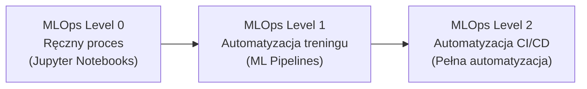

### Level 0 – Ręczny proces
- Data Scientist trenuje model lokalnie w notebooku.
- Model jest eksportowany i wdrażany ręcznie (np. przez email lub pendrive).
- Brak wersjonowania danych i modeli.
- Brak monitoringu — nikt nie wie, czy model nadal działa poprawnie.
- Brak automatycznych testów — „działa na moim laptopie".

**Problem:** „Works on my machine" – model działa u Data Scientista, ale nie w produkcji.

> 💡 **Typowa pułapka Level 0:** Data Scientist wysyła plik `model_final_v3_FINAL.pkl` na Slacku. Nikt nie wie, jakie dane i parametry zostały użyte. Po 3 miesiącach model przestaje działać, a odtworzenie go jest niemożliwe.

**Przykład z życia:** Startup fintech trenuje model scoringowy w Jupyter Notebook. Model działa świetnie na danych testowych (AUC=0.92). Po wdrożeniu na produkcję okazuje się, że preprocessing danych różni się od tego w notebooku — AUC spada do 0.65.

### Level 1 – Automatyzacja treningu
- Zdefiniowane ML Pipelines (automatyczny trening od danych do modelu).
- Wersjonowanie danych, kodu i modeli (DVC, MLflow).
- Automatyczne wyzwalanie retreningu (np. po wykryciu driftu lub według harmonogramu).
- Monitoring modelu w produkcji (metryki ML + metryki operacyjne).
- Feature Store zapewnia spójność cech między treningiem a produkcją.

**Przykład:** Bank automatycznie retrenuje model scoringowy co tydzień na nowych danych transakcyjnych. Pipeline waliduje dane, trenuje model, porównuje metryki z poprzednią wersją i rejestruje model w Model Registry.

### Level 2 – CI/CD dla ML
- Pełna automatyzacja: od commita do wdrożenia (GitHub Actions, Cloud Build).
- Testy jednostkowe dla komponentów pipeline'u.
- Automatyczne testy A/B nowych modeli na produkcji.
- Canary deployments (stopniowe wdrożenie), rollback w razie problemów.
- Quality Gates — automatyczne bramki jakości blokujące wdrożenie słabych modeli.

**Przykład:** Google Ads używa Level 2 MLOps — każda zmiana w kodzie modelu automatycznie uruchamia pipeline CI/CD, który trenuje model, testuje go, wdraża canary na 5% ruchu i monitoruje metryki biznesowe.

### Jak ocenić swój poziom dojrzałości?

| Pytanie | Level 0 | Level 1 | Level 2 |
|---------|---------|---------|---------|
| Jak często retrenujecie model? | Ręcznie, ad hoc | Automatycznie, regularnie | Automatycznie, na trigger |
| Czy możecie odtworzyć model sprzed 3 miesięcy? | Nie | Tak (DVC/MLflow) | Tak + pełny audit trail |
| Ile czasu zajmuje wdrożenie nowego modelu? | Dni–tygodnie | Godziny | Minuty |
| Kto monitoruje model w produkcji? | Nikt | Zespół ML | Automatyczny system |
| Co jest artefaktem wdrożenia? | plik `.pkl` | pipeline treningowy | pipeline + kod CI/CD + testy |
| Jak wygląda rollback? | „poszukajmy starego pliku” | ręczna zmiana wersji w rejestrze | automatyczny, po przekroczeniu progu |

### Jak przejść z Level 0 do Level 1 – minimalna ścieżka

Nie trzeba od razu budować platformy. Rozsądna kolejność kroków (każdy daje osobną wartość):

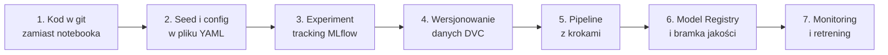

> ⚠️ **Pułapka:** wdrażanie Kubernetesa i Kubeflow w zespole, który nie ma jeszcze kodu w repozytorium ani zapisanych eksperymentów. Narzędzia z wyższego poziomu nie naprawią braków z niższego.


### Pętle sprzężenia zwrotnego (feedback loops)

Model produkcyjny **wpływa na dane**, na których będzie trenowany w przyszłości. Przykład: system rekomendacji pokazuje głównie popularne produkty → użytkownicy klikają głównie w nie → kolejny model uczy się, że tylko one są ważne.

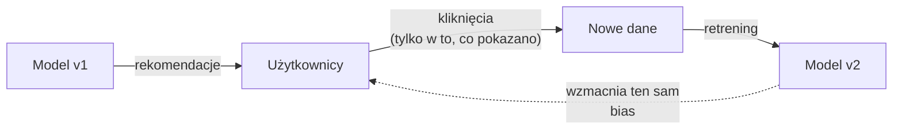

Sposoby ograniczania: eksploracja (np. część ruchu z losowymi rekomendacjami), logowanie prawdopodobieństwa pokazania elementu (*propensity*) i korekta wag, grupy kontrolne bez modelu.

---

## 4. Główne wyzwania MLOps

### 4.1 Reprodukowalność

```python
# Złe podejście - brak kontroli losowości
import numpy as np
from sklearn.ensemble import RandomForestClassifier

model = RandomForestClassifier()
model.fit(X_train, y_train)

# Dobre podejście - pełna reprodukowalność
import numpy as np
from sklearn.ensemble import RandomForestClassifier

SEED = 42
np.random.seed(SEED)

model = RandomForestClassifier(
    n_estimators=100,
    random_state=SEED,
    n_jobs=-1
)
model.fit(X_train, y_train)

# Zapisz parametry eksperymentu
experiment_config = {
    "seed": SEED,
    "model": "RandomForestClassifier",
    "n_estimators": 100,
    "data_version": "v2024-01-15",
    "train_size": len(X_train)
}
```


#### Źródła niedeterminizmu

Seed to tylko jeden element. Pełna reprodukowalność wymaga kontroli wszystkich poniższych źródeł:

| Źródło | Przykład | Jak kontrolować |
|---|---|---|
| Losowość algorytmu | inicjalizacja wag, bootstrap w RF | `random_state`, `np.random.default_rng(seed)`, `torch.manual_seed` |
| Podział danych | `train_test_split` bez seeda | stały seed lub zapis indeksów podziału |
| Dane | tabela nadpisana nowymi rekordami | snapshot + hash (DVC), `data_version` |
| Kod | niezacommitowane zmiany | zapis `git commit hash` w metadanych eksperymentu |
| Środowisko | inna wersja scikit-learn | `requirements.txt` z przypiętymi wersjami, Docker |
| Sprzęt | operacje GPU (cuDNN), wielowątkowość | flagi deterministyczne, akceptacja małej tolerancji |
| Kolejność danych | `SELECT` bez `ORDER BY` | jawne sortowanie |

Przykład zapisania „odcisku palca” eksperymentu – wersji danych, kodu i środowiska:

```python
import hashlib
import json
import platform
import subprocess

import sklearn

def file_hash(path: str) -> str:
    h = hashlib.sha256()
    with open(path, "rb") as f:
        for chunk in iter(lambda: f.read(8192), b""):
            h.update(chunk)
    return h.hexdigest()[:12]

def git_commit() -> str:
    try:
        return subprocess.check_output(["git", "rev-parse", "--short", "HEAD"], text=True).strip()
    except Exception:
        return "unknown"

fingerprint = {
    "data_hash": file_hash("data/train.csv"),
    "git_commit": git_commit(),
    "python": platform.python_version(),
    "sklearn": sklearn.__version__,
    "seed": 42,
}
print(json.dumps(fingerprint, indent=2))
```

> 💡 **Reguła:** jeśli z metadanych eksperymentu nie da się odpowiedzieć na pytanie „jakie dane, jaki kod, jakie parametry, jakie środowisko?”, eksperyment nie jest reprodukowalny – nawet gdy seed był ustawiony.

> **▶️ Demo na żywo:** `python lectures/scripts/lecture_01/01_reproducibility.py`  
> **Kiedy:** na koniec sekcji 4.1, przed przejściem do dryftu.  
> **Co pokazać:** trzy różne accuracy bez seeda, trzy identyczne z `seed=42` i zapisany plik `experiment_config.json`.

### 4.2 Data Drift

**Data drift** – rozkład danych wejściowych zmienia się w czasie.

#### Przykład: scoring kredytowy w banku

Bank trenuje model scoringowy na wnioskach z lat 2022–2023. Większość wnioskodawców to wtedy osoby w wieku 35–55 lat, z medianą dochodu ok. 6 000 zł, składające wnioski w oddziale. W 2024 r. bank uruchamia wnioski przez aplikację mobilną i kampanię w social mediach. Rozkład cech wejściowych się zmienia:

| Cecha | Dane treningowe (2022–2023) | Dane produkcyjne (2024) | Zmiana |
|---|---|---|---|
| Wiek (średnia) | 44 lata | 29 lat | młodsi klienci |
| Dochód (mediana) | 6 000 zł | 4 200 zł | niższe dochody |
| Staż pracy (średnia) | 11 lat | 3 lata | krótsza historia |
| Kanał `mobile` | 10% | 70% | nowy dominujący kanał |

Reguła „spłaca kredyt, jeśli…”, czyli $P(y \mid X)$, mogła się nie zmienić. Zmieniło się $P(X)$: model widzi teraz głównie przypadki, których w treningu było mało. Tam ma mało danych, więc jego predykcje są mniej pewne i gorzej skalibrowane. Ważne jest to, że **data drift da się wykryć od razu, bez etykiet**: wystarczy porównać rozkłady cech, a na informację, czy klient spłacił kredyt, trzeba by czekać miesiącami.

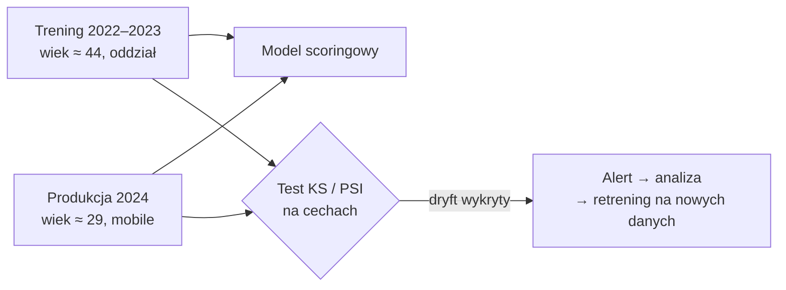

Inne typowe przykłady data drift:
- **E-commerce:** w Black Friday rośnie średnia wartość koszyka i udział nowych klientów.
- **Czujniki IoT:** po wymianie czujnika na nowy model odczyty temperatury są przesunięte o +2°C.
- **Rozpoznawanie obrazów:** zdjęcia z nowego modelu smartfona mają inną jasność i rozdzielczość.

Kod poniżej odtwarza przykład bankowy dla cechy „wiek”:

```python
import numpy as np
from scipy import stats

rng = np.random.default_rng(42)
age_train = rng.normal(44, 9, 5000).clip(18, 80)  # wnioski 2022–2023
age_prod = rng.normal(29, 6, 1000).clip(18, 80)   # wnioski 2024 (mobile)

stat, p = stats.ks_2samp(age_train, age_prod)
print(f"KS = {stat:.3f}, p-value = {p:.2e}")      # KS ≈ 0.8, p ≈ 0 → dryft
print(f"Udział klientów < 30 lat: trening {np.mean(age_train < 30):.0%}, "
      f"produkcja {np.mean(age_prod < 30):.0%}")
```

Poniższa funkcja to ogólny detektor, który można stosować do każdej cechy numerycznej:

```python
import numpy as np
from scipy import stats

def detect_data_drift(reference_data: np.ndarray, 
                       current_data: np.ndarray,
                       threshold: float = 0.05) -> dict:
    """
    Wykrywa data drift za pomocą testu Kolmogorova-Smirnova.
    
    Args:
        reference_data: dane referencyjne (z treningu)
        current_data: aktualne dane produkcyjne
        threshold: próg p-value dla odrzucenia H0
    
    Returns:
        dict z wynikami testu
    """
    statistic, p_value = stats.ks_2samp(reference_data, current_data)
    
    return {
        "statistic": statistic,
        "p_value": p_value,
        "drift_detected": p_value < threshold,
        "severity": "high" if p_value < 0.01 else "medium" if p_value < threshold else "none"
    }

# Przykład użycia
reference = np.random.normal(0, 1, 1000)   # dane treningowe
current = np.random.normal(0.5, 1.2, 500)  # dane produkcyjne (z dryftem)

result = detect_data_drift(reference, current)
print(f"Drift wykryty: {result['drift_detected']}")
print(f"P-value: {result['p_value']:.4f}")
print(f"Nasilenie: {result['severity']}")
```

### 4.3 Concept Drift

**Concept drift** – relacja między cechami a etykietą zmienia się w czasie.

Przykład: model przewidujący ceny mieszkań przestaje działać po kryzysie finansowym.

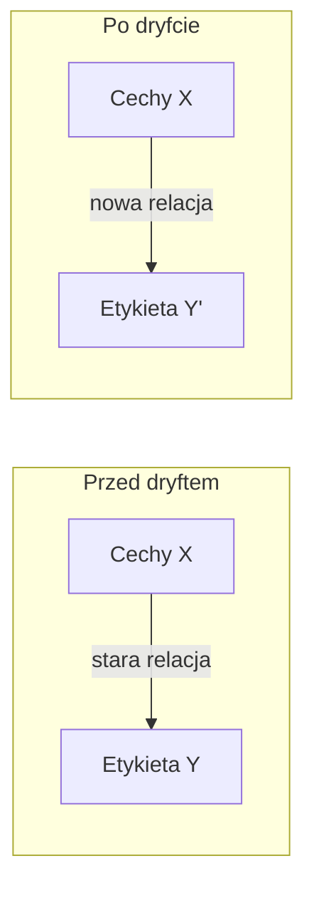

#### Dlaczego concept drift jest trudniejszy do wykrycia?

Przy concept drift rozkład cech $P(X)$ może pozostać **identyczny** – test KS na cechach nic nie pokaże. Zmienia się jedynie odpowiedź, którą „świat” przypisuje tym samym cechom. Wykryć to można tylko porównując predykcje z prawdziwymi etykietami, a te często przychodzą z opóźnieniem (*label delay*):

| Domena | Opóźnienie etykiety | Konsekwencja |
|---|---|---|
| Rekomendacje (kliknięcie) | sekundy–minuty | szybka reakcja możliwa |
| Fraud kartowy (chargeback) | tygodnie | trzeba polegać na proxy (rozkład predykcji, reguły) |
| Scoring kredytowy (default) | miesiące–lata | monitoring głównie pośredni, okresowe backtesty |

Przykład minimalny – ten sam $X$, przesunięty próg decyzji:

```python
import numpy as np
from sklearn.linear_model import LogisticRegression

rng = np.random.default_rng(42)
X = rng.normal(0, 1, (2000, 1))
y_old = (X[:, 0] > 0).astype(int)      # stara reguła
y_new = (X[:, 0] > 1).astype(int)      # nowa reguła (np. zaostrzone kryteria)

model = LogisticRegression().fit(X, y_old)
print("accuracy przed:", (model.predict(X) == y_old).mean())   # ≈ 1.0
print("accuracy po:   ", (model.predict(X) == y_new).mean())   # ≈ 0.66
# Rozkład X się nie zmienił, więc test KS na cechach nie wykryje problemu.
```


> **▶️ Demo na żywo:** `python lectures/scripts/lecture_01/02_data_drift.py --plot`  
> **Kiedy:** po omówieniu sekcji 4.2 i 4.3.  
> **Co pokazać:** mały dryft (0.1) nie jest istotny statystycznie, a duży jest. W części concept drift test KS nic nie wykrywa, mimo że accuracy spada z ~1.0 do ~0.5. Wykres histogramów zapisuje się w `outputs/data_drift.png`. Ćwiczenie: zmień parametry rozkładu i zapytaj studentów, od jakiego przesunięcia test zaczyna wykrywać dryft.


### 4.4 Taksonomia dryftu

Z punktu widzenia rozkładu łącznego $P(X, y) = P(y \mid X)\,P(X)$ wyróżniamy:

| Rodzaj | Co się zmienia | Przykład | Jak wykryć |
|---|---|---|---|
| **Covariate shift** (data drift) | $P(X)$ | nowa grupa wiekowa klientów | testy statystyczne na cechach (KS, PSI, χ²) – bez etykiet |
| **Prior / label shift** | $P(y)$ | odsetek oszustw rośnie z 1% do 5% | rozkład predykcji, później rozkład etykiet |
| **Concept drift** | $P(y \mid X)$ | pandemia zmienia zachowania zakupowe | tylko metryki jakości – wymaga etykiet |
| **Schema / upstream drift** | format danych | kolumna w złotych → w groszach | walidacja schematu i zakresów |

Dryft może być **nagły** (zmiana przepisów), **stopniowy** (inflacja), **cykliczny** (sezonowość) lub **przejściowy** (jednorazowy incydent):

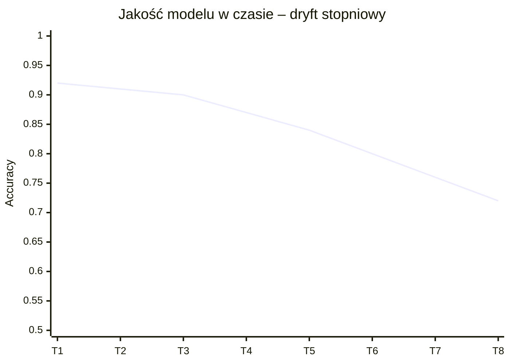

#### Population Stability Index (PSI)

Obok testu KS w branży (np. bankowość) popularny jest PSI – działa na przedziałach (binach) i jest łatwy w interpretacji:

$$PSI = \sum_{i=1}^{k} (p_i^{cur} - p_i^{ref}) \cdot \ln\frac{p_i^{cur}}{p_i^{ref}}$$

```python
import numpy as np

def psi(reference: np.ndarray, current: np.ndarray, bins: int = 10) -> float:
    edges = np.quantile(reference, np.linspace(0, 1, bins + 1))
    edges[0], edges[-1] = -np.inf, np.inf
    ref = np.histogram(reference, edges)[0] / len(reference)
    cur = np.histogram(current, edges)[0] / len(current)
    ref, cur = np.clip(ref, 1e-6, None), np.clip(cur, 1e-6, None)
    return float(np.sum((cur - ref) * np.log(cur / ref)))

rng = np.random.default_rng(0)
ref = rng.normal(0, 1, 10_000)
print(f"brak dryftu:  {psi(ref, rng.normal(0, 1, 5000)):.3f}")
print(f"duży dryft:   {psi(ref, rng.normal(0.5, 1.2, 5000)):.3f}")
```

Reguła kciuka: **PSI < 0.1** – brak istotnej zmiany, **0.1–0.25** – umiarkowana (obserwuj), **> 0.25** – istotna zmiana (rozważ retrening).

> **Uwaga:** przy bardzo dużych próbkach testy statystyczne (KS) wykrywają nawet nieistotne biznesowo różnice (p-value → 0). Dlatego w praktyce łączy się p-value z miarą wielkości efektu (statystyka KS, PSI, odległość Wassersteina).

#### Porównanie metod wykrywania dryftu

| Metoda | Typ cechy | Wymaga etykiet? | Zalety | Wady |
|---|---|---|---|---|
| Test KS | numeryczna | nie | prosty, nieparametryczny | nadwrażliwy przy dużych n |
| Test χ² | kategoryczna | nie | standard dla kategorii | problem z rzadkimi kategoriami |
| PSI | numeryczna i kategoryczna | nie | interpretowalne progi | zależy od doboru binów |
| Odległość Wassersteina | numeryczna | nie | mierzy „ile” przesunięcia, w jednostkach cechy | brak naturalnego progu |
| Rozkład predykcji | wyjście modelu | nie | jeden sygnał zamiast setek cech | nie wskazuje przyczyny |
| Metryki jakości (AUC, F1) | – | tak | mierzy to, co naprawdę ważne | opóźnienie etykiet |

> ⚠️ **Pułapka wielokrotnych testów:** przy 200 cechach i progu p < 0.05 średnio ~10 cech „wykaże dryft” przypadkiem. Stosuj korektę (np. Bonferroni), monitoruj najważniejsze cechy lub alertuj dopiero przy dryfcie w kilku kolejnych oknach.

### 4.5 Train/serve skew i data leakage

Dwa błędy, które powodują, że model **świetny offline okazuje się słaby online** – choć nie ma żadnego dryftu:

| | Train/serve skew | Data leakage |
|---|---|---|
| Istota | cechy liczone inaczej w treningu i na produkcji | w treningu model widzi informację niedostępną w chwili predykcji |
| Przykład | `dochód` w treningu w zł, w API w groszach | cecha `liczba_monitów` powstaje dopiero *po* opóźnieniu w spłacie |
| Objaw | spadek jakości od pierwszego dnia wdrożenia | podejrzanie wysokie metryki offline (AUC 0.99) |
| Zapobieganie | jedna implementacja cech (Feature Store, wspólny `Pipeline`) | podział czasowy, analiza „kiedy cecha jest znana” |

Klasyczny leakage w preprocessingu i jego poprawka:

```python
from sklearn.datasets import make_classification
from sklearn.linear_model import LogisticRegression
from sklearn.model_selection import train_test_split
from sklearn.pipeline import make_pipeline
from sklearn.preprocessing import StandardScaler

X, y = make_classification(n_samples=1000, random_state=42)

# ŹLE: scaler widzi dane testowe (średnia i odchylenie z całego zbioru)
X_scaled = StandardScaler().fit_transform(X)
X_tr, X_te, y_tr, y_te = train_test_split(X_scaled, y, random_state=42)

# DOBRZE: preprocessing jest częścią modelu - ten sam obiekt trafia na produkcję
X_tr, X_te, y_tr, y_te = train_test_split(X, y, random_state=42)
model = make_pipeline(StandardScaler(), LogisticRegression())
model.fit(X_tr, y_tr)
print(f"accuracy: {model.score(X_te, y_te):.3f}")
```

> 💡 Zapisanie całego `Pipeline` (preprocessing + model) jako jednego artefaktu to najprostszy sposób na uniknięcie train/serve skew w małych projektach.

---

## 5. Architektura systemu MLOps

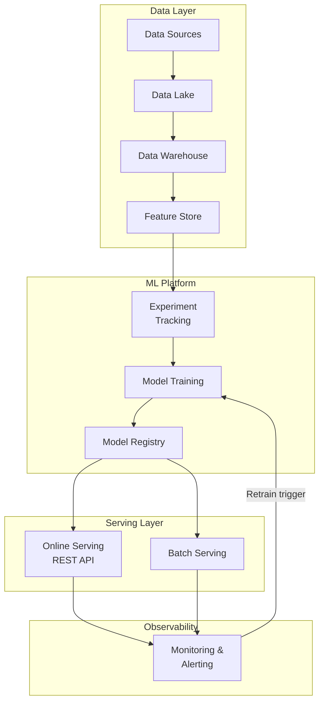

### Opis elementów architektury

#### Data Layer
- **Data Sources** – źródła danych wejściowych (systemy transakcyjne, logi aplikacyjne, API, IoT), z których zasilany jest system ML.
- **Data Lake** – warstwa surowych danych (często w formacie plikowym), przechowująca pełną historię danych do analizy i retreningu.
- **Data Warehouse** – ustrukturyzowana warstwa analityczna po czyszczeniu i transformacjach, używana do raportowania i przygotowania cech.
- **Feature Store** – centralne repozytorium cech z jednolitą definicją obliczeń dla treningu i inferencji, które ogranicza train/serve skew.
  - **Trening** – etap, w którym model uczy się na danych historycznych. Cechy liczone są wsadowo (batch) dla wielu rekordów naraz, np. „liczba transakcji klienta w ostatnich 30 dniach” wyliczona dla całego zbioru z ubiegłego roku.
  - **Inferencja** (serving, predykcja) – użycie wytrenowanego modelu na produkcji do przewidywania dla nowych danych, często w czasie rzeczywistym. Te same cechy trzeba policzyć dla pojedynczego żądania, np. dla klienta, który właśnie składa zamówienie.
  - **Train/serve skew** (training-serving skew) – rozbieżność między cechami widzianymi przez model w treningu a cechami podawanymi mu na produkcji. Zwykle wynika z dwóch różnych implementacji tej samej cechy (np. pandas w treningu, SQL lub Java w serwisie) albo z innych źródeł danych. Przykłady to inne zaokrąglenia, strefy czasowe, inna obsługa braków czy inne okno czasowe. Model dobrze wypada offline, a na produkcji działa gorzej, choć sam się nie zmienił. Feature Store temu przeciwdziała: cecha jest zdefiniowana raz i z tej samej definicji korzysta trening (offline store) i inferencja (online store). Szerzej w wykładzie 2.

#### ML Platform
- **Experiment Tracking** – rejestr eksperymentów (parametry, metryki, artefakty, wersje danych i kodu), który zapewnia porównywalność i reprodukowalność.
- **Model Training** – proces trenowania i walidacji modeli w pipeline’ach, z kontrolą jakości danych oraz metryk.
- **Model Registry** – katalog wersji modeli wraz ze statusem (staging/production/archived), metadanymi i historią promocji.

#### Serving Layer
- **Online Serving (REST API)** – serwowanie predykcji w czasie rzeczywistym dla aplikacji wymagających niskich opóźnień.
- **Batch Serving** – predykcje wsadowe uruchamiane cyklicznie (np. nocne skoringi), gdy nie jest wymagana odpowiedź online.

#### Observability
- **Monitoring & Alerting** – obserwowalność systemu i modelu: metryki operacyjne (latencja, błędy), metryki jakości predykcji, data/concept drift oraz alerty.
- **Retrain trigger** – mechanizm automatycznego uruchamiania retreningu po przekroczeniu progów jakości, dryfu lub według harmonogramu.

> 💡 **W praktyce:** warto definiować dla każdego komponentu właściciela, SLA/SLO oraz minimalny zestaw metryk. Dzięki temu architektura MLOps jest nie tylko kompletna technicznie, ale też operacyjnie utrzymywalna.

### Online vs batch serving – porównanie

| Kryterium | Online (REST/gRPC) | Batch |
|---|---|---|
| Opóźnienie | milisekundy | minuty–godziny |
| Przykład | wykrywanie fraudu przy płatności | nocny scoring churnu dla całej bazy |
| Cechy | z online store, liczone w locie | z hurtowni danych |
| Skalowanie | autoskalowanie replik | zasoby na czas zadania |
| Typowe ryzyko | latencja, dostępność, skew | nieaktualne predykcje |
| Monitoring | latencja p95/p99, błędy HTTP | czas zadania, liczba rekordów |

Przepływ pojedynczego żądania predykcji online:

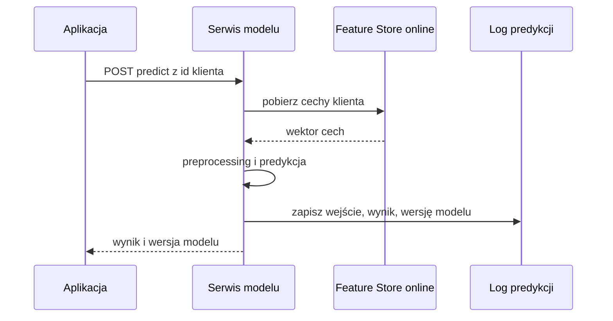

> ⚠️ **Często pomijane:** logowanie wejść, predykcji i **wersji modelu** dla każdego żądania. Bez tych logów nie da się później policzyć metryk po nadejściu etykiet, wykryć dryftu ani zbadać incydentu.

---

## 6. Kluczowe narzędzia ekosystemu MLOps

| Kategoria | Narzędzia Open Source | Narzędzia Cloud |
|-----------|----------------------|-----------------|
| Experiment Tracking | MLflow, Weights & Biases | Vertex AI Experiments |
| Pipeline Orchestration | Kubeflow, Apache Airflow | Vertex AI Pipelines |
| Model Registry | MLflow Registry | Vertex AI Model Registry |
| Feature Store | Feast | Vertex AI Feature Store |
| Model Serving | BentoML, Seldon | Vertex AI Endpoints |
| Monitoring | Evidently AI, Prometheus | Vertex AI Model Monitoring |
| CI/CD | GitHub Actions, Jenkins | Cloud Build |


### Jak dobierać narzędzia? Build vs Buy

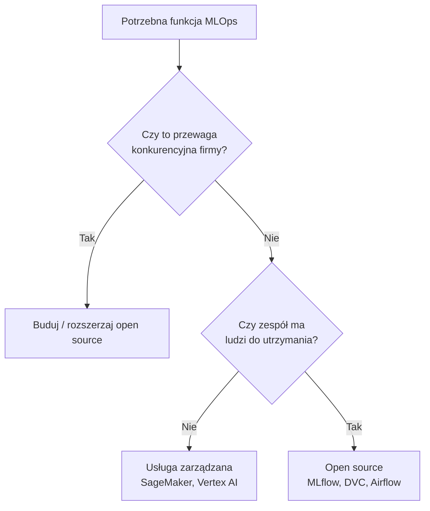

Kryteria wyboru: koszt utrzymania, integracja z istniejącym stosem (chmura, CI/CD), vendor lock-in, wymagania bezpieczeństwa (dane nie mogą opuszczać firmy), dojrzałość społeczności. Dobra praktyka: **zaczynać od najprostszego rozwiązania** (np. MLflow + DVC + GitHub Actions) i dokładać narzędzia dopiero, gdy pojawi się konkretny problem.

---

## 7. MLOps vs DevOps – kluczowe różnice

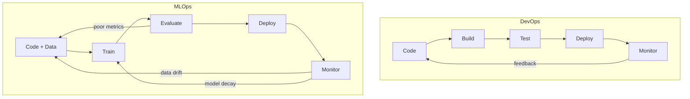

**Dodatkowe elementy w MLOps:**
- Wersjonowanie **danych** (nie tylko kodu)
- Wersjonowanie **modeli** (artefakty binarne)
- **Metryki ML** jako warunek wdrożenia
- **Automatyczny retraining** po wykryciu driftu
- **Explainability** – wyjaśnialność predykcji

### CI, CD i CT

W MLOps do klasycznej pary CI/CD dochodzi trzeci element – **CT (Continuous Training)**:

| Praktyka | DevOps | MLOps |
|---|---|---|
| **CI** – Continuous Integration | testy kodu, build | + testy danych, walidacja schematu, testy komponentów pipeline'u |
| **CD** – Continuous Delivery | wdrożenie aplikacji | wdrożenie **pipeline'u treningowego** oraz serwisu predykcji |
| **CT** – Continuous Training | – | automatyczny retrening na nowych danych z bramką jakości |

| Aspekt | DevOps | MLOps |
|---|---|---|
| Wyzwalacz zmiany | commit w kodzie | commit **lub** nowe dane **lub** alert dryftu |
| Artefakt | binarka, obraz Docker | obraz + model + metadane danych |
| Kryterium „gotowe do wdrożenia” | testy przechodzą | testy + metryki ≥ próg + porównanie z modelem produkcyjnym |
| Strategia wdrożenia | blue-green, canary | + shadow deployment, testy A/B |
| Rollback | poprzednia wersja kodu | poprzednia wersja modelu z rejestru |

> 💡 **Shadow deployment:** nowy model otrzymuje kopię ruchu produkcyjnego i liczy predykcje, ale ich nie zwraca użytkownikom. Pozwala porównać modele na prawdziwych danych bez ryzyka.

---

## 8. Przykład: Prosty system MLOps od zera

```python
from dataclasses import dataclass, field
from datetime import datetime
from typing import Optional
import json
import hashlib

@dataclass
class ModelVersion:
    """Reprezentuje wersję modelu w rejestrze."""
    name: str
    version: str
    metrics: dict
    data_version: str
    created_at: str = field(default_factory=lambda: datetime.now().isoformat())
    status: str = "staging"  # staging | production | archived
    
    def to_dict(self) -> dict:
        return {
            "name": self.name,
            "version": self.version,
            "metrics": self.metrics,
            "data_version": self.data_version,
            "created_at": self.created_at,
            "status": self.status
        }

class SimpleModelRegistry:
    """Prosty rejestr modeli (demonstracja konceptu)."""
    
    def __init__(self):
        self.models: dict[str, list[ModelVersion]] = {}
    
    def register(self, model: ModelVersion) -> str:
        """Rejestruje nową wersję modelu."""
        if model.name not in self.models:
            self.models[model.name] = []
        self.models[model.name].append(model)
        print(f"✅ Zarejestrowano: {model.name} v{model.version}")
        return model.version
    
    def promote_to_production(self, name: str, version: str):
        """Promuje wersję modelu do produkcji."""
        for mv in self.models.get(name, []):
            if mv.status == "production":
                mv.status = "archived"
            if mv.version == version:
                mv.status = "production"
                print(f"🚀 Wdrożono: {name} v{version} → produkcja")
    
    def get_production_model(self, name: str) -> Optional[ModelVersion]:
        """Zwraca aktualny model produkcyjny."""
        for mv in self.models.get(name, []):
            if mv.status == "production":
                return mv
        return None

# Użycie
registry = SimpleModelRegistry()

# Rejestracja modelu v1
v1 = ModelVersion(
    name="churn_predictor",
    version="1.0.0",
    metrics={"auc": 0.82, "f1": 0.75},
    data_version="data-2024-01"
)
registry.register(v1)
registry.promote_to_production("churn_predictor", "1.0.0")

# Rejestracja lepszego modelu v2
v2 = ModelVersion(
    name="churn_predictor",
    version="2.0.0",
    metrics={"auc": 0.89, "f1": 0.83},
    data_version="data-2024-06"
)
registry.register(v2)
registry.promote_to_production("churn_predictor", "2.0.0")

# Sprawdzenie aktualnego modelu produkcyjnego
prod = registry.get_production_model("churn_predictor")
print(f"\nAktualny model produkcyjny: {prod.name} v{prod.version}")
print(f"Metryki: {prod.metrics}")
```


> **▶️ Demo na żywo:** `python lectures/scripts/lecture_01/03_simple_mlops_system.py`  
> **Kiedy:** po przykładzie z sekcji 8, jako jego rozbudowana, działająca wersja.  
> **Co pokazać:** modele v1 i v2 trafiają na produkcję, a słabszy v3 zostaje w `staging` (bramka jakości). Następnie pokaż plik `outputs/model_registry/registry.json` i zapowiedz, że w wykładzie 3 tę samą rolę pełni MLflow Model Registry.

### Bramka jakości (quality gate)

W przykładzie powyżej `promote_to_production` promuje model bezwarunkowo. W prawdziwym systemie promocja powinna być decyzją opartą na regułach. Cykl życia wersji modelu:

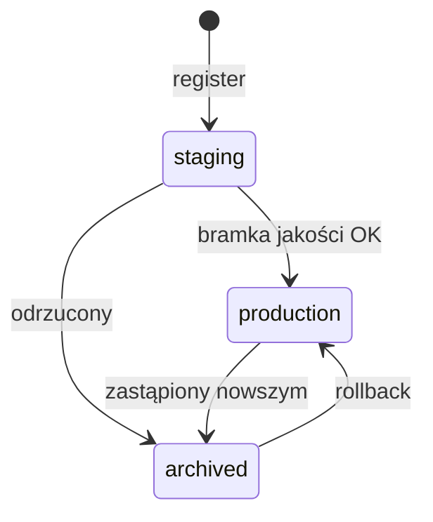

Przykładowa bramka, którą można dołożyć do `SimpleModelRegistry`:

```python
def passes_quality_gate(candidate: ModelVersion,
                        current: Optional[ModelVersion],
                        min_auc: float = 0.80,
                        min_improvement: float = 0.01) -> bool:
    """Model trafia na produkcję tylko, jeśli spełnia próg i jest lepszy od obecnego."""
    if candidate.metrics.get("auc", 0.0) < min_auc:
        return False
    if current is None:
        return True
    return candidate.metrics["auc"] >= current.metrics["auc"] + min_improvement

candidate = ModelVersion("churn_predictor", "3.0.0", {"auc": 0.87, "f1": 0.80}, "data-2024-09")
registry.register(candidate)
if passes_quality_gate(candidate, registry.get_production_model("churn_predictor")):
    registry.promote_to_production("churn_predictor", "3.0.0")
else:
    print("⛔ v3.0.0 zostaje w staging – nie przeszedł bramki jakości")
```

> ⚠️ **Pułapka:** porównywanie modeli na **różnych** zbiorach testowych. AUC nowego modelu na danych z września i starego na danych ze stycznia nie są porównywalne – oba modele trzeba ocenić na tym samym, aktualnym zbiorze.


### Testowanie systemów ML – piramida testów

System ML wymaga testów na kilku poziomach (por. *ML Test Score*, Breck i in., Google 2017):

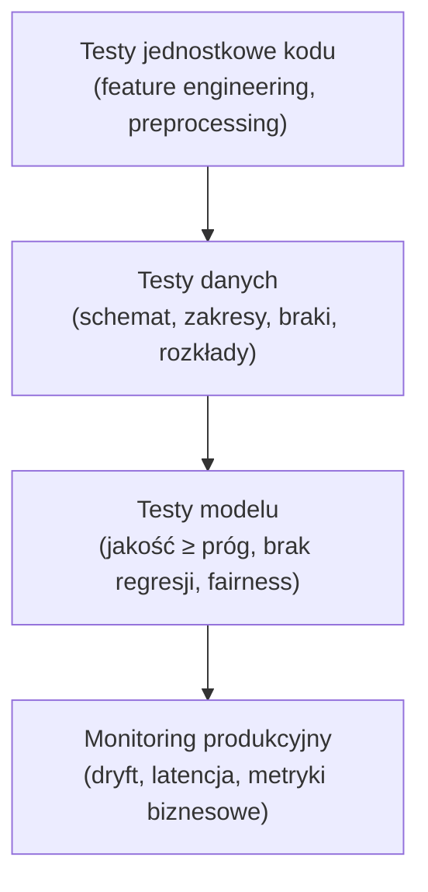

Przykład testów (pytest) dla systemu z sekcji 8:

```python
import numpy as np
import pytest
from sklearn.datasets import make_classification
from sklearn.linear_model import LogisticRegression
from sklearn.metrics import f1_score

@pytest.fixture(scope="module")
def data():
    return make_classification(n_samples=1000, random_state=42)

def test_feature_shape(data):                      # test danych
    X, y = data
    assert X.shape[1] == 20 and not np.isnan(X).any()

def test_model_quality_threshold(data):            # test jakości
    X, y = data
    model = LogisticRegression(max_iter=500).fit(X[:800], y[:800])
    assert f1_score(y[800:], model.predict(X[800:])) >= 0.8

def test_invariance_to_row_order(data):            # test behawioralny
    X, y = data
    model = LogisticRegression(max_iter=500).fit(X, y)
    idx = np.random.default_rng(0).permutation(len(X))
    assert (model.predict(X)[idx] == model.predict(X[idx])).all()
```

Typy testów behawioralnych (*CheckList*, Ribeiro i in. 2020): **invariance** (zmiana nieistotnej cechy nie zmienia predykcji), **directional expectation** (wzrost dochodu nie powinien zwiększać ryzyka kredytowego), **minimum functionality** (proste przypadki muszą działać).

---

## 9. Role w zespole MLOps

Wdrożenie MLOps wymaga współpracy wielu specjalistów:

| Rola | Odpowiedzialność | Typowe narzędzia |
|------|------------------|------------------|
| **Data Scientist** | Eksperymentowanie, trening modeli | Jupyter, scikit-learn, PyTorch |
| **ML Engineer** | Produktyzacja modeli, pipeline'y | KFP, Airflow, Docker |
| **Data Engineer** | Pipeline'y danych, Feature Store | Spark, Kafka, dbt |
| **DevOps/Platform Engineer** | Infrastruktura, CI/CD, monitoring | Kubernetes, Terraform, Prometheus |
| **Product Manager** | Definiowanie metryk biznesowych | A/B testing, dashboardy |

> 💡 **Wskazówka:** W małych zespołach jedna osoba często pełni kilka ról. Kluczowe jest, aby **każda z tych odpowiedzialności była pokryta**, nawet jeśli przez tę samą osobę.

### Kto za co odpowiada? (macierz RACI)

R – wykonuje, A – odpowiada za wynik, C – konsultowany, I – informowany.

| Zadanie | Data Scientist | ML Engineer | Data Engineer | Platform Engineer | Product Manager |
|---|---|---|---|---|---|
| Definicja metryki sukcesu | C | I | I | I | **A/R** |
| Pipeline danych i jakość danych | C | C | **A/R** | I | I |
| Eksperymenty i wybór modelu | **A/R** | C | I | I | C |
| Pipeline treningowy i serwowanie | C | **A/R** | C | C | I |
| Infrastruktura i CI/CD | I | C | I | **A/R** | I |
| Reakcja na alert dryftu | R | **A** | R | C | I |

### Case study: Zillow Offers – koszt braku kontroli nad modelem

W 2021 r. Zillow zamknął biznes skupu mieszkań (*Zillow Offers*), raportując straty rzędu kilkuset milionów dolarów i redukcję ok. 25% personelu. Model wyceny nieruchomości był używany do automatycznego składania ofert zakupu w okresie gwałtownych zmian rynku. Wnioski dla MLOps (w uproszczeniu):
- model działający dobrze na danych historycznych nie nadążał za szybką zmianą rynku (**concept drift**),
- decyzje modelu bezpośrednio wpływały na rynek i na przyszłe dane (**pętla sprzężenia zwrotnego**),
- brakowało wystarczających mechanizmów ograniczania ryzyka (limity, nadzór człowieka, szybka reakcja na sygnały z monitoringu).

---

## Pytania kontrolne i do dyskusji

1. Wyjaśnij, dlaczego wdrożenie modelu ML w produkcji jest trudniejsze niż wdrożenie klasycznej aplikacji webowej.
2. Na jakim poziomie dojrzałości MLOps (0, 1, 2) znajduje się Twoja organizacja lub projekt? Uzasadnij.
3. Podaj trzy przykłady sytuacji, w których model ML może zdegradować się w produkcji.
4. Czym różni się data drift od concept drift? Podaj przykład każdego z nich.
5. Dlaczego sam kod modelu stanowi tylko ~5% całego systemu ML? Co stanowi pozostałe 95%?
6. Jakie korzyści daje Feature Store w porównaniu z sytuacją, gdy każdy Data Scientist oblicza cechy samodzielnie?
7. **Dyskusja:** Czy każdy projekt ML potrzebuje pełnego MLOps (Level 2)? Kiedy Level 0 jest wystarczający?
8. Wymień co najmniej cztery źródła niedeterminizmu w treningu modelu poza brakiem seeda.
9. Czym różni się train/serve skew od data leakage? Jak każdy z nich objawia się w metrykach?
10. Dlaczego concept drift nie zostanie wykryty przez test KS na cechach wejściowych?
11. Czym jest Continuous Training i czym różni się od Continuous Delivery?
12. Dlaczego bramka jakości powinna porównywać kandydata z modelem produkcyjnym na tym samym zbiorze testowym?


### Proponowane odpowiedzi

1. Wdrożenie modelu ML jest trudniejsze, bo poza kodem dochodzą dane, model, pipeline, monitoring dryfu i reprodukowalność. Aplikacja webowa jest zwykle deterministyczna, a system ML probabilistyczny i degraduje się wraz ze zmianą danych.
2. W większości projektów uczelnianych i małych zespołów to zwykle Level 0 lub początek Level 1: są eksperymenty i ręczne wdrożenia, ale brakuje pełnego monitoringu i automatycznego CI/CD. Uzasadnieniem jest brak pełnego versioningu danych/modeli oraz automatycznych bramek jakości.
3. (a) Zmiana zachowań użytkowników (np. sezonowość), (b) zmiana źródła/schematu danych wejściowych, (c) zmiana procesu biznesowego lub rynku, przez co relacja cechy→etykieta przestaje być aktualna.
4. Data drift to zmiana rozkładu cech wejściowych (np. wiek klientów przesuwa się ku młodszym grupom). Concept drift to zmiana zależności między cechami a etykietą (np. te same cechy kredytowe przestają tak dobrze przewidywać niewypłacalność po kryzysie).
5. Bo produkcyjny system ML wymaga infrastruktury: zbierania i walidacji danych, feature engineeringu, treningu, rejestru modeli, serwowania, monitoringu, alertingu, CI/CD i zarządzania zasobami. Kod modelu jest tylko jednym z elementów tego łańcucha.
6. Feature Store daje jedną, spójną definicję cech dla treningu i inferencji, więc zmniejsza training-serving skew. Dodatkowo ogranicza duplikację pracy, poprawia reużywalność i upraszcza governance oraz audyt.
7. Nie każdy projekt potrzebuje od razu Level 2. Level 0 bywa wystarczający dla PoC, prototypu lub małego projektu o niskim ryzyku i krótkim horyzoncie. Gdy rośnie skala, częstotliwość zmian i koszt błędów, warto przejść co najmniej do Level 1, a docelowo Level 2.
8. Losowy podział danych, zmiana danych źródłowych (brak snapshotu), niezacommitowany kod, inne wersje bibliotek, niedeterministyczne operacje GPU i wielowątkowość, kolejność wierszy zwracanych przez zapytanie SQL.
9. Train/serve skew to różna implementacja cech w treningu i na produkcji – metryki offline są dobre, a online od pierwszego dnia gorsze. Data leakage to użycie w treningu informacji niedostępnej w chwili predykcji – metryki offline są nienaturalnie wysokie, a na produkcji spadają.
10. Bo przy concept drift zmienia się $P(y \mid X)$, a rozkład $P(X)$ może pozostać taki sam. Test KS porównuje tylko rozkłady cech, więc nie widzi zmiany relacji z etykietą – do tego potrzebne są etykiety i metryki jakości.
11. CT to automatyczne ponowne trenowanie modelu na nowych danych (wyzwalane harmonogramem, nowymi danymi lub alertem). CD dotyczy wdrażania oprogramowania – w MLOps wdrażany jest pipeline treningowy i serwis, a CT ten pipeline uruchamia.
12. Bo metryki policzone na różnych danych odzwierciedlają różnice w danych, a nie w modelach. Uczciwe porównanie wymaga wspólnego, aktualnego zbioru ewaluacyjnego.


---

## Podsumowanie

- **MLOps** to praktyki łączące ML, inżynierię oprogramowania i operacje IT.
- Główne wyzwania: reprodukowalność, data drift, concept drift, skalowalność.
- Model świetny offline, a słaby online, to najczęściej train/serve skew lub data leakage – nie dryft.
- Oprócz CI/CD w MLOps występuje **CT** – ciągły retrening z bramką jakości.
- Trzy poziomy dojrzałości: ręczny → automatyzacja treningu → pełne CI/CD.
- Kluczowe komponenty: Feature Store, Experiment Tracking, Model Registry, Monitoring.
- Sam kod modelu to ~5% systemu — reszta to infrastruktura, dane i procesy.
- MLOps to nie jednorazowy projekt, ale **ciągły proces** wymagający współpracy wielu ról.

## Literatura i zasoby

- [Google MLOps: Continuous delivery and automation pipelines in machine learning](https://cloud.google.com/architecture/mlops-continuous-delivery-and-automation-pipelines-in-machine-learning)
- [Sculley et al. "Hidden Technical Debt in Machine Learning Systems" (NIPS 2015)](https://papers.nips.cc/paper/2015/hash/86df7dcfd896fcaf2674f757a2463eba-Abstract.html)
- [Chip Huyen "Designing Machine Learning Systems" (O'Reilly, 2022)](https://www.oreilly.com/library/view/designing-machine-learning/9781098107956/)
- [ml-ops.org](https://ml-ops.org/)
- [Uber Michelangelo – ML Platform](https://www.uber.com/blog/michelangelo-machine-learning-platform/)
- [Made With ML – MLOps Course](https://madewithml.com/)
- [Awesome MLOps – lista narzędzi i zasobów](https://github.com/visenger/awesome-mlops)
