# Wykład 2: Inżynieria Danych dla ML

## Cel wykładu
Po tym wykładzie student:
- rozumie rolę inżynierii danych w systemach ML,
- zna wzorce architektoniczne Data Lake i Data Warehouse,
- potrafi zaprojektować pipeline przetwarzania danych,
- rozumie koncepcję Feature Store i jego znaczenie.

## Skrypty do wykładu

Skrypty demonstracyjne znajdują się w `lectures/scripts/lecture_02/`. Pełną instrukcję znajdziesz w [`lectures/scripts/README.md`](scripts/README.md).

| Kiedy (sekcja) | Skrypt | Cel demonstracji |
|---|---|---|
| 3. Formaty danych | `01_csv_vs_parquet.py` | rozmiar, szybkość, column pruning i typy danych |
| 5. Pipeline przetwarzania | `02_data_pipeline.py` | kompletny pipeline pandas + sklearn zapisany jako jeden artefakt |
| 6. Walidacja danych | `03_data_validation.py [--corrupt]` | walidacja jako bramka jakości (kod wyjścia 1 przy błędach) |
| 8. DVC | `05_dvc_demo.sh` | wersjonowanie danych i powrót do poprzedniej wersji |
| 10. Pułapki | `04_data_leakage.py` | data leakage daje złudnie wysokie wyniki |

**Jak:** z katalogu głównego repozytorium uruchom `python lectures/scripts/lecture_02/<skrypt>`. Skrypt DVC uruchamia się przez `bash` i wymaga `git` oraz `dvc`. Działa w katalogu tymczasowym, więc nie zmienia repozytorium.

---

## 1. Dane jako fundament ML

> „Garbage in, garbage out" – jakość modelu jest ograniczona jakością danych.

W systemach produkcyjnych dane są najważniejszym zasobem. Inżynieria danych (Data Engineering) zajmuje się:
- **zbieraniem** danych z różnych źródeł,
- **przechowywaniem** w odpowiednich formatach i strukturach,
- **przetwarzaniem** (czyszczenie, transformacja, agregacja),
- **udostępnianiem** dla modeli ML.

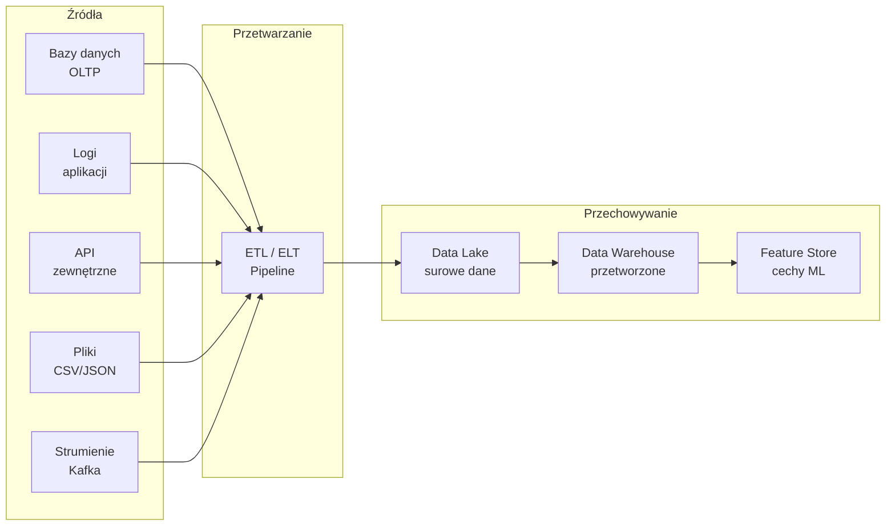

### 1.1. Ile pracy w ML to praca z danymi?

W badaniach i ankietach branżowych regularnie powtarza się obserwacja, że przygotowanie danych zajmuje większość czasu projektu ML, a sam kod modelu to niewielki fragment całego systemu (por. Sculley i in., *Hidden Technical Debt in Machine Learning Systems*, NeurIPS 2015).

```
┌──────────────────────────────────────────────────────────────────┐
│                    System ML na produkcji                        │
│  ┌────────────┐ ┌─────────────┐ ┌───────────┐ ┌───────────────┐  │
│  │ Zbieranie  │ │ Weryfikacja │ │ Ekstrakcja│ │ Zarządzanie   │  │
│  │ danych     │ │ danych      │ │ cech      │ │ zasobami      │  │
│  └────────────┘ └─────────────┘ └───────────┘ └───────────────┘  │
│  ┌────────────┐      ┌──────┐      ┌───────────┐ ┌───────────┐   │
│  │ Konfigur.  │      │ KOD  │      │ Serving   │ │ Monitoring│   │
│  │            │      │  ML  │      │           │ │           │   │
│  └────────────┘      └──────┘      └───────────┘ └───────────┘   │
└──────────────────────────────────────────────────────────────────┘
        mały prostokąt „KOD ML” otoczony infrastrukturą danych
```

### 1.2. Cykl życia danych w systemie ML

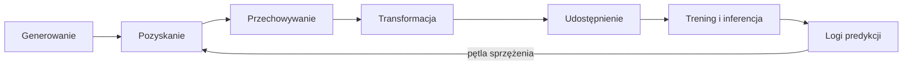

Pętla zwrotna jest kluczowa: predykcje modelu i reakcje użytkowników stają się nowymi danymi treningowymi. To źródło zarówno ciągłego uczenia się, jak i ryzyka (np. *feedback loop* – system rekomendacji uczy się na danych, które sam ukształtował).

### 1.3. Role w zespole danych

| Rola | Główna odpowiedzialność | Typowe narzędzia |
|---|---|---|
| Data Engineer | pipeline'y, magazyny danych, jakość i dostępność | Spark, Airflow, dbt, Kafka |
| Analytics Engineer | modele danych w hurtowni, metryki biznesowe | dbt, SQL, Looker |
| Data Scientist | eksploracja, cechy, modele | pandas, sklearn, notebooks |
| ML Engineer | produkcyjne pipeline'y ML, serving | MLflow, Feast, Docker, K8s |
| Data Steward / Owner | definicje, własność, zgodność z regulacjami | katalogi danych, DataHub |

> 💡 **Data-centric AI** (A. Ng): zamiast w nieskończoność stroić architekturę modelu, często więcej zyskujemy, systematycznie poprawiając dane – etykiety, pokrycie przypadków brzegowych, spójność definicji.

---

## 2. Architektura danych: Data Lake vs Data Warehouse

### Data Lake
- Przechowuje **surowe dane** w oryginalnym formacie (pliki, JSON, Parquet, Avro).
- Schemat definiowany przy odczycie (*schema-on-read*).
- Tanie przechowywanie dużych wolumenów.
- Przykłady: AWS S3, Google Cloud Storage, Azure Data Lake.

### Data Warehouse
- Przechowuje **przetworzone, ustrukturyzowane dane**.
- Schemat definiowany przy zapisie (*schema-on-write*).
- Zoptymalizowany pod kątem zapytań analitycznych (OLAP).
- Przykłady: BigQuery, Snowflake, Redshift.

### Data Lakehouse
Nowoczesne podejście łączące zalety obu:

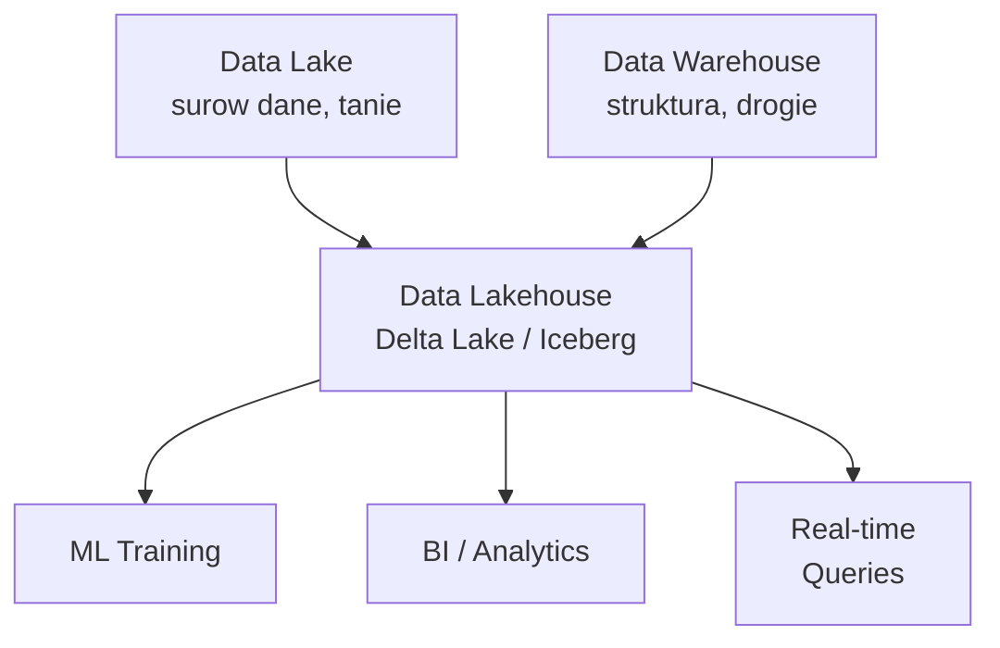


### Architektura medalionowa (Bronze / Silver / Gold)

Popularny wzorzec organizacji danych w Lakehouse – dane przechodzą przez kolejne warstwy jakości:

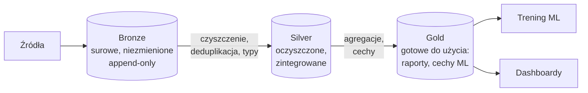

| Warstwa | Zawartość | Kto używa | Zasada |
|---|---|---|---|
| Bronze | kopia danych źródłowych | inżynierowie danych | nigdy nie nadpisujemy – możliwy pełny replay |
| Silver | dane oczyszczone, ujednolicone typy | analitycy, DS | jedna „wersja prawdy” dla encji |
| Gold | agregaty i cechy biznesowe | modele ML, BI | zoptymalizowane pod konkretne użycie |

Zaleta dla ML: gdy zmienimy logikę feature engineeringu, możemy **odtworzyć** warstwy Silver/Gold z Bronze i wytrenować model na historycznych danych z nowymi cechami.

### OLTP vs OLAP

| | OLTP (np. PostgreSQL) | OLAP (np. BigQuery) |
|---|---|---|
| Operacje | wiele małych zapisów/odczytów | duże skany i agregacje |
| Układ danych | wierszowy | kolumnowy |
| Rola w ML | źródło danych, online serving | trening, analityka, feature engineering |

### Porównanie zbiorcze: Lake vs Warehouse vs Lakehouse

| Kryterium | Data Lake | Data Warehouse | Data Lakehouse |
|---|---|---|---|
| Typy danych | dowolne: tabele, tekst, obrazy, audio | ustrukturyzowane | dowolne + tabele z ACID |
| Schemat | schema-on-read | schema-on-write | schema-on-write z ewolucją |
| Transakcje ACID | brak | tak | tak (warstwa metadanych) |
| Koszt przechowywania | niski (object storage) | wyższy | niski |
| Wydajność SQL | słaba bez dodatków | bardzo dobra | dobra |
| Time travel | brak | zależnie od produktu | tak (wersje snapshotów) |
| Typowe użycie w ML | dane nieustrukturyzowane do DL | cechy tabelaryczne, analityka | jedno źródło dla BI i ML |

### Jak działa Lakehouse? Otwarte formaty tabel

Lakehouse to w praktyce pliki Parquet w object storage **plus dziennik transakcji** (metadane), który mówi, które pliki tworzą daną wersję tabeli. Najpopularniejsze implementacje: **Delta Lake**, **Apache Iceberg**, **Apache Hudi**.

```
s3://lake/silver/orders/
├── _delta_log/
│   ├── 00000000000000000000.json   ← wersja 0: dodano part-0001, part-0002
│   ├── 00000000000000000001.json   ← wersja 1: usunięto part-0002, dodano part-0003
│   └── 00000000000000000002.json   ← wersja 2: MERGE (upsert)
├── part-0001.snappy.parquet
├── part-0002.snappy.parquet        ← logicznie usunięty, fizycznie do VACUUM
└── part-0003.snappy.parquet
```

Dzięki temu możliwe są: atomowe zapisy, `MERGE`/`UPDATE`/`DELETE` (ważne np. dla RODO – prawo do usunięcia danych), **time travel** (odczyt tabeli w wersji, na której trenowano model) i ewolucja schematu.

```python
# Delta Lake + PySpark: odczyt tabeli w stanie z dnia treningu
df_train = (spark.read.format("delta")
            .option("timestampAsOf", "2024-01-15")
            .load("s3://lake/gold/churn_features"))
```

> 💡 Time travel w Lakehouse i DVC (sekcja 8) rozwiązują ten sam problem – **odtwarzalność danych treningowych** – na różnych skalach: DVC dla plików w repozytorium projektu, formaty tabel dla dużych współdzielonych tabel.

> ⚠️ **Pułapka: Data Swamp (bagno danych).** Data Lake bez katalogu, właścicieli, opisu schematów i polityk retencji szybko zamienia się w zbiór plików, których nikt nie rozumie i nikt nie odważy się usunąć. Minimum: katalog danych (np. Glue Catalog, DataHub, Unity Catalog), konwencja nazw ścieżek, właściciel każdego zbioru.

### Modelowanie danych w hurtowni: schemat gwiazdy

Hurtownie często organizuje się w **tabelę faktów** (zdarzenia, liczby) i **tabele wymiarów** (opis encji). Z tego układu wyprowadza się cechy ML.

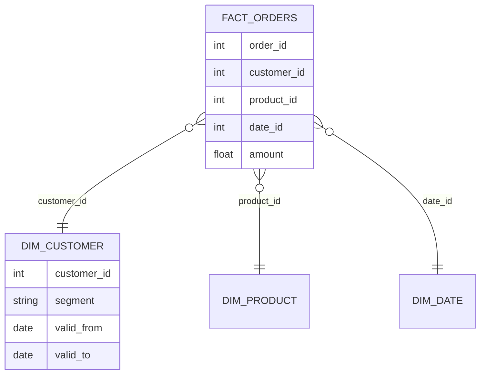

Kolumny `valid_from`/`valid_to` to **SCD typu 2** (*Slowly Changing Dimension*): zamiast nadpisywać np. segment klienta, dodajemy nowy wiersz z zakresem ważności. Dla ML to ogromna wartość – pozwala odtworzyć, jaki segment miał klient w chwili zdarzenia (point-in-time correctness, sekcja 7).

| Typ SCD | Zachowanie przy zmianie | Historia | Przydatność dla ML |
|---|---|---|---|
| Typ 0 | wartość nigdy się nie zmienia | — | tylko atrybuty stałe |
| Typ 1 | nadpisanie | brak | ryzyko wycieku z przyszłości |
| Typ 2 | nowy wiersz + zakres dat | pełna | zalecany |
| Typ 3 | dodatkowa kolumna „poprzednia wartość” | jeden krok | ograniczona |

---

## 3. Formaty danych dla ML

### Porównanie formatów

| Format | Typ | Kompresja | Schemat | Użycie |
|--------|-----|-----------|---------|--------|
| CSV | Wierszowy | Brak | Brak | Małe zbiory, prototypy |
| JSON | Wierszowy | Opcjonalna | Brak | API, logi |
| Parquet | Kolumnowy | Snappy/ZSTD | Tak | Analityka, ML |
| Avro | Wierszowy | Deflate | Tak | Kafka, streaming |
| TFRecord | Binarny | Opcjonalna | Tak | TensorFlow |
| HDF5 | Hierarchiczny | Tak | Tak | Duże macierze, DL |

### Dlaczego Parquet dla ML?

```python
import pandas as pd
import pyarrow as pa
import pyarrow.parquet as pq
import time
import os

# Generowanie przykładowych danych
df = pd.DataFrame({
    'user_id': range(1_000_000),
    'age': pd.Series(range(1_000_000)) % 80 + 18,
    'income': pd.Series(range(1_000_000)) * 0.05 + 20000,
    'churn': pd.Series(range(1_000_000)) % 2
})

# Zapis CSV
t0 = time.time()
df.to_csv('/tmp/data.csv', index=False)
csv_time = time.time() - t0
csv_size = os.path.getsize('/tmp/data.csv') / 1024 / 1024

# Zapis Parquet
t0 = time.time()
df.to_parquet('/tmp/data.parquet', compression='snappy', index=False)
parquet_time = time.time() - t0
parquet_size = os.path.getsize('/tmp/data.parquet') / 1024 / 1024

print(f"CSV:     {csv_size:.1f} MB, zapis: {csv_time:.2f}s")
print(f"Parquet: {parquet_size:.1f} MB, zapis: {parquet_time:.2f}s")
print(f"Oszczędność miejsca: {(1 - parquet_size/csv_size)*100:.0f}%")

# Odczyt tylko wybranych kolumn (column pruning)
t0 = time.time()
df_partial = pd.read_parquet('/tmp/data.parquet', columns=['user_id', 'churn'])
print(f"\nOdczyt 2 kolumn z Parquet: {time.time()-t0:.3f}s")
```


> **▶️ Demo na żywo:** `python lectures/scripts/lecture_02/01_csv_vs_parquet.py --rows 1000000`  
> **Kiedy:** po omówieniu tabeli porównawczej formatów.  
> **Co pokazać:** Parquet jest kilkukrotnie mniejszy, odczyt dwóch kolumn jest wielokrotnie szybszy, a CSV gubi typy `datetime` i `category`.

### Układ wierszowy vs kolumnowy

```
Tabela:   id | age | income | churn
          1  | 25  | 5000   | 0
          2  | 41  | 7200   | 1
          3  | 33  | 6100   | 0

Wierszowo (CSV, Avro, OLTP):
[1,25,5000,0][2,41,7200,1][3,33,6100,0]
  → szybkie dopisanie/odczyt całego rekordu

Kolumnowo (Parquet, ORC, OLAP):
[1,2,3][25,41,33][5000,7200,6100][0,1,0]
  → czytamy tylko potrzebne kolumny,
  → podobne wartości obok siebie = lepsza kompresja
```

### Budowa pliku Parquet

```
plik.parquet
├── Row group 1  (np. ~128 MB wierszy)
│   ├── Column chunk: age     → strony + statystyki min/max, null_count
│   ├── Column chunk: income
│   └── Column chunk: churn
├── Row group 2
│   └── ...
└── Footer: schemat, offsety, statystyki każdej kolumny w każdej grupie
```

Korzyści wynikające z budowy:
- **Column pruning (projection pushdown)** – czytamy tylko wybrane kolumny.
- **Predicate pushdown** – statystyki min/max w stopce pozwalają pominąć całe row groups (np. `age > 60`, gdy `max(age)=55`).
- **Kodowanie słownikowe i RLE** – kolumny o małej liczbie unikalnych wartości (np. `country`) zajmują ułamek miejsca.
- **Typy logiczne** – daty, decimale, listy, struktury zachowane bez parsowania tekstu.

### Partycjonowanie danych

```python
import pandas as pd

df = pd.DataFrame({
    "event_date": pd.to_datetime(["2024-01-14", "2024-01-14", "2024-01-15"]),
    "country": ["PL", "DE", "PL"],
    "amount": [10.0, 25.5, 7.2],
})
df["date"] = df["event_date"].dt.strftime("%Y-%m-%d")

# Zapis w układzie Hive: data/events/date=2024-01-14/country=PL/part-0.parquet
df.to_parquet("data/events", partition_cols=["date", "country"], index=False)

# Odczyt z filtrem – pyarrow czyta tylko pasujące katalogi (partition pruning)
pl_15 = pd.read_parquet("data/events", filters=[("date", "=", "2024-01-15"),
                                                ("country", "=", "PL")])
```

| Dobra praktyka | Dlaczego |
|---|---|
| Partycjonuj po kolumnie używanej w filtrach (zwykle data) | partition pruning, łatwy backfill jednej partycji |
| Unikaj kolumn o dużej kardynalności (`user_id`) | miliony małych plików = problem *small files* |
| Celuj w pliki 100 MB – 1 GB | balans między równoległością a narzutem metadanych |
| Zapisuj schemat jawnie (`pyarrow.schema`) | brak niespodzianek typu `int` → `float` przy NaN |

### Ewolucja schematu

Schemat danych zmienia się w czasie: dochodzą kolumny, zmieniają się typy. Formaty ze schematem (Parquet, Avro) pozwalają tym zarządzać świadomie.

| Zmiana | Zgodność wstecz | Komentarz |
|---|---|---|
| Dodanie kolumny opcjonalnej (nullable) | ✅ | starzy czytelnicy ją ignorują |
| Usunięcie kolumny | ⚠️ | psuje konsumentów, którzy jej używają |
| Zmiana nazwy kolumny | ❌ | dla czytelnika to usunięcie + dodanie |
| Rozszerzenie typu `int32` → `int64` | ✅ zwykle | zależnie od formatu i silnika |
| Zawężenie typu `float` → `int` | ❌ | utrata informacji |

> ⚠️ **Pułapka CSV:** `pd.read_csv` zgaduje typy. Kod pocztowy `01-234` może być OK, ale `00123` zamieni się w liczbę `123`, identyfikatory z wiodącymi zerami stracą je, a kolumna `int` z jednym brakiem stanie się `float64`. Zawsze podawaj `dtype=` lub przejdź na Parquet.

### Dane nieustrukturyzowane

Dla obrazów, audio i tekstu w deep learningu stosuje się inne podejścia: miliony małych plików w object storage są wolne w odczycie, dlatego łączy się je w **shardy** (TFRecord, WebDataset `.tar`, formaty Lance/Mosaic MDS), a metadane (etykiety, ścieżki, podziały) trzyma w Parquet.

---

## 4. ETL vs ELT

### ETL (Extract → Transform → Load)
Tradycyjne podejście: transformacja przed załadowaniem do magazynu.

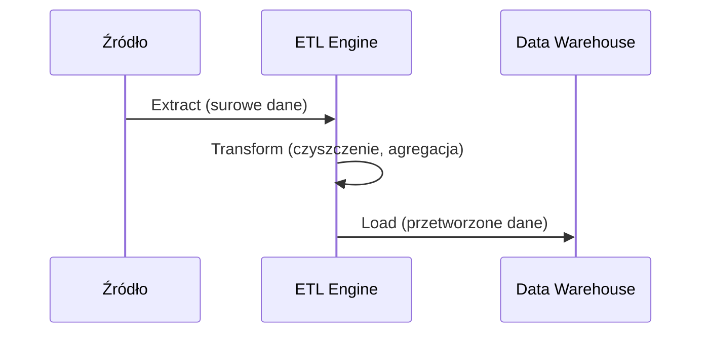

### ELT (Extract → Load → Transform)
Nowoczesne podejście: ładowanie surowych danych, transformacja w miejscu.

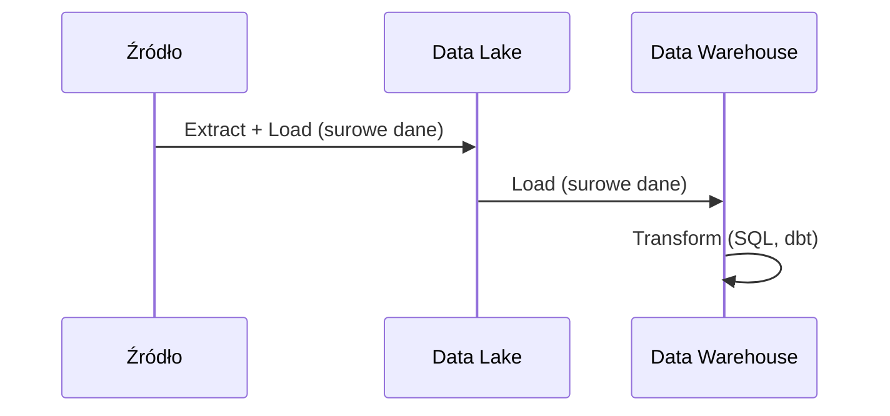

**Zalety ELT:**
- Zachowanie surowych danych (możliwość ponownego przetworzenia).
- Wykorzystanie mocy obliczeniowej magazynu danych.
- Łatwiejsze debugowanie.


### Orkiestracja pipeline'ów: DAG, idempotentność, backfill

Pipeline danych to **skierowany graf acykliczny (DAG)** zadań. Orkiestrator (Airflow, Prefect, Dagster) pilnuje kolejności, ponowień i harmonogramu.

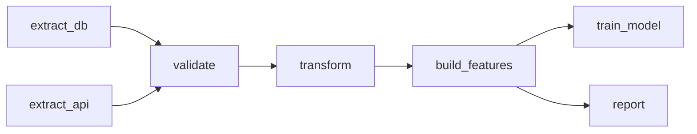

Kluczowe właściwości dobrego zadania w pipeline:
- **Idempotentność** – wielokrotne uruchomienie dla tego samego okresu daje ten sam wynik (np. `INSERT OVERWRITE partition=2024-01-15` zamiast `INSERT`).
- **Determinizm** – wynik zależy tylko od wejścia i parametrów (np. daty logicznej), a nie od „teraz”.
- **Atomowość** – zapis do lokalizacji tymczasowej, potem zamiana (rename); brak „połówek” danych.
- **Backfill** – możliwość przeliczenia historii dla nowej logiki.

Przykład szkieletu DAG w Airflow (TaskFlow API):

```python
from datetime import datetime
from airflow.decorators import dag, task

@dag(schedule="@daily", start_date=datetime(2024, 1, 1), catchup=True)
def churn_features():
    @task
    def extract(ds=None) -> str:            # ds = data logiczna, np. "2024-01-15"
        path = f"s3://lake/bronze/events/date={ds}/"
        # ... kopiowanie danych dla JEDNEGO dnia -> idempotentne
        return path

    @task
    def validate(path: str) -> str:
        # ... uruchom oczekiwania; wyjątek zatrzymuje pipeline
        return path

    @task
    def build_features(path: str, ds=None) -> None:
        # ... nadpisz partycję gold/features/date={ds}
        ...

    build_features(validate(extract()))

churn_features()
```

### ETL vs ELT – porównanie

| Kryterium | ETL | ELT |
|---|---|---|
| Miejsce transformacji | osobny silnik (Spark, Python, narzędzia ETL) | w hurtowni / lakehouse (SQL) |
| Surowe dane | często tracone | zachowane |
| Elastyczność | zmiana logiki = ponowna ekstrakcja | zmiana logiki = ponowne uruchomienie SQL |
| Prywatność | łatwiej maskować przed załadowaniem | trzeba chronić surowe dane w magazynie |
| Typowe narzędzia | Spark, Informatica, NiFi | Fivetran/Airbyte + dbt + Snowflake/BigQuery |
| Kiedy | dane wrażliwe, ciężkie transformacje nie-SQL | nowoczesny stos w chmurze |

### Ładowanie pełne vs przyrostowe vs CDC

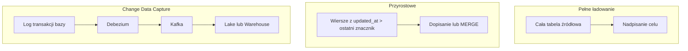

| Strategia | Zalety | Wady |
|---|---|---|
| Full load | proste, zawsze spójne | drogie przy dużych tabelach |
| Incremental (watermark kolumny) | tanie | nie widzi usunięć; wymaga wiarygodnego `updated_at` |
| CDC (log bazy) | widzi INSERT/UPDATE/DELETE, niskie opóźnienie | złożona infrastruktura |

### Przykład transformacji ELT w dbt

```sql
-- models/gold/customer_features.sql
{{ config(materialized='incremental', unique_key=['customer_id', 'feature_date']) }}

SELECT
    customer_id,
    DATE '{{ var("ds") }}'                         AS feature_date,
    COUNT(*)                                       AS orders_30d,
    AVG(amount)                                    AS avg_order_30d,
    DATE_DIFF(DATE '{{ var("ds") }}', MAX(order_date), DAY) AS days_since_last_order
FROM {{ ref('silver_orders') }}
WHERE order_date <  DATE '{{ var("ds") }}'                 -- tylko przeszłość!
  AND order_date >= DATE_SUB(DATE '{{ var("ds") }}', INTERVAL 30 DAY)
GROUP BY customer_id
```

```yaml
# models/gold/schema.yml – testy dbt jako bramka jakości
models:
  - name: customer_features
    columns:
      - name: customer_id
        tests: [not_null]
      - name: orders_30d
        tests:
          - dbt_utils.accepted_range: {min_value: 0}
```

### Idempotentny zapis partycji w Pythonie

```python
import os
import shutil
import tempfile
import pandas as pd

def write_partition_atomically(df: pd.DataFrame, root: str, ds: str) -> None:
    """Nadpisuje partycję date=ds w sposób idempotentny i atomowy."""
    target = os.path.join(root, f"date={ds}")
    tmp = tempfile.mkdtemp(dir=root, prefix=".tmp_")
    df.to_parquet(os.path.join(tmp, "part-0.parquet"), index=False)
    if os.path.exists(target):
        shutil.rmtree(target)        # ponowne uruchomienie = ten sam wynik
    os.rename(tmp, target)           # rename w obrębie FS jest atomowy
```

> ⚠️ **Pułapka: `datetime.now()` w zadaniu.** Zadanie liczące „ostatnie 30 dni względem teraz” da inny wynik przy backfillu i przy ponownym uruchomieniu. Zawsze parametryzuj zadanie **datą logiczną** (`ds`) przekazaną przez orkiestrator.

### Porównanie orkiestratorów

| | Airflow | Prefect | Dagster |
|---|---|---|---|
| Model | zadania (tasks) w DAG | przepływy Pythona (flows) | zasoby danych (assets) |
| Mocne strony | dojrzałość, ogromna liczba integracji | prostota, dynamiczne przepływy | lineage danych, typowanie, testowalność |
| Słabsze strony | cięższa infrastruktura | mniejszy ekosystem | krzywa uczenia pojęć |

---

## 5. Pipeline przetwarzania danych w Pythonie

### Przykład: Pipeline z użyciem pandas i scikit-learn

```python
import pandas as pd
import numpy as np
from sklearn.pipeline import Pipeline
from sklearn.preprocessing import StandardScaler, OneHotEncoder
from sklearn.impute import SimpleImputer
from sklearn.compose import ColumnTransformer
from sklearn.model_selection import train_test_split

# --- Krok 1: Wczytanie danych ---
def load_data(path: str) -> pd.DataFrame:
    """Wczytuje dane i wykonuje podstawową walidację."""
    df = pd.read_parquet(path)
    
    required_cols = ['age', 'income', 'category', 'churn']
    missing = set(required_cols) - set(df.columns)
    if missing:
        raise ValueError(f"Brakujące kolumny: {missing}")
    
    print(f"Wczytano {len(df):,} wierszy, {df.shape[1]} kolumn")
    return df

# --- Krok 2: Czyszczenie danych ---
def clean_data(df: pd.DataFrame) -> pd.DataFrame:
    """Usuwa duplikaty i oczywiste błędy."""
    initial_size = len(df)
    
    # Usuń duplikaty
    df = df.drop_duplicates()
    
    # Usuń wiersze z ujemnym wiekiem
    df = df[df['age'] > 0]
    
    # Usuń wartości odstające (IQR method)
    Q1 = df['income'].quantile(0.25)
    Q3 = df['income'].quantile(0.75)
    IQR = Q3 - Q1
    df = df[df['income'].between(Q1 - 3*IQR, Q3 + 3*IQR)]
    
    removed = initial_size - len(df)
    print(f"Usunięto {removed:,} wierszy ({removed/initial_size*100:.1f}%)")
    return df

# --- Krok 3: Feature Engineering ---
def engineer_features(df: pd.DataFrame) -> pd.DataFrame:
    """Tworzy nowe cechy."""
    df = df.copy()
    
    # Cechy pochodne
    df['income_per_age'] = df['income'] / df['age']
    df['age_group'] = pd.cut(df['age'], 
                              bins=[0, 25, 35, 50, 65, 100],
                              labels=['<25', '25-35', '35-50', '50-65', '65+'])
    
    return df

# --- Krok 4: Preprocessing Pipeline ---
def build_preprocessing_pipeline(
    numeric_features: list[str],
    categorical_features: list[str]
) -> ColumnTransformer:
    """Buduje pipeline preprocessingu."""
    
    numeric_transformer = Pipeline(steps=[
        ('imputer', SimpleImputer(strategy='median')),
        ('scaler', StandardScaler())
    ])
    
    categorical_transformer = Pipeline(steps=[
        ('imputer', SimpleImputer(strategy='most_frequent')),
        ('encoder', OneHotEncoder(handle_unknown='ignore', sparse_output=False))
    ])
    
    preprocessor = ColumnTransformer(transformers=[
        ('num', numeric_transformer, numeric_features),
        ('cat', categorical_transformer, categorical_features)
    ])
    
    return preprocessor

# --- Główny pipeline ---
def run_data_pipeline(input_path: str) -> tuple:
    """Uruchamia pełny pipeline przetwarzania danych."""
    
    # Wczytaj i oczyść
    df = load_data(input_path)
    df = clean_data(df)
    df = engineer_features(df)
    
    # Podział na cechy i etykietę
    X = df.drop('churn', axis=1)
    y = df['churn']
    
    # Podział na zbiory
    X_train, X_test, y_train, y_test = train_test_split(
        X, y, test_size=0.2, random_state=42, stratify=y
    )
    
    # Preprocessing
    numeric_features = ['age', 'income', 'income_per_age']
    categorical_features = ['category', 'age_group']
    
    preprocessor = build_preprocessing_pipeline(numeric_features, categorical_features)
    
    X_train_processed = preprocessor.fit_transform(X_train)
    X_test_processed = preprocessor.transform(X_test)
    
    print(f"\nWymiary po preprocessingu:")
    print(f"  Train: {X_train_processed.shape}")
    print(f"  Test:  {X_test_processed.shape}")
    
    return X_train_processed, X_test_processed, y_train, y_test, preprocessor
```


> **▶️ Demo na żywo:** `python lectures/scripts/lecture_02/02_data_pipeline.py`  
> **Kiedy:** po omówieniu kodu z sekcji 5.  
> **Co pokazać:** log czyszczenia (duplikaty, błędne dochody), raport klasyfikacji i predykcja z zapisanego pipeline'u. Podkreśl, że imputacja i skalowanie są dopasowywane tylko na zbiorze treningowym.

### Przepływ danych przez pipeline – co jest „fitowane”, a co nie?

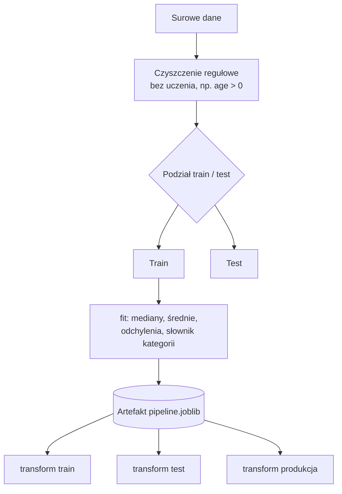

> 💡 Reguła kciuka: operacje **bez stanu** (filtr `age > 0`, obliczenie `income / age`) można robić przed podziałem. Operacje, które **uczą się statystyk z danych** (imputacja medianą, skalowanie, kodowanie kategorii, progi IQR, selekcja cech), muszą być częścią pipeline'u dopasowywanego tylko na zbiorze treningowym. Zwróć uwagę, że usuwanie outlierów metodą IQR w `clean_data` powyżej liczy kwantyle na całym zbiorze – w rygorystycznym ujęciu to również drobny wyciek.

### Rodzaje braków danych

| Mechanizm | Znaczenie | Przykład | Konsekwencja |
|---|---|---|---|
| MCAR (Missing Completely At Random) | brak niezależny od czegokolwiek | awaria czujnika losowo | imputacja prosta jest OK |
| MAR (Missing At Random) | brak zależy od innych obserwowanych cech | starsi rzadziej podają e-mail | imputacja warunkowa (KNN, iteracyjna) |
| MNAR (Missing Not At Random) | brak zależy od samej brakującej wartości | osoby o wysokich dochodach nie podają dochodu | sam fakt braku niesie informację |

```python
from sklearn.impute import SimpleImputer

# add_indicator=True dodaje kolumnę binarną "czy był brak" – przydatne przy MNAR
imputer = SimpleImputer(strategy="median", add_indicator=True)
```

### Kodowanie zmiennych kategorycznych

| Metoda | Kiedy | Ryzyko |
|---|---|---|
| One-Hot | mała kardynalność (< ~50) | eksplozja wymiarów |
| Ordinal | naturalny porządek (S < M < L) | sztuczny porządek, jeśli go nie ma |
| Target encoding | duża kardynalność | **wyciek etykiety** – wymaga CV/out-of-fold |
| Hashing | bardzo duża kardynalność, streaming | kolizje, brak interpretowalności |
| Embeddingi | DL, kategorie jak `product_id` | potrzeba dużo danych |

### Własny transformer zgodny ze sklearn

Cechy pochodne warto także zamknąć w pipeline, aby produkcja liczyła je identycznie:

```python
import numpy as np
import pandas as pd
from sklearn.base import BaseEstimator, TransformerMixin

class RatioFeatures(BaseEstimator, TransformerMixin):
    """Dodaje income_per_age; bezstanowy, więc fit nic nie uczy."""

    def fit(self, X: pd.DataFrame, y=None):
        return self

    def transform(self, X: pd.DataFrame) -> pd.DataFrame:
        X = X.copy()
        X["income_per_age"] = X["income"] / X["age"].replace(0, np.nan)
        return X
```

```python
import joblib
from sklearn.pipeline import Pipeline
from sklearn.linear_model import LogisticRegression

full_pipeline = Pipeline([
    ("ratios", RatioFeatures()),
    ("prep", build_preprocessing_pipeline(
        ["age", "income", "income_per_age"], ["category"])),
    ("model", LogisticRegression(max_iter=1000)),
])
full_pipeline.fit(X_train, y_train)
joblib.dump(full_pipeline, "models/churn_pipeline.joblib")   # jeden artefakt
```

> ⚠️ **Pułapka:** zapisanie samego modelu (`model.pkl`) bez preprocessora. Serwis produkcyjny musi wtedy odtworzyć skalowanie ręcznie – to prosta droga do training-serving skew.

### Typowe operacje czyszczenia – ściąga

| Problem | Wykrycie | Typowa reakcja |
|---|---|---|
| Duplikaty | `df.duplicated(subset=klucz)` | deduplikacja po kluczu i najnowszym znaczniku |
| Niespójne kategorie (`"PL"`, `"pl"`, `"Polska"`) | `value_counts()` | normalizacja, słownik mapowań |
| Wartości wartownicze (`-1`, `999`, `"N/A"`) | rozkład, wiedza domenowa | zamiana na `NaN` |
| Strefy czasowe | mieszane offsety | konwersja do UTC |
| Outliery | IQR, z-score, wiedza domenowa | usunięcie, przycięcie (*clipping*), osobna flaga |

---

## 6. Walidacja danych – Great Expectations

Walidacja danych to kluczowy element MLOps. Biblioteka **Great Expectations** pozwala definiować i weryfikować oczekiwania dotyczące danych.

```python
import great_expectations as gx
import pandas as pd

# Przykładowe dane
df = pd.DataFrame({
    'age': [25, 30, -5, 200, 45],       # -5 i 200 to błędy
    'income': [50000, 60000, None, 80000, 55000],
    'churn': [0, 1, 0, 1, 2]            # 2 to błąd (powinno być 0 lub 1)
})

# Tworzenie kontekstu GE
context = gx.get_context()

# Definicja oczekiwań (expectations)
validator = context.sources.pandas_default.read_dataframe(df)

# Oczekiwania dotyczące kolumny 'age'
validator.expect_column_values_to_be_between('age', min_value=0, max_value=120)
validator.expect_column_values_to_not_be_null('age')

# Oczekiwania dotyczące kolumny 'income'
validator.expect_column_values_to_not_be_null('income')
validator.expect_column_values_to_be_between('income', min_value=0)

# Oczekiwania dotyczące kolumny 'churn'
validator.expect_column_values_to_be_in_set('churn', value_set=[0, 1])

# Uruchomienie walidacji
results = validator.validate()
print(f"Walidacja: {'✅ OK' if results.success else '❌ FAILED'}")
for result in results.results:
    status = "✅" if result.success else "❌"
    print(f"  {status} {result.expectation_config.expectation_type}: "
          f"{result.expectation_config.kwargs}")
```

### Schemat walidacji danych w pipeline

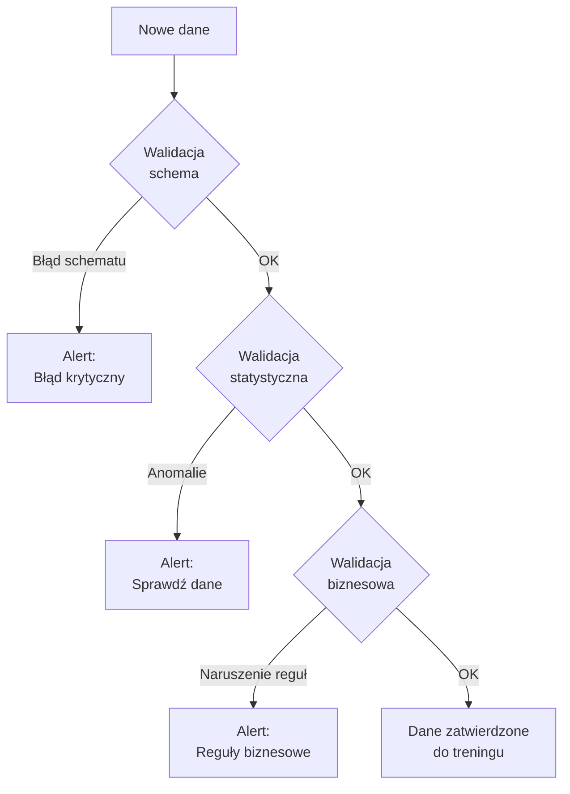


> **▶️ Demo na żywo:** `python lectures/scripts/lecture_02/03_data_validation.py && python lectures/scripts/lecture_02/03_data_validation.py --corrupt; echo $?`  
> **Kiedy:** po przykładzie Great Expectations.  
> **Co pokazać:** te same oczekiwania (w tym parametr `mostly`) zaimplementowane w czystym pandas. Na danych z błędami walidacja nie przechodzi, a skrypt zwraca kod 1, co w CI/CD zatrzymuje pipeline.


### Wymiary jakości danych

| Wymiar | Pytanie | Przykładowa reguła |
|---|---|---|
| Kompletność | Czy brakuje wartości/wierszy? | `age` nie-null w ≥ 99% |
| Poprawność | Czy wartości są w dozwolonym zakresie? | `0 ≤ age ≤ 120` |
| Spójność | Czy dane są zgodne między systemami? | suma zamówień = suma w księgowości |
| Unikalność | Czy nie ma duplikatów? | `customer_id` unikalny |
| Aktualność | Czy dane są świeże? | ostatni rekord < 24 h |
| Stabilność rozkładu | Czy rozkład się nie zmienił? | PSI(`income`) < 0.2 |

### Training-serving skew

Najczęstsze źródło „model działał offline, a na produkcji nie”: **cechy liczone inaczej podczas treningu i serwowania**.

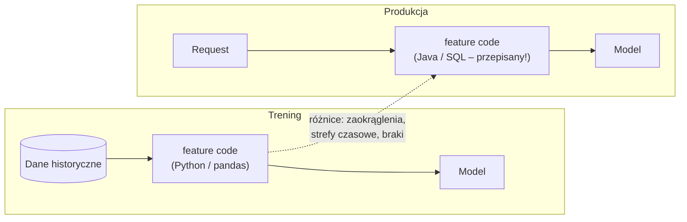

Rozwiązania: jedna implementacja cech (Feature Store, wspólna biblioteka), zapis cech użytych przy predykcji (*log & wait*) i porównywanie ich z cechami treningowymi.

### Walidacja schematu w kodzie: Pandera

Alternatywą lżejszą od Great Expectations jest **Pandera** – schematy danych zapisane jako kod Pythona, wygodne w testach jednostkowych.

```python
import pandas as pd
import pandera as pa
from pandera import Column, Check

schema = pa.DataFrameSchema({
    "age":    Column(int,   Check.in_range(0, 120)),
    "income": Column(float, Check.ge(0), nullable=True),
    "churn":  Column(int,   Check.isin([0, 1])),
}, strict=True)               # dodatkowe, nieznane kolumny = błąd

df = pd.DataFrame({"age": [25, 130], "income": [5000.0, None], "churn": [0, 1]})
try:
    schema.validate(df, lazy=True)        # lazy: zbierz wszystkie błędy naraz
except pa.errors.SchemaErrors as err:
    print(err.failure_cases[["column", "check", "failure_case"]])
```

| Narzędzie | Styl | Mocne strony |
|---|---|---|
| Great Expectations | deklaratywne „oczekiwania”, raporty HTML | dokumentacja danych, dużo gotowych reguł |
| Pandera | schemat jako kod | integracja z testami i typowaniem |
| dbt tests | SQL w hurtowni | walidacja tam, gdzie są dane |
| TFDV / Evidently | statystyki i dryf | porównanie rozkładów train vs produkcja |

### Walidacja statystyczna: dryf rozkładu i PSI

**Population Stability Index** porównuje rozkład cechy w danych referencyjnych (np. treningowych) i bieżących:

PSI = Σ (pᵢ − qᵢ) · ln(pᵢ / qᵢ), gdzie pᵢ, qᵢ to udziały obserwacji w koszyku *i*.

```python
import numpy as np

def psi(reference: np.ndarray, current: np.ndarray, bins: int = 10) -> float:
    edges = np.quantile(reference, np.linspace(0, 1, bins + 1))
    edges[0], edges[-1] = -np.inf, np.inf
    p = np.histogram(reference, edges)[0] / len(reference)
    q = np.histogram(current, edges)[0] / len(current)
    p, q = np.clip(p, 1e-6, None), np.clip(q, 1e-6, None)
    return float(np.sum((p - q) * np.log(p / q)))

rng = np.random.default_rng(42)
train_income = rng.normal(5000, 1000, 10_000)
print(psi(train_income, rng.normal(5000, 1000, 10_000)))   # ~0.00 – stabilnie
print(psi(train_income, rng.normal(5600, 1200, 10_000)))   # wyraźnie > 0.1 – dryf
```

| PSI | Interpretacja (konwencja branżowa) |
|---|---|
| < 0.1 | brak istotnej zmiany |
| 0.1 – 0.2 | umiarkowana zmiana – obserwuj |
| > 0.2 | istotna zmiana – zbadaj, rozważ retrening |

### Data contracts – kontrakty danych

Wiele awarii pipeline'ów ML wynika z tego, że zespół produktowy zmienił źródło (nazwę kolumny, jednostkę, znaczenie statusu), nie wiedząc, że ktoś z niego korzysta. **Kontrakt danych** to jawne, wersjonowane porozumienie producenta i konsumenta:

```yaml
# contracts/orders.yaml
dataset: orders
owner: team-checkout
version: 2.1.0
freshness: { max_delay: 2h }
schema:
  - { name: order_id,  type: string,  required: true, unique: true }
  - { name: amount,    type: decimal, unit: PLN, min: 0 }
  - { name: status,    type: string,  enum: [NEW, PAID, CANCELLED, REFUNDED] }
breaking_change_policy: "nowa wersja główna + 30 dni okresu przejściowego"
```

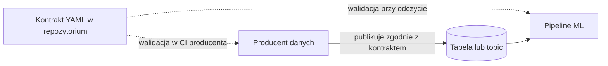

> 💡 **Gdzie walidować?** Najtaniej jak najbliżej źródła (*shift left*): błąd złapany w CI producenta kosztuje minuty, ten sam błąd wykryty po spadku metryk modelu – tygodnie.

> ⚠️ **Pułapka: zbyt sztywne reguły.** Reguła „0 braków w `income`” zablokuje pipeline przy pierwszym pojedynczym nullu. Stosuj progi tolerancji (`mostly=0.99` w GE, demo `03_data_validation.py`) i rozróżniaj poziomy: *błąd krytyczny* (stop) vs *ostrzeżenie* (alert, pipeline idzie dalej).

---

## 7. Feature Store – centralne repozytorium cech

**Feature Store** to system do przechowywania, zarządzania i serwowania cech ML.

### Problem bez Feature Store

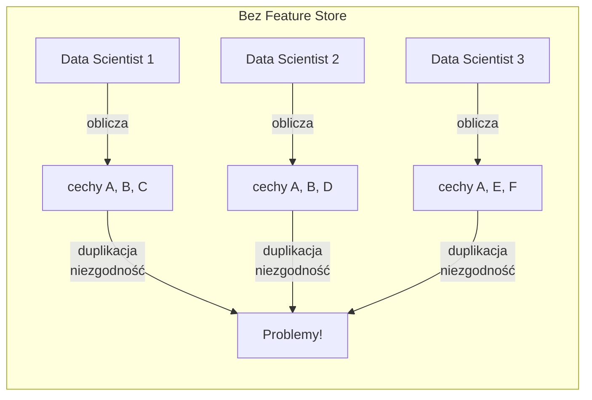

### Rozwiązanie z Feature Store

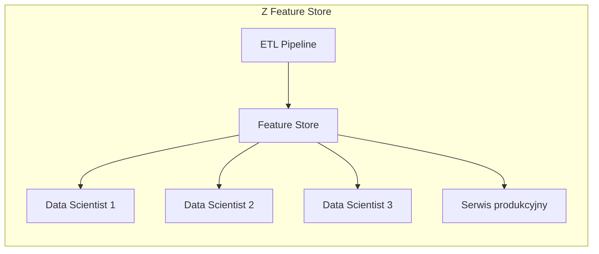

### Implementacja prostego Feature Store z Feast

```python
from feast import Entity, Feature, FeatureView, FileSource, ValueType
from feast.types import Float32, Int64
from datetime import timedelta

# Definicja encji
user = Entity(
    name="user_id",
    value_type=ValueType.INT64,
    description="Identyfikator użytkownika"
)

# Źródło danych
user_stats_source = FileSource(
    path="data/user_stats.parquet",
    timestamp_field="event_timestamp"
)

# Definicja Feature View
user_stats_fv = FeatureView(
    name="user_statistics",
    entities=["user_id"],
    ttl=timedelta(days=7),  # czas życia cechy
    features=[
        Feature(name="age", dtype=Float32),
        Feature(name="income", dtype=Float32),
        Feature(name="days_since_last_purchase", dtype=Int64),
        Feature(name="total_purchases_30d", dtype=Int64),
        Feature(name="avg_order_value", dtype=Float32),
    ],
    source=user_stats_source,
)

# Pobieranie cech dla treningu (historical features)
from feast import FeatureStore
import pandas as pd

store = FeatureStore(repo_path="feature_repo/")

# Pobierz historyczne cechy dla zbioru treningowego
entity_df = pd.DataFrame({
    "user_id": [1001, 1002, 1003],
    "event_timestamp": pd.to_datetime(["2024-01-15", "2024-01-15", "2024-01-15"])
})

training_df = store.get_historical_features(
    entity_df=entity_df,
    features=[
        "user_statistics:age",
        "user_statistics:income",
        "user_statistics:total_purchases_30d",
    ]
).to_df()

print(training_df)

# Pobieranie cech online (dla predykcji w czasie rzeczywistym)
online_features = store.get_online_features(
    features=["user_statistics:age", "user_statistics:income"],
    entity_rows=[{"user_id": 1001}]
).to_dict()

print(online_features)
```


### Point-in-time correctness – poprawność w czasie

Budując zbiór treningowy, dla każdego zdarzenia wolno użyć **tylko cech znanych w chwili tego zdarzenia**. Zwykły `JOIN` po `user_id` wziąłby najnowszą wartość cechy – czyli informację z przyszłości (data leakage).

#### Dlaczego to ważne?

Model na produkcji zawsze dostaje cechy „ze stanu na teraz”, czyli z przeszłości względem chwili, dla której przewiduje. Zbiór treningowy musi odtwarzać dokładnie tę sytuację. Jeśli w treningu do zdarzenia z 15 stycznia dołączymy cechę policzoną 21 stycznia, model uczy się z informacji, której w momencie decyzji nikt jeszcze nie miał. Skutki:

- **zawyżone metryki offline** – walidacja wygląda świetnie, bo model „zna przyszłość”;
- **spadek jakości po wdrożeniu** – na produkcji tej informacji nie ma, więc model działa gorzej, niż obiecywały testy;
- **trudna diagnoza** – kod jest poprawny, dane też, błąd tkwi tylko w sposobie złączenia w czasie.

To szczególny przypadek data leakage (sekcja 10) i jedna z przyczyn training-serving skew (sekcja 6).

#### Kluczowe pojęcia

| Pojęcie | Znaczenie | Przykład |
|---|---|---|
| **Encja** (entity) | obiekt, którego dotyczą cechy; klucz złączenia | `user_id = 1001` |
| **Czas zdarzenia** (event timestamp) | chwila, dla której robimy predykcję i której dotyczy etykieta | wniosek złożony 15.01 |
| **Czas cechy** (feature timestamp) | chwila, od której dana wartość cechy obowiązuje | `avg_order = 80` od 11.01 |
| **Czas dostępności** (created / ingestion timestamp) | chwila, w której wartość faktycznie trafiła do systemu | wyliczona nocnym jobem 12.01 o 02:00 |
| **TTL** (time-to-live) | jak długo wartość cechy uznajemy za aktualną | cecha starsza niż 30 dni = brak (`NaN`) |

Reguła point-in-time join: dla każdego wiersza etykiety `(encja, t)` wybierz **ostatnią wartość cechy z `czas_cechy ≤ t`** (a w wersji ostrożnej `czas_dostępności ≤ t`), o ile nie jest starsza niż TTL. Jest to tzw. złączenie *as-of* („według stanu na dzień”).

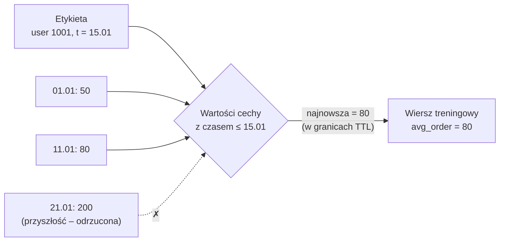

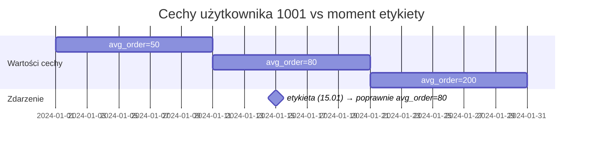

Feature Store realizuje to przez *point-in-time join*. W pandas ten sam efekt daje `merge_asof`:

```python
import pandas as pd

features = pd.DataFrame({
    "user_id": [1001, 1001, 1001],
    "ts": pd.to_datetime(["2024-01-01", "2024-01-11", "2024-01-21"]),
    "avg_order": [50, 80, 200],
})
labels = pd.DataFrame({"user_id": [1001], "ts": pd.to_datetime(["2024-01-15"]), "churn": [1]})

wrong = labels.merge(features.sort_values("ts").groupby("user_id").tail(1), on="user_id")
right = pd.merge_asof(labels.sort_values("ts"), features.sort_values("ts"),
                      on="ts", by="user_id", direction="backward")
print(wrong[["avg_order"]].iloc[0].item(), "← wyciek z przyszłości")   # 200
print(right[["avg_order"]].iloc[0].item(), "← poprawnie")              # 80
```

Co robi ten kod:
- `wrong` – bierze **ostatni** znany wiersz cechy dla użytkownika (21.01, wartość 200) i dokleja go do etykiety z 15.01. Tak działa naiwny `JOIN` z tabelą „aktualnych” cech.
- `right` – `merge_asof` dla każdej etykiety szuka po `user_id` (`by=`) wiersza cechy o największym `ts`, które jest **≤** czasowi etykiety (`direction="backward"`). Obie tabele muszą być posortowane po kolumnie czasu.

#### Pułapka: opóźnienie dostępności i nieaktualne cechy

Cecha z czasem 11.01 mogła zostać policzona dopiero następnego dnia (np. dzienny job wsadowy). Jeśli zdarzenie było 11.01 o 10:00, na produkcji tej wartości jeszcze by nie było. Dlatego złączenie robi się po **czasie dostępności**, a nie po czasie cechy. Drugi problem to wartości bardzo stare – parametr `tolerance` odpowiada TTL:

```python
import pandas as pd

features = pd.DataFrame({
    "user_id": [1001, 1001],
    "feature_ts": pd.to_datetime(["2024-01-01", "2024-01-11"]),
    "avg_order": [50, 80],
})
# cechy liczone nocnym jobem – dostępne dzień później o 02:00
features["available_ts"] = features["feature_ts"] + pd.Timedelta(days=1, hours=2)

labels = pd.DataFrame({
    "user_id": [1001, 1001, 1001],
    "ts": pd.to_datetime(["2024-01-11 10:00", "2024-01-15 00:00", "2024-03-01 00:00"]),
})

result = pd.merge_asof(
    labels.sort_values("ts"),
    features.sort_values("available_ts"),
    left_on="ts", right_on="available_ts", by="user_id",
    direction="backward",
    tolerance=pd.Timedelta(days=30),   # TTL: starsze wartości → NaN
)
print(result[["ts", "avg_order"]])
# 2024-01-11 10:00 → 50   (wartość 80 jeszcze niedostępna)
# 2024-01-15       → 80
# 2024-03-01       → NaN  (ostatnia wartość starsza niż 30 dni)
```

Odpowiednik w SQL (np. BigQuery, Snowflake), gdy brak `ASOF JOIN`:

```sql
SELECT l.user_id, l.ts, f.avg_order
FROM labels l
LEFT JOIN features f
  ON f.user_id = l.user_id
 AND f.available_ts <= l.ts
 AND f.available_ts >  l.ts - INTERVAL 30 DAY
QUALIFY ROW_NUMBER() OVER (PARTITION BY l.user_id, l.ts ORDER BY f.available_ts DESC) = 1;
```

#### Typowe błędy i dobre praktyki

- **Tabela cech bez historii** (tylko „stan bieżący”, nadpisywany każdej nocy) – nie da się z niej zbudować poprawnego zbioru treningowego. Cechy przechowuj jako historię (append-only, warstwa Bronze/Silver) z kolumną czasu.
- **Agregaty liczone na całym zbiorze**, np. „średnia wartość zamówień klienta” policzona ze wszystkich lat – zawiera przyszłość. Okno agregacji musi kończyć się przed czasem zdarzenia (`rolling` z `closed="left"`).
- **Strefy czasowe** – porównuj znaczniki czasu w jednej strefie (najlepiej UTC), inaczej przesunięcie o kilka godzin daje wyciek albo brak cech.
- **Losowy podział train/test** przy danych czasowych – nawet przy poprawnym złączeniu test „miesza się” z treningiem. Dziel po czasie (trening: przeszłość, test: przyszłość).
- **Test kontrolny** – w pipeline sprawdzaj asercją, że dla każdego wiersza `feature_ts ≤ event_ts`.

Feature Store (np. Feast `get_historical_features`) wykonuje point-in-time join automatycznie na podstawie `timestamp_field` źródła i `ttl` widoku cech, dlatego ta sama definicja cechy daje spójne dane dla treningu (offline) i serwowania (online).

### Online vs offline store

| | Offline store | Online store |
|---|---|---|
| Cel | zbiory treningowe, batch scoring | predykcja w czasie rzeczywistym |
| Technologia | Parquet, BigQuery | Redis, DynamoDB |
| Latencja | minuty | milisekundy |
| Dane | pełna historia | tylko najnowsza wartość cechy |

### Architektura Feature Store

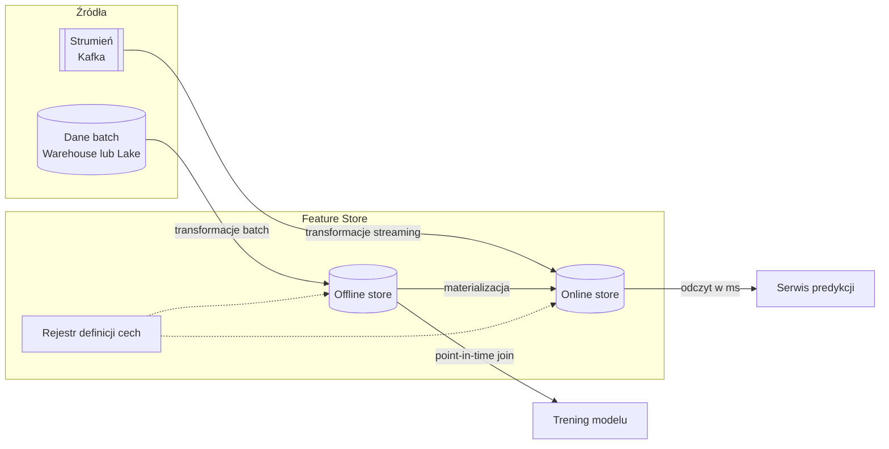

Najważniejsze komponenty:
- **Rejestr** – definicje cech, właściciele, opisy, wersje (odkrywalność i reużycie).
- **Offline store** – pełna historia do budowy zbiorów treningowych.
- **Online store** – najnowsze wartości do serwowania z niską latencją.
- **Materializacja** – okresowe kopiowanie najnowszych wartości offline → online (w Feast: `feast materialize-incremental <data>`).

### Współczesne API Feast

> ⚠️ Przykład z początku sekcji używa starszego API (`Feature`, `ValueType`), które w nowych wersjach Feast zostało zastąpione przez `Field` i `schema`. Poniżej odpowiednik w aktualnym stylu – sprawdź wersję biblioteki w `requirements.txt`.

```python
from datetime import timedelta
from feast import Entity, FeatureView, Field, FileSource
from feast.types import Float32, Int64

user = Entity(name="user", join_keys=["user_id"])

user_stats_source = FileSource(
    path="data/user_stats.parquet",
    timestamp_field="event_timestamp",
    created_timestamp_column="created",   # czas dostępności wartości
)

user_stats_fv = FeatureView(
    name="user_statistics",
    entities=[user],
    ttl=timedelta(days=7),
    schema=[
        Field(name="age", dtype=Float32),
        Field(name="income", dtype=Float32),
        Field(name="total_purchases_30d", dtype=Int64),
    ],
    source=user_stats_source,
)
```

```bash
feast apply                                  # rejestracja definicji
feast materialize-incremental 2024-01-15T00:00:00   # offline → online
```

### Kiedy Feature Store się opłaca?

| Sytuacja | Feature Store? |
|---|---|
| Jeden model batch, mały zespół | raczej nie – wystarczy tabela Gold + wspólny kod |
| Wiele modeli współdzielących cechy | tak – reużycie i spójne definicje |
| Predykcje online z cechami historycznymi (np. fraud) | zdecydowanie tak |
| Silne wymagania audytu (finanse) | tak – lineage i wersjonowanie cech |

| Rozwiązanie | Typ | Uwagi |
|---|---|---|
| Feast | open source | lekki, „bring your own” storage |
| Hopsworks | open source / komercyjny | pełna platforma z online store |
| Tecton | komercyjny | silne wsparcie streamingu |
| Databricks / Vertex AI / SageMaker Feature Store | zarządzane w chmurze | integracja z ekosystemem dostawcy |

---

## 8. Wersjonowanie danych z DVC

**DVC** (Data Version Control) to narzędzie do wersjonowania danych i modeli, działające razem z Git.

```bash
# Inicjalizacja DVC w projekcie
git init
dvc init

# Dodanie zdalnego storage (np. Google Cloud Storage)
dvc remote add -d myremote gs://my-bucket/dvc-storage

# Śledzenie pliku danych
dvc add data/train.parquet
git add data/train.parquet.dvc .gitignore
git commit -m "Add training data v1"

# Przesłanie danych do zdalnego storage
dvc push

# Przełączenie na inną wersję danych
git checkout v1.0
dvc checkout
```

### Struktura pliku .dvc

```yaml
# data/train.parquet.dvc
outs:
- md5: a1b2c3d4e5f6...
  size: 52428800
  path: train.parquet
```

### Pipeline DVC

```yaml
# dvc.yaml
stages:
  prepare:
    cmd: python src/prepare.py
    deps:
      - src/prepare.py
      - data/raw/
    outs:
      - data/prepared/

  train:
    cmd: python src/train.py
    deps:
      - src/train.py
      - data/prepared/
    params:
      - params.yaml:
          - train.n_estimators
          - train.max_depth
    outs:
      - models/model.pkl
    metrics:
      - metrics/scores.json:
          cache: false
```

```python
# params.yaml
train:
  n_estimators: 100
  max_depth: 5
  random_state: 42
test_size: 0.2
```


> **▶️ Demo na żywo:** `bash lectures/scripts/lecture_02/05_dvc_demo.sh`  
> **Kiedy:** po omówieniu poleceń DVC i pliku `.dvc`.  
> **Co pokazać:** zawartość pliku `train.csv.dvc` (hash md5), zmianę liczby wierszy z 5000 na 1000 po `git checkout data-v1 && dvc checkout` oraz historię commitów.

### Jak DVC działa pod spodem?

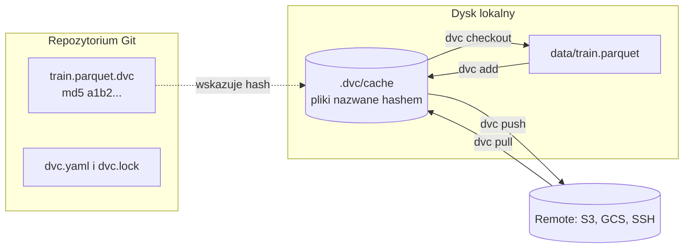

- Git przechowuje tylko **mały plik-wskaźnik** z hashem; duże pliki trafiają do cache i remote (*content-addressable storage*).
- Ten sam plik w wielu wersjach projektu zajmuje miejsce tylko raz.
- `dvc.lock` zapisuje hashe wejść i wyjść każdego etapu – `dvc repro` uruchamia **tylko etapy, których zależności się zmieniły**.

### Typowy przepływ pracy z pipeline DVC

```bash
dvc dag                     # wizualizacja zależności etapów
dvc repro                   # uruchom tylko zmienione etapy
dvc params diff             # co zmieniło się w params.yaml
dvc metrics diff main       # porównanie metryk z gałęzią main
dvc exp run -S train.max_depth=8   # eksperyment z innym parametrem
git add dvc.lock params.yaml && git commit -m "max_depth=8"
dvc push
```

Przykładowy wynik `dvc dag`:

```
+---------+
| prepare |
+---------+
     *
     *
+-------+
| train |
+-------+
```

### Porównanie narzędzi do wersjonowania danych

| Narzędzie | Model | Skala | Kiedy |
|---|---|---|---|
| DVC | pliki + Git | pliki/katalogi do setek GB | projekty ML, eksperymenty |
| Git LFS | pliki w Git | małe/średnie pliki | binaria, bez pipeline'ów |
| lakeFS | „Git dla object storage” (gałęzie, commity) | całe jeziora danych | izolacja zmian w lake |
| Delta / Iceberg time travel | wersje tabel | bardzo duże tabele | tabele analityczne w lakehouse |

> ⚠️ **Pułapka:** commit pliku `.dvc` bez `dvc push`. Koledzy dostaną wskaźnik do danych, których nie ma w remote. Dobrą praktyką jest hook pre-push lub krok CI sprawdzający `dvc status -c`.

> 💡 Dla pełnej odtwarzalności modelu trzeba znać trzy rzeczy: **wersję kodu** (commit Git), **wersję danych** (hash DVC / snapshot tabeli) i **parametry/środowisko** (`params.yaml`, obraz Dockera). Zapisuj wszystkie trzy przy każdym przebiegu treningu (np. jako tagi w MLflow).

---

## 9. Streaming vs Batch Processing

### Batch Processing
- Przetwarzanie dużych zbiorów danych w regularnych interwałach.
- Narzędzia: Apache Spark, dbt, pandas.
- Użycie: trening modeli, raporty dzienne.

### Stream Processing
- Przetwarzanie danych w czasie rzeczywistym.
- Narzędzia: Apache Kafka, Apache Flink, Spark Streaming.
- Użycie: wykrywanie fraudów, rekomendacje real-time.

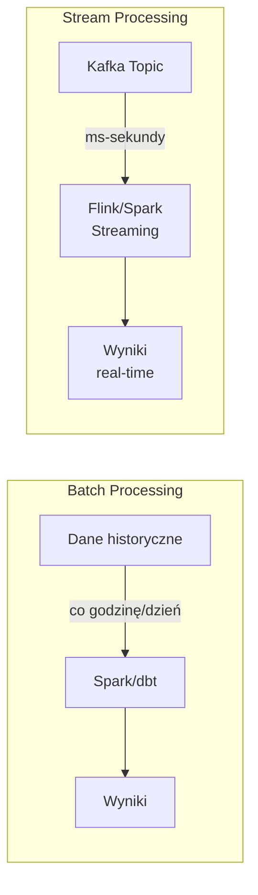

### Przykład: Kafka Producer/Consumer dla ML

```python
from kafka import KafkaProducer, KafkaConsumer
import json
import numpy as np

# Producer – wysyłanie zdarzeń do Kafka
producer = KafkaProducer(
    bootstrap_servers=['localhost:9092'],
    value_serializer=lambda v: json.dumps(v).encode('utf-8')
)

def send_prediction_request(user_id: int, features: dict):
    """Wysyła żądanie predykcji do Kafka."""
    message = {
        "user_id": user_id,
        "features": features,
        "timestamp": "2024-01-15T10:30:00Z"
    }
    producer.send('ml-predictions', value=message)
    producer.flush()

# Consumer – odbieranie i przetwarzanie zdarzeń
consumer = KafkaConsumer(
    'ml-predictions',
    bootstrap_servers=['localhost:9092'],
    value_deserializer=lambda m: json.loads(m.decode('utf-8')),
    group_id='ml-service-group',
    auto_offset_reset='earliest'
)

def process_predictions(model):
    """Przetwarza żądania predykcji ze strumienia."""
    for message in consumer:
        data = message.value
        features = np.array(list(data['features'].values())).reshape(1, -1)
        prediction = model.predict(features)[0]
        probability = model.predict_proba(features)[0][1]
        
        print(f"User {data['user_id']}: "
              f"churn={'TAK' if prediction else 'NIE'} "
              f"(p={probability:.2%})")
```


### Architektury Lambda i Kappa

```mermaid
flowchart LR
    subgraph Lambda
        S1[Strumień] --> B1[Batch layer\nSpark, codziennie]
        S1 --> SP1[Speed layer\nFlink, na bieżąco]
        B1 --> SV1[Serving: scalanie wyników]
        SP1 --> SV1
    end
    subgraph Kappa
        S2[Log zdarzeń\nKafka] --> SP2[Jeden silnik\nstreamingowy]
        SP2 --> SV2[Serving]
        S2 -. replay historii .-> SP2
    end
```

- **Lambda** – dwie ścieżki (dokładna batch + szybka streaming); wada: dwie implementacje tej samej logiki.
- **Kappa** – tylko streaming; historię przelicza się, odtwarzając log zdarzeń.

### Okna czasowe w przetwarzaniu strumieniowym

Cechy strumieniowe (np. „liczba transakcji w ostatnich 10 min”) liczy się w oknach:
- **tumbling** – rozłączne okna stałej długości (00:00–00:10, 00:10–00:20),
- **sliding/hopping** – okna nakładające się (10 min co 1 min),
- **session** – okno zamykane po okresie bezczynności użytkownika.

Ważne rozróżnienie: **event time** (kiedy zdarzenie zaszło) vs **processing time** (kiedy je przetworzono). Spóźnione zdarzenia obsługuje się *watermarkami*.

```python
import pandas as pd

tx = pd.DataFrame({
    "ts": pd.to_datetime(["10:00", "10:03", "10:07", "10:12", "10:14"], format="%H:%M"),
    "amount": [20, 35, 500, 15, 40],
}).set_index("ts")

print(tx["amount"].resample("10min").sum())          # okna tumbling
print(tx["amount"].rolling("10min").count())         # okno przesuwne: liczba tx w ost. 10 min
```

### Batch vs streaming – porównanie

| Kryterium | Batch | Streaming |
|---|---|---|
| Opóźnienie | minuty – godziny | milisekundy – sekundy |
| Złożoność | niższa | wyższa (stan, spóźnione zdarzenia, porządek) |
| Koszt | zwykle niższy | stała infrastruktura 24/7 |
| Poprawianie błędów | ponowne uruchomienie partii | replay z logu, trudniejsze |
| Typowe cechy | agregaty 30/90 dni | liczniki z ostatnich minut |

> 💡 W praktyce większość systemów łączy oba podejścia: cechy „wolnozmienne” (np. średnia wartość zamówień z 90 dni) liczone są wsadowo, a „szybkozmienne” (liczba transakcji w ostatnich 5 min) strumieniowo – oba trafiają do tego samego online store.

### Semantyka dostarczania wiadomości

| Gwarancja | Znaczenie | Konsekwencja dla cech ML |
|---|---|---|
| at-most-once | wiadomość może zginąć | zaniżone liczniki |
| at-least-once | wiadomość może się powtórzyć | zawyżone liczniki – potrzebna deduplikacja po `event_id` |
| exactly-once | efekt jak przy jednokrotnym przetworzeniu | wymaga transakcji (Kafka transactions, checkpointy Flink) |

W przykładzie konsumenta powyżej offsety są zatwierdzane automatycznie – przy awarii w trakcie przetwarzania możliwa jest utrata lub ponowne przetworzenie wiadomości. W produkcji stosuje się ręczne `commit()` po udanym przetworzeniu oraz idempotentnych odbiorców.

### Event time, watermark i spóźnione zdarzenia

```
event time:       10:00  10:02  10:04       10:01 (spóźnione!)
processing time:  10:00  10:02  10:04  ...  10:07
                   │      │      │            │
okno [10:00,10:05) ●──────●──────●            ●  ← przyjęte, jeśli watermark
                                                  (np. max_event_time − 5 min)
                                                  jeszcze nie zamknął okna
```

**Watermark** to deklaracja „nie spodziewam się już zdarzeń starszych niż T”. Za mały – gubimy spóźnione zdarzenia; za duży – wyniki okien publikujemy z większym opóźnieniem i trzymamy więcej stanu.

### Case study: wykrywanie fraudów w czasie rzeczywistym

```mermaid
sequenceDiagram
    participant K as Klient
    participant API as API płatności
    participant FS as Online Feature Store
    participant M as Model fraud
    participant Q as Kafka
    participant F as Flink

    K->>API: transakcja
    API->>FS: pobierz cechy karty
    FS-->>API: tx_count_10m, avg_amount_90d
    API->>M: predykcja
    M-->>API: p_fraud = 0.93
    API-->>K: odrzucenie lub 3-D Secure
    API->>Q: zdarzenie transakcji
    Q->>F: strumień
    F->>FS: aktualizacja tx_count_10m
```

Budżet latencji całej ścieżki to zwykle kilkadziesiąt–kilkaset ms, dlatego cechy muszą być **wcześniej policzone** i leżeć w online store; liczenie agregatów 90-dniowych w chwili żądania jest niewykonalne.

---

## 10. Typowe pułapki w inżynierii danych dla ML

> ⚠️ **Pułapka 1: Data Leakage (wyciek danych)**
> Najczęstszy i najgroźniejszy błąd — informacje z przyszłości „wyciekają" do danych treningowych. Przykład: normalizacja cech na całym zbiorze przed podziałem train/test powoduje, że statystyki zbioru testowego wpływają na trening.

```python
# ❌ ŹLE: normalizacja przed podziałem (data leakage!)
from sklearn.preprocessing import StandardScaler
scaler = StandardScaler()
X_scaled = scaler.fit_transform(X)  # fit na CAŁYM zbiorze
X_train, X_test = train_test_split(X_scaled, ...)

# ✅ DOBRZE: normalizacja po podziale
X_train, X_test = train_test_split(X, ...)
scaler = StandardScaler()
X_train_scaled = scaler.fit_transform(X_train)  # fit tylko na train
X_test_scaled = scaler.transform(X_test)         # transform na test
```

> ⚠️ **Pułapka 2: Training-Serving Skew**
> Preprocessing danych w treningu różni się od preprocessingu w produkcji. Rozwiązanie: używaj tego samego kodu (np. sklearn Pipeline) w obu środowiskach.

> ⚠️ **Pułapka 3: Ignorowanie brakujących wartości**
> Model wytrenowany na danych bez braków może się zachowywać nieprzewidywalnie, gdy w produkcji pojawią się wartości null. Zawsze testuj model z brakującymi danymi.


> **▶️ Demo na żywo:** `python lectures/scripts/lecture_02/04_data_leakage.py`  
> **Kiedy:** przy omawianiu pułapki „normalizacja przed podziałem”.  
> **Co pokazać:** na czystym szumie selekcja cech przed CV daje accuracy ~0.85, a poprawny `Pipeline` daje ~0.5. Cecha „z przyszłości” podnosi wynik z ~0.65 do ~0.95.

### Case Study: Zillow — katastrofa danych

**Zillow** (portal nieruchomości) stracił **304 miliony dolarów** w 2021 roku z powodu błędów w modelu wyceny nieruchomości. Główne przyczyny:
- Model był trenowany na danych historycznych, które nie uwzględniały gwałtownych zmian rynkowych (pandemia COVID-19).
- Brak odpowiedniego monitoringu dryfu danych — model kontynuował predykcje mimo fundamentalnej zmiany rozkładu cen.
- Niewystarczająca walidacja danych wejściowych — model akceptował nierealistyczne wartości cech.

> 💡 Część analityków podkreśla też efekty biznesowe (agresywne cele zakupowe, *adverse selection* – sprzedający chętniej przyjmowali zawyżone oferty). Lekcja dla MLOps: model jest elementem większego systemu decyzyjnego, a jakość danych i monitoring muszą uwzględniać pętlę sprzężenia między predykcjami a danymi.

### Kolejne pułapki

> ⚠️ **Pułapka 4: Losowy podział danych czasowych**
> Przy danych z osią czasu `train_test_split(shuffle=True)` miesza przyszłość z przeszłością. Stosuj podział po czasie lub `TimeSeriesSplit`.

```python
from sklearn.model_selection import TimeSeriesSplit

df = df.sort_values("event_ts")
for fold, (tr_idx, te_idx) in enumerate(TimeSeriesSplit(n_splits=4).split(df)):
    print(fold, df.iloc[tr_idx]["event_ts"].max(), "<", df.iloc[te_idx]["event_ts"].min())
```

> ⚠️ **Pułapka 5: Wyciek przez grupy (ten sam klient w train i test)**
> Jeśli jeden pacjent/klient ma wiele wierszy, model może „zapamiętać” osobę. Użyj `GroupKFold` / `GroupShuffleSplit` z `groups=customer_id`.

> ⚠️ **Pułapka 6: Cechy-proxy etykiety**
> Kolumna `cancellation_reason` dla modelu churnu jest wypełniona tylko u klientów, którzy już odeszli. Każdą cechę sprawdzaj pytaniem: *„czy znałbym tę wartość w chwili predykcji?”*.

> ⚠️ **Pułapka 7: Cicha zmiana źródła**
> Zmiana jednostki (grosze → złote), kodowania (`M/F` → `1/2`) albo znaczenia statusu nie wywoła błędu, tylko po cichu pogorszy model. Pomagają kontrakty danych i walidacja rozkładów (sekcja 6).

> ⚠️ **Pułapka 8: Niezbalansowane lub stronnicze próbki**
> Dane historyczne odzwierciedlają dawne decyzje (np. kredyty przyznawane tylko części klientów – *selection bias*). Model nie wie nic o populacji, której nigdy nie obsłużono.

### Taksonomia wycieku danych

| Typ wycieku | Mechanizm | Przykład | Ochrona |
|---|---|---|---|
| Preprocessing | statystyki liczone na całym zbiorze | `StandardScaler` przed splitem | `Pipeline` + CV |
| Selekcja cech | wybór cech z użyciem etykiet testu | `SelectKBest` przed CV (demo `04_data_leakage.py`) | selekcja wewnątrz pipeline |
| Temporalny | informacja z przyszłości | agregat z całej historii klienta | point-in-time join, split po czasie |
| Target leakage | cecha jest skutkiem etykiety | `cancellation_reason` | przegląd cech z ekspertem domenowym |
| Grupowy | ta sama encja w train i test | zdjęcia tego samego pacjenta | `GroupKFold` |
| Duplikaty | identyczne wiersze w obu zbiorach | zdublowane rekordy z ETL | deduplikacja przed splitem |

```mermaid
flowchart TD
    A["Podejrzanie wysoki wynik offline?"] --> B{"Czy jedna cecha\ndominuje ważność?"}
    B -->|tak| C["Sprawdź, czy jest znana\nw chwili predykcji"]
    B -->|nie| D{"Czy dane mają\noś czasu lub grupy?"}
    D -->|tak| E["Użyj splitu czasowego\nlub GroupKFold"]
    D -->|nie| F{"Czy preprocessing\njest w Pipeline?"}
    F -->|nie| G["Przenieś fit do Pipeline"]
    F -->|tak| H["Sprawdź duplikaty\nmiędzy train i test"]
```

### Checklista inżynierii danych dla projektu ML

- [ ] Surowe dane są przechowywane niezmienione (Bronze) i można odtworzyć z nich resztę.
- [ ] Każdy zbiór ma właściciela, opis schematu i politykę retencji.
- [ ] Dane zapisane w formacie ze schematem (Parquet), partycjonowane po dacie.
- [ ] Zadania pipeline'u są idempotentne i parametryzowane datą logiczną.
- [ ] Walidacja (schemat, zakresy, świeżość, rozkłady) działa jako bramka w pipeline i CI.
- [ ] Cechy budowane z zachowaniem point-in-time correctness.
- [ ] Preprocessing zapisany razem z modelem jako jeden artefakt.
- [ ] Wersja danych (DVC/snapshot) zapisana przy każdym treningu.
- [ ] Cechy serwowane na produkcji są logowane i porównywane z treningowymi.

---

## Pytania kontrolne i do dyskusji

1. Wyjaśnij różnicę między Data Lake a Data Warehouse. Kiedy użyjesz każdego z nich?
2. Dlaczego Parquet jest lepszym formatem niż CSV dla dużych zbiorów danych ML?
3. Czym różni się ETL od ELT? Jakie są zalety podejścia ELT?
4. Co to jest data leakage i jak go uniknąć?
5. Jakie korzyści daje Feature Store w porównaniu z ręcznym obliczaniem cech?
6. Dlaczego wersjonowanie danych (DVC) jest ważne w projektach ML?
7. **Dyskusja:** Kiedy warto użyć stream processingu zamiast batch processingu w kontekście ML?
8. Czym jest point-in-time correctness i dlaczego zwykły `JOIN` po kluczu encji może prowadzić do wycieku?
9. Co oznacza idempotentność zadania w pipeline danych? Podaj przykład zadania nieidempotentnego i sposób jego naprawy.
10. Wyjaśnij różnicę między architekturą Lambda a Kappa.
11. Do czego służy PSI i jak interpretować jego wartości?
12. Dlaczego SCD typu 2 jest lepszy dla ML niż SCD typu 1?
13. **Dyskusja:** Twój model churnu ma AUC = 0.99 na walidacji. Jakie kroki diagnostyczne wykonasz, zanim go wdrożysz?


### Proponowane odpowiedzi

1. Data Lake przechowuje surowe, różnorodne dane „as-is”, a Data Warehouse dane już oczyszczone i ustrukturyzowane pod analitykę. Lake wybieram do eksploracji i długiego przechowywania, Warehouse do raportowania i stabilnych zapytań biznesowych.
2. Parquet jest kolumnowy, kompresuje dane i pozwala czytać tylko potrzebne kolumny, więc jest szybszy i tańszy I/O przy dużych zbiorach. CSV jest tekstowy, cięższy i mniej wydajny przy analityce ML.
3. ETL: transformujesz przed załadowaniem do magazynu; ELT: najpierw ładujesz, potem transformujesz w silniku docelowym. ELT lepiej skaluje się w chmurze, daje większą elastyczność i łatwiejsze odtwarzanie transformacji.
4. Data leakage to sytuacja, gdy model „widzi” informacje niedostępne w momencie predykcji (np. statystyki z testu podczas treningu). Unikamy tego przez poprawny split czasowy/train-test, pipeline preprocessingu fitowany tylko na train i rygor walidacji cech.
5. Feature Store zapewnia spójność cech online/offline, wersjonowanie, reużywalność i centralne zarządzanie definicjami cech. Ręczne liczenie cech zwiększa ryzyko niespójności i duplikacji.
6. DVC daje odtwarzalność eksperymentów: wiemy, na jakiej wersji danych trenowano dany model. Ułatwia audyt, porównania i rollback po pogorszeniu jakości.
7. Stream processing warto wybrać, gdy decyzje muszą być podejmowane blisko czasu rzeczywistego (np. fraud, rekomendacje live). Batch wystarcza, gdy dopuszczalne jest opóźnienie i ważniejsza jest prostota/koszt.
8. To zasada, że do zdarzenia z chwili *t* dołączamy wyłącznie wartości cech dostępne w chwili *t*. Zwykły `JOIN` bierze bieżącą (najnowszą) wartość cechy, często policzoną po zdarzeniu, więc model uczy się na informacji z przyszłości. Rozwiązanie: złączenie as-of (`merge_asof`, `get_historical_features`).
9. Idempotentne zadanie uruchomione wielokrotnie dla tych samych parametrów daje ten sam wynik. Nieidempotentne: `INSERT` dopisujący dane dnia – ponowienie po awarii tworzy duplikaty. Naprawa: nadpisanie partycji (`INSERT OVERWRITE`, `MERGE` po kluczu) i parametryzacja datą logiczną zamiast `now()`.
10. Lambda utrzymuje dwie ścieżki – dokładną batch i szybką streaming – scalane w warstwie serwowania (koszt: dwie implementacje logiki). Kappa ma jedną ścieżkę streamingową, a historię przelicza przez replay logu zdarzeń.
11. PSI mierzy zmianę rozkładu cechy między danymi referencyjnymi a bieżącymi. Konwencjonalnie: < 0.1 brak zmian, 0.1–0.2 umiarkowana zmiana, > 0.2 istotny dryf wymagający analizy lub retreningu.
12. SCD1 nadpisuje atrybut, więc tracimy historię i do starych zdarzeń dołączamy bieżący stan (wyciek). SCD2 przechowuje wersje z zakresem ważności, co pozwala odtworzyć stan encji w chwili zdarzenia.
13. Sprawdzić ważność cech (czy jedna dominuje i czy jest znana w chwili predykcji), sposób podziału (czas, grupy), czy preprocessing i selekcja cech są wewnątrz pipeline'u, duplikaty między zbiorami oraz point-in-time correctness złączeń. Następnie zweryfikować model na zbiorze „z przyszłości” (out-of-time) lub w trybie shadow.


---

## Podsumowanie

- Dane są fundamentem systemów ML – ich jakość determinuje jakość modelu.
- **Data Lake** przechowuje surowe dane, **Data Warehouse** przetworzone, **Data Lakehouse** łączy zalety obu.
- **Parquet** to preferowany format dla ML (kolumnowy, skompresowany, z schematem).
- **Walidacja danych** (Great Expectations) powinna być integralną częścią pipeline'u — nie opcjonalnym dodatkiem.
- **Feature Store** eliminuje duplikację i zapewnia spójność cech między treningiem a produkcją.
- **DVC** umożliwia wersjonowanie danych razem z kodem.
- Unikaj typowych pułapek: data leakage, training-serving skew, ignorowanie brakujących wartości.
- **Point-in-time correctness**, **idempotentne pipeline'y** i **kontrakty danych** to fundamenty odtwarzalnych i wiarygodnych danych treningowych.
- Batch i streaming się uzupełniają – wybór zależy od wymaganej latencji decyzji i kosztu.

## Literatura i zasoby

- [Fundamentals of Data Engineering (O'Reilly)](https://www.oreilly.com/library/view/fundamentals-of-data/9781098108298/)
- [Great Expectations Documentation](https://docs.greatexpectations.io/)
- [DVC Documentation](https://dvc.org/doc)
- [Feast Feature Store](https://feast.dev/)
- [Apache Parquet Format](https://parquet.apache.org/)
- [Zillow's iBuying Debacle – What Went Wrong](https://insidebigdata.com/2021/12/13/the-500-million-lesson-from-zillow/)
- [Data Leakage in Machine Learning (Kaggle)](https://www.kaggle.com/code/alexisbcook/data-leakage)
- [Hidden Technical Debt in Machine Learning Systems (NeurIPS 2015)](https://papers.nips.cc/paper/2015/hash/86df7dcfd896fcaf2674f757a2463eba-Abstract.html)
- [Pandera Documentation](https://pandera.readthedocs.io/)
- [Delta Lake Documentation](https://docs.delta.io/)
- [dbt Documentation](https://docs.getdbt.com/)
