# Wykład 3: Eksperymentowanie i Śledzenie Eksperymentów

## Cel wykładu
Po tym wykładzie student:
- rozumie potrzebę systematycznego śledzenia eksperymentów ML,
- potrafi używać MLflow do logowania parametrów, metryk i artefaktów,
- zna wzorce organizacji eksperymentów,
- potrafi porównywać eksperymenty i wybierać najlepszy model.

## Skrypty do wykładu

Skrypty demonstracyjne znajdują się w `lectures/scripts/lecture_03/`. Pełną instrukcję znajdziesz w [`lectures/scripts/README.md`](scripts/README.md).

| Kiedy (sekcja) | Skrypt | Cel demonstracji |
|---|---|---|
| 3. Podstawy MLflow Tracking | `01_mlflow_experiments.py` | logowanie parametrów, metryk, artefaktów i modeli |
| 4. Porównywanie eksperymentów | `02_compare_runs.py` (po `01`) | `search_runs`, ładowanie modelu, Model Registry + alias |
| 6. Optuna | `03_hyperparameter_tuning.py --trials 15` | HPO z zagnieżdżonymi runami |
| 8 i 10. Reprodukowalność, pułapki | `04_reproducibility.py` | seed, commit git, hash danych, run FAILED |

**Jak:** przed wykładem uruchom `rm -rf mlruns`, żeby zacząć od pustego trackingu. Następnie uruchamiaj skrypty z katalogu głównego repozytorium (`python lectures/scripts/lecture_03/<skrypt>`). W drugim terminalu uruchom `mlflow ui --port 5000` i po każdym skrypcie pokazuj wyniki w przeglądarce (http://localhost:5000). Domyślnie skrypty zapisują runy w `./mlruns`. Żeby użyć serwera, ustaw `MLFLOW_TRACKING_URI`.

---

## 1. Problem niekontrolowanych eksperymentów

Typowy scenariusz bez śledzenia eksperymentów:

```
model_final.pkl
model_final_v2.pkl
model_final_v2_NAPRAWDE_FINAL.pkl
model_best_20240115.pkl
model_DO_UZYCIA.pkl   ← który to jest?!
```

**Problemy:**
- Nie wiadomo, jakie hiperparametry dały najlepszy wynik.
- Nie wiadomo, na jakich danych trenowano.
- Nie można odtworzyć eksperymentu.
- Trudno porównać różne podejścia.


### Co dokładnie należy logować?

Eksperyment jest powtarzalny tylko wtedy, gdy zapiszemy **wszystkie** jego wejścia i wyjścia:

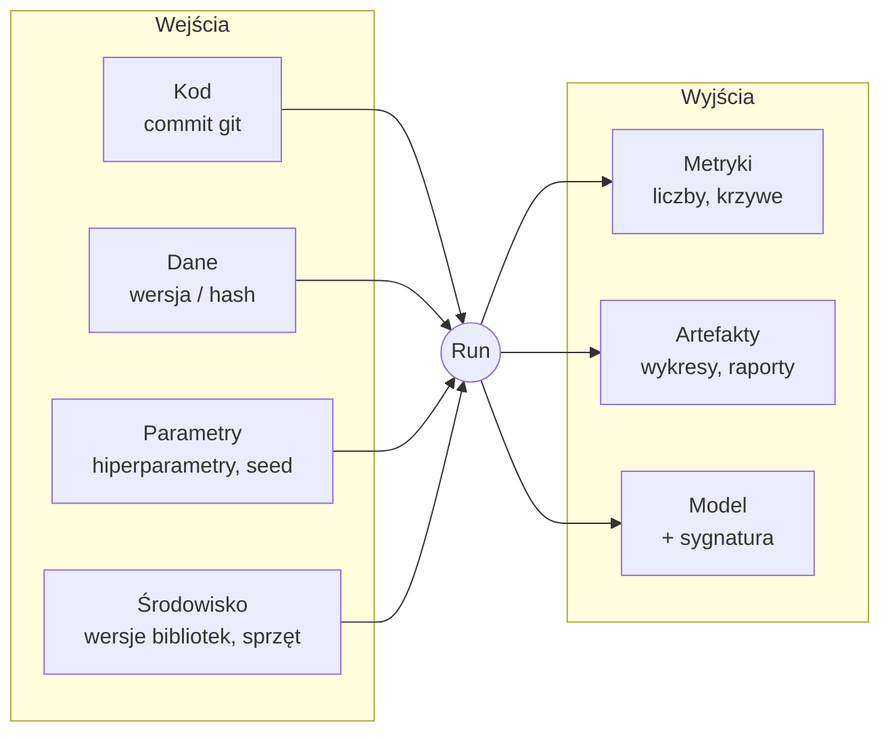

| Kategoria | Przykłady | MLflow API |
|---|---|---|
| Parametry | `learning_rate`, `max_depth`, `seed` | `log_param(s)` |
| Metryki | `roc_auc`, `loss` per epoka | `log_metric(s)` (z `step`) |
| Tagi | `git_commit`, `data_hash`, `author` | `set_tag(s)` |
| Artefakty | confusion matrix, feature importance | `log_artifact`, `log_figure` |
| Dane | nazwa, źródło, digest zbioru | `log_input` |
| Model | wytrenowany model, sygnatura | `mlflow.<flavor>.log_model` |

### Cykl pracy eksperymentalnej

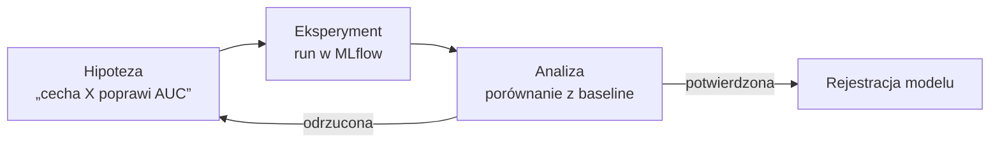

Dobra praktyka: **zawsze zaczynaj od baseline'u** (np. model większościowy, regresja logistyczna) – bez punktu odniesienia nie wiadomo, czy złożony model wnosi wartość.

### Dlaczego ML potrzebuje czegoś więcej niż Git?

W klasycznym oprogramowaniu wynik programu zależy (prawie) wyłącznie od kodu. W ML wynik jest funkcją **kodu, danych, konfiguracji i losowości**:

```
              ┌───────────── Software 1.0 ─────────────┐
  kod  ─────► │  program  │ ─────► zachowanie          │   Git wystarcza
              └────────────────────────────────────────┘

              ┌───────────── Software 2.0 (ML) ────────┐
  kod  ─────► │                                        │
  dane ─────► │  trening  │ ─────► model ─► zachowanie │   Git + DVC + tracking
  parametry ► │                                        │
  seed ─────► │                                        │
              └────────────────────────────────────────┘
```

| Narzędzie | Co wersjonuje | Czego **nie** rozwiązuje |
|---|---|---|
| Git | kod, konfiguracje YAML | duże dane, wyniki, metryki |
| DVC / LakeFS | dane i duże pliki | porównywanie wyników runów |
| MLflow / W&B | parametry, metryki, artefakty, modele | wersjonowanie samych danych źródłowych |
| Docker / `requirements.txt` | środowisko | logikę eksperymentu |

> 💡 Tracking eksperymentów jest „dziennikiem laboratoryjnym” data scientisty. Git mówi, **jak** kod wyglądał, a tracking – **co** z tym kodem osiągnięto i na jakich danych.

### Case study: „model, którego nie umiemy odtworzyć”

Zespół scoringu kredytowego wdrożył model z AUC 0.81. Po pół roku regulator poprosił o wyjaśnienie decyzji, a zespół chciał model douczyć. Okazało się, że:

1. Notebook, z którego powstał model, był wielokrotnie edytowany po treningu.
2. Dane treningowe pochodziły z zapytania SQL do tabeli, która od tego czasu była nadpisywana.
3. Nikt nie pamiętał, czy użyto `class_weight="balanced"`.

Ponowny trening dawał AUC 0.77–0.79 i nikt nie umiał wyjaśnić różnicy. Koszt: kilka tygodni pracy na „archeologię”. Z trackingiem wystarczyłoby otworzyć run, odczytać commit, hash danych i parametry.

### Poziomy dojrzałości trackingu

| Poziom | Opis | Typowy objaw |
|---|---|---|
| 0 | brak trackingu, wyniki w głowie / Excelu | „który plik `.pkl` jest aktualny?” |
| 1 | ręczne logowanie metryk w arkuszu | literówki, brak artefaktów |
| 2 | MLflow lokalnie (`./mlruns`) | każdy ma swoje runy, brak współdzielenia |
| 3 | wspólny tracking server + registry | porównania w zespole, aliasy modeli |
| 4 | tracking zintegrowany z pipeline'ami CI/CD | każdy trening produkcyjny automatycznie zalogowany |

---

## 2. MLflow – platforma do śledzenia eksperymentów

**MLflow** to open-source'owa platforma do zarządzania cyklem życia ML, składająca się z czterech komponentów:

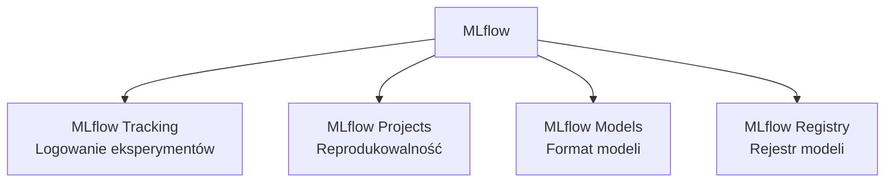

### Instalacja i uruchomienie

```bash
pip install mlflow scikit-learn pandas

# Uruchomienie UI (domyślnie http://localhost:5000)
mlflow ui
```

### Architektura MLflow Tracking

MLflow rozdziela dwa rodzaje magazynów:

- **Backend store** – metadane: eksperymenty, runy, parametry, metryki, tagi (pliki w `./mlruns` albo baza SQL: SQLite, PostgreSQL, MySQL).
- **Artifact store** – duże pliki: modele, wykresy, raporty (lokalny dysk, S3, GCS, Azure Blob, MinIO).

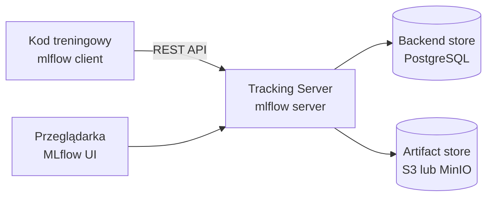

| Scenariusz | Backend store | Artifact store | Kiedy |
|---|---|---|---|
| Lokalny | `./mlruns` (pliki) | `./mlruns` | nauka, prototypy, ten wykład |
| Lokalny z bazą | `sqlite:///mlflow.db` | `./mlartifacts` | potrzebny Model Registry lokalnie |
| Zespołowy | PostgreSQL | S3 / MinIO | kilka osób, wspólne porównania |
| Zarządzany | Databricks, SageMaker, Azure ML | chmura | organizacje bez własnej infrastruktury |

```bash
# Serwer zespołowy (przykład)
mlflow server \
  --backend-store-uri postgresql://mlflow:haslo@db:5432/mlflow \
  --artifacts-destination s3://ml-artifacts \
  --host 0.0.0.0 --port 5000

# Klient wskazuje serwer przez zmienną środowiskową
export MLFLOW_TRACKING_URI=http://mlflow.firma.local:5000
```

> ⚠️ Domyślny `mlflow server` nie ma uwierzytelniania. Nie wystawiaj go publicznie bez reverse proxy z logowaniem (lub wbudowanego `--app-name basic-auth`).

> 💡 Skrypty z `lectures/scripts/lecture_03/` domyślnie piszą do `./mlruns`, a po ustawieniu `MLFLOW_TRACKING_URI` – do serwera. Kod treningowy się nie zmienia, zmienia się tylko konfiguracja.

---

## 3. Podstawy MLflow Tracking

### Kluczowe pojęcia

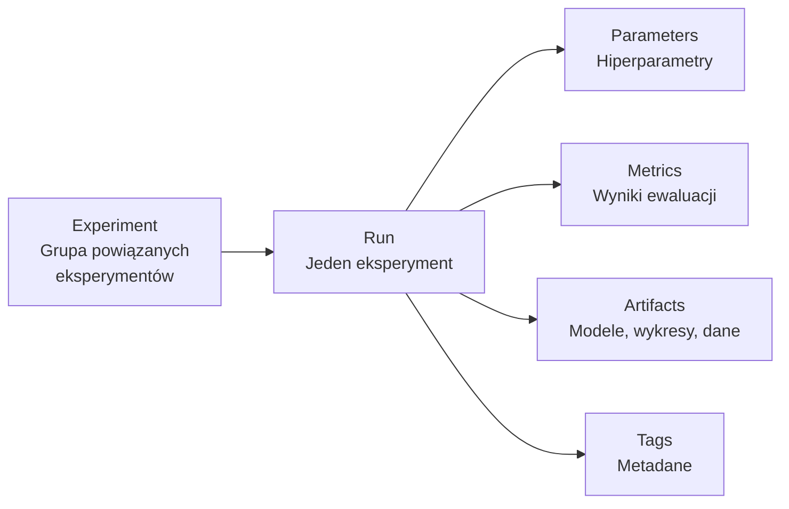

### Parametr, metryka czy tag?

| Cecha | Parametr | Metryka | Tag |
|---|---|---|---|
| Typ wartości | tekst (zapisywany jako string) | liczba (float) | tekst |
| Zmienność | **niezmienny** po zapisaniu | może mieć wiele wartości (`step`, `timestamp`) | można nadpisać |
| Rola | wejście eksperymentu | wynik eksperymentu | kontekst, filtrowanie |
| Przykład | `max_depth=8` | `val_loss` w epoce 12 | `git_commit`, `owner` |

> ⚠️ Ponowne `log_param` z **inną** wartością dla tego samego klucza w tym samym runie kończy się błędem. To celowe – parametry opisują konfigurację, która nie powinna się zmieniać w trakcie runu.

### Cykl życia runu

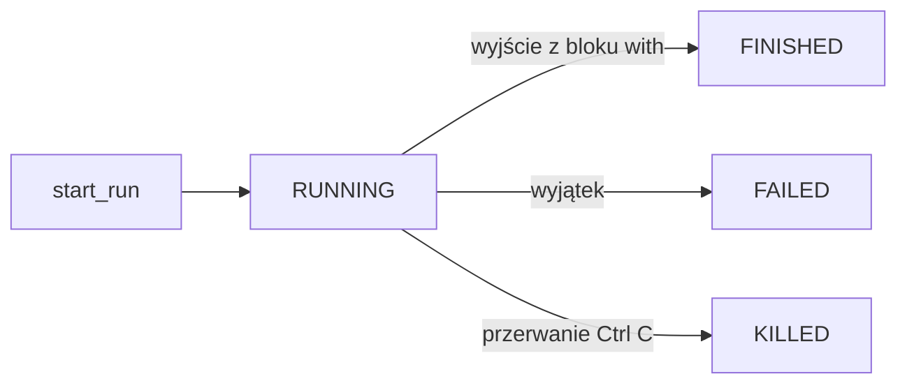

Użycie `with mlflow.start_run():` gwarantuje, że run zostanie zamknięty z poprawnym statusem także przy wyjątku – to wykorzystuje skrypt `04_reproducibility.py` (run `failing-run`).

### Autologging – minimum wysiłku

Większość popularnych bibliotek ma integrację `autolog`, która sama loguje parametry estymatora, metryki treningowe i model:

```python
import mlflow
from sklearn.datasets import make_classification
from sklearn.ensemble import RandomForestClassifier
from sklearn.model_selection import train_test_split

mlflow.set_experiment("autolog-demo")
mlflow.sklearn.autolog(log_input_examples=True)

X, y = make_classification(n_samples=2000, random_state=42)
X_tr, X_te, y_tr, y_te = train_test_split(X, y, random_state=42)

with mlflow.start_run(run_name="rf-autolog"):
    model = RandomForestClassifier(n_estimators=150, random_state=42).fit(X_tr, y_tr)
    # metryki testowe nadal warto zalogować jawnie
    mlflow.log_metric("test_accuracy", model.score(X_te, y_te))
```

| Podejście | Zalety | Wady |
|---|---|---|
| `autolog()` | szybkie, nic nie zapomnimy z parametrów modelu | loguje dużo szumu, nie zna metryk biznesowych ani wersji danych |
| Logowanie ręczne | pełna kontrola, spójne nazwy metryk | więcej kodu, łatwo coś pominąć |
| Hybryda (zalecane) | autolog + ręcznie: dane, commit, metryki testowe | – |

### Sygnatura modelu i dane wejściowe

Sygnatura opisuje schemat wejścia i wyjścia modelu. Dzięki niej serwer predykcji może odrzucić żądanie z błędnymi kolumnami lub typami:

```python
import mlflow
from mlflow.models import infer_signature

signature = infer_signature(X_tr, model.predict_proba(X_tr)[:, 1])
with mlflow.start_run():
    dataset = mlflow.data.from_numpy(X_tr, targets=y_tr, name="churn-train")
    mlflow.log_input(dataset, context="training")   # digest danych w UI
    mlflow.sklearn.log_model(model, "model", signature=signature,
                             input_example=X_tr[:5])
```

### Przykład: Pełny eksperyment z MLflow

```python
import mlflow
import mlflow.sklearn
import pandas as pd
import numpy as np
from sklearn.datasets import make_classification
from sklearn.ensemble import RandomForestClassifier, GradientBoostingClassifier
from sklearn.linear_model import LogisticRegression
from sklearn.model_selection import train_test_split, cross_val_score
from sklearn.metrics import (accuracy_score, roc_auc_score, 
                              f1_score, classification_report)
import matplotlib.pyplot as plt
import json

# Generowanie danych
X, y = make_classification(
    n_samples=10_000,
    n_features=20,
    n_informative=10,
    n_redundant=5,
    random_state=42
)
X_train, X_test, y_train, y_test = train_test_split(
    X, y, test_size=0.2, random_state=42, stratify=y
)

# Konfiguracja MLflow
mlflow.set_tracking_uri("http://localhost:5000")
mlflow.set_experiment("churn-prediction-v1")

def evaluate_model(model, X_test, y_test) -> dict:
    """Oblicza metryki ewaluacji modelu."""
    y_pred = model.predict(X_test)
    y_prob = model.predict_proba(X_test)[:, 1]
    
    return {
        "accuracy": accuracy_score(y_test, y_pred),
        "auc_roc": roc_auc_score(y_test, y_prob),
        "f1_score": f1_score(y_test, y_pred),
    }

def run_experiment(model_class, params: dict, run_name: str):
    """Uruchamia jeden eksperyment i loguje wyniki do MLflow."""
    
    with mlflow.start_run(run_name=run_name) as run:
        # Logowanie parametrów
        mlflow.log_params(params)
        mlflow.log_param("model_class", model_class.__name__)
        mlflow.log_param("train_size", len(X_train))
        mlflow.log_param("test_size", len(X_test))
        
        # Trening modelu
        model = model_class(**params, random_state=42)
        model.fit(X_train, y_train)
        
        # Ewaluacja
        metrics = evaluate_model(model, X_test, y_test)
        
        # Cross-validation
        cv_scores = cross_val_score(model, X_train, y_train, cv=5, scoring='roc_auc')
        metrics["cv_auc_mean"] = cv_scores.mean()
        metrics["cv_auc_std"] = cv_scores.std()
        
        # Logowanie metryk
        mlflow.log_metrics(metrics)
        
        # Logowanie modelu
        mlflow.sklearn.log_model(
            model, 
            "model",
            registered_model_name=f"churn-{model_class.__name__.lower()}"
        )
        
        # Logowanie wykresu feature importance (dla RF)
        if hasattr(model, 'feature_importances_'):
            fig, ax = plt.subplots(figsize=(10, 6))
            importances = model.feature_importances_
            indices = np.argsort(importances)[::-1][:10]
            ax.bar(range(10), importances[indices])
            ax.set_title('Top 10 Feature Importances')
            ax.set_xlabel('Feature Index')
            plt.tight_layout()
            mlflow.log_figure(fig, "feature_importance.png")
            plt.close()
        
        # Logowanie raportu klasyfikacji jako artefakt
        report = classification_report(y_test, model.predict(X_test))
        with open("/tmp/classification_report.txt", "w") as f:
            f.write(report)
        mlflow.log_artifact("/tmp/classification_report.txt")
        
        print(f"Run: {run_name}")
        print(f"  AUC-ROC: {metrics['auc_roc']:.4f}")
        print(f"  F1:      {metrics['f1_score']:.4f}")
        print(f"  Run ID:  {run.info.run_id}")
        
        return run.info.run_id, metrics

# Eksperymenty z różnymi modelami i hiperparametrami
experiments = [
    (RandomForestClassifier, {"n_estimators": 100, "max_depth": 5}, "RF-shallow"),
    (RandomForestClassifier, {"n_estimators": 200, "max_depth": 10}, "RF-deep"),
    (GradientBoostingClassifier, {"n_estimators": 100, "learning_rate": 0.1}, "GBM-default"),
    (GradientBoostingClassifier, {"n_estimators": 200, "learning_rate": 0.05}, "GBM-slow"),
    (LogisticRegression, {"C": 1.0, "max_iter": 1000}, "LR-default"),
]

results = []
for model_class, params, name in experiments:
    run_id, metrics = run_experiment(model_class, params, name)
    results.append({"name": name, "run_id": run_id, **metrics})

# Podsumowanie wyników
results_df = pd.DataFrame(results).sort_values("auc_roc", ascending=False)
print("\n=== Ranking eksperymentów ===")
print(results_df[["name", "auc_roc", "f1_score", "cv_auc_mean"]].to_string(index=False))
```


> **▶️ Demo na żywo:** `python lectures/scripts/lecture_03/01_mlflow_experiments.py`  
> **Kiedy:** po omówieniu kodu z sekcji 3. Trwa około 40 s, więc w tym czasie możesz omówić kluczowe pojęcia.  
> **Co pokazać:** w MLflow UI zaznacz 5 runów i kliknij **Compare** (wykres parallel coordinates). Otwórz run GBM i pokaż metrykę krokową `staged_roc_auc`, artefakty `evaluation/confusion_matrix.png` oraz model z sygnaturą i `input_example`.

### Typowe błędy w kodzie logującym

| Błąd | Skutek | Poprawka |
|---|---|---|
| `mlflow.set_experiment` pominięte | runy lądują w eksperymencie `Default` | zawsze ustawiaj eksperyment na początku skryptu |
| `start_run()` bez `with` i bez `end_run()` | kolejne runy zagnieżdżają się lub status zostaje `RUNNING` | używaj menedżera kontekstu |
| Zapis artefaktów do stałej ścieżki `/tmp/x.txt` | kolizje przy równoległych runach | `tempfile.TemporaryDirectory()` lub `mlflow.log_text` |
| Logowanie metryki w pętli bez `step` | wykres krzywej nieczytelny | `log_metric(name, value, step=epoch)` |
| Różne nazwy tej samej metryki (`auc`, `roc_auc`, `AUC`) | nie da się porównać runów | ustal słownik nazw w zespole |

```python
# Zamiast pliku tymczasowego – bezpośrednio z pamięci
mlflow.log_text(report, "evaluation/classification_report.txt")
mlflow.log_dict({"threshold": 0.42, "features": 20}, "config/eval.json")
```

---

## 4. Porównywanie eksperymentów

### Programowe porównanie przez MLflow API

```python
import mlflow
from mlflow.tracking import MlflowClient

client = MlflowClient()

# Pobierz wszystkie runy z eksperymentu
experiment = client.get_experiment_by_name("churn-prediction-v1")
runs = client.search_runs(
    experiment_ids=[experiment.experiment_id],
    order_by=["metrics.auc_roc DESC"],
    max_results=10
)

print("Top 5 eksperymentów wg AUC-ROC:")
for i, run in enumerate(runs[:5], 1):
    print(f"{i}. {run.data.tags.get('mlflow.runName', 'N/A')}")
    print(f"   AUC-ROC: {run.data.metrics.get('auc_roc', 0):.4f}")
    print(f"   F1:      {run.data.metrics.get('f1_score', 0):.4f}")
    print(f"   Params:  {run.data.params}")
    print()

# Pobierz najlepszy model
best_run = runs[0]
best_run_id = best_run.info.run_id
print(f"Najlepszy model: {best_run_id}")

# Załaduj najlepszy model
best_model = mlflow.sklearn.load_model(f"runs:/{best_run_id}/model")
```


> **▶️ Demo na żywo:** `python lectures/scripts/lecture_03/02_compare_runs.py`  
> **Kiedy:** bezpośrednio po kodzie z sekcji 4.  
> **Co pokazać:** ranking runów w terminalu, filtr `tags.model_type = ... and metrics.roc_auc > 0.9` (ta sama składnia działa w polu wyszukiwania UI) oraz zakładkę **Models** w UI z modelem `churn-classifier` i aliasem `champion`.


### Czy różnica między runami jest istotna?

Różnica AUC 0.871 vs 0.874 może wynikać wyłącznie z losowości podziału danych. Zanim ogłosisz „lepszy model”:
1. Uruchom każdą konfigurację z **kilkoma seedami** lub w **k-fold CV** i porównuj średnią ± odchylenie.
2. Użyj testu sparowanego (te same foldy) lub **bootstrapu** na zbiorze testowym.

```python
import numpy as np
from sklearn.datasets import make_classification
from sklearn.ensemble import GradientBoostingClassifier, RandomForestClassifier
from sklearn.model_selection import cross_val_score, StratifiedKFold
from scipy import stats

X, y = make_classification(n_samples=2000, n_features=20, random_state=0)
cv = StratifiedKFold(n_splits=10, shuffle=True, random_state=0)   # te same foldy!
a = cross_val_score(RandomForestClassifier(random_state=0), X, y, cv=cv, scoring="roc_auc")
b = cross_val_score(GradientBoostingClassifier(random_state=0), X, y, cv=cv, scoring="roc_auc")

print(f"RF : {a.mean():.4f} ± {a.std():.4f}")
print(f"GBM: {b.mean():.4f} ± {b.std():.4f}")
t, p = stats.ttest_rel(a, b)
print(f"sparowany t-test: p = {p:.3f} → {'różnica istotna' if p < 0.05 else 'brak dowodu na różnicę'}")
```

> Wyniki z CV warto logować w MLflow jako `roc_auc_mean` i `roc_auc_std` – wtedy porównanie w UI uwzględnia niepewność.

### Bootstrap przedziału ufności na zbiorze testowym

Gdy mamy jeden zbiór testowy, możemy oszacować niepewność metryki przez losowanie próbek ze zwracaniem:

```python
import numpy as np
from sklearn.metrics import roc_auc_score

def bootstrap_auc(y_true, y_score, n_boot=1000, seed=42):
    rng = np.random.default_rng(seed)
    n = len(y_true)
    scores = []
    for _ in range(n_boot):
        idx = rng.integers(0, n, n)
        if len(np.unique(y_true[idx])) < 2:   # AUC wymaga obu klas
            continue
        scores.append(roc_auc_score(y_true[idx], y_score[idx]))
    return np.percentile(scores, [2.5, 97.5])

low, high = bootstrap_auc(np.asarray(y_test), y_prob)
mlflow.log_metrics({"roc_auc_ci_low": low, "roc_auc_ci_high": high})
```

Jeżeli przedziały ufności dwóch modeli mocno się nakładają, różnica jest prawdopodobnie przypadkowa (dla ścisłego testu użyj bootstrapu **sparowanego** – te same indeksy dla obu modeli).

### Składnia filtrów `search_runs`

| Cel | Filtr |
|---|---|
| metryka powyżej progu | `metrics.roc_auc > 0.9` |
| konkretny parametr | `params.max_depth = '8'` (parametry są stringami!) |
| tag | `tags.model_type = 'gbm'` |
| tylko zakończone | `attributes.status = 'FINISHED'` |
| nazwa runu | `attributes.run_name LIKE 'GBM%'` |
| łączenie warunków | `metrics.roc_auc > 0.9 and tags.feature_set = 'v2'` |

```python
import mlflow

# Wynik jako pandas.DataFrame – wygodne do analiz i wykresów
df = mlflow.search_runs(
    experiment_names=["churn-prediction-v1"],
    filter_string="attributes.status = 'FINISHED'",
    order_by=["metrics.roc_auc DESC"],
)
print(df[["tags.mlflow.runName", "metrics.roc_auc", "params.max_depth"]].head())
```

### Jak wybrać „najlepszy” model?

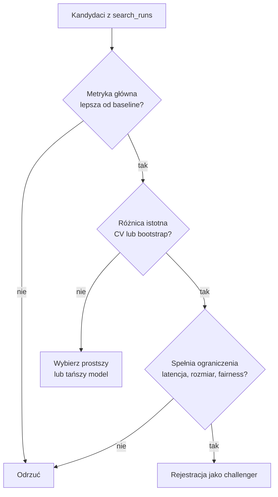

> 💡 Przy remisie statystycznym wybieraj model **prostszy** (brzytwa Ockhama): szybszy w inferencji, łatwiejszy do wyjaśnienia i utrzymania.

---

## 5. Organizacja eksperymentów – dobre praktyki

### Hierarchia eksperymentów

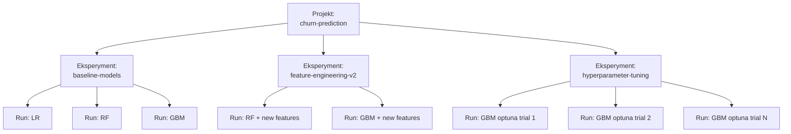

**Objaśnienie diagramu** – trzy poziomy organizacji pracy:

- **Projekt** (`churn-prediction`) – problem biznesowy, który rozwiązujemy, tu przewidywanie odejścia klienta (*churn*). MLflow nie ma osobnego obiektu „projekt”, więc zwykle jest to wspólny prefiks nazw eksperymentów (np. `churn-prediction/baseline-models`) albo osobny serwer lub workspace dla zespołu.
- **Eksperyment** (MLflow *Experiment*) – grupa runów, które odpowiadają na **jedno pytanie badawcze**. Runy w jednym eksperymencie powinny dać się sensownie porównać: ta sama metryka, ten sam podział danych.
  - **`baseline-models`** – punkt odniesienia. Proste modele z domyślnymi parametrami na podstawowym zestawie cech. Pytanie: jaki wynik da się osiągnąć „najprostszym” podejściem?
  - **`feature-engineering-v2`** – sprawdzamy nowy zestaw cech (wersja 2, np. agregaty z 30 dni, staż klienta). Pytanie: czy nowe cechy poprawiają wynik względem baseline'u przy tych samych modelach?
  - **`hyperparameter-tuning`** – strojenie hiperparametrów najlepszego modelu. Pytanie: ile zyskamy na doborze parametrów?
- **Run** – pojedyncze uruchomienie treningu z konkretnymi parametrami, danymi i kodem. Zapisuje parametry, metryki, artefakty i tagi.
  - **LR** (*Logistic Regression*) – regresja logistyczna: liniowy, szybki i interpretowalny model, klasyczny baseline.
  - **RF** (*Random Forest*) – las losowy: zespół drzew decyzyjnych uczonych na losowych podzbiorach danych i cech. Wynik to głosowanie drzew.
  - **GBM** (*Gradient Boosting Machine*) – gradient boosting: drzewa budowane sekwencyjnie, każde poprawia błędy poprzednich. Często najlepszy na danych tabelarycznych.
  - **`+ new features`** – ten sam model co w baseline, ale z cechami v2. Porównanie np. `RF` z `RF + new features` pokazuje wpływ samych cech.
  - **`optuna trial 1…N`** – kolejne próby (*trials*) strojenia w Optunie (sekcja 6). Każda próba to run z innym zestawem hiperparametrów. W praktyce są to **runy zagnieżdżone** (`nested=True`) pod jednym runem-rodzicem całego badania, więc UI nie zaśmieca się setkami pozycji.

Dlaczego taki podział? Każdy eksperyment zmienia **jeden czynnik**: najpierw model, potem cechy, potem hiperparametry. Dzięki temu wiadomo, skąd pochodzi poprawa wyniku. Najlepszy run z każdego etapu jest punktem startowym następnego, a jego wynik porównujemy zawsze z baseline'em.

### Konwencje nazewnictwa

```python
# Dobra konwencja nazewnictwa runów
run_name = f"{model_type}-{feature_set}-{date}-{author}"
# Przykład: "GBM-v2features-20240115-jkowalski"

# Tagi dla łatwego filtrowania
tags = {
    "author": "jan.kowalski",
    "feature_set": "v2",
    "data_version": "2024-01-15",
    "purpose": "hyperparameter_search",
    "environment": "development"
}

with mlflow.start_run(run_name=run_name, tags=tags):
    pass  # ... trening
```

### Tagi systemowe vs własne

MLflow sam ustawia tagi z prefiksem `mlflow.`, m.in. `mlflow.runName`, `mlflow.user`, `mlflow.source.name` (skrypt) i `mlflow.source.git.commit` (gdy skrypt uruchomiono w repozytorium Git). Własne tagi nie powinny używać tego prefiksu.

### Antywzorce organizacji

> ⚠️ **Jeden eksperyment na wszystko** – tysiące runów w `Default`, różne zbiory danych i metryki. Porównanie traci sens.

> ⚠️ **Eksperyment na każdy run** – brak możliwości porównania w jednym widoku. Eksperyment = pytanie badawcze, nie pojedyncza próba.

> ⚠️ **Informacja tylko w nazwie runu** – `GBM_lr01_v2_final` jest nieczytelne dla filtrów. Kluczowe informacje trzymaj w parametrach i tagach, nazwa jest tylko etykietą dla człowieka.

### Checklista przed uruchomieniem eksperymentu

- [ ] Ustawiony właściwy eksperyment (`set_experiment`).
- [ ] Zapisana hipoteza (np. tag `hypothesis` lub opis runu `mlflow.note.content`).
- [ ] Zalogowane: commit, wersja / hash danych, seed.
- [ ] Ta sama metryka główna i ten sam podział danych co baseline.
- [ ] Kod zatwierdzony w Git (brak niezacommitowanych zmian – tag `git_dirty`).

---

## 6. Optuna – automatyczne strojenie hiperparametrów

**Optuna** to framework do automatycznej optymalizacji hiperparametrów (AutoML).

```python
import optuna
import mlflow
from sklearn.ensemble import GradientBoostingClassifier
from sklearn.model_selection import cross_val_score

# Integracja Optuna z MLflow
mlflow.set_experiment("hyperparameter-tuning-gbm")

def objective(trial: optuna.Trial) -> float:
    """Funkcja celu dla Optuna."""
    
    # Przestrzeń hiperparametrów
    params = {
        "n_estimators": trial.suggest_int("n_estimators", 50, 500),
        "max_depth": trial.suggest_int("max_depth", 2, 10),
        "learning_rate": trial.suggest_float("learning_rate", 0.01, 0.3, log=True),
        "subsample": trial.suggest_float("subsample", 0.6, 1.0),
        "min_samples_split": trial.suggest_int("min_samples_split", 2, 20),
        "random_state": 42
    }
    
    with mlflow.start_run(run_name=f"trial-{trial.number}", nested=True):
        mlflow.log_params(params)
        
        model = GradientBoostingClassifier(**params)
        scores = cross_val_score(model, X_train, y_train, cv=5, scoring='roc_auc')
        
        mean_auc = scores.mean()
        mlflow.log_metric("cv_auc_mean", mean_auc)
        mlflow.log_metric("cv_auc_std", scores.std())
    
    return mean_auc

# Uruchomienie optymalizacji
with mlflow.start_run(run_name="optuna-study"):
    study = optuna.create_study(
        direction="maximize",
        sampler=optuna.samplers.TPESampler(seed=42),
        pruner=optuna.pruners.MedianPruner()
    )
    study.optimize(objective, n_trials=50, timeout=300)
    
    # Logowanie najlepszych wyników
    mlflow.log_params(study.best_params)
    mlflow.log_metric("best_auc", study.best_value)
    
    print(f"Najlepsze hiperparametry: {study.best_params}")
    print(f"Najlepsze AUC: {study.best_value:.4f}")
```

### Pruning – wczesne przerywanie słabych prób

Pruner (np. `MedianPruner`) działa tylko wtedy, gdy próba **raportuje wyniki pośrednie**. W powyższym przykładzie z `cross_val_score` nie ma metryk pośrednich, więc pruner nic nie robi. Poprawna wersja raportuje wynik po każdym foldzie:

```python
import numpy as np
import optuna
from sklearn.model_selection import StratifiedKFold
from sklearn.metrics import roc_auc_score

def objective(trial: optuna.Trial) -> float:
    params = {
        "n_estimators": trial.suggest_int("n_estimators", 50, 300),
        "learning_rate": trial.suggest_float("learning_rate", 0.01, 0.3, log=True),
        "max_depth": trial.suggest_int("max_depth", 2, 6),
    }
    cv = StratifiedKFold(n_splits=5, shuffle=True, random_state=42)
    scores = []
    for fold, (tr, va) in enumerate(cv.split(X_train, y_train)):
        model = GradientBoostingClassifier(**params, random_state=42)
        model.fit(X_train[tr], y_train[tr])
        scores.append(roc_auc_score(y_train[va], model.predict_proba(X_train[va])[:, 1]))
        trial.report(np.mean(scores), step=fold)      # wynik pośredni
        if trial.should_prune():                       # gorzej niż mediana?
            raise optuna.TrialPruned()
    return float(np.mean(scores))
```

### Grid vs random search – intuicja

```
   Grid search 3×3                    Random search (9 prób)
   ważny parametr →                   ważny parametr →
   ┌───────────────┐                  ┌───────────────┐
   │ ●     ●     ● │                  │   ●       ●   │
   │               │                  │ ●     ●       │
   │ ●     ●     ● │                  │         ●   ● │
   │               │                  │  ●   ●        │
   │ ●     ●     ● │                  │            ●  │
   └───────────────┘                  └───────────────┘
   3 różne wartości ważnego           9 różnych wartości ważnego
   parametru                          parametru
```

### Projektowanie przestrzeni przeszukiwania

| Hiperparametr | Rozkład | Dlaczego |
|---|---|---|
| `learning_rate` | log-uniform (`log=True`) | różnica 0.001 → 0.01 jest tak samo ważna jak 0.01 → 0.1 |
| `C`, `alpha` (regularyzacja) | log-uniform | zmiany rzędu wielkości |
| `max_depth`, `num_layers` | int, uniform | mały zakres dyskretny |
| `subsample`, `dropout` | float, uniform | ograniczony przedział [0, 1] |
| `optimizer`, `kernel` | categorical | brak porządku |

> 💡 Zacznij od szerokiej przestrzeni i małej liczby prób, obejrzyj `plot_param_importances`, a potem zawęź zakresy najważniejszych parametrów.

> ⚠️ Jeżeli najlepsza wartość leży **na brzegu** przedziału (np. `learning_rate=0.3` przy górnej granicy 0.3), przestrzeń jest prawdopodobnie zbyt wąska.

### Wizualizacja przestrzeni hiperparametrów

```python
import optuna.visualization as vis

# Wykres ważności hiperparametrów
fig = vis.plot_param_importances(study)
fig.write_html("/tmp/param_importances.html")
mlflow.log_artifact("/tmp/param_importances.html")

# Historia optymalizacji
fig = vis.plot_optimization_history(study)
fig.write_html("/tmp/optimization_history.html")
mlflow.log_artifact("/tmp/optimization_history.html")
```


> **▶️ Demo na żywo:** `python lectures/scripts/lecture_03/03_hyperparameter_tuning.py --trials 15`  
> **Kiedy:** po omówieniu integracji Optuna + MLflow.  
> **Co pokazać:** w eksperymencie `churn-hpo` rozwiń run-rodzica z próbami jako runami zagnieżdżonymi, a następnie użyj **Compare → Parallel Coordinates**. Bez zainstalowanej Optuny skrypt użyje random search. Warto zestawić oba podejścia.


### Strategie przeszukiwania hiperparametrów – teoria

| Metoda | Idea | Zalety | Wady |
|---|---|---|---|
| Grid search | wszystkie kombinacje siatki | prosta, pełna | koszt rośnie wykładniczo z liczbą parametrów |
| Random search | losowe punkty | lepiej pokrywa ważne wymiary (Bergstra & Bengio, 2012) | nie uczy się z poprzednich prób |
| Bayesowska (TPE, GP) | model zastępczy przewiduje, gdzie szukać | mniej prób do dobrego wyniku | sekwencyjna, trudniej zrównoleglić |
| Hyperband / ASHA | wczesne przerywanie słabych prób (pruning) | ogromna oszczędność czasu | wymaga metryki pośredniej (np. per epoka) |

Dlaczego random search bije grid search? Gdy tylko jeden z dwóch parametrów jest istotny, siatka 3×3 testuje tylko **3** różne wartości ważnego parametru, a 9 losowych prób – **9** różnych wartości.

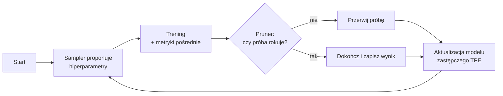

**TPE (Tree-structured Parzen Estimator)** – domyślny sampler Optuny – dzieli dotychczasowe próby na „dobre” (górne γ%, np. 25%) i „złe”, modeluje gęstości $l(x)$ i $g(x)$ hiperparametrów w obu grupach i proponuje punkty maksymalizujące $l(x)/g(x)$.

> **Pułapka:** strojenie na zbiorze testowym. Hiperparametry wybieramy na walidacji (lub CV), a test używamy **raz**, na końcu – inaczej wynik testowy jest optymistycznie obciążony.

---

## 7. Śledzenie eksperymentów głębokiego uczenia

### Integracja z PyTorch

```python
import mlflow
import torch
import torch.nn as nn
from torch.utils.data import DataLoader, TensorDataset

class SimpleNN(nn.Module):
    def __init__(self, input_dim: int, hidden_dim: int, dropout: float):
        super().__init__()
        self.network = nn.Sequential(
            nn.Linear(input_dim, hidden_dim),
            nn.ReLU(),
            nn.Dropout(dropout),
            nn.Linear(hidden_dim, hidden_dim // 2),
            nn.ReLU(),
            nn.Dropout(dropout),
            nn.Linear(hidden_dim // 2, 1),
            nn.Sigmoid()
        )
    
    def forward(self, x):
        return self.network(x).squeeze()

def train_neural_network(
    hidden_dim: int = 128,
    dropout: float = 0.3,
    lr: float = 0.001,
    epochs: int = 50,
    batch_size: int = 256
):
    """Trenuje sieć neuronową z logowaniem do MLflow."""
    
    with mlflow.start_run():
        # Logowanie hiperparametrów
        params = {
            "hidden_dim": hidden_dim,
            "dropout": dropout,
            "learning_rate": lr,
            "epochs": epochs,
            "batch_size": batch_size,
            "optimizer": "Adam"
        }
        mlflow.log_params(params)
        
        # Przygotowanie danych
        X_t = torch.FloatTensor(X_train)
        y_t = torch.FloatTensor(y_train.values)
        dataset = TensorDataset(X_t, y_t)
        loader = DataLoader(dataset, batch_size=batch_size, shuffle=True)
        
        # Model i optymalizator
        model = SimpleNN(X_train.shape[1], hidden_dim, dropout)
        optimizer = torch.optim.Adam(model.parameters(), lr=lr)
        criterion = nn.BCELoss()
        
        # Trening z logowaniem metryk per epoka
        for epoch in range(epochs):
            model.train()
            total_loss = 0
            
            for X_batch, y_batch in loader:
                optimizer.zero_grad()
                y_pred = model(X_batch)
                loss = criterion(y_pred, y_batch)
                loss.backward()
                optimizer.step()
                total_loss += loss.item()
            
            avg_loss = total_loss / len(loader)
            
            # Logowanie metryki per krok (epoka)
            mlflow.log_metric("train_loss", avg_loss, step=epoch)
            
            if (epoch + 1) % 10 == 0:
                print(f"Epoch {epoch+1}/{epochs}, Loss: {avg_loss:.4f}")
        
        # Logowanie modelu PyTorch
        mlflow.pytorch.log_model(model, "neural_network")
        
        return model
```

### Co logować w treningu sieci neuronowych

| Kategoria | Przykłady | Częstotliwość |
|---|---|---|
| Krzywe uczenia | `train_loss`, `val_loss`, `val_auc` | co epokę (lub co N kroków) |
| Optymalizacja | `learning_rate` (przy schedulerze), norma gradientu | co krok / epokę |
| Zasoby | zużycie GPU, czas epoki | co epokę |
| Checkpointy | najlepszy model wg `val_loss` | przy poprawie |
| Przykłady predykcji | obrazy z błędną klasą, próbki tekstu | rzadko (artefakty są duże) |

### Odczytywanie krzywych uczenia

```
 loss                                    loss
  │╲                                      │╲
  │ ╲__  val                              │ ╲   val      ___----
  │    ╲____________                      │  ╲_____----
  │ ╲__                                   │ ╲__
  │    ╲____________ train                │    ╲________________ train
  └──────────────────► epoka              └──────────────────► epoka
   dobre dopasowanie                       overfitting: val rośnie,
                                           train dalej spada → early stopping
```

### Walidacja, early stopping i checkpoint

```python
best_val, patience, bad_epochs = float("inf"), 5, 0
for epoch in range(epochs):
    train_loss = train_one_epoch(model, train_loader)      # funkcje pomocnicze
    val_loss = evaluate(model, val_loader)
    mlflow.log_metrics({"train_loss": train_loss, "val_loss": val_loss}, step=epoch)

    if val_loss < best_val:
        best_val, bad_epochs = val_loss, 0
        torch.save(model.state_dict(), "best.pt")
        mlflow.log_artifact("best.pt", artifact_path="checkpoints")
    else:
        bad_epochs += 1
        if bad_epochs >= patience:
            mlflow.set_tag("early_stopped_epoch", epoch)
            break
mlflow.log_metric("best_val_loss", best_val)
```

> ⚠️ Logowanie metryki **po każdym batchu** przy milionach kroków potrafi spowolnić trening i zapchać backend store. Loguj co N kroków lub użyj `mlflow.log_metrics` w paczkach.

> 💡 Dla PyTorch Lightning, Keras i Hugging Face Transformers istnieje `mlflow.<framework>.autolog()` lub gotowy callback – nie trzeba pisać pętli logującej samodzielnie.

---

## 8. Reproducibility – gwarancja powtarzalności

```python
import os
import sys
import platform
import subprocess
import mlflow

def log_environment_info():
    """Loguje informacje o środowisku do MLflow."""
    
    env_info = {
        "python_version": sys.version,
        "platform": platform.platform(),
        "cpu_count": os.cpu_count(),
    }
    
    # Wersje bibliotek
    import sklearn, numpy, pandas
    lib_versions = {
        "sklearn_version": sklearn.__version__,
        "numpy_version": numpy.__version__,
        "pandas_version": pandas.__version__,
    }
    
    # Git commit hash
    try:
        git_hash = subprocess.check_output(
            ["git", "rev-parse", "HEAD"]
        ).decode().strip()
        lib_versions["git_commit"] = git_hash
    except Exception:
        lib_versions["git_commit"] = "unknown"
    
    mlflow.log_params({**env_info, **lib_versions})
    
    # Zapisz requirements.txt jako artefakt
    subprocess.run(["pip", "freeze"], 
                   stdout=open("/tmp/requirements_snapshot.txt", "w"))
    mlflow.log_artifact("/tmp/requirements_snapshot.txt")

# Użycie w eksperymencie
with mlflow.start_run():
    log_environment_info()
    # ... reszta eksperymentu
```

### Ustawianie seedów w jednym miejscu

```python
import os
import random
import numpy as np

def set_seed(seed: int = 42) -> None:
    """Ustawia seedy wszystkich używanych generatorów losowych."""
    random.seed(seed)
    np.random.seed(seed)
    os.environ["PYTHONHASHSEED"] = str(seed)  # działa dla podprocesów
    try:
        import torch
        torch.manual_seed(seed)
        torch.cuda.manual_seed_all(seed)
        torch.backends.cudnn.benchmark = False
    except ImportError:
        pass
```

### Hash danych jako „odcisk palca”

```python
import hashlib
import pandas as pd

def dataframe_hash(df: pd.DataFrame) -> str:
    """Stabilny hash zawartości ramki danych (niezależny od pliku)."""
    row_hashes = pd.util.hash_pandas_object(df, index=True).values
    return hashlib.md5(row_hashes.tobytes()).hexdigest()

mlflow.set_tag("data_hash", dataframe_hash(train_df))
```

Ten sam pomysł (hash, commit git, seed) realizuje skrypt `04_reproducibility.py`.

### Poziomy reprodukowalności

| Poziom | Definicja | Co jest potrzebne |
|---|---|---|
| Bitowa | identyczne wagi i predykcje | te same dane, kod, seed, biblioteki, sprzęt, deterministyczne operacje |
| Statystyczna | metryki w granicach niepewności | dane, kod, konfiguracja; seed opcjonalny |
| Koncepcyjna | ten sam wniosek przy innej implementacji | opis metody i danych |

> 💡 W praktyce produkcyjnej zwykle wystarcza reprodukowalność **statystyczna**, ale do debugowania i audytu przydaje się bitowa.


> **▶️ Demo na żywo:** `python lectures/scripts/lecture_03/04_reproducibility.py`  
> **Kiedy:** po sekcji 8. Uzupełnia też sekcję 10 (logowanie nieudanych eksperymentów).  
> **Co pokazać:** dwa runy z `seed=42` dają identyczne `roc_auc`. Pokaż w UI tagi `git_commit`, `data_hash` i wersje bibliotek oraz run `failing-run` ze statusem FAILED.


### Źródła niedeterminizmu

| Źródło | Przykład | Jak kontrolować |
|---|---|---|
| Generatory losowe | inicjalizacja wag, podział danych, bootstrap | `random`, `numpy`, `torch` seed, `random_state` |
| Dane | ktoś nadpisał plik CSV | DVC, hash danych w tagu runu |
| Kolejność danych | `SELECT` bez `ORDER BY`, wielowątkowe ładowanie | sortowanie, seed `DataLoader` |
| Biblioteki | inna wersja sklearn zmienia domyślne parametry | `requirements.txt` z wersjami, Docker |
| Sprzęt | niedeterministyczne operacje cuDNN na GPU | `torch.use_deterministic_algorithms(True)` |
| Arytmetyka | inna kolejność sumowania float w obliczeniach równoległych | akceptacja tolerancji (np. ±1e-6) |

### Lineage – pochodzenie modelu

Pełny rodowód pozwala odpowiedzieć na pytanie audytora: *„Na jakich danych i jakim kodem powstał model, który odrzucił ten wniosek kredytowy?”*

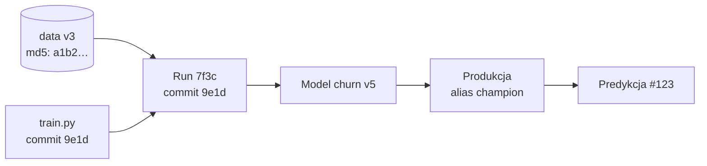

---

## 9. Weights & Biases (W&B) – alternatywa dla MLflow

**W&B** to chmurowa platforma do śledzenia eksperymentów, popularna w środowiskach badawczych.

```python
import wandb
from sklearn.ensemble import RandomForestClassifier
from sklearn.metrics import roc_auc_score

# Inicjalizacja projektu W&B
wandb.init(
    project="churn-prediction",
    name="RF-experiment-01",
    config={
        "n_estimators": 200,
        "max_depth": 8,
        "random_state": 42
    }
)

config = wandb.config

# Trening
model = RandomForestClassifier(
    n_estimators=config.n_estimators,
    max_depth=config.max_depth,
    random_state=config.random_state
)
model.fit(X_train, y_train)

# Logowanie metryk
auc = roc_auc_score(y_test, model.predict_proba(X_test)[:, 1])
wandb.log({"auc_roc": auc, "n_features": X_train.shape[1]})

# Logowanie modelu
wandb.save("model.pkl")

wandb.finish()
```

### Porównanie MLflow vs W&B

| Cecha | MLflow | Weights & Biases |
|-------|--------|-----------------|
| Hosting | Self-hosted / Managed | Cloud (SaaS) |
| Koszt | Open Source (darmowy) | Freemium |
| UI | Podstawowy | Zaawansowany |
| Integracje | Szerokie | Bardzo szerokie |
| Kolaboracja | Ograniczona | Wbudowana |
| Model Registry | Tak | Tak |

### Szerszy krajobraz narzędzi

| Narzędzie | Model | Mocne strony | Uwagi |
|---|---|---|---|
| MLflow | open source, self-hosted lub zarządzany | standard de facto, registry, wiele flavorów modeli | UI prostsze niż konkurencji |
| Weights & Biases | SaaS (opcja on-prem) | wizualizacje, raporty, sweeps | dane trafiają do chmury dostawcy |
| Neptune.ai | SaaS | skalowalne metadane, porównania | płatny przy większej skali |
| Comet ML | SaaS / on-prem | panele, porównanie kodu | podobny do W&B |
| ClearML | open source | tracking + orkiestracja + kolejki zadań | bardziej rozbudowana instalacja |
| DVC (`dvc exp`) | open source, oparty na Git | eksperymenty jako commity, wersjonowanie danych | brak pełnego serwera UI (Studio osobno) |
| TensorBoard | open source | krzywe uczenia DL | brak registry i zarządzania runami |

> 💡 Kryteria wyboru: gdzie mogą być przechowywane dane (regulacje, RODO), koszt przy skali zespołu, integracja z istniejącą chmurą i potrzeba Model Registry.


### Model Registry – cykl życia wersji modelu

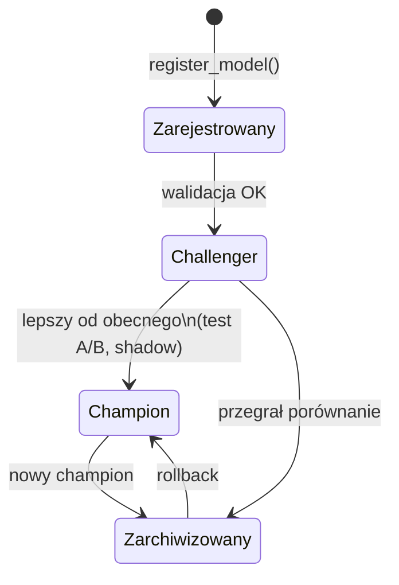

W MLflow ≥ 2.9 zamiast etapów (`Staging`/`Production`, obecnie przestarzałe) używa się **aliasów** (`champion`, `challenger`) i tagów. Kod serwujący ładuje model po aliasie, więc wdrożenie i rollback to tylko przestawienie aliasu:

```python
from mlflow import MlflowClient
import mlflow

client = MlflowClient()
client.set_registered_model_alias("churn-classifier", "champion", version=5)
model = mlflow.pyfunc.load_model("models:/churn-classifier@champion")
# rollback:
client.set_registered_model_alias("churn-classifier", "champion", version=4)
```

---

## 10. Typowe pułapki w śledzeniu eksperymentów

> ⚠️ **Pułapka 1: Porównywanie jabłek z gruszkami**
> Porównywanie modeli trenowanych na różnych wersjach danych lub z różnym preprocessingiem. Zawsze loguj `data_version` i `preprocessing_version` jako parametry.

> ⚠️ **Pułapka 2: Overfitting do zbioru testowego**
> Wielokrotne strojenie hiperparametrów na tym samym zbiorze testowym prowadzi do overfittingu. Rozwiązanie: używaj trzech zbiorów (train/validation/test) lub cross-validation, a zbiór testowy traktuj jako „ostateczny egzamin".

> ⚠️ **Pułapka 3: Brak logowania negatywnych wyników**
> Zespoły często logują tylko udane eksperymenty. Negatywne wyniki są równie wartościowe — pokazują, czego nie warto próbować. Loguj **każdy** eksperyment, nawet nieudany.

```python
# ✅ Dobra praktyka: loguj też nieudane eksperymenty z odpowiednim tagiem
with mlflow.start_run(run_name="failed-experiment", tags={"status": "failed"}):
    mlflow.log_param("reason", "OOM - model zbyt duży dla dostępnej pamięci")
    mlflow.log_param("model_class", "TransformerXL")
    mlflow.log_param("memory_required_gb", 32)
    mlflow.log_param("memory_available_gb", 16)
```

> ⚠️ **Pułapka 4: Metryki ML vs metryki biznesowe**
> Wysoki AUC-ROC nie zawsze oznacza wartość biznesową. Model z AUC=0.85 może generować więcej zysku niż model z AUC=0.92, jeśli lepiej identyfikuje klientów o wysokiej wartości. Zawsze loguj metryki biznesowe obok metryk ML.

> ⚠️ **Pułapka 5: Wyciek danych (data leakage) w preprocessingu**
> Skalowanie lub selekcja cech dopasowana na całym zbiorze przed podziałem na foldy zawyża metryki CV. Umieszczaj preprocessing w `sklearn.pipeline.Pipeline`, aby był dopasowywany tylko na części treningowej każdego foldu.

```python
from sklearn.pipeline import make_pipeline
from sklearn.preprocessing import StandardScaler
from sklearn.feature_selection import SelectKBest
from sklearn.linear_model import LogisticRegression

# ✅ scaler i selekcja cech dopasowywane wewnątrz każdego foldu
pipe = make_pipeline(StandardScaler(), SelectKBest(k=10), LogisticRegression(max_iter=1000))
scores = cross_val_score(pipe, X_train, y_train, cv=5, scoring="roc_auc")
```

> ⚠️ **Pułapka 6: Wybór najlepszego z setek runów (multiple comparisons)**
> Im więcej prób, tym większa szansa, że najlepszy wynik jest szczęśliwym przypadkiem. Najlepszą konfigurację z HPO zawsze potwierdź na niezależnym zbiorze testowym lub powtórzeniem z innymi seedami.

> ⚠️ **Pułapka 7: Niezacommitowany kod**
> Tag `git_commit` jest bezwartościowy, jeśli run powstał z lokalnie zmienionego kodu. Loguj też flagę `git_dirty` (wynik `git status --porcelain`) albo blokuj treningi „oficjalne” przy brudnym repozytorium.

> ⚠️ **Pułapka 8: Metryka liczona inaczej w różnych runach**
> np. F1 przy progu 0.5 w jednym runie i przy progu optymalnym w innym. Wspólna funkcja `evaluate_model` w repozytorium (jak w skryptach do wykładu) eliminuje ten problem.

### Podsumowanie pułapek

| Pułapka | Objaw | Zabezpieczenie |
|---|---|---|
| Różne dane | niespójne porównania | `data_version`, `log_input` |
| Overfitting do testu | spadek jakości na produkcji | train / val / test, test użyty raz |
| Brak negatywnych wyników | powtarzanie nieudanych pomysłów | loguj każdy run, także FAILED |
| Metryki tylko ML | model „lepszy”, a zysk mniejszy | metryki biznesowe w runie |
| Data leakage | podejrzanie wysokie wyniki | `Pipeline`, podział przed preprocessingiem |
| Multiple comparisons | wynik nie powtarza się | potwierdzenie na holdout / innych seedach |
| Brudne repozytorium | nie da się odtworzyć kodu | tag `git_dirty`, CI |

### Case Study: Netflix — eksperymenty na skalę

**Netflix** prowadzi tysiące eksperymentów ML jednocześnie (rekomendacje, thumbnails, personalizacja UI):
- Każdy eksperyment jest śledzony z pełnym kontekstem: dane, parametry, metryki ML i metryki biznesowe (czas oglądania, retencja).
- Używają wewnętrznej platformy do A/B testowania modeli na żywym ruchu.
- Kluczowa lekcja: **metryka offline (AUC) nie zawsze koreluje z metryką online (czas oglądania)**. Dlatego każdy model przechodzi testy A/B przed pełnym wdrożeniem.

---

## Pytania kontrolne i do dyskusji

1. Dlaczego systematyczne śledzenie eksperymentów jest ważniejsze niż sam wybór algorytmu?
2. Jakie informacje powinien zawierać każdy zalogowany eksperyment w MLflow?
3. Czym różni się `mlflow.log_param` od `mlflow.log_metric`? Kiedy użyjesz każdego?
4. Wyjaśnij, jak Optuna wybiera kolejne hiperparametry do przetestowania (TPE sampler).
5. Porównaj MLflow i Weights & Biases — kiedy wybierzesz jedno, a kiedy drugie?
6. Co to jest overfitting do zbioru testowego i jak go uniknąć?
7. **Dyskusja:** Czy warto logować eksperymenty, które zakończyły się niepowodzeniem? Uzasadnij.
8. Czym różni się backend store od artifact store w MLflow? Co przechowuje każdy z nich?
9. Dlaczego `MedianPruner` nie przerwie żadnej próby, jeśli funkcja celu nie wywołuje `trial.report`?
10. Masz dwa modele: AUC 0.874 ± 0.012 i 0.871 ± 0.010 (10-fold CV). Który wdrożysz i dlaczego?
11. Dlaczego `learning_rate` próbkujemy w skali logarytmicznej?
12. Jakie są zalety i wady `mlflow.autolog()` w porównaniu z ręcznym logowaniem?


### Proponowane odpowiedzi

1. Bez trackingu nie da się rzetelnie porównać wyników ani odtworzyć najlepszego modelu, więc nawet „lepszy algorytm” niewiele daje. Największą wartość daje kontrola procesu uczenia, nie pojedynczy wybór modelu.
2. Minimum: parametry, metryki, artefakty modelu, wersja danych, wersja kodu (commit), środowisko (biblioteki), czas uruchomienia i tagi kontekstowe. To zapewnia pełną reprodukowalność i audyt.
3. `mlflow.log_param` służy do zapisu konfiguracji (np. `max_depth=8`), a `mlflow.log_metric` do wyników liczbowych (np. `auc=0.89`) zwykle także po epokach/krokach. Parametry opisują wejście eksperymentu, metryki jego jakość.
4. TPE buduje probabilistyczny model przestrzeni hiperparametrów i wybiera kolejne konfiguracje, które mają najwyższą oczekiwaną poprawę względem dotychczasowych wyników. Dzięki temu szuka mądrzej niż brute force.
5. MLflow wybiorę, gdy potrzebuję open-source i self-hostingu; W&B, gdy priorytetem jest współpraca zespołowa i bogate UI SaaS. Oba narzędzia wspierają tracking, ale różnią się stylem pracy i kosztem.
6. Overfitting do testu to strojenie decyzji pod jeden zbiór testowy, przez co wynik testowy przestaje być obiektywny. Zapobiegamy temu przez osobny validation set/CV i użycie testu dopiero na końcu.
7. Tak, warto logować także nieudane eksperymenty, bo oszczędza to czas i zapobiega powtarzaniu tych samych błędów. To też buduje wiedzę zespołu o ograniczeniach danych i modeli.
8. Backend store trzyma metadane (eksperymenty, runy, parametry, metryki, tagi) w plikach lub bazie SQL. Artifact store trzyma duże pliki (modele, wykresy, raporty) na dysku lub w magazynie obiektowym (S3, MinIO).
9. Pruner porównuje wyniki pośrednie próby z innymi próbami na tym samym kroku. Bez `trial.report` nie ma czego porównać, więc `should_prune()` zawsze zwraca `False`.
10. Różnica (0.003) jest dużo mniejsza od odchylenia standardowego, więc najpewniej nieistotna (warto potwierdzić sparowanym testem). Wybieramy model prostszy, tańszy lub szybszy, albo kierujemy się metryką biznesową i ograniczeniami wdrożeniowymi.
11. Wpływ learning rate zależy od rzędu wielkości, a nie od wartości bezwzględnej. Próbkowanie liniowe na [0.0001, 0.3] prawie nigdy nie sprawdziłoby wartości poniżej 0.01.
12. Autolog jest szybki i niczego nie pomija z parametrów modelu, ale loguje dużo szumu i nie zna kontekstu (wersja danych, metryki biznesowe, metryki testowe). Najlepiej łączyć oba podejścia.


---

## Podsumowanie

- Systematyczne śledzenie eksperymentów jest kluczowe dla reprodukowalności i porównywania modeli.
- **MLflow** oferuje kompletne rozwiązanie: tracking, registry, serving.
- Loguj **wszystko**: parametry, metryki, artefakty, środowisko, wersję kodu — także nieudane eksperymenty.
- **Optuna** automatyzuje poszukiwanie optymalnych hiperparametrów (TPE, pruning).
- Dobra organizacja eksperymentów (nazewnictwo, tagi, hierarchia) oszczędza czas w przyszłości.
- Pamiętaj o różnicy między metrykami ML a metrykami biznesowymi.
- Różnice między runami weryfikuj statystycznie (CV z wieloma foldami, bootstrap) – przy remisie wybieraj model prostszy.
- Architektura MLflow rozdziela metadane (backend store) od artefaktów (artifact store), co pozwala skalować tracking od laptopa do zespołu.

## Literatura i zasoby

- [MLflow Documentation](https://mlflow.org/docs/latest/index.html)
- [Optuna Documentation](https://optuna.readthedocs.io/)
- [Weights & Biases Documentation](https://docs.wandb.ai/)
- [Hyperparameter Optimization: A Spectral Approach](https://arxiv.org/abs/1706.00764)
- [Netflix Technology Blog – ML Experimentation](https://netflixtechblog.com/)
- [How to Track ML Experiments (Neptune.ai Blog)](https://neptune.ai/blog/ml-experiment-tracking)
