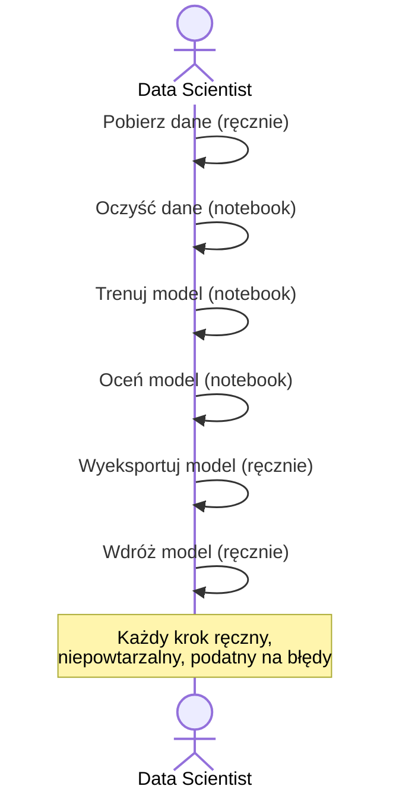
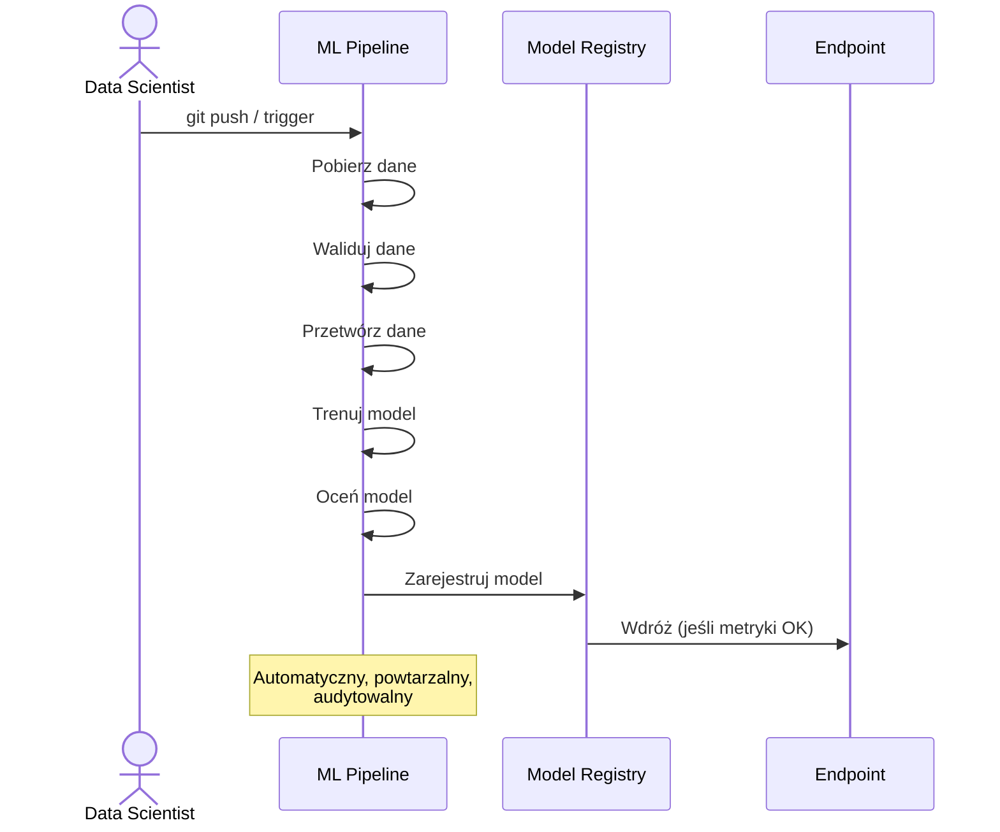
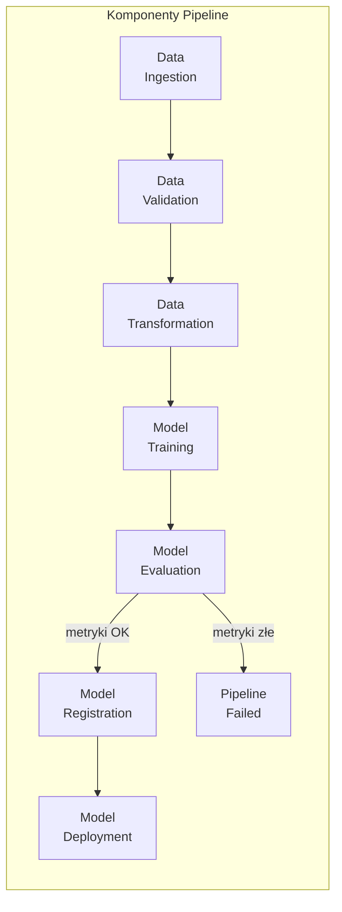
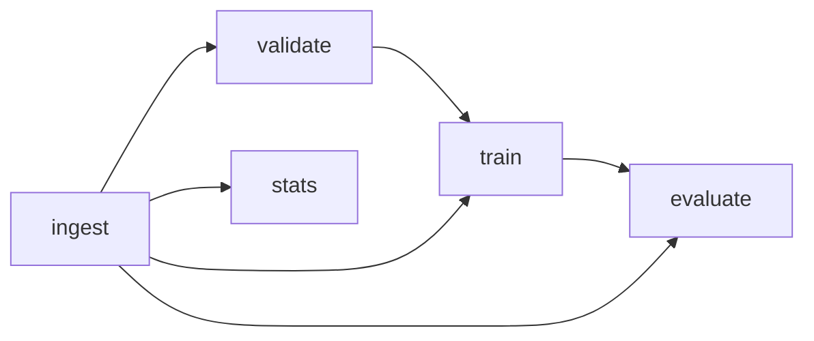
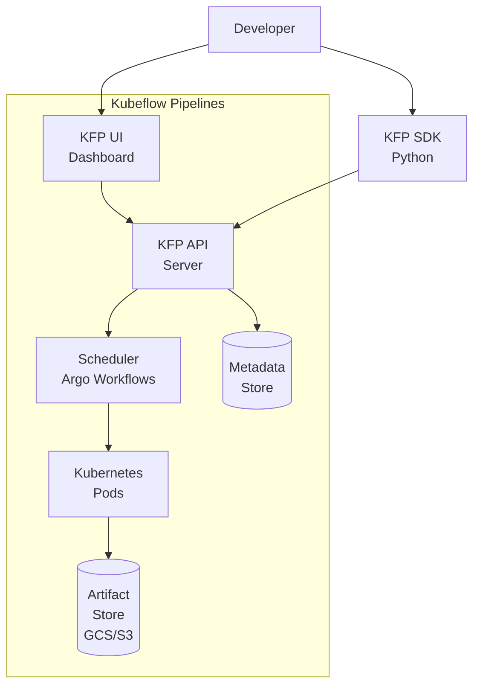
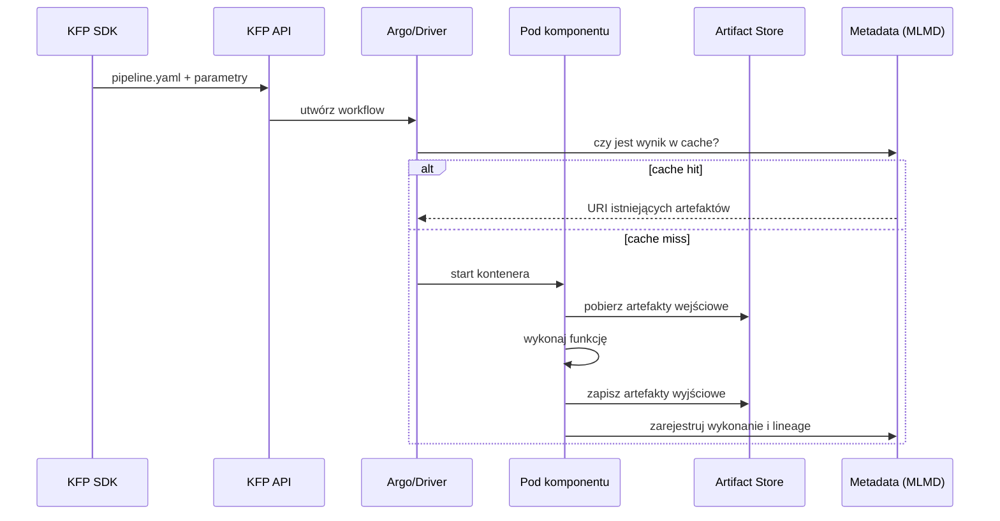
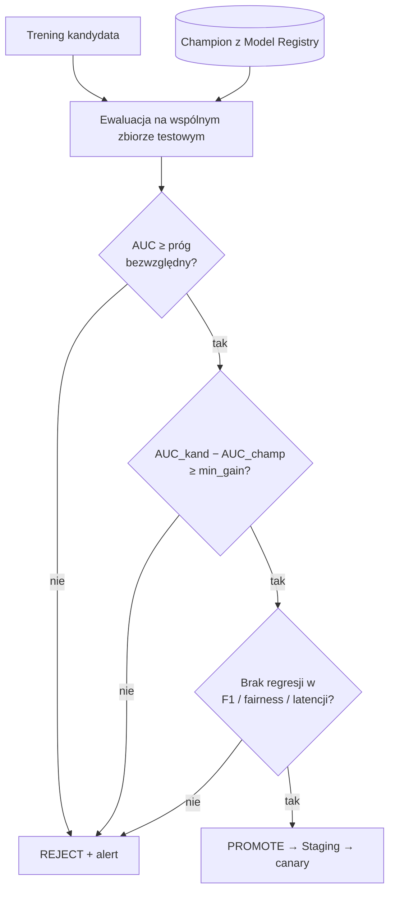
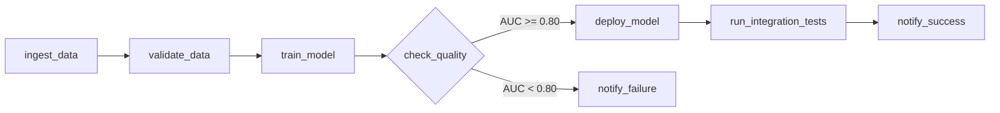
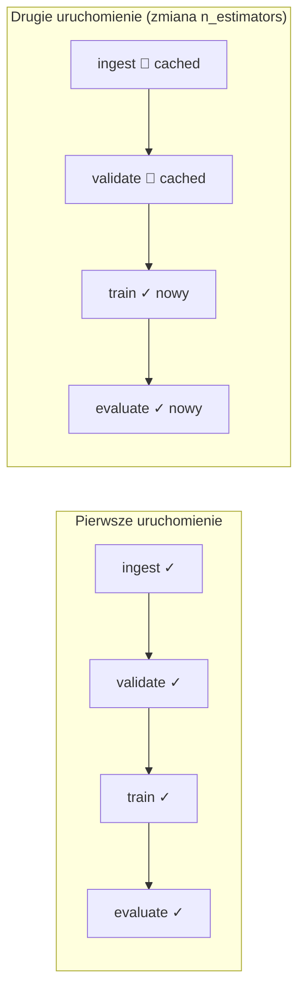
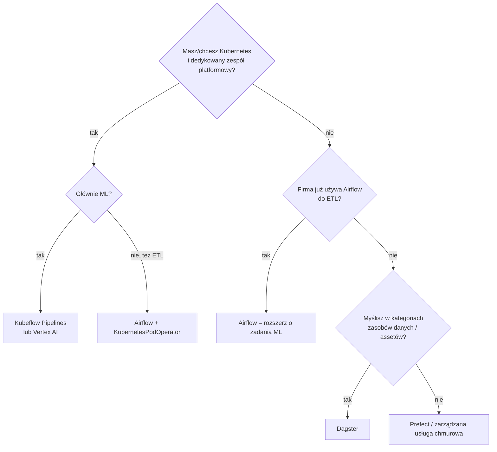

# Wykład 4: ML Pipelines – Automatyzacja Przepływu Pracy

## Cel wykładu
Po tym wykładzie student:
- rozumie, czym są ML Pipelines i dlaczego są kluczowe w MLOps,
- zna różnicę między pipeline'em danych a pipeline'em ML,
- potrafi zbudować pipeline z użyciem Kubeflow Pipelines (KFP),
- rozumie koncepcję DAG i orkiestracji zadań,
- zna pojęcia: artefakt, lineage, metadata store, caching, quality gate, backfill,
- potrafi świadomie wybrać orkiestrator i uniknąć typowych pułapek.

> 💻 **Skrypty demonstracyjne** do tego wykładu znajdują się w `lectures/scripts/lecture_04/`:
>
> | Skrypt | Sekcja | Co pokazuje |
> |--------|--------|-------------|
> | `01_mini_orchestrator.py` | 2a | Własny mini-orkiestrator: DAG, sortowanie topologiczne, retry, caching |
> | `02_quality_gate_pipeline.py` | 6a | Lokalny pipeline z artefaktami, lineage (`metadata.jsonl`) i bramką champion/challenger |
> | `03_kfp_compile.py` | 4–6 | Kompilacja pipeline'u KFP v2 do YAML bez klastra i analiza wygenerowanego DAG |
>
> Wyniki zapisywane są w `lectures/scripts/lecture_04/outputs/`.

---

## 1. Czym jest ML Pipeline?

**ML Pipeline** to zautomatyzowany, powtarzalny przepływ pracy, który łączy wszystkie etapy cyklu życia modelu ML — od danych do wdrożenia.

### Bez pipeline'u (ręczny proces)



### Z ML Pipeline



### Trzy rodzaje pipeline'ów w systemie ML

W praktyce „pipeline ML” to nie jeden przepływ, lecz co najmniej trzy powiązane ze sobą:

```
┌──────────────────┐   cechy    ┌────────────────────┐   model    ┌────────────────────┐
│  DATA / FEATURE  │──────────▶│ TRAINING PIPELINE  │──────────▶│ INFERENCE PIPELINE │
│    PIPELINE      │ (Feature  │ (walidacja, trening│ (Model     │ (batch scoring lub │
│ ETL, agregacje,  │  Store)   │  ewaluacja, rejestr│  Registry) │  online serving)   │
│ walidacja danych │           │  bramka jakości)   │            │                    │
└──────────────────┘           └────────────────────┘            └─────────┬──────────┘
         ▲                                                                  │ logi predykcji,
         └──────────────────── monitoring / retraining trigger ◀────────────┘ drift
```

| Aspekt | Pipeline danych | Pipeline treningowy | Pipeline inferencji |
|--------|-----------------|---------------------|---------------------|
| Wejście | Surowe dane (DB, logi, API) | Cechy + etykiety | Cechy nowych obserwacji |
| Wyjście | Tabele cech, zbiory danych | Model + metryki + karta modelu | Predykcje |
| Częstotliwość | Godzinowo / dziennie / streaming | Dziennie / tygodniowo / na trigger | Ciągle lub batch |
| Główne ryzyko | Złe/niekompletne dane | Regresja jakości, leakage | Training–serving skew, latencja |
| Typowe narzędzia | Airflow, dbt, Spark | KFP, Vertex AI, SageMaker, MLflow | FastAPI, KServe, Spark batch |

> 💡 **Training–serving skew** – jeśli preprocessing jest zaimplementowany dwa razy (w pipeline'ie treningowym w pandas i w serwisie w Javie), wcześniej czy później się rozjedzie. Dobra praktyka: jeden kod transformacji (np. `sklearn.Pipeline` zapisany razem z modelem, Feature Store) używany w obu miejscach.

### Poziomy dojrzałości automatyzacji (wg Google MLOps)

| Poziom | Opis | Co jest zautomatyzowane |
|--------|------|-------------------------|
| **0 – proces ręczny** | Notebooki, ręczne przekazanie modelu do IT | Nic |
| **1 – automatyzacja pipeline'u ML** | Pipeline treningowy uruchamiany automatycznie (harmonogram/trigger), continuous training | Trening, walidacja, rejestracja |
| **2 – CI/CD pipeline'ów** | Kod pipeline'u jest testowany, budowany i wdrażany przez CI/CD | Także budowa i wdrażanie samego pipeline'u |

Kluczowa zmiana mentalna przy przejściu z poziomu 0 na 1: **wdrażamy pipeline, a nie model**. Model jest artefaktem, który pipeline produkuje regularnie.

---

## 2. Anatomia ML Pipeline



### Właściwości dobrego pipeline'u

| Właściwość | Opis |
|-----------|------|
| **Idempotentność** | Wielokrotne uruchomienie daje ten sam wynik |
| **Modularność** | Każdy krok jest niezależnym komponentem |
| **Audytowalność** | Pełna historia uruchomień i artefaktów |
| **Skalowalność** | Możliwość równoległego wykonania kroków |
| **Odporność na błędy** | Retry, checkpointing, rollback |
| **Reprodukowalność** | Wersjonowany kod, dane, obrazy i parametry pozwalają odtworzyć dowolny run |
| **Obserwowalność** | Logi, metryki czasu/kosztu kroków, alerty |

### Kluczowe pojęcia

| Pojęcie | Definicja | Przykład |
|---------|-----------|----------|
| **Komponent (krok, task)** | Samodzielna jednostka pracy z jawnie zdefiniowanymi wejściami i wyjściami | `train_model(dataset) -> model, metrics` |
| **Artefakt** | Plik/obiekt produkowany przez krok, przechowywany w Artifact Store | `dataset.parquet`, `model.joblib` |
| **Parametr** | Mała wartość (liczba, string) przekazywana do kroku | `n_estimators=200` |
| **Run** | Pojedyncze wykonanie pipeline'u z konkretnymi parametrami | `run_id=a80e822b` |
| **Lineage** | Graf pochodzenia: z jakich danych i kodu powstał dany model | model v7 ← dataset hash `4710b7` ← kod `git:3fa2c1` |
| **Metadata Store** | Baza z informacjami o runach, artefaktach i ich relacjach | ML Metadata (MLMD) w KFP/TFX |
| **Quality gate** | Warunek, który musi spełnić model, by przejść dalej | AUC ≥ 0.85 i lepszy od championa |
| **Backfill** | Uruchomienie pipeline'u dla historycznych przedziałów czasu | przeliczenie cech za ostatnie 90 dni |

### Parametry vs artefakty – częsty błąd

Orkiestratory rozróżniają małe **parametry** (przechowywane w bazie metadanych, np. JSON) od dużych **artefaktów** (pliki w S3/GCS). Przekazywanie DataFrame'u przez parametr (np. XCom w Airflow) to antywzorzec – baza metadanych nie jest magazynem danych. Przekazuj **ścieżkę/URI** do artefaktu, nie sam obiekt.

```
Krok A ──(parametr: "s3://bucket/run-42/dataset.parquet")──▶ Krok B   ✅
Krok A ──(XCom: DataFrame 2 GB zserializowany do JSON)────▶ Krok B   ❌
```

---

## 2a. DAG i orkiestracja – jak to działa od środka

**DAG (Directed Acyclic Graph)** to graf skierowany bez cykli: wierzchołki to kroki, krawędzie to zależności („B potrzebuje wyniku A”). Brak cykli gwarantuje, że istnieje kolejność wykonania, w której każdy krok startuje dopiero po swoich zależnościach – tzw. **porządek topologiczny**.



Orkiestrator wykonuje w pętli:
1. Wyznacza kroki, których wszystkie zależności są zakończone (in-degree = 0) → **fala** kroków, które można uruchomić równolegle (`validate` i `stats` powyżej).
2. Dla każdego kroku liczy **klucz cache** = hash(kod/obraz + parametry + wejścia). Jeśli wynik istnieje – pomija wykonanie.
3. Uruchamia krok (proces, kontener, pod K8s), przy błędzie przejściowym robi **retry z wykładniczym backoffem**.
4. Zapisuje artefakty i metadane, aktualizuje stan, przechodzi do następnej fali.

To wszystko implementuje w ~100 liniach skrypt `01_mini_orchestrator.py`:

```bash
python lectures/scripts/lecture_04/01_mini_orchestrator.py
```

```text
▶ Uruchomienie 1 (n_estimators=50)
  fala 0: ['ingest']
    ⟳  ingest    błąd: timeout hurtowni danych – retry za 0.1s
    ⟳  ingest    błąd: timeout hurtowni danych – retry za 0.2s
    ✓  ingest    wykonany w 0.03s (próba 3)
  fala 1: ['validate', 'stats']
  ...
▶ Uruchomienie 2 (n_estimators=150) – ingest/validate/stats z cache
    💾 ingest    cache hit (7f0ddaefe6059093)
    💾 validate  cache hit (196ceaa092a8ef4b)
    ✓  train     wykonany w 0.35s (próba 1)
▶ Próba z cyklem (train → ingest)
  ❌ Graf zawiera cykl – to nie jest DAG!
```

### Retry – kiedy pomaga, a kiedy szkodzi

| Typ błędu | Przykład | Retry? |
|-----------|----------|--------|
| Przejściowy (transient) | timeout sieci, chwilowy brak GPU, preempcja spot VM | ✅ tak, z backoffem |
| Deterministyczny | błąd w kodzie, zła kolumna, assert walidacji | ❌ nie – retry tylko marnuje zasoby |
| Z efektem ubocznym | wysłanie e-maila, zapis do bazy bez klucza idempotencji | ⚠️ tylko jeśli operacja jest idempotentna |

### Idempotentność w praktyce

```python
# ❌ Nieidempotentne: każde uruchomienie dopisuje dane (duplikaty po retry)
df.to_sql("features", engine, if_exists="append")

# ✅ Idempotentne: partycja dla daty logicznej jest nadpisywana
out = f"s3://features/date={run_date}/part.parquet"
df.to_parquet(out)  # ponowne uruchomienie dla run_date daje ten sam stan

# ❌ Zależność od "teraz" – wynik zależy od momentu uruchomienia
start = datetime.now() - timedelta(days=30)

# ✅ Zależność od daty logicznej runu (parametr pipeline'u / {{ ds }} w Airflow)
start = run_date - timedelta(days=30)
```

---

## 3. Kubeflow Pipelines (KFP)

**Kubeflow Pipelines** to platforma do budowania i uruchamiania ML Pipelines na Kubernetes.

### Architektura KFP



### Jak KFP wykonuje komponent

Każdy komponent to osobny **kontener** uruchamiany jako pod Kubernetes. Kod funkcji Pythona z `@dsl.component` jest serializowany do specyfikacji YAML i przy starcie poda wstrzykiwany do obrazu `base_image` (dlatego **importy muszą być wewnątrz funkcji**!). Artefakty są przekazywane przez Artifact Store (S3/GCS/MinIO), nie przez pamięć.



### Typy komponentów KFP v2

| Typ | Definicja | Kiedy używać |
|-----|-----------|--------------|
| **Lightweight Python** | `@dsl.component(base_image=..., packages_to_install=[...])` | Prototypy, proste kroki; pakiety instalowane przy każdym starcie (wolniej) |
| **Containerized Python** | `@dsl.component(target_image=...)` + `kfp component build` | Produkcja: zależności zapieczone w obrazie, szybki start, powtarzalność |
| **Container component** | `@dsl.container_component` zwracający `dsl.ContainerSpec` | Dowolny język/narzędzie (np. Spark, binarka C++) |
| **Importer** | `dsl.importer(artifact_uri=...)` | Wprowadzenie istniejącego artefaktu (np. modelu bazowego) do lineage |

> ⚠️ `packages_to_install` bez przypiętych wersji (`"pandas"`) narusza reprodukowalność – za pół roku zainstaluje się inna wersja. W produkcji przypinaj wersje lub buduj własny obraz.

### Instalacja KFP SDK

```bash
pip install "kfp>=2.9,<3.0"   # zgodnie z requirements.txt kursu
```

> 📝 Kompilacja pipeline'u do YAML **nie wymaga klastra** – wystarczy SDK. Pozwala to testować definicję pipeline'u w CI (patrz `03_kfp_compile.py`).

---

## 4. Budowanie komponentów KFP

### Komponent jako funkcja Python

```python
from kfp import dsl
from kfp.dsl import Dataset, Model, Metrics, Input, Output
import pandas as pd
import numpy as np

# --- Komponent 1: Pobieranie danych ---
@dsl.component(
    base_image="python:3.11-slim",
    packages_to_install=["pandas", "scikit-learn"]
)
def ingest_data(
    n_samples: int,
    output_dataset: Output[Dataset]
):
    """Pobiera i zapisuje dane treningowe."""
    from sklearn.datasets import make_classification
    import pandas as pd
    
    X, y = make_classification(
        n_samples=n_samples,
        n_features=20,
        n_informative=10,
        random_state=42
    )
    
    df = pd.DataFrame(X, columns=[f"feature_{i}" for i in range(20)])
    df['target'] = y
    
    df.to_parquet(output_dataset.path, index=False)
    print(f"Zapisano {len(df)} wierszy do {output_dataset.path}")


# --- Komponent 2: Walidacja danych ---
@dsl.component(
    base_image="python:3.11-slim",
    packages_to_install=["pandas", "pyarrow"]
)
def validate_data(
    input_dataset: Input[Dataset],
    min_rows: int = 1000
) -> bool:
    """Waliduje dane wejściowe."""
    import pandas as pd
    
    df = pd.read_parquet(input_dataset.path)
    
    # Sprawdzenia
    assert len(df) >= min_rows, f"Za mało wierszy: {len(df)} < {min_rows}"
    assert df.isnull().sum().sum() == 0, "Dane zawierają wartości null"
    assert 'target' in df.columns, "Brak kolumny 'target'"
    
    print(f"✅ Walidacja OK: {len(df)} wierszy, {df.shape[1]} kolumn")
    return True


# --- Komponent 3: Trening modelu ---
@dsl.component(
    base_image="python:3.11-slim",
    packages_to_install=["pandas", "scikit-learn", "pyarrow", "joblib"]
)
def train_model(
    input_dataset: Input[Dataset],
    n_estimators: int,
    max_depth: int,
    output_model: Output[Model],
    output_metrics: Output[Metrics]
):
    """Trenuje model i zapisuje artefakty."""
    import pandas as pd
    import joblib
    from sklearn.ensemble import RandomForestClassifier
    from sklearn.model_selection import train_test_split
    from sklearn.metrics import roc_auc_score, f1_score, accuracy_score
    
    # Wczytaj dane
    df = pd.read_parquet(input_dataset.path)
    X = df.drop('target', axis=1)
    y = df['target']
    
    X_train, X_test, y_train, y_test = train_test_split(
        X, y, test_size=0.2, random_state=42, stratify=y
    )
    
    # Trening
    model = RandomForestClassifier(
        n_estimators=n_estimators,
        max_depth=max_depth,
        random_state=42,
        n_jobs=-1
    )
    model.fit(X_train, y_train)
    
    # Ewaluacja
    y_pred = model.predict(X_test)
    y_prob = model.predict_proba(X_test)[:, 1]
    
    auc = roc_auc_score(y_test, y_prob)
    f1 = f1_score(y_test, y_pred)
    acc = accuracy_score(y_test, y_pred)
    
    # Logowanie metryk do KFP
    output_metrics.log_metric("auc_roc", auc)
    output_metrics.log_metric("f1_score", f1)
    output_metrics.log_metric("accuracy", acc)
    output_metrics.log_metric("n_estimators", n_estimators)
    output_metrics.log_metric("max_depth", max_depth)
    
    # Zapis modelu
    joblib.dump(model, output_model.path)
    print(f"Model zapisany. AUC-ROC: {auc:.4f}")


# --- Komponent 4: Ewaluacja i decyzja o wdrożeniu ---
@dsl.component(
    base_image="python:3.11-slim",
    packages_to_install=["pandas", "scikit-learn", "pyarrow", "joblib"]
)
def evaluate_and_decide(
    input_model: Input[Model],
    input_dataset: Input[Dataset],
    auc_threshold: float = 0.80
) -> str:
    """Ocenia model i decyduje o wdrożeniu."""
    import pandas as pd
    import joblib
    from sklearn.metrics import roc_auc_score
    from sklearn.model_selection import train_test_split
    
    df = pd.read_parquet(input_dataset.path)
    X = df.drop('target', axis=1)
    y = df['target']
    # Ten sam podział co w train_model (łącznie ze stratify!) – inaczej
    # zbiór testowy różniłby się od treningowego podziału i mógłby
    # zawierać próbki widziane podczas treningu (data leakage).
    _, X_test, _, y_test = train_test_split(
        X, y, test_size=0.2, random_state=42, stratify=y
    )
    
    model = joblib.load(input_model.path)
    auc = roc_auc_score(y_test, model.predict_proba(X_test)[:, 1])
    
    decision = "deploy" if auc >= auc_threshold else "reject"
    print(f"AUC: {auc:.4f}, próg: {auc_threshold}, decyzja: {decision}")
    return decision
```

> 💡 **Lepszy wzorzec:** zamiast powtarzać `train_test_split` w kilku komponentach, wydziel osobny komponent `split_data`, który produkuje dwa artefakty (`train_dataset`, `test_dataset`). Wtedy podział jest wykonywany raz, jest widoczny w lineage i nie ma ryzyka rozjechania się logiki.

### Dobre praktyki projektowania komponentów

- **Jedna odpowiedzialność** – komponent robi jedną rzecz (łatwiej cache'ować i testować).
- **Logika poza dekoratorem** – trzymaj właściwy kod w zwykłym module Pythona (`src/train.py`), a komponent KFP traktuj jako cienki wrapper. Wtedy testy jednostkowe nie wymagają KFP (patrz sekcja 9).
- **Jawne typy wejść/wyjść** – `Input[Dataset]`, `Output[Model]`, typy parametrów; kompilator wykrywa niezgodności przed uruchomieniem.
- **Determinizm** – `random_state`, przypięte wersje bibliotek, brak `datetime.now()` w logice.
- **Rozmiar granulacji** – zbyt drobne kroki = narzut startu podów (często 10–60 s na krok); zbyt duże = brak cache i trudne debugowanie.

---

## 5. Definiowanie Pipeline'u

```python
from kfp import dsl, compiler

@dsl.pipeline(
    name="churn-prediction-pipeline",
    description="Pełny pipeline ML dla predykcji churnu"
)
def churn_pipeline(
    n_samples: int = 10000,
    n_estimators: int = 100,
    max_depth: int = 5,
    auc_threshold: float = 0.80
):
    """Definiuje pełny pipeline ML."""
    
    # Krok 1: Pobierz dane
    ingest_task = ingest_data(n_samples=n_samples)
    
    # Krok 2: Waliduj dane
    validate_task = validate_data(
        input_dataset=ingest_task.outputs["output_dataset"]
    )
    
    # Krok 3: Trenuj model (po walidacji)
    train_task = train_model(
        input_dataset=ingest_task.outputs["output_dataset"],
        n_estimators=n_estimators,
        max_depth=max_depth
    )
    train_task.after(validate_task)  # zależność
    
    # Krok 4: Oceń i zdecyduj
    evaluate_task = evaluate_and_decide(
        input_model=train_task.outputs["output_model"],
        input_dataset=ingest_task.outputs["output_dataset"],
        auc_threshold=auc_threshold
    )
    
    # Konfiguracja zasobów
    train_task.set_cpu_request("2")
    train_task.set_memory_request("4Gi")
    train_task.set_cpu_limit("4")
    train_task.set_memory_limit("8Gi")

# Kompilacja pipeline'u do YAML
compiler.Compiler().compile(
    pipeline_func=churn_pipeline,
    package_path="churn_pipeline.yaml"
)
print("Pipeline skompilowany do churn_pipeline.yaml")
```

### Uruchomienie pipeline'u

```python
import kfp

# Połączenie z KFP (Vertex AI Pipelines lub lokalny KFP)
client = kfp.Client(host="https://your-kfp-endpoint")

# Uruchomienie pipeline'u
run = client.create_run_from_pipeline_func(
    churn_pipeline,
    arguments={
        "n_samples": 50000,
        "n_estimators": 200,
        "max_depth": 8,
        "auc_threshold": 0.82
    },
    run_name="churn-pipeline-run-20240115",
    experiment_name="churn-experiments"
)

print(f"Pipeline uruchomiony: {run.run_id}")
# Uwaga: get_run zwraca obiekt runu – status to pole .state (KFP v2)
print(f"Status: {client.get_run(run.run_id).state}")

# Opcjonalnie: czekaj na zakończenie (np. w CI)
result = client.wait_for_run_completion(run.run_id, timeout=3600)
print(f"Stan końcowy: {result.state}")
```

### Harmonogram (recurring run)

```python
client.create_recurring_run(
    experiment_id=client.get_experiment(experiment_name="churn-experiments").experiment_id,
    job_name="churn-nightly",
    cron_expression="0 0 2 * * *",   # KFP używa 6-polowego crona (z sekundami)
    pipeline_package_path="churn_pipeline.yaml",
    params={"n_samples": 50000},
    max_concurrency=1,               # nie uruchamiaj nowego, gdy poprzedni trwa
)
```

### Kompilacja lokalna i inspekcja YAML

Skrypt `03_kfp_compile.py` kompiluje pipeline z warunkiem `dsl.If/dsl.Else`, retry i limitami zasobów, a następnie czyta wygenerowany IR YAML:

```bash
python lectures/scripts/lecture_04/03_kfp_compile.py
```

```text
Parametry pipeline'u:
  auc_threshold  NUMBER_DOUBLE domyślnie=0.8
  n_estimators   NUMBER_INTEGER domyślnie=100.0
  n_samples      NUMBER_INTEGER domyślnie=10000.0

Zadania w DAG (z zagnieżdżonymi grupami warunkowymi):
  - condition-branches-1  deps=['train-model']
    - condition-2  deps=[]  if: inputs.parameter_values['pipelinechannel--train-model-Output'] >= ...
      - deploy-model  deps=[]
    - condition-3  deps=[]  if: !(inputs.parameter_values['pipelinechannel--train-model-Output'] >= ...)
      - send-notification  deps=[]
  - ingest-data  deps=[]
  - train-model  deps=['ingest-data']
```

Widać, że `dsl.If/Else` kompiluje się do grup warunkowych z wyrażeniem CEL, a zależności (`dependentTasks`) wynikają **automatycznie** z przepływu danych – `.after()` jest potrzebne tylko dla zależności bez przekazywania artefaktu (jak `validate_task` → `train_task` w przykładzie powyżej).

---

## 6. Warunkowe wykonanie kroków

```python
from kfp import dsl

@dsl.pipeline(name="conditional-pipeline")
def pipeline_with_conditions(auc_threshold: float = 0.80):
    
    # ... poprzednie kroki ...
    evaluate_task = evaluate_and_decide(...)
    
    # Warunkowe wdrożenie
    with dsl.If(evaluate_task.output == "deploy", name="deploy-condition"):
        deploy_task = deploy_model(
            input_model=train_task.outputs["output_model"]
        )
        notify_task = send_notification(
            message="Model wdrożony pomyślnie!"
        )
        notify_task.after(deploy_task)
    
    with dsl.Else(name="reject-condition"):
        alert_task = send_notification(
            message=f"Model odrzucony - AUC poniżej progu {auc_threshold}"
        )
```

> ⚠️ Uwaga na f-string z parametrem pipeline'u: `auc_threshold` wewnątrz funkcji `@dsl.pipeline` to **placeholder** (`PipelineParameterChannel`), a nie liczba – w f-stringu pojawi się jego tekstowa reprezentacja, a nie wartość. Wartość progu lepiej przekazać jako osobny parametr komponentu i sformatować wiadomość wewnątrz niego.

### Inne konstrukcje sterujące KFP v2

| Konstrukcja | Zastosowanie |
|-------------|--------------|
| `dsl.If / dsl.Elif / dsl.Else` | Rozgałęzienie na podstawie wyjścia kroku lub parametru |
| `dsl.ParallelFor(items, parallelism=4)` | Fan-out: np. trening po jednym modelu na region lub siatka hiperparametrów |
| `dsl.Collected(...)` | Fan-in: zebranie wyników z `ParallelFor` (np. wybór najlepszego modelu) |
| `dsl.ExitHandler(exit_task)` | Krok sprzątający/powiadamiający uruchamiany zawsze, także po błędzie |
| `task.set_retry(num_retries, backoff_duration)` | Retry dla kroków podatnych na błędy przejściowe |
| `task.set_caching_options(False)` | Wyłączenie cache dla kroków z efektem ubocznym |

```python
@dsl.pipeline(name="per-region-training")
def per_region(regions: list = ["PL", "DE", "CZ"]):
    notify = send_notification(message="Pipeline zakończony")
    with dsl.ExitHandler(notify):
        with dsl.ParallelFor(regions, parallelism=2) as region:
            data = ingest_region(region=region)
            train_model(input_dataset=data.outputs["output_dataset"],
                        n_estimators=100, max_depth=5)
```

---

## 6a. Bramka jakości (quality gate) i champion/challenger

Sam bezwzględny próg (`AUC ≥ 0.80`) to za mało: nowy model może przejść próg, a mimo to być **gorszy od obecnego modelu produkcyjnego**. Dojrzałe pipeline'y porównują kandydata (*challenger*) z modelem produkcyjnym (*champion*) na **tym samym** zbiorze testowym.



Typowe kryteria bramki:

| Kryterium | Przykład | Po co |
|-----------|----------|-------|
| Próg bezwzględny | AUC ≥ 0.85 | Minimalna akceptowalna jakość biznesowa |
| Względna poprawa | ΔAUC ≥ +0.005 vs champion | Unikanie „churnu modeli” bez realnego zysku |
| Brak regresji w segmentach | F1 w każdym regionie ≥ F1 championa − 0.02 | Model lepszy średnio, ale gorszy dla grupy klientów |
| Wymagania niefunkcjonalne | p95 latencji < 50 ms, rozmiar < 500 MB | Model musi dać się serwować |
| Testy behawioralne | inwariancja na zmianę imienia, monotoniczność ceny | Sensowność predykcji |

Skrypt `02_quality_gate_pipeline.py` implementuje lokalnie cały przepływ z zapisem lineage:

```bash
python lectures/scripts/lecture_04/02_quality_gate_pipeline.py
python lectures/scripts/lecture_04/02_quality_gate_pipeline.py --min-gain 0.02   # → REJECT
```

```text
  champion  (LogReg): {'auc': 0.9688, 'f1': 0.8621}
  candidate (GBM)   : {'auc': 0.9766, 'f1': 0.8935}
  🚦 decyzja: PROMOTE

Lineage (.../outputs/quality_gate/metadata.jsonl):
  ingest               {'output': 'dataset.parquet', 'output_hash': '4710b76cff', 'rows': 6000}
  validate             {'input_hash': '4710b76cff', 'checks': {...}}
  train_candidate      {'input_hash': '4710b76cff', 'output_hash': 'c4f7bc2dde'}
  evaluate_candidate   {'model_hash': 'c4f7bc2dde', 'metrics': {'auc': 0.9766, 'f1': 0.8935}}
  quality_gate         {'decision': 'promote', 'reasons': []}
```

Dzięki hashom można odpowiedzieć na pytanie audytora: *„na jakich dokładnie danych wytrenowano model, który podjął tę decyzję kredytową?”* – to właśnie **lineage**.

---

## 7. Apache Airflow dla ML

**Apache Airflow** to alternatywny orkiestrator, popularny w środowiskach data engineering.

```python
from airflow import DAG
from airflow.operators.python import PythonOperator, BranchPythonOperator
from datetime import datetime, timedelta

# Definicja DAG
default_args = {
    'owner': 'mlops-team',
    'depends_on_past': False,
    'email_on_failure': True,
    'email': ['mlops@company.com'],
    'retries': 2,
    'retry_delay': timedelta(minutes=5),
}

with DAG(
    dag_id='ml_training_pipeline',
    default_args=default_args,
    description='Pipeline treningu modelu ML',
    schedule='0 2 * * *',  # codziennie o 2:00 (w Airflow < 2.4: schedule_interval)
    start_date=datetime(2024, 1, 1),  # stała data; days_ago() jest przestarzałe
    catchup=False,
    tags=['ml', 'training', 'churn'],
) as dag:
    
    def ingest_data_fn(**context):
        """Pobiera dane z Data Warehouse."""
        import pandas as pd
        # ... logika pobierania danych
        print(f"Pobrano dane dla: {context['ds']}")
        return "data/train_2024-01-15.parquet"
    
    def validate_data_fn(**context):
        """Waliduje dane."""
        ti = context['task_instance']
        data_path = ti.xcom_pull(task_ids='ingest_data')
        # ... logika walidacji
        print(f"Walidacja danych: {data_path}")
    
    def train_model_fn(**context):
        """Trenuje model."""
        # ... logika treningu
        auc = 0.87  # wynik treningu
        context['task_instance'].xcom_push(key='auc', value=auc)
        return auc
    
    def check_model_quality(**context):
        """Sprawdza jakość modelu i decyduje o wdrożeniu."""
        ti = context['task_instance']
        auc = ti.xcom_pull(task_ids='train_model', key='auc')
        
        if auc >= 0.80:
            return 'deploy_model'
        else:
            return 'notify_failure'
    
    # Definicja zadań
    ingest = PythonOperator(
        task_id='ingest_data',
        python_callable=ingest_data_fn,
    )
    
    validate = PythonOperator(
        task_id='validate_data',
        python_callable=validate_data_fn,
    )
    
    train = PythonOperator(
        task_id='train_model',
        python_callable=train_model_fn,
    )
    
    check_quality = BranchPythonOperator(
        task_id='check_model_quality',
        python_callable=check_model_quality,
    )
    
    deploy = PythonOperator(
        task_id='deploy_model',
        python_callable=lambda: print("Wdrażanie modelu..."),
    )
    
    notify_failure = PythonOperator(
        task_id='notify_failure',
        python_callable=lambda: print("Model odrzucony!"),
    )
    
    # Zależności między zadaniami
    ingest >> validate >> train >> check_quality >> [deploy, notify_failure]
```

> 📝 `BranchPythonOperator` zwraca `task_id` gałęzi do wykonania – oba zadania docelowe muszą istnieć w DAG-u, a pominięta gałąź dostaje status `skipped`.

### Data logiczna, catchup i backfill

W Airflow każdy run ma **datę logiczną** (`{{ ds }}`, `logical_date`) – przedział danych, który przetwarza, a nie moment uruchomienia. Run dla `2024-01-15` startuje zwykle po zakończeniu tego dnia.

```
oś czasu:   |--- 01-13 ---|--- 01-14 ---|--- 01-15 ---|  teraz
runy:            run(ds=01-13)  run(ds=01-14)  run(ds=01-15)
catchup=True  → po włączeniu DAG-a Airflow uruchomi wszystkie zaległe runy od start_date
catchup=False → tylko najnowszy
backfill      → airflow dags backfill -s 2023-10-01 -e 2023-12-31 ml_training_pipeline
```

Backfill działa poprawnie **tylko dla idempotentnych zadań** parametryzowanych datą logiczną (sekcja 2a).

### Nowoczesny styl: TaskFlow API

```python
from airflow.decorators import dag, task
from datetime import datetime

@dag(schedule="0 2 * * *", start_date=datetime(2024, 1, 1), catchup=False, tags=["ml"])
def ml_training_taskflow():

    @task(retries=3)
    def ingest(ds=None) -> str:
        return f"s3://ml-data/train/date={ds}/data.parquet"   # zwracamy URI, nie dane!

    @task
    def train(path: str) -> float:
        print(f"Trening na {path}")
        return 0.87

    @task.branch
    def gate(auc: float) -> str:
        return "deploy" if auc >= 0.80 else "notify_failure"

    @task
    def deploy(): print("deploy")

    @task
    def notify_failure(): print("alert")

    gate(train(ingest())) >> [deploy(), notify_failure()]

ml_training_taskflow()
```

TaskFlow automatycznie tworzy zależności z przepływu wartości i przekazuje je przez XCom – stąd zasada: przez XCom tylko małe wartości (URI, metryki).

### Wizualizacja DAG Airflow



---

## 8. Vertex AI Pipelines

**Vertex AI Pipelines** to zarządzana usługa Google Cloud do uruchamiania KFP pipeline'ów.

```python
from google.cloud import aiplatform
from kfp import compiler

# Inicjalizacja Vertex AI
aiplatform.init(
    project="my-gcp-project",
    location="us-central1",
    staging_bucket="gs://my-bucket/staging"
)

# Kompilacja pipeline'u
compiler.Compiler().compile(
    pipeline_func=churn_pipeline,
    package_path="churn_pipeline.yaml"
)

# Uruchomienie na Vertex AI
job = aiplatform.PipelineJob(
    display_name="churn-pipeline-20240115",
    template_path="churn_pipeline.yaml",
    pipeline_root="gs://my-bucket/pipeline-runs",
    parameter_values={
        "n_samples": 100000,
        "n_estimators": 300,
        "max_depth": 10,
        "auc_threshold": 0.85
    },
    enable_caching=True  # cache wyników komponentów
)

job.submit()
print(f"Pipeline uruchomiony: {job.resource_name}")
```

### Caching w pipeline'ach



**Caching** oszczędza czas i koszty — jeśli dane wejściowe komponentu nie zmieniły się, wynik jest pobierany z cache.

### Pułapki cache'owania

Klucz cache w KFP obejmuje specyfikację komponentu (kod, obraz) oraz wartości wejść – **ale nie zawartość zewnętrznych źródeł**. Komponent `ingest_data(table="sales")` czytający z BigQuery zostanie zcache'owany, choć tabela dostała nowe wiersze!

| Sytuacja | Problem | Rozwiązanie |
|----------|---------|-------------|
| Odczyt z zewnętrznej bazy/API | Stare dane z cache | Przekaż datę/snapshot jako parametr lub wyłącz cache dla kroku |
| Krok z efektem ubocznym (deploy, e-mail) | Krok „pominięty”, efekt nie wystąpił | `task.set_caching_options(False)` |
| Niedeterministyczny trening | Cache ukrywa wariancję wyników | Ustal seedy; świadomie wyłącz cache w eksperymentach |
| `packages_to_install` bez wersji | Ten sam klucz, inne biblioteki | Przypnij wersje lub użyj własnego obrazu |

### Porównanie zarządzanych usług pipeline'ów w chmurze

| Cecha | Vertex AI Pipelines | SageMaker Pipelines | Azure ML Pipelines |
|-------|---------------------|---------------------|--------------------|
| Format definicji | KFP v2 / TFX | SageMaker Python SDK | Azure ML SDK v2 / YAML |
| Serverless | Tak (płacisz za kroki) | Tak | Częściowo (compute clusters) |
| Cache | Tak | Tak (`CacheConfig`) | Tak (reuse) |
| Model Registry | Vertex Model Registry | SageMaker Model Registry | Azure ML Registry |
| Przenośność | Wysoka (KFP działa też on-prem) | Niska (vendor lock-in) | Średnia |

---

## 9. Testowanie pipeline'ów

```python
import pytest
from unittest.mock import patch, MagicMock
import pandas as pd
import numpy as np

class TestPipelineComponents:
    """Testy jednostkowe komponentów pipeline'u."""
    
    def test_ingest_data_creates_correct_shape(self, tmp_path):
        """Test: komponent ingest_data tworzy dane o poprawnym kształcie."""
        output_path = tmp_path / "dataset.parquet"
        
        # Symulacja Output[Dataset]
        mock_output = MagicMock()
        mock_output.path = str(output_path)
        
        # Wywołanie funkcji komponentu (bez dekoratora KFP)
        from lecture_04_components import ingest_data_fn
        ingest_data_fn(n_samples=1000, output_path=str(output_path))
        
        df = pd.read_parquet(output_path)
        assert len(df) == 1000
        assert 'target' in df.columns
        assert df.shape[1] == 21  # 20 features + target
    
    def test_validate_data_rejects_empty_dataset(self, tmp_path):
        """Test: walidacja odrzuca pusty zbiór danych."""
        empty_df = pd.DataFrame()
        empty_path = tmp_path / "empty.parquet"
        empty_df.to_parquet(empty_path)
        
        with pytest.raises(AssertionError, match="Za mało wierszy"):
            from lecture_04_components import validate_data_fn
            validate_data_fn(input_path=str(empty_path), min_rows=1000)
    
    def test_train_model_produces_valid_metrics(self, tmp_path):
        """Test: trening modelu produkuje metryki w oczekiwanym zakresie."""
        # Przygotuj dane testowe
        from sklearn.datasets import make_classification
        X, y = make_classification(n_samples=500, random_state=42)
        df = pd.DataFrame(X, columns=[f"f{i}" for i in range(20)])
        df['target'] = y
        
        data_path = tmp_path / "data.parquet"
        model_path = tmp_path / "model.pkl"
        df.to_parquet(data_path)
        
        from lecture_04_components import train_model_fn
        metrics = train_model_fn(
            input_path=str(data_path),
            output_path=str(model_path),
            n_estimators=10,
            max_depth=3
        )
        
        assert 0.5 <= metrics['auc_roc'] <= 1.0
        assert 0.0 <= metrics['f1_score'] <= 1.0

# Uruchomienie testów
# pytest test_pipeline_components.py -v
```

> 📝 Powyższe testy zakładają wzorzec „logika poza dekoratorem”: moduł `lecture_04_components` zawiera zwykłe funkcje (`ingest_data_fn`, `validate_data_fn`, `train_model_fn`), a komponenty KFP tylko je wywołują.

### Piramida testów pipeline'u ML

```
                 ▲  mało, wolne, drogie
                ╱ ╲      E2E: pełny run na stagingu (Vertex/KFP), mały zbiór danych
               ╱───╲
              ╱     ╲    Integracyjne: kompilacja pipeline'u, run lokalny
             ╱       ╲   (np. kfp.local / DockerRunner), kontrakty artefaktów
            ╱─────────╲
           ╱           ╲ Jednostkowe: funkcje transformacji, walidacji, metryk;
          ╱             ╲ testy danych (schemat, zakresy) i modelu (próg jakości)
         ▔▔▔▔▔▔▔▔▔▔▔▔▔▔▔▔▔ dużo, szybkie, tanie
```

### Test kompilacji pipeline'u w CI

```python
# tests/test_pipeline_compiles.py
import yaml
from kfp import compiler
from pipelines.churn import churn_pipeline

def test_pipeline_compiles(tmp_path):
    path = tmp_path / "p.yaml"
    compiler.Compiler().compile(churn_pipeline, str(path))
    spec = yaml.safe_load(path.read_text())
    tasks = spec["root"]["dag"]["tasks"]
    assert "train-model" in tasks
    assert "ingest-data" in tasks["train-model"]["dependentTasks"]
```

Taki test wyłapuje błędy typów wejść/wyjść i literówki w nazwach artefaktów w sekundę – zamiast po 20 minutach na klastrze.

---

## 10. Typowe pułapki w budowaniu pipeline'ów ML

> ⚠️ **Pułapka 1: Monolityczny pipeline**
> Jeden wielki skrypt, który robi wszystko — od pobierania danych po wdrożenie. Taki pipeline jest trudny do debugowania, testowania i modyfikowania. Rozwiązanie: dziel pipeline na małe, niezależne komponenty.

> ⚠️ **Pułapka 2: Brak idempotentności**
> Pipeline, który daje różne wyniki przy każdym uruchomieniu (np. przez brak ustalonego seeda lub pobieranie danych z API bez cache). Każdy komponent powinien dawać ten sam wynik dla tych samych danych wejściowych.

> ⚠️ **Pułapka 3: Hardkodowane ścieżki i parametry**
> Ścieżki do danych, hiperparametry i konfiguracje wpisane bezpośrednio w kodzie. Używaj plików konfiguracyjnych (params.yaml) i parametrów pipeline'u.

> ⚠️ **Pułapka 4: Brak obsługi błędów**
> Pipeline bez retry, timeoutów i alertów. W produkcji dane mogą być niedostępne, API może nie odpowiadać, a trening może się zawiesić. Zawsze dodawaj obsługę błędów i powiadomienia.

> ⚠️ **Pułapka 5: Przekazywanie dużych danych przez metadane**
> DataFrame w XCom/parametrze zapycha bazę orkiestratora i spowalnia UI. Przekazuj URI artefaktów.

> ⚠️ **Pułapka 6: Różny preprocessing w treningu i serwowaniu**
> Training–serving skew – model działa świetnie w ewaluacji i źle w produkcji. Zapisuj preprocessing razem z modelem (`sklearn.Pipeline`) lub korzystaj z Feature Store.

> ⚠️ **Pułapka 7: Ewaluacja na innym podziale niż zakładany**
> Każdy komponent sam dzieli dane (`train_test_split`) z innymi argumentami – zbiór testowy przestaje być rozłączny z treningowym. Dziel dane raz, w osobnym kroku.

> ⚠️ **Pułapka 8: Brak bramki względem championa**
> Automatyczny retraining z samym progiem bezwzględnym może wdrożyć model gorszy od obecnego. Porównuj z modelem produkcyjnym (sekcja 6a).

### Checklist gotowości pipeline'u do produkcji

- [ ] Każdy krok ma jawne wejścia/wyjścia i jest idempotentny
- [ ] Wersje bibliotek przypięte / własny obraz Dockera
- [ ] Parametry w konfiguracji, nie w kodzie
- [ ] Walidacja danych przed treningiem (schemat, zakresy, liczność)
- [ ] Bramka jakości: próg bezwzględny + porównanie z championem
- [ ] Retry tylko dla błędów przejściowych, timeouty dla każdego kroku
- [ ] Alerty przy błędzie (`ExitHandler`, `on_failure_callback`)
- [ ] Lineage: model → dane → commit kodu
- [ ] Test kompilacji pipeline'u w CI

### Case Study: Uber — Michelangelo

**Uber** zbudował platformę **Michelangelo**, która standaryzuje cały cykl: zarządzanie cechami (Palette Feature Store), trening, ewaluację, wdrożenie i monitoring predykcji. Kluczowe lekcje:
- Ten sam kod cech używany offline (trening, Spark) i online (serwowanie) – eliminacja training–serving skew.
- Pipeline'y są szablonami – zespół produktowy konfiguruje, a nie programuje infrastrukturę.
- Każdy model w produkcji ma zapisane pochodzenie (dane, konfigurację, metryki), co umożliwia porównania i rollback.

### Case Study: Spotify — przejście na Kubeflow

**Spotify** opisywał migrację z własnych, rozproszonych skryptów do platformy opartej o **Kubeflow Pipelines** (wewnętrznie „ML Home” / „Paved Road”). Efektem było ujednolicenie sposobu trenowania i wdrażania modeli przez wiele zespołów oraz znaczne skrócenie czasu od eksperymentu do produkcji – dzięki gotowym, współdzielonym komponentom zamiast każdorazowego pisania infrastruktury od zera.

### Case Study: Airbnb — Zipline ML Pipeline

**Airbnb** zbudował wewnętrzną platformę **Zipline** do zarządzania pipeline'ami ML:
- Obsługuje ponad 100 modeli ML w produkcji (dynamiczne ceny, wykrywanie fraudów, ranking wyników wyszukiwania).
- Kluczowa innowacja: **automatyczne backfilling** — gdy dodajesz nową cechę, Zipline automatycznie oblicza ją dla danych historycznych.
- Pipeline'y są definiowane deklaratywnie (YAML), co ułatwia audyt i reprodukowalność.
- Gwarantuje spójność cech offline/online i **poprawność punktową w czasie** (point-in-time correctness) – cecha dla przykładu treningowego liczona jest wyłącznie z danych dostępnych w chwili zdarzenia, co zapobiega wyciekowi danych z przyszłości.

> 📝 Zipline to w istocie framework **pipeline'ów cech** (część platformy ML Airbnb *Bighead*), a nie ogólny orkiestrator – dobrze ilustruje, że pipeline danych/cech jest równie ważny jak pipeline treningowy.

### Porównanie orkiestratorów ML

| Cecha | Kubeflow Pipelines | Apache Airflow | Prefect | Dagster |
|-------|-------------------|----------------|---------|---------|
| Specjalizacja | ML-first | Ogólny ETL | Ogólny | Data-first |
| Infrastruktura | Kubernetes | Dowolna | Dowolna | Dowolna |
| UI | Dobry (ML-focused) | Dobry | Bardzo dobry | Bardzo dobry |
| Krzywa uczenia | Stroma | Średnia | Łagodna | Łagodna |
| Caching | Wbudowany | Brak | Wbudowany | Wbudowany |
| Najlepszy dla | Duże zespoły ML, K8s | Istniejące zespoły DE | Małe/średnie zespoły | Projekty data-centric |

> 📝 Uwaga do wiersza „Caching”: Airflow nie ma cache'owania wyników zadań na wzór KFP – „pomijanie” zadań uzyskuje się ręcznie (sensory, sprawdzanie istnienia partycji, `ShortCircuitOperator`).

### Jak wybrać? Drzewo decyzyjne



### Ten sam krok w różnych orkiestratorach

```python
# Prefect
from prefect import flow, task

@task(retries=3, cache_key_fn=lambda ctx, p: str(p))
def train(n_estimators: int) -> float: ...

@flow
def ml_flow(): train(100)

# Dagster – myślenie w kategoriach "assetów" (tabel/modeli), a nie zadań
from dagster import asset

@asset
def training_data(): ...

@asset
def churn_model(training_data): ...   # zależność wynika z nazwy argumentu
```

---

## Pytania kontrolne i do dyskusji

1. Czym różni się ML Pipeline od zwykłego skryptu Python, który wykonuje te same kroki?
2. Wyjaśnij pojęcie DAG (Directed Acyclic Graph) w kontekście pipeline'ów.
3. Dlaczego idempotentność jest ważną właściwością komponentów pipeline'u?
4. Jak działa caching w KFP i kiedy warto go wyłączyć?
5. Porównaj Kubeflow Pipelines i Apache Airflow — kiedy użyjesz każdego z nich?
6. Jak testować komponenty pipeline'u? Podaj przykład testu jednostkowego.
7. **Dyskusja:** Czy warto budować własny pipeline od zera, czy lepiej użyć gotowego orkiestratora? Jakie są trade-offy?
8. Dlaczego przez XCom/parametry nie należy przekazywać dużych danych? Co przekazywać zamiast nich?
9. Czym jest bramka champion/challenger i dlaczego sam próg bezwzględny nie wystarcza?
10. Kiedy retry jest szkodliwy? Podaj przykład.


### Proponowane odpowiedzi

1. ML Pipeline jest deklaratywny, podzielony na komponenty, wersjonowalny i orkiestrowany (z retry, cache, harmonogramem), a skrypt to zwykle sekwencja kroków bez silnego zarządzania wykonaniem. Pipeline lepiej skaluje się i jest łatwiejszy w utrzymaniu.
2. DAG to graf zależności między zadaniami bez cykli, który określa kolejność uruchamiania komponentów. Dzięki temu orkiestrator wie, co można uruchomić równolegle i jakie są zależności danych.
3. Idempotentność gwarantuje, że to samo wejście daje ten sam wynik przy ponownym uruchomieniu. To kluczowe dla niezawodności, debugowania, retry i audytu.
4. KFP cache’uje wynik komponentu dla tego samego kodu i parametrów, więc ponowne uruchomienie może pominąć krok i oszczędzić czas/koszt. Wyłączamy cache np. przy testach integracyjnych, krokach z efektem ubocznym lub gdy świadomie chcemy wymusić świeże przeliczenie.
5. KFP wybieram dla środowisk Kubernetes i pipeline’ów ML-first; Airflow dla dojrzałych zespołów data engineering i ogólnych workflow ETL. KFP ma silniejsze natywne wsparcie artefaktów ML, Airflow ma ogromny ekosystem operatorów.
6. Komponenty testujemy jak zwykłe funkcje: wejście/wyjście, walidacja błędów, zakres metryk. Przykład: test sprawdza, że trening zapisuje model i zwraca AUC/F1 w poprawnych przedziałach.
7. Zwykle lepiej zacząć od gotowego orkiestratora, bo skraca czas i zmniejsza ryzyko operacyjne. Własne rozwiązanie daje pełną kontrolę, ale zwiększa koszt utrzymania, ryzyko błędów i dług techniczny.
8. Baza metadanych orkiestratora nie jest magazynem danych – duże obiekty spowalniają system, mają limity rozmiaru i nie są wersjonowane jak artefakty. Przekazujemy URI artefaktu w Artifact Store (S3/GCS).
9. Kandydat jest porównywany z modelem produkcyjnym na tym samym zbiorze testowym; promujemy go tylko przy realnej poprawie i braku regresji. Sam próg może wdrożyć model, który go spełnia, ale jest gorszy od obecnego.
10. Przy błędach deterministycznych (bug, nieudana walidacja) retry tylko marnuje zasoby i opóźnia alert; przy nieidempotentnych efektach ubocznych (np. `append` do bazy) retry tworzy duplikaty.


---

## Podsumowanie

- **ML Pipeline** automatyzuje i standaryzuje cały przepływ pracy ML.
- **KFP** (Kubeflow Pipelines) to standard dla pipeline'ów ML na Kubernetes.
- Każdy komponent pipeline'u powinien być **niezależny, testowalny i idempotentny**.
- **Caching** komponentów oszczędza czas i koszty przy ponownych uruchomieniach.
- **Warunkowe wykonanie** pozwala na automatyczne decyzje o wdrożeniu.
- Testuj komponenty pipeline'u jak zwykły kod Python.
- Wybór orkiestratora zależy od kontekstu: KFP dla Kubernetes, Airflow dla istniejących zespołów DE, Prefect/Dagster dla mniejszych zespołów.
- Orkiestrator to w istocie: DAG + sortowanie topologiczne + cache + retry + metadane (`01_mini_orchestrator.py`).
- Dojrzały pipeline kończy się **bramką jakości champion/challenger** i zapisuje **lineage** (`02_quality_gate_pipeline.py`).
- Definicję pipeline'u KFP można kompilować i testować lokalnie w CI (`03_kfp_compile.py`).

## Literatura i zasoby

- [Kubeflow Pipelines Documentation](https://www.kubeflow.org/docs/components/pipelines/)
- [Vertex AI Pipelines](https://cloud.google.com/vertex-ai/docs/pipelines/introduction)
- [Apache Airflow Documentation](https://airflow.apache.org/docs/)
- [KFP SDK v2 Migration Guide](https://www.kubeflow.org/docs/components/pipelines/v2/migration/)
- [Prefect Documentation](https://docs.prefect.io/)
- [Dagster Documentation](https://docs.dagster.io/)
- [Airbnb Zipline – ML Feature Pipeline](https://medium.com/airbnb-engineering)
- [Google Cloud – MLOps: Continuous delivery and automation pipelines in ML](https://cloud.google.com/architecture/mlops-continuous-delivery-and-automation-pipelines-in-machine-learning)
- [Uber Engineering – Meet Michelangelo](https://www.uber.com/blog/michelangelo-machine-learning-platform/)
- [Airflow – TaskFlow API](https://airflow.apache.org/docs/apache-airflow/stable/tutorial/taskflow.html)
