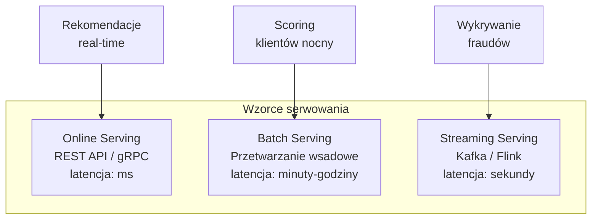
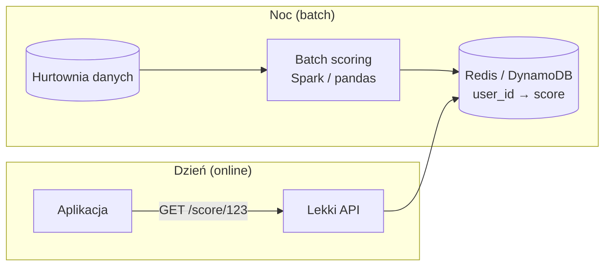
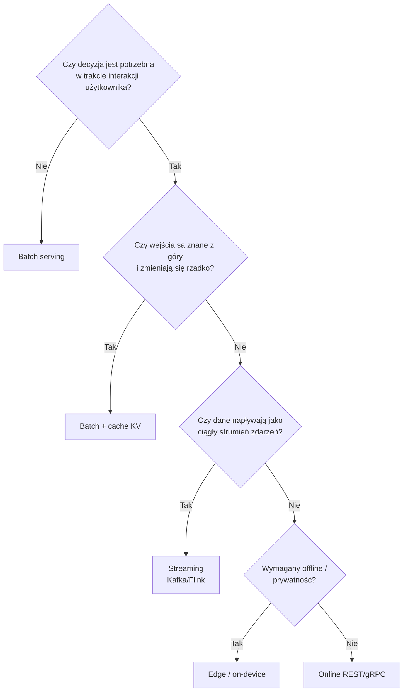
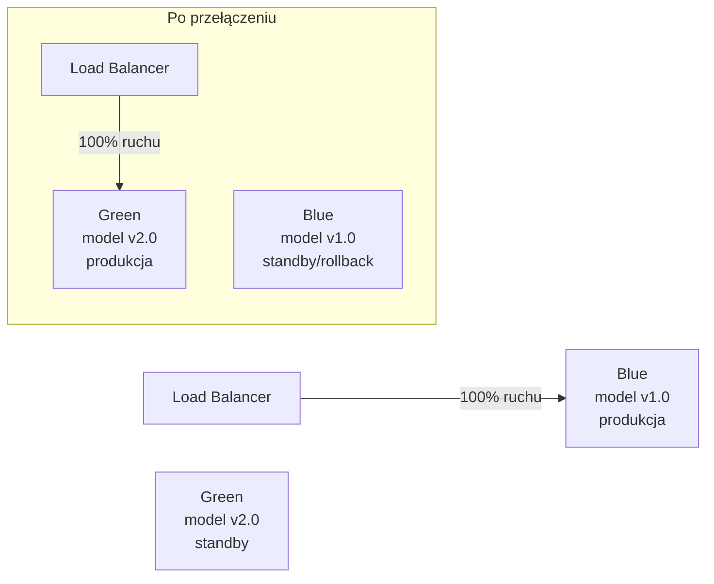
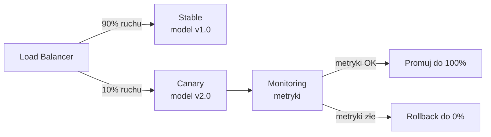
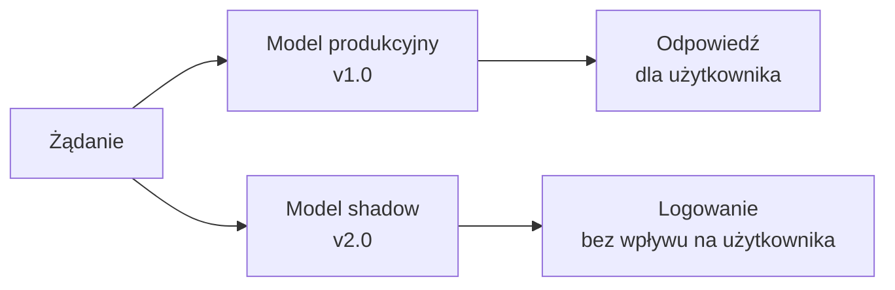
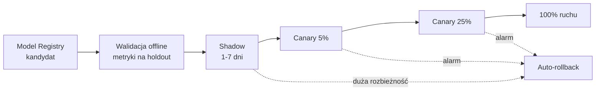
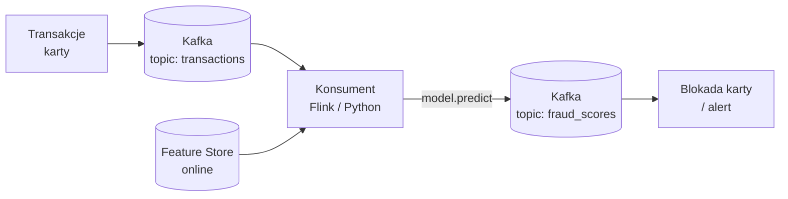
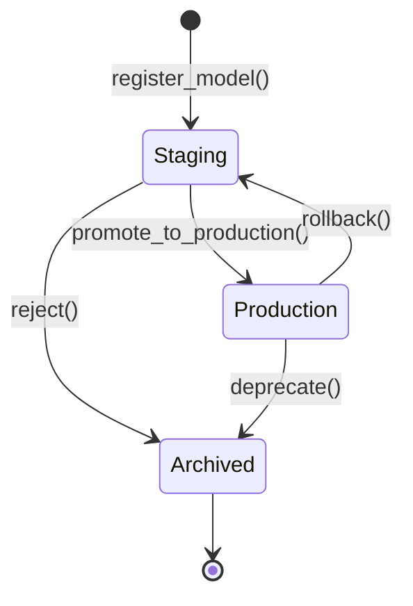
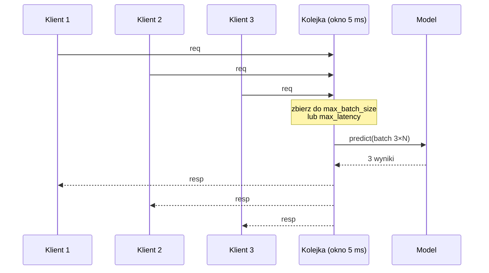

# Wykład 5: Wdrażanie i Serwowanie Modeli ML

## Cel wykładu
Po tym wykładzie student:
- zna wzorce wdrażania modeli ML (online, batch, streaming),
- potrafi zbudować REST API dla modelu ML z użyciem FastAPI,
- rozumie strategie wdrożeń (canary, blue-green, shadow),
- zna narzędzia do serwowania modeli (BentoML, Seldon, Triton),
- rozumie trade-off latencja vs throughput, percentyle p95/p99 i mikrobatching,
- potrafi zaprojektować idempotentny batch scoring i bezpieczny rollout z automatycznym rollbackiem.

> 💻 **Skrypty do wykładu** (katalog `lectures/scripts/lecture_05/`, uruchamiane z katalogu głównego repo):
>
> | Skrypt | Sekcja | Co pokazuje |
> |--------|--------|-------------|
> | `01_fastapi_service.py` | 2 | Serwis FastAPI (Pydantic v2, lifespan, `/health` vs `/ready`, `/v1/...`) testowany przez `TestClient` – bez uruchamiania serwera |
> | `02_latency_batching.py` | 9 | Pomiar p50/p95/p99 i throughput dla różnych rozmiarów batcha + wykres |
> | `03_deployment_strategies.py` | 4 | Symulacja shadow i canary (sticky routing, auto-rollback przy błędzie cech) |
> | `04_batch_scoring.py` | 6 | Batch scoring w chunkach do partycji Parquet, idempotencja, metadane |

---

## 0. Od notebooka do produkcji – co właściwie znaczy „wdrożyć model”?

Wytrenowany model to tylko **artefakt** (plik `.pkl`, `.onnx`, katalog SavedModel). „Wdrożenie” oznacza opakowanie go w **system**, który:

1. przyjmuje dane wejściowe w ustalonym **kontrakcie** (schemat, typy, jednostki),
2. wykonuje **dokładnie ten sam** preprocessing co podczas treningu,
3. zwraca predykcję w wymaganym **SLA** (latencja, dostępność),
4. jest **obserwowalny** (logi, metryki, trace), **wersjonowany** i **odwracalny** (rollback).

```
  ┌──────────┐   ┌──────────────┐   ┌───────────────┐   ┌──────────┐   ┌──────────────┐
  │ Klient   │──▶│ Walidacja    │──▶│ Feature       │──▶│ Model    │──▶│ Post-        │──▶ odpowiedź
  │ (HTTP)   │   │ (Pydantic)   │   │ pipeline      │   │ .predict │   │ processing   │
  └──────────┘   └──────────────┘   │ (ten sam co   │   └──────────┘   │ (próg, ranga)│
                                    │  w treningu!) │        │         └──────────────┘
                                    └───────────────┘        ▼
                                                   logi predykcji ──▶ monitoring (wykład 6)
```

> 💡 Szacuje się, że w typowym systemie ML kod samego modelu to niewielki ułamek całości (Sculley i in., *Hidden Technical Debt in ML Systems*, 2015) – resztę stanowi „infrastruktura dookoła”, której dotyczy ten wykład.

### Kluczowe pojęcia

| Pojęcie | Znaczenie |
|---------|-----------|
| **Latencja** | Czas od wysłania żądania do otrzymania odpowiedzi; mierzymy percentyle (p50, p95, p99) |
| **Throughput** | Liczba predykcji na sekundę (RPS/QPS) |
| **SLA / SLO** | Umowa / cel jakości usługi, np. „p99 < 100 ms, dostępność 99,9%” |
| **Cold start** | Pierwsze żądania po starcie są wolne (ładowanie modelu, JIT, pusty cache) |
| **Training-serving skew** | Różnica między przetwarzaniem danych w treningu i w serwowaniu |
| **Rollout / rollback** | Wprowadzanie nowej wersji / szybki powrót do poprzedniej |

---

## 1. Wzorce serwowania modeli



### Porównanie wzorców

| Wzorzec | Latencja | Throughput | Koszt | Przykład |
|---------|----------|------------|-------|---------|
| Online (REST) | < 100ms | Średni | Wysoki | Rekomendacje, chatbot |
| Batch | Minuty–godziny | Bardzo wysoki | Niski | Scoring klientów |
| Streaming | Sekundy | Wysoki | Średni | Wykrywanie fraudów |

### Czwarty wzorzec: predykcja na urządzeniu (edge / embedded)

Model może też działać **w aplikacji klienta** (telefon, przeglądarka, mikrokontroler) – np. TensorFlow Lite, ONNX Runtime Mobile, Core ML. Zalety: zerowa latencja sieciowa, prywatność, działanie offline. Wady: ograniczona moc i pamięć (kwantyzacja, pruning), trudna aktualizacja modelu (wymaga wydania aplikacji), brak centralnego logowania predykcji.

### Online vs. precomputed (batch → cache)

Częsty kompromis: predykcje liczone są **batchowo** i zapisywane w szybkim magazynie klucz-wartość (Redis, DynamoDB), a API tylko je **odczytuje**.



| Kryterium | Online inference | Precomputed (batch + cache) |
|-----------|------------------|-----------------------------|
| Świeżość cech | Aktualne (sekundy) | Nieaktualne (do 24 h) |
| Latencja odczytu | Zależna od modelu (ms–s) | ~1 ms (lookup) |
| Nowi użytkownicy | Obsłużeni | Brak wyniku (cold start → fallback) |
| Koszt | Stała infrastruktura 24/7 | Krótki job + tani KV store |
| Złożoność | Wyższa (SLA, autoskalowanie) | Niższa |

### Drzewo decyzyjne wyboru wzorca



> 🏦 **Przykład z praktyki:** bank liczy *scoring kredytowy* klientów nocą (batch), ale *wykrywanie fraudów* przy transakcji kartą musi działać w < 100 ms (online/streaming) – często w tej samej organizacji współistnieją wszystkie wzorce.

---

## 2. REST API z FastAPI

**FastAPI** to nowoczesny framework Python do budowania API, idealny do serwowania modeli ML.

### Podstawowy serwis predykcji

```python
from fastapi import FastAPI, HTTPException, BackgroundTasks
from pydantic import BaseModel, Field, field_validator
from typing import Optional
import joblib
import numpy as np
import time
import logging
from contextlib import asynccontextmanager

# Konfiguracja logowania
logging.basicConfig(level=logging.INFO)
logger = logging.getLogger(__name__)

# --- Modele danych (Pydantic) ---
class PredictionRequest(BaseModel):
    """Schemat żądania predykcji."""
    user_id: int = Field(..., description="ID użytkownika", gt=0)
    age: float = Field(..., description="Wiek użytkownika", ge=0, le=120)
    income: float = Field(..., description="Dochód miesięczny", ge=0)
    tenure_months: int = Field(..., description="Staż klienta w miesiącach", ge=0)
    num_products: int = Field(..., description="Liczba produktów", ge=1, le=10)
    
    @field_validator('income')  # Pydantic v2 (w v1: @validator)
    @classmethod
    def income_must_be_reasonable(cls, v):
        if v > 1_000_000:
            raise ValueError("Dochód wydaje się zbyt wysoki")
        return v

class PredictionResponse(BaseModel):
    """Schemat odpowiedzi z predykcją."""
    user_id: int
    churn_probability: float = Field(..., ge=0, le=1)
    churn_prediction: bool
    risk_level: str  # low / medium / high
    model_version: str
    prediction_time_ms: float

class HealthResponse(BaseModel):
    status: str
    model_loaded: bool
    model_version: str
    uptime_seconds: float

# --- Zarządzanie cyklem życia aplikacji ---
model = None
model_version = "unknown"
start_time = time.time()

@asynccontextmanager
async def lifespan(app: FastAPI):
    """Ładuje model przy starcie, zwalnia zasoby przy zamknięciu."""
    global model, model_version
    
    logger.info("Ładowanie modelu...")
    try:
        model = joblib.load("models/churn_model.pkl")
        model_version = "v2.1.0"
        logger.info(f"Model załadowany: {model_version}")
    except FileNotFoundError:
        logger.warning("Plik modelu nie znaleziony - używam modelu demo")
        from sklearn.ensemble import RandomForestClassifier
        from sklearn.datasets import make_classification
        # n_features=5 – tyle cech budujemy w /predict (inaczej predict_proba rzuci błąd!)
        X, y = make_classification(n_samples=1000, n_features=5, random_state=42)
        model = RandomForestClassifier(random_state=42).fit(X, y)
        model_version = "demo-v1.0"
    
    yield  # aplikacja działa
    
    logger.info("Zamykanie aplikacji...")

# --- Aplikacja FastAPI ---
app = FastAPI(
    title="Churn Prediction API",
    description="API do predykcji churnu klientów",
    version="1.0.0",
    lifespan=lifespan
)

def get_risk_level(probability: float) -> str:
    """Klasyfikuje ryzyko churnu."""
    if probability < 0.3:
        return "low"
    elif probability < 0.7:
        return "medium"
    else:
        return "high"

def log_prediction(request: PredictionRequest, response: PredictionResponse):
    """Loguje predykcję do systemu monitoringu."""
    logger.info(
        f"prediction | user_id={request.user_id} | "
        f"prob={response.churn_probability:.4f} | "
        f"risk={response.risk_level} | "
        f"time_ms={response.prediction_time_ms:.2f}"
    )

# --- Endpointy ---
@app.get("/health", response_model=HealthResponse)
async def health_check():
    """Sprawdza stan serwisu."""
    return HealthResponse(
        status="healthy" if model is not None else "degraded",
        model_loaded=model is not None,
        model_version=model_version,
        uptime_seconds=time.time() - start_time
    )

@app.post("/predict", response_model=PredictionResponse)
async def predict(
    request: PredictionRequest,
    background_tasks: BackgroundTasks
):
    """Zwraca predykcję churnu dla użytkownika."""
    if model is None:
        raise HTTPException(status_code=503, detail="Model nie jest załadowany")
    
    t0 = time.time()
    
    # Przygotowanie cech
    features = np.array([[
        request.age,
        request.income,
        request.tenure_months,
        request.num_products,
        request.income / max(request.age, 1),  # income_per_age
    ]])
    
    # Predykcja
    try:
        probability = float(model.predict_proba(features)[0][1])
        prediction = probability >= 0.5
    except Exception as e:
        logger.error(f"Błąd predykcji: {e}")
        raise HTTPException(status_code=500, detail=f"Błąd predykcji: {str(e)}")
    
    prediction_time = (time.time() - t0) * 1000
    
    response = PredictionResponse(
        user_id=request.user_id,
        churn_probability=probability,
        churn_prediction=prediction,
        risk_level=get_risk_level(probability),
        model_version=model_version,
        prediction_time_ms=prediction_time
    )
    
    # Logowanie w tle (nie blokuje odpowiedzi)
    background_tasks.add_task(log_prediction, request, response)
    
    return response

@app.post("/predict/batch", response_model=list[PredictionResponse])
async def predict_batch(requests: list[PredictionRequest]):
    """Predykcja dla wielu użytkowników naraz."""
    if model is None:
        raise HTTPException(status_code=503, detail="Model nie jest załadowany")
    if not requests or len(requests) > 1000:
        raise HTTPException(
            status_code=400,
            detail="Maksymalnie 1000 rekordów w jednym żądaniu"
        )
    
    features = np.array([[
        r.age, r.income, r.tenure_months,
        r.num_products, r.income / max(r.age, 1)
    ] for r in requests])
    
    t0 = time.time()
    probabilities = model.predict_proba(features)[:, 1]
    prediction_time = (time.time() - t0) * 1000 / len(requests)
    
    return [
        PredictionResponse(
            user_id=req.user_id,
            churn_probability=float(prob),
            churn_prediction=bool(prob >= 0.5),
            risk_level=get_risk_level(float(prob)),
            model_version=model_version,
            prediction_time_ms=prediction_time
        )
        for req, prob in zip(requests, probabilities)
    ]
```

### Uruchomienie i testowanie

```bash
# Uruchomienie serwisu
uvicorn main:app --host 0.0.0.0 --port 8080 --workers 4

# Test health check
curl http://localhost:8080/health

# Test predykcji
curl -X POST http://localhost:8080/predict \
  -H "Content-Type: application/json" \
  -d '{
    "user_id": 1001,
    "age": 35,
    "income": 55000,
    "tenure_months": 24,
    "num_products": 2
  }'

# Interaktywna dokumentacja (Swagger UI) generowana automatycznie
# http://localhost:8080/docs
```

> 💻 **Demo:** `python lectures/scripts/lecture_05/01_fastapi_service.py` – uruchamia analogiczny serwis *in-process* przez `fastapi.testclient.TestClient`, wysyła poprawne i błędne żądania (HTTP 422 z opisem pól) oraz pusty batch (HTTP 400). Nie zostawia działającego serwera.

### Testowanie API bez serwera (pytest)

```python
# tests/test_api.py
from fastapi.testclient import TestClient
from src.main import app

def test_predict_ok():
    with TestClient(app) as client:          # `with` uruchamia lifespan (ładowanie modelu)
        r = client.post("/predict", json={"user_id": 1, "age": 30, "income": 5000,
                                          "tenure_months": 12, "num_products": 2})
        assert r.status_code == 200
        assert 0 <= r.json()["churn_probability"] <= 1

def test_predict_invalid_age():
    with TestClient(app) as client:
        r = client.post("/predict", json={"user_id": 1, "age": -3, "income": 5000,
                                          "tenure_months": 12, "num_products": 2})
        assert r.status_code == 422             # walidacja Pydantic
```

### `async def` czy `def`? – model współbieżności

To jedna z najczęstszych pułapek w FastAPI. `model.predict()` ze scikit-learn jest **synchroniczne i obciąża CPU**.

| Definicja endpointu | Gdzie się wykonuje | Skutek dla predykcji CPU |
|---------------------|--------------------|--------------------------|
| `async def` + `model.predict()` | W pętli zdarzeń (event loop) | **Blokuje** wszystkie inne żądania w tym workerze na czas predykcji |
| `def` + `model.predict()` | W puli wątków (threadpool) | Event loop wolny; ograniczenie GIL, ale I/O innych żądań idzie dalej |
| `async def` + `await run_in_threadpool(...)` | Jawnie w puli wątków | Jak wyżej, przy zachowaniu async dla I/O (np. Feature Store) |
| Kilka procesów (`--workers N`) | N niezależnych procesów | Prawdziwa równoległość CPU, ale N kopii modelu w RAM |

```python
from starlette.concurrency import run_in_threadpool

@app.post("/v2/predict")
async def predict_v2(req: PredictionRequest):
    features = await feature_store.get(req.user_id)          # I/O – async
    proba = await run_in_threadpool(model.predict_proba, features)  # CPU – poza event loop
    return {"churn_probability": float(proba[0, 1])}
```

> 💡 **Reguła kciuka:** liczba workerów ≈ liczba rdzeni CPU (dla modeli CPU-bound). Każdy worker ładuje własną kopię modelu – model 2 GB × 8 workerów = 16 GB RAM. Dla dużych modeli lepiej mniej workerów + batching albo dedykowany serwer inferencji (Triton).

### Liveness vs. readiness

W Kubernetes (wykład 7) rozróżniamy dwa rodzaje sond:

| Sonda | Pytanie | Reakcja przy porażce | Przykład endpointu |
|-------|---------|----------------------|--------------------|
| **Liveness** | Czy proces żyje? | Restart kontenera | `/health` – zawsze 200, jeśli proces odpowiada |
| **Readiness** | Czy mogę przyjmować ruch? | Usunięcie z load balancera (bez restartu) | `/ready` – 503, dopóki model się nie załaduje |
| **Startup** | Czy start się zakończył? | Wstrzymuje liveness na czas długiego startu | Przydatne przy modelach ładowanych minutami |

Pomylenie tych sond to klasyczny błąd: jeśli liveness sprawdza model, a ładowanie trwa 90 s, Kubernetes zabija kontener w pętli (*CrashLoopBackOff*).

### Kontrakt API i wersjonowanie

```
/v1/predict  ──▶ {"churn_probability": 0.42}                         (stary klient – działa dalej)
/v2/predict  ──▶ {"churn_probability": 0.42, "explanation": {...}}    (nowe pole – nowa wersja)
```

- **Zmiany kompatybilne wstecz** (dodanie opcjonalnego pola w odpowiedzi) – można w tej samej wersji.
- **Zmiany łamiące** (usunięcie/zmiana typu pola, zmiana znaczenia progu) – nowa wersja API.
- Wersja **API** ≠ wersja **modelu**: `/v1/predict` może serwować model v2.1.0, o ile kontrakt się nie zmienia. Zwracaj `model_version` w odpowiedzi – ułatwia debugowanie i analizę A/B.

---

## 3. Konteneryzacja z Docker

```dockerfile
# Dockerfile
FROM python:3.11-slim

WORKDIR /app

# Instalacja zależności (warstwa cache)
COPY requirements.txt .
RUN pip install --no-cache-dir -r requirements.txt

# Kopiowanie kodu aplikacji
COPY src/ ./src/
COPY models/ ./models/

# Użytkownik bez uprawnień root (bezpieczeństwo)
RUN useradd -m -u 1000 mluser
USER mluser

EXPOSE 8080

# Health check
# UWAGA: obraz python:3.11-slim NIE zawiera curl – używamy Pythona (albo doinstaluj curl)
HEALTHCHECK --interval=30s --timeout=10s --start-period=5s --retries=3 \
    CMD python -c "import urllib.request; urllib.request.urlopen('http://localhost:8080/health')" || exit 1

CMD ["uvicorn", "src.main:app", "--host", "0.0.0.0", "--port", "8080", "--workers", "2"]
```

```yaml
# docker-compose.yml
version: '3.8'

services:
  ml-api:
    build: .
    ports:
      - "8080:8080"
    environment:
      - MODEL_PATH=/app/models/churn_model.pkl
      - LOG_LEVEL=INFO
    volumes:
      - ./models:/app/models:ro
    deploy:
      resources:
        limits:
          cpus: '2'
          memory: 4G
    restart: unless-stopped
    
  prometheus:
    image: prom/prometheus:latest
    ports:
      - "9090:9090"
    volumes:
      - ./prometheus.yml:/etc/prometheus/prometheus.yml
```

> ℹ️ Klucz `version:` w `docker-compose.yml` jest w Compose v2 przestarzały i ignorowany – można go pominąć.

### Model w obrazie czy poza obrazem?

| Podejście | Opis | Zalety | Wady |
|-----------|------|--------|------|
| **Model „wypieczony” w obrazie** (`COPY models/`) | Obraz = kod + model | Pełna reprodukowalność, jeden artefakt, szybki start | Każdy nowy model = nowy obraz; duże obrazy |
| **Model montowany/pobierany przy starcie** (S3, MLflow, wolumen) | Obraz = tylko kod | Zmiana modelu bez budowania obrazu; mniejsze obrazy | Zależność od zewnętrznego storage; wolniejszy start; ryzyko niezgodności wersji |

### Multi-stage build – mniejszy i bezpieczniejszy obraz

```dockerfile
# --- etap 1: budowanie kół (wheel) z kompilatorami ---
FROM python:3.11-slim AS builder
RUN apt-get update && apt-get install -y --no-install-recommends build-essential
COPY requirements.txt .
RUN pip wheel --no-cache-dir --wheel-dir /wheels -r requirements.txt

# --- etap 2: obraz runtime bez kompilatorów ---
FROM python:3.11-slim
WORKDIR /app
COPY --from=builder /wheels /wheels
RUN pip install --no-cache-dir /wheels/* && rm -rf /wheels
COPY src/ ./src/
RUN useradd -m -u 1000 mluser
USER mluser
ENV PYTHONUNBUFFERED=1
CMD ["uvicorn", "src.main:app", "--host", "0.0.0.0", "--port", "8080"]
```

**Dobre praktyki obrazów ML:**
- przypinaj wersje (`scikit-learn==1.5.2`) – model zapisany `joblib`/`pickle` może nie wczytać się w innej wersji biblioteki,
- kolejność warstw: najpierw `requirements.txt`, potem kod (cache Dockera),
- `.dockerignore` (bez `data/`, `.git/`, `mlruns/`, notebooków),
- nie uruchamiaj jako root, nie zapisuj sekretów w obrazie (`ENV API_KEY=...` jest widoczne w `docker history`),
- skanuj obraz (`docker scout`, `trivy`) – obrazy z CUDA mają często setki CVE.

> ⚠️ **Bezpieczeństwo pickle:** `joblib.load`/`pickle.load` wykonuje dowolny kod zapisany w pliku. Ładuj tylko modele z zaufanego źródła (własny registry, sprawdzona suma SHA-256). Alternatywy: ONNX, `skops`, safetensors (dla sieci neuronowych).

---

## 4. Strategie wdrożeń

### Blue-Green Deployment



**Zalety:** Natychmiastowy rollback, zero downtime.
**Wady:** Podwójne zasoby podczas przełączania.

### Canary Deployment



**Zalety:** Stopniowe wdrożenie, ograniczone ryzyko.
**Wady:** Złożoność konfiguracji, dłuższy czas wdrożenia.

### Shadow Mode (Shadow Deployment)



**Zalety:** Testowanie nowego modelu na prawdziwym ruchu bez ryzyka.
**Wady:** Podwójne koszty obliczeniowe.

> ⚠️ Wywołanie modelu shadow musi być **asynchroniczne** (fire-and-forget, kolejka) – jeśli shadow jest wolny lub się wywraca, nie może to wpływać na latencję i dostępność odpowiedzi produkcyjnej. Shadow nie może też wywoływać **efektów ubocznych** (wysłanie maila, obciążenie karty).

### A/B test vs. canary – to nie to samo

| | Canary | A/B test | Multi-armed bandit |
|---|--------|----------|--------------------|
| Cel | Bezpieczeństwo techniczne (czy v2 się nie psuje?) | Pomiar wpływu biznesowego (czy v2 jest lepszy?) | Maksymalizacja nagrody w trakcie testu |
| Podział ruchu | Rosnący 1→5→25→100% | Stały (np. 50/50) przez z góry ustalony czas | Dynamiczny, adaptacyjny |
| Metryki | Błędy, latencja, rozkład predykcji | Konwersja, przychód, churn – z istotnością statystyczną | Nagroda (CTR, konwersja) |
| Czas trwania | Godziny–dni | Tygodnie (moc testu!) | Ciągły |

### Porównanie strategii

| Strategia | Ryzyko dla użytkowników | Koszt infrastruktury | Szybkość rollbacku | Walidacja na żywych danych | Kiedy stosować |
|-----------|-------------------------|----------------------|--------------------|----------------------------|----------------|
| Recreate (stop → start) | Wysokie (downtime) | Niski | Wolna | Tak | Środowiska dev, joby batch |
| Rolling update | Średnie | Niski | Średnia | Tak | Domyślne w K8s, zmiany kodu |
| Blue-green | Średnie (wszyscy naraz) | 2× w trakcie | Natychmiastowa | Tak | Krytyczne usługi, łatwy rollback |
| Canary | Niskie (mały %) | Niski–średni | Szybka | Tak, stopniowo | Domyślny wybór dla nowych modeli |
| Shadow | Zerowe | 2× obliczeń | N/D (brak ruchu) | Tylko predykcje, bez efektu biznesowego | Duże zmiany modelu, nowa architektura |

### Typowy pipeline rolloutu modelu



**Na co patrzeć podczas canary (guardrail metrics):**
- techniczne: odsetek błędów 5xx, p99 latencji, zużycie pamięci,
- „ML-owe”: rozkład predykcji (np. średnie prawdopodobieństwo, odsetek klasy pozytywnej) – nagła zmiana często sygnalizuje błąd w cechach,
- biznesowe (gdy etykiety są szybko dostępne): CTR, konwersja.

> 💻 **Demo:** `python lectures/scripts/lecture_05/03_deployment_strategies.py` – symuluje shadow i canary 5%→25%→50%→100%. W scenariuszu B kandydat ma „ukryty” błąd (odwrócona kolejność cech – klasyczny training-serving skew): shadow pokazuje spadek zgodności z v1, a canary automatycznie robi rollback już na 5% ruchu.

### Implementacja Canary w Pythonie

```python
import random
from typing import Callable
import logging

logger = logging.getLogger(__name__)

class CanaryRouter:
    """Router implementujący strategię canary deployment."""
    
    def __init__(
        self,
        stable_model,
        canary_model,
        canary_traffic_pct: float = 0.1
    ):
        self.stable_model = stable_model
        self.canary_model = canary_model
        self.canary_traffic_pct = canary_traffic_pct
        self._canary_requests = 0
        self._stable_requests = 0
    
    def predict(self, features):
        """Kieruje żądanie do odpowiedniego modelu."""
        # Uwaga: losowanie per żądanie – ten sam użytkownik może dostawać raz v1, raz v2.
        # W praktyce lepszy jest "sticky" routing: hash(user_id) % 100 < pct (patrz skrypt 03).
        use_canary = random.random() < self.canary_traffic_pct
        
        if use_canary:
            self._canary_requests += 1
            result = self.canary_model.predict_proba(features)
            logger.info(f"canary_request | total={self._canary_requests}")
        else:
            self._stable_requests += 1
            result = self.stable_model.predict_proba(features)
        
        return result
    
    def get_traffic_stats(self) -> dict:
        total = self._canary_requests + self._stable_requests
        return {
            "total_requests": total,
            "canary_requests": self._canary_requests,
            "stable_requests": self._stable_requests,
            "actual_canary_pct": self._canary_requests / max(total, 1)
        }
    
    def promote_canary(self):
        """Promuje canary do roli stable."""
        self.stable_model = self.canary_model
        self.canary_model = None
        self.canary_traffic_pct = 0.0
        logger.info("Canary model promoted to stable!")
    
    def rollback(self):
        """Wycofuje canary deployment."""
        self.canary_traffic_pct = 0.0
        logger.warning("Canary deployment rolled back!")
```

---

## 5. BentoML – framework do serwowania modeli

**BentoML** upraszcza pakowanie i wdrażanie modeli ML.

```python
import bentoml
import numpy as np
from bentoml.io import NumpyNdarray, JSON
from sklearn.ensemble import RandomForestClassifier

# Zapisanie modelu do BentoML Store
model = RandomForestClassifier(n_estimators=100, random_state=42)
# model.fit(X_train, y_train)  # zakładamy wytrenowany model

saved_model = bentoml.sklearn.save_model(
    "churn_predictor",
    model,
    signatures={
        "predict": {"batchable": True, "batch_dim": 0},
        "predict_proba": {"batchable": True, "batch_dim": 0}
    },
    metadata={
        "auc_roc": 0.89,
        "training_data": "2024-01-15",
        "author": "mlops-team"
    }
)
print(f"Model zapisany: {saved_model.tag}")

# Definicja serwisu BentoML
runner = bentoml.sklearn.get("churn_predictor:latest").to_runner()

svc = bentoml.Service("churn_prediction_service", runners=[runner])

@svc.api(input=JSON(), output=JSON())
async def predict(input_data: dict) -> dict:
    """Endpoint predykcji."""
    features = np.array([[
        input_data["age"],
        input_data["income"],
        input_data["tenure_months"],
        input_data["num_products"]
    ]])
    
    probability = await runner.predict_proba.async_run(features)
    churn_prob = float(probability[0][1])
    
    return {
        "user_id": input_data.get("user_id"),
        "churn_probability": churn_prob,
        "churn_prediction": churn_prob >= 0.5,
        "risk_level": "high" if churn_prob > 0.7 else "medium" if churn_prob > 0.3 else "low"
    }
```

```bash
# Uruchomienie serwisu BentoML
bentoml serve churn_prediction_service:latest --port 3000

# Budowanie Bento (pakiet do wdrożenia)
bentoml build

# Konteneryzacja
bentoml containerize churn_prediction_service:latest
```

> ℹ️ Powyższy przykład używa API BentoML 1.0/1.1 (`bentoml.Service` + runnery). Od wersji **1.2** zalecany jest styl klasowy:

```python
import bentoml
import numpy as np

@bentoml.service(resources={"cpu": "2"}, traffic={"timeout": 10})
class ChurnService:
    def __init__(self):
        self.model = bentoml.sklearn.load_model("churn_predictor:latest")

    @bentoml.api(batchable=True, max_batch_size=64, max_latency_ms=20)  # adaptive batching
    def predict(self, features: np.ndarray) -> np.ndarray:
        return self.model.predict_proba(features)[:, 1]
```

### Porównanie narzędzi do serwowania

| Narzędzie | Typ | Mocne strony | Słabe strony | Kiedy wybrać |
|-----------|-----|--------------|--------------|--------------|
| **FastAPI (ręcznie)** | Framework web | Pełna kontrola, prostota, ogromna społeczność | Batching, skalowanie, wersjonowanie – ręcznie | Małe/średnie modele, niestandardowa logika |
| **BentoML** | Framework serwowania | Pakowanie (Bento), adaptive batching, łatwa konteneryzacja | Własna abstrakcja do nauczenia | Szybkie przejście od modelu do kontenera |
| **MLflow Models** | Format + `mlflow models serve` | Integracja z registry, jeden format „pyfunc” | Ograniczona wydajność serwera | Prototypy, zespoły już na MLflow |
| **NVIDIA Triton** | Serwer inferencji | GPU, dynamic batching, wiele frameworków (ONNX, TensorRT, PyTorch), ensemble | Złożona konfiguracja | Deep learning, wysoki RPS, GPU |
| **TorchServe / TF Serving** | Serwer dla frameworka | Dojrzałe, zoptymalizowane pod swój framework | Związanie z jednym frameworkiem | Zespoły PyTorch / TensorFlow |
| **KServe / Seldon Core** | Platforma na Kubernetes | Canary, autoskalowanie do zera, explainers, standard protokołu V2 | Wymaga K8s i zespołu platformowego | Wiele modeli i zespołów w organizacji |
| **vLLM / TGI** | Serwer LLM | Continuous batching, PagedAttention, streaming tokenów | Tylko modele językowe | Serwowanie LLM (wykład 8) |

### Konfiguracja Triton – przykład `config.pbtxt`

```protobuf
name: "churn_onnx"
platform: "onnxruntime_onnx"
max_batch_size: 128
input  [{ name: "float_input", data_type: TYPE_FP32, dims: [4] }]
output [{ name: "probabilities", data_type: TYPE_FP32, dims: [2] }]
dynamic_batching {
  preferred_batch_size: [32, 64]
  max_queue_delay_microseconds: 2000   # czekaj max 2 ms na zebranie batcha
}
instance_group [{ count: 2, kind: KIND_GPU }]
```

### Eksport do ONNX – niezależność od frameworka

```python
# pip install skl2onnx onnxruntime   (poza requirements.txt kursu)
from skl2onnx import to_onnx
import onnxruntime as ort

onx = to_onnx(model, X_train[:1].astype(np.float32))
open("churn.onnx", "wb").write(onx.SerializeToString())

sess = ort.InferenceSession("churn.onnx")
proba = sess.run(None, {sess.get_inputs()[0].name: X_test.astype(np.float32)})[1]
```

ONNX pozwala trenować w scikit-learn/PyTorch, a serwować w ONNX Runtime (C++, często 2–10× szybciej, bez Pythona po stronie serwera) – i likwiduje problem niezgodnych wersji `pickle`.

---

## 6. Batch Serving

```python
import pandas as pd
import joblib
import numpy as np
from pathlib import Path
from datetime import datetime
import logging

logger = logging.getLogger(__name__)

def run_batch_scoring(
    input_path: str,
    output_path: str,
    model_path: str,
    batch_size: int = 10_000
) -> dict:
    """
    Uruchamia batch scoring dla dużego zbioru danych.
    
    Args:
        input_path: ścieżka do danych wejściowych (Parquet)
        output_path: ścieżka do wyników (Parquet)
        model_path: ścieżka do modelu
        batch_size: rozmiar batcha
    
    Returns:
        Statystyki przetwarzania
    """
    logger.info(f"Ładowanie modelu z {model_path}")
    model = joblib.load(model_path)
    
    logger.info(f"Wczytywanie danych z {input_path}")
    df = pd.read_parquet(input_path)
    
    feature_cols = ['age', 'income', 'tenure_months', 'num_products']
    total_rows = len(df)
    results = []
    
    logger.info(f"Przetwarzanie {total_rows:,} wierszy w batchach po {batch_size:,}")
    
    for i in range(0, total_rows, batch_size):
        batch = df.iloc[i:i+batch_size]
        X_batch = batch[feature_cols].values
        
        probabilities = model.predict_proba(X_batch)[:, 1]
        
        batch_results = pd.DataFrame({
            'user_id': batch['user_id'].values,
            'churn_probability': probabilities,
            'churn_prediction': probabilities >= 0.5,
            'risk_level': pd.cut(
                probabilities,
                bins=[0, 0.3, 0.7, 1.0],
                labels=['low', 'medium', 'high'],
                include_lowest=True  # bez tego p == 0.0 → NaN
            ),
            'scored_at': datetime.now().isoformat()
        })
        results.append(batch_results)
        
        processed = min(i + batch_size, total_rows)
        logger.info(f"Przetworzono {processed:,}/{total_rows:,} ({processed/total_rows*100:.1f}%)")
    
    # Zapis wyników
    final_df = pd.concat(results, ignore_index=True)
    final_df.to_parquet(output_path, index=False)
    
    stats = {
        "total_rows": total_rows,
        "high_risk_count": int((final_df['risk_level'] == 'high').sum()),
        "medium_risk_count": int((final_df['risk_level'] == 'medium').sum()),
        "low_risk_count": int((final_df['risk_level'] == 'low').sum()),
        "avg_churn_probability": float(final_df['churn_probability'].mean()),
        "output_path": output_path
    }
    
    logger.info(f"Batch scoring zakończony: {stats}")
    return stats

# Użycie
if __name__ == "__main__":
    stats = run_batch_scoring(
        input_path="data/customers_2024-01-15.parquet",
        output_path="results/churn_scores_2024-01-15.parquet",
        model_path="models/churn_model.pkl",
        batch_size=50_000
    )
    print(f"Wyniki: {stats}")
```

### Dobre praktyki batch scoringu

```
  dane wejściowe            job scoringowy                       wyniki
 ┌──────────────┐   ┌────────────────────────────┐   ┌─────────────────────────────────┐
 │ snapshot     │──▶│ 1. wczytaj model z registry│──▶│ scores/score_date=2026-10-24/   │
 │ cech na dzień│   │ 2. waliduj schemat wejścia │   │   part-0000.parquet             │
 │ D (as-of)    │   │ 3. scoring w chunkach      │   │   part-0001.parquet             │
 └──────────────┘   │ 4. zapis do partycji D     │   │   _metadata.json (wersja modelu)│
                    │    (nadpisanie = idempot.) │   └─────────────────────────────────┘
                    └────────────────────────────┘
```

- **Idempotencja:** ponowne uruchomienie dla tej samej daty musi dać ten sam wynik i nie dublować wierszy → zapis do partycji `score_date=D` z nadpisaniem (albo `MERGE`/upsert w hurtowni). Dzięki temu orkiestrator (Airflow, wykład 2) może bezpiecznie robić *retry* i *backfill*.
- **Point-in-time correctness:** scoring na dzień D używa cech dostępnych *na dzień D* – inaczej backfill historyczny „podgląda przyszłość”.
- **Zapisuj wersję modelu i datę** przy każdym wierszu/partycji – bez tego nie da się później analizować jakości ani wyjaśnić decyzji.
- **Skalowanie:** pandas w chunkach wystarcza do kilkudziesięciu mln wierszy; dalej Spark (`mapInPandas`/`pandas_udf`), Dask, Ray lub scoring bezpośrednio w hurtowni (BigQuery ML, Snowflake UDF).
- **Sanity checks na wyjściu:** liczba wierszy = liczba wejść, brak NaN, rozkład wyników podobny do wczorajszego (np. alarm, gdy odsetek „high” zmieni się > 2×).

> 💻 **Demo:** `python lectures/scripts/lecture_05/04_batch_scoring.py` – generuje 200 tys. klientów do Parquet, uruchamia scoring w chunkach dwa razy dla tej samej daty i pokazuje, że liczba wierszy w tabeli wyników się nie podwaja (idempotencja). Wyniki trafiają do `lectures/scripts/lecture_05/outputs/scores/`.

### Streaming serving – szkic



```python
# pip install kafka-python   (opcjonalne, poza requirements.txt)
from kafka import KafkaConsumer, KafkaProducer
import json

consumer = KafkaConsumer("transactions", bootstrap_servers="localhost:9092",
                         group_id="fraud-scorer", value_deserializer=json.loads)
producer = KafkaProducer(bootstrap_servers="localhost:9092",
                         value_serializer=lambda v: json.dumps(v).encode())

for msg in consumer:                       # nieskończona pętla – konsument działa ciągle
    tx = msg.value
    score = float(model.predict_proba([[tx["amount"], tx["hour"], tx["merchant_risk"]]])[0, 1])
    producer.send("fraud_scores", {"tx_id": tx["tx_id"], "score": score,
                                   "model_version": "fraud-v3"})
```

Kluczowe kwestie: semantyka dostarczenia (*at-least-once* → predykcje muszą być idempotentne po `tx_id`), okna czasowe dla cech agregowanych („liczba transakcji w ostatnich 10 min”), back-pressure przy skokach ruchu.

---

## 7. Model Registry i zarządzanie wersjami



```python
import mlflow
from mlflow.tracking import MlflowClient

client = MlflowClient()

def promote_model_to_production(
    model_name: str,
    version: int,
    min_auc: float = 0.80
) -> bool:
    """
    Promuje model do produkcji po weryfikacji metryk.
    
    Returns:
        True jeśli model został wdrożony, False w przeciwnym razie
    """
    # Pobierz informacje o modelu
    model_version = client.get_model_version(model_name, str(version))
    run_id = model_version.run_id
    
    # Sprawdź metryki
    run = client.get_run(run_id)
    auc = run.data.metrics.get("auc_roc", 0)
    
    if auc < min_auc:
        print(f"❌ Model odrzucony: AUC {auc:.4f} < próg {min_auc}")
        client.transition_model_version_stage(
            name=model_name,
            version=str(version),
            stage="Archived"
        )
        return False
    
    # Archiwizuj poprzedni model produkcyjny
    prod_versions = client.get_latest_versions(model_name, stages=["Production"])
    for pv in prod_versions:
        client.transition_model_version_stage(
            name=model_name,
            version=pv.version,
            stage="Archived"
        )
        print(f"📦 Zarchiwizowano: v{pv.version}")
    
    # Promuj nowy model
    client.transition_model_version_stage(
        name=model_name,
        version=str(version),
        stage="Production"
    )
    
    # Dodaj opis
    client.update_model_version(
        name=model_name,
        version=str(version),
        description=f"Wdrożony automatycznie. AUC: {auc:.4f}"
    )
    
    print(f"✅ Model {model_name} v{version} wdrożony do produkcji (AUC: {auc:.4f})")
    return True

# Użycie
promote_model_to_production("churn_predictor", version=5, min_auc=0.82)
```

> ℹ️ Od MLflow 2.9 **stages** (`Staging`/`Production`) są oznaczone jako przestarzałe na rzecz **aliasów** i tagów. Ten sam przepływ w nowym stylu:

```python
client.set_registered_model_alias("churn_predictor", "champion", version="5")
client.set_model_version_tag("churn_predictor", "5", "validation_status", "approved")

# Serwis zawsze ładuje "championa" – promocja/rollback = przestawienie aliasu, bez zmiany kodu
model = mlflow.pyfunc.load_model("models:/churn_predictor@champion")
```

Wzorzec **champion / challenger**: `@champion` obsługuje produkcję, `@challenger` jest kandydatem testowanym w shadow/canary. Rollback to jedno wywołanie API – przestawienie aliasu na poprzednią wersję.

### Co powinien zawierać wpis w registry?

| Element | Po co |
|---------|-------|
| Artefakt modelu + **sygnatura** (schemat wejścia/wyjścia) | Walidacja kontraktu przy serwowaniu |
| `run_id`, commit Git, hash danych (DVC) | Pełna reprodukowalność (wykład 1–3) |
| Metryki offline (AUC, kalibracja, metryki per segment) | Decyzja o promocji |
| Wersje bibliotek (`requirements.txt`/`conda.yaml`) | Unikanie błędów deserializacji |
| Przykład wejścia (`input_example`) | Smoke test po wdrożeniu |
| Właściciel, opis, ograniczenia (*model card*) | Odpowiedzialność i audyt |

---

## 8. Typowe pułapki w serwowaniu modeli

> ⚠️ **Pułapka 1: Brak walidacji wejść**
> Model przyjmuje dowolne dane bez sprawdzenia zakresu, typu czy kompletności. W produkcji mogą pojawić się wartości null, ujemne wiek czy nierealistyczne dochody. Zawsze waliduj dane wejściowe (Pydantic).

> ⚠️ **Pułapka 2: Synchroniczne ładowanie modelu**
> Ładowanie modelu przy każdym żądaniu zamiast jednorazowo przy starcie serwisu. Model powinien być załadowany do pamięci raz (lifespan) i współdzielony między żądaniami.

> ⚠️ **Pułapka 3: Brak health checków**
> Serwis bez endpointu `/health` nie może być poprawnie zarządzany przez Kubernetes (readiness/liveness probes). Zawsze implementuj health check.

> ⚠️ **Pułapka 4: Brak wersjonowania API**
> Zmiana formatu odpowiedzi bez wersjonowania łamie istniejących klientów. Używaj wersjonowania URL (`/v1/predict`, `/v2/predict`) lub nagłówków.

> ⚠️ **Pułapka 5: Training-serving skew**
> Preprocessing zaimplementowany dwa razy (np. w notebooku pandas i w serwisie ręcznie) prędzej czy później się rozjedzie: inna kolejność kolumn, inne kodowanie kategorii, inna obsługa braków. Rozwiązanie: serializuj **cały `sklearn.Pipeline`** (preprocessing + model) jako jeden artefakt, albo używaj Feature Store (wykład 2). Loguj cechy z serwowania i porównuj ich rozkład z treningowym (wykład 6).

> ⚠️ **Pułapka 6: Blokowanie event loop**
> `async def` z ciężką predykcją CPU w środku zatrzymuje cały worker – p99 rośnie skokowo przy wielu równoległych żądaniach. Używaj `def` lub `run_in_threadpool` (sekcja 2).

> ⚠️ **Pułapka 7: Niezgodność wersji bibliotek**
> Model zapisany `joblib` w scikit-learn 1.3 może nie wczytać się (lub dać inne wyniki) w 1.5. Przypinaj wersje w obrazie i zapisuj je w registry.

> ⚠️ **Pułapka 8: Brak timeoutów i fallbacku**
> Gdy model/Feature Store nie odpowiada, klient czeka w nieskończoność. Ustaw timeout i zwróć **fallback** (np. regułę biznesową, predykcję z cache, model „baseline”) zamiast błędu 500 – degradacja jakości jest zwykle lepsza niż awaria.

### Checklista gotowości produkcyjnej (production readiness)

- [ ] Walidacja wejścia (schemat, zakresy) i czytelne błędy 4xx
- [ ] Preprocessing w jednym artefakcie z modelem
- [ ] `/health` (liveness) i `/ready` (readiness)
- [ ] `model_version` w każdej odpowiedzi i w logach
- [ ] Metryki: RPS, błędy, p50/p95/p99, rozkład predykcji (Prometheus – wykład 6)
- [ ] Testy API w CI, smoke test po wdrożeniu
- [ ] Timeouty, limity rozmiaru żądania, fallback
- [ ] Strategia rolloutu i przećwiczony rollback
- [ ] Obraz bez roota, bez sekretów, z przypiętymi wersjami
- [ ] Test obciążeniowy (np. `locust`) potwierdzający SLA

### Case Study: Instagram — serwowanie modeli rekomendacji

**Instagram** serwuje modele ML dla ponad 2 miliardów użytkowników:
- Używają **gRPC** zamiast REST dla wewnętrznych serwisów (niższa latencja, mniejszy overhead).
- Modele są serwowane na **GPU** z użyciem NVIDIA Triton Inference Server.
- Stosują **model ensembling** — kilka modeli jest wywoływanych równolegle, a wyniki są agregowane.
- Kluczowa metryka: **p99 latencja < 50ms** — każda milisekunda opóźnienia wpływa na engagement użytkowników.

### Kiedy użyć gRPC zamiast REST?

| Aspekt | REST (JSON) | gRPC (Protocol Buffers) |
|--------|-------------|------------------------|
| Format danych | JSON (tekstowy) | Protobuf (binarny) |
| Latencja | Wyższa | Niższa (~2-5x) |
| Rozmiar payload | Większy | Mniejszy (~3-10x) |
| Streaming | Ograniczony | Natywny (bidirectional) |
| Debugowanie | Łatwe (curl) | Trudniejsze |
| Najlepszy dla | Publiczne API, prototypy | Wewnętrzne serwisy, niska latencja |

Przykładowa definicja kontraktu gRPC (`churn.proto`):

```protobuf
syntax = "proto3";

service ChurnPredictor {
  rpc Predict (PredictRequest) returns (PredictResponse);
  rpc PredictStream (stream PredictRequest) returns (stream PredictResponse);
}

message PredictRequest  { int64 user_id = 1; float age = 2; float income = 3;
                          int32 tenure_months = 4; int32 num_products = 5; }
message PredictResponse { int64 user_id = 1; float churn_probability = 2; string model_version = 3; }
```

Kontrakt `.proto` jest silnie typowany i generuje klientów w wielu językach – to jego dodatkowa zaleta poza wydajnością.

### Case Study: Uber Michelangelo

Platforma ML Ubera (od 2017) obsługuje zarówno **batch** (predykcje zapisywane do Hive), jak i **online** (predykcje w czasie rzeczywistym, np. szacowany czas dostawy w Uber Eats). Kluczowe decyzje projektowe:
- wspólny **Feature Store** (Palette) dla treningu i serwowania – eliminacja training-serving skew,
- modele ładowane do kontenerów serwujących z centralnego registry, **wiele modeli w jednym procesie**,
- wbudowane porównanie predykcji online z późniejszymi etykietami (monitoring jakości).

### Case Study: Booking.com – „150 udanych modeli”

W publikacji *150 Successful Machine Learning Models* (KDD 2019) Booking.com pokazał, że **wzrost latencji o ~30% obniżał konwersję o ~0,5%**, a lepsza metryka offline modelu *nie gwarantowała* lepszego wyniku biznesowego. Wnioski: każdy model wdrażany jest przez **A/B test**, a optymalizacja serwowania (cache, precomputacja, prostsze modele) jest równie ważna jak jakość modelu.

---

## 9. Wydajność serwowania: latencja, throughput i skalowanie

### Budżet latencji

Czas odpowiedzi to suma wielu składowych – model bywa najmniejszą z nich:

```
  p99 = 100 ms (SLO)
  ├── sieć klient ↔ load balancer ........  10 ms
  ├── deserializacja JSON + walidacja ....   3 ms
  ├── pobranie cech z Feature Store ......  25 ms   ← często największy koszt!
  ├── preprocessing ......................   5 ms
  ├── model.predict ......................  15 ms
  ├── logowanie / serializacja ...........   2 ms
  └── zapas na kolejkowanie / GC .........  40 ms
```

### Dlaczego percentyle, a nie średnia?

Jeśli 1% żądań trwa 50 ms dłużej (GC, zimny cache), średnia prawie się nie zmienia, ale p99 rośnie trzykrotnie. Gdy jedna strona wywołuje 20 serwisów równolegle, prawdopodobieństwo, że *którykolwiek* trafi w „ogon” 1%, wynosi `1 − 0,99^20 ≈ 18%` – stąd w dużych systemach liczy się p99 i p99.9 (*The Tail at Scale*, Dean & Barroso, 2013).

### Batching i dynamic batching

Wywołanie `predict` na 1 wierszu i na 100 wierszach często trwa podobnie (narzut wywołania, wektoryzacja, GPU). **Dynamic batching** zbiera żądania napływające w krótkim oknie (np. 2–10 ms) i wykonuje jedną predykcję:



Trade-off: **throughput rośnie**, ale każde żądanie może czekać do długości okna. Parametry `max_batch_size` i `max_latency_ms` (BentoML) / `max_queue_delay_microseconds` (Triton) dobiera się eksperymentalnie pod SLO.

> 💻 **Demo:** `python lectures/scripts/lecture_05/02_latency_batching.py` – mierzy p50/p95/p99 i throughput RandomForest dla batchy 1…512 oraz pokazuje, jak 1% wolnych żądań zmienia p99 przy niemal niezmienionej średniej. Wykres: `lectures/scripts/lecture_05/outputs/latency_batching.png`. Przykładowy wynik (zależny od sprzętu): batch=1 → ~90 req/s, batch=512 → ~29 000 req/s.

### Techniki przyspieszania inferencji

| Technika | Idea | Typowy zysk | Koszt |
|----------|------|-------------|-------|
| Batching | Jedno wywołanie dla wielu żądań | 10–100× throughput | Wyższa latencja pojedynczego żądania |
| Cache predykcji | Te same wejścia → wynik z Redis | Latencja ~1 ms | Nieświeże wyniki, unieważnianie cache |
| Kwantyzacja (FP32 → INT8) | Mniejsza precyzja wag | 2–4× szybciej, 4× mniej RAM | Niewielki spadek jakości |
| Destylacja | Mały model „uczeń” naśladuje duży | 5–10× szybciej | Dodatkowy trening |
| Kompilacja (ONNX Runtime, TensorRT) | Optymalizacja grafu obliczeń | 2–5× | Dodatkowy krok budowania |
| Prostszy model | LogReg / mniejszy GBM zamiast ensemble | Rzędy wielkości | Możliwy spadek metryk |

### Skalowanie horyzontalne

```
                      ┌──────────────┐
   ruch ──▶ LB ──────▶│ pod 1 (model)│
             │        ├──────────────┤        autoskaler (HPA/KEDA):
             ├───────▶│ pod 2 (model)│        CPU > 70% lub kolejka > X
             │        ├──────────────┤        → dodaj pody
             └───────▶│ pod N (model)│
                      └──────────────┘
```

Prawo Little'a pomaga oszacować pojemność: **liczba równoczesnych żądań = RPS × latencja**. Przy 500 RPS i 40 ms latencji w systemie jest średnio 20 żądań „w locie” – przy 4 workerach na pod potrzeba co najmniej 5 podów (plus zapas ~30–50% na skoki ruchu i awarie). Szczegóły autoskalowania w Kubernetes – wykład 7.

### Test obciążeniowy (locust)

```python
# locustfile.py   (pip install locust – opcjonalne)
from locust import HttpUser, task, between

class ApiUser(HttpUser):
    wait_time = between(0.01, 0.1)

    @task
    def predict(self):
        self.client.post("/predict", json={"user_id": 1, "age": 35, "income": 5500,
                                           "tenure_months": 24, "num_products": 2})
# locust -f locustfile.py --host http://localhost:8080 --users 200 --spawn-rate 20
```

---

## Pytania kontrolne i do dyskusji

1. Porównaj trzy wzorce serwowania modeli (online, batch, streaming). Kiedy użyjesz każdego?
2. Dlaczego FastAPI jest lepszym wyborem niż Flask do serwowania modeli ML?
3. Wyjaśnij różnicę między blue-green, canary i shadow deployment. Jakie są zalety i wady każdego?
4. Jak zapewnić zero-downtime deployment modelu ML?
5. Dlaczego konteneryzacja (Docker) jest ważna dla serwowania modeli?
6. Co to jest Model Registry i jakie stany może mieć model (staging, production, archived)?
7. **Dyskusja:** Kiedy warto użyć gRPC zamiast REST do serwowania modeli? Jakie są trade-offy?
8. Czym różni się sonda liveness od readiness i co się stanie, jeśli liveness będzie sprawdzać, czy model jest załadowany?
9. Dlaczego SLO definiuje się na p99, a nie na średniej latencji? Jaki jest trade-off przy dynamic batchingu?
10. Jak zapewnić idempotencję joba batch scoringu i dlaczego jest ona ważna dla orkiestratora?
11. Czym jest training-serving skew i jak mu zapobiegać na etapie serwowania?


### Proponowane odpowiedzi

1. Online daje predykcję natychmiast (ms), batch liczy okresowo dla dużych wolumenów, a streaming przetwarza zdarzenia ciągle z małym opóźnieniem. Wybór zależy od wymagań SLA i charakteru procesu biznesowego.
2. FastAPI ma lepsze wsparcie typowania, walidacji (Pydantic), async i automatycznej dokumentacji OpenAPI, co przyspiesza budowę bezpiecznego API ML. Flask jest prostszy, ale wymaga więcej ręcznej pracy.
3. Blue-green przełącza cały ruch między dwoma środowiskami (łatwy rollback, większy koszt). Canary wypuszcza model stopniowo na mały procent ruchu (niższe ryzyko, wolniejsze wdrożenie). Shadow duplikuje ruch do nowego modelu bez wpływu na użytkownika (świetne porównanie, ale brak realnej walidacji decyzji biznesowych na produkcji).
4. Potrzebne są rolling/blue-green deploy, health checks, kompatybilność API, warm-up modelu i kontrola ruchu przez load balancer. Dodatkowo warto mieć szybki rollback i obserwowalność metryk po wdrożeniu.
5. Docker zapewnia powtarzalne środowisko uruchomieniowe i eliminuje „works on my machine”. Ułatwia też skalowanie, deployment na K8s i kontrolę wersji zależności.
6. Model Registry to centralny katalog wersji modeli z metadanymi, metrykami i historią promocji. Typowe stany to `staging` (kandydat), `production` (aktywny), `archived` (wycofany).
7. gRPC warto użyć przy komunikacji wewnętrznej i niskiej latencji/wysokim RPS. REST bywa lepszy dla publicznego API i łatwiejszego debugowania; trade-off to wygoda vs wydajność.
8. Liveness sprawdza, czy proces żyje (porażka → restart), readiness – czy można kierować ruch (porażka → wyłączenie z load balancera). Jeśli liveness czeka na długo ładowany model, Kubernetes będzie restartował kontener w pętli (CrashLoopBackOff), zanim model zdąży się załadować.
9. Średnia ukrywa „ogon” – rzadkie, bardzo wolne żądania, które przy wielu wywołaniach na stronę dotykają dużej części użytkowników. Dynamic batching zwiększa throughput i obniża koszt, ale dodaje czas oczekiwania na zebranie batcha (do `max_latency`).
10. Zapis do partycji według daty z nadpisaniem (lub upsert po kluczu), deterministyczne wejście (snapshot cech na dzień D) i zapis wersji modelu. Dzięki temu retry i backfill nie dublują ani nie psują wyników.
11. To rozbieżność przetwarzania cech między treningiem a serwowaniem. Zapobiegamy, serializując cały pipeline (preprocessing + model), używając Feature Store, walidując schemat wejścia i monitorując rozkład cech/predykcji (shadow, canary, wykład 6).


---

## Podsumowanie

- Trzy główne wzorce serwowania: **online** (REST/gRPC), **batch**, **streaming**.
- **FastAPI** + **Pydantic** to solidna podstawa dla serwisów ML (walidacja, dokumentacja, async).
- Konteneryzacja z **Docker** zapewnia przenośność i reprodukowalność.
- Strategie wdrożeń: **blue-green** (szybki rollback), **canary** (stopniowe wdrożenie), **shadow** (testowanie bez ryzyka).
- **Model Registry** zarządza cyklem życia modeli i umożliwia rollback.
- Dla niskiej latencji rozważ **gRPC** zamiast REST i **BentoML/Triton** zamiast ręcznego serwisu.
- Wydajność mierzymy **percentylami** (p95/p99); **batching** zwiększa throughput kosztem latencji, a budżet latencji często zjada pobieranie cech, nie sam model.
- Rozróżniaj **liveness** i **readiness**, zwracaj `model_version`, miej **fallback** i przećwiczony **rollback**.
- Batch scoring musi być **idempotentny** (partycje po dacie) i zapisywać wersję modelu.

## Literatura i zasoby

- [FastAPI Documentation](https://fastapi.tiangolo.com/)
- [BentoML Documentation](https://docs.bentoml.com/)
- [MLflow Model Registry](https://mlflow.org/docs/latest/model-registry.html)
- [Seldon Core](https://docs.seldon.io/projects/seldon-core/en/latest/)
- [NVIDIA Triton Inference Server](https://developer.nvidia.com/triton-inference-server)
- [gRPC Documentation](https://grpc.io/docs/)
- [Instagram Engineering – ML at Scale](https://engineering.fb.com/category/ml-applications/)
- [KServe Documentation](https://kserve.github.io/website/)
- [ONNX Runtime](https://onnxruntime.ai/)
- Sculley i in., *Hidden Technical Debt in Machine Learning Systems*, NeurIPS 2015
- Dean, Barroso, *The Tail at Scale*, Communications of the ACM, 2013
- Bernardi i in., *150 Successful Machine Learning Models: 6 Lessons Learned at Booking.com*, KDD 2019
- [Uber – Meet Michelangelo](https://www.uber.com/blog/michelangelo-machine-learning-platform/)
- Chip Huyen, *Designing Machine Learning Systems*, O'Reilly 2022 – rozdz. 7 (Model Deployment)
