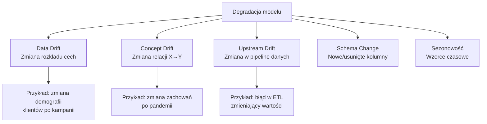
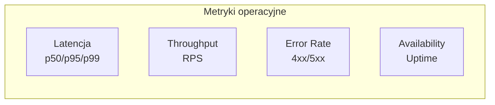
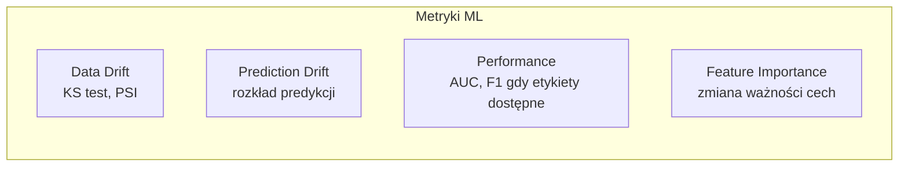
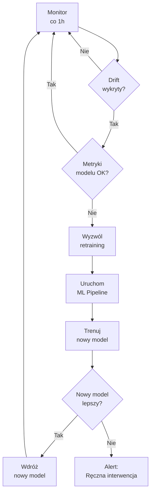
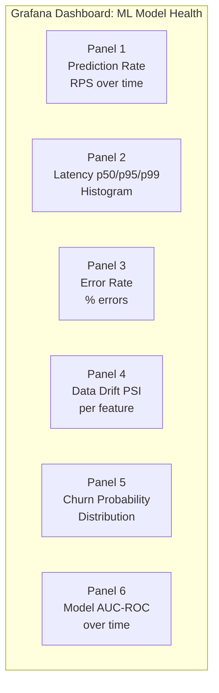

# Wykład 6: Monitoring Modeli ML w Produkcji

## Cel wykładu
Po tym wykładzie student:
- rozumie, dlaczego monitoring jest kluczowy w systemach ML,
- zna rodzaje dryfu danych i metody ich wykrywania,
- potrafi zbudować system monitoringu z użyciem Evidently AI i Prometheus,
- wie, jak skonfigurować alerty i automatyczny retraining,
- rozumie formalne podstawy miar dryfu (PSI, KS, KL, JS, Wasserstein) i ich ograniczenia,
- potrafi zaprojektować strategię monitoringu przy opóźnionych etykietach.

## Skrypty do wykładu

Skrypty demonstracyjne znajdują się w `lectures/scripts/lecture_06/`. Pełną instrukcję znajdziesz w [`lectures/scripts/README.md`](scripts/README.md).

| Kiedy (sekcja) | Skrypt | Cel demonstracji |
|---|---|---|
| 3. Wykrywanie dryfu | `01_drift_metrics.py` | PSI, KS, KL, JS i Wasserstein dla rosnącego dryfu + pułapka dużych próbek |
| 1. i 6. Rodzaje dryfu / retraining | `02_concept_drift_stream.py` | data drift vs concept drift na 12-tygodniowym strumieniu, quality gate |
| 5. Prometheus | `03_prometheus_metrics.py [--serve]` | instrumentacja, format `/metrics`, kwantyle z bucketów histogramu |

**Jak:** z katalogu głównego repozytorium uruchom `python lectures/scripts/lecture_06/<skrypt>`. Skrypt 03 zapisuje wynik do `lectures/scripts/lecture_06/outputs/`.

---

## 1. Dlaczego modele degradują?

Model wytrenowany dziś może jutro dawać gorsze wyniki. Przyczyny:



### Rodzaje dryfu

| Typ | Definicja | Wykrywanie |
|-----|-----------|------------|
| **Data Drift** | P(X) się zmienia | Testy statystyczne na cechach |
| **Concept Drift** | P(Y\|X) się zmienia | Monitoring metryk modelu |
| **Label Drift** | P(Y) się zmienia | Monitoring rozkładu etykiet |
| **Prediction Drift** | P(Ŷ) się zmienia | Monitoring rozkładu predykcji |

### Formalnie: rozkład łączny i jego rozkłady

Model uczy się przybliżenia rozkładu łącznego `P(X, Y)`, który można rozłożyć na dwa sposoby:

```
P(X, Y) = P(Y | X) · P(X)      ← widok „przyczynowy" (cechy → etykieta)
P(X, Y) = P(X | Y) · P(Y)      ← widok „generatywny" (etykieta → cechy)
```

Z tego wynikają klasyczne nazwy z literatury (Quiñonero-Candela i in., *Dataset Shift in ML*):

| Nazwa w literaturze | Co się zmienia | Co stałe | Przykład |
|---|---|---|---|
| **Covariate shift** (= data drift) | `P(X)` | `P(Y\|X)` | nowy kanał marketingowy przyciąga młodszych klientów |
| **Prior / label shift** | `P(Y)` | `P(X\|Y)` | odsetek fraudów rośnie w okresie świątecznym |
| **Concept drift** | `P(Y\|X)` | (dowolne) | po zmianie regulaminu ci sami klienci rezygnują częściej |
| **Upstream / schema drift** | sposób liczenia cech | – | ETL zaczyna zwracać dochód w tys. zł zamiast w zł |

> 💡 Covariate shift **nie zawsze** psuje model: jeśli model dobrze przybliża `P(Y|X)` także w nowym obszarze przestrzeni cech, jakość pozostaje dobra (zob. demo `02_concept_drift_stream.py`, tygodnie 5–8: PSI > 0.9, a AUC bez zmian). Concept drift **zawsze** psuje model, ale jest **niewidoczny** dla testów na samych cechach (tygodnie 9–12: PSI ≈ 0, AUC spada z 0.85 do 0.52).

### Dynamika dryfu w czasie

```
nagły (sudden)        stopniowy (gradual)    przyrostowy (incremental)   cykliczny (recurring)
koncept                koncept                 koncept                     koncept
 B ┤      ┌─────       B ┤    ┌┐ ┌┐┌───        B ┤          ╱───          B ┤  ┌──┐    ┌──┐
   │      │              │    ││ │││             │        ╱                 │  │  │    │  │
 A ┤──────┘            A ┤────┘└─┘└┘           A ┤──────╱                 A ┤──┘  └────┘  └──
   └──────────▶ t        └──────────▶ t          └──────────▶ t              └──────────────▶ t
 np. COVID-19,          np. migracja klientów   np. inflacja, starzenie     np. sezonowość,
 zmiana API partnera    do nowej aplikacji      się sprzętu/sensorów        weekendy, święta
```

| Typ | Jak wykryć | Typowa reakcja |
|---|---|---|
| Nagły | alert progowy na krótkim oknie (1h–1d) | rollback / szybki retraining / reguły awaryjne |
| Stopniowy | trend metryk na oknie przesuwnym | zaplanowany retraining |
| Przyrostowy | porównanie z referencją z treningu (nie z „wczoraj"!) | retraining okresowy, uczenie online |
| Cykliczny | porównanie z analogicznym okresem (rok/tydzień temu) | cechy kalendarzowe, osobne modele/referencje |

### Problem opóźnionych etykiet (label delay)

W większości systemów prawdziwa etykieta pojawia się z opóźnieniem: churn – po 30 dniach, fraud – po chargebacku (do 90 dni), default kredytowy – po miesiącach. Dlatego monitoring stosuje **hierarchię sygnałów**:


Im dalej w prawo, tym sygnał jest **pewniejszy**, ale **późniejszy**. Drift cech i predykcji to „wczesne ostrzeżenie", a nie dowód degradacji. Narzędzia typu NannyML próbują estymować jakość bez etykiet (metoda CBPE – *Confidence-Based Performance Estimation*), zakładając dobrą kalibrację modelu i brak concept driftu.

---

## 2. Metryki monitoringu

### Metryki operacyjne (infrastruktura)



### Metryki ML (jakość modelu)



### Piramida monitoringu ML

```
                  ┌─────────────────────┐
                  │  KPI biznesowe       │  przychód, churn, straty na fraudach
                ┌─┴─────────────────────┴─┐
                │  Jakość modelu           │  AUC, F1, MAE, kalibracja (opóźnione)
              ┌─┴─────────────────────────┴─┐
              │  Predykcje                   │  rozkład ŷ, odsetek klas, pewność
            ┌─┴─────────────────────────────┴─┐
            │  Dane wejściowe                  │  drift, braki, zakresy, schemat
          ┌─┴─────────────────────────────────┴─┐
          │  Infrastruktura / serwis             │  latencja, RPS, błędy, CPU/GPU, RAM
          └─────────────────────────────────────┘
```

Dolne warstwy są tanie i natychmiastowe, górne – kosztowne i opóźnione, ale to one mówią, czy model **przynosi wartość**.

| Warstwa | Przykładowa metryka | Częstotliwość | Typ metryki Prometheus | Kto reaguje |
|---|---|---|---|---|
| Infrastruktura | p95 latencji, 5xx | sekundy | Histogram, Counter | SRE / on-call |
| Dane | PSI per cecha, % nulli | minuty–godziny (batch) | Gauge | Data Engineer |
| Predykcje | średnie ŷ, % klasy „high" | minuty | Counter, Gauge | ML Engineer |
| Jakość | AUC, precision@k | dni–tygodnie | Gauge | Data Scientist |
| Biznes | koszt fałszywych alarmów | tygodnie | dashboard BI | Product Owner |

> 💡 **Golden signals** (Google SRE): latency, traffic, errors, saturation. Dla ML dodajemy „piąty sygnał": **jakość/rozkład predykcji**.

---

## 3. Wykrywanie dryfu – metody statystyczne

### Teoria: miary odległości między rozkładami

Niech `p` – rozkład referencyjny (trening), `q` – rozkład bieżący (produkcja). Dla miar binowanych `p_i`, `q_i` to odsetki obserwacji w i-tym binie (biny wyznaczamy **kwantylami referencji**, więc `p_i ≈ 1/n_bins`).

| Miara | Wzór | Zakres | Symetryczna | Uwagi |
|---|---|---|---|---|
| **KS** | `D = sup_x \|F_p(x) − F_q(x)\|` | [0, 1] | tak | test nieparametryczny, daje p-value; tylko cechy ciągłe 1D |
| **PSI** | `Σ (q_i − p_i) · ln(q_i / p_i)` | [0, ∞) | tak | standard w bankowości (scoring); = `KL(p‖q) + KL(q‖p)` |
| **KL** | `Σ q_i · ln(q_i / p_i)` | [0, ∞) | nie | nieskończona, gdy `p_i = 0` → wymaga wygładzania (ε) |
| **Jensen–Shannon** | `√(½KL(p‖m) + ½KL(q‖m))`, `m = ½(p+q)` | [0, 1] (log₂) | tak | ograniczona, stabilna; domyślna w Evidently dla dużych zbiorów |
| **Wasserstein (EMD)** | `∫ \|F_p(x) − F_q(x)\| dx` | [0, ∞) w jednostkach cechy | tak | „koszt przeniesienia masy"; normalizuj przez σ referencji |
| **Chi²** | `Σ (O_i − E_i)² / E_i` | [0, ∞) | nie | dla cech **kategorycznych**, daje p-value |

Skąd progi PSI 0.1 / 0.2? To reguła kciuka z praktyki ryzyka kredytowego. Dla małego przesunięcia średniej o `δ` odchyleń standardowych w rozkładzie normalnym `PSI ≈ δ²`, czyli:

```
PSI ≈ 0.01  ↔ przesunięcie o 0.1σ    (szum)
PSI ≈ 0.10  ↔ przesunięcie o ~0.3σ   (warto obserwować)
PSI ≈ 0.25  ↔ przesunięcie o ~0.5σ   (istotna zmiana)
```

Demo `01_drift_metrics.py` pokazuje to empirycznie: przesunięcie o 0.5σ (μ +5) daje PSI ≈ 0.31, a o 0.1σ – PSI ≈ 0.015.

### Test statystyczny vs miara wielkości efektu

```
          p-value testu KS                         PSI / JS / Wasserstein
   1.0 ┤●                                    0.1 ┤
       │  ●                                      │●
   0.5 ┤                                         │  ●
       │     ●                                   │     ●──────●───────●
   0.0 ┤        ●──────●───────●             0.0 ┤
       └──────────────────────────▶ n            └──────────────────────────▶ n
         ta sama, nieistotna zmiana 0.05σ          ta sama zmiana – wartość stała
```

- **p-value** odpowiada na pytanie „czy rozkłady są *dokładnie* takie same?" – przy dużym ruchu (n = 100 000) odpowiedź prawie zawsze brzmi „nie" (demo: p = 6e-29 dla zmiany o 0.05σ). To źródło **alert fatigue**.
- **Effect size** (PSI, JS, Wasserstein/σ) odpowiada na pytanie „*jak bardzo* się różnią?" – to powinno sterować alertami.
- Przy małych próbkach (n = 200) **wszystkie** miary są zaszumione (PSI ≈ 0.065 bez realnego dryfu) – ustal minimalny rozmiar okna (np. ≥ 1 000 obserwacji / ≥ 50 na bin).
- Testując 200 cech z `α = 0.05`, średnio **10 fałszywych alarmów** na każde sprawdzenie. Stosuj korektę Bonferroniego (`α/k`) lub Benjamini–Hochberga, albo monitoruj tylko top-k najważniejszych cech.

| Sytuacja | Rekomendowana metoda |
|---|---|
| Cecha numeryczna, n < 1 000 | KS (p-value) |
| Cecha numeryczna, n > 1 000 | Wasserstein/σ lub JS, ewentualnie PSI |
| Cecha kategoryczna | Chi² (małe n), JS lub PSI na kategoriach (duże n) |
| Scoring kredytowy / regulacje | PSI (wymagany w raportach, np. pod nadzorem KNF/EBA) |
| Wiele cech jednocześnie | drift klasyfikatora (*domain classifier*), PCA + błąd rekonstrukcji |
| Embeddingi (NLP, obrazy) | MMD, odległość cosinusowa średnich embeddingów, domain classifier |

#### Dryf wielowymiarowy – domain classifier

Testy 1D nie wykryją zmiany **korelacji** między cechami (każda cecha osobno ma ten sam rozkład). Prosta i skuteczna technika: wytrenuj klasyfikator odróżniający „referencję" (y=0) od „produkcji" (y=1).

```python
import numpy as np
import pandas as pd
from sklearn.ensemble import RandomForestClassifier
from sklearn.model_selection import cross_val_score

def domain_classifier_drift(reference: pd.DataFrame, current: pd.DataFrame) -> float:
    """Zwraca AUC klasyfikatora ref-vs-cur. AUC≈0.5 → brak dryfu, >0.6 → dryf."""
    X = pd.concat([reference, current], ignore_index=True)
    y = np.r_[np.zeros(len(reference)), np.ones(len(current))]
    clf = RandomForestClassifier(n_estimators=100, max_depth=5, random_state=42)
    return cross_val_score(clf, X, y, cv=5, scoring="roc_auc").mean()
    # Bonus: clf.feature_importances_ wskazuje, KTÓRE cechy najbardziej dryfują
```

> ▶️ **Demo na żywo:** `python lectures/scripts/lecture_06/01_drift_metrics.py`  
> Pokaż tabelę rosnącego dryfu, a potem sekcję „pułapka dużych próbek" – zapytaj studentów, którą metrykę podpięliby pod alert.

### Test Kolmogorova-Smirnova (KS Test)

```python
import numpy as np
import pandas as pd
from scipy import stats
from typing import Optional
import warnings

def ks_drift_test(
    reference: np.ndarray,
    current: np.ndarray,
    feature_name: str,
    threshold: float = 0.05
) -> dict:
    """
    Wykrywa data drift za pomocą testu KS.
    
    Hipoteza zerowa H0: obie próbki pochodzą z tego samego rozkładu.
    Odrzucamy H0 gdy p-value < threshold → drift wykryty.
    """
    statistic, p_value = stats.ks_2samp(reference, current)
    drift_detected = p_value < threshold
    
    return {
        "feature": feature_name,
        "test": "KS",
        "statistic": round(statistic, 4),
        "p_value": round(p_value, 4),
        "drift_detected": drift_detected,
        "severity": (
            "critical" if p_value < 0.001 else
            "high" if p_value < 0.01 else
            "medium" if p_value < threshold else
            "none"
        )
    }
```

### Population Stability Index (PSI)

```python
def calculate_psi(
    reference: np.ndarray,
    current: np.ndarray,
    n_bins: int = 10,
    feature_name: str = "feature"
) -> dict:
    """
    Oblicza PSI (Population Stability Index).
    
    PSI < 0.1:  brak istotnej zmiany
    PSI 0.1-0.2: umiarkowana zmiana (monitoruj)
    PSI > 0.2:  znacząca zmiana (retraining wymagany)
    """
    # Tworzenie binów na podstawie danych referencyjnych
    bins = np.percentile(reference, np.linspace(0, 100, n_bins + 1))
    bins[0] = -np.inf
    bins[-1] = np.inf
    
    # Obliczenie proporcji w każdym binie
    ref_counts, _ = np.histogram(reference, bins=bins)
    cur_counts, _ = np.histogram(current, bins=bins)
    
    # Unikamy dzielenia przez zero
    ref_pct = ref_counts / len(reference)
    cur_pct = cur_counts / len(current)
    
    ref_pct = np.where(ref_pct == 0, 0.0001, ref_pct)
    cur_pct = np.where(cur_pct == 0, 0.0001, cur_pct)
    
    # PSI = Σ (cur - ref) * ln(cur/ref)
    psi = np.sum((cur_pct - ref_pct) * np.log(cur_pct / ref_pct))
    
    return {
        "feature": feature_name,
        "test": "PSI",
        "psi_value": round(psi, 4),
        "drift_detected": psi > 0.2,
        "severity": (
            "critical" if psi > 0.5 else
            "high" if psi > 0.2 else
            "medium" if psi > 0.1 else
            "none"
        )
    }

# Przykład użycia
np.random.seed(42)
reference_data = np.random.normal(50, 10, 10000)  # dane treningowe
current_data = np.random.normal(55, 12, 2000)      # dane produkcyjne (z dryftem)

ks_result = ks_drift_test(reference_data, current_data, "age")
psi_result = calculate_psi(reference_data, current_data, feature_name="age")

print(f"KS Test: drift={ks_result['drift_detected']}, severity={ks_result['severity']}")
print(f"PSI:     drift={psi_result['drift_detected']}, PSI={psi_result['psi_value']}")
```

### Kompleksowy monitor dryfu

```python
import pandas as pd
import numpy as np
from dataclasses import dataclass, field
from datetime import datetime
from typing import Callable, Optional

@dataclass
class DriftReport:
    """Raport z monitoringu dryfu."""
    timestamp: str = field(default_factory=lambda: datetime.now().isoformat())
    feature_results: list = field(default_factory=list)
    overall_drift: bool = False
    critical_features: list = field(default_factory=list)
    
    def summary(self) -> str:
        status = "🔴 DRIFT WYKRYTY" if self.overall_drift else "🟢 OK"
        lines = [f"=== Raport Dryfu [{self.timestamp}] ===", f"Status: {status}"]
        
        for r in self.feature_results:
            icon = "❌" if r['drift_detected'] else "✅"
            lines.append(
                f"  {icon} {r['feature']}: "
                f"PSI={r.get('psi_value', 'N/A')}, "
                f"severity={r['severity']}"
            )
        
        if self.critical_features:
            lines.append(f"\n⚠️  Krytyczne cechy: {', '.join(self.critical_features)}")
        
        return "\n".join(lines)

class DataDriftMonitor:
    """Monitor dryfu danych dla modelu ML."""
    
    def __init__(
        self,
        reference_df: pd.DataFrame,
        feature_columns: list[str],
        alert_callback: Optional[Callable] = None
    ):
        self.reference_df = reference_df
        self.feature_columns = feature_columns
        self.alert_callback = alert_callback
        self._drift_history: list[DriftReport] = []
    
    def check_drift(self, current_df: pd.DataFrame) -> DriftReport:
        """Sprawdza dryft dla wszystkich cech."""
        report = DriftReport()
        
        for feature in self.feature_columns:
            if feature not in current_df.columns:
                continue
            
            ref_values = self.reference_df[feature].dropna().values
            cur_values = current_df[feature].dropna().values
            
            # Oblicz PSI
            psi_result = calculate_psi(ref_values, cur_values, feature_name=feature)
            report.feature_results.append(psi_result)
            
            if psi_result['severity'] in ('high', 'critical'):
                report.critical_features.append(feature)
        
        report.overall_drift = len(report.critical_features) > 0
        self._drift_history.append(report)
        
        # Wywołaj alert jeśli wykryto drift
        if report.overall_drift and self.alert_callback:
            self.alert_callback(report)
        
        return report
    
    def get_drift_trend(self) -> pd.DataFrame:
        """Zwraca historię dryfu jako DataFrame."""
        rows = []
        for rep in self._drift_history:
            for feat_result in rep.feature_results:
                rows.append({
                    "timestamp": rep.timestamp,
                    "feature": feat_result["feature"],
                    "psi": feat_result.get("psi_value", 0),
                    "drift": feat_result["drift_detected"]
                })
        return pd.DataFrame(rows)

# Przykład użycia
def send_alert(report: DriftReport):
    print(f"🚨 ALERT: Wykryto drift w cechach: {report.critical_features}")
    # W produkcji: wyślij email, Slack, PagerDuty...

# Dane referencyjne (z treningu)
reference = pd.DataFrame({
    'age': np.random.normal(40, 10, 5000),
    'income': np.random.normal(50000, 15000, 5000),
    'tenure': np.random.exponential(24, 5000)
})

# Dane produkcyjne (z dryftem)
current = pd.DataFrame({
    'age': np.random.normal(45, 12, 1000),      # drift!
    'income': np.random.normal(50500, 15000, 1000),  # brak dryfu
    'tenure': np.random.exponential(18, 1000)    # drift!
})

monitor = DataDriftMonitor(
    reference_df=reference,
    feature_columns=['age', 'income', 'tenure'],
    alert_callback=send_alert
)

report = monitor.check_drift(current)
print(report.summary())
```

---

## 4. Evidently AI – biblioteka do monitoringu ML

**Evidently AI** to open-source'owa biblioteka do monitoringu i testowania modeli ML.

> ⚠️ **Wersje API.** Poniższy kod używa „klasycznego" API Evidently (0.4.x – 0.6.x: `ColumnMapping`, `Report`, `TestSuite`, `metric_preset`). Od wersji **0.7** API zostało przebudowane (`from evidently import Report, Dataset, DataDefinition`, `from evidently.presets import DataDriftPreset`, a Test Suite zastąpiono warunkami `tests=` w metrykach). Przypnij wersję w `requirements.txt` i sprawdź dokumentację swojej wersji.

**Jak Evidently wybiera test dryfu (domyślnie, per kolumna):**

| Typ kolumny | n ≤ 1000 | n > 1000 |
|---|---|---|
| numeryczna (> 5 unikalnych wartości) | KS (p-value < 0.05) | Wasserstein znormalizowany (> 0.1) |
| kategoryczna / mało wartości | Chi² (lub Z-test dla binarnych) | Jensen–Shannon (> 0.1) |

**Dataset drift** jest zgłaszany, gdy dryfuje ≥ 50% kolumn (parametr `drift_share`). Wszystko to można nadpisać, np. `DataDriftPreset(stattest="psi", stattest_threshold=0.2)`.

| Narzędzie | Typ | Mocne strony | Słabsze strony |
|---|---|---|---|
| **Evidently** | OSS + Cloud | raporty HTML, testy w CI, wiele testów statystycznych | brak natywnego alertingu (trzeba podpiąć Prometheus/Grafana) |
| **NannyML** | OSS | estymacja jakości bez etykiet (CBPE/DLE), drift wielowymiarowy | węższy zakres (głównie tabelaryczne) |
| **WhyLogs / WhyLabs** | OSS + SaaS | lekkie profile statystyczne (sketches), skalowalne do strumieni | profile zamiast surowych danych → mniej szczegółów |
| **Alibi Detect** | OSS | detektory dla obrazów/tekstu (MMD, LSDD), outliery | bardziej „researchowe", mniej gotowych dashboardów |
| **Arize / Fiddler / Datadog ML** | SaaS | gotowe dashboardy, wyjaśnialność, alerting | koszt, dane opuszczają organizację |
| **Prometheus + Grafana** | OSS | standard SRE, alerting, skalowalność | brak gotowych testów dryfu – liczysz je sam |

```python
import pandas as pd
import numpy as np
from evidently import ColumnMapping
from evidently.report import Report
from evidently.metric_preset import (
    DataDriftPreset,
    DataQualityPreset,
    ClassificationPreset
)
from evidently.metrics import (
    DatasetDriftMetric,
    ColumnDriftMetric,
    DatasetMissingValuesMetric
)
from evidently.test_suite import TestSuite
from evidently.test_preset import DataDriftTestPreset, DataQualityTestPreset

# Przygotowanie danych
np.random.seed(42)
n_ref = 5000
n_cur = 1000

reference_data = pd.DataFrame({
    'age': np.random.normal(40, 10, n_ref),
    'income': np.random.normal(50000, 15000, n_ref),
    'tenure': np.random.exponential(24, n_ref),
    'num_products': np.random.randint(1, 5, n_ref),
    'target': np.random.binomial(1, 0.2, n_ref),
    'prediction': np.random.uniform(0, 1, n_ref)
})

current_data = pd.DataFrame({
    'age': np.random.normal(45, 12, n_cur),       # drift
    'income': np.random.normal(50000, 15000, n_cur),
    'tenure': np.random.exponential(18, n_cur),    # drift
    'num_products': np.random.randint(1, 5, n_cur),
    'target': np.random.binomial(1, 0.25, n_cur),
    'prediction': np.random.uniform(0.1, 1, n_cur)
})

# Mapowanie kolumn
column_mapping = ColumnMapping(
    target='target',
    prediction='prediction',
    numerical_features=['age', 'income', 'tenure'],
    categorical_features=['num_products']
)

# --- Raport dryfu danych ---
data_drift_report = Report(metrics=[
    DataDriftPreset(),
    DataQualityPreset(),
])

data_drift_report.run(
    reference_data=reference_data,
    current_data=current_data,
    column_mapping=column_mapping
)

# Zapis raportu HTML
data_drift_report.save_html("reports/data_drift_report.html")
print("Raport zapisany: reports/data_drift_report.html")

# Pobierz wyniki jako dict
results = data_drift_report.as_dict()
drift_detected = results['metrics'][0]['result']['dataset_drift']
print(f"Dataset drift: {drift_detected}")

# --- Test Suite (pass/fail) ---
tests = TestSuite(tests=[
    DataDriftTestPreset(),
    DataQualityTestPreset(),
])

tests.run(
    reference_data=reference_data,
    current_data=current_data,
    column_mapping=column_mapping
)

tests.save_html("reports/test_suite.html")

# Sprawdź wyniki testów
test_results = tests.as_dict()
all_passed = all(t['status'] == 'SUCCESS' for t in test_results['tests'])
print(f"Wszystkie testy: {'✅ PASS' if all_passed else '❌ FAIL'}")
```

---

## 5. Prometheus + Grafana dla ML

### Eksportowanie metryk ML do Prometheus

```python
from prometheus_client import (
    Counter, Histogram, Gauge, Summary,
    start_http_server, CollectorRegistry
)
import time
import numpy as np

# Definicja metryk
PREDICTION_COUNTER = Counter(
    'ml_predictions_total',
    'Łączna liczba predykcji',
    ['model_version', 'risk_level']
)

PREDICTION_LATENCY = Histogram(
    'ml_prediction_latency_seconds',
    'Czas predykcji w sekundach',
    ['model_version'],
    buckets=[0.001, 0.005, 0.01, 0.025, 0.05, 0.1, 0.25, 0.5, 1.0]
)

CHURN_PROBABILITY_GAUGE = Gauge(
    'ml_churn_probability_avg',
    'Średnie prawdopodobieństwo churnu (ostatnie 1000 predykcji)'
)

DATA_DRIFT_GAUGE = Gauge(
    'ml_data_drift_psi',
    'PSI dla cechy',
    ['feature_name']
)

MODEL_AUC_GAUGE = Gauge(
    'ml_model_auc_roc',
    'AUC-ROC modelu na danych produkcyjnych',
    ['model_version']
)

ERROR_COUNTER = Counter(
    'ml_prediction_errors_total',
    'Liczba błędów predykcji',
    ['error_type']
)

class InstrumentedMLService:
    """Serwis ML z instrumentacją Prometheus."""
    
    def __init__(self, model, model_version: str):
        self.model = model
        self.model_version = model_version
        self._recent_probs = []
    
    def predict(self, features: np.ndarray, user_id: int) -> dict:
        """Predykcja z pełną instrumentacją."""
        start_time = time.time()
        
        try:
            probability = float(self.model.predict_proba(features)[0][1])
            risk_level = (
                "high" if probability > 0.7 else
                "medium" if probability > 0.3 else
                "low"
            )
            
            # Aktualizacja metryk
            PREDICTION_COUNTER.labels(
                model_version=self.model_version,
                risk_level=risk_level
            ).inc()
            
            # Aktualizacja średniej prawdopodobieństwa
            self._recent_probs.append(probability)
            if len(self._recent_probs) > 1000:
                self._recent_probs.pop(0)
            CHURN_PROBABILITY_GAUGE.set(np.mean(self._recent_probs))
            
            return {
                "user_id": user_id,
                "probability": probability,
                "risk_level": risk_level
            }
        
        except Exception as e:
            ERROR_COUNTER.labels(error_type=type(e).__name__).inc()
            raise
        
        finally:
            # Zawsze mierz latencję
            latency = time.time() - start_time
            PREDICTION_LATENCY.labels(
                model_version=self.model_version
            ).observe(latency)
    
    def update_drift_metrics(self, psi_scores: dict):
        """Aktualizuje metryki dryfu."""
        for feature, psi in psi_scores.items():
            DATA_DRIFT_GAUGE.labels(feature_name=feature).set(psi)

# Uruchomienie serwera metryk Prometheus
start_http_server(8000)
print("Metryki dostępne na http://localhost:8000/metrics")
```

> ⚠️ **Uwaga:** powyższy przykład używa domyślnego rejestru globalnego. W testach i w aplikacjach z wieloma workerami (np. `gunicorn`/`uvicorn --workers 4`) użyj `CollectorRegistry()` per proces lub trybu `multiprocess` z `PROMETHEUS_MULTIPROC_DIR` – inaczej każdy worker raportuje własne liczniki, a Prometheus losowo widzi jeden z nich.

#### Typy metryk Prometheus – kiedy którego użyć

| Typ | Zachowanie | Przykład w ML | Typowe zapytanie |
|---|---|---|---|
| **Counter** | tylko rośnie (reset przy restarcie) | liczba predykcji, błędów | `rate(x_total[5m])` |
| **Gauge** | dowolna wartość w chwili t | PSI, AUC, rozmiar kolejki | `x`, `avg_over_time(x[1h])` |
| **Histogram** | liczniki w bucketach `le` + `_sum` + `_count` | latencja, rozkład score'ów | `histogram_quantile(0.95, sum by (le) (rate(x_bucket[5m])))` |
| **Summary** | kwantyle liczone po stronie klienta | latencja w jednym procesie | `x{quantile="0.95"}` (nie da się agregować!) |

> 💡 **Histogram predykcji** (np. buckety 0.1, 0.2, … 1.0 dla prawdopodobieństwa) pozwala liczyć drift predykcji bezpośrednio w PromQL, bez osobnego joba batch.

> ⚠️ **Kardynalność etykiet.** Każda unikalna kombinacja etykiet to osobny szereg czasowy. Nigdy nie dawaj `user_id`, `request_id` ani surowych wartości cech jako etykiety – 1 mln użytkowników = 1 mln szeregów i awaria Prometheusa. Etykiety powinny mieć małą, skończoną liczbę wartości (`model_version`, `risk_level`, `feature_name`).

```
Przepływ metryk:

 ┌──────────────┐  scrape /metrics   ┌────────────┐  PromQL  ┌──────────┐
 │ ml-api:8000  │◀───── co 15s ──────│ Prometheus │◀─────────│ Grafana  │
 │ (Counter,    │                    │  (TSDB)    │          └──────────┘
 │  Histogram)  │                    │   rules ───┼──▶ Alertmanager ──▶ Slack/PagerDuty
 └──────────────┘                    └─────▲──────┘
 ┌──────────────┐  push (Pushgateway)      │
 │ drift job    │──────────────────────────┘   (joby batch, które nie żyją długo)
 │ (cron, PSI)  │
 └──────────────┘
```

> ▶️ **Demo na żywo:** `python lectures/scripts/lecture_06/03_prometheus_metrics.py`  
> Pokaż format ekspozycji tekstowej i jak z bucketów histogramu powstaje p95 (interpolacja liniowa jak w `histogram_quantile`). Z `--serve` metryki są dostępne pod `http://localhost:8000/metrics`.

### Konfiguracja Prometheus

```yaml
# prometheus.yml
global:
  scrape_interval: 15s
  evaluation_interval: 15s

rule_files:
  - "ml_alerts.yml"

alerting:
  alertmanagers:
    - static_configs:
        - targets: ['alertmanager:9093']

scrape_configs:
  - job_name: 'ml-service'
    static_configs:
      - targets: ['ml-api:8000']
    metrics_path: '/metrics'
```

### Reguły alertów

```yaml
# ml_alerts.yml
groups:
  - name: ml_alerts
    rules:
      # Alert: wysoka latencja predykcji
      - alert: HighPredictionLatency
        expr: histogram_quantile(0.95, sum by (le, model_version) (rate(ml_prediction_latency_seconds_bucket[5m]))) > 0.5
        for: 5m
        labels:
          severity: warning
        annotations:
          summary: "Wysoka latencja predykcji (p95 > 500ms)"
          description: "Model {{ $labels.model_version }} ma p95 latencję {{ $value }}s"

      # Alert: data drift
      - alert: DataDriftDetected
        expr: ml_data_drift_psi > 0.2
        for: 10m
        labels:
          severity: critical
        annotations:
          summary: "Wykryto data drift"
          description: "Cecha {{ $labels.feature_name }} ma PSI={{ $value }}"

      # Alert: wysoki error rate
      - alert: HighErrorRate
        # (odsetek błędów > 1% wszystkich żądań, a nie 0.01 błędu/s)
        expr: |
          sum(rate(ml_prediction_errors_total[5m]))
            / (sum(rate(ml_predictions_total[5m])) + sum(rate(ml_prediction_errors_total[5m])))
            > 0.01
        for: 2m
        labels:
          severity: critical
        annotations:
          summary: "Wysoki error rate predykcji"

      # Alert: rozkład predykcji „zamarł" (np. model zwraca stałą wartość)
      - alert: PredictionsStuck
        expr: stddev_over_time(ml_churn_probability_avg[1h]) == 0
        for: 30m
        labels:
          severity: warning
        annotations:
          summary: "Średnia predykcja nie zmienia się od godziny"

      # Alert: brak ruchu (serwis żyje, ale nikt go nie woła – zepsuty upstream?)
      - alert: NoPredictionTraffic
        expr: sum(rate(ml_predictions_total[15m])) == 0
        for: 15m
        labels:
          severity: warning
```

#### Projektowanie alertów – dobre praktyki

- **Alertuj na objawy, nie na przyczyny** – „AUC spadło" / „p95 > SLO" zamiast „CPU 80%".
- **`for:`** wymusza utrzymanie się warunku – eliminuje pojedyncze piki.
- **Poziomy severity:** `warning` → kanał Slack (dzień roboczy), `critical` → PagerDuty (budzi on-call). Drift cech to zwykle `warning`, drift + spadek proxy KPI → `critical`.
- **Każdy alert ma runbook** (`annotations.runbook_url`) – co sprawdzić, jak zrobić rollback.
- Mierz **precyzję alertów**: jeśli > 50% alertów nie wymaga działania, podnieś progi.

---

## 6. Automatyczny retraining



### Strategie retrainingu – porównanie

| Strategia | Wyzwalacz | Zalety | Wady | Gdzie stosować |
|---|---|---|---|---|
| **Ręczna** | decyzja człowieka | pełna kontrola | wolna, nie skaluje się | modele regulowane (kredyty, medycyna) |
| **Okresowa** (cron) | co dzień/tydzień/miesiąc | prosta, przewidywalny koszt | trenuje niepotrzebnie albo za rzadko | rekomendacje, prognozy popytu |
| **Na dryf** | PSI/KS > próg | reaguje na zmiany danych | data drift ≠ degradacja → zbędne retrainy | dane szybko się zmieniające |
| **Na spadek jakości** | AUC/F1 < próg | trenuje tylko gdy trzeba | wymaga etykiet (opóźnienie!) | fraud z szybkim feedbackiem, ads (CTR) |
| **Online / ciągła** | każda nowa porcja danych | najszybsza adaptacja | ryzyko catastrophic forgetting i ataków (data poisoning) | ads, feed ranking |

W praktyce łączy się je: **okresowo + awaryjnie na spadek jakości**, a drift cech służy jako sygnał do analizy, nie automatyczny wyzwalacz.

#### Quality gate – champion vs challenger

```
  nowe dane ──▶ walidacja danych ──▶ trening challengera ──▶ ewaluacja na holdoucie (świeże dane!)
                     │ fail                                          │
                     ▼                                               ▼
                  ALERT               challenger ≥ champion + δ  AND  metryki ≥ minimum
                                       AND fairness OK  AND  latencja OK ?
                                          │ tak                         │ nie
                                          ▼                             ▼
                              shadow / canary 5% ──▶ 100%        zostaw championa + alert
```

> ⚠️ Holdout do porównania musi pochodzić z **najnowszego okresu** – porównanie na starym zbiorze testowym faworyzuje starego championa i ukrywa concept drift.

> ▶️ **Demo na żywo:** `python lectures/scripts/lecture_06/02_concept_drift_stream.py`  
> Tygodnie 5–8: alarm DATA_DRIFT, ale AUC bez zmian (retraining zbędny). Tygodnie 9–12: PSI cech ≈ 0, a AUC spada do ~0.52 – wykryje to tylko monitoring jakości. Na końcu quality gate promuje challengera.

```python
import schedule
import time
import logging
from datetime import datetime

logger = logging.getLogger(__name__)

class AutoRetrainingSystem:
    """System automatycznego retreningu modelu."""
    
    def __init__(
        self,
        drift_monitor: DataDriftMonitor,
        pipeline_trigger,
        drift_threshold_psi: float = 0.2,
        min_retraining_interval_hours: int = 24
    ):
        self.drift_monitor = drift_monitor
        self.pipeline_trigger = pipeline_trigger
        self.drift_threshold_psi = drift_threshold_psi
        self.min_interval = min_retraining_interval_hours
        self._last_retraining: Optional[datetime] = None
    
    def check_and_retrain(self, current_data: pd.DataFrame):
        """Sprawdza drift i wyzwala retraining jeśli potrzebny."""
        
        # Sprawdź czy minął minimalny czas od ostatniego retreningu
        if self._last_retraining:
            # total_seconds(), a nie .seconds (to drugie ignoruje pełne dni!)
            hours_since = (datetime.now() - self._last_retraining).total_seconds() / 3600
            if hours_since < self.min_interval:
                logger.info(f"Zbyt wcześnie na retraining ({hours_since:.1f}h < {self.min_interval}h)")
                return
        
        # Sprawdź drift
        report = self.drift_monitor.check_drift(current_data)
        
        if not report.overall_drift:
            logger.info("✅ Brak dryfu - retraining nie jest potrzebny")
            return
        
        logger.warning(f"⚠️ Drift wykryty w cechach: {report.critical_features}")
        logger.info("🔄 Wyzwalanie automatycznego retreningu...")
        
        try:
            # Wyzwól pipeline ML
            run_id = self.pipeline_trigger.trigger(
                reason="auto_retraining",
                triggered_by="drift_monitor",
                drift_features=report.critical_features
            )
            
            self._last_retraining = datetime.now()
            logger.info(f"✅ Pipeline uruchomiony: {run_id}")
            
        except Exception as e:
            logger.error(f"❌ Błąd wyzwalania retreningu: {e}")
            # Wyślij alert do zespołu
            raise

# Harmonogram monitoringu
def setup_monitoring_schedule(auto_retrain_system, data_source):
    """Konfiguruje harmonogram monitoringu."""
    
    def monitoring_job():
        logger.info(f"Uruchamianie monitoringu: {datetime.now()}")
        current_data = data_source.get_recent_data(hours=1)
        auto_retrain_system.check_and_retrain(current_data)
    
    # Sprawdzaj co godzinę
    schedule.every(1).hours.do(monitoring_job)
    
    logger.info("Monitoring zaplanowany co 1 godzinę")
    
    while True:
        schedule.run_pending()
        time.sleep(60)
```

---

## 7. Dashboard monitoringu – przykład Grafana



Przykładowe zapytania PromQL dla Grafana:

```promql
# Prediction rate (RPS)
rate(ml_predictions_total[5m])

# Latencja p95
histogram_quantile(0.95, rate(ml_prediction_latency_seconds_bucket[5m]))

# Error rate
rate(ml_prediction_errors_total[5m]) / rate(ml_predictions_total[5m])

# PSI dla cechy 'age'
ml_data_drift_psi{feature_name="age"}

# Rozkład risk level
sum by (risk_level) (rate(ml_predictions_total[1h]))

# Udział predykcji "high" – porównanie z tym samym oknem tydzień temu (sezonowość!)
  sum(rate(ml_predictions_total{risk_level="high"}[1h])) / sum(rate(ml_predictions_total[1h]))
- sum(rate(ml_predictions_total{risk_level="high"}[1h] offset 7d)) / sum(rate(ml_predictions_total[1h] offset 7d))

# Porównanie latencji dwóch wersji modelu (canary)
histogram_quantile(0.95, sum by (le, model_version) (rate(ml_prediction_latency_seconds_bucket[5m])))
```

**Zasady dobrego dashboardu ML:**
1. Na górze **jeden wiersz statusu** (zielony/żółty/czerwony) per model – odpowiedź „czy wszystko OK?" w 5 sekund.
2. Każdy panel pokazuje **wersję modelu** (adnotacje Grafany przy deploymencie) – skok metryki zbiega się z wdrożeniem?
3. Metryki ML na tle **linii referencyjnej** z treningu (np. oczekiwany odsetek klasy „high").
4. Osobne dashboardy: operacyjny (SRE, odświeżanie 10s) i analityczny (DS, dni/tygodnie).

---

## 8. Typowe pułapki w monitoringu ML

> ⚠️ **Pułapka 1: Monitorowanie tylko metryk operacyjnych**
> Serwis odpowiada szybko (latencja OK, error rate 0%), ale model daje bezsensowne predykcje. Monitoruj **metryki ML** (rozkład predykcji, drift cech) obok metryk infrastrukturalnych.

> ⚠️ **Pułapka 2: Zbyt czuły monitoring**
> Alerty na każdą drobną zmianę w rozkładzie danych prowadzą do „alert fatigue" — zespół ignoruje alerty. Ustaw rozsądne progi (np. PSI > 0.2 zamiast > 0.05) i używaj okien czasowych (np. drift utrzymujący się > 1h).

> ⚠️ **Pułapka 3: Brak danych referencyjnych**
> Nie można wykryć dryfu bez danych referencyjnych z okresu treningu. Zawsze zapisuj statystyki danych treningowych (rozkłady, percentyle, korelacje) jako artefakt modelu.

> ⚠️ **Pułapka 4: Automatyczny retraining bez zabezpieczeń**
> Automatyczny retraining na „zatrutych" danych może wdrożyć gorszy model. Zawsze porównuj nowy model z aktualnym produkcyjnym i wymagaj minimalnych progów jakości.

> ⚠️ **Pułapka 5: p-value jako jedyne kryterium**
> Przy dużym ruchu test KS zgłasza dryf dla zmian bez znaczenia (demo `01_drift_metrics.py`). Używaj miar wielkości efektu (PSI, JS, Wasserstein) i korekty na wielokrotne testowanie.

> ⚠️ **Pułapka 6: Feedback loop**
> Model wpływa na dane, na których jest później oceniany i trenowany: system antyfraudowy blokuje transakcje → nie poznajemy ich prawdziwej etykiety; rekomender pokazuje tylko popularne produkty → tylko one zbierają kliknięcia. Rozwiązanie: mały odsetek ruchu z losową decyzją (*exploration / holdout group*).

> ⚠️ **Pułapka 7: Training-serving skew zamiast dryfu**
> Wysoki PSI od pierwszego dnia po wdrożeniu to zwykle nie dryf, tylko **różnica w liczeniu cech** między treningiem a serwowaniem (inna strefa czasowa, inne kodowanie kategorii, brak normalizacji). Porównuj cechy zalogowane na produkcji z cechami z treningu dla tych samych encji.

> ⚠️ **Pułapka 8: Brak logowania wejść i predykcji**
> Bez logów (cechy, predykcja, wersja modelu, timestamp, `request_id`) nie da się policzyć dryfu ani dołączyć etykiet, gdy się pojawią. Loguj asynchronicznie (kolejka/Kafka) i z próbkowaniem przy bardzo dużym ruchu; pamiętaj o RODO (pseudonimizacja).

### Checklista wdrożenia monitoringu

| ✔ | Element |
|---|---|
| ☐ | Statystyki referencyjne (kwantyle, rozkłady kategorii) zapisane jako artefakt modelu (np. w MLflow) |
| ☐ | Logowanie wejść, predykcji, wersji modelu i `request_id` |
| ☐ | Metryki operacyjne + SLO (np. p95 < 200 ms, dostępność 99.9%) |
| ☐ | Drift cech (top-k ważnych) i predykcji liczone cyklicznie, min. rozmiar okna |
| ☐ | Pipeline dołączania etykiet (join po `request_id`) i metryki jakości |
| ☐ | Alerty z `for:`, severity i runbookiem |
| ☐ | Polityka retrainingu z quality gate i możliwością rollbacku |

### Case Study: Tesla Autopilot — monitoring w czasie rzeczywistym

**Tesla** monitoruje modele ML w milionach pojazdów jednocześnie:
- Każdy pojazd wysyła dane telemetryczne o sytuacjach, w których model był niepewny (low confidence predictions).
- Te dane są używane do **aktywnego uczenia** (active learning) — model jest retrenowany na najtrudniejszych przypadkach.
- Monitoring wykrywa **edge cases** (np. nietypowe warunki pogodowe, nowe znaki drogowe), które są automatycznie dodawane do zbioru treningowego.

### Case Study: Twitter — wykrywanie dryfu w rekomendacjach

**Twitter** (X) monitoruje modele rekomendacji timeline'a:
- Sezonowe wydarzenia (np. wybory, Super Bowl) powodują gwałtowne zmiany w rozkładzie danych — to **nie jest drift**, ale normalna zmienność.
- Kluczowe wyzwanie: odróżnienie prawdziwego dryfu od sezonowości. Rozwiązanie: porównywanie z danymi z analogicznego okresu rok wcześniej.

### Case Study: COVID-19 — nagły concept drift na masową skalę

W marcu 2020 r. wiele modeli produkcyjnych przestało działać niemal z dnia na dzień:
- **Prognozy popytu** w handlu (papier toaletowy, makaron, maseczki) – historyczne wzorce sezonowe stały się bezużyteczne.
- **Systemy antyfraudowe** w bankach – nagły wzrost zakupów online u klientów, którzy wcześniej płacili tylko w sklepach, generował masę fałszywych alarmów.
- **Scoring kredytowy** – dochody i zachowania płatnicze zmieniły się w sposób niewidoczny w danych historycznych.

Lekcje: (1) firmy z monitoringiem predykcji i proxy KPI wykryły problem w ciągu dni, inne – po tygodniach strat; (2) retraining na danych z 2 tygodni był zbyt mało stabilny – stosowano **reguły biznesowe jako fallback** i ręczne korekty; (3) po pandemii trzeba było zdecydować, czy dane z 2020 r. w ogóle włączać do treningu.

### Case Study: Zillow Offers — koszt niezauważonego dryfu

Zillow używał modelu wyceny nieruchomości (Zestimate) do **automatycznego kupowania domów**. W 2021 r. rynek zaczął się ochładzać, a model nadal przewidywał wzrosty cen (concept drift + feedback loop: firma sama podbijała ceny w niektórych regionach). Skutek: zakup tysięcy domów powyżej ceny rynkowej, odpis rzędu **ponad 500 mln USD** i zamknięcie działu. Wniosek: gdy model podejmuje decyzje finansowe automatycznie, monitoring **błędu predykcji na świeżych transakcjach** i limity ekspozycji są obowiązkowe.

### Case Study: Uber Michelangelo — monitoring na skalę platformy

Platforma ML Ubera automatycznie dla każdego wdrożonego modelu loguje próbkę predykcji, później łączy je z rzeczywistymi wynikami (np. faktyczny czas dojazdu dla modelu ETA) i publikuje metryki jakości na wspólnych dashboardach. Zespoły nie muszą budować monitoringu samodzielnie – to przykład **monitoringu jako usługi platformowej**, który jest jednym z wyznaczników dojrzałości MLOps.

---

## Pytania kontrolne i do dyskusji

1. Wyjaśnij różnicę między data drift, concept drift, label drift i prediction drift.
2. Jak działa test Kolmogorova-Smirnova (KS) i kiedy go użyjesz do wykrywania dryfu?
3. Co oznaczają wartości PSI < 0.1, 0.1-0.2 i > 0.2?
4. Dlaczego monitorowanie samych metryk operacyjnych (latencja, error rate) nie wystarcza?
5. Jak skonfigurować automatyczny retraining, aby nie wdrożyć gorszego modelu?
6. Jakie metryki wyeksponujesz na dashboardzie Grafana dla serwisu ML?
7. **Dyskusja:** Jak odróżnić prawdziwy drift od sezonowej zmienności danych?
8. Dlaczego test KS przy bardzo dużych próbkach generuje fałszywe alarmy i czym go zastąpić?
9. Jak monitorować model, gdy etykiety pojawiają się dopiero po 60 dniach?
10. Czym różni się data drift od training-serving skew i jak je rozróżnić?


### Proponowane odpowiedzi

1. Data drift to zmiana rozkładu cech wejściowych, concept drift to zmiana relacji cechy→etykieta, label drift to zmiana rozkładu etykiet, a prediction drift to zmiana rozkładu predykcji modelu. Każdy sygnalizuje inny typ problemu i wymaga innej reakcji.
2. KS porównuje dwie dystrybucje i zwraca statystykę różnicy oraz `p-value`; niskie `p-value` sugeruje istotną zmianę rozkładu. Używamy go głównie dla cech numerycznych, porównując dane referencyjne i bieżące.
3. Zwykle PSI < 0.1 oznacza brak istotnego driftu, 0.1–0.2 umiarkowany sygnał do obserwacji, a > 0.2 silny drift wymagający reakcji. Progi trzeba kalibrować do konkretnego przypadku biznesowego.
4. Bo model może działać szybko i bez błędów HTTP, a jednocześnie dawać słabe lub stronnicze predykcje. Dlatego trzeba monitorować też jakość ML, rozkłady danych i drift.
5. Retraining powinien mieć quality gates: walidację danych, porównanie z modelem bazowym, próg minimalnych metryk, testy regresji i etap canary/shadow przed pełną promocją. Bez tego łatwo wdrożyć model gorszy od obecnego.
6. Na dashboard dałbym: RPS, p95/p99 latencję, error rate, rozkłady predykcji, PSI/KS dla kluczowych cech, metryki jakości (AUC/F1 jeśli labels dostępne) i status alertów/retrainingu. Taki zestaw łączy perspektywę operacyjną i ML.
7. Trzeba porównywać nie tylko do „wczoraj”, ale też do analogicznych okresów sezonowych, używać okien czasowych i progów utrzymywania się sygnału. Pomaga też wzbogacenie monitoringu o kontekst biznesowy (kampanie, święta, wydarzenia).
8. p-value mierzy, czy rozkłady są identyczne, a nie jak bardzo się różnią – przy n rzędu 100 000 nawet zmiana o 0.05σ daje p ≈ 0. Lepiej alertować na miarach wielkości efektu (PSI, JS, Wasserstein/σ) z progami biznesowymi i stosować korektę na wielokrotne testowanie.
9. Użyć hierarchii sygnałów: drift cech i predykcji (natychmiast), metryki proxy (np. aktywność klienta, reklamacje), estymacja jakości bez etykiet (CBPE w NannyML), a po 60 dniach – prawdziwe metryki na dołączonych etykietach. Ważne jest logowanie `request_id`, by etykiety dało się dołączyć.
10. Data drift to zmiana świata w czasie, skew to różnica w implementacji cech trening vs serwowanie. Skew widać od razu po wdrożeniu (wysoki PSI od dnia 0) i potwierdza go porównanie cech dla tych samych encji policzonych obiema ścieżkami.


---

## Podsumowanie

- Modele degradują z powodu **data drift**, **concept drift** i zmian w pipeline danych.
- Kluczowe metryki: **PSI** i **KS test** dla dryfu cech, **AUC/F1** dla jakości modelu.
- **Evidently AI** generuje czytelne raporty HTML i umożliwia automatyczne testy.
- **Prometheus + Grafana** to standard dla monitoringu operacyjnego i ML.
- **Automatyczny retraining** zamyka pętlę MLOps — ale wymaga zabezpieczeń (quality gates).
- Odróżniaj prawdziwy drift od sezonowości i normalnej zmienności.
- **Covariate shift** nie musi psuć modelu, a **concept drift** jest niewidoczny dla testów na cechach – potrzebny monitoring jakości (z etykietami lub proxy).
- Do alertów używaj **miar wielkości efektu**, a nie samego p-value; uważaj na kardynalność etykiet w Prometheus.

## Literatura i zasoby

- [Evidently AI Documentation](https://docs.evidentlyai.com/)
- [Prometheus Documentation](https://prometheus.io/docs/)
- [Grafana Documentation](https://grafana.com/docs/)
- [Chip Huyen: ML Systems Design – Chapter on Monitoring](https://huyenchip.com/ml-interviews-book/)
- [Google: Monitoring ML Models in Production](https://cloud.google.com/architecture/mlops-continuous-delivery-and-automation-pipelines-in-machine-learning#monitoring)
- [NannyML – Post-deployment ML Monitoring](https://nannyml.readthedocs.io/)
- [Failing Loudly: An Empirical Study of Methods for Detecting Dataset Shift](https://arxiv.org/abs/1810.11953)
- [Gama i in.: A Survey on Concept Drift Adaptation (ACM Computing Surveys, 2014)](https://dl.acm.org/doi/10.1145/2523813)
- [Quiñonero-Candela i in.: Dataset Shift in Machine Learning (MIT Press, 2009)](https://mitpress.mit.edu/9780262545877/dataset-shift-in-machine-learning/)
- [Google SRE Book – Monitoring Distributed Systems (Golden Signals)](https://sre.google/sre-book/monitoring-distributed-systems/)
- [Prometheus – Histograms and Summaries](https://prometheus.io/docs/practices/histograms/)
