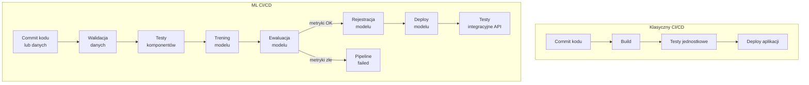
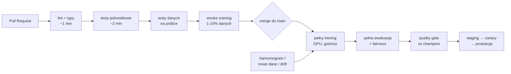
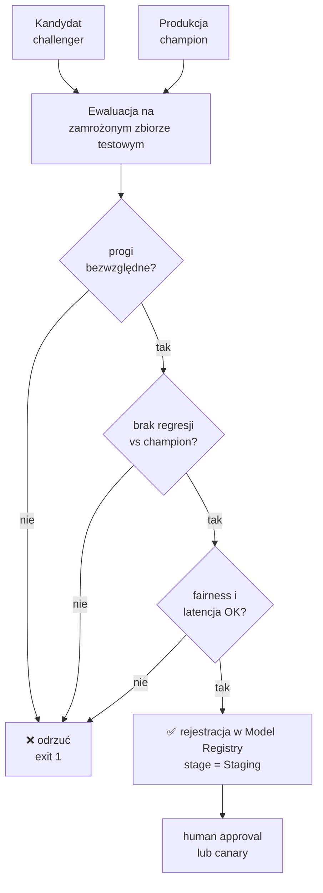
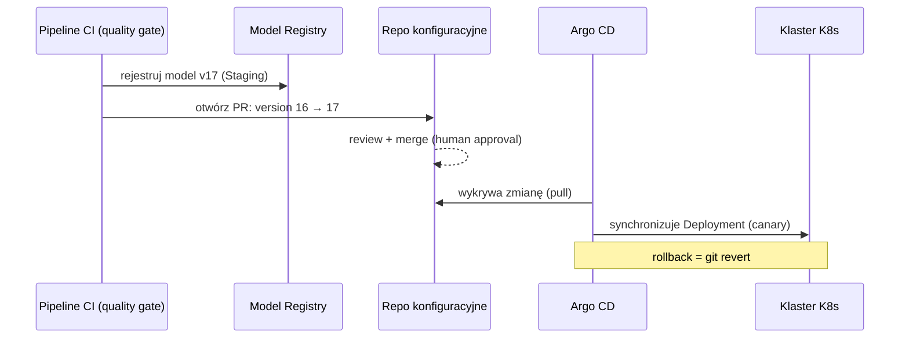

# Wykład 7: CI/CD dla Machine Learning

## Cel wykładu
Po tym wykładzie student:
- rozumie, czym jest CI/CD w kontekście ML i jak różni się od klasycznego CI/CD,
- potrafi zbudować pipeline CI/CD dla modelu ML z GitHub Actions,
- zna wzorce testowania kodu ML,
- rozumie koncepcję GitOps i Infrastructure as Code dla ML.

## Skrypty do wykładu

Skrypty demonstracyjne znajdują się w `lectures/scripts/lecture_07/`. Pełną instrukcję znajdziesz w [`lectures/scripts/README.md`](scripts/README.md).

| Kiedy (sekcja) | Skrypt | Cel demonstracji |
|---|---|---|
| 2. Testowanie kodu ML | `01_ml_unit_tests.py` | testy jednostkowe, kontraktowe, behawioralne (INV/DIR) i MFT w pytest |
| 3. / 6. Pipeline CI/CD | `03_ci_pipeline_sim.py [--break-data]` | lokalna symulacja pipeline'u fail-fast ze smoke trainingiem i manifestem artefaktu |
| 4. Quality Gates | `02_quality_gate.py [--bad]` | bramka champion vs challenger (progi bezwzględne, względne, fairness; kod wyjścia 1) |

**Jak:** z katalogu głównego repozytorium uruchom `python lectures/scripts/lecture_07/<skrypt>`. Artefakty (model, manifest, raport) trafiają do `lectures/scripts/lecture_07/outputs/`.

---

## 1. CI/CD w kontekście ML

### Klasyczny CI/CD vs ML CI/CD



### Trzy poziomy testowania w ML CI/CD

| Poziom | Co testujemy | Narzędzia |
|--------|-------------|-----------|
| **Kod** | Funkcje, klasy, logika | pytest, unittest |
| **Dane** | Schemat, rozkłady, jakość | Great Expectations, pytest |
| **Model** | Metryki, bias, latencja | pytest, locust |

### Dlaczego ML potrzebuje „innego” CI/CD?

W klasycznym oprogramowaniu zachowanie systemu jest w całości zapisane w **kodzie**. W ML zachowanie wynika z trzech osi zmian, z których każda może zepsuć produkcję niezależnie od pozostałych:

```
          ┌──────────── KOD ─────────────┐
          │ preprocessing, architektura, │
          │ hiperparametry, serving      │
          └──────────────┬───────────────┘
                         │
     ┌───── DANE ────────┼──────── MODEL ─────┐
     │ nowe partie,      │   wagi, progi,     │
     │ zmiana schematu,  │   wersja artefaktu │
     │ drift rozkładów   │                    │
     └───────────────────┴────────────────────┘
   Każda zmiana na dowolnej osi = potencjalny release
```

Konsekwencje praktyczne:
- **Testy są probabilistyczne.** Nie sprawdzamy `assert f(x) == y`, lecz „AUC ≥ 0.80” albo „predykcje nie zmieniają się po zmianie nieistotnej cechy”. Progi trzeba dobrać z marginesem, inaczej testy będą *flaky*.
- **Artefakt to nie tylko binarka.** Release = kod + dane (hash/wersja DVC) + model + konfiguracja + środowisko (obraz Docker). Brak któregokolwiek elementu uniemożliwia odtworzenie wyniku.
- **Trening jest drogi.** Nie da się trenować pełnego modelu przy każdym commicie, więc pipeline dzielimy na szybką ścieżkę (minuty) i wolną ścieżkę (godziny, harmonogram/wyzwalacz).
- **Pojawia się CT – Continuous Training.** Oprócz CI (integracja kodu) i CD (dostarczanie) potrzebujemy automatycznego ponownego treningu wyzwalanego zmianą danych lub driftem.

### Poziomy dojrzałości MLOps (wg Google)

| Poziom | Opis | CI | CD | CT | Typowy objaw |
|---|---|---|---|---|---|
| **0 – manualny** | notebook → ręczny eksport modelu | ❌ | ❌ | ❌ | „model działa u mnie”, wdrożenia raz na kwartał |
| **1 – automatyzacja pipeline'u** | pipeline treningowy jako kod, uruchamiany automatycznie | częściowo | model | ✅ | szybki retraining, ale ręczne wdrażanie zmian w pipeline |
| **2 – CI/CD pipeline'u** | testowany i wdrażany jest sam pipeline, nie tylko model | ✅ | pipeline + model | ✅ | wiele wdrożeń dziennie, pełna audytowalność |

### Szybka i wolna ścieżka (fast/slow lane)



| Cecha | Szybka ścieżka (PR) | Wolna ścieżka (main / harmonogram) |
|---|---|---|
| Cel | feedback dla programisty | kandydat do produkcji |
| Czas | < 10–15 min | minuty – godziny |
| Dane | próbka, fixtures, dane syntetyczne | pełny zbiór, wersjonowany (DVC) |
| Sprzęt | runner CPU | GPU / klaster, self-hosted runner |
| Wynik | zielony/czerwony check w PR | zarejestrowany model + raport |

### Strategie wyzwalania pipeline'u

| Wyzwalacz | Przykład w GitHub Actions | Kiedy stosować |
|---|---|---|
| Zmiana kodu | `on: push`, `on: pull_request` | zawsze – podstawowe CI |
| Zmiana danych | `paths: ['data/**.dvc']` | dane wersjonowane w repo (DVC) |
| Harmonogram | `on: schedule: - cron: '0 3 * * 1'` | dane napływają regularnie, wolny drift |
| Zdarzenie zewnętrzne | `on: repository_dispatch` (webhook z monitoringu) | retraining po wykryciu driftu |
| Ręcznie | `on: workflow_dispatch` z parametrami | eksperymenty, awaryjne retrainingi |

---

## 2. Testowanie kodu ML

### Testy jednostkowe komponentów ML

```python
# tests/test_preprocessing.py
import pytest
import pandas as pd
import numpy as np
from sklearn.preprocessing import StandardScaler

from src.preprocessing import (
    clean_data,
    engineer_features,
    build_preprocessing_pipeline
)

class TestCleanData:
    """Testy funkcji czyszczenia danych."""
    
    @pytest.fixture
    def sample_df(self):
        """Przykładowe dane testowe."""
        return pd.DataFrame({
            'age': [25, 30, -5, 200, 45, 25],  # -5 i 200 to błędy, 25 duplikat
            'income': [50000, 60000, 70000, 80000, 55000, 50000],
            'churn': [0, 1, 0, 1, 0, 0]
        })
    
    def test_removes_negative_age(self, sample_df):
        """Test: usuwa wiersze z ujemnym wiekiem."""
        result = clean_data(sample_df)
        assert (result['age'] >= 0).all(), "Znaleziono ujemny wiek po czyszczeniu"
    
    def test_removes_unrealistic_age(self, sample_df):
        """Test: usuwa wiersze z nierealistycznym wiekiem."""
        result = clean_data(sample_df)
        assert (result['age'] <= 120).all(), "Znaleziono wiek > 120 po czyszczeniu"
    
    def test_removes_duplicates(self, sample_df):
        """Test: usuwa duplikaty."""
        result = clean_data(sample_df)
        assert not result.duplicated().any(), "Znaleziono duplikaty po czyszczeniu"
    
    def test_preserves_valid_rows(self, sample_df):
        """Test: zachowuje poprawne wiersze."""
        result = clean_data(sample_df)
        # Powinny zostać: wiersze z age=30, 45 (25 jest duplikatem)
        assert len(result) >= 2, "Zbyt mało wierszy po czyszczeniu"
    
    def test_returns_dataframe(self, sample_df):
        """Test: zwraca DataFrame."""
        result = clean_data(sample_df)
        assert isinstance(result, pd.DataFrame)


class TestFeatureEngineering:
    """Testy inżynierii cech."""
    
    @pytest.fixture
    def clean_df(self):
        return pd.DataFrame({
            'age': [25, 35, 50],
            'income': [30000, 60000, 90000],
            'churn': [0, 1, 0]
        })
    
    def test_creates_income_per_age(self, clean_df):
        """Test: tworzy cechę income_per_age."""
        result = engineer_features(clean_df)
        assert 'income_per_age' in result.columns
        assert (result['income_per_age'] == result['income'] / result['age']).all()
    
    def test_creates_age_group(self, clean_df):
        """Test: tworzy cechę age_group."""
        result = engineer_features(clean_df)
        assert 'age_group' in result.columns
        assert result['age_group'].notna().all()
    
    def test_does_not_modify_original(self, clean_df):
        """Test: nie modyfikuje oryginalnego DataFrame."""
        original_cols = set(clean_df.columns)
        engineer_features(clean_df)
        assert set(clean_df.columns) == original_cols


class TestModelPerformance:
    """Testy jakości modelu."""
    
    @pytest.fixture(scope="class")
    def trained_model(self):
        """Trenuje model raz dla całej klasy testów."""
        from sklearn.datasets import make_classification
        from sklearn.ensemble import RandomForestClassifier
        from sklearn.model_selection import train_test_split
        
        X, y = make_classification(n_samples=5000, n_features=20, random_state=42)
        X_train, X_test, y_train, y_test = train_test_split(X, y, random_state=42)
        
        model = RandomForestClassifier(n_estimators=50, random_state=42)
        model.fit(X_train, y_train)
        
        return model, X_test, y_test
    
    def test_auc_above_threshold(self, trained_model):
        """Test: AUC-ROC powyżej minimalnego progu."""
        from sklearn.metrics import roc_auc_score
        model, X_test, y_test = trained_model
        auc = roc_auc_score(y_test, model.predict_proba(X_test)[:, 1])
        assert auc >= 0.75, f"AUC {auc:.4f} poniżej progu 0.75"
    
    def test_prediction_latency(self, trained_model):
        """Test: latencja predykcji poniżej 100ms."""
        import time
        model, X_test, _ = trained_model
        
        single_sample = X_test[:1]
        
        start = time.time()
        for _ in range(100):
            model.predict_proba(single_sample)
        avg_latency_ms = (time.time() - start) / 100 * 1000
        
        assert avg_latency_ms < 100, f"Latencja {avg_latency_ms:.2f}ms > 100ms"
    
    def test_no_nan_predictions(self, trained_model):
        """Test: brak NaN w predykcjach."""
        model, X_test, _ = trained_model
        predictions = model.predict_proba(X_test)
        assert not np.isnan(predictions).any(), "Predykcje zawierają NaN"
    
    def test_predictions_in_valid_range(self, trained_model):
        """Test: predykcje w zakresie [0, 1]."""
        model, X_test, _ = trained_model
        probs = model.predict_proba(X_test)
        assert (probs >= 0).all() and (probs <= 1).all()
    
    def test_no_bias_by_age_group(self, trained_model):
        """Test: brak znaczącego biasu między grupami wiekowymi."""
        from sklearn.metrics import roc_auc_score
        import pandas as pd
        
        model, X_test, y_test = trained_model
        
        # Symulacja grup wiekowych
        np.random.seed(42)
        age_groups = np.random.choice(['young', 'middle', 'senior'], len(y_test))
        
        probs = model.predict_proba(X_test)[:, 1]
        
        aucs = {}
        for group in ['young', 'middle', 'senior']:
            mask = age_groups == group
            if mask.sum() > 10:
                aucs[group] = roc_auc_score(y_test[mask], probs[mask])
        
        # Różnica AUC między grupami nie powinna przekraczać 0.1
        auc_values = list(aucs.values())
        max_diff = max(auc_values) - min(auc_values)
        assert max_diff < 0.1, f"Zbyt duży bias między grupami: {aucs}"
```

### Piramida testów w ML

```
                 ▲  wolne, drogie, mało
                / \
               / E2E\        smoke test endpointu, testy A/B / shadow
              /------\
             / Model  \      metryki vs próg, fairness, testy behawioralne
            /----------\
           / Integracja \    pipeline end-to-end na małej próbce
          /--------------\
         /  Dane (schemat) \  schemat, zakresy, braki, rozkłady
        /------------------\
       /  Jednostkowe (kod)  \ preprocessing, cechy, utilsy, kontrakty
      /________________________\
                 ▼  szybkie, tanie, dużo
```

### Rodzaje testów modelu – taksonomia

| Typ testu | Pytanie | Przykład | Kiedy w pipeline |
|---|---|---|---|
| **Kontraktowy** | czy wyjście ma dobry format? | `predict_proba` zwraca `(n, 2)`, wartości w [0, 1] | PR |
| **Determinizm** | czy trening jest powtarzalny? | dwa treningi z tym samym seedem dają te same predykcje | PR |
| **Overfit na batchu** | czy model w ogóle potrafi się uczyć? | sieć osiąga ~100% accuracy na 32 przykładach | PR |
| **MFT** (Minimum Functionality) | czy model jest lepszy od trywialnego? | AUC modelu > AUC `DummyClassifier` + margines | PR / main |
| **INV** (invariance) | czy nieistotna zmiana nie zmienia predykcji? | zmiana miasta / imienia nie zmienia scoringu | main |
| **DIR** (directional) | czy zmiana idzie w oczekiwanym kierunku? | więcej zgłoszeń do supportu → wyższe ryzyko churnu | main |
| **Regresyjny** | czy znane trudne przypadki dalej działają? | „złoty zbiór” 200 przykładów z incydentów | main |
| **Wydajnościowy** | czy mieścimy się w SLA? | p95 latencji < 100 ms, rozmiar modelu < 500 MB | main |

> **▶️ Demo na żywo:** `python lectures/scripts/lecture_07/01_ml_unit_tests.py` – 10 testów pytest pokazujących wszystkie powyższe kategorie (poza wydajnościowymi) na małym modelu churn.

Przykład testów behawioralnych (fragment skryptu):

```python
def test_invariance_to_city(model, data):
    """INV: zmiana cechy nieużywanej (miasto) nie może zmienić predykcji."""
    _, test = data
    changed = test.copy()
    changed["city"] = "Gdańsk"
    np.testing.assert_allclose(
        model.predict_proba(test[FEATURES]), model.predict_proba(changed[FEATURES])
    )


def test_directional_support_calls(model, data):
    """DIR: więcej zgłoszeń do supportu => prawdopodobieństwo churnu nie maleje."""
    _, test = data
    more = test.copy()
    more["support_calls"] += 3
    p_base = model.predict_proba(test[FEATURES])[:, 1]
    p_more = model.predict_proba(more[FEATURES])[:, 1]
    assert (p_more >= p_base - 1e-9).mean() > 0.99   # tolerancja zamiast 100%
```

### Dobre praktyki pisania testów ML

- **Ustaw seedy** (`random_state`, `np.random.default_rng(42)`, `torch.manual_seed`) – inaczej testy będą losowo czerwone.
- **Fixtures o zasięgu `module`/`session`** dla kosztownych obiektów (wytrenowany model, dane) – trenujesz raz na cały plik testów.
- **Tolerancje zamiast równości**: `np.testing.assert_allclose`, `pytest.approx`, progi procentowe.
- **Małe dane w repo** (`tests/fixtures/*.parquet`, kilkaset wierszy) – testy nie mogą zależeć od produkcyjnej bazy.
- **Markery** do podziału szybkich i wolnych testów: `@pytest.mark.slow` i w CI `pytest -m "not slow"` w PR, pełny zestaw na `main`.
- **Testuj kontrakty, nie implementację** – test nie powinien pękać po zmianie solvera, tylko po zmianie zachowania.

```ini
# pytest.ini
[pytest]
markers =
    slow: testy trenujące model na większych danych (uruchamiane tylko na main)
    gpu: testy wymagające GPU (self-hosted runner)
addopts = -ra --strict-markers
```

### Testy danych

```python
# tests/test_data_quality.py
import pytest
import pandas as pd
import numpy as np

class TestDataQuality:
    """Testy jakości danych wejściowych."""
    
    @pytest.fixture
    def production_data(self):
        """Symulacja danych produkcyjnych."""
        np.random.seed(42)
        return pd.DataFrame({
            'age': np.random.normal(40, 10, 1000).clip(18, 100),
            'income': np.random.normal(50000, 15000, 1000).clip(0),
            'tenure_months': np.random.exponential(24, 1000),
            'num_products': np.random.randint(1, 5, 1000),
            'churn': np.random.binomial(1, 0.2, 1000)
        })
    
    def test_no_missing_values(self, production_data):
        """Test: brak brakujących wartości."""
        missing = production_data.isnull().sum()
        assert missing.sum() == 0, f"Brakujące wartości: {missing[missing > 0].to_dict()}"
    
    def test_age_in_valid_range(self, production_data):
        """Test: wiek w zakresie 18-100."""
        assert production_data['age'].between(18, 100).all()
    
    def test_income_non_negative(self, production_data):
        """Test: dochód nieujemny."""
        assert (production_data['income'] >= 0).all()
    
    def test_target_binary(self, production_data):
        """Test: etykieta binarna (0 lub 1)."""
        assert set(production_data['churn'].unique()).issubset({0, 1})
    
    def test_class_balance(self, production_data):
        """Test: klasy nie są skrajnie niezbalansowane."""
        churn_rate = production_data['churn'].mean()
        assert 0.05 <= churn_rate <= 0.50, \
            f"Niezbalansowane klasy: churn_rate={churn_rate:.2%}"
    
    def test_no_duplicate_users(self, production_data):
        """Test: brak zduplikowanych rekordów."""
        if 'user_id' in production_data.columns:
            assert not production_data['user_id'].duplicated().any()
```

---

## 3. GitHub Actions dla ML

### Pełny workflow CI/CD

```yaml
# .github/workflows/ml_cicd.yml
name: ML CI/CD Pipeline

on:
  push:
    branches: [main, develop]
    paths:
      - 'src/**'
      - 'tests/**'
      - 'data/**'
      - 'params.yaml'
  pull_request:
    branches: [main]
  schedule:
    - cron: '0 2 * * 1'  # co poniedziałek o 2:00 (retraining)

env:
  PYTHON_VERSION: '3.11'
  MLFLOW_TRACKING_URI: ${{ secrets.MLFLOW_TRACKING_URI }}

jobs:
  # --- Job 1: Testy kodu ---
  test-code:
    name: Code Tests
    runs-on: ubuntu-latest
    
    steps:
      - uses: actions/checkout@v4
      
      - name: Setup Python
        uses: actions/setup-python@v5
        with:
          python-version: ${{ env.PYTHON_VERSION }}
          cache: 'pip'
      
      - name: Install dependencies
        run: |
          pip install -r requirements.txt
          pip install -r requirements-dev.txt
      
      - name: Run linting
        run: |
          ruff check src/ tests/
          mypy src/ --ignore-missing-imports
      
      - name: Run unit tests
        run: |
          pytest tests/unit/ -v \
            --cov=src \
            --cov-report=xml \
            --cov-report=term-missing \
            --junitxml=reports/junit.xml
      
      - name: Upload coverage
        uses: codecov/codecov-action@v4
        with:
          file: coverage.xml

  # --- Job 2: Walidacja danych ---
  validate-data:
    name: Data Validation
    runs-on: ubuntu-latest
    needs: test-code
    
    steps:
      - uses: actions/checkout@v4
      
      - name: Setup Python
        uses: actions/setup-python@v5
        with:
          python-version: ${{ env.PYTHON_VERSION }}
          cache: 'pip'
      
      - name: Install dependencies
        run: pip install -r requirements.txt
      
      - name: Pull data with DVC
        env:
          GOOGLE_APPLICATION_CREDENTIALS: ${{ secrets.GCP_SA_KEY }}
        run: |
          dvc pull data/train.parquet.dvc
          dvc pull data/test.parquet.dvc
      
      - name: Validate data quality
        run: |
          python scripts/validate_data.py \
            --input data/train.parquet \
            --expectations expectations/train_expectations.json
      
      - name: Run data tests
        run: pytest tests/data/ -v

  # --- Job 3: Trening i ewaluacja modelu ---
  train-and-evaluate:
    name: Train & Evaluate Model
    runs-on: ubuntu-latest
    needs: validate-data
    
    steps:
      - uses: actions/checkout@v4
      
      - name: Setup Python
        uses: actions/setup-python@v5
        with:
          python-version: ${{ env.PYTHON_VERSION }}
          cache: 'pip'
      
      - name: Install dependencies
        run: pip install -r requirements.txt
      
      - name: Pull data
        run: dvc pull
      
      - name: Train model
        run: |
          python src/train.py \
            --config params.yaml \
            --output models/
        env:
          MLFLOW_TRACKING_URI: ${{ env.MLFLOW_TRACKING_URI }}
      
      - name: Evaluate model
        id: evaluate
        run: |
          python scripts/evaluate_model.py \
            --model models/model.pkl \
            --test-data data/test.parquet \
            --output reports/metrics.json
          
          # Odczytaj metryki i ustaw jako output
          AUC=$(python -c "import json; print(json.load(open('reports/metrics.json'))['auc_roc'])")
          echo "auc_roc=$AUC" >> $GITHUB_OUTPUT
          echo "Model AUC-ROC: $AUC"
      
      - name: Check model quality gate
        run: |
          python scripts/quality_gate.py \
            --metrics reports/metrics.json \
            --min-auc 0.80 \
            --min-f1 0.70
      
      - name: Upload model artifacts
        uses: actions/upload-artifact@v4
        with:
          name: trained-model
          path: |
            models/model.pkl
            reports/metrics.json
          retention-days: 30

  # --- Job 4: Testy modelu ---
  test-model:
    name: Model Tests
    runs-on: ubuntu-latest
    needs: train-and-evaluate
    
    steps:
      - uses: actions/checkout@v4
      
      - name: Download model artifacts
        uses: actions/download-artifact@v4
        with:
          name: trained-model
      
      - name: Run model tests
        run: |
          pytest tests/model/ -v \
            --model-path models/model.pkl

  # --- Job 5: Build Docker image ---
  build-docker:
    name: Build & Push Docker Image
    runs-on: ubuntu-latest
    needs: test-model
    if: github.ref == 'refs/heads/main'
    
    steps:
      - uses: actions/checkout@v4
      
      - name: Download model artifacts
        uses: actions/download-artifact@v4
        with:
          name: trained-model
      
      - name: Set up Docker Buildx
        uses: docker/setup-buildx-action@v3
      
      - name: Login to Container Registry
        uses: docker/login-action@v3
        with:
          registry: gcr.io
          username: _json_key
          password: ${{ secrets.GCP_SA_KEY }}
      
      - name: Build and push
        uses: docker/build-push-action@v5
        with:
          context: .
          push: true
          tags: |
            gcr.io/${{ secrets.GCP_PROJECT }}/churn-api:latest
            gcr.io/${{ secrets.GCP_PROJECT }}/churn-api:${{ github.sha }}
          cache-from: type=gha
          cache-to: type=gha,mode=max

  # --- Job 6: Deploy ---
  deploy:
    name: Deploy to Production
    runs-on: ubuntu-latest
    needs: build-docker
    environment: production
    
    steps:
      - uses: actions/checkout@v4
      
      - name: Deploy to Vertex AI Endpoint
        run: |
          python scripts/deploy_model.py \
            --model-uri gs://my-bucket/models/${{ github.sha }} \
            --endpoint-name churn-predictor-prod \
            --traffic-split '{"new": 10, "current": 90}'
        env:
          GOOGLE_APPLICATION_CREDENTIALS: ${{ secrets.GCP_SA_KEY }}
      
      - name: Run smoke tests
        run: |
          python scripts/smoke_test.py \
            --endpoint-url ${{ secrets.ENDPOINT_URL }}
      
      - name: Notify on success
        uses: slackapi/slack-github-action@v1
        with:
          payload: |
            {
              "text": "✅ Model wdrożony pomyślnie!\nCommit: ${{ github.sha }}\nAUC: ${{ needs.train-and-evaluate.outputs.auc_roc }}"
            }
        env:
          SLACK_WEBHOOK_URL: ${{ secrets.SLACK_WEBHOOK }}
```

---

## 4. Quality Gates – bramki jakości

```python
# scripts/quality_gate.py
import json
import argparse
import sys
from dataclasses import dataclass
from typing import Optional

@dataclass
class QualityGate:
    """Definicja bramki jakości dla modelu ML."""
    min_auc_roc: float = 0.80
    min_f1_score: float = 0.70
    max_prediction_latency_ms: float = 100.0
    max_bias_difference: float = 0.10
    min_data_coverage: float = 0.95

def check_quality_gate(metrics: dict, gate: QualityGate) -> tuple[bool, list[str]]:
    """
    Sprawdza czy model spełnia wymagania jakościowe.
    
    Returns:
        (passed, list_of_failures)
    """
    failures = []
    
    # Sprawdzenie AUC-ROC
    auc = metrics.get('auc_roc', 0)
    if auc < gate.min_auc_roc:
        failures.append(
            f"AUC-ROC {auc:.4f} < minimum {gate.min_auc_roc}"
        )
    
    # Sprawdzenie F1
    f1 = metrics.get('f1_score', 0)
    if f1 < gate.min_f1_score:
        failures.append(
            f"F1-Score {f1:.4f} < minimum {gate.min_f1_score}"
        )
    
    # Sprawdzenie latencji
    latency = metrics.get('avg_latency_ms', 0)
    if latency > gate.max_prediction_latency_ms:
        failures.append(
            f"Latencja {latency:.1f}ms > maksimum {gate.max_prediction_latency_ms}ms"
        )
    
    # Sprawdzenie biasu
    bias_diff = metrics.get('max_group_auc_difference', 0)
    if bias_diff > gate.max_bias_difference:
        failures.append(
            f"Bias między grupami {bias_diff:.4f} > maksimum {gate.max_bias_difference}"
        )
    
    passed = len(failures) == 0
    return passed, failures

def main():
    parser = argparse.ArgumentParser()
    parser.add_argument('--metrics', required=True)
    parser.add_argument('--min-auc', type=float, default=0.80)
    parser.add_argument('--min-f1', type=float, default=0.70)
    args = parser.parse_args()
    
    with open(args.metrics) as f:
        metrics = json.load(f)
    
    gate = QualityGate(
        min_auc_roc=args.min_auc,
        min_f1_score=args.min_f1
    )
    
    passed, failures = check_quality_gate(metrics, gate)
    
    if passed:
        print("✅ Quality Gate: PASSED")
        # uwaga: formatowanie ':.4f' na napisie 'N/A' rzuciłoby ValueError
        print(f"   AUC-ROC: {metrics.get('auc_roc', float('nan')):.4f}")
        print(f"   F1-Score: {metrics.get('f1_score', float('nan')):.4f}")
        sys.exit(0)
    else:
        print("❌ Quality Gate: FAILED")
        for failure in failures:
            print(f"   - {failure}")
        sys.exit(1)  # Niezerowy exit code zatrzymuje pipeline CI/CD

if __name__ == "__main__":
    main()
```

### Rodzaje progów w quality gate

Sam próg bezwzględny („AUC ≥ 0.80”) nie wystarcza: nowy model z AUC 0.81 przejdzie bramkę, mimo że produkcyjny ma 0.88. Dlatego w dojrzałych systemach łączy się kilka typów progów:

| Typ progu | Przykład | Chroni przed | Wada |
|---|---|---|---|
| **Bezwzględny** | AUC ≥ 0.80, p95 < 100 ms | modelem bezużytecznym biznesowo | nie wykrywa regresji względem produkcji |
| **Względny (vs champion)** | AUC kandydata ≥ AUC championa − 0.01 | cichą regresją | wymaga ewaluacji obu modeli na tym samym zbiorze |
| **Statystyczny** | przedział ufności (bootstrap) różnicy AUC nie obejmuje spadku > 0.01 | szumem na małym zbiorze testowym | droższy obliczeniowo |
| **Per-segment / fairness** | różnica AUC między grupami ≤ 0.10 | dyskryminacją, degradacją w niszy | wymaga atrybutów grupowych |
| **Operacyjny** | rozmiar ≤ 500 MB, RAM ≤ 2 GB | problemami przy wdrożeniu | zależny od infrastruktury |



> **▶️ Demo na żywo:** `python lectures/scripts/lecture_07/02_quality_gate.py` (kandydat przechodzi) oraz `python lectures/scripts/lecture_07/02_quality_gate.py --bad` (zepsute etykiety – bramka zwraca kod 1 i listę naruszeń, raport w `outputs/quality_gate_report.json`).

**Pułapki przy projektowaniu bramek:**
- **Zbiór testowy musi być zamrożony i wersjonowany.** Jeśli champion i challenger są oceniani na różnych danych, porównanie jest bezwartościowe.
- **Nie dostrajaj progów do jednego wyniku.** Próg ustawiony „na styk” do aktualnego modelu spowoduje losowe porażki (szum ±0.005 AUC jest normalny).
- **Metryka offline ≠ metryka biznesowa.** Bramka offline to warunek konieczny, nie wystarczający – ostateczną weryfikację daje canary/A-B test.
- **Progi trzymaj w konfiguracji** (np. `configs/quality_gate.yaml`) wersjonowanej razem z kodem, a nie w argumentach rozsianych po workflow.

```yaml
# configs/quality_gate.yaml
absolute:
  auc_roc: {min: 0.80}
  f1_score: {min: 0.70}
  p95_latency_ms: {max: 100}
relative_to_champion:
  auc_roc: {max_drop: 0.01}
fairness:
  group_column: region
  max_auc_difference: 0.10
```

### Strategie wdrażania po przejściu bramki

| Strategia | Jak działa | Ryzyko | Koszt | Rollback |
|---|---|---|---|---|
| **Recreate / big bang** | stary model wyłączony, nowy włączony | wysokie | niski | wolny (ponowny deploy) |
| **Blue-green** | dwa środowiska, przełączenie ruchu | średnie | 2× zasoby | natychmiastowy |
| **Canary** | 1% → 10% → 50% → 100% ruchu z monitoringiem | niskie | średni | natychmiastowy |
| **Shadow** | nowy model dostaje kopię ruchu, odpowiedzi ignorowane | brak wpływu na użytkownika | 2× inferencja | niepotrzebny |
| **A/B test** | losowy podział użytkowników, test statystyczny KPI | niskie | wysoki (czas) | natychmiastowy |

```
Canary – automatyczna promocja z monitoringiem

 ruch %  100 ┤                                   ┌──────── produkcja
          50 ┤                     ┌─────────────┘
          10 ┤          ┌──────────┘
           1 ┤ ─────────┘     ▲ na każdym kroku: error rate, latencja,
           0 ┼──────────────────── rozkład predykcji vs champion  → czas
                 jeśli metryka przekroczy próg → automatyczny rollback do 0%
```

---

## 5. Infrastructure as Code dla ML

### Terraform dla infrastruktury ML

```hcl
# infrastructure/main.tf
terraform {
  required_providers {
    google = {
      source  = "hashicorp/google"
      version = "~> 5.0"
    }
  }
  
  backend "gcs" {
    bucket = "my-terraform-state"
    prefix = "mlops/state"
  }
}

provider "google" {
  project = var.project_id
  region  = var.region
}

# Cloud Storage bucket dla danych i modeli
resource "google_storage_bucket" "ml_artifacts" {
  name          = "${var.project_id}-ml-artifacts"
  location      = var.region
  force_destroy = false
  
  versioning {
    enabled = true
  }
  
  lifecycle_rule {
    condition {
      age = 90
    }
    action {
      type          = "SetStorageClass"
      storage_class = "NEARLINE"
    }
  }
}

# Vertex AI Endpoint
resource "google_vertex_ai_endpoint" "churn_predictor" {
  name         = "churn-predictor-prod"
  display_name = "Churn Predictor Production"
  location     = var.region
  
  labels = {
    environment = "production"
    team        = "mlops"
    model       = "churn-predictor"
  }
}

# Service Account dla ML pipeline
resource "google_service_account" "ml_pipeline_sa" {
  account_id   = "ml-pipeline-sa"
  display_name = "ML Pipeline Service Account"
}

resource "google_project_iam_member" "ml_pipeline_roles" {
  for_each = toset([
    "roles/aiplatform.user",
    "roles/storage.objectAdmin",
    "roles/bigquery.dataViewer"
  ])
  
  project = var.project_id
  role    = each.value
  member  = "serviceAccount:${google_service_account.ml_pipeline_sa.email}"
}
```

---

## 6. Makefile dla ML projektu

```makefile
# Makefile
.PHONY: setup test train deploy clean

# Zmienne
PYTHON := python3
PIP := pip3
MODEL_PATH := models/model.pkl
DATA_PATH := data/

## Konfiguracja środowiska
setup:
	$(PIP) install -r requirements.txt
	$(PIP) install -r requirements-dev.txt
	pre-commit install
	dvc pull

## Testy
test:
	pytest tests/ -v --cov=src --cov-report=term-missing

test-unit:
	pytest tests/unit/ -v

test-data:
	pytest tests/data/ -v

test-model:
	pytest tests/model/ -v --model-path $(MODEL_PATH)

## Jakość kodu
lint:
	ruff check src/ tests/
	mypy src/ --ignore-missing-imports

format:
	ruff format src/ tests/

## Trening
train:
	$(PYTHON) src/train.py --config params.yaml

train-local:
	$(PYTHON) src/train.py --config params.yaml --local

## Ewaluacja
evaluate:
	$(PYTHON) scripts/evaluate_model.py \
		--model $(MODEL_PATH) \
		--test-data data/test.parquet \
		--output reports/metrics.json

quality-gate:
	$(PYTHON) scripts/quality_gate.py \
		--metrics reports/metrics.json \
		--min-auc 0.80

## Wdrożenie
build-docker:
	docker build -t churn-api:latest .

run-local:
	docker-compose up -d

deploy-staging:
	$(PYTHON) scripts/deploy_model.py --env staging

deploy-prod:
	$(PYTHON) scripts/deploy_model.py --env production

## Czyszczenie
clean:
	find . -type f -name "*.pyc" -delete
	find . -type d -name "__pycache__" -delete
	rm -rf .pytest_cache/ .mypy_cache/ .ruff_cache/
	rm -rf reports/*.json reports/*.html

## Pipeline end-to-end
pipeline: setup lint test-unit validate-data train evaluate quality-gate
	@echo "✅ Pipeline zakończony pomyślnie"
```

---

## 7. Pre-commit hooks dla ML

```yaml
# .pre-commit-config.yaml
repos:
  - repo: https://github.com/astral-sh/ruff-pre-commit
    rev: v0.3.0
    hooks:
      - id: ruff
        args: [--fix]
      - id: ruff-format

  - repo: https://github.com/pre-commit/mirrors-mypy
    rev: v1.8.0
    hooks:
      - id: mypy
        additional_dependencies: [types-requests]

  - repo: local
    hooks:
      # Sprawdź czy nie commitujemy dużych plików danych
      - id: check-large-files
        name: Check for large files
        entry: python scripts/check_large_files.py
        language: python
        pass_filenames: true
        args: [--max-size-mb, "10"]
      
      # Sprawdź czy notebooks są wyczyszczone
      - id: clear-notebook-outputs
        name: Clear Jupyter notebook outputs
        entry: jupyter nbconvert --ClearOutputPreprocessor.enabled=True --inplace
        language: python
        files: \.ipynb$
        additional_dependencies: [jupyter]
      
      # Uruchom testy jednostkowe przed commitem
      - id: run-unit-tests
        name: Run unit tests
        entry: pytest tests/unit/ -x -q
        language: python
        pass_filenames: false
        stages: [pre-commit]   # nazwa 'commit' jest przestarzała od pre-commit 3.2
```

---

## 8. Typowe pułapki w CI/CD dla ML

> ⚠️ **Pułapka 1: Trening w CI/CD na pełnych danych**
> Pipeline CI trwa 4 godziny, bo trenuje model na pełnym zbiorze danych. Rozwiązanie: w CI używaj **podzbioru danych** (smoke test), a pełny trening uruchamiaj osobno (np. scheduled pipeline).

> ⚠️ **Pułapka 2: Brak quality gates**
> Model jest wdrażany automatycznie bez sprawdzenia metryk. Jeden zły commit może wdrożyć model z AUC=0.50. Zawsze dodawaj bramki jakości z minimalnymi progami.

> ⚠️ **Pułapka 3: Sekrety w kodzie**
> Klucze API, hasła do baz danych i tokeny wpisane bezpośrednio w kodzie lub plikach konfiguracyjnych. Używaj GitHub Secrets, Vault lub zmiennych środowiskowych.

> ⚠️ **Pułapka 4: Brak testów danych**
> Testy kodu przechodzą, ale model jest trenowany na uszkodzonych danych (np. puste kolumny, zmieniony schemat). Zawsze testuj dane przed treningiem.

> ⚠️ **Pułapka 5: Niedeterministyczne (flaky) testy modelu**
> Test „AUC ≥ 0.85” raz przechodzi, raz nie, bo brakuje seedów lub zbiór testowy ma 200 przykładów. Zespół zaczyna ignorować czerwone buildy. Rozwiązanie: seedy, większy zbiór ewaluacyjny, progi z marginesem, przedziały ufności.

> ⚠️ **Pułapka 6: Brak powiązania artefaktu z wejściem**
> W rejestrze jest `model_v17.pkl`, ale nikt nie wie, z jakiego commita i jakich danych powstał. Zapisuj manifest: hash commita, hash danych, wersje bibliotek, metryki (patrz `03_ci_pipeline_sim.py`).

> ⚠️ **Pułapka 7: Training-serving skew**
> Preprocessing w treningu (pandas) i w serwisie (ręcznie przepisany w Javie) różnią się szczegółami. Rozwiązanie: jeden artefakt `Pipeline` (preprocessing + model) i test integracyjny porównujący predykcje offline i z endpointu dla tych samych rekordów.

> ⚠️ **Pułapka 8: Niezablokowane zależności**
> `pip install scikit-learn` bez wersji – po nowym wydaniu biblioteki model zapisany w `joblib` nie wczytuje się na produkcji. Przypinaj wersje (`requirements.txt` z zakresami, lockfile) i buduj obraz Docker w CI.

### Symulacja pipeline'u fail-fast

Zanim napiszesz workflow YAML, warto mieć lokalny odpowiednik całego pipeline'u (np. `make pipeline` lub skrypt). Pozwala to debugować etapy bez czekania na runnera CI:

```
[1/6] load-data      ✅   hash danych → manifest
[2/6] validate-data  ❌   za dużo braków: 20.0% > 1%
                          ↓ fail-fast
Pominięte: smoke-train, quality-gate, package-model, smoke-test
```

> **▶️ Demo na żywo:** `python lectures/scripts/lecture_07/03_ci_pipeline_sim.py` (pełny przebieg + `outputs/model_manifest.json`) oraz `... --break-data` (pipeline zatrzymuje się na walidacji danych, kolejne etapy nie są uruchamiane).

### Porównanie narzędzi CI/CD dla ML

| Narzędzie | Typ | Mocne strony | Słabe strony |
|---|---|---|---|
| **GitHub Actions** | ogólne CI/CD | integracja z PR, marketplace akcji, darmowe minuty | limit 6 h na job, GPU tylko na self-hosted / płatnych runnerach |
| **GitLab CI** | ogólne CI/CD | wbudowany registry, środowiska, self-hosted | mniejszy ekosystem akcji |
| **Jenkins** | ogólne CI/CD | pełna kontrola, on-premise | utrzymanie, konfiguracja |
| **CML (Iterative)** | dodatek ML do GH/GitLab | raporty z metrykami/wykresami jako komentarz w PR, provisioning GPU w chmurze | zależność od ekosystemu DVC |
| **Argo Workflows / Kubeflow Pipelines** | orkiestracja na K8s | ciężki trening, DAG, cache kroków | złożoność Kubernetes |
| **Argo CD / Flux** | GitOps CD | stan klastra = stan repo, automatyczny rollback | tylko część CD |

### GitOps dla modeli

W GitOps repozytorium jest **jedynym źródłem prawdy** o tym, co działa na produkcji. Promocja modelu to po prostu commit (zwykle przez automatyczny PR) zmieniający wersję modelu w manifeście:

```yaml
# deploy/production/model-config.yaml  (repo konfiguracyjne)
model:
  name: churn-classifier
  version: "17"            # zmiana tej linii = wdrożenie
  uri: models:/churn-classifier/17
rollout:
  strategy: canary
  steps: [1, 10, 50, 100]
  max_error_rate: 0.01
```



Zalety: pełna historia wdrożeń w `git log`, review zmian produkcyjnych, rollback przez `git revert`, brak uprawnień CI do klastra (CD *ciągnie* zmiany zamiast CI *pchać*).

### Case Study: Lyft — CI/CD dla setek modeli ML

**Lyft** (ride-sharing) zarządza setkami modeli ML w produkcji:
- Każdy model ma własny pipeline CI/CD z automatycznymi testami kodu, danych i metryk.
- Używają **Flyte** (open-source orkiestrator) zamiast Airflow — lepsze wsparcie dla ML workflows.
- Kluczowa praktyka: **shadow deployment** — nowy model działa równolegle z produkcyjnym przez 24h, porównując predykcje bez wpływu na użytkowników.
- Automatyczne rollbacki: jeśli metryki biznesowe (czas oczekiwania, cena) pogarszają się o >2%, model jest automatycznie wycofywany.

> Uwaga: liczby w case studies są ilustracyjne i uproszczone na podstawie publicznych prezentacji/blogów firm – szczegóły implementacji zmieniają się w czasie.

### Case Study: Uber Michelangelo — od notebooka do platformy

- Problem wyjściowy: każdy zespół wdrażał modele po swojemu, brak powtarzalności i monitoringu.
- Rozwiązanie: wspólna platforma, w której trening, ewaluacja, rejestr modeli i deployment są **standardowymi krokami pipeline'u**, a nie skryptami zespołów.
- Lekcja dla CI/CD: standaryzacja kroków (te same bramki, ten sam format artefaktu) pozwala skalować się do tysięcy modeli – pipeline staje się produktem platformowym.

### Case Study: incydent „cichej regresji” (scenariusz typowy)

Zespół fintech zmienił w PR sposób kodowania kategorii (`OneHotEncoder` → `OrdinalEncoder`). Testy jednostkowe przeszły, AUC spadło z 0.86 do 0.83 – wciąż powyżej progu bezwzględnego 0.80, więc model trafił na produkcję. Po dwóch tygodniach odsetek fałszywie odrzuconych wniosków kredytowych wzrósł o 15%.

Co by zapobiegło: (1) próg **względny** vs champion, (2) raport metryk jako komentarz w PR (np. CML), (3) canary z monitoringiem rozkładu predykcji.

### Checklist CI/CD dla ML

Przed wdrożeniem modelu upewnij się, że:

- [ ] Testy jednostkowe kodu przechodzą (pytest)
- [ ] Linting i type checking przechodzą (ruff, mypy)
- [ ] Dane wejściowe są zwalidowane (schemat, rozkłady, brakujące wartości)
- [ ] Model spełnia minimalne progi jakości (AUC, F1, latencja)
- [ ] Model nie wykazuje biasu między grupami demograficznymi
- [ ] Obraz Docker buduje się poprawnie i przechodzi health check
- [ ] Smoke testy na endpoincie przechodzą
- [ ] Sekrety nie są hardkodowane w kodzie
- [ ] Dokumentacja jest aktualna (README, CHANGELOG)
- [ ] Model nie jest gorszy od aktualnego championa (próg względny)
- [ ] Artefakt ma manifest: commit, hash danych, wersje bibliotek, metryki
- [ ] Zdefiniowana jest strategia wdrożenia (canary/shadow) i procedura rollbacku

---

## Pytania kontrolne i do dyskusji

1. Czym różni się CI/CD dla ML od klasycznego CI/CD dla aplikacji webowej?
2. Co to jest quality gate i dlaczego jest kluczowy w pipeline'ach ML?
3. Jakie trzy poziomy testowania powinien zawierać pipeline CI/CD dla ML?
4. Wyjaśnij, jak GitHub Actions może automatycznie wyzwalać retraining modelu.
5. Dlaczego Infrastructure as Code (Terraform) jest ważne w kontekście MLOps?
6. Jakie pre-commit hooks są szczególnie przydatne w projektach ML?
7. **Dyskusja:** Czy warto trenować model w pipeline CI (przy każdym PR), czy lepiej robić to osobno? Jakie są trade-offy?
8. Czym różni się test niezmienniczości (INV) od testu kierunkowego (DIR)? Podaj przykład dla modelu scoringu kredytowego.
9. Dlaczego sam próg bezwzględny w quality gate nie wystarcza?
10. Na czym polega GitOps i jak realizuje się w nim rollback modelu?


### Proponowane odpowiedzi

1. CI/CD dla ML obejmuje nie tylko kod, ale też dane, trening, artefakty modeli i metryki jakości. W klasycznej aplikacji webowej zwykle wystarczy build/test/deploy kodu.
2. Quality gate to automatyczna bramka (np. minimalny AUC, limit latencji, brak driftu danych), która blokuje promocję słabego modelu. To kluczowa ochrona przed regresją jakości na produkcji.
3. Trzy poziomy: testy kodu (unit/lint/type), testy danych (schema/quality/drift), testy modelu i wdrożenia (metryki, smoke/performance). Dopiero ich komplet daje wiarygodny sygnał gotowości.
4. GitHub Actions może uruchamiać retraining po harmonogramie, po zmianie danych lub po sygnale z monitoringu (dispatch/webhook). Workflow pobiera dane, trenuje, ocenia, rejestruje model i promuje go tylko po spełnieniu quality gates.
5. Terraform daje powtarzalność i wersjonowanie infrastruktury (środowiska, endpointy, IAM), więc zmiany są audytowalne i odtwarzalne. To ogranicza ręczne błędy konfiguracji.
6. Szczególnie przydatne: lint/format, type check, testy jednostkowe, blokada dużych plików danych, czyszczenie outputów notebooków i skan sekretów. Dzięki temu problemy są wykrywane przed PR/merge.
7. Trening przy każdym PR poprawia szybki feedback, ale może być drogi i wolny; osobne treningi (scheduled/event-based) są tańsze i stabilniejsze. Praktyczny kompromis: w CI robić smoke training na próbce, a pełny trening uruchamiać poza PR.
8. INV: zmiana cechy, która nie powinna mieć wpływu, nie zmienia predykcji (np. imię klienta). DIR: zmiana cechy przesuwa predykcję w znanym kierunku (np. wyższe zadłużenie → wyższe ryzyko).
9. Bo nie wykrywa regresji względem modelu produkcyjnego – kandydat może być powyżej progu, a mimo to wyraźnie gorszy od championa. Potrzebny jest próg względny (najlepiej ze statystyczną oceną różnicy).
10. Stan produkcji jest opisany w repozytorium, a narzędzie (Argo CD/Flux) synchronizuje klaster z repo. Wdrożenie to merge PR zmieniającego wersję modelu, rollback to `git revert`.


---

## Podsumowanie

- ML CI/CD rozszerza klasyczny CI/CD o walidację danych, trening i ewaluację modelu.
- **Quality Gates** automatycznie blokują wdrożenie modeli niespełniających wymagań.
- **GitHub Actions** umożliwia pełną automatyzację od commita do wdrożenia.
- Testuj kod ML jak każdy inny kod: testy jednostkowe, integracyjne, wydajnościowe.
- **Infrastructure as Code** (Terraform) zapewnia reprodukowalność środowiska.
- Używaj checklisty przed każdym wdrożeniem — automatyzuj co się da, ale nie pomijaj żadnego kroku.
- Dziel pipeline na **szybką ścieżkę** (PR, minuty) i **wolną ścieżkę** (pełny trening, harmonogram/drift).
- Testy modelu obejmują kontrakty, determinizm, MFT oraz testy behawioralne **INV/DIR**.
- Bramki łącz: progi bezwzględne + **względne vs champion** + fairness; wdrażaj stopniowo (canary/shadow), najlepiej w modelu **GitOps**.

## Literatura i zasoby

- [GitHub Actions Documentation](https://docs.github.com/en/actions)
- [pytest Documentation](https://docs.pytest.org/)
- [Terraform Documentation](https://developer.hashicorp.com/terraform/docs)
- [pre-commit Documentation](https://pre-commit.com/)
- [Google MLOps: CI/CD for ML](https://cloud.google.com/architecture/mlops-continuous-delivery-and-automation-pipelines-in-machine-learning)
- [Flyte Documentation](https://docs.flyte.org/)
- [Continuous Delivery for Machine Learning (martinfowler.com)](https://martinfowler.com/articles/cd4ml.html)
- [Breck i in., „The ML Test Score: A Rubric for ML Production Readiness” (Google, 2017)](https://research.google/pubs/the-ml-test-score-a-rubric-for-ml-production-readiness-and-technical-debt-reduction/)
- [Ribeiro i in., „Beyond Accuracy: Behavioral Testing of NLP Models with CheckList” (ACL 2020)](https://aclanthology.org/2020.acl-main.442/)
- [CML – Continuous Machine Learning](https://cml.dev/)
- [Argo CD Documentation](https://argo-cd.readthedocs.io/)
